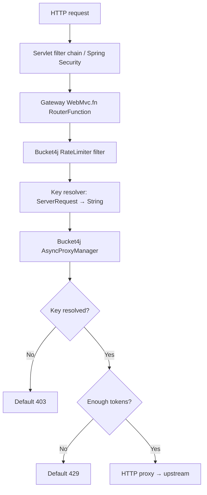
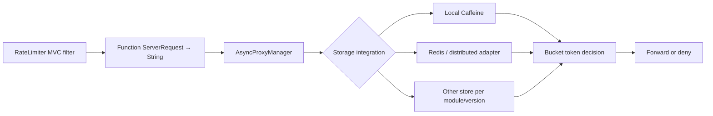
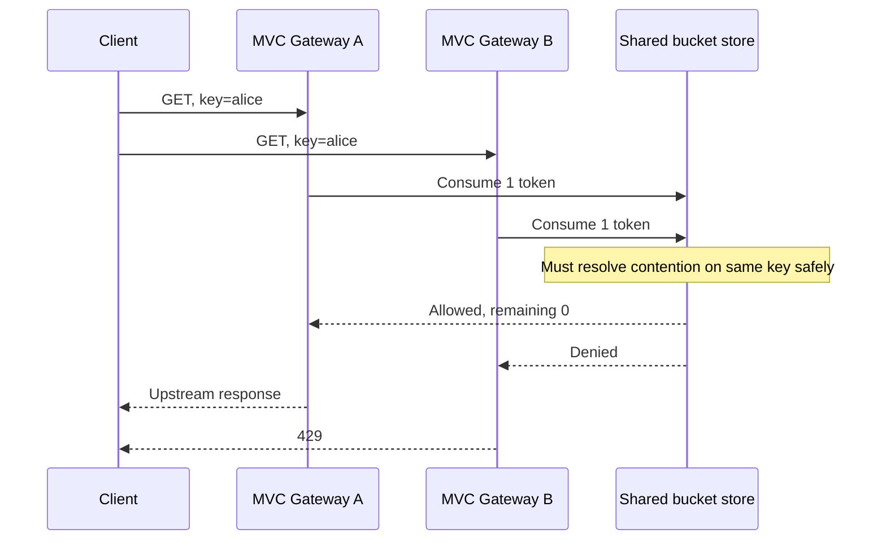
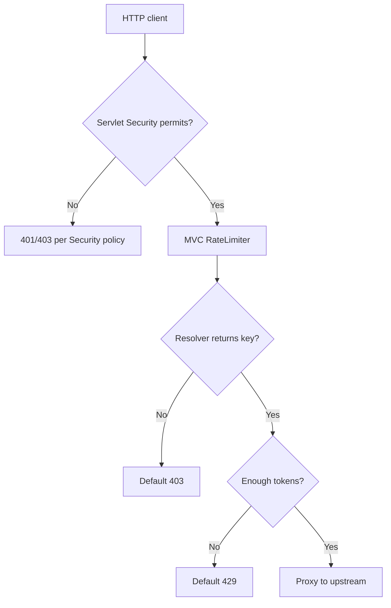
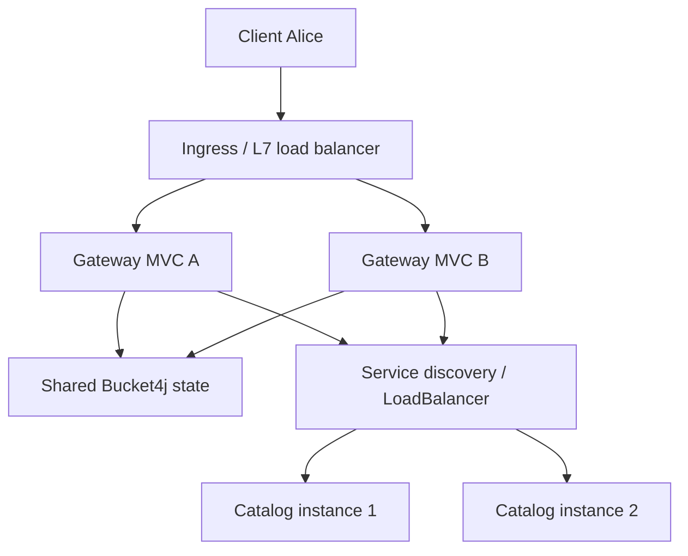

# Bucket4j-Based RateLimiter and Web MVC Key Resolver in Spring Cloud Gateway

An API Gateway often serves as the common entry point for microservices such as catalog, orders, payments, and reporting. Beyond selecting routes via predicates, modifying paths/headers, and discovering services, the Gateway also needs **rate limiting** so a bursty client does not exhaust backend resources. In **Spring Cloud Gateway Server Web MVC**, this capability is provided via the **Bucket4j-based RateLimiter Filter**.

Two decisive details for configuring it properly:

- The **Server MVC** filter is attached using **`Bucket4jFilterFunctions.rateLimit(...)`** in the **WebMvc.fn** Java DSL.
- The **MVC key resolver** is a **`java.util.Function<ServerRequest, String>`**. Per Spring Cloud Gateway Server Web MVC 4.3.5 and 5.1.0 docs, the supported way to configure a key resolver is the **Java DSL**, not a reactive `KeyResolver` bean referenced via SpEL in YAML as in Gateway Server WebFlux.

This lesson belongs to the **Server Web MVC** chapter of module `SPRING_CLOUD_GATEWAY`. Concepts connect to route predicates, filter chains, path/header transforms, LoadBalancer/service discovery, authentication, rate limiting, circuit breakers, retries, TLS, and request observability to operate a microservice entry gateway safely.

**After this lesson, you will know** how to write rate-limited MVC routes, choose keys matching users/tenants, distinguish 403 from 429, register a Bucket4j state store via `AsyncProxyManager`, distinguish local caches from distributed quotas, test concurrency, and avoid copying WebFlux APIs by mistake.

> **Version scope:** Code in this lesson follows examples documented in Spring Cloud Gateway **Server Web MVC 4.3.5 and 5.1.0**. Do not assume all Bucket4j modules, starters, Java signatures, or properties are identical across every major Spring Boot/Spring Cloud version. Every project must verify its dependency tree, startup, and integration tests. There are no additional academic notes from input.

## 1. What Problem Does Rate Limiting Solve?

Suppose an e-commerce platform has:

| API | Resource consumed | Hypothetical quota |
| --- | --- | --- |
| `GET /api/catalog/**` | Cache/database reads, rendering product details. | 60 req/sec/user, burst 120. |
| `POST /api/orders` | Order creation and multi-table writes. | 10 req/min/account, needs idempotency. |
| `POST /api/payments` | Creating payment intents or calling providers. | 3 req/min/account, reconciliation against double-charges. |
| `GET /api/reports/**` | CPU- and I/O-heavy queries. | 2 req/min/tenant or cost-based. |

The limits above are **examples only**, not Spring Cloud Gateway recommendations for production. Policies should be derived from real throughput, SLOs, backend capacity, customer tiers, and business cost models.

An otherwise authorized request can still be blocked when tokens run out. With Gateway Server MVC RateLimiter, **HTTP 429 Too Many Requests** is the default response when quota is insufficient. However, when **no key can be resolved**, MVC docs specify denying by default with **403 Forbidden**, completely distinct from 429.

### 1.1. What Mechanisms Does Rate Limiting Not Replace?

- **Authentication/authorization:** is the user allowed to call the API?
- **Circuit breaker:** is the backend failing enough to temporarily trip the circuit?
- **Retry:** should requests be re-sent on timeout/502/503?
- **Idempotency:** could a POST creating orders or charging payments execute twice?
- **Concurrency control:** how many requests are in flight simultaneously?
- **Request size limits:** is an uploaded body too large?
- **WAF/CDN:** do abusive floods need to be stopped outside the Gateway?

A limiter typically enforces at the **front of a route chain**; it does not automatically guard individual SQL operations or WebSocket frames after connection establishment.

## 2. Where RateLimiter Runs in Gateway Server MVC

Spring Cloud Gateway **Server Web MVC** runs on a **Servlet runtime** such as Tomcat or Jetty and leverages **WebMvc.fn**. Key components:

- `RouterFunction<ServerResponse>`: set of HTTP routing rules.
- `GatewayRouterFunctions.route("id")`: builds a Gateway route with an ID.
- `HandlerFunctions.http()`: HTTP proxy handler.
- `BeforeFilterFunctions.uri(...)`: sets upstream destination.
- `Bucket4jFilterFunctions.rateLimit(...)`: attaches the quota filter.
- `Function<ServerRequest, String>`: selects a bucket key.



The diagram depicts logical flow rather than replacing checks of actual filter order. A `SecurityFilterChain` can return 401/403 **before** the MVC `RouterFunction` matches any route.

### 2.1. Exact Comparison with WebFlux

| Comparison axis | **Gateway Server Web MVC** | **Gateway Server WebFlux** |
| --- | --- | --- |
| Framework | Spring MVC, Servlet, WebMvc.fn. | Spring WebFlux, Reactor Netty. |
| Route API | `RouterFunction<ServerResponse>`. | `RouteLocator`/`GatewayFilter` route definitions. |
| Bucket4j filter here | `Bucket4jFilterFunctions.rateLimit`. | `RequestRateLimiter` with `Bucket4jRateLimiter` when configured. |
| Key resolver | `Function<ServerRequest, String>`. | `KeyResolver.resolve(ServerWebExchange)` returning `Mono<String>`. |
| Principal | `request.servletRequest().getUserPrincipal()`. | Reactive `exchange.getPrincipal()`. |
| Resolver config style | **Java DSL** per MVC docs. | Resolver bean / SpEL in route config. |
| Avoid misusing | `ServerWebExchange` or `Mono` in MVC key resolvers. | `request.servletRequest()` or MVC `Bucket4jFilterFunctions`. |

**Same Bucket4j engine does not mean same integration API.** This is a frequent error when migrating a Gateway from WebFlux to MVC or copying an online snippet without checking server variant.

## 3. Token Bucket: `capacity`, `period`, and `tokens`

Bucket4j maintains a **token bucket** per key.

- `capacity`: maximum tokens a bucket can hold; allows bursts when full.
- `period`: `java.time.Duration` specifying the refill period of the MVC policy.
- `tokens`: token cost of one request, **default 1** per MVC docs.
- `key`: quota identity, e.g., `user:42` or `tenant:acme`.

An intuitive model:

```text
Full bucket: capacity = 10
One request costs: tokens = 1

Request 1  → allowed, ~9 left
Request 2  → allowed, ~8 left
...
Request 10 → allowed, ~0 left
Request 11 → if not yet refilled, returns 429

Tokens are refilled per Bucket4j's period/refill policy.
```

**Warning:** `capacity=10` and `period=1m` does not automatically mean "hard quota resetting at :00 every minute." It is a token bucket model; refills can spread over time depending on style/implementation. For strict accounting like "at most 10 orders per UTC calendar minute," use a different policy or add a calendar-window counter.

### 3.1. Quantitative Examples

| Configuration | With a full bucket and near-simultaneous requests |
| --- | --- |
| Capacity 20, period 1 min, tokens 1 | Lets roughly the first 20 requests pass, then waits for refill. |
| Capacity 12, period 1 min, tokens 4 | Lets 3 initial requests pass if no refill occurs in between. |
| Capacity 5, period 10 sec, tokens 1 | Small burst of up to ~5 requests when full. |
| Capacity 1, period 30 sec, tokens 1 | One initial request; subsequent requests wait for refill. |

**`tokens` is not the refill rate.** If `tokens = 4`, each request consumes 4 tokens; do not read it as "refill 4 tokens/sec."

### 3.2. Why Burst and Steady Rate Differ

A frontend might load multiple widgets on page open and stay quiet afterward. Capacity absorbs short bursts; refill governs sustained rate. If capacity is too small, legitimate users get 429s; if too large, bursts can saturate backends even at low average rates.

## 4. Choosing the Right Server MVC Starter

In newer Spring Cloud Gateway doc branches, the **Server Web MVC** starter is:

```xml
<dependency>
    <groupId>org.springframework.cloud</groupId>
    <artifactId>spring-cloud-starter-gateway-server-webmvc</artifactId>
</dependency>
```

Use a **Spring Cloud Release Train / BOM** compatible with your Spring Boot version. Never mix starter, Bucket4j, and Jakarta Servlet versions manually without checking compatibility.

Server MVC is a **Servlet-based Gateway**. If a project uses `spring-cloud-starter-gateway-server-webflux` and `ServerWebExchange`/Netty classes, the examples below are **not** how you configure filters in that variant.

### 4.1. Spotting Mixed Imports

```java
// Right for WebMvc.fn:
org.springframework.web.servlet.function.ServerRequest

// Not the ServerRequest type used in MVC examples:
org.springframework.web.reactive.function.server.ServerRequest
```

Two classes with nearly identical names cannot be swapped. Check imports in your IDE or compiler before troubleshooting Bucket4j issues.

## 5. Complete Java DSL Example: Attaching RateLimiter to a Route

Example MVC route protecting the Catalog API with a per-principal quota:

```java
package com.example.gateway;

import java.security.Principal;
import java.time.Duration;

import org.springframework.context.annotation.Bean;
import org.springframework.context.annotation.Configuration;
import org.springframework.web.servlet.function.RouterFunction;
import org.springframework.web.servlet.function.ServerResponse;

import static org.springframework.cloud.gateway.server.mvc.filter.BeforeFilterFunctions.uri;
import static org.springframework.cloud.gateway.server.mvc.filter.Bucket4jFilterFunctions.rateLimit;
import static org.springframework.cloud.gateway.server.mvc.handler.GatewayRouterFunctions.route;
import static org.springframework.cloud.gateway.server.mvc.handler.HandlerFunctions.http;

@Configuration
public class CatalogGatewayRoutes {

    @Bean
    RouterFunction<ServerResponse> catalogRateLimitedRoute() {
        return route("catalog_rate_limited")
            .GET("/api/catalog/**", http())
            .before(uri("https://catalog.internal.example"))
            .filter(rateLimit(config -> config
                .setCapacity(10)
                .setPeriod(Duration.ofMinutes(1))
                .setKeyResolver(request -> {
                    Principal principal =
                        request.servletRequest().getUserPrincipal();

                    return principal == null
                        ? null
                        : "catalog:user:" + principal.getName();
                })))
            .build();
    }
}
```

**Part-by-part explanation:**

1. `route("catalog_rate_limited")` sets an ID to track and distinguish the route.
2. `GET("/api/catalog/**", http())` matches GET requests and uses the HTTP proxy handler.
3. `before(uri(...))` specifies the upstream. This example uses explicit HTTPS to avoid relying on discovery config.
4. `filter(rateLimit(...))` attaches the Bucket4j RateLimiter to the route pipeline.
5. `setCapacity(10)` and `setPeriod(Duration.ofMinutes(1))` configure the bucket.
6. `setKeyResolver(...)` derives the key from the Servlet principal.
7. The resolver returns `null` when no principal exists, avoiding `NullPointerException`.

This is a **route snippet**, excluding the full application, storage bean, and Spring Security config. When an app does not authenticate requests and the principal is always null, the outcome may be **403**, not an automatic anonymous quota.

### 5.1. Official Example Without Null Guard

Spring Cloud Gateway docs often show something close to:

```java
.filter(rateLimit(c -> c
    .setCapacity(100)
    .setPeriod(Duration.ofMinutes(1))
    .setKeyResolver(request ->
        request.servletRequest().getUserPrincipal().getName())))
```

That snippet assumes the request already has a principal. On public routes or misconfigured Security matchers, calling `getName()` throws a null-pointer error. **Add null handling** and decide your anonymous policy before deploying to production.

### 5.2. Compute Keys Strictly Inside the Resolver

Never store a mutable `lastUser` field on a singleton `@Configuration` or filter bean to reuse as a key. Requests from Alice and Bob run concurrently; shared state causes cross-user quota interference and potential information leaks. Resolvers must be deterministic, side-effect-free, and read strictly from the current request/security context.

## 6. The Key Resolver Is `Function<ServerRequest, String>`

To see the type clearly, extract the resolver into a variable:

```java
import java.security.Principal;
import java.util.function.Function;
import org.springframework.web.servlet.function.ServerRequest;

Function<ServerRequest, String> byPrincipal = request -> {
    Principal principal =
        request.servletRequest().getUserPrincipal();

    return principal == null
        ? null
        : "user:" + principal.getName();
};
```

This is not WebFlux's `org.springframework.cloud.gateway.filter.ratelimit.KeyResolver`. The MVC resolver:

- Accepts a **Servlet-style `ServerRequest`**.
- Returns **`String`**, not `Mono<String>`.
- Is passed into **`setKeyResolver(...)` in the Java DSL**.
- Needs a stable scope consistent across Gateway replicas.

### 6.1. One Key for One Quota Meaning

There are several ways to scope keys:

| Quota contract | What the key should represent | Example |
| --- | --- | --- |
| Per-user catalog | Authenticated User ID. | `catalog:user:723`. |
| Per-tenant order creation | Verified Tenant ID. | `orders:tenant:acme`. |
| Per-API-key partner traffic | Internal ID of verified API key. | `partner:key:914`. |
| Global protection | Deliberately shared bucket. | `reports:global`. |
| Anonymous traffic | Client IP/identity via trusted edge. | `public:ip:203.0.113.10`. |

A key **must not represent a single HTTP request**. Generating a new UUID on every resolve opens a fresh bucket per request, rendering the limiter useless and bloating caches.

### 6.2. Wrong Example: Fixed Key When Per-User Was Intended

```java
// WRONG if the goal is a separate quota per user:
.setKeyResolver(request -> "all-users")
```

Alice can drain the bucket and get Bob rejected. A single shared key fits only when a **global quota** is intended.

### 6.3. Wrong Example: Keyed by Request ID

```java
// WRONG for per-user quota: creates a new bucket per request.
.setKeyResolver(request ->
    java.util.UUID.randomUUID().toString())
```

If the state backend uses a cache or distributed store, key cardinality explodes rapidly. Use stable user/tenant/API-key IDs—never trace IDs, request IDs, or timestamps—as quota identities.

## 7. Why Must MVC Key Resolvers Be Configured via Java DSL?

The **RateLimiter Filter** documentation for Gateway Server MVC 4.3.5 and 5.1.0 states that key resolvers are declared via the **Java DSL**, not external properties.

A common **WebFlux** setup like the following **is not how MVC is configured in this lesson**:

```yaml
# Example NOT directly applicable to Web MVC RateLimiter.
filters:
  - name: RequestRateLimiter
    args:
      key-resolver: "#{@userKeyResolver}"
      redis-rate-limiter.replenishRate: 10
      redis-rate-limiter.burstCapacity: 20
```

For **Server MVC**:

```java
.filter(rateLimit(c -> c
    .setCapacity(100)
    .setPeriod(Duration.ofMinutes(1))
    .setKeyResolver(request -> {
        Principal p =
            request.servletRequest().getUserPrincipal();
        return p == null ? null : p.getName();
    })))
```

**Do not conclude all MVC route configs must be written in Java.** The specific point here is that the **Bucket4j RateLimiter key resolver** is documented via the Java DSL in these versions.

### 7.1. Can `capacity`/`period` Be Read from External Config?

You can design a configuration properties bean so operators tune numbers via Spring Boot Configuration Properties, then pass them into the route builder:

```java
// Illustrative fragment with application-bound/validated quota.
.filter(rateLimit(c -> c
    .setCapacity(quota.capacity())
    .setPeriod(quota.period())
    .setKeyResolver(byPrincipal)))
```

In this fragment, `quota` and `byPrincipal` are prepared by the application. This is **not** YAML creating an MVC resolver via SpEL. For runtime refreshes, also inspect filter/router lifecycles: updating properties may not automatically rebuild already-constructed functions.

### 7.2. Distinguish "Resolver Bean" from "`AsyncProxyManager` Bean"

Gateway MVC RateLimiter may require an **`AsyncProxyManager` bean** for Bucket4j storage, but that **does not mean** MVC automatically looks up a Spring bean named `userKeyResolver` via `#{@...}` like WebFlux.

Two separate responsibilities:

- **Resolver:** per-request function deriving a key.
- **Proxy manager:** component managing token state per key.

## 8. Authenticated Principals and Spring Security Servlet

For JWT-protected APIs, Spring Security should authenticate requests **before** the route calls `getUserPrincipal()`. Gateway Server MVC uses **Servlet `SecurityFilterChain`**, not WebFlux's reactive `SecurityWebFilterChain`.

Example app configuration:

```java
import org.springframework.context.annotation.Bean;
import org.springframework.context.annotation.Configuration;
import org.springframework.security.config.annotation.web.builders.HttpSecurity;
import org.springframework.security.web.SecurityFilterChain;

@Configuration
class GatewaySecurityConfig {

    @Bean
    SecurityFilterChain security(HttpSecurity http)
            throws Exception {

        http.authorizeHttpRequests(auth -> auth
            .requestMatchers("/api/catalog/**").authenticated()
            .anyRequest().permitAll());

        http.oauth2ResourceServer(oauth2 ->
            oauth2.jwt(jwt -> {}));

        return http.build();
    }
}
```

**Limits:** This example shows how Security populates a principal; it is **not** a complete production policy. You must configure JWT issuer/JWK, lock down other routes, CSRF, CORS, sessions, Actuator, TLS, and business permissions per threat model. Never copy `permitAll()` to a production Gateway without reviewing every endpoint.

### 8.1. Why Might You See 401 or 403 Before 429?

- **401:** missing, expired, or invalid token per Spring Security.
- **403 Security:** authenticated but lacking authority on the route.
- **403 RateLimiter:** request entered the limiter, yet the resolver **could not find a key**; MVC docs note the default is `FORBIDDEN`.
- **429 RateLimiter:** valid key, yet bucket lacked tokens.

An application can also receive 429 from a CDN/WAF or backend. Separate the **blocking source** in tracing and metrics.

### 8.2. User ID or Tenant ID?

If quotas are **per-user**, `principal.getName()` may fit. If contracts are **per-tenant**, never trust a browser-sent `X-Tenant-Id` header. Extract the tenant from validated JWT claims (after checking issuer/audience/signature) and verify the principal's tenant membership.

### 8.3. Keys Do Not Replace Authorization

Resolving `catalog:user:723` does not grant the caller permission to access account 723's data. Backends must protect business resources, and Gateway's Security chain must verify identity and privileges on every HTTP request.

## 9. Anonymous Requests and Trusted Client IP

On public APIs, `getUserPrincipal()` may be null. One option is rate limiting by IP, provided you understand trust boundaries.

```java
// Only reflects the direct peer address to the Servlet container.
Function<ServerRequest, String> byPeerIp =
    request -> "public:peer:" +
        request.servletRequest().getRemoteAddr();
```

If Gateway sits behind NGINX, a CDN, or Kubernetes ingress, this address may be **the proxy's IP**, lumping all users into a single bucket.

`X-Forwarded-For` is also **untrusted by default**: attackers can inject headers unless the edge strips/rewrites them. Design trusted-proxy IP resolution and trust only verified hops.

### 9.1. Limitations of IP-Based Quotas

- Many users share one IP behind NAT/CGNAT.
- IPv6 provides vast address pools, requiring deliberate per-address/per-prefix policies.
- Mobile devices change IPs across networks.
- Attackers can rotate through many IPs.
- Proxies or CDNs alter routing paths, changing observed IPs.

For serious abuse, combine CDN/WAF, authentication, bot detection, and per-account/API-key limits; IP-only limiting rarely suffices.

### 9.2. Bounding Key Cardinality

Never build keys from raw paths, arbitrary queries, or unnormalized `User-Agent` strings. Bound format, length, cardinality, and retention. Keys can be hashed/pseudonymized to avoid exposing emails or sensitive identifiers in Redis or logs.

## 10. Why Is `AsyncProxyManager<String>` Needed?

Bucket4j must store token state per key. Gateway Server MVC docs specify a bean of type **`io.github.bucket4j.distributed.proxy.AsyncProxyManager`**; compatible proxy managers can be adapted via `asAsync()`.



Distinguish:

- `Function<ServerRequest,String>` derives a key **per request**.
- `AsyncProxyManager` maintains bucket state **across requests**.

Adding only the Bucket4j core dependency is insufficient; you need a storage integration and bean actually consumed by Gateway MVC RateLimiter.

### 10.1. "MVC" Does Not Mean Replacing the Async Bean with Sync

Even though Server MVC runs on Servlet, **the documented integration requires `AsyncProxyManager`**. Do not substitute a synchronous `ProxyManager` hoping Gateway auto-configuration will adapt it.

Likewise, "async" does not imply every storage adapter is purely non-blocking or free of thread overhead; measure latency, timeouts, and threading of your state backend.

## 11. Example Bucket4j Bean with Local Caffeine

Pattern closely matching Spring Cloud Gateway documentation:

```java
package com.example.gateway;

import java.time.Duration;

import com.github.benmanes.caffeine.cache.Caffeine;
import io.github.bucket4j.caffeine.CaffeineProxyManager;
import io.github.bucket4j.distributed.proxy.AsyncProxyManager;
import io.github.bucket4j.distributed.remote.RemoteBucketState;

import org.springframework.context.annotation.Bean;
import org.springframework.context.annotation.Configuration;

@Configuration
class Bucket4jLocalStateConfig {

    @Bean
    @SuppressWarnings({"rawtypes", "unchecked"})
    AsyncProxyManager<String> caffeineProxyManager() {
        Caffeine<String, RemoteBucketState> cache =
            (Caffeine) Caffeine.newBuilder()
                .maximumSize(1_000);

        return new CaffeineProxyManager<>(
            cache,
            Duration.ofMinutes(10)
        ).asAsync();
    }
}
```

**Meaning:**

- `Caffeine` stores state **inside the current Gateway JVM**.
- `CaffeineProxyManager` is the matching Bucket4j integration.
- `asAsync()` produces the `AsyncProxyManager<String>` bean.
- `maximumSize(1_000)` bounds cache entries, **not** 1,000 requests/second.
- `Duration.ofMinutes(10)` is the integration's keep-after-refill/expiration parameter, **not** the rate limiter's refill period.
- Generic casts reflect types in the Caffeine adapter example; exact signatures may vary across Bucket4j/Caffeine versions.

**Do not treat this snippet as guaranteed to compile across every Bucket4j version.** Verify imports, constructors, and your project's dependency tree; the STEP 4 lesson does not run Maven/Gradle.

### 11.1. Illustrative Maven Dependencies

```xml
<!-- MVC starter managed by the Spring Cloud BOM. -->
<dependency>
    <groupId>org.springframework.cloud</groupId>
    <artifactId>spring-cloud-starter-gateway-server-webmvc</artifactId>
</dependency>

<!-- Bucket4j JDK 17 integration example; check supported version. -->
<dependency>
    <groupId>com.bucket4j</groupId>
    <artifactId>bucket4j_jdk17-core</artifactId>
    <version>${bucket4j.version}</version>
</dependency>

<dependency>
    <groupId>com.bucket4j</groupId>
    <artifactId>bucket4j_jdk17-caffeine</artifactId>
    <version>${bucket4j.version}</version>
</dependency>

<dependency>
    <groupId>com.github.ben-manes.caffeine</groupId>
    <artifactId>caffeine</artifactId>
</dependency>
```

Set `${bucket4j.version}` via a build-managed property pinned to a tested Bucket4j version rather than guessing the latest version if Spring Cloud Gateway aligns with another. This sample omits Security, Actuator, LoadBalancer, and test dependencies.

### 11.2. Local Caffeine Fits Only Specific Use Cases

If Gateway runs three replicas, each replica holds a **separate bucket** for the same key `user:alice`. A user distributed across A/B/C receives more total quota than contracted. Restarts or cache evictions recreate full buckets.

Use local Caffeine when:
- Running demos/tests or a single Gateway instance.
- Policies intentionally enforce **per-node** limits.
- Fragmented quotas are acceptable and outer layers enforce global bounds.

Never use local state to promise **exact cluster-wide quotas** without a dedicated token-budget splitting strategy.

## 12. Distributed State: Redis, Hazelcast, and Other Adapters

When cluster-wide quotas are required, use a **Bucket4j distributed adapter** compatible with Redis/Valkey, Hazelcast, Infinispan/JCache, databases, or other supported backends.

| Criterion | Local Caffeine | Distributed store |
| --- | --- | --- |
| State scope | Single Gateway JVM. | Shared state across replicas via adapter. |
| Latency | Usually very low. | Adds network, serialization, and contention. |
| Gateway restart | Local state normally lost. | State can survive in external store. |
| Multi-replica | Same key has independent buckets. | Shares keys when config/store align. |
| Failure mode | Memory pressure, TTL/eviction, crash. | Timeouts, partitions, failovers, replication lag. |
| Operations | Simple. | Needs HA, TLS, secrets, metrics, backup/recovery. |
| Atomicity | Inside local manager. | Depends on adapter's atomic/CAS/transaction support. |

**"Bucket4j supports adapter X" does not mean "Spring Cloud Gateway MVC auto-configures X from YAML alone."** You must configure the client/store, wire `AsyncProxyManager`, and check dependencies, serializers, and bean selection.

### 12.1. Bucket4j + Redis Is Not WebFlux `RedisRateLimiter`

- Gateway's **WebFlux `RedisRateLimiter`**: separate implementation and token state with `redis-rate-limiter.replenishRate` and `burstCapacity`.
- **MVC Bucket4j + Redis:** Bucket4j state manager over a Redis adapter; policy via `capacity`, `period`, and `tokens`.
- They do not share Redis keys, serialization formats, or consumed quotas even on the same Redis host.

When migrating from WebFlux to MVC, plan quota rollout/migration rather than expecting state to carry over automatically.

### 12.2. Atomicity When Multiple Gateways Deduct Tokens Concurrently



If two replicas read "1 token left" and write back non-atomically, both requests pass and exceed quota. Verify CAS/transactions/locks/Lua or equivalent atomic primitives **in your specific adapter**, rather than trusting the label "distributed."

### 12.3. TTL and Eviction Can Reset Quotas

A bucket allowing 1 request/minute whose state expires after 5 seconds idle will recreate with full tokens and allow extra requests early. Ensure state lifetimes align with refill horizons, capacities, idle patterns, and duplicate-key risks.

### 12.4. Aligning Key Namespaces

If Gateway A generates `catalog:user:Alice` while Gateway B generates `catalog:user:alice`, those are **two distinct buckets** in the shared store. Key resolvers must normalize identities/operations and construct keys identically across replicas and rolling versions.

## 13. MVC RateLimiter Configuration Parameters

Gateway Server MVC documentation describes the following options:

| Option | Purpose | Documented default |
| --- | --- | --- |
| `capacity` | Maximum bucket capacity. | Must fit policy. |
| `period` | `Duration` defining refill cycle. | Must fit policy. |
| `tokens` | Tokens consumed per request. | **1**. |
| `statusCode` | Status when quota is exhausted. | **429 Too Many Requests**. |
| `headerName` | Header reporting remaining tokens. | **`X-RateLimit-Remaining`**. |
| `timeout` | `Duration` waiting on distributed bucket decision. | **Unset by default**. |
| `keyResolver` | `Function<ServerRequest,String>`. | Configured via MVC Java DSL. |

**Note:** Setter names and customizable fields may vary across versions. The main Java example in this lesson uses only **`setCapacity`**, **`setPeriod`**, and **`setKeyResolver`**, as clearly documented in 4.3.5/5.1.0.

### 13.1. Remaining-Token Headers Are Not Universal Across Every Limiter

Illustrative response:

```http
HTTP/1.1 429 Too Many Requests
X-RateLimit-Remaining: 0
Cache-Control: no-store
```

This is **illustrative** and does not guarantee every Gateway/CDN/backend emits identical headers or bodies. If `Retry-After` is required, supply it using contracted calculations/mechanisms; never assume the MVC Bucket4j filter always emits it.

### 13.2. `timeout` Applies to Storage, Not Upstream Responses

The distributed bucket timeout bounds waiting for a decision from the **quota state store**. It does not replace HTTP proxy `connectTimeout`, read timeout, or response timeout to backends.

If the store stalls for 5 seconds while Gateway's SLO is 1 second, apply an appropriate timeout/failure policy. Never let Servlet request threads block indefinitely.

## 14. 401, 403, and 429: Identifying the Exact Source



| Status | Possible origin | What to investigate |
| --- | --- | --- |
| 401 | Servlet Security authentication. | JWT/cookie/issuer/expiry. |
| 403 | Authorization or MVC empty-key denial. | Security matchers/principal/key resolver. |
| 429 | Gateway MVC limiter, WAF/CDN, or backend. | Token metrics, response source, route/key. |
| 503 | Backend unavailable / service discovery or storage fail-policy. | LoadBalancer, backend, quota-store logs. |
| 504 | Proxy/upstream/dependency timeout. | Network deadlines, retries, dependency latency. |

**Never interpret 403 as "Bucket4j out of tokens"**: MVC docs specify 429 for exhausted quotas and 403 for missing keys.

### 14.1. When Spring Security Has No Principal

If `getUserPrincipal()` is null, Section 5's snippet returns null. In practice:
- Security may reject earlier with 401/403.
- If permitted into the MVC route, RateLimiter gets no key and returns 403 by default.
- If public IP-based quotas are needed, use a dedicated resolver rather than coercing null into a fake user.

## 15. Store Outages: Fail-Open, Fail-Closed, or Dependency Error?

Redis or other distributed stores can time out, disconnect, fail over, or reject credentials. Quota decisions are then **indeterminate**, distinct from knowing a bucket is empty.

| Policy | Expected behavior | Risk |
| --- | --- | --- |
| **Fail-closed** | Reject requests when quota cannot be verified. | Reduced availability during storage outages. |
| **Fail-open** | Allow traffic through when limiter fails. | Can expose backends to abuse/overload. |
| **Local fallback** | Fall back temporarily to per-pod quotas. | Cluster-wide quota can exceed contract. |
| **Return dependency error** | e.g., 503 per policy to distinguish storage outage. | Clients interrupted, yet cause signal is clear. |

Never assume Bucket4j's MVC filter or any adapter defaults to the fail-open/fail-closed behavior you want. Test exceptions, timeouts, and response mappings on your actual dependencies/version.

### 15.1. Storage Retries Can Skew Token Decisions

An adapter retrying a `consume` after a timeout may have already applied the first deduction without the caller receiving the ACK. Verify whether your adapter has safe retry semantics instead of blindly wrapping non-idempotent token deductions in a retry loop.

### 15.2. 429 Must Not Mask Storage Failures

If the store is unreachable and clients see 429, they may think their quota ran out. Distinguish `quota_denied` from `quota_storage_error` in observability and follow tested error-mapping contracts.

## 16. LoadBalancer, Filter Ordering, Retries, and Circuit Breakers

An MVC Gateway route can proxy to `lb://catalog-service` using Spring Cloud LoadBalancer integration. **Limiters should guard user/tenant quotas**, independent of which backend instance is later picked.



### 16.1. Do Not Confuse Rate Limiting with Service Discovery

If buckets have tokens yet `lb://service` has no healthy instances, Gateway may return 503. **Increasing capacity** does not create backend instances; inspect service IDs, registrations, readiness, and routing.

### 16.2. Retries Can Multiply Upstream Attempts

If a request passes the limiter and a `Retry` filter re-executes part of the downstream chain, total HTTP attempts to the backend can exceed client requests. Filter order determines whether retries consume extra tokens. **Never assert generally that a retry always costs one token** without verifying your actual chain.

### 16.3. POST and Idempotency

An order-creation POST may commit before its response is lost. A Gateway retry can create a duplicate order unless the backend enforces idempotency keys or unique constraints. **Bucket4j does not solve that**; limiters only regulate request admission.

### 16.4. Circuit Breakers Do Not Refund Tokens Automatically

If the limiter admits a call yet a circuit breaker or fallback intercepts the backend call, the token may already be consumed depending on filter order. Never promise "backend errors refund tokens" without an explicitly designed and tested refund mechanism.

## 17. CORS, TLS, and Quota Trust Boundaries

Browsers may send CORS preflight `OPTIONS` before requests carrying `Authorization`. In Gateway Server MVC, CORS and Spring Security Servlet often handle `OPTIONS` at an earlier layer before the router; never assume RateLimiter runs for preflight requests.

- Permit origins/methods/headers strictly per API contract.
- Avoid wrongly requiring JWTs on preflight requests.
- Ensure 403/429 responses include appropriate CORS headers so frontends can read status codes.
- Never pair wildcard origins with credentials carelessly.
- Enforce HTTPS to the Gateway and TLS/mTLS or network policy on Gateway–backend hops.
- Trust forwarded client IP headers only when created and controlled by trusted ingress.
- Never use client-sent `X-User-Id` as a quota identity.

### 17.1. Key Resolvers Are Not Authorization Checkpoints

Even if a resolver returns `tenant:acme`, backends must still verify the user belongs to tenant `acme`. Rate limiting is an additional defense layer, not an authorization engine.

## 18. Observability: Measuring Decisions and Overhead

Seeing very few 429s does not prove the Gateway is protecting backends well. Possible reasons:
- The resolver generates a fresh key per request.
- The filter is not attached to the active route.
- State is fragmented across replicas using local Caffeine.
- The store is failing under a fail-open policy.
- A CDN is already blocking upstream of Gateway.
- `capacity` was set far too high.

Essential metrics:

| Metric | Purpose |
| --- | --- |
| HTTP request count/latency by route/method/status | Understand incoming traffic. |
| Limiter allowed/denied decisions | Track actual enforcement rate. |
| Empty-key/403 decisions | Detect principal/key resolver bugs. |
| 429 by route/quota tier | Spot abuse or overly tight quotas. |
| Bucket state lookup/consume latency | Find storage bottlenecks. |
| Store exceptions/timeouts | Separate store outages from exhausted quotas. |
| Active key count / eviction rate | Alert on key cardinality or bad TTLs. |
| Upstream RPS/latency | Measure backend protection effectiveness. |
| Gateway replica count / config revision | Explain quota shifts during scaling. |

Dashboard metric names may require custom instrumentation; do not assume Spring Cloud Gateway emits all of these by default.

### 18.1. Avoid High-Cardinality Metric Labels

Never label metrics with raw `userId`, email, idempotency keys, JWTs, request paths containing UUIDs, or arbitrary headers. Use route ID, quota tier, decision, and store backend category. Per-user audit logs require separate access controls and retention policies.

### 18.2. HTTP 429 Alone Does Not Prove Upstream Protection

The strongest test measures **how many requests reach upstream**. If Gateway returns 429 while backends still get hit (due to misconfiguration or backend-side limiting), inspect filters, route matchers, and ordering.

## 19. Integration Testing with a Mock Upstream

An effective test suite should include:
- A Spring MVC context containing the `RouterFunction` using `rateLimit`.
- A real injected `AsyncProxyManager` bean.
- A suitable mock or real authenticated principal.
- A mock upstream tracking a request counter.
- A small test quota with a stable key.
- An HTTP client or `MockMvc` for the relevant routing layer, depending on Gateway version/harness.

### 19.1. Burst Testing a Single User

Suppose capacity 3, period 60s, tokens 1, fresh full bucket:

```bash
for i in 1 2 3 4 5; do
  curl -sS -o /dev/null \
    -w "n=$i status=%{http_code}\n" \
    -H "Authorization: Bearer <test-token-alice>" \
    "http://localhost:8080/api/catalog/42"
done
```

Sent closely together, roughly three requests should succeed before 429s appear. **Never hardcode that the fourth request is always 429** if tokens refill between calls or leftover state remains from another test.

Check the mock upstream counter: requests denied by the limiter **must not** reach the backend.

### 19.2. Two Independent Users

- Alice uses principal `alice` and bursts until exhausted.
- Bob uses principal `bob` and sends his own request.
- Under per-user policy, Bob has a separate bucket and is not denied because of Alice.

If Bob also receives 429, check whether the key was hardcoded or whether the test requests shared the same Security principal.

### 19.3. Missing Principal

Send a request into the MVC rate limiter without a principal:

- Security may block it first with 401/403.
- If it passes Security and the resolver returns null, MVC docs specify default 403.
- This is **not** an exhausted-token-bucket test.

### 19.4. Concurrent Requests

Send concurrent requests under the same key and count hits at the mock upstream. Test both on one replica and across **two Gateway replicas** sharing a store to expose non-atomic consume races.

### 19.5. Restarts and TTLs

With local Caffeine: drain a bucket and restart the Gateway; state is lost and tokens reset. With a distributed store: restart the Gateway while the store stays up and verify state/TTL persist and token counts remain accurate.

## 20. Failure Matrix to Verify

| Case | What to verify |
| --- | --- |
| Wrong `ServerRequest` import | Fails to compile or resolver breaks MVC API. |
| Missing `AsyncProxyManager` bean | Context/filter does not wire as expected. |
| Null key resolver result | Returns 403 per limiter policy if request reaches filter. |
| Constant key | Quota accidentally shared across users. |
| Per-request UUID key | Limiter bypassed and cache/store grows rapidly. |
| Wrong trusted proxy IP | Users share one bucket or spoof keys. |
| Caffeine, 1 replica | Local quota enforces cleanly. |
| Caffeine, 2 replicas | State fragments; document limitation. |
| Distributed store concurrent consume | Atomic consumption invariant holds. |
| Storage timeout | Requests do not hang; follow failure policy. |
| Storage failover/partition | Do not equate "distributed" with strict consistency. |
| TTL/eviction too short | Does not prematurely reset quotas. |
| Invalid JWT | Never creates fake principals for quota. |
| CORS error response | Browsers can read 429/403 on allowed origins. |
| POST retry | Backend idempotency prevents duplicate side effects. |
| No service instances | Diagnose 503 at LoadBalancer, not rate limiter. |
| Rolling upgrade | State/serializers/quota versions remain compatible. |
| Gateway restart | State persists or resets as expected for local/distributed choice. |
| Modified rate-limit headers | Check proxy/filter order and API contract. |
| Rising metric cardinality | Key resolvers/labels do not create unbounded time series. |

## 21. Common Mistakes

| Symptom | Causes to check | Fix |
| --- | --- | --- |
| Copied WebFlux `KeyResolver` fails to compile. | MVC uses `Function` and Servlet `ServerRequest`. | Fix types/imports and use Java DSL. |
| `RequestRateLimiter` YAML has no effect. | Wrong server variant/filter. | Use `Bucket4jFilterFunctions.rateLimit` for MVC. |
| All requests return 403. | Missing principal or Security rejection. | Separate 403 sources; fix key resolver. |
| All requests return 429. | Empty bucket, shared key, wrong refill config. | Check `capacity`/`period`/`tokens` and key. |
| Never returns 429. | Filter unattached, per-request key, or huge quota. | Use mock upstream, stable key, small test quota. |
| Two Gateways exceed total quota. | Per-node local Caffeine. | Switch to shared distributed adapter. |
| Same Redis host doesn't share state with WebFlux `RedisRateLimiter`. | Different engines, keys, and state formats. | Plan explicit quota migration. |
| Keys contain raw JWT/email. | Using secrets/PII as identities. | Use opaque stable IDs, hashing, and log hygiene. |
| Clients change `X-User-Id` to bypass quota. | Resolver trusts client headers. | Use authenticated principal/tenant. |
| 403 misdiagnosed as out of quota. | Missing key defaults to 403. | Instrument empty-key counts; check principal. |
| 503 blamed on Bucket4j. | `lb://` has no backend instances. | Check discovery/health/connection errors. |
| RateLimiter spikes latency. | Slow storage, long timeouts, blocking lookups. | Measure latency; tune timeout/failure policy. |
| Cache eviction resets quotas. | Bad TTL/`maximumSize`. | Align with refill horizon and cardinality. |
| Retried POSTs create duplicate orders. | Missing backend idempotency. | Add idempotency keys + transactions/dedup. |
| Frontend reports CORS errors on 429. | Denied responses lack CORS headers. | Apply CORS policy at the right layer/response path. |
| 429s drop while backend overloads worsen. | Fail-open, detached limiter, or fragmented state. | Measure upstream RPS and limiter decisions. |

## 22. Practice Exercises with Answers

### Exercise 1 — Right Variant

A route uses `RouterFunction<ServerResponse>` and `Bucket4jFilterFunctions.rateLimit(...)`. Which variant is it?

**Answer:** **Gateway Server Web MVC**. Not Server WebFlux's `RequestRateLimiter`.

### Exercise 2 — Right KeyResolver Type

What type should an MVC key resolver have?

**Answer:** `Function<org.springframework.web.servlet.function.ServerRequest, String>`. Not `Mono<String>` or `ServerWebExchange`.

### Exercise 3 — Empty Key

An unauthenticated request reaches the MVC filter and the resolver returns null. What is the documented default response?

**Answer:** **403 Forbidden**, not 429 out of quota. The authentication chain may reject even earlier.

### Exercise 4 — Unintended Global Quota

A resolver always returns `"all-users"`; Alice drains the bucket and Bob receives 429. Why?

**Answer:** All users share one bucket. Use a shared key only when a global quota is intended; per-user requires a stable authenticated user ID.

### Exercise 5 — Keyed by UUID

A resolver generates a new UUID for every request. What happens?

**Answer:** Every request gets a fresh bucket, bypassing per-user quotas and causing cardinality explosion.

### Exercise 6 — Keyed by Peer IP

Gateway sits behind NGINX; the resolver calls `getRemoteAddr()`. Why might users share a quota?

**Answer:** The peer address is NGINX's IP, not necessarily the real client IP. Use trusted-proxy client-IP resolution rather than trusting raw `X-Forwarded-For`.

### Exercise 7 — Tokens Greater Than 1

Capacity 12, each request consumes 4 tokens, no refill during the test window. How many requests pass from a full bucket?

**Answer:** **Three.** The fourth request lacks 4 tokens.

### Exercise 8 — Caffeine with Multiple Replicas

Two Gateway MVC pods each run local Caffeine with capacity 10. Can you guarantee a user never exceeds 10 total requests?

**Answer:** **No.** Each pod keeps isolated state; a shared Bucket4j store is required for cluster-wide quotas.

### Exercise 9 — Spring Security

Requests missing a Bearer token get 401; requests with a token whose resolver returns no key get 403; requests out of tokens get 429. Can you collapse all three into one status?

**Answer:** No. They represent authentication failure, missing key, and quota exhaustion.

### Exercise 10 — MVC vs. `RedisRateLimiter`

A WebFlux Gateway using `RedisRateLimiter` switches to MVC Bucket4j + Redis. Does bucket state carry over automatically?

**Answer:** No. The two implementations use different schemas and keys; plan an explicit migration/rollout.

### Exercise 11 — TTL and Resets

Bucket policy is 1 request/minute, yet state is evicted after 5 seconds idle. Can clients call again sooner than contracted?

**Answer:** Yes, because the recreated bucket starts full. TTLs must align with refill policies, retention, and live tests.

### Exercise 12 — Store Outage

The quota store times out. Should you return 429 to every request by default?

**Answer:** No. Storage timeouts differ from quota exhaustion; define an explicit failure policy and status mapping.

### Exercise 13 — Payment Retries

Gateway lets a payment POST through the limiter. The backend commits the payment, yet the response drops. Does Bucket4j ensure retrying the POST will not double-charge?

**Answer:** No. You need backend idempotency, transactions, and provider reconciliation.

### Exercise 14 — Client CORS

The frontend reports a "CORS error" when Gateway actually returned 429. What should you inspect?

**Answer:** CORS preflight and response headers on rate-limit-denied branches; never enable unconstrained wildcard origins.

### Exercise 15 — Bursts and Clocks

Capacity 3, period 1s; a sequential test sometimes allows a fourth request. Does this prove Bucket4j lacks atomicity?

**Answer:** No. Tokens may have refilled between calls, or the test reused an unisolated bucket. Control keys/timing and count upstream hits.

### Exercise 16 — Zero 429s After Deploy

429s drop near zero while backend RPS surges. Is the system definitely healthier?

**Answer:** No. The resolver may have been changed to per-request keys, the filter detached from the route, or the store failing open. Measure decisions, key cardinality, and backend load.

## 23. Pre-Production Checklist

- [ ] Confirmed the app is **Spring Cloud Gateway Server Web MVC**, without mixing WebFlux APIs.
- [ ] `spring-cloud-starter-gateway-server-webmvc` matches the Spring Cloud BOM / Spring Boot version.
- [ ] Routes use WebMvc.fn's `GatewayRouterFunctions.route` and `HandlerFunctions.http`.
- [ ] `Bucket4jFilterFunctions.rateLimit(...)` is attached via the Java DSL.
- [ ] Key resolver is **`Function<ServerRequest, String>`** using Servlet `ServerRequest`.
- [ ] No WebFlux `KeyResolver`, `Mono`, `ServerWebExchange`, or `RequestRateLimiter` YAML is used for MVC.
- [ ] `capacity`, `period`, and `tokens` are sized to API cost, bursts, and quota contracts.
- [ ] Keys use trusted user/tenant/API-key/IP identities with identical scopes across all Gateway replicas.
- [ ] Client-sent `X-User-Id`/`X-Tenant-Id` headers are never trusted as identities.
- [ ] Spring Security Servlet handles authN/authZ without treating quota keys as credentials.
- [ ] Empty-key policy is explicit, distinguishing 403 from exhausted-token 429.
- [ ] Valid `AsyncProxyManager<String>` bean uses an adapter/constructor compatible with your Bucket4j version.
- [ ] Caffeine is used only where local/per-node quotas fit; distributed stores are used for cluster-wide quotas.
- [ ] Distributed adapter atomic consumption, TTL/eviction, serialization, and failover have been tested.
- [ ] Storage timeout/failure semantics do not arbitrarily turn Redis errors into fake 429s.
- [ ] `X-RateLimit-Remaining` headers are verified against the active filter/version.
- [ ] Browser CORS preflight and 403/429 responses are tested.
- [ ] HTTPS/TLS and trusted-proxy forwarded headers are configured properly.
- [ ] POST retries are avoided without idempotency keys and backend deduplication.
- [ ] Circuit breakers / load balancing failures are not misdiagnosed as quota errors.
- [ ] Allowed/denied/empty-key metrics, store latency/errors, and upstream RPS are monitored.
- [ ] Metric labels contain no raw user IDs, JWTs, emails, or high-cardinality keys.
- [ ] Unit/integration tests cover single-key bursts, two users, concurrency, two replicas, restarts, and outages.
- [ ] Rolling upgrades have quota policy migration/versioning and a rollback plan.
- [ ] Exact Server MVC documentation for the deployed version has been checked.

## 24. Official References for Verification

Primary reference sources:

1. **Spring Cloud Gateway Server Web MVC 5.1.0 – RateLimiter Filter** (Bucket4j, `Function<ServerRequest,String>`, `AsyncProxyManager`):  
   https://docs.spring.io/spring-cloud-gateway/reference/spring-cloud-gateway-server-webmvc/filters/ratelimiter.html
2. **Spring Cloud Gateway Server Web MVC 4.3.5 – RateLimiter Filter:**  
   https://docs.spring.io/spring-cloud-gateway/reference/4.3/spring-cloud-gateway-server-webmvc/filters/ratelimiter.html
3. **Gateway Server MVC starter and Servlet runtime:**  
   https://docs.spring.io/spring-cloud-gateway/reference/spring-cloud-gateway-server-webmvc/starter.html
4. **Gateway Handler Filter Functions – WebMvc.fn:**  
   https://docs.spring.io/spring-cloud-gateway/reference/spring-cloud-gateway-server-webmvc/gateway-handler-filter-functions.html
5. **Bucket4j Java token bucket library:**  
   https://github.com/bucket4j/bucket4j

Tutorial snippets do not replace compiling and running the Spring context against your project's dependency tree. Check API changes whenever upgrading Spring Cloud Gateway, Bucket4j, Java, or storage adapters.

## 25. Summary

In **Spring Cloud Gateway Server Web MVC**, the **RateLimiter** filter uses **Bucket4j** to decide whether requests may proceed upstream. Integration uses **`Bucket4jFilterFunctions.rateLimit(...)`** in the **WebMvc.fn Java DSL**, with a key resolver typed as **`Function<ServerRequest, String>`**. Never copy Gateway Server WebFlux's `RequestRateLimiter` or `Mono<String>`/`ServerWebExchange` into MVC.

`capacity`, `period`, and `tokens` define the token bucket. When quota runs out, the default response is **429 Too Many Requests**; when the key resolver returns no key, MVC docs specify **403 Forbidden** by default. This mechanism requires an **`AsyncProxyManager`** and a bucket state store. **Local Caffeine** fits demos or per-node limits; cluster-wide quotas require a shared store with atomic consumption, proper TTLs, timeouts, and clear failure semantics.

For `SPRING_CLOUD_GATEWAY` to truly protect microservices, derive keys from verified identities and coordinate Servlet Security, CORS, TLS, load balancing, circuit breakers, retries/idempotency, and observability. Verify effectiveness by counting **actual requests reaching backends**—not just seeing a 429—and always check your exact MVC variant and library versions.
