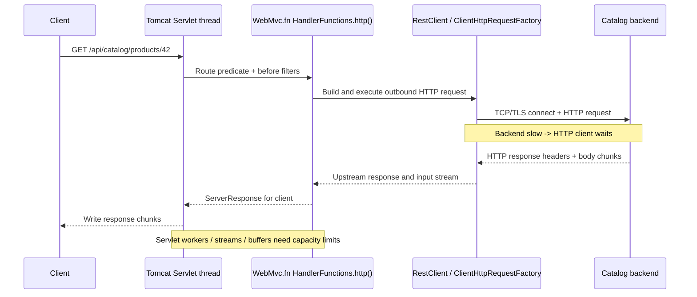
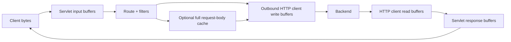
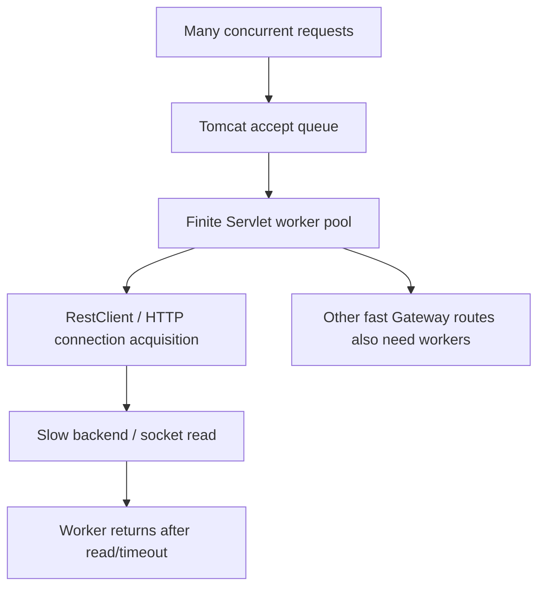
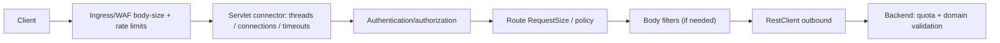
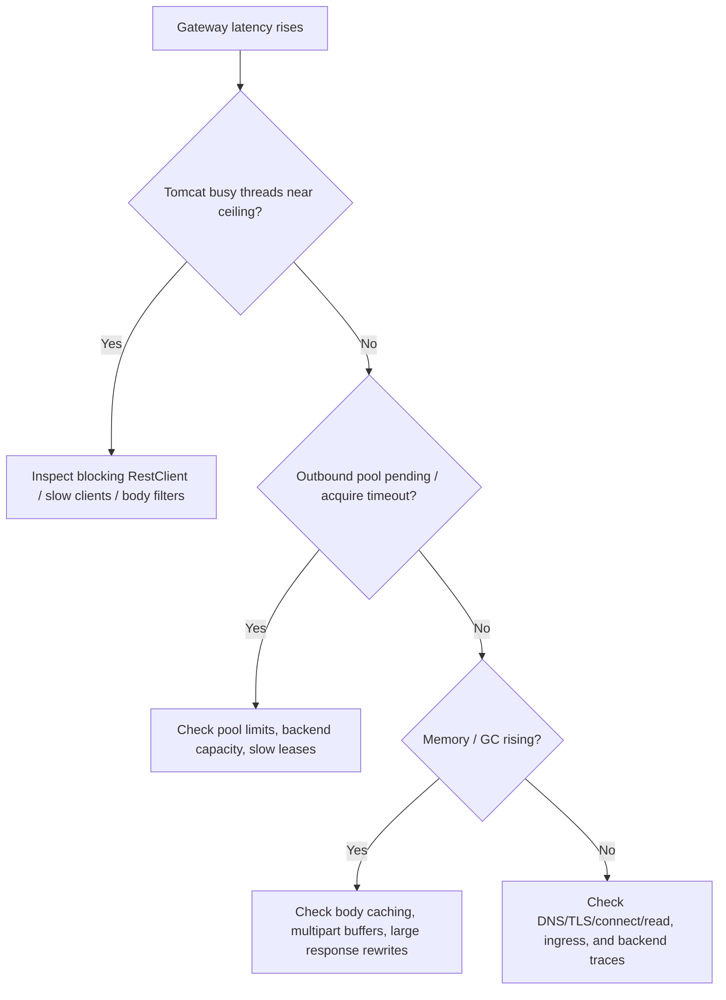

# HttpClient, Timeouts, and Buffering in the Servlet Architecture of Spring Cloud Gateway Server Web MVC

## 1. Problem: How Does Gateway MVC Handle Load When Backends Are Slow or Responses Are Huge?

**Spring Cloud Gateway** is the HTTP entry point in a microservices architecture: matching routes with predicates, running filters, transforming paths/headers, discovering services, authenticating, rate limiting, circuit breaking, retrying, securing TLS, and observing requests. For the **Spring Cloud Gateway Server Web MVC** variant, these tasks execute on **Spring MVC / WebMvc.fn and a Servlet container** (such as Tomcat or Jetty), rather than Gateway Server WebFlux's Reactor Netty event-loop pipeline.

Suppose a Gateway on `:8080` forwards `GET /api/catalog/products/42` to Catalog on `:8081`. If the backend waits 20 seconds on a database, returns a 500 MB response, or the client downloads slowly, the Gateway can experience:

- **Busy Servlet worker threads** waiting on the HTTP client or writing responses.
- **Outbound HTTP connections** held open while the backend replies slowly.
- **Buffers** growing across the request/response pipeline, filters, or Servlet container.
- **Timeouts** at different layers terminating requests at different moments.
- **Retries** multiplying downstream attempts and, when caching request bodies, adding memory pressure.

This lesson aims to clearly distinguish:

1. The **outbound `HttpClient`** used by Gateway MVC to proxy backends vs. the **inbound Servlet container**.
2. `connect timeout`, `read timeout`, `request/async timeout`, TLS timeout, and **end-to-end deadlines**.
3. **Streaming I/O buffers** (e.g., 16 KiB) vs. **full request/response body caching** vs. HTTP response caching.
4. How to configure **Spring Boot 3.5 / Boot 4.x** and **Spring Cloud Gateway Web MVC**, avoiding WebFlux prefix mix-ups.
5. Thread/connection bounding models, uploads/downloads/SSE, body-handling filters, failures, and performance observability.

> **Scope:** This lesson covers **Spring Cloud Gateway Server Web MVC 4.3+/5.x**, primarily using the `spring.cloud.gateway.server.webmvc.*` prefix. When referencing HTTP client settings, check your **actual Spring Boot version**: Spring Boot 3.x generally uses `spring.http.client.*`; Boot 4.x moves to `spring.http.clients.*`. Never apply `spring.cloud.gateway.server.webflux.httpclient.*` verbatim to Server Web MVC.

## 2. Servlet Architecture: Two HTTP Connections and Waiting Points



**Both connection legs must be managed independently:**

| Leg | Inbound / outbound | Runtime and common issues |
|---|---|---|
Client → Gateway | **Inbound server** receiving HTTP requests | Tomcat/Jetty Servlet thread pool, accept queue, keep-alive, upload limits |
Gateway → backend | **Outbound client** sending HTTP requests | `RestClient`, `ClientHttpRequestFactory`, JDK/Apache/Jetty HTTP client, connect/read timeout, TLS, connection pool |
Backend → Gateway | Reading upstream status/headers/body | Slow responses, long-lived streams, compression, upstream disconnects |
Gateway → client | Writing responses | Slow clients, network backpressure, Servlet output buffer, committed status/headers |

Gateway MVC uses **WebMvc.fn** `RouterFunction<ServerResponse>`. Per docs, `HandlerFunctions.http()` is the HTTP proxy handler; target URIs can be set via `BeforeFilterFunctions.uri(...)`. Spring Cloud Gateway MVC builds on **Spring Boot `RestClient`** infrastructure for backend calls. `RestClient` exposes an imperative/synchronous API, though the underlying HTTP library can support various connection/pooling strategies.

### 2.1. Why Are There Multiple Kinds of Buffers?



No single `buffer-size` property controls **every box in this diagram**. Socket buffers, Servlet input/output buffers, streaming buffers, retry body caches, multipart parsers, `HttpMessageConverter`, and HTTP caching have distinct purposes and limits.

**Warning:** Servlet does not mean "every response is loaded entirely into RAM." Streaming with `InputStream`/`OutputStream` can copy chunks incrementally, yet **a filter reading the full body** or a misconfigured HTTP client/request factory can still force aggregation.

## 3. Sample Dependencies and Route for Gateway MVC

### 3.1. Choosing the Right Starter

```xml
<!-- Gateway pom.xml; compatible Spring Boot parent + Spring Cloud BOM -->
<dependency>
    <groupId>org.springframework.cloud</groupId>
    <artifactId>spring-cloud-starter-gateway-server-webmvc</artifactId>
</dependency>
<dependency>
    <groupId>org.springframework.boot</groupId>
    <artifactId>spring-boot-starter-actuator</artifactId>
</dependency>
```

```groovy
// Gateway build.gradle — versions managed by BOM
dependencies {
    implementation 'org.springframework.cloud:spring-cloud-starter-gateway-server-webmvc'
    implementation 'org.springframework.boot:spring-boot-starter-actuator'
}
```

`spring-boot-starter-actuator` is **optional** for metrics/health and not required to proxy HTTP. The MVC starter brings the right WebMVC/Servlet stack; **do not switch to `spring-cloud-starter-gateway-server-webflux`** simply because you see the word "HttpClient."

| Gateway stack | Primary runtime | Java route API | Typical HTTP client |
|---|---|---|---|
**Server Web MVC** | Servlet, Spring MVC/WebMvc.fn | `RouterFunctions`, `GatewayRouterFunctions.route`, `HandlerFunctions.http` | Spring Boot `RestClient` / `ClientHttpRequestFactory` |
**Server WebFlux** | Spring WebFlux, Reactor Netty | `RouteLocatorBuilder`, `GatewayFilter`, `GlobalFilter` | Reactor Netty `HttpClient` |

Never use `Mono.block()`, `ServerWebExchange`, or Netty's `HttpClientCustomizer` as default MVC configuration. When customizing filters in MVC, use WebMvc.fn's `BeforeFilterFunctions`, `AfterFilterFunctions`, and `HandlerFilterFunction`.

### 3.2. YAML Route Configuration

```yaml
# application.yml — Server Web MVC 4.3+/5.x
server:
  port: 8080

spring:
  cloud:
    gateway:
      server:
        webmvc:
          routes:
            - id: catalog-via-mvc
              uri: http://localhost:8081
              predicates:
                - Path=/api/catalog/**
              filters:
                - StripPrefix=1
```

The client calls `GET /api/catalog/products/42`. `StripPrefix=1` strips `api`, so the backend receives `GET /catalog/products/42`. If the backend actually exposes `/products/42`, use `StripPrefix=2`. Right route with wrong path causes HTTP 404, **not a timeout**.

In Docker/Kubernetes, `localhost:8081` inside the Gateway process points only to its own network namespace/container. Replace it with internal DNS, service name/port, or `lb://service-id` with Spring Cloud LoadBalancer per environment.

### 3.3. Equivalent Java DSL — Use Only One Route Registration Style

```java
package com.example.gateway.routes;

import static org.springframework.cloud.gateway.server.mvc.filter.BeforeFilterFunctions.stripPrefix;
import static org.springframework.cloud.gateway.server.mvc.filter.BeforeFilterFunctions.uri;
import static org.springframework.cloud.gateway.server.mvc.handler.GatewayRouterFunctions.route;
import static org.springframework.cloud.gateway.server.mvc.handler.HandlerFunctions.http;

import org.springframework.context.annotation.Bean;
import org.springframework.context.annotation.Configuration;
import org.springframework.web.servlet.function.RouterFunction;
import org.springframework.web.servlet.function.ServerResponse;

@Configuration(proxyBeanMethods = false)
public class CatalogMvcRoute {
    @Bean
    RouterFunction<ServerResponse> catalogRoute() {
        return route("catalog-via-mvc")
            .GET("/api/catalog/**", http())
            .before(uri("http://localhost:8081"))
            .before(stripPrefix(1))
            .build();
    }
}
```

`GatewayRouterFunctions.route("catalog-via-mvc")` assigns the MVC route ID. `http()` performs HTTP proxying; `uri(...)` sets the target, and `stripPrefix(1)` adjusts the path. This is an **alternative** to the YAML route sharing the same route ID: never register both in the same test, as it obscures which route executed.

## 4. Outbound `HttpClient` in MVC: `RestClient` and Request Factories

### 4.1. `RestClient` Is Not Reactor Netty

In Spring Cloud Gateway Server MVC, HTTP proxying uses Spring Boot's `RestClient` infrastructure. `RestClient` is an **imperative API**; when executing requests, the calling thread may wait on I/O depending on the implementation and Servlet processing strategy.

`ClientHttpRequestFactory` selects the underlying HTTP transport. Spring Boot auto-detects Apache HttpClient, Jetty HttpClient, Reactor Netty HttpClient, JDK `java.net.http.HttpClient`, or simple JDK depending on classpath/version, and allows explicit selection.

| Component | Responsibility | What to monitor |
|---|---|---|
`RestClient` | Synchronous HTTP call API | Request/response lifecycle, error handling |
`ClientHttpRequestFactory` | Adapter creating/executing HTTP requests | Timeouts, TLS, redirects, socket behavior |
Apache HttpComponents (if used) | HTTP client and connection manager/pool | Max connections, pending leases, stale connections |
JDK HttpClient (if used) | Standard JDK HTTP client | Connect timeout, request timeout, HTTP version/proxy |
Servlet container | Receives client requests and writes responses | Thread pool, accept queue, request-size limits |

**Do not drop Reactor Netty's `spring.cloud.gateway.server.webflux.httpclient.pool.*` or `wiretap`** into a pure Gateway Server MVC app assuming you tuned the outbound pool. In MVC, start from **Spring Boot HTTP client settings** and the actual selected HTTP request factory.

### 4.2. Spring Boot 4.x: `spring.http.clients.*`

For Gateway MVC versions paired with **Spring Boot 4.x**, global HTTP client properties follow Boot 4:

```yaml
# Spring Boot 4.x example (do not mix with the Boot 3.x config below)
spring:
  http:
    clients:
      connect-timeout: 2s
      read-timeout: 5s
      imperative:
        factory: jdk
```

Meaning:

- `connect-timeout: 2s`: limits time to **establish a connection to the backend** per the configured implementation; does not bound the entire request.
- `read-timeout: 5s`: limits waiting to **read responses** per request-factory/HTTP-client semantics. Not automatically a total wall-clock deadline for a 2 GB download.
- `imperative.factory: jdk`: selects the JDK HTTP client request factory where supported; omitting this lets Boot auto-detect from the classpath.

These are **global Spring Boot HTTP client defaults**; they can affect other Boot-managed `RestClient`s, not just the Catalog route. When an app defines custom `RestClient` builder/factory beans, verify which client Gateway actually uses rather than assuming properties override custom factories.

### 4.3. Spring Boot 3.5: Singular `spring.http.client.*`

For Spring Boot **3.5.x** (typically paired with Spring Cloud Gateway **4.3.x** on a compatible release train):

```yaml
# Example for Spring Boot 3.5.x:
spring:
  http:
    client:
      connect-timeout: 2s
      read-timeout: 5s
      factory: jdk
```

Boot 4 marks the older `spring.http.client.*` keys **deprecated** in favor of `spring.http.clients.*`. Never paste both blocks expecting the system to pick the "right" one automatically; check your **Boot version, `configprops`, and auto-configuration report**.

### 4.4. Easily Confused Namespaces

| Property | Applies to | Notes |
|---|---|---|
`spring.http.clients.connect-timeout` | Spring Boot 4.x HTTP client defaults | Shared across Boot-managed imperative clients |
`spring.http.clients.read-timeout` | Spring Boot 4.x HTTP client defaults | Semantics depend on request factory |
`spring.http.clients.imperative.factory` | Spring Boot 4.x `RestClient` transport choice | Does not create a separate pool per route |
`spring.http.client.connect-timeout` | Spring Boot 3.x HTTP client defaults | Deprecated in Boot 4 |
`spring.cloud.gateway.mvc.http-client.*` | **Older Gateway MVC lines** | Discouraged in MVC 4.3+/5.x; moved toward Boot settings |
`spring.cloud.gateway.server.webflux.httpclient.*` | **Gateway Server WebFlux** | Not used for Gateway MVC outbound config |
`server.tomcat.*` | **Inbound Servlet container** | Does not replace outbound connect/read timeouts |
`spring.mvc.async.request-timeout` | Servlet **async request processing** | Does not automatically time out every `HandlerFunctions.http()` call |

**Remember:** Gateway MVC docs marked `spring.cloud.gateway.mvc.http-client.ssl-bundle` deprecated as of 4.2 in favor of Spring Boot's SSL bundle configuration. Client, socket, and timeout choices must match your current dependencies rather than assuming legacy properties still apply.

## 5. Timeouts: Never Use One Number as "the Gateway Timeout"

A request crosses multiple boundaries:

```text
Client -> Ingress/WAF -> Tomcat (Gateway MVC)
                   -> outbound HTTP client -> DNS/TCP/TLS -> Backend
                   <- response headers/body <-           <-
Client <- Tomcat response writer / ingress  <-
```

Several independent time limits exist:

| Timeout type | What it measures | Where configured | Is it a total request deadline? |
|---|---|---|---|
**TCP connect** | Waiting to open outbound socket | `spring.http.clients.connect-timeout` (Boot 4) or request factory | **No**; excludes backend processing |
**TLS handshake** | Waiting for TLS negotiation on HTTPS connect | HTTP client / TLS stack, factory-specific | No |
**Read/response** | Waiting to read HTTP response per client semantics | `spring.http.clients.read-timeout` or request factory | **Not necessarily**; often wait-for-data rather than total download time |
**Connection acquisition** | Waiting for an outbound connection from pool | Specific HTTP client / connection manager | No; distinct from TCP connect |
**Servlet inbound connection** | Waiting for client request-line/HTTP data at certain stages | `server.tomcat.connection-timeout` and container settings | No |
**Servlet async timeout** | Processing time of a Servlet asynchronous request | `spring.mvc.async.request-timeout` when async is actually used | Does not cover every blocking proxy request |
**Ingress/CDN idle timeout** | Waiting for bytes on upstream/downstream channels | Load balancer / reverse proxy | No |
**End-to-end deadline** | From client sending request until completion/close | Client + server contract, must be designed | **Yes**, if enforced consistently |

### 5.1. Connect Timeout Does Not Cut Off a Slow Backend After Connecting

Suppose Gateway establishes TCP to `localhost:8081` in 10 ms, and the backend runs an 8-second query before returning status. `connect-timeout: 2s` **has no effect** because the connect phase already finished.

If `read-timeout: 5s` applies when the backend emits zero response bytes for 8 seconds, the outbound client can time out. However, the client-facing HTTP status **is not guaranteed to always be HTTP 504**: it depends on the request factory, Gateway MVC exception mapping, Servlet response commit state, and error handlers. Measure live to confirm `502/503/504/500` per contract.

### 5.2. Read Timeout Is Not Necessarily Total File Download Duration

A backend might emit **16 KiB every 2 seconds** for 30 minutes. If the timeout measures **idle gap between reads**, the connection stays alive for the entire duration. Other HTTP client implementations may offer an additional request-level deadline.

Never infer from `read-timeout: 5s` that every `GET` finishes **within 5 seconds**. Check the semantics of your **specific JDK/Apache/Jetty request factory** and test both "no first byte yet" and "slow trickle download."

### 5.3. Servlet Request Timeouts Are Not Outbound HTTP Timeouts

Example Tomcat configuration:

```yaml
server:
  port: 8080
  tomcat:
    connection-timeout: 10s
    threads:
      max: 200
```

`server.tomcat.connection-timeout` governs the **inbound connector** on the Servlet server, such as waiting for the request line after accepting a socket. It is **not** passed to `RestClient` when Gateway calls a backend.

`server.tomcat.threads.max` sizes worker threads (in the **platform thread model**); it does **not** fix why HTTP clients wait too long. Raising it from 200 to 1,000 just to endure a slow backend merely shifts overload onto database/HTTP connection pools and increases thread memory.

### 5.4. `spring.mvc.async.request-timeout` Is Only for Async Servlet Requests

```yaml
spring:
  mvc:
    async:
      request-timeout: 30s
```

This property governs **Servlet async request processing**, such as controllers returning `Callable`, `DeferredResult`, or `StreamingResponseBody` in Spring MVC. Gateway MVC's `HandlerFunctions.http()` proxying **is not guaranteed** to inherit a deadline just because this property is set.

**Safe approach:** when a route requires a hard deadline, choose a mechanism **supported by the HTTP client/request factory or a version-appropriate filter/handler**, coordinated with ingress and client timeouts. Never copy WebFlux snippets:

```yaml
# NOT valid by default for Gateway Server Web MVC:
metadata:
  connect-timeout: 200
  response-timeout: -1
```

That is the **per-route timeout pattern documented for Gateway Server WebFlux**, not a promise that Gateway MVC applies the same semantics. In MVC, check your exact API and release before using timeout metadata; if per-route controls are missing, consider **separating gateway deployments** or creating dedicated outbound clients with explicit boundaries.

### 5.5. Total Deadlines and Retry Budgets

An API design with a `4-second` total SLA might allocate an **illustrative** budget:

| Component | Reference budget |
|---|---:|
Ingress/queue/predicate/security | 200 ms |
DNS/TCP/TLS connect | 500 ms |
Backend processing / first byte | 2,500 ms |
Expected response read/write | 300 ms |
Jitter/logging/correlation headroom | 500 ms |
**Total** | **4,000 ms** |

This is a **planning budget**, not five timers that Gateway sums automatically. A "per-attempt = 3s" timeout plus `Retry=3` attempts with backoff easily blows past `4s`. When designing retries, retry only idempotent operations and bound attempts, backoff, and concurrency; backends must still enforce idempotency on mutations.

**Avoid the naive rule "bigger timeout is safer":** overly long timeouts keep Servlet workers and outbound connections tied up, growing queues until the entire Gateway becomes unresponsive.

## 6. Servlet Thread Pools and Outbound Connection Pools

### 6.1. Why Slow Backends Exhaust Workers

Traditional Spring MVC handles requests synchronously on a Servlet worker. When a request calls a backend via imperative `RestClient` and blocks for I/O, the worker remains held until I/O finishes (unless runtime-supported async mechanisms are enabled and active).

With at most **200 workers**, if each request holds a worker for **5 seconds**, maximum pure waiting throughput is roughly:

\[
\frac{200\ \text{workers}}{5\ \text{s/request}} \approx 40\ \text{requests/s}
\]

This is an **illustrative throughput/latency estimate**; real behavior also reflects CPU time, connection pooling, accept queues, traffic mix, and infrastructure. It demonstrates how **one slow backend can starve unrelated routes** sharing the same pool, even when those routes call fast backends.



Signs of thread starvation:

- p95/p99 latency spikes across **multiple routes** simultaneously.
- `tomcat.threads.busy` nears ceiling while queues grow (metric names depend on Actuator/runtime).
- High backend latency, pending outbound pool connections, or acquisition timeouts.
- Even health probes or trivial APIs slow down when sharing the worker pool.
- Thread dumps show many threads waiting in `RestClient`/`SocketInputStream.read`/HTTP client internals.

### 6.2. `server.tomcat.threads.max` Does Not Equal Max Outbound Connections

Example:

```yaml
server:
  tomcat:
    threads:
      max: 200
    max-connections: 8192
    accept-count: 100
```

These three numbers govern **distinct inbound Tomcat aspects**:

- `threads.max`: max worker threads under platform threads.
- `max-connections`: max inbound network connections Tomcat accepts/handles at once.
- `accept-count`: inbound backlog length when processing capacity is full.

**None** of these configure an Apache/JDK outbound HTTP connection pool. With Apache HttpClient, configure and measure `maxTotal`, `maxPerRoute`, connection lease timeouts, and keep-alive/TTL on the client itself; with JDK HTTP client, pooling behavior and APIs differ.

Never assume Spring Boot always uses Apache merely because a transitive Maven dependency exists. Boot picks the request factory based on **classpath and overrides**, so verify the actual request factory after any dependency change.

### 6.3. Virtual Threads on Java 21+

Spring Boot offers:

```yaml
spring:
  threads:
    virtual:
      enabled: true
```

On a supported JDK and properly integrated Servlet container, virtual threads can make the cost of parking a thread during blocking I/O **much lower** than platform threads. However:

1. They do not give backends or DBs more connections or CPU.
2. They do not turn `RestClient` into a reactive streaming API.
3. You still need **semaphores/concurrency bulkheads**, connection pool caps, deadlines, and timeouts.
4. `native`/`synchronized` sections can still cause contention or pinning depending on JDK/libraries.
5. Settings like `server.tomcat.threads.max` **no longer behave the same as with platform threads** when virtual threads are enabled; Boot docs note this explicitly.

**Strategy:** test virtual threads under production-like load, measuring p99/heap/GC/connection wait before and after. Never turn on virtual threads and remove active-request limits.

## 7. Servlet and HTTP Client Buffers: Separating Streaming from Full-Body Caching

### 7.1. Buffers for Streaming MIME Types

Gateway MVC 5.0/5.1 provides two properties:

```yaml
spring:
  cloud:
    gateway:
      server:
        webmvc:
          streaming-media-types:
            - text/event-stream
            - application/x-ndjson
          streaming-buffer-size: 16384
```

`configprops` docs describe `streaming-buffer-size` as defaulting to **16384 bytes** (16 KiB) **for MIME types recognized as streaming**. `streaming-media-types` lists response types that should use Gateway MVC's streaming forwarding path.

**Accurate interpretation:**

- `16384` is the **I/O streaming buffer size**, not a 16 KiB response size cap.
- It does not truncate a 200 MB file down to 16 KiB.
- It does not mean Gateway uses only 16 KiB of heap per request; socket buffers, HTTP clients, Servlet buffers, and filters add memory.
- It does not guarantee every SSE event flushes at exactly 16 KiB or once per event; message writers, HTTP clients, servlet responses, proxy buffering, and networks also matter.
- It does not control **Retry's body cache** or multipart parser memory.

For single-shot JSON responses, do not tag them `text/event-stream` "to optimize"; `Content-Type` must reflect the **actual contract**. List only MIME types genuinely streamed by backends and verify traces before and after.

### 7.2. Chunked Data Flow Is Not Automatically Non-Blocking

```text
Backend input stream --[16 KiB]--> Gateway read buffer
                    --[16 KiB]--> Servlet output stream --[network]--> Client
```

Chunk-by-chunk copying avoids **holding the entire file in RAM**; however, under **blocking I/O**, workers still wait reading from upstream or writing to slow clients. HTTP client/Servlet stacks do not automatically provide end-to-end Reactor backpressure; capping concurrent downloads and timeouts remains essential.

Never write this in a custom filter:

```java
// WRONG for scalability with unbounded payloads:
byte[] entireBody = servletRequest.getInputStream().readAllBytes();
```

A 500 MB request creates a huge `byte[]` plus copies on JSON/string conversion; 50 concurrent requests rapidly blow the heap budget. If body inspection is truly required, enforce hard size limits first, use streaming parsers, or delegate inspection to a dedicated backend.

### 7.3. Socket Buffers and Servlet Output Buffers

| Buffer | Scope / point of application | Risk when confused |
|---|---|---|
TCP send/receive buffers | OS / socket | Enlarging buffers does not speed up slow backends |
Servlet request input | Container receiving/parsing bytes | Can hold threads during slow client uploads |
Servlet response output | Pre-commit / writing response | Committed headers/status cannot be changed |
Gateway `streaming-buffer-size` | Copying chunks for streaming MIME types | Not a request-size limit |
HttpClient buffers | Reading/writing outbound requests/responses | Semantics vary across JDK/Apache/Jetty |
Retry body cache | Holding request body for replay | Heap grows as bytes × concurrency |
`@RequestBody` + JSON parsing | Deserializing into objects/strings | Can aggregate huge bodies |
Multipart parser / temp storage | Storing parts in RAM or temp files | Disk exhaustion, temp file leaks, DoS |
`LocalResponseCache` | Caching responses for future requests if enabled on supported stacks | **Not a streaming buffer** |

`Content-Length`/`Transfer-Encoding` are **HTTP wire-contract headers**, not RAM tuning knobs. Never leave a stale `Content-Length` after a filter alters a body: clients can hang indefinitely or truncate responses.

## 8. Body Caching in Servlets: Request `InputStream` Is Usually One-Shot

In the Servlet API, `HttpServletRequest.getInputStream()` is normally consumed **in a single pass**. If a `before` filter reads the request body to verify an HMAC and then proxies, the backend receives an empty body unless Gateway **caches and re-adapts** the data.

### 8.1. `AdaptCachedBody` Enables Re-Reading, Not Response Caching

Gateway MVC provides `MvcUtils.cacheAndReadBody(request, BodyType.class)` and `BeforeFilterFunctions.adaptCachedBody()`. Per official docs:

1. `cacheAndReadBody(...)` reads/decodes and stores the body in request attributes.
2. `adaptCachedBody()` wraps the request so downstream steps can read the cached bytes as a fresh input stream.
3. **Order matters:** the adapter must run **after** the step that cached the body; placing it earlier finds nothing and can forward an empty body.

Illustrative Java DSL (for small, size-bounded payloads only):

```java
package com.example.gateway.routes;

import static org.springframework.cloud.gateway.server.mvc.filter.BeforeFilterFunctions.adaptCachedBody;
import static org.springframework.cloud.gateway.server.mvc.filter.BeforeFilterFunctions.uri;
import static org.springframework.cloud.gateway.server.mvc.handler.GatewayRouterFunctions.route;
import static org.springframework.cloud.gateway.server.mvc.handler.HandlerFunctions.http;

import java.util.Optional;
import org.springframework.cloud.gateway.server.mvc.common.MvcUtils;
import org.springframework.context.annotation.Bean;
import org.springframework.context.annotation.Configuration;
import org.springframework.web.servlet.function.RouterFunction;
import org.springframework.web.servlet.function.ServerResponse;

@Configuration(proxyBeanMethods = false)
public class SmallBodyInspectionRoute {
    @Bean
    RouterFunction<ServerResponse> inspectedRoute() {
        return route("inspected-small-body")
            .POST("/api/inspect", http())
            .before(uri("http://localhost:8081"))
            .before(request -> {
                Optional<String> body =
                    MvcUtils.cacheAndReadBody(request, String.class);
                // Handle metadata/small checks only; DO NOT log raw body.
                // When verifying HMAC, use raw bytes and sign the exact canonical form.
                body.ifPresent(value -> {
                    if (value.length() > 1024 * 1024) {
                        throw new IllegalArgumentException("Body too large");
                    }
                });
                return request;
            })
            .before(adaptCachedBody())
            .build();
    }
}
```

**This only demonstrates filter ordering**, not a production-safe HMAC or body-limiting solution. `String.length()` counts UTF-16 code units, **not UTF-8 bytes on the wire**; checking after reading the body is also **too late to prevent large RAM allocations**. In production, enforce **request-size limits before caching**, bound actual bytes read, handle charsets/encodings properly, map errors to 4xx per API contract, and never log private payloads.

### 8.2. Setting `RequestSize` on Small-Body Routes

Gateway MVC supports the `RequestSize` filter:

```yaml
spring:
  cloud:
    gateway:
      server:
        webmvc:
          routes:
            - id: small-json-import
              uri: http://localhost:8081
              predicates:
                - Path=/api/import/**
                - Method=POST
              filters:
                - StripPrefix=1
                - name: RequestSize
                  args:
                    maxSize: 1MB
```

`RequestSize` rejects oversized requests with `413 Payload Too Large` per filter docs. It is a **route-level policy**, not a replacement for container/ingress limits or byte caps in custom filters. If clients send false `Content-Length` headers or chunked uploads, test your exact implementation and byte-counting layers.

**Do not assume `small-json-import` in YAML and `inspected-small-body` in Java share `RequestSize`.** They are two independent examples; if testing HMAC alongside `RequestSize`, combine the full policy onto **the same route** and verify ordering.

### 8.3. `Retry` `cacheBody=true` Multiplies RAM by Concurrency

When retrying a POST with a body, Gateway must be able to **re-read the body**. Gateway MVC's Retry filter provides `cacheBody`; when enabled, docs warn it **reads the entire body into memory** and must be paired with `AdaptCachedBody`.

Example **solely for an idempotent demo operation**, never copy verbatim to payment APIs:

```yaml
spring:
  cloud:
    gateway:
      server:
        webmvc:
          routes:
            - id: idempotent-test-retry
              uri: http://localhost:8081
              predicates:
                - Path=/api/demo/retry
                - Method=POST
              filters:
                - name: RequestSize
                  args:
                    maxSize: 512KB
                - name: Retry
                  args:
                    retries: 1
                    methods: POST
                    series: SERVER_ERROR
                    cacheBody: true
                - name: AdaptCachedBody
```

Suppose you cache **512 KiB** × **100** concurrent requests: raw payload bytes alone need ~**50 MiB**, **excluding** copies, object overhead, HTTP client buffers, Servlet state, and other routes. As concurrency or payload size rises, memory usage climbs fast.

**Safety note:** `POST` is not inherently idempotent. Even a demo backend should require a trusted **`Idempotency-Key`**, store results per key, and deduplicate replays. Retries can create multiple downstream attempts, including when the first attempt succeeded yet the response was lost. In production, prefer avoiding mutation retries or implementing true business idempotency first.

If a filter caches the body yet `AdaptCachedBody` is missing or misordered, the backend may receive an **empty body on subsequent calls**. Check request counts, backend logs/headers, and body checksums in tests rather than looking solely at Gateway HTTP 200.

### 8.4. `ModifyRequestBody` / `ModifyResponseBody` Also Carry Aggregation Costs

In Gateway MVC, docs describe filters modifying request/response bodies via the Java DSL and HTTP message conversion:

```java
// API illustration only; see MVC docs for imports/route context:
.before(modifyRequestBody(
    String.class, String.class, "text/plain",
    (request, body) -> body == null ? "" : body.toUpperCase()))
```

To modify a body, the framework may have to **read and deserialize the entire representation** before re-encoding it. For small, bounded JSON payloads, this is fine. For multi-GB file downloads, SSE, or unbounded NDJSON, never use a filter that materializes the entire body as a `String`/DTO.

Distinguish:

- **Streaming copy:** reads/writes chunks with small buffers, never needing the full response on the heap.
- **Body rewrite/deserialize:** may hold the entire body in RAM to transform it.
- **HTTP response cache:** stores responses for **later** requests, unrelated to inline body rewriting.

**Do not use WebFlux's `spring.http.codecs.max-in-memory-size`** as a global cap for all body rewrites in Servlet Gateway MVC. Spring Boot docs specify that property for auto-configured WebFlux servers/`WebClient`, **not total memory across Servlet input streams**.

## 9. `application/x-www-form-urlencoded`, Multipart, and Servlet Request Parameters

### 9.1. The Servlet Container May Consume the Body When Parsing Parameters

For `Content-Type: application/x-www-form-urlencoded`, the Servlet container often merges form fields into **request parameters** alongside query parameters. A `Servlet Filter` calling `getParameterMap()` ahead of Gateway can trigger parsing and consume the input stream. Gateway MVC provides **`FormFilter`** to reconstruct the body properly for downstream.

Gateway MVC docs specify that **Servlet Filters reading request parameters** must be ordered **before `FormFilter`** per specific guidance. If a security/observability filter reads parameters and the downstream body vanishes, inspect filter order, form reconstruction, and actual bytes reaching the backend—do not immediately blame the outbound `HttpClient`.

Example payload to preserve:

```http
POST /api/payments/form HTTP/1.1
Content-Type: application/x-www-form-urlencoded

reference=INV-42&amount=100
```

Calling `getInputStream()`, `getReader()`, or `getParameterMap()` across multiple Servlet filters alters body consumption; never assume raw bytes can be read multiple times without wrappers/caching.

### 9.2. Multipart Uploads Create a Different Buffer Pressure

For `multipart/form-data`, the Servlet container / multipart resolver may buffer parts **in RAM or temporary files**. Spring Boot provides:

```yaml
# Example multipart controls in a Servlet app, depending on container/version.
spring:
  servlet:
    multipart:
      max-file-size: 10MB
      max-request-size: 12MB
      file-size-threshold: 1MB
```

**Do not confuse:** these properties govern **multipart parsing** when triggered; they do not automatically bound raw `application/octet-stream` POSTs or streaming responses. For uploads proxied through Gateway, enforce limits at ingress/Gateway route/backend, monitor temp-directory capacity, concurrent uploads, and disk quotas.

If Gateway does not need to inspect uploaded files, avoid unnecessary multipart parsing and let the **domain service** handle streaming, AV scanning, checksums, and ownership. If pre-proxy scanning is needed, consider **object storage + async scan workflows** instead of holding large files in Servlet workers/heap.

### 9.3. Hop-by-Hop Headers and `Content-Length`

Gateway MVC uses request/response header filters to strip hop-by-hop headers, normalize `Transfer-Encoding`, and update `Content-Length` after body transforms. Never:

- Forward raw `Connection`, `Transfer-Encoding`, or `Keep-Alive` as end-to-end headers.
- Keep the old body's `Content-Length` after a filter changes the byte count.
- Force `Transfer-Encoding: chunked` on HTTP/2.
- Log raw multipart payloads, form parameters containing passwords/tokens, or full binary bodies.

If tests show the backend receiving truncated/empty bodies or clients hanging until timeout after the backend already finished, inspect **Servlet `FormFilter`**, request-body caching, custom filters, and framing headers before raising `read-timeout`.

## 10. Streaming Responses on Servlets: Large Files, NDJSON, and SSE

### 10.1. Large Downloads

When backends serve multi-GB `application/octet-stream` files, the best option is usually **streaming bytes** through Gateway or issuing signed object-storage URLs when policy allows. Never rewrite a response body via `String` or JSON serializer just to add a header.

Pressures to monitor:

1. **Response read timeout** from the HTTP client to the backend.
2. **Servlet output buffer** and client download bandwidth.
3. How long a worker/connection stays held on the Gateway.
4. `Content-Length` and `Content-Range`/`Range` headers if resumable downloads are supported.
5. Ingress/CDN maximum response size, idle timeouts, and compression.
6. Per-tenant bandwidth and concurrent stream quotas.

If a client downloads slowly, the backend may also slow down because Gateway cannot drain reads quickly. `streaming-buffer-size` chunks data flow, yet does not enforce bandwidth or concurrency quotas automatically.

### 10.2. SSE and NDJSON Through Gateway MVC

SSE is a long-lived `text/event-stream` HTTP response; NDJSON emits newline-delimited JSON objects. Both require **incremental flushing** rather than waiting for the entire body to finish.

```yaml
spring:
  cloud:
    gateway:
      server:
        webmvc:
          streaming-media-types:
            - text/event-stream
            - application/x-ndjson
          streaming-buffer-size: 16384
          routes:
            - id: events-mvc
              uri: http://localhost:8081
              predicates:
                - Path=/api/events/**
                - Method=GET
              filters:
                - StripPrefix=1
```

Yet `streaming-media-types` does not disable HTTP client **`read-timeout`** or ingress idle timeouts, nor guarantee that every proxy/HTTP client flushes each event byte-for-byte. Test with `curl -N` **directly against the backend**, **through Gateway**, and **through ingress**, comparing line-by-line timestamps.

**Do not apply Retry, body caching, or short CircuitBreaker `TimeLimiter` defaults** to long-lived streams. Once a response is committed, Gateway cannot safely turn 200 into 503; clients need explicit reconnect/resume contracts.

### 10.3. Servlet Async Streaming at the Backend: A Separate Thread Budget

A **Spring MVC backend** can return `StreamingResponseBody`, `SseEmitter`, or `ResponseBodyEmitter`; Spring MVC typically uses Servlet async processing and a task executor for writes. On that backend, configure `spring.mvc.async.request-timeout` and a bounded `AsyncTaskExecutor` rather than letting thousands of streams share an unbounded default executor. Even then, Servlet output writes can still block on slow clients.

Moreover, the backend using Servlet async **does not turn Gateway MVC into non-blocking Reactor**. Gateway still has its `HttpClient` reads, Servlet response writes, and its own connection/thread/buffer limits.

For bidirectional WebSocket frames, Gateway MVC provides WebSocket proxying with a **separate** set of bounds such as `spring.cloud.gateway.server.webmvc.websocket.send-buffer-size-limit`. **Never confuse WebSocket send buffers with `streaming-buffer-size` for HTTP SSE/NDJSON.**

## 11. Choosing a Request Factory and Customizing HTTP Clients in the Right Scope

### 11.1. Never "Guess" the HTTP Client from the Servlet Container Name

Tomcat is the **inbound Servlet runtime**. It does not force Gateway MVC to use Apache HttpClient or JDK HttpClient for **outbound calls**. Spring Boot picks `ClientHttpRequestFactory` based on classpath and configuration.

| Outbound choice | What to verify |
|---|---|
JDK `java.net.http.HttpClient` | Proxy/TLS/redirects, connect timeout, request factory response/read behavior |
Apache HttpComponents | `ConnectionManager`, max total/per route, pool lease timeout, idle eviction, HTTP versions |
Jetty HTTP client | Connection limits, idle timeouts, request timeouts, and shared resources |
Auto-detected client | New dependencies may silently alter the selected implementation |

When custom HTTP proxy/connection pooling is needed, **prefer Boot/Gateway documented settings**. For advanced HTTP client customization in Spring Boot 4, you can use `ClientHttpRequestFactoryBuilderCustomizer` or `ClientHttpRequestFactoryBuilder`; verify via tests that **Gateway MVC's `RestClient`** actually picks up your configuration.

### 11.2. A Custom `RestClient` Does Not Automatically Replace Gateway's HTTP Client

The snippet below is for a **service you write yourself**, not something that automatically changes Gateway's `HandlerFunctions.http()`:

```java
package com.example.catalog.client;

import java.time.Duration;

import org.springframework.boot.http.client.ClientHttpRequestFactoryBuilder;
import org.springframework.boot.http.client.HttpClientSettings;
import org.springframework.http.client.ClientHttpRequestFactory;
import org.springframework.stereotype.Component;
import org.springframework.web.client.RestClient;

@Component
public class CatalogStatusClient {
    private final RestClient restClient;

    public CatalogStatusClient(RestClient.Builder builder) {
        ClientHttpRequestFactory factory =
            ClientHttpRequestFactoryBuilder.detect().build(
                HttpClientSettings.defaults()
                    .withConnectTimeout(Duration.ofSeconds(1))
                    .withReadTimeout(Duration.ofSeconds(2)));

        this.restClient = builder
            .baseUrl("https://catalog.internal.example")
            .requestFactory(factory)
            .build();
    }

    public String checkHealth() {
        return restClient.get()
            .uri("/health")
            .retrieve()
            .body(String.class);
    }
}
```

This API illustrates **Spring Boot 4.x `ClientHttpRequestFactoryBuilder`**. It is not code you add to Gateway to enable `routes`; `/health` is an **illustrative** endpoint that must be permitted and secured by the backend. On Spring Boot 3.x, packages and APIs may differ.

**Important:** creating `CatalogStatusClient` does not mean Gateway MVC automatically uses this instance to proxy `catalog-via-mvc`. When routes require distinct timeouts, use **supported extension points and explicit route → client/handler mappings**, or separate workloads/gateway deployments. Never promise that an arbitrary `RestClientCustomizer` bean alters one specific route without testing.

### 11.3. Avoiding Surprise Retries, Redirects, and Proxies

- **Redirects:** HTTP clients may follow certain 3xx responses per policy. For public gateways, check `Location`/hostname/trust policies so `Authorization` headers are never forwarded to third-party hosts.
- **HTTP proxies:** do not confuse an outbound HTTP client forward proxy with Gateway's inbound reverse proxy. Behind a corporate proxy, configure internal allowlists and `nonProxyHosts` per implementation.
- **Connection reuse:** keeping connections cuts TCP/TLS handshakes, yet requires handling idle/stale connections and remote closes. Do not blame reuse automatically when responses are slow.
- **DNS:** pooled connections can keep hitting old IPs after a service rotates addresses; tune TTLs, discovery, connection max-age, or rolling restarts to match infrastructure.
- **mTLS:** configure keys/certs and trust for the **outbound leg**; client → Gateway HTTPS does not encrypt Gateway → backend.

## 12. TLS and SSL Bundles on the Outbound Leg

For Gateway MVC, TLS/SSL docs explain that backend proxy calls use **Spring Boot `RestClient` infrastructure** and SSL bundles. In Spring Boot 4, the namespace is standardized to `spring.http.clients.ssl.bundle`:

```yaml
# Spring Boot 4.x — example using a PEM CA to trust an internal backend.
spring:
  http:
    clients:
      connect-timeout: 2s
      read-timeout: 5s
      ssl:
        bundle: catalog-trust
  ssl:
    bundle:
      pem:
        catalog-trust:
          truststore:
            certificate: classpath:catalog-ca.pem

  cloud:
    gateway:
      server:
        webmvc:
          routes:
            - id: catalog-tls
              uri: https://catalog.internal.example
              predicates:
                - Path=/api/catalog/**
              filters:
                - StripPrefix=1
```

`catalog-ca.pem` is an **illustrative trusted CA file**, not included in sample projects. Use real backend CAs and hostnames, verify SAN/chain and rotation, and never use insecure trust managers or disable hostname verification in production.

On **Spring Boot 3.5**, the client SSL property sits under `spring.http.client.ssl.bundle` rather than `spring.http.clients.ssl.bundle`. Some Spring Cloud Gateway TLS doc pages still show the older singular name; **consult Spring Boot 4's deprecated-properties table directly** when running Boot 4.

**Distinguish TLS timeouts:** `connect-timeout` is not a complete handshake cap if a request factory has its own TLS timeout. On TLS failures, cert/hostname errors may fail immediately or after handshake timeout. Never raise `read-timeout` to "fix" an untrusted certificate.

## 13. Security, Memory Budgets, and Resource Limits

### 13.1. Layers to Protect Before Processing Bodies



Layered defenses:

1. **Ingress:** reject oversized requests and floods as early as possible.
2. **Servlet container:** cap connections, request-header sizes, form/multipart parsers, and thread budgets.
3. **Spring Security:** verify Bearer JWTs/cookies/sessions, scopes, and tenants before opening paths to sensitive data.
4. **Gateway routes:** set `RequestSize` per endpoint group; never enable unbounded body caching.
5. **Outbound client:** enforce connection pools/bulkheads, connect/read timeouts, and TLS trust.
6. **Backend:** verify contracts again, cap payloads/SQL/DB pools, and enforce idempotency.

**Never let route predicates act as authorization:** `Host`/`Path` only pick routes; clients can send arbitrary `Host`s, queries, or headers. Routes to internal services require identity, network policy, mTLS, and backend resource authorization.

### 13.2. Estimating an Approximate Memory Budget

Suppose `Retry.cacheBody=true` is enabled on an upload route allowing **4 MiB** per request with **150 concurrent requests**:

\[
4\ \text{MiB/request} \times 150\ \text{requests}
= 600\ \text{MiB}
\]

That covers only the **minimum raw payload bytes** for a single copy—excluding Java arrays/string copies, request attributes, SSL/native buffers, HTTP clients, Servlet container overhead, metrics, and other routes.

If the Gateway container has a 512 MiB heap, cached bytes alone exceed the heap. Never blindly raise `-Xmx`: shrink payloads/concurrency, disable body caching, split out an upload service, or move to object-storage workflows.

**Upload limits differ from download limits:** `RequestSize` typically guards **inbound client requests**; it does not stop a 1 GB backend response body. For downloads, separately bound connections, bandwidth, streaming, and response transformations.

### 13.3. Sensitive Data in Bodies and Headers

- Never log request/response bodies containing tokens, PII, payment details, or raw `Authorization`.
- Never cache/retry raw credentials or mutating requests without explicit safety policies.
- Never copy raw `Set-Cookie` or `Authorization` into tracing tags.
- When enabling HTTP debug wire logs on clients/Servlets, assume **payload exposure risk** and restrict to sanitized sandboxes.
- Buffers and request attributes retaining bodies in memory extend the lifetime of sensitive data in the JVM; tighten retention, heap-dump access, and permissions.
- When returning fallbacks/errors after timeouts, never expose stack traces, internal backend URIs, or TLS certificate paths to clients.

### 13.4. Client Cancellation Does Not Always Stop the Backend Immediately

If a browser closes the socket while Gateway MVC awaits `RestClient`, the HTTP client may finish reading or abort depending on implementation and disconnect detection. A backend mutation may **already have committed** even though Gateway/client saw a timeout or socket reset.

Therefore:

- Writes must have **idempotency and outcome verification**.
- Timeouts/fallbacks do not roll back backend transactions.
- Retrying after a socket reset can create duplicates without an idempotency key.
- Once Servlet headers are committed, status cannot be switched to `504` as if the response had not begun.

### 13.5. Should You Choose Gateway MVC or WebFlux?

| Condition | MVC may fit | WebFlux may fit |
|---|---|---|
System already uses Servlet filters / MVC libraries | **Yes**, integrates naturally with existing stack | Needs compatibility review |
Short-lived proxied requests, moderate load | Yes | Yes |
Blocking SDK/JDBC inside custom gateway logic | MVC / virtual threads can be simpler | Must offload blocking calls properly |
Tens of thousands of SSE streams / long-lived HTTP | Measure threads/connections/memory carefully | Event-loop/reactive often fits better, still bounded |
HTTP client timeouts/SSL managed via Boot `RestClient` | Clear in MVC | WebFlux uses Reactor Netty differently |
Team requires WebMvc.fn `RouterFunction` and Servlet filters | Yes | Not equivalent APIs |

Neither variant automatically solves rate limiting, auth, circuit breaking, body-size DoS, or overloaded backends. Choose based on **real workload, operability, and compatibility**, not buzzwords.

## 14. Lab: Measuring Connect/Read Timeouts and Streaming Through Gateway MVC

### 14.1. Preparing a Sandbox Environment

You need **two separate applications**:

1. **Gateway Server Web MVC:** port `8080`, MVC starter, `catalog-via-mvc` route from Section 3, and HTTP client timeouts from Section 4.
2. **Catalog Spring MVC backend:** port `8081`, demo controller below with fast, slow, streaming, and body-echo endpoints.

The backend uses `spring-boot-starter-web` on Spring Boot 3.x or the corresponding MVC starter on Boot 4.x with its own `@SpringBootApplication`/`main`. The controller needs no Spring Cloud Gateway dependency.

**Never run load experiments or artificial delays in production.** Using `Thread.sleep()` to simulate delays is **strictly for sandboxes**.

### 14.2. Illustrative Backend Controller

```java
package com.example.catalogdemo;

import java.nio.charset.StandardCharsets;
import java.util.Map;

import org.springframework.http.HttpHeaders;
import org.springframework.http.MediaType;
import org.springframework.http.ResponseEntity;
import org.springframework.web.bind.annotation.GetMapping;
import org.springframework.web.bind.annotation.PostMapping;
import org.springframework.web.bind.annotation.RequestBody;
import org.springframework.web.bind.annotation.RestController;
import org.springframework.web.servlet.mvc.method.annotation.StreamingResponseBody;

@RestController
public class CatalogDemoController {

    @GetMapping("/catalog/fast")
    public ResponseEntity<Map<String, Object>> fast() {
        return ResponseEntity.ok(Map.of("status", "fast", "value", 42));
    }

    @GetMapping("/catalog/slow")
    public ResponseEntity<String> slow() throws InterruptedException {
        // DEMO ONLY: backend withholds response for 3.5 seconds.
        Thread.sleep(3500);
        return ResponseEntity.ok("slow-ok");
    }

    @GetMapping("/catalog/stream")
    public ResponseEntity<StreamingResponseBody> stream() {
        StreamingResponseBody body = out -> {
            for (int i = 1; i <= 5; i++) {
                String event = "data: item-" + i + "\n\n";
                out.write(event.getBytes(StandardCharsets.UTF_8));
                out.flush();
                try {
                    Thread.sleep(700); // DEMO ONLY: chunked writes.
                } catch (InterruptedException ex) {
                    Thread.currentThread().interrupt();
                    break;
                }
            }
        };

        return ResponseEntity.ok()
            .contentType(MediaType.TEXT_EVENT_STREAM)
            .header(HttpHeaders.CACHE_CONTROL, "no-store, no-transform")
            .body(body);
    }

    @PostMapping("/catalog/echo")
    public ResponseEntity<Map<String, Object>> echo(@RequestBody String body) {
        // Test small payloads only. Never log/echo sensitive data.
        int bytes = body.getBytes(StandardCharsets.UTF_8).length;
        return ResponseEntity.ok(Map.of("receivedBytes", bytes));
    }
}
```

**Because `StreamingResponseBody` uses Servlet async support**, production backends must configure a bounded `AsyncTaskExecutor` and `spring.mvc.async.request-timeout` rather than letting thousands of streaming tasks use an unbounded default executor. Servlet output writes can still block on slow clients.

`echo(@RequestBody String)` intentionally deserializes **the whole body** to display byte count easily—for tiny payloads only, never as a real upload architecture. For larger bodies, enforce limits at **both Gateway and backend** before converting to `String`.

### 14.3. Test the Backend First

```bash
# Call backend directly; verify endpoint/path and response time.
curl -i http://localhost:8081/catalog/fast
curl -i -w 'time_total=%{time_total}s\n' \
  http://localhost:8081/catalog/slow

# -N disables curl stdout buffering so chunks appear incrementally.
curl -i -N --max-time 10 http://localhost:8081/catalog/stream
```

Expected:

- `/catalog/fast` returns 200 immediately.
- `/catalog/slow` returns 200 after ~3.5 seconds unless a shorter timeout cuts it off.
- `/catalog/stream` returns `Content-Type: text/event-stream` and prints `data: item-...` lines incrementally without waiting for all five events.

If direct backend calls fail to stream, **do not start by editing Gateway**. Fix the controller, Spring MVC async executor, response flushing, or any proxy in front of the backend.

### 14.4. Test Through Gateway MVC

With `catalog-via-mvc` routing `/api/catalog/**` and `StripPrefix=1`:

```bash
curl -i http://localhost:8080/api/catalog/fast

curl -i \
  -w 'status=%{http_code} total=%{time_total}s\n' \
  http://localhost:8080/api/catalog/slow

curl -i -N --max-time 10 \
  http://localhost:8080/api/catalog/stream
```

When Gateway Boot 4 sets `read-timeout: 5s`, the 3.5-second slow call **can succeed** unless another lower timeout applies. When changing sandbox `read-timeout` to `2s`, a request waiting 3.5 seconds before the first byte **can time out**. Final HTTP status is not fixed at 504—record **status, exception class, and Gateway logs**.

For streaming, the MVC route needs `text/event-stream` configured per Sections 7/10 if the runtime doesn't auto-detect it as expected. To prevent timeouts from cutting long streams prematurely, **never raise `read-timeout` to hours for every route**; isolate streaming policies and align idle/lifetime limits at ingress/client.

### 14.5. Testing Small Request Bodies

```bash
printf '{"message":"hello"}' | \
  curl -i -X POST \
    -H 'Content-Type: application/json' \
    --data-binary @- \
    http://localhost:8080/api/catalog/echo
```

Backend `/catalog/echo` returns the byte count received. When adding `RequestSize` or a body-reading filter to the test route, compare `receivedBytes` before and after. If the backend gets 0 bytes, check `cacheAndReadBody`/`AdaptCachedBody` order, Servlet filters, and `Content-Length`/`Transfer-Encoding` normalization.

**No real file is needed for testing**; the command above pipes a tiny body via stdin. Never throw multi-GB files at `@RequestBody String` and treat an OOM as a "stress-test result."

### 14.6. Testing Exceeding `RequestSize` in Sandbox

With `small-json-import` from Section 8.2 running, send over 1 MB of test data from Linux/Bash:

```bash
# Send 2 MB of zero bytes via stdin; sandbox ONLY.
head -c 2097152 /dev/zero | \
  curl -i -X POST \
    -H 'Content-Type: application/octet-stream' \
    --data-binary @- \
    http://localhost:8080/api/import/test
```

Expected **policy outcome**: requests exceeding `maxSize: 1MB` are rejected—typically `413` per `RequestSize` docs—before the backend receives the full payload. Exact HTTP behavior can vary if ingress/container rejects earlier, the client drops, or the route doesn't match.

**Never run this against production URLs** or grow payloads unboundedly; check Gateway heap, connection states, and backend logs to confirm the payload wasn't forwarded.

### 14.7. Testing Slow Clients, Not Only Slow Backends

```bash
# If backend has a matching stream endpoint:
# throttle receive rate on the test client.
curl -i -N --limit-rate 2k --max-time 10 \
  http://localhost:8080/api/catalog/stream
```

With only tens of bytes per event in the demo, `2k` may still be **too fast to exhibit clear backpressure**. Reliable testing needs an endpoint returning enough data (such as a capped 10 MB test payload) while measuring Servlet worker occupancy, outbound connection duration, heap/native buffers, and cleanup after client disconnect.

### 14.8. Testing Bounded Concurrent Requests

```bash
# Only 20 concurrent requests in sandbox; never load-test real APIs.
for i in $(seq 1 20); do
  curl -sS -o /dev/null \
    -w "request=$i status=%{http_code} t=%{time_total}s\n" \
    http://localhost:8080/api/catalog/slow &
done
wait
```

This is a small check of **latency and Servlet worker behavior**, not a full capacity benchmark. Never extrapolate production throughput from 20 local requests; proper benchmarks require warm-up, realistic pods/CPU, sampling, TLS, request mix, backend/pool capacities, and error tracking.

## 15. Observability: Distinguishing Bottlenecks Across Servlet, `HttpClient`, and Buffers

### 15.1. Recommended Metric Groups

| Group | Example metrics to track | Question answered |
|---|---|---|
Inbound Servlet | Current/busy threads, active connections, accept queue, request latency | Is Gateway short on workers to accept requests? |
Outbound `HttpClient` | Active/idle/leased connections, pending acquires, DNS/TLS/connect/read latency | Is Gateway waiting on pools, network, or backends? |
Backend | p95/p99, DB pool wait, error rate | Is the backend responding slowly? |
Memory/GC | Heap used, allocation rate, GC pauses, direct/native buffers | Are body caches/buffers growing excessively? |
Streaming | Active streams, bytes/s, long-lived requests, client cancellations | Are there too many slow consumers? |
Retry/CB | Attempts per logical request, circuit state, fallback counts | Is Gateway amplifying load onto backends? |
Security | 401/403/413/429, rejected requests, auth latency | Are policies blocking at the right layer? |

Exact metric names depend on Spring Boot, Micrometer, Servlet container, HTTP client, and exporter. For example, Tomcat emits `tomcat.threads.busy`/`tomcat.threads.current` when properly bound, yet **never assume they exist** if containers/registries/Actuator are disabled.

### 15.2. Expose Actuator Only on Management Surfaces

```yaml
management:
  endpoints:
    web:
      exposure:
        include: health,info,metrics
```

With Actuator and valid admin credentials:

```bash
curl -i http://localhost:8080/actuator/health
curl -i http://localhost:8080/actuator/metrics
```

Never expose `heapdump`, `threaddump`, or `env` to the public Internet. For custom `RestClient` transports, client metrics may need explicit instrumentation or observation registries; having Actuator **does not guarantee every Apache/JDK pool metric is exported**.

### 15.3. Thread Dumps and JFR

When Gateway p99 suddenly spikes:

1. Capture thread states from an authorized management environment (JFR/thread dump) per runbook.
2. Check for many Servlet workers in `WAITING`/`TIMED_WAITING` inside the HTTP client or waiting on pool leases.
3. Compare outbound `read-timeout` against backend latency.
4. Inspect live body caches, heap allocations, and GC pauses.
5. Identify which routes handle large payloads, retries, or streams.
6. Verify request paths, Security, and filters are not reading bodies multiple times.

Never log raw payloads/tokens just to hunt a memory leak. A heap dump can retain **entire cached request bodies**, so lock down access permissions and retention strictly.

### 15.4. Common Root Causes From One Symptom



**Never raise both thread pools and body buffers at once automatically.** Change one variable, re-measure, and track config by release revision so regressions can be rolled back.

## 16. Layer-by-Layer Troubleshooting

| Symptom | Possible cause | Check / remediation |
|---|---|---|
`spring.cloud.gateway.server.webflux.httpclient.response-timeout` has no effect | App runs **Server Web MVC** with `RestClient` | Use the **Spring Boot HTTP client** namespace for your version |
Boot 4 Gateway MVC still uses old timeout | Deprecated `spring.http.client.*`, custom factory, or wrong scope | Switch to `spring.http.clients.*`; inspect auto-config/runtime |
Connect timeout after backend IP change | DNS, firewall, unreachable TCP, pool/DNS cache | Test network to backend, connect timeout, service discovery |
Backend takes 8s yet `connect-timeout=2s` doesn't cut it | TCP connect already succeeded; waiting on response | Configure `read-timeout` and end-to-end deadlines |
30-minute download finishes despite `read-timeout=5s` | Timeout measures read idle gaps, not total duration | Check HTTP client implementation and time between chunks |
`spring.mvc.async.request-timeout=30s` doesn't stop proxy calls | Async timeout doesn't cover imperative MVC paths | Check `HandlerFunctions`/Servlet lifecycle and outbound timeouts |
`server.tomcat.connection-timeout` doesn't stop backend 504 | Governs **inbound connector**, not outbound reads | Isolate which leg timed out before tuning |
Gateway has 200 threads yet low throughput | Workers stuck waiting on backends/connection pools | Thread dumps, latency, pool pending, backend capacity |
Raising `server.tomcat.threads.max` still leaves Gateway choked | Outbound connections/DB/backend saturated or memory rising | Limit concurrency; analyze saturation per layer |
`streaming-buffer-size=16KiB` mistaken for response max-size | Only the I/O buffer for streaming MIME types | Measure memory/throughput; cap payload size separately |
SSE/NDJSON arrives in batches | Unrecognized MIME, client/proxy buffering, compression/flush | Check `streaming-media-types`, `curl -N` per hop, ingress |
POST form backend gets empty body | `getParameterMap()`/filter consumed body, `FormFilter` order | Check Servlet filter order and form reconstruction |
POST with HMAC filter leaves backend with empty body | Missing or misordered `cacheAndReadBody`/`AdaptCachedBody` | Cache with size caps, adapt in right order, check checksums |
Large POST upload causes OOM | `Retry.cacheBody=true`, String conversion, high concurrency | Enforce `RequestSize`, disable body caching, cap concurrency |
`RequestSize` rejects with 413 | Payload exceeds `maxSize` or rejected earlier by ingress/container | Verify payload sizes and policy; don't raise arbitrarily |
Multipart uploads fill disk | Temp files/part parser, huge max-request, cleanup errors | Tune multipart settings, temp quotas, cleanup, object storage |
Backend returns 200 yet client sees mid-stream failure | Servlet response committed; connection or write error | Inspect slow clients, read/write exceptions, and cancellations |
HTTP 502/500 after timeout instead of 504 | Gateway exception/error handling varies by HTTP client/version | Check root cause; don't guess status codes |
Switching to Apache HttpClient alters latency | Classpath changed request factory, pool/timeout semantics differ | Verify factory and connection manager config |
TLS handshake fails despite healthy TCP connect | Wrong cert/hostname/SAN/CA or handshake timeout | Check Spring Boot SSL bundle, trust chain, redacted TLS logs |
`/api/catalog/fast` returns 404 | Wrong `StripPrefix`, altered URI path, or missing backend handler | Call backend directly; verify route/path |
Gateway uses virtual threads yet DB still runs out of connections | Virtual threads cut waiting cost, not DB capacity | Add bulkheads, DB pool caps, outbound caps, timeouts |
Outbound pool metrics missing | Missing instrumented client/registry or different pooling impl | Add proper instrumentation; never fabricate metrics |
POST retry creates duplicate transactions | First request committed before response failed | Enforce idempotency keys, dedup/transaction policy, drop retry |

### 16.1. Short Investigation Order

When hitting high latency or OOMs:

1. **Confirm the stack:** WebMVC vs. WebFlux starter, Boot version, actual HTTP client factory.
2. **Reproduce with minimal requests:** backend directly, Gateway, ingress; record status, headers, duration.
3. **Isolate the phase:** connection acquisition, DNS/TCP/TLS connect, waiting for first byte, reading body, writing to client.
4. **Measure concurrency:** Servlet busy threads, outbound pool, backend/DB connections, streams.
5. **Inspect body filters:** `RequestSize`, Retry `cacheBody`, `AdaptCachedBody`, `ModifyBody`, `FormFilter`, multipart parsing.
6. **Check memory:** heap allocations, full-body caches, temp files, GC.
7. **Tune deliberately:** change one timeout/pool/buffer at a time and record outcomes.

## 17. Practice Questions and Answers

**Exercise 1 — Choosing the stack.** Gateway uses `spring-cloud-starter-gateway-server-webmvc` on Tomcat. You set `spring.cloud.gateway.server.webflux.httpclient.response-timeout: 5s`. Can you conclude outbound proxies now have a 5s timeout?

**Answer:** No. That property belongs to **Server WebFlux / Reactor Netty**. For MVC, use the Spring Boot HTTP client properties for your version and verify the request factory/runtime.

**Exercise 2 — What is the `HttpClient`?** An MVC Gateway runs on Tomcat. Must the outbound HTTP client be "Tomcat HttpClient"?

**Answer:** No. Tomcat is the **inbound Servlet runtime**. Outbound uses `RestClient` and `ClientHttpRequestFactory`, which can be JDK/Apache/Jetty or another option depending on classpath and config.

**Exercise 3 — Connect timeout.** The backend accepts TCP in 20 ms yet takes 8 seconds to return the first byte. Why didn't `connect-timeout: 2s` abort it?

**Answer:** Because the TCP connect phase finished. Check `read-timeout`/backend processing deadlines and separate time-to-first-byte from total response duration.

**Exercise 4 — Boot namespace.** In Spring Boot 4, which property replaces `spring.http.client.read-timeout`?

**Answer:** `spring.http.clients.read-timeout` (plural `clients`). For the imperative request factory transport choice, use `spring.http.clients.imperative.factory`.

**Exercise 5 — Inbound Servlet.** Can `server.tomcat.connection-timeout` replace outbound HTTP read timeouts?

**Answer:** No. It governs the Tomcat connector accepting client sockets, not `RestClient` calls to backends.

**Exercise 6 — Streaming buffers.** Does `spring.cloud.gateway.server.webmvc.streaming-buffer-size: 16384` forbid downloading files larger than 16 KiB?

**Answer:** No. That is the I/O buffer size for streaming MIME types, **not** a maximum response size or total memory cap.

**Exercise 7 — Caching bodies.** A filter reads `request.body()` to check a signature and the backend receives an empty body. What should you inspect?

**Answer:** Servlet input streams are typically one-shot. Cache bodies with size limits using `MvcUtils.cacheAndReadBody` followed by `adaptCachedBody()` in the right order. For HMAC, verify raw bytes in canonical form.

**Exercise 8 — Retry memory.** `Retry.cacheBody=true` on 4 MiB POSTs sees 150 concurrent requests. Roughly how much RAM does a single copy of payloads alone require?

**Answer:** Roughly **600 MiB** before copies and overhead. Bound payload sizes/concurrency and never enable retry body caching by default.

**Exercise 9 — `RequestSize`.** `RequestSize` returns 413 at Gateway. Does that mean the backend definitely received the full body before rejecting?

**Answer:** No. The filter's goal is rejecting oversized requests **before proxying**. Exact cutoff timing still depends on `Content-Length`/chunking/ingress; check logs and your version's implementation.

**Exercise 10 — SSE.** Browsers receive events all at once on connection close instead of incrementally. Will raising `streaming-buffer-size` to 8 MB definitely help?

**Answer:** No—it may actually worsen memory and latency. Check `text/event-stream` MIME matching, flushing, proxy buffering/compression, and HTTP client/Servlet behavior via `curl -N`.

**Exercise 11 — Read timeout.** A backend streams 8 KiB every second for a 2-hour download. Can you assert `read-timeout: 5s` must abort at second five?

**Answer:** No. Many request factories measure **read idle wait** rather than total wall-clock request duration; check your implementation and enforce an absolute deadline if needed.

**Exercise 12 — Virtual threads.** Does setting `spring.threads.virtual.enabled=true` let the backend handle infinite database connections?

**Answer:** No. Virtual threads lower thread-parking overhead in certain cases, yet DB/HTTP pools and backend resources remain finite.

**Exercise 13 — Multipart.** Does `spring.servlet.multipart.max-file-size` automatically bound raw `application/octet-stream` POSTs?

**Answer:** No. It applies when multipart parsing occurs. Raw uploads require explicit request-size policies at ingress/Gateway/backend.

**Exercise 14 — `FormFilter`.** Why can a Servlet filter calling `getParameterMap()` affect form request bodies?

**Answer:** The Servlet container may consume the input stream to parse `application/x-www-form-urlencoded`; filter ordering and Gateway MVC's `FormFilter` must coordinate to rebuild the downstream body.

**Exercise 15 — Timeout status.** Gateway's outbound HTTP client times out. Is the client guaranteed to receive 504?

**Answer:** No. HTTP status depends on exception mapping, error handlers, and whether headers were already committed; verify against the runtime and define explicit API contracts.

**Exercise 16 — Routing.** `/api/catalog/fast` returns 404. Should you raise HTTP `read-timeout`?

**Answer:** Not before checking routing. Verify `StripPrefix=1` turns it into `/catalog/fast` and that the backend exposes that endpoint; 404 from route/path differs from timeouts.

**Exercise 17 — SSL.** Gateway has inbound TLS on Tomcat. Is that enough to protect Gateway → backend traffic?

**Answer:** No. The outbound hop has its own scheme, truststore, hostname verification, and possibly mTLS. Use Boot SSL bundles and configure `RestClient` accordingly.

**Exercise 18 — Custom `RestClient`.** You define `@Bean RestClient catalogClient` with a 500 ms timeout. Does Gateway MVC's `HandlerFunctions.http()` automatically use that bean for the Catalog route?

**Answer:** You cannot assume so. A standalone `RestClient` applies only where injected/used; changing Gateway's HTTP proxy client requires supported extension points/routing integration verified by tests.

**Exercise 19 — Streaming response reads.** A 1 GB download copies in 16 KiB chunks. Does that guarantee Gateway holds zero Servlet workers during the download?

**Answer:** No. Streaming avoids buffering the entire file on the heap, yet blocking reads/writes and slow clients can still tie up threads and connections.

**Exercise 20 — Tuning priorities.** Gateway OOMs due to Retry `cacheBody` on 50 MB uploads; should you simply raise heap and timeouts?

**Answer:** No. Remove/isolate body caching, bound request sizes/concurrency, adopt object-storage/streaming workflows, then measure memory and verify retry/idempotency contracts.

## 18. Official References

- [Spring Cloud Gateway Server Web MVC – How It Works](https://docs.spring.io/spring-cloud-gateway/reference/spring-cloud-gateway-server-webmvc/how-it-works.html): `WebMvc.fn`, `RouterFunction`, and `HandlerFunctions.http()`.
- [Spring Cloud Gateway Server Web MVC – Starter](https://docs.spring.io/spring-cloud-gateway/reference/spring-cloud-gateway-server-webmvc/starter.html): correct starter and Servlet runtime (Tomcat/Jetty).
- [Spring Cloud Gateway Server Web MVC – Java Routes API](https://docs.spring.io/spring-cloud-gateway/reference/spring-cloud-gateway-server-webmvc/java-routes-api.html): `GatewayRouterFunctions.route`, `BeforeFilterFunctions.uri`, `HandlerFunctions.http`.
- [Spring Cloud Gateway 5.1 – Configuration Properties](https://docs.spring.io/spring-cloud-gateway/reference/5.1/configprops.html): `webmvc.streaming-buffer-size`/`streaming-media-types` vs. `webflux.httpclient.*`.
- [Spring Cloud Gateway Server Web MVC – TLS and SSL](https://docs.spring.io/spring-cloud-gateway/reference/spring-cloud-gateway-server-webmvc/tls-and-ssl.html): `RestClient`, Spring Boot HTTP client, and SSL bundles.
- [Spring Cloud Gateway Server Web MVC – Working with Servlets and Filters](https://docs.spring.io/spring-cloud-gateway/reference/spring-cloud-gateway-server-webmvc/working-with-servlets-and-filters.html): `FormFilter` and Servlet parameter parsing.
- [Spring Cloud Gateway Server Web MVC – AdaptCachedBody](https://docs.spring.io/spring-cloud-gateway/reference/spring-cloud-gateway-server-webmvc/filters/adaptcachedbody.html): `MvcUtils.cacheAndReadBody`, one-shot input streams, and filter ordering.
- [Spring Cloud Gateway Server Web MVC – Retry](https://docs.spring.io/spring-cloud-gateway/reference/spring-cloud-gateway-server-webmvc/filters/retry.html): `cacheBody`, `AdaptCachedBody`, in-memory bodies, and retry semantics.
- [Spring Cloud Gateway Server Web MVC – RequestSize](https://docs.spring.io/spring-cloud-gateway/reference/spring-cloud-gateway-server-webmvc/filters/requestsize.html): `maxSize` and `413 Payload Too Large`.
- [Spring Cloud Gateway Server Web MVC – ModifyResponseBody](https://docs.spring.io/spring-cloud-gateway/reference/spring-cloud-gateway-server-webmvc/filters/modifyresponsebody.html): Java DSL body rewriting.
- [Spring Boot 4.0 – Common Application Properties](https://docs.spring.io/spring-boot/4.0/appendix/application-properties/): `spring.http.clients.*`, `server.tomcat.*`, `spring.mvc.async.request-timeout`.
- [Spring Boot 4.0 – Deprecated Properties](https://docs.spring.io/spring-boot/4.0/appendix/deprecated-application-properties/): moving `spring.http.client.*` to `spring.http.clients.*`.
- [Spring Boot – Calling REST Services](https://docs.spring.io/spring-boot/reference/io/rest-client.html): `RestClient`, `ClientHttpRequestFactory`, JDK/Apache/Jetty selection, and client settings.
- [Spring Boot – SSL Bundles](https://docs.spring.io/spring-boot/reference/features/ssl.html): `spring.ssl.bundle` for outbound truststores/mTLS.
- [Spring Framework – Servlet Asynchronous Processing](https://docs.spring.io/spring-framework/reference/web/webmvc/mvc-ann-async.html): `StreamingResponseBody`, `SseEmitter`, task executors, and async timeouts.

**Takeaway:** **Server Web MVC runs inside a Servlet container and uses `RestClient`/`ClientHttpRequestFactory` to proxy HTTP**. Keep **outbound connect/read timeouts** distinct from **inbound Tomcat/Servlet async timeouts** and end-to-end deadlines; distinguish **16 KiB `streaming-buffer-size`** from **full-body caches** used by `Retry.cacheBody`/`AdaptCachedBody`. Thread pool tuning does not replace connection pool sizing; streaming does not turn blocking I/O into non-blocking. For safe operations, bound sizes and concurrency, avoid caching unbounded uploads/streams, protect TLS/auth, test both directly against backends and through Gateway, and monitor the exact layer where failures occur.
