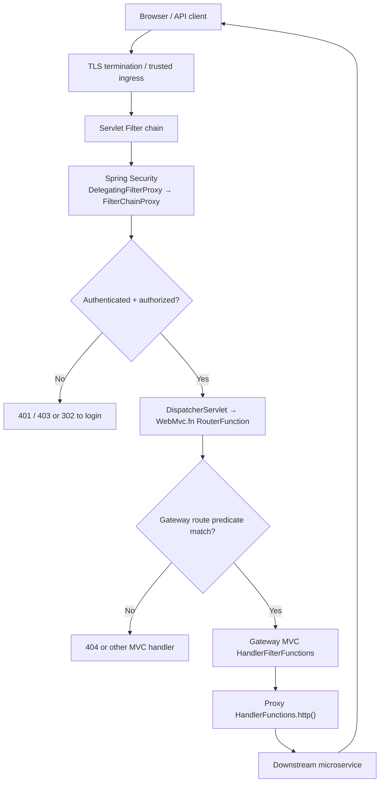
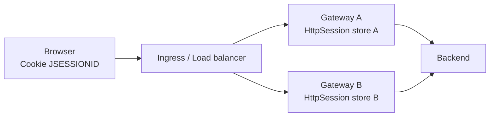
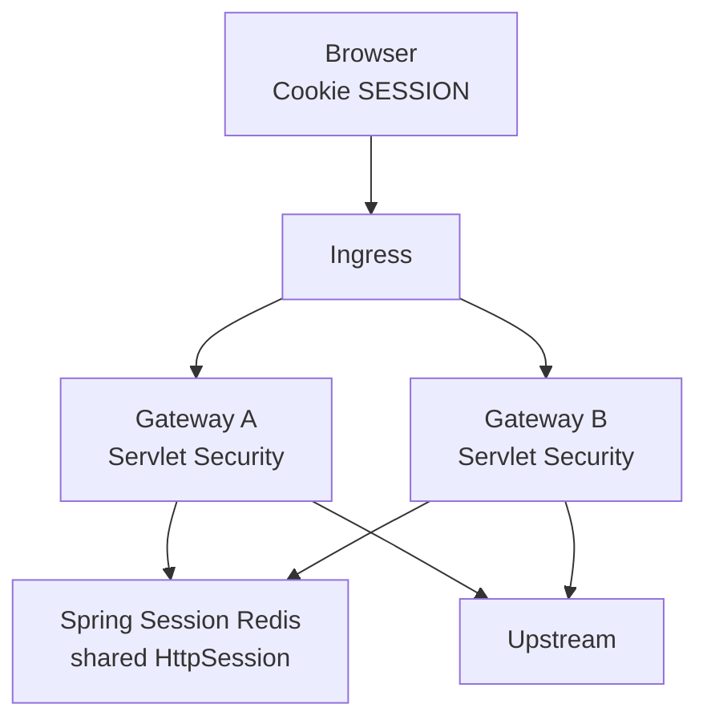
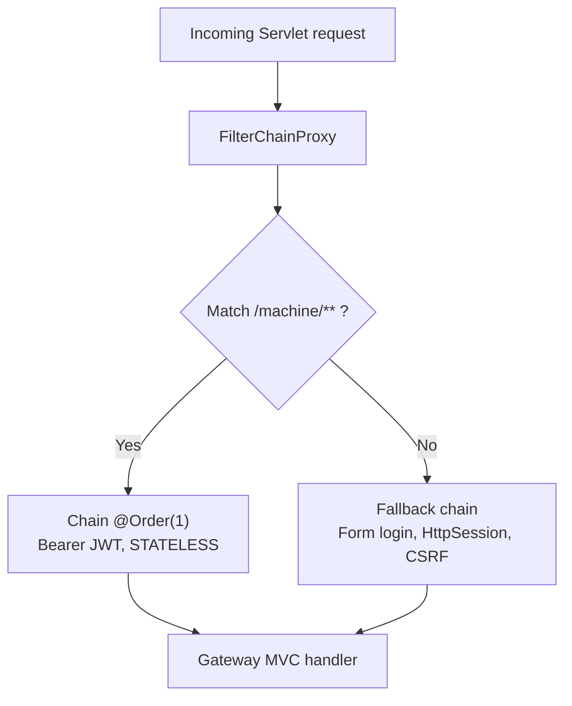
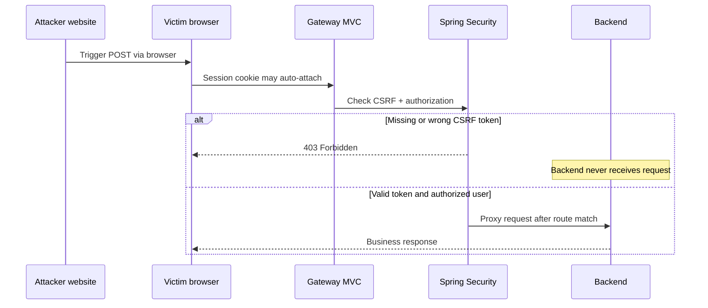
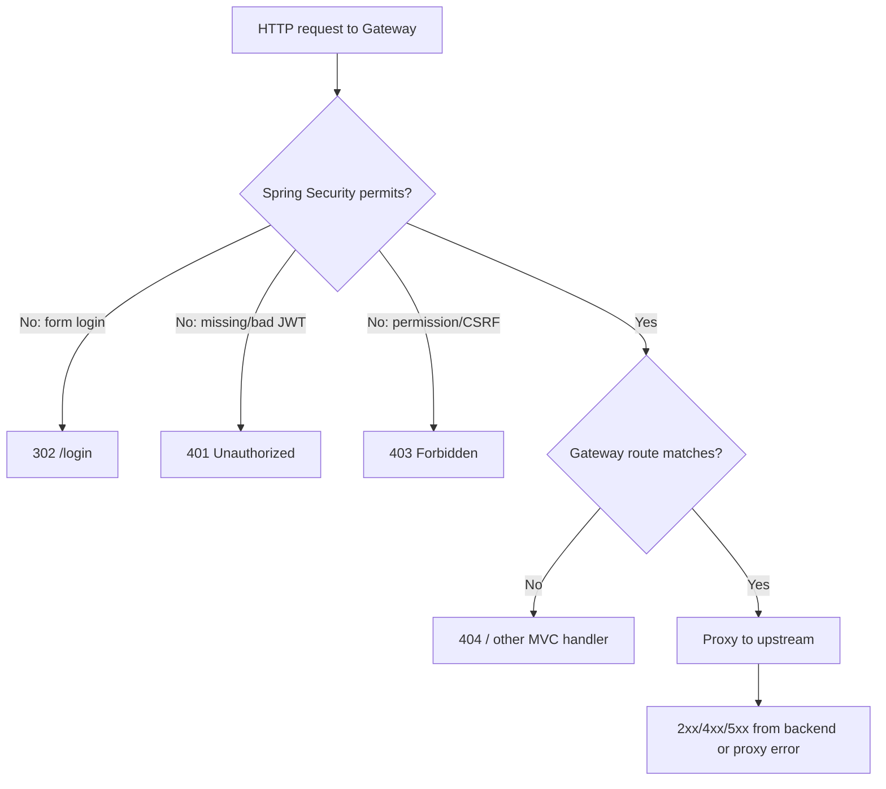

# Integrating SecurityFilterChain and Servlet Session Management in Spring Cloud Gateway Server Web MVC

**Spring Cloud Gateway Server Web MVC** is the Gateway variant running on **Spring MVC / WebMvc.fn and a Servlet container** such as Tomcat or Jetty. It still handles the microservice entry gateway duties: selecting routes with predicates, running route filters, rewriting paths/headers, forwarding to target services, supporting service discovery, and enforcing authentication, rate limiting, circuit breakers, retries, TLS, and request observability. However, its security architecture **differs from Spring Cloud Gateway Server WebFlux**.

In Web MVC, an HTTP request passes through the Servlet Filter chain. **Spring Security's `SecurityFilterChain`** performs authentication and authorization before Spring MVC dispatches the request to a proxy `RouterFunction`/`HandlerFunction`. When using form login, Spring Security typically stores the `SecurityContext` in a **Servlet `HttpSession`**, while the browser holds a cookie carrying the session ID (typically `JSESSIONID`). Because a Gateway often runs across multiple replicas, deciding **where sessions live, how cookies are protected, and whether they ever reach backends** is a crucial architectural decision.

This lesson belongs to the **Server Web MVC** chapter in the `SPRING_CLOUD_GATEWAY` module. We will practice Servlet session login, connect a `SecurityFilterChain` to a Gateway route, inspect `JSESSIONID`/CSRF/session fixation, and then compare with stateless JWTs, Spring Session Redis, and production scenarios.

> **Scope:** Spring Cloud Gateway **Server Web MVC 5.0.x**, Spring Cloud 2025.1.x, Spring Boot 4.x, and compatible Spring Security Servlet. Route namespace is `spring.cloud.gateway.server.webmvc.routes`. The configuration classes in the examples are **`HttpSecurity` + `SecurityFilterChain`**, not Gateway Server WebFlux's `ServerHttpSecurity` + `SecurityWebFilterChain`. When deploying, use supported version pairs with active security patches; never mix WebFlux and MVC starters.

## 1. Learning Objectives

After this lesson, you will be able to:

1. Explain the roles of `DelegatingFilterProxy`, `FilterChainProxy`, `SecurityFilterChain`, Servlet `HttpSession`, and Gateway MVC's `RouterFunction`/`HandlerFunction`.
2. Configure `SecurityFilterChain` for public routes, authenticated routes, and management endpoints following **default deny**.
3. Distinguish `securityMatcher` across multiple Security chains from `requestMatchers` used for authorization inside one chain, and distinguish both from Gateway's `Path` predicate.
4. Build a Spring Boot MVC Gateway lab with form login, `JSESSIONID`, CSRF, session fixation protection, and a Java echo backend.
5. Determine when a Servlet session is appropriate vs. when to use `SessionCreationPolicy.STATELESS` with a JWT Resource Server.
6. Secure cookie flags (`HttpOnly`/`Secure`/`SameSite`/`Path`), handle logout/timeouts/concurrent sessions, and prevent leaking Gateway cookies to backends.
7. Design multi-replica Gateways using Spring Session Redis or evaluate the limitations of sticky sessions.
8. Distinguish OAuth2 `TokenRelay`, Gateway sessions, downstream tokens, and backend authorization.
9. Test safely for 302/401/403/404 responses, CSRF, session expiration, security chain ordering, logout, and failover.

## 2. Architecture Map: Security Runs Before Proxying

A request typically flows through these layers:



```text
Servlet layer:
  Servlet container (HttpServletRequest, HttpServletResponse, HttpSession)
    -> Filters (Spring Security and other Filters)
    -> DispatcherServlet
    -> Spring MVC handler mapping / WebMvc.fn RouterFunction

Spring Cloud Gateway Server Web MVC layer:
  Route predicate (Path, Method, Host, ...)
    -> HandlerFilterFunctions / BeforeFilterFunctions / AfterFilterFunctions
    -> HandlerFunctions.http() -> upstream
```

**Two very different "filter chains":**

| Component | Layer | Primary job |
|---|---|---|
| `SecurityFilterChain` | Spring Security Servlet | Authentication, authorization, CSRF, security context, sessions, logout |
| `FilterChainProxy` | Spring Security | Picks **one matching `SecurityFilterChain`** by matcher and order |
| `HandlerFilterFunction` | Spring MVC functional routing | Filters a `RouterFunction`/`HandlerFunction`; transforms route requests/responses |
| `BeforeFilterFunctions.stripPrefix(...)` | Gateway MVC | Transforms the path sent downstream |
| `HandlerFunctions.http()` | Gateway MVC | Forwards HTTP requests upstream |
| `HttpSession` | Servlet container or Spring Session | **Gateway's** session state |
| `SecurityContextRepository` | Spring Security | Stores/loads authentication context, typically via `HttpSession` when stateful |

Spring Security does not depend on whether a Gateway route declares an auth filter: Servlet Security can reject requests **before route matching**. Conversely, a `HandlerFilterFunction` does not automatically enforce authentication/CSRF across every endpoint in the Servlet application.

### 2.1. Ordering Has Security Meaning

For an unauthenticated `GET /app/api/items`, Spring Security can redirect straight to `/login`, so the backend is **never called**. Once logged in, the request reaches the Gateway route and is proxied. An unmatched path can still require login via Spring Security before returning 404, depending on your configuration.

Consequently:

- `302 Found` to login **does not prove** the Gateway route matched.
- `401 Unauthorized` typically comes from HTTP Basic or JWT authentication entry points.
- `403 Forbidden` typically comes from authorization denial or CSRF rejection.
- `404 Not Found` may appear only after clearing Security when no handler/route matches.
- `502`/`503` points to upstream/network issues after passing the earlier layers.

### 2.2. Web MVC Does Not Use WebFlux Reactive APIs

| Aspect | Gateway Server Web MVC | Gateway Server WebFlux |
|---|---|---|
| Web runtime | Servlet, Spring MVC/WebMvc.fn | Reactive WebFlux / Reactor Netty |
| Security builder | `HttpSecurity` | `ServerHttpSecurity` |
| Security chain | `SecurityFilterChain` | `SecurityWebFilterChain` |
| HTTP session | `jakarta.servlet.http.HttpSession` | `WebSession` / reactive session mechanisms |
| Gateway routes | `RouterFunction`/`HandlerFunction`, or MVC YAML | `Route`/`GatewayFilterFactory`, or WebFlux YAML |
| YAML namespace | `spring.cloud.gateway.server.webmvc.routes` | `spring.cloud.gateway.server.webflux.routes` |
| Common session store | Servlet session/Tomcat, Spring Session Redis | Reactive session repository if needed |
| Securing routes | Servlet filters before Gateway MVC handlers | WebFlux security web filters in reactive chain |

Never use `@EnableWebFluxSecurity`, `ServerHttpSecurity`, `SecurityWebFilterChain`, or `ReactiveSessionRegistry` in this MVC lab. Likewise, never put `spring.cloud.gateway.server.webflux.routes` into a Gateway MVC application expecting routes to appear.

## 3. `HttpSession`, `JSESSIONID`, and `SecurityContext`

### 3.1. A Form Login Lifecycle

```mermaid
sequenceDiagram
    participant B as Browser
    participant G as Gateway MVC
    participant S as Spring Security
    participant H as HttpSession store
    participant U as Backend
    B->>G: GET /app/api/items
    G->>S: Servlet security filters
    S-->>B: 302 Location: /login
    B->>G: GET /login and CSRF token
    B->>G: POST /login + username/password + CSRF + cookie
    G->>S: Authenticate credentials
    S->>H: Save SecurityContext in session
    S-->>B: Set-Cookie: JSESSIONID=...; 302 redirect
    B->>G: GET /app/api/items + JSESSIONID
    S->>H: Look up session, load Authentication
    S-->>G: Authenticated + authorized
    G->>U: Proxy GET /items
    U-->>G: 200 OK
    G-->>B: 200 OK
```

In practice, **a session can be created before login** to store a CSRF token or saved request. Upon successful login, Spring Security defends against **session fixation** by rotating the session ID on modern Servlet containers. The sequence above shows logical milestones, not a claim that cookies only first appear after authentication.

### 3.2. Cookies Carry an ID, Not the Entire Authentication Object

Upon successful login, browsers typically hold:

```http
Set-Cookie: JSESSIONID=<opaque-id>; Path=/; HttpOnly; SameSite=Lax
```

On the next request:

```http
Cookie: JSESSIONID=<opaque-id>
```

The cookie normally contains only a **random session identifier**; the server uses that ID to look up `HttpSession`/`SecurityContext`. **Do not confuse `JSESSIONID` with a JWT**: a session ID is not a self-verifying claims token and should never be sent in `Authorization: Bearer`.

A session ID is a **sensitive bearer credential**: anyone capturing a valid cookie can impersonate the session while it lives. Enforce HTTPS/WSS, appropriate `Secure`, `HttpOnly`, and `SameSite` flags, session fixation protection, logout, and timeouts, and **never log cookies or blindly forward them to every upstream**.

### 3.3. How Spring Security Persists Authentication

Spring Security uses `SecurityContextHolder` so code reads `Authentication` during a request, while `SecurityContextRepository` loads and saves the context across requests.

In modern Servlet stacks, Spring Security uses `SecurityContextHolderFilter` and **explicit `SecurityContext` saving** whenever custom authentication logic sets an authentication object. Standard mechanisms like form login handle persistence for you. If you write a custom login filter or controller that sets:

```java
SecurityContextHolder.getContext().setAuthentication(authentication);
```

and finishes the response **without** calling `SecurityContextRepository.saveContext(...)` when required, the next request drops back to anonymous. Never write a "custom login" that only mutates the ThreadLocal expecting sessions to persist automatically.

The lab below uses **standard form login** instead of a custom auth filter so CSRF, session fixation, persistence, and logout work as supported by the framework.

### 3.4. When Does the Servlet Container Create an `HttpSession`?

A simple public GET **may not create** a session. Sessions can be created when:

- A CSRF token is stored via `HttpSessionCsrfTokenRepository`.
- Spring Security saves the original request in `RequestCache` before redirecting to login.
- Form login succeeds and authentication is persisted.
- Application code calls `request.getSession()` (which creates one by default if missing).
- Another component (OAuth2 login, flash attributes, remember-me per config) stores state.

To **inspect without creating** a session, call `request.getSession(false)`. When counting active sessions, never equate every HTTP request with a session or assume `JSESSIONID` appears on every response.

## 4. Choosing a Model: Stateful Session, Stateless JWT, or Hybrid

Before configuring, decide whether the Gateway **acts as a login proxy for browsers**, **validates bearer tokens from API clients**, or **combines both**.

| Model | How clients carry identity | Does Gateway store sessions? | Suitable scenarios |
|---|---|---|---|
| **Stateful form login** | `JSESSIONID` cookie | Yes, `HttpSession`/`SecurityContext` | Web admin UIs, browser sessions / BFF |
| **OAuth2 login + token relay** | Usually session cookie after OAuth2 login | Usually session + OAuth2 authorized client | Gateway acts as OAuth2 client for browsers, proxies API backends |
| **Stateless JWT resource server** | `Authorization: Bearer <JWT>` per request | No authentication session needed | Mobile/server-to-server APIs with issuer/audience/scopes |
| **Hybrid, multiple `SecurityFilterChain`s** | Browsers use cookies, APIs use bearer | Yes on browser chain; API chain is STATELESS | One Gateway serving both browsers and machine clients |
| **Verified API key** | Header / API key | Depends on design | Partner APIs; needs quotas, rotation, clear auth policies |

No single model fits everywhere. Stateful sessions simplify browser flows yet require session stores, CSRF, session fixation defense, and multi-replica care. Stateless JWTs avoid shared sessions yet demand signature, expiry, issuer, audience, scope, revocation, and leak controls.

**Important:** `SessionCreationPolicy.STATELESS` does not make HTTP "automatically secure." It only tells Spring Security not to use `HttpSession` to store/retrieve `SecurityContext`. It does not replace JWT validation, authorization, CSRF risk assessment, or stop other Servlet components from creating sessions.

## 5. Maven Dependencies: Using Gateway Server Web MVC

For compatible Spring Boot 4.x + Spring Cloud Gateway 5.0.x:

```xml
<dependencies>
    <!-- Gateway MVC using Servlet / WebMvc.fn -->
    <dependency>
        <groupId>org.springframework.cloud</groupId>
        <artifactId>spring-cloud-starter-gateway-server-webmvc</artifactId>
    </dependency>

    <!-- HttpSecurity, SecurityFilterChain, and form login -->
    <dependency>
        <groupId>org.springframework.boot</groupId>
        <artifactId>spring-boot-starter-security</artifactId>
    </dependency>
</dependencies>
```

This is a **dependencies snippet**, not a complete `pom.xml`. Your project needs the Spring Boot parent/plugin and a Spring Cloud BOM from the matching release train; never pin mismatched starter versions manually. `spring-cloud-starter-gateway-server-webmvc` brings Gateway MVC components and the Servlet web runtime; if the app also declares `spring-boot-starter-webmvc`, verify there are no dependency conflicts.

Optional dependencies:

| Need | Dependency |
|---|---|
| OAuth2 login / token relay | `org.springframework.boot:spring-boot-starter-oauth2-client` |
| JWT / opaque token resource server | `org.springframework.boot:spring-boot-starter-oauth2-resource-server` |
| Shared Servlet sessions in Redis (Boot 4) | `org.springframework.boot:spring-boot-starter-session-data-redis` |
| Health / metrics / Actuator observability | `org.springframework.boot:spring-boot-starter-actuator` |

**Do not add `spring-cloud-starter-gateway-server-webflux` to this lab.** Mixing MVC and WebFlux components can alter web application type detection and security auto-configuration unexpectedly. This lesson intentionally runs on Servlet with `jakarta.servlet.http.HttpServletRequest`/`HttpSession`.

### 5.1. Security Does Not Automatically Protect Business Paths Correctly

Adding only `spring-boot-starter-security` typically secures all HTTP endpoints under a default chain. However, it **cannot know** which paths are public, admin-only, internal, tenant-A-only, or require OAuth scopes. Always define explicit `SecurityFilterChain` rules rather than leaving every path with uniform access.

## 6. End-to-End Lab: Form Login + `JSESSIONID` Before Proxying

Lab goals:

- Gateway MVC listens on `127.0.0.1:8080`.
- Route `GET /app/api/**` passes Security and forwards to `127.0.0.1:9001`.
- Unauthenticated callers receive **302 to `/login`**, never hitting the backend.
- After login, browsers send `JSESSIONID`; requests are allowed through to the backend.
- The route strips the `Cookie` header **before proxying**, preventing Gateway's session ID from leaking to internal backends that shouldn't see sessions.
- CSRF protects `POST /login` and `POST /logout`; Security rotates the session ID on login.
- A loopback `/_lab/csrf` endpoint lets learners fetch CSRF tokens with `curl`. **Never expose this endpoint to the Internet or production.**

### 6.1. Create the Gateway Application

`GatewayMvcApplication.java`:

```java
import org.springframework.boot.SpringApplication;
import org.springframework.boot.autoconfigure.SpringBootApplication;

@SpringBootApplication
public class GatewayMvcApplication {
    public static void main(String[] args) {
        SpringApplication.run(GatewayMvcApplication.class, args);
    }
}
```

Place `GatewayMvcApplication`, security config, and the lab controller in the **same package or subpackages** so Spring Boot's component scan detects all beans. For multi-file apps, never place classes in the default package in production.

### 6.2. `application.yml` with Route and Session Cookie Settings

```yaml
server:
  address: 127.0.0.1   # Local personal lab only
  port: 8080
  servlet:
    session:
      timeout: 15m
      cookie:
        http-only: true
        same-site: lax
        # Do not set secure: true for HTTP labs; production must use
        # HTTPS and secure: true on public cookies.

spring:
  application:
    name: gateway-mvc-session-lab
  cloud:
    gateway:
      server:
        webmvc:
          routes:
            - id: demo-profile
              uri: http://127.0.0.1:9001
              predicates:
                - Path=/app/api/**
                - Method=GET
              filters:
                - StripPrefix=2
                - RemoveRequestHeader=Cookie
```

Route processing:

```text
Client:  GET /app/api/items
SecurityFilterChain: requires role USER
StripPrefix=2: /app/api/items -> /items
RemoveRequestHeader=Cookie: do not send JSESSIONID to backend
Backend: GET http://127.0.0.1:9001/items
```

**Why is `RemoveRequestHeader=Cookie` needed?** The `JSESSIONID` cookie is a credential at **Gateway's** trust boundary. If a backend expects public requests or receives identity via a dedicated signed mechanism, it must never accidentally receive Gateway's session ID. If a backend genuinely requires its own cookies, do not wipe all cookies blindly—forward cookies using a **strict name/target allowlist** and verify session domains/ownership.

`server.servlet.session.timeout` is the Servlet session inactivity timeout. It is **not** an absolute lifetime guaranteeing a session expires after X time since login; if an absolute lifetime is required, implement explicit policy or identity-provider controls.

### 6.3. Stateful `SecurityFilterChain` with CSRF Enabled

Create `GatewaySecurityConfig.java`:

```java
import org.springframework.context.annotation.Bean;
import org.springframework.context.annotation.Configuration;
import org.springframework.http.HttpMethod;
import org.springframework.security.config.Customizer;
import org.springframework.security.config.annotation.web.builders.HttpSecurity;
import org.springframework.security.config.annotation.web.configuration.EnableWebSecurity;
import org.springframework.security.config.http.SessionCreationPolicy;
import org.springframework.security.core.userdetails.User;
import org.springframework.security.core.userdetails.UserDetailsService;
import org.springframework.security.crypto.bcrypt.BCryptPasswordEncoder;
import org.springframework.security.crypto.password.PasswordEncoder;
import org.springframework.security.provisioning.InMemoryUserDetailsManager;
import org.springframework.security.web.SecurityFilterChain;

@Configuration
@EnableWebSecurity
public class GatewaySecurityConfig {

    @Bean
    SecurityFilterChain gatewaySecurity(HttpSecurity http) throws Exception {
        http
            .authorizeHttpRequests(auth -> auth
                // Form login and CSRF token helper for LAB ONLY.
                .requestMatchers("/login", "/_lab/csrf", "/error").permitAll()
                .requestMatchers(HttpMethod.GET, "/_lab/whoami")
                    .authenticated()
                .requestMatchers(HttpMethod.GET, "/app/api/**")
                    .hasRole("USER")
                .anyRequest().denyAll())
            // Default CSRF protection stays enabled; no .csrf(disable).
            .formLogin(Customizer.withDefaults())
            .logout(logout -> logout
                .logoutUrl("/logout")
                .logoutSuccessUrl("/login?logout")
                .invalidateHttpSession(true)
                .deleteCookies("JSESSIONID")
                .permitAll())
            .sessionManagement(session -> session
                .sessionCreationPolicy(SessionCreationPolicy.IF_REQUIRED)
                .sessionFixation(fix -> fix.changeSessionId()));

        return http.build();
    }

    @Bean
    PasswordEncoder passwordEncoder() {
        return new BCryptPasswordEncoder();
    }

    @Bean
    UserDetailsService users(PasswordEncoder encoder) {
        // LAB ONLY: never hardcode production credentials.
        return new InMemoryUserDetailsManager(
            User.withUsername("student")
                .password(encoder.encode("demo-only-change-me"))
                .roles("USER")
                .build()
        );
    }
}
```

**Meaning of key lines:**

| Configuration | Meaning |
|---|---|
| `HttpSecurity` | Spring Security **Servlet** builder |
| `@EnableWebSecurity` | Enables web security infrastructure and registers the Servlet security filter chain |
| `permitAll()` for login/`/_lab/csrf` | Allows browsers to reach login and fetch CSRF tokens before authenticating |
| `hasRole("USER")` | Requires authority `ROLE_USER` on the lab route |
| `anyRequest().denyAll()` | Denies any undeclared URLs |
| `formLogin(...)` | Username/password authentication with default login page |
| `logout(...)` | Invalidates session, clears context/cookies, and redirects after logout |
| `SessionCreationPolicy.IF_REQUIRED` | Creates sessions when security mechanisms require them |
| `changeSessionId()` | Protects against session fixation |
| `BCryptPasswordEncoder` | Hashes lab user passwords instead of storing plaintext |

**There is no CSRF disablement.** Spring Security validates CSRF tokens on state-changing requests such as `POST /login` and `POST /logout`. Although the lab has a GET endpoint returning the token, fetching a token is not authentication; it simply exposes the synchronizer token so a **same-site browser** or `curl` can submit it on the next request.

### 6.4. Session and CSRF Debug Endpoints — Loopback Only

`LabSessionController.java`:

```java
import java.security.Principal;
import java.util.Map;

import jakarta.servlet.http.HttpServletRequest;

import org.springframework.security.web.csrf.CsrfToken;
import org.springframework.web.bind.annotation.GetMapping;
import org.springframework.web.bind.annotation.RequestAttribute;
import org.springframework.web.bind.annotation.RestController;

@RestController
public class LabSessionController {

    @GetMapping("/_lab/csrf")
    public Map<String, String> csrf(
            @RequestAttribute("_csrf") CsrfToken csrfToken) {
        // getToken() forces resolving the deferred token, for lab use.
        return Map.of(
            "parameterName", csrfToken.getParameterName(),
            "headerName", csrfToken.getHeaderName(),
            "token", csrfToken.getToken()
        );
    }

    @GetMapping("/_lab/whoami")
    public Map<String, Object> whoami(
            Principal principal, HttpServletRequest request) {

        return Map.of(
            "user", principal.getName(),
            "sessionExists", request.getSession(false) != null
        );
    }
}
```

**Boundary:** `/_lab/csrf` is **never something to expose in production**. Never set `Access-Control-Allow-Origin: *`, and never let external sites read tokens bound to a cookie session. Tokens must never appear in URLs or access logs. `/_lab/whoami` returns only username and `sessionExists`—**never raw session IDs**, cookie values, or full `Authentication` objects.

`@RequestAttribute("_csrf")` reads the `CsrfToken` placed on the Servlet request by Spring Security; in modern Spring Security, tokens may be lazy/deferred. Calling `getToken()` forces generation/resolution so the lab client can send it in POST forms.

### 6.5. Separate JDK HTTP Backend

Create `MvcGatewayBackend.java` in a separate lab directory from the Gateway code:

```java
import com.sun.net.httpserver.HttpServer;
import java.net.InetSocketAddress;
import java.nio.charset.StandardCharsets;
import java.util.concurrent.atomic.AtomicLong;

public class MvcGatewayBackend {
    public static void main(String[] args) throws Exception {
        HttpServer server = HttpServer.create(
            new InetSocketAddress("127.0.0.1", 9001), 0);
        AtomicLong calls = new AtomicLong();

        server.createContext("/", exchange -> {
            long n = calls.incrementAndGet();
            boolean cookieForwarded =
                    exchange.getRequestHeaders().getFirst("Cookie") != null;

            String body = "{\"backendCall\":" + n
                + ",\"path\":\"" + exchange.getRequestURI().getRawPath()
                + "\",\"cookieForwarded\":" + cookieForwarded + "}";
            byte[] bytes = body.getBytes(StandardCharsets.UTF_8);

            exchange.getResponseHeaders().set(
                "Content-Type", "application/json; charset=utf-8");
            exchange.getResponseHeaders().set(
                "Cache-Control", "no-store");

            exchange.sendResponseHeaders(200, bytes.length);
            try (var out = exchange.getResponseBody()) {
                out.write(bytes);
            }

            System.out.println("upstream request#" + n);
        });

        server.start();
        System.out.println("Backend on http://127.0.0.1:9001");
    }
}
```

The backend **has no auth layer** and binds strictly to `127.0.0.1` in the lab. In production, upstream services still require per-resource/tenant authorization, mTLS, or workload identity; **never treat an exposed backend as safe just because Gateway checks login**.
The backend returns `cookieForwarded` to confirm the route stripped `Cookie` without printing cookie values. When requests are unauthorized, `backendCall` **must not increment**, proving Security blocked them before proxying.

### 6.6. Starting Up and Checking Initial Conditions

First terminal (JDK 17+):

```bash
java --add-modules jdk.httpserver MvcGatewayBackend.java
```

Second terminal, in the Gateway project:

```bash
# Linux/macOS
./mvnw spring-boot:run

# Windows PowerShell
.\mvnw.cmd spring-boot:run
```

Verify the backend directly:

```bash
curl -i http://127.0.0.1:9001/items
```

Sample response:

```http
HTTP/1.1 200 OK
Content-Type: application/json; charset=utf-8
Cache-Control: no-store

{"backendCall":1,"path":"/items","cookieForwarded":false}
```

In the lab, calling the backend directly increments the counter. Subsequent calls through Gateway will not start at `backendCall=1` if you already ran direct checks; what matters is whether the count **increments or stays unchanged** when requests hit upstream.

## 7. Practicing Login and Session Verification with `curl`

The lab uses **loopback** HTTP; never reuse lab passwords in production. In Windows PowerShell 5.1, use `curl.exe` instead of the `curl` alias; multi-line Bash commands below can be run as single lines in PowerShell.

### 7.1. Unauthenticated: Security Blocks Before Gateway Handler

```bash
curl -i http://127.0.0.1:8080/app/api/items
```

Because `formLogin` is configured, an unauthenticated caller typically receives:

```http
HTTP/1.1 302 Found
Location: http://127.0.0.1:8080/login
```

In some setups `Location` may be relative or include query/URL-encoding determined by container/Security. What you must verify is that **Gateway did not proxy to the backend when unauthorized**. If `backendCall` increments, fix `SecurityFilterChain`/matchers before deploying.

**Do not assume unauthenticated requests always return 401** in a form-login app: 302 to `/login` is expected. For JWT Resource Servers or HTTP Basic, unauthenticated requests typically return `401`. The difference is the **authentication entry point**, not route predicates.

### 7.2. Fetching the Cookie Jar and CSRF Token

First save cookies into `cookie-jar.txt`:

```bash
curl -i -c cookie-jar.txt \
  http://127.0.0.1:8080/_lab/csrf
```

Example body (actual token will differ):

```json
{
  "parameterName": "_csrf",
  "headerName": "X-CSRF-TOKEN",
  "token": "<generated-csrf-token>"
}
```

Spring Security may create an `HttpSession` to store the synchronizer token and send `Set-Cookie: JSESSIONID=...`. In `curl`, `-c cookie-jar.txt` writes server cookies and `-b cookie-jar.txt` sends saved cookies on subsequent requests.

**Never copy the placeholder token from the JSON example**; copy the fresh `token` value from your live response into the next command. A CSRF token is not a password, not a JWT, and does not replace user authentication.

### 7.3. Logging In via Form POST with CSRF

```bash
curl -i -b cookie-jar.txt -c cookie-jar.txt \
  --data-urlencode "username=student" \
  --data-urlencode "password=demo-only-change-me" \
  --data-urlencode "_csrf=<actual-token-just-fetched>" \
  http://127.0.0.1:8080/login
```

With standard form login, success typically yields a **302 redirect** to the saved request or default success URL—do not expect a JSON access token. The session cookie ID should **rotate after login** via `changeSessionId()`; `curl` passes both `-b` and `-c` so it captures the updated cookie.

Next:

```bash
curl -i -b cookie-jar.txt \
  http://127.0.0.1:8080/_lab/whoami

curl -i -b cookie-jar.txt \
  http://127.0.0.1:8080/app/api/items
```

Expected:

```json
{"user":"student","sessionExists":true}
```

And from upstream via Gateway:

```http
HTTP/1.1 200 OK
Content-Type: application/json; charset=utf-8

{"backendCall":2,"path":"/items","cookieForwarded":false}
```

The `backendCall` number is **illustrative** and depends on prior backend hits. Verify `path=/items` and `cookieForwarded=false`, while the same cookie jar allows subsequent requests.

### 7.4. Testing Missing CSRF

If you POST directly to `/login` **without a CSRF token**:

```bash
curl -i -X POST \
  --data-urlencode "username=student" \
  --data-urlencode "password=demo-only-change-me" \
  http://127.0.0.1:8080/login
```

You normally get `403 Forbidden` before authentication runs. That is expected when CSRF is active for form login. **Never "fix" this with `http.csrf(csrf -> csrf.disable())`** just to get a lab login working—doing so strips an essential defense whenever browsers auto-send session cookies.

The right fix: submit forms with the hidden `_csrf` input, or have `curl` fetch the token from the same session and submit it back. SPAs need proper CSRF handlers, especially when using `CookieCsrfTokenRepository` and BREACH-protected token masking.

### 7.5. Logout Requires a Fresh CSRF Token

After logging in, **fetch a fresh CSRF token** because Spring Security can clear/rotate tokens upon authentication success:

```bash
curl -i -b cookie-jar.txt -c cookie-jar.txt \
  http://127.0.0.1:8080/_lab/csrf
```

Use the new token for:

```bash
curl -i -b cookie-jar.txt -c cookie-jar.txt \
  --data-urlencode "_csrf=<new-token-after-login>" \
  http://127.0.0.1:8080/logout
```

Expected: redirect to `/login?logout`; session invalidated, `SecurityContext` cleared, and cookie deletion requested per config. After logout:

```bash
curl -i -b cookie-jar.txt \
  http://127.0.0.1:8080/app/api/items
```

must return to the unauthenticated flow (typically redirecting to login). Never treat deleting a browser cookie as sufficient if the **server-side session stays alive**; logout must genuinely invalidate server-side session state.

### 7.6. A Real Browser Helps Verify Cookie Flags

In a browser:

1. Visit `http://127.0.0.1:8080/app/api/items` and confirm redirect to login.
2. Sign in with `student` and the lab password in Spring Security's login form.
3. Inspect Network/Storage in DevTools: `JSESSIONID` has `HttpOnly` and `SameSite=Lax`; on HTTP labs it will **not yet have `Secure`**.
4. Reload `/app/api/items` and confirm the backend responds without receiving any cookie.
5. Sign out via the CSRF-protected logout form and verify subsequent requests lose access.
6. Never paste or share **real cookie values** in tickets, screenshots, or logs.

When production uses HTTPS at ingress, `Secure` must apply to public cookies even if Gateway receives plain HTTP internally behind ingress. See the forwarded-headers and TLS discussion below.

## 8. Servlet Session Management: Policies, Cookies, Timeouts, Logout

### 8.1. What Does `SessionCreationPolicy` Solve?

| Policy | Main meaning | When to use |
|---|---|---|
| `ALWAYS` | Spring Security proactively creates an HTTP session | Rarely needed on API Gateways |
| `IF_REQUIRED` | Creates a session when security mechanisms need one | Stateful form login / OAuth2 browser sessions |
| `NEVER` | Spring Security never creates a session, yet uses an existing one | Specialized migration cases; easily misunderstood |
| `STATELESS` | Spring Security neither creates nor uses sessions for `SecurityContext` | Bearer-only JWT / opaque resource-server APIs |

**`NEVER` is not `STATELESS`.** If another component creates a session, `NEVER` still lets Spring Security reuse that session. With `STATELESS`, Security uses `NullSecurityContextRepository` / stateless handling and never reads `HttpSession` for `SecurityContext`.

In a hybrid Gateway, never configure the whole app as `STATELESS` expecting browser form login to preserve cookies; separate Security chains or pick one clear model.

### 8.2. Inactivity Timeouts Are Not Absolute Lifetimes

`server.servlet.session.timeout: 15m` normally means a session can expire after roughly **15 minutes with no counted activity**. Never claim a session expires strictly 15 minutes after login, because every valid request resets the inactivity timer. Servlet containers, Spring Session Redis, and middleware each implement cleanup on their own schedules.

If you need:

- **Idle timeout:** too long without activity → session expires.
- **Absolute expiration:** more than X hours since login even while active → force re-login.
- **Revocation:** admin immediately revokes a user/session.
- **Concurrent session limits:** same user holds at most N active sessions.

design and test each capability explicitly rather than relying on a single timeout property.

### 8.3. Meaning of Cookie Flags

| Attribute | Purpose | Notes |
|---|---|---|
| `HttpOnly` | JS cannot read the cookie via `document.cookie` | Does not replace full XSS defenses |
| `Secure` | Browser sends cookie over HTTPS only | Enable on public TLS in production; HTTP labs cannot send `Secure` cookies |
| `SameSite=Lax` | Mitigates several cross-site CSRF paths | Does not replace CSRF synchronizer tokens |
| `SameSite=Strict` | Stricter cross-site blocking | Can break OAuth2 redirects or deep links |
| `SameSite=None` | Allows cross-site cookie sending | Requires `Secure` in modern browsers; increases CSRF exposure |
| `Path` | Restricts request paths receiving the cookie | Not an authorization boundary |
| `Domain` | Cookie domain/subdomain scope | Avoid overly broad domains |
| `Max-Age`/`Expires` | Client-side cookie lifetime | Distinct from actual server-side session lifetime |

**Illustrative HTTPS** production YAML:

```yaml
server:
  servlet:
    session:
      timeout: 30m
      cookie:
        http-only: true
        secure: true
        same-site: lax
        path: /
```

Spring Boot 4 supports `server.servlet.session.cookie.same-site` for Servlet sessions, including with Spring Session. Never set `secure: false` for authentication cookies on the public Internet just because TLS terminates at a proxy; configure trusted-proxy scheme awareness or set `secure: true` explicitly.

### 8.4. Session Fixation Protection

Attackers can try to trick victims into logging in with a known session ID. Spring Security defends by default on modern Servlet containers by **changing the session ID upon authentication** (`changeSessionId()`).

Options:

- `changeSessionId()`: calls `HttpServletRequest.changeSessionId()`, keeping the session object while rotating its ID.
- `newSession()`: creates a fresh session and limits copied attributes.
- `migrateSession()`: copies old attributes into a new session.
- `none()`: disables protection—**not recommended**.

Never set `none()` just to make a test comparing cookie IDs before/after login look "stable." With custom login mechanisms, ensure `SessionAuthenticationStrategy` runs properly; standard login mechanisms handle this automatically, whereas custom filters must integrate explicitly.

### 8.5. Logout Is a Server-Side Operation

Spring Security Servlet provides default logout support:

- `POST /logout` with a valid CSRF token when CSRF is enabled.
- Invalidates the HTTP session.
- Clears `SecurityContext` / authentication.
- Clears CSRF tokens and remember-me tokens as configured.
- Redirects to a configured target URL.

`deleteCookies("JSESSIONID")` asks browsers to remove the cookie; cookie name, path, and domain must match actual configuration, and deletion behavior depends on container/proxy. If using Spring Session with a different cookie name, adjust accordingly. You can consider `Clear-Site-Data` over HTTPS per browser support, but never treat it as a substitute for server-side session invalidation.

### 8.6. Limiting Concurrent Sessions

When policy allows at most one session per user:

```java
http.sessionManagement(session -> session
    .maximumSessions(1)
    .maxSessionsPreventsLogin(true)
);
```

This is an **extension snippet** on `HttpSecurity`, not a separate `SecurityFilterChain` bean. With `maxSessionsPreventsLogin(true)`, a second login is rejected; otherwise, the older session is invalidated per policy.

In a single JVM, Spring Security tracks session lifecycle registries/events (e.g., `HttpSessionEventPublisher` where needed). Across multiple replicas, an in-memory `SessionRegistryImpl` **has no knowledge of sessions on other replicas**. For cluster-wide concurrency control, wire `SpringSessionBackedSessionRegistry` with an indexed repository and verify behavior on your exact version; **enabling Redis sessions alone does not prove cluster-wide concurrency limits work**.

## 9. Multiple Gateway Replicas: Why Sessions Are Not Shared Automatically

In the lab, Tomcat/Gateway keeps sessions inside **one Servlet JVM**. When scaling out:



If a browser logs in via A, its cookie holds A's session ID. The next request routed to B **cannot find that session**, triggering a login redirect or 401 per policy. Two Gateways running identical code **do not share Servlet sessions automatically**.

### 9.1. Sticky Sessions Are Routing Optimization, Not Shared State

Load balancers can use session affinity to send a browser back to the same Gateway replica. This **reduces** lost sessions from replica hopping when state lives only in the JVM, yet:

- If replica A restarts or scales down, local sessions vanish.
- LB rebalances or failovers can shift users to B anyway.
- IP-based affinity skews traffic behind NAT/proxies.
- LB affinity cookies are separate cookies with their own policies and lifecycles.
- Sticky sessions do not solve global revocation or concurrent session limits across nodes.

**Never rely on sticky sessions alone** when logins must survive rolling deployments or failovers. Measure session-loss/re-login rates and manage graceful draining.

### 9.2. Shared Session Store with Spring Session Redis

Spring Session can **replace Servlet `HttpSession` with a Redis-backed implementation** via Servlet Filter `springSessionRepositoryFilter`. When A and B share the same session repository and namespace:



Now `SecurityContext` saved in the session repository can be read by Gateway B when B receives the same cookie ID—**provided** deployments share consistent configuration, serialization, and namespaces and the session has not expired. This is a **shared session**, not sharing a Java `SecurityContextHolder` ThreadLocal across processes.

Add the Spring Boot 4 starter:

```xml
<dependency>
    <groupId>org.springframework.boot</groupId>
    <artifactId>spring-boot-starter-session-data-redis</artifactId>
</dependency>
```

Illustrative config for a secured Redis environment:

```yaml
server:
  servlet:
    session:
      cookie:
        http-only: true
        secure: true
        same-site: lax

spring:
  data:
    redis:
      host: ${REDIS_HOST:localhost}
      port: ${REDIS_PORT:6379}
  session:
    timeout: 30m
    data:
      redis:
        namespace: gateway:mvc:sessions
        flush-mode: on_save
```

**Operational notes:**

- This **YAML snippet is for production with HTTPS**—never use `secure: true` unmodified on HTTP labs because browsers will not send the cookie over HTTP. Redis requires authentication, TLS, and secret management in real environments.
- Spring Boot supports `spring.session.timeout` and falls back to `server.servlet.session.timeout` in Servlet apps if unset.
- `spring.session.data.redis.namespace` isolates session keys across apps/environments; sharing Redis with different namespaces **does not** share sessions.
- Boot auto-configures `springSessionRepositoryFilter` via the starter; avoid adding `@EnableRedisHttpSession` unconditionally unless intentionally overriding configuration.
- **The cookie name typically changes to `SESSION`** with Spring Session. Never hardcode logout or proxy logic to `JSESSIONID`; inspect actual cookies and `CookieSerializer`.
- If monitoring surfaces session IDs, treat them as **sensitive credentials** and never paste them into logs or chat.
- If Redis disconnects, session-based auth can fail or time out; define an explicit failure policy rather than claiming the system stays secure by failing open.

### 9.3. Shared Sessions Alone Do Not Complete Logout and Concurrency Policies

Spring Session Redis shares `HttpSession`, yet you must still verify:

1. **Invalidation:** logging out on A causes requests to B with the old cookie to be rejected promptly.
2. **Session indexing/events:** cluster-wide concurrent login limits require an indexed repository/registry, not local `SessionRegistryImpl`.
3. **Serialization:** two app versions during a rolling update must both deserialize session objects; avoid storing large incompatible custom objects.
4. **Expiry:** align idle timeouts, Redis TTLs, cleanup intervals, and invalidation lag.
5. **Security:** Redis holds session/authentication state; protect it with auth/TLS, network policy, backups, and auditing.
6. **Capacity:** measure session counts, sizes, peak users, write rates, memory/connections, and Redis latency.
7. **Race conditions:** two concurrent requests can read/write the same session; Spring Session does not automatically resolve every concurrent mutation of business attributes.

**Never turn `HttpSession` into a business database.** Do not store large shopping carts, arbitrary token secrets, non-serializable objects, or critical financial documents in sessions just because Redis has memory.

### 9.4. When to Use JDBC Sessions Instead of Redis?

Spring Session Servlet also offers a JDBC store. It can make sense when an organization already operates robust database infrastructure and data policies, yet write amplification, session indexing/cleanup, latency, and peak login loads must be benchmarked. Choose stores based on SLOs, availability, and security, not just because "sessions need to be shared."

### 9.5. Enforcing Session Limits Across Multiple Replicas

A system requiring **at most one session per user cluster-wide** must define what counts as a session and when it is revoked. Calling only:

```java
.sessionManagement(session -> session.maximumSessions(1))
```

with a per-JVM registry **will not cover sessions in other JVMs**. Use `SpringSessionBackedSessionRegistry` paired with a session repository supporting indexing and event handling, verified on your exact version. Test two browsers logging in as the same user through **two different replicas** and confirm old/new sessions behave per policy.

## 10. Stateless JWT for APIs: Do Not Mix with Form Sessions

Some Gateways only need to validate tokens sent on each request; in that case cookie sessions add needless overhead.

### 10.1. Dedicated `SecurityFilterChain` for Bearer-Only APIs

**Alternative replacing the session lab** (do not put alongside the earlier `GatewaySecurityConfig` bean without intentional integration):

```java
import org.springframework.context.annotation.Bean;
import org.springframework.context.annotation.Configuration;
import org.springframework.security.config.Customizer;
import org.springframework.security.config.annotation.web.builders.HttpSecurity;
import org.springframework.security.config.annotation.web.configurers.AbstractHttpConfigurer;
import org.springframework.security.config.http.SessionCreationPolicy;
import org.springframework.security.web.SecurityFilterChain;

@Configuration
class StatelessGatewaySecurity {

    @Bean
    SecurityFilterChain apiSecurity(HttpSecurity http) throws Exception {
        return http
            .authorizeHttpRequests(auth -> auth
                .requestMatchers("/actuator/health").permitAll()
                .anyRequest().authenticated())
            .sessionManagement(session -> session
                .sessionCreationPolicy(SessionCreationPolicy.STATELESS))
            // ONLY consider disabling CSRF for genuinely bearer-only APIs,
            // not relying on automatically sent browser sessions/cookies.
            .csrf(AbstractHttpConfigurer::disable)
            .oauth2ResourceServer(oauth2 ->
                oauth2.jwt(Customizer.withDefaults()))
            .build();
    }
}
```

Requires `spring-boot-starter-oauth2-resource-server` and key source config:

```yaml
spring:
  security:
    oauth2:
      resourceserver:
        jwt:
          issuer-uri: https://identity.example.test/realms/demo
```

The issuer is an **illustrative URL**; point it to a real IdP exposing OpenID Connect/JWKs. Beyond signature/issuer/expiration, validate **audience, authorities, and scopes**. Never accept a token simply because a library parsed its JWT payload.

**Disable CSRF strictly per threat model:** if endpoints still accept browser-auto-sent credentials like session cookies, CSRF protection remains mandatory. Never write `csrf.disable()` on a Gateway using form login thinking attacks are mitigated.

### 10.2. Multiple `SecurityFilterChain`s for Browsers and Machine Clients

When one Gateway serves two path groups:



Java skeleton:

```java
@Bean
@Order(1)
SecurityFilterChain machineApi(HttpSecurity http) throws Exception {
    return http
        .securityMatcher("/machine/**")
        .authorizeHttpRequests(auth -> auth
            .anyRequest().hasAuthority("SCOPE_gateway.read"))
        .sessionManagement(session -> session
            .sessionCreationPolicy(SessionCreationPolicy.STATELESS))
        .csrf(AbstractHttpConfigurer::disable)
        .oauth2ResourceServer(oauth2 ->
            oauth2.jwt(Customizer.withDefaults()))
        .build();
}

@Bean
@Order(2)
SecurityFilterChain browser(HttpSecurity http) throws Exception {
    return http
        // Omit securityMatcher so remaining URLs are still protected.
        .authorizeHttpRequests(auth -> auth
            .requestMatchers("/login").permitAll()
            .requestMatchers("/browser/**").authenticated()
            .anyRequest().denyAll())
        .formLogin(Customizer.withDefaults())
        .sessionManagement(session -> session
            .sessionCreationPolicy(SessionCreationPolicy.IF_REQUIRED))
        .build();
}
```

This is a **skeleton**; add imports (Spring Core's `@Order`, `HttpSecurity`, `SecurityFilterChain`, `Customizer`, `AbstractHttpConfigurer`, `SessionCreationPolicy`) and matching credential/JWT configuration. Do not paste the earlier form-login bean alongside it causing unintended matcher collisions.

### 10.3. `securityMatcher` vs. `requestMatchers`

| API | Purpose |
|---|---|
| `http.securityMatcher("/machine/**")` | Decides whether **this `SecurityFilterChain` is selected** |
| `authorizeHttpRequests(...requestMatchers(...))` | Decides **access permissions** inside the selected chain |
| `Gateway Path=/machine/**` | Decides which **Gateway route** proxies after Security |
| `@Order(1)` on Security chain | Precedence among **`SecurityFilterChain`s** |
| `route.order` in Gateway MVC | Precedence among **Gateway routes**, does not alter Spring Security chain order |

If **no `SecurityFilterChain` matches** a request, that request may **bypass Spring Security protection**. Always provide an explicit catch-all chain with default deny instead of restricting `securityMatcher("/api/**")` to a few paths and accidentally leaving admin/debug endpoints unprotected.

**Crucial for URL rewriting:** Servlet Security inspects the client path sent to Gateway **before Gateway's `StripPrefix` runs**. Protect `/app/api/**`, not just `/items` (the post-rewrite upstream path).

## 11. OAuth2 Login, `TokenRelay`, and Backend Responsibilities

When Gateway MVC acts as an OAuth2 client and browsers log in via an IdP:

1. Browser redirects to the IdP, and OAuth2 callbacks return to Gateway.
2. Gateway establishes a login session and stores the authorized client/token per config.
3. Subsequent requests carry the **Gateway session cookie**.
4. `TokenRelay` fetches the corresponding OAuth2 access token and sets `Authorization: Bearer ...` **on the backend request**.
5. The backend must **verify the token, audience, scopes, and resource permissions**.

Gateway MVC supports the `TokenRelay` filter, e.g.:

```yaml
spring:
  cloud:
    gateway:
      server:
        webmvc:
          routes:
            - id: catalog-with-oauth2
              uri: https://catalog.internal.example
              predicates:
                - Path=/user-api/catalog/**
              filters:
                - TokenRelay=
                - RemoveRequestHeader=Cookie
```

This snippet **will not run standalone** without `spring-boot-starter-oauth2-client`, `spring.security.oauth2.client.registration/provider.*`, OAuth2 login, an authorized-client manager, and a real upstream URL. `TokenRelay` does not convert `JSESSIONID` into an arbitrary JWT; it relays the **OAuth2 access token** obtained from the configured flow.

### 11.1. OAuth2 Authorized Client Persistence Across Replicas

In addition to `HttpSession`, **OAuth2AuthorizedClient / access-token persistence** may also need to be shared. Gateway MVC docs note `TokenRelay`'s default store is in-memory; across multiple Gateway instances, use a durable, encrypted, access-controlled `OAuth2AuthorizedClientService`/repository. Test how token refresh/rotation behaves across replicas.

**Spring Session Redis does not automatically turn every `OAuth2AuthorizedClientService` into a distributed store.** Verify both state stores independently.

### 11.2. Do Not Forward Gateway Session IDs to Backends Unnecessarily

| Value | Who manages it? | Should the backend receive it? |
|---|---|---|
| `JSESSIONID`/`SESSION` | Gateway Servlet / Spring Session | **No**, unless the backend intentionally shares sessions |
| OAuth2 access token | IdP / OAuth2 client | Yes, when `TokenRelay` is configured with proper audience/scopes |
| Client-sent `X-User-Id` | Self-declared by client | **Do not trust** without signatures/mTLS/sanitization |

When passing user/tenant metadata downstream, ensure it originates from a verified `Authentication` over mTLS/signed claims or a well-defined trust boundary. Backends must never skip permission checks just because they receive an `X-Authenticated-User` header that clients could spoof.

### 11.3. Route-Level Authorization Does Not Replace Data-Level Authorization

Gateway can check that a user holds `ROLE_USER` and may call `/app/api/orders/**`, yet deciding **whether that user owns order ID 42** must be enforced at the backend or an authorization service with domain data. Defense-in-depth:

- Gateway: authentication, path enforcement, quotas/rate limiting, TLS, header normalization.
- Backend: domain authorization, tenant isolation, ownership, data filtering.
- IdP: identity, token scopes/audiences, lifecycle, revocation.
- Session store: holding trusted `SecurityContext`, protecting session IDs and invalidation.

An `/api/admin/**` route is not secure just because its path says "admin"; configure proper Security matchers/authorization rules and test route overlap.

## 12. CSRF, HTTP Firewalls, and Reverse Proxy Boundaries

### 12.1. Why Do Cookie Sessions Need CSRF Protection?

Browsers automatically attach valid cookies to URLs matching `Domain`/`Path`/`SameSite`. A malicious site can trick an authenticated browser into sending `POST`/`DELETE` to Gateway without ever knowing the session ID.

Spring Security's `CsrfFilter` protects **unsafe HTTP methods** with an application-issued token checked on submission. The token must travel in a hidden form field or request header that attackers cannot forge solely via cookies.



**`SameSite` does not replace CSRF tokens.** `SameSite` has exceptions and browser-specific behavior; never treat a `SameSite=Lax` cookie as complete protection for state-changing requests.

### 12.2. Never Disable CSRF Just "to Let POSTs Through Gateway"

Anti-pattern:

```java
// DO NOT use on a browser Gateway authenticating via session cookies:
http.csrf(csrf -> csrf.disable());
```

That allows browser requests carrying session cookies without CSRF tokens to execute. "Using JSON APIs" or "sitting behind ingress" does not eliminate CSRF. Only for standalone bearer-only APIs that never accept browser auto-sent credentials may disabling CSRF on a **separate Security chain** be considered after threat modeling.

### 12.3. SPAs and `CookieCsrfTokenRepository`

Modern Spring Security uses `XorCsrfTokenRequestAttributeHandler` by default to defend tokens against BREACH. When an SPA reads a CSRF cookie and sends `X-XSRF-TOKEN`, the cookie value and masked attribute representation can differ; use proper SPA handler config (such as `csrf.spa()` on supported releases) rather than comparing raw strings manually.

**Never read `JSESSIONID` with JavaScript to build a CSRF token.** Session cookies and CSRF tokens are separate secrets. Keep session cookies `HttpOnly`.

### 12.4. `StrictHttpFirewall` Blocks Before Route Matching

Spring Security Servlet includes `StrictHttpFirewall`, rejecting anomalous URLs such as encoded slashes `%2F`, double slashes, backslashes, or strings prone to normalization mismatches. Thus `GET /app/api/a%2Fb` may receive `400 Bad Request` **before Gateway route predicates run**.

Gateway MVC docs show relaxing encoded-slash rules for upstreams requiring such URLs, yet apply that only after evaluating **authorization bypass, path traversal, and path-normalization mismatches** across ingress/Gateway/backend. Never enable all `setAllow...(true)` flags just to make 400 tests disappear.

### 12.5. Ingress, Forwarded Headers, and `Secure` Cookies

Common topology:

```text
Browser --HTTPS--> Trusted ingress / LB --HTTP or HTTPS--> Gateway MVC
```

If Gateway receives plain HTTP internally, Servlet requests may observe scheme `http` instead of public `https`. That breaks `/login` redirects, OAuth2 callbacks, `Secure` cookies, and `Location` URLs.

Spring Boot provides `server.forward-headers-strategy`; use it only when **trusted ingress strips and rewrites `Forwarded`/`X-Forwarded-*`** from external clients. If clients can send `X-Forwarded-Host: evil.test` and Gateway trusts it, host poisoning and open redirects occur.

For public cookie authentication, set `server.servlet.session.cookie.secure: true` whenever HTTPS is mandatory, verify `Host`/scheme through ingress, and verify certificates/SANs/CAs on every TLS hop. Never derive roles or identity from forwarded headers.

### 12.6. Upstreams Receiving `Cookie` or Sending `Set-Cookie`

```text
Browser --Cookie: JSESSIONID=...--> Gateway Security
Gateway --RemoveRequestHeader=Cookie--> Backend
Backend --Set-Cookie: ...--> Gateway --> Browser?
```

Even after stripping outbound `Cookie`, a backend can still return `Set-Cookie`. If the backend is not allowed to set cookies on the public Gateway domain, filter or adjust `Set-Cookie` per **route/contract allowlist**.

Never strip **every** `Set-Cookie` unconditionally if legitimate services need their own cookies; equally, never let untrusted upstreams overwrite `JSESSIONID`/`SESSION`, causing session confusion or cookie tossing. Define explicitly who may emit which cookies with consistent `Domain`/`Path`/`Secure`/`SameSite`.

### 12.7. Management and Actuator Endpoints Need Separate Protection

Consider isolating the management port/network and protecting admin endpoints with authenticated roles or mTLS. Expose minimal `health` for probes, and never expose `/actuator/env`, `/actuator/configprops`, `/actuator/loggers`, or route-control endpoints to the Internet.

If management runs in a **separate application context/port**, verify the Security Filter chain on that context rather than assuming the public Gateway port's Security chain covers everything.

## 13. Observability for Security and Servlet Sessions

### 13.1. Recommended Operational Signals

| Suggested signal | Purpose |
|---|---|
| `auth_success_total` / `auth_failure_total` | Valid logins, bad credentials, IdP failures |
| `authorization_denied_total` | Isolate 403s due to missing permissions |
| `csrf_denied_total` | Detect CSRF attacks or broken frontend token rotation |
| `active_http_sessions` / `session_created_total` | Session store load and session counts |
| `session_expired_total` / `session_invalidated_total` | Timeouts, logouts, and revocations |
| `session_repository_latency` / `errors` | Redis/JDBC session bottlenecks |
| `login_redirect_rate` | Abnormal login redirects from lost sessions |
| `gateway_route_requests` + status/p95 | Requests actually reaching routes/backends |
| `cookie_policy_errors` | Unexpected `Secure`/`SameSite`/`Domain` cookie behavior |
| `concurrent_session_rejections` | Effectiveness of max-session policies |
| `jwt_validation_errors` | Signature, issuer, audience, expiry, scope failures |
| `token_relay_errors` | OAuth2 authorized client / refresh token errors |

The names above are a **suggested metric schema**, not a claim that all are built into Spring Boot/Security/Gateway. With Micrometer/Actuator, check actual metric names/tags for your release and instrument Servlet filters, auth events, or session stores as needed.

**Never use session IDs, access tokens, raw usernames, or emails as metric tags**, as they leak PII and explode cardinality.

### 13.2. Controlled Structured Logs

An **illustrative** event, not default output:

```json
{
  "event": "gateway.security.decision",
  "requestId": "trace-demo-42",
  "routeId": "demo-profile",
  "authMechanism": "FORM_SESSION",
  "authenticated": true,
  "authorizationOutcome": "ALLOW",
  "sessionPresent": true,
  "csrfOutcome": "NOT_REQUIRED_GET",
  "upstreamCalled": true,
  "httpStatus": 200
}
```

Never log:

- Raw `Cookie`/`Set-Cookie` headers or session IDs.
- `Authorization: Bearer ...`, passwords, OAuth authorization codes, refresh tokens.
- Raw CSRF tokens, Redis keys carrying credentials, or full `SecurityContext` objects.
- Full account/payment/order response bodies.
- Sensitive data inside forwarded headers, queries, or exception messages.

Standardized `requestId`/`traceId` correlates Security logs, Gateway route logs, and backend logs without exposing session IDs.

### 13.3. Distinguishing Which Layer Emitted a Status



An HTTP `403` does not always mean a Gateway route failed, nor that upstream returned `403`. Identify whether the response came from Servlet Security, Gateway MVC handlers, the backend, or ingress/WAF using traces and logs on both sides.

### 13.4. Session Count Does Not Equal Active Authenticated Users

One user can hold multiple devices/browsers; CSRF token requests or `RequestCache` can create `HttpSession`s **before login**. Therefore, active sessions differ from active logged-in users. To distinguish them, track authentication/session events per policy while limiting PII.

### 13.5. Observing Spring Session When Scaling

When scaling from 1 to 8 Gateway replicas:

- Compare abnormal login-redirect / 401 rates across pods.
- Test a session created on A being read by B with the same cookie.
- Measure Redis latency and connection pools at peak login and per request.
- Test Redis timeouts/outages in the lab and verify response/failure policies.
- Verify serialization and session lifecycles during rolling updates.
- Verify concurrency limits and revocation across pods.
- Watch HPA CPU/memory and Redis capacity so you don't shift bottlenecks from Gateway to the store.

Succeeding login on one pod **does not prove shared sessions work**: test the next request through a different pod.

## 14. Integration Testing: Security Must Be Tested Ahead of Gateway Routes

The table below applies to the MVC lab; JWT/Redis scenarios require enabling matching configs in a separate test profile.

| Case | Action | Expectation / what to assert |
|---|---|---|
| S01 | GET `/app/api/items` with no cookie | Form login redirects to `/login`; backend not called |
| S02 | GET `/_lab/csrf` with cookie jar | Returns CSRF token; session cookie may be issued |
| S03 | POST `/login` without CSRF | 403; login fails |
| S04 | POST `/login` with CSRF and wrong password | Authentication fails; no session granted |
| S05 | POST `/login` with valid credentials + token | Success redirect; `SecurityContext` persisted |
| S06 | GET `/_lab/whoami` with post-login cookie | `user=student`, `sessionExists=true` |
| S07 | GET `/app/api/items` after login | 200 from backend, path `/items` |
| S08 | Backend inspects `Cookie` | `cookieForwarded=false` via `RemoveRequestHeader=Cookie` |
| S09 | GET same path without cookie | Redirects to login; cannot read logged-in user's response |
| S10 | POST `/logout` with fresh CSRF token | Session invalidated; browser instructed to delete cookie |
| S11 | GET after logout with old cookie | No longer authorized (redirects to login or per policy) |
| S12 | Compare session ID cookie before/after login | ID rotates when Servlet session existed and fixation protection runs |
| S13 | Wait past idle timeout then request | Session expired; re-authentication required per policy |
| S14 | Try GET `/app/api/../../admin` or encoded slash | Cannot bypass authorization/firewall |
| S15 | POST `/app/api/items` | Route is GET-only and Security defaults deny; not proxied |
| S16 | GET `/unknown` | Does not open public path; Security/handlers follow policy |
| S17 | `@Order(1)` JWT chain, missing token | 401 on bearer-only API; no form-login redirect |
| S18 | Browser chain with cookie session | Keeps CSRF protection and form login |
| S19 | Two Gateway replicas with in-memory sessions | Login can drop when requests hit another pod |
| S20 | Two replicas sharing Spring Session Redis | Cookie from login on A works on B |
| S21 | Logout on A, request to B with old cookie | B rejects invalidated session per policy |
| S22 | Stop Redis session store in test | Controlled error/observability; never fails open |
| S23 | Proxied request carries client-sent `X-User-Id` | Backend never trusts header as identity |
| S24 | OAuth2 `TokenRelay` missing authorized client | Errors cleanly; never fabricates a bearer token |
| S25 | Backend returns `Set-Cookie` matching Gateway session cookie | Response header policy guards cookie boundary |
| S26 | Unprivileged call to Actuator admin | Blocked by network/authorization rules |
| S27 | New dynamic route without auth rule | Catch-all chain denies instead of exposing publicly |
| S28 | Redis sessions across rolling deploy | Compatible session formats/serializers; no mass logouts |

### 14.1. Using `MockMvc` + Spring Security Test

For the Servlet stack, use `MockMvc` (not reactive `WebTestClient` by default) to test the Security filter chain. Once matching test starters are added for your Boot/Security version:

```java
// Unit/integration test sketch: requires imports, @SpringBootTest,
// @AutoConfigureMockMvc, and matching test dependencies.
mvc.perform(get("/app/api/items"))
    .andExpect(unauthenticated());

mvc.perform(post("/login")
        .param("username", "student")
        .param("password", "demo-only-change-me"))
    .andExpect(status().isForbidden());

mvc.perform(formLogin()
        .user("student")
        .password("demo-only-change-me"))
    .andExpect(authenticated());
```

`formLogin()` is a `spring-security-test` helper; configure context/security properly and inspect sessions/cookies. The first two assertions do not test the backend—they demonstrate security responses. **Never assert only HTTP 200**; assert user/authorities, session state, CSRF, and especially that the backend **receives zero unauthorized requests**.

### 14.2. Testing Cookies and Sessions in a Browser

Browser tests complement `MockMvc`:

1. Open DevTools and verify actual `Set-Cookie`/`Cookie` attributes.
2. Confirm successful login rotates the session ID.
3. Confirm JS cannot read `HttpOnly` cookies.
4. Confirm `Secure` cookies are sent only over HTTPS on public origins.
5. Test two tabs sharing a session and two independent browser sessions.
6. Wait out idle timeouts, close/reopen the browser, log out, and refresh.
7. For multi-replica tests, switch pods after login to verify the shared store.
8. Test CSRF token rotation after login/logout instead of reusing stale tokens.

When saving screenshots/logs, **redact cookie values, passwords, CSRF tokens, and OAuth codes**.

### 14.3. Testing Behind TLS Termination

A proxy test should prove:

- Browsers connect via public HTTPS and receive `Secure` cookies.
- Login redirects use valid public hosts/schemes.
- Spoofed `X-Forwarded-Host`/`Proto` from clients never alter trusted origins.
- Form login / OAuth2 callbacks cannot cause open redirects.
- Backends receive only permitted headers/cookies, never `JSESSIONID`.
- `Authorization` headers are never forwarded raw to wrong-audience upstreams.

Config working on `127.0.0.1:8080` does not prove these hold behind production ingress.

## 15. Common Troubleshooting

| Symptom | Possible causes | How to verify / fix |
|---|---|---|
| Gateway MVC doesn't load routes | Used `webflux.routes` namespace or wrong starter | Use `spring.cloud.gateway.server.webmvc.routes` and `server-webmvc` starter |
| Declared `SecurityWebFilterChain` yet requests stay unprotected | Used WebFlux API in Servlet app | Use `HttpSecurity` + `SecurityFilterChain` |
| Unauthenticated call sees `302` instead of `401` | Form login entry point redirects browsers | Expected; bearer-only APIs use resource server for 401 |
| Login POST gets `403` | Missing/wrong CSRF token or mismatched session cookie | Fetch token from same session; check form/CSRF handler |
| After login, page keeps redirecting to login | Cookie not sent, `SecurityContext` unsaved, or session store lost state | Check `Set-Cookie`, `Secure`, `SameSite`, `SecurityContextRepository`, and Redis |
| Session ID doesn't change on login | Custom auth bypassed fixation strategy or no prior session | Check standard login and `changeSessionId()`; don't disable defense |
| Login works on A yet B treats user as anonymous | Local in-memory Servlet sessions not shared | Share Spring Session store; check namespace/cookie/serialization |
| Spring Session Redis enabled yet browser logic expects `JSESSIONID` | Cookie name changed or custom serializer used | Inspect live `Set-Cookie` and update logout/filters |
| Logout doesn't invalidate session on B | Different store/namespace or only cleared client cookie | Check Redis state and server-side logout |
| Session cookie missing in browser | `Secure=true` on plain HTTP test or wrong `Domain`/`Path` | Use HTTPS in production; separate lab config, never drop `Secure` on Internet |
| Browser blocks cookie cross-site | `SameSite`/third-party restrictions or OAuth2 redirects | Design cookie domain/`SameSite`, HTTPS, CSRF; test in real browsers |
| OAuth2 login redirects to `http://` instead of `https://` | TLS terminated at ingress; forwarded scheme untrusted/ignored | Fix ingress forwarded headers and Boot strategy for trusted proxies |
| CSRF token stops working after login | Token rotated/cleared on authentication | Fetch fresh token after login/logout and update SPA handler |
| Backend receives Gateway's `Cookie` | Missing `RemoveRequestHeader=Cookie` or filter not on route | Check Gateway MVC filters and upstream headers |
| Backend emits `Set-Cookie` colliding with `SESSION` | Unprotected session boundary | Separate cookie scopes; filter response `Set-Cookie` per policy |
| Backend returns `403` after Gateway allowed request | Backend enforces its own domain authorization | Inspect logs/traces across both layers; never turn 403 into 200 |
| GET `/app/api/items` returns 404 after login | Route predicate mismatch or wrong `StripPrefix` | Check route ID, client path, and backend `/items` path |
| POST `/app/api/items` denied despite role | Security allows only GET and Gateway route is GET-only | Add Method/policy deliberately, keeping CSRF for state changes |
| URL containing `%2F` returns 400 before route | `StrictHttpFirewall` blocked it | Never relax URL firewall before reviewing normalization/authorization |
| `@Order(1)` API chain doesn't run | `securityMatcher` path mismatch or higher-priority chain shadowed it | Inspect `FilterChainProxy` debug logs and original request URI |
| An endpoint skips Security completely | No `SecurityFilterChain` matched | Add catch-all deny chain; avoid `web.ignoring()` on APIs |
| Stateless API still sets session cookies | Another component created a session or hit browser chain | Check selected chain, `RequestCache`, CSRF, app code, cookies |
| Using Redis yet `maximumSessions(1)` fails cluster-wide | Registry is in-memory or indexing misconfigured | Use distributed-index-capable registry; test two replicas |
| `TokenRelay` sends no Bearer header | Missing OAuth2 authorized client, manager/registration, or expired token | Check OAuth2 login, authorized client store, and `TokenRelay` config |
| Gateway 500 when Redis times out | Session repository unreachable | Check Redis TLS/auth/network, pools, timeouts, and alerts |
| CPU/GC climbs with user count | Huge session attributes, heavy serialization, session churn | Shrink session payloads; measure reads/writes and memory |
| Actuator endpoints exposed publicly | Missing separate management policy/network | Isolate management port/network, RBAC/mTLS, limit exposure |
| Session cookies appear in logs | Access/debug logging dumps raw headers | Redact `Cookie`/`Set-Cookie`/`Authorization` and token IDs |
| Users see form login on machine-only API | API matched browser chain by mistake | Check `securityMatcher`/`@Order`; set bearer entry point |
| CSRF disabled globally to fix frontend | Security config lacks separate chains | Re-enable for browser flows; configure SPA CSRF properly |

### 15.1. Seven-Step Investigation Flow

1. **Identify stack:** Gateway Server Web MVC + Servlet, right starter and `webmvc` namespace.
2. **Identify Security chain:** which `securityMatcher` matched, what `@Order`, is there a catch-all?
3. **Check authentication:** did 302/401/403 come from Spring Security, backend, or ingress?
4. **Check session/cookie:** was a session created, what cookie name/flags/`Domain`/`Path`, do CSRF and fixation work?
5. **Check route:** Path/Method predicates, `StripPrefix`, and `RemoveRequestHeader` before outbound.
6. **Check distributed state:** do A and B share the same Redis namespace/serializer, and are expiry/revocation shared?
7. **Check observability:** trace ID, auth outcome, session store latency, whether backend was called—without dumping secrets.

Never "fix" issues by disabling CSRF, setting `anyRequest().permitAll()`, disabling `StrictHttpFirewall`, or forwarding raw `Cookie`s to backends. Those changes hide symptoms while introducing vulnerabilities.

## 16. Self-Check Questions

**Q1.** Why does Gateway Server Web MVC use `SecurityFilterChain` instead of `SecurityWebFilterChain`?

**Answer:** MVC runs on Servlets and Spring MVC/WebMvc.fn; Spring Security uses `HttpSecurity` and Servlet `FilterChainProxy`. WebFlux uses a different reactive security pipeline.

**Q2.** Is `SecurityFilterChain` a Gateway `HandlerFilterFunction`?

**Answer:** No. `SecurityFilterChain` is Spring Security's request filtering layer ahead of Servlet/MVC handlers. `HandlerFilterFunction` lives inside a Gateway MVC route to process/transform route requests and responses.

**Q3.** Why does an unauthenticated `GET /app/api/items` return 302 instead of 401?

**Answer:** `formLogin` uses an authentication entry point redirecting browsers to `/login`. 401 is more typical for bearer-only resource servers or HTTP Basic APIs.

**Q4.** Does `JSESSIONID` hold the entire `SecurityContext` or only an ID?

**Answer:** Usually only an opaque session identifier. The context lives server-side in Servlet `HttpSession` or a Spring Session repository.

**Q5.** Why shouldn't Gateway's `JSESSIONID` be forwarded to every microservice?

**Answer:** It is a Gateway-boundary credential that can be leaked or replayed if upstreams are not meant to manage it. Strip outbound `Cookie`s when unneeded; pass verified identity downstream using trusted tokens/claims per policy.

**Q6.** Does a successful login change the session ID?

**Answer:** On modern Servlet containers with default session fixation protection / `changeSessionId()`, the session ID rotates upon authentication to prevent session fixation.

**Q7.** Is `SessionCreationPolicy.NEVER` the same as `STATELESS`?

**Answer:** No. `NEVER` stops Spring Security from creating a session, yet it still uses an existing one; `STATELESS` never uses `HttpSession` for `SecurityContext`.

**Q8.** If a browser already holds a session cookie, why do POSTs still need a CSRF token?

**Answer:** Browsers auto-attach cookies even when third-party sites trigger requests. A CSRF token proves the request came from a legitimate origin per synchronizer-token policy, not merely carrying a cookie.

**Q9.** If `Secure=true` cookies don't send on HTTP localhost tests, should you drop `Secure` in production?

**Answer:** No. Use a dedicated profile for HTTP labs; production must use HTTPS/WSS, `Secure` public cookies, and trusted forwarded headers.

**Q10.** Does `SameSite=Lax` replace CSRF protection?

**Answer:** No. It mitigates certain cross-site requests, yet CSRF tokens and proper authorization are still required.

**Q11.** Why might a `JSESSIONID` logged in on Gateway A be rejected on Gateway B?

**Answer:** If sessions live in A's JVM memory, B lacks that state. Use a shared session store like Spring Session Redis or evaluate session-affinity trade-offs.

**Q12.** When adding Spring Session Redis, does the cookie stay named `JSESSIONID` by default?

**Answer:** Do not assume so. Spring Session commonly uses `SESSION`; inspect live `Set-Cookie` headers and `CookieSerializer` config.

**Q13.** With Spring Session Redis enabled, does `maximumSessions(1)` automatically work across all replicas?

**Answer:** Not necessarily. Cluster-wide concurrency control needs a compatible session index/registry and multi-replica testing.

**Q14.** How does `securityMatcher("/machine/**")` differ from `requestMatchers("/machine/**")`?

**Answer:** `securityMatcher` decides whether a `SecurityFilterChain` applies at all; `requestMatchers` inside `authorizeHttpRequests` sets access rules inside that selected chain.

**Q15.** Why doesn't `StripPrefix=2` make Security protect the backend's `/items` path?

**Answer:** Servlet Security runs before route filters and sees the client URL `/app/api/items`. Security matchers must match public paths.

**Q16.** Can a JWT bearer-only API use `SessionCreationPolicy.STATELESS`?

**Answer:** Yes, when requests authenticate via bearer tokens sent every time without session cookies. You still need signature/issuer/audience/scope validation and credential-aware CSRF review.

**Q17.** Does `TokenRelay` convert a session ID into a JWT automatically?

**Answer:** No. It relays an OAuth2 access token Gateway already holds from proper OAuth2 client / authorized client configuration.

**Q18.** Why shouldn't backends blindly trust a client-sent `X-User-Id` header?

**Answer:** Clients can spoof headers to access other tenants' or users' data. Require identity verified via tokens, mTLS, signed claims, or a trusted gateway boundary.

**Q19.** On logout, is deleting the browser cookie enough?

**Answer:** No. You must invalidate the server-side session / `SecurityContext` and verify the session is rejected across all Gateway replicas.

**Q20.** Where can an HTTP 400 before route matching happen when a URL contains `%2F`?

**Answer:** Spring Security Servlet's `StrictHttpFirewall`; never relax rules without assessing URL normalization and authorization risks.

**Q21.** When an OAuth2 login redirects to `http://` behind TLS ingress, what should you check?

**Answer:** Forwarded host/scheme on trusted proxies, `server.forward-headers-strategy`, public redirect URIs, and `Secure` cookie policies.

**Q22.** Even sharing Redis, why might Gateway B still fail to read Gateway A's session?

**Answer:** Different namespaces, wrong cookie name/`Domain`/`Path`, incompatible serializers/class versions, Redis connectivity/security errors, expired sessions, or pointing at a different store.

## 17. Secure Deployment Checklist and Extended Exercises

### 17.1. Production Checklist for Gateway Server Web MVC

- [ ] Confirmed **Spring Cloud Gateway Server Web MVC**, starter `spring-cloud-starter-gateway-server-webmvc`, and namespace `spring.cloud.gateway.server.webmvc.routes`.
- [ ] Project uses compatible Spring Boot / Spring Cloud / Spring Security versions with supported security patches.
- [ ] `SecurityFilterChain` bean built with `HttpSecurity`; no reactive `ServerHttpSecurity`/`SecurityWebFilterChain` mixed in.
- [ ] `FilterChainProxy` covers the **entire public URL space**, including a catch-all deny chain for unapproved paths.
- [ ] Distinguished `securityMatcher`, `requestMatchers`, Gateway `Path` predicates, Security `@Order`, and `route.order`.
- [ ] Authorization matchers target **external paths before `StripPrefix`/`RewritePath`**, not backend URIs alone.
- [ ] Login, logout, `/error`, and auth callbacks map to the intended chain and are not swallowed by catch-all proxy routes.
- [ ] For browser cookie logins, **CSRF is enabled** and tokens are fetched/rotated safely; no indiscriminate `csrf.disable()`.
- [ ] `SessionCreationPolicy` explicitly matches form login/OAuth2 or stateless JWT.
- [ ] Session fixation protection stays active; login rotates session IDs.
- [ ] Session cookies enforce `HttpOnly`, `Secure` over HTTPS, `SameSite`, and tight `Domain`/`Path`, with raw IDs excluded from logs.
- [ ] Session timeouts, absolute lifetimes, logout, revocation, and concurrent session rules are defined and tested individually.
- [ ] `HttpSession` is never misused as a business store for PII, tokens, or oversized objects.
- [ ] Multi-replica Gateways use bounded sticky affinity or Spring Session Redis/JDBC, tested across failovers and rolling updates.
- [ ] With Spring Session Redis, verified **`SESSION` (or custom) cookie name**, namespace, timeouts, serializers, and Redis security.
- [ ] Tested logout on replica A followed by requests with the old session on replica B—never single-JVM tests only.
- [ ] Cluster-wide concurrent session caps use repositories/indexes/registries supporting distributed state.
- [ ] OAuth2 login / `TokenRelay` uses persistent authorized-client storage rather than assuming Spring Session covers all OAuth2 state.
- [ ] Bearer-only APIs validate JWT/opaque tokens for issuer/signature/audience/scopes rather than merely decoding payloads.
- [ ] CSRF is disabled **only on bearer-only chains** that truly never receive browser auto-sent credentials.
- [ ] Proxy routes strip/rewrite **Cookies and identity headers** at trust boundaries without leaking Gateway session IDs to backends.
- [ ] Backends enforce resource/tenant authorization instead of trusting Gateway login alone or client-sent `X-User-Id` headers.
- [ ] Public ingress uses TLS/HTTPS, proxy headers are sanitized, and login redirects / OAuth2 callbacks match public origins.
- [ ] `StrictHttpFirewall` is never loosened for `%2F` 400s without evaluating normalization/security.
- [ ] Actuator/admin endpoints are protected on their actual port/context/network and never accidentally exposed via `permitAll()`.
- [ ] Integration tests cover login/CSRF/302/401/403/404/session cookies/`SessionCreationPolicy`.
- [ ] Observability tracks authentication, session-store, CSRF, and route errors without logging secrets or PII.
- [ ] Plans exist for Redis/IdP outages, avoiding fail-open, with failover and rollback tested in the lab.

### 17.2. Practice Exercises

1. **Layer separation:** Call `GET /app/api/items` unauthenticated, observe 302, and prove the backend counter stays flat. After login, prove the backend receives `/items`.
2. **CSRF:** POST `/login` without a token, then with a token from the same cookie jar; compare 403 and 302. Explain why the pre-login token cannot be reused indefinitely after login.
3. **Session fixation:** Compare opaque session IDs (in a private lab only, never published) before and after login. Distinguish session objects from session IDs.
4. **Cookie boundary:** Temporarily remove `RemoveRequestHeader=Cookie` **in the lab only**, observe `cookieForwarded`, then re-enable it. Explain session-leak risks.
5. **Timeouts:** Lower `server.servlet.session.timeout` in a test profile, verify users must re-login after inactivity, and distinguish idle timeout from absolute lifetime.
6. **SPA CSRF:** Build a frontend using `CookieCsrfTokenRepository` and a matching handler; test POSTs with and without the CSRF header without disabling protection.
7. **JWT chain:** Add `/machine/**` with a bearer-only `SecurityFilterChain`, verify unauthenticated calls return 401 instead of form redirects, and check issuer/audience/scopes.
8. **Multiple chains:** Deliberately misconfigure `@Order` or an overly narrow `securityMatcher` in a test to prove the catch-all deny chain protects remaining URLs.
9. **Spring Session Redis:** Run two Gateway processes sharing one Redis namespace and cookie name; log in on A and call B. Stop Redis in the lab to observe failure behavior.
10. **Concurrent sessions:** Enforce max one session per user and test two browsers across two replicas. Determine which registry/indexed session repository is needed for cluster-wide enforcement.
11. **OAuth2 login / `TokenRelay`:** Test an IdP with `TokenRelay` into a backend verifying bearer audience; check authorized-client state when requests switch Gateway replicas.
12. **TLS proxy:** Put an HTTPS test ingress in front; verify `Secure` cookies, forwarded host/scheme, `/login` redirects, and rejection of client-spoofed forwarded headers.
13. **HTTP firewall:** Send a URL containing `%2F`, record the 400 response, and explain how it differs from a 404 route miss without loosening the firewall in production.
14. **Security logging:** Emit structured logs carrying only route ID/outcome/trace ID, and write a unit test asserting `Cookie`/`Authorization` are never printed.
15. **Backend ownership:** Build a backend returning orders by ID; two users with `ROLE_USER` in different tenants must be unable to read each other's data even after Gateway authentication.

## 18. References

1. [Spring Cloud Gateway Server Web MVC 5.0 — How to Include Starter](https://docs.spring.io/spring-cloud-gateway/reference/5.0/spring-cloud-gateway-server-webmvc/starter.html). Starters, Servlet runtime, differences from WebFlux.
2. [Spring Cloud Gateway Server Web MVC 5.0 — How It Works](https://docs.spring.io/spring-cloud-gateway/reference/5.0/spring-cloud-gateway-server-webmvc/how-it-works.html). `RouterFunction`, `HandlerFunctions`, predicate/filter functions.
3. [Spring Cloud Gateway Server Web MVC 5.0 — Spring Security Integration](https://docs.spring.io/spring-cloud-gateway/reference/5.0/spring-cloud-gateway-server-webmvc/spring-security.html). Security starter, `SecurityFilterChain`, JWT, HTTP firewall, and `TokenRelay`.
4. [Spring Cloud Gateway Server Web MVC 5.0 — StripPrefix](https://docs.spring.io/spring-cloud-gateway/reference/5.0/spring-cloud-gateway-server-webmvc/filters/stripprefix.html). URL rewriting before forwarding downstream.
5. [Spring Cloud Gateway Server Web MVC 5.0 — RemoveRequestHeader](https://docs.spring.io/spring-cloud-gateway/reference/5.0/spring-cloud-gateway-server-webmvc/filters/removerequestheader.html). Stripping `Cookie` and headers that should not be forwarded.
6. [Spring Cloud Gateway Server Web MVC 5.0 — TokenRelay](https://docs.spring.io/spring-cloud-gateway/reference/5.0/spring-cloud-gateway-server-webmvc/filters/tokenrelay.html). Relaying OAuth2 access tokens and authorized client dependencies.
7. [Spring Security 7 — Java Security Configuration](https://docs.spring.io/spring-security/reference/7.0/servlet/configuration/java.html). Multiple `SecurityFilterChain`s, `securityMatcher`, and `requestMatchers`.
8. [Spring Security 7 — Authentication Persistence and Session Management](https://docs.spring.io/spring-security/reference/7.0/servlet/authentication/session-management.html). `SecurityContextRepository`, `SessionCreationPolicy`, session fixation, concurrent sessions, timeouts.
9. [Spring Security 7 — Cross Site Request Forgery](https://docs.spring.io/spring-security/reference/7.0/servlet/exploits/csrf.html). `CsrfFilter`, synchronizer tokens, masked tokens/BREACH, and SPA integration.
10. [Spring Security 7 — Logout](https://docs.spring.io/spring-security/reference/7.0/servlet/authentication/logout.html). Invalidating sessions, clearing context, CSRF, and cookie cleanup.
11. [Spring Boot 4 — Servlet Web Applications](https://docs.spring.io/spring-boot/4.0/reference/web/servlet.html). `server.servlet.session.*`, session cookies, and `SameSite`.
12. [Spring Boot — Spring Session Auto-Configuration](https://docs.spring.io/spring-boot/reference/web/spring-session.html). Redis/JDBC Servlet session stores, timeouts, and auto-config.
13. [Spring Session — Spring Boot with Redis](https://docs.spring.io/spring-session/reference/guides/boot-redis.html). Redis starter, `springSessionRepositoryFilter`, namespace, `SESSION` cookie.
14. [Spring Session — HttpSession Integration](https://docs.spring.io/spring-session/reference/http-session.html). Replacing Servlet `HttpSession` with a shared-state repository.
15. [Spring Security — Servlet HTTP Firewall](https://docs.spring.io/spring-security/reference/servlet/exploits/firewall.html). URL normalization and `StrictHttpFirewall`.
16. [OWASP — Session Management Cheat Sheet](https://cheatsheetseries.owasp.org/cheatsheets/Session_Management_Cheat_Sheet.html). Session IDs, cookie flags, session fixation, expiry, and logout.
17. [OWASP — Cross-Site Request Forgery Prevention Cheat Sheet](https://cheatsheetseries.owasp.org/cheatsheets/Cross-Site_Request_Forgery_Prevention_Cheat_Sheet.html). CSRF threats and defense-in-depth.

**Takeaway:** In **Spring Cloud Gateway Server Web MVC**, protect routes with a **Servlet `SecurityFilterChain`** (built with `HttpSecurity`) before Gateway selects a `RouterFunction` and proxies. When choosing **stateful browser login**, `HttpSession` and `JSESSIONID`/`SESSION` cookies are credentials that must be defended with CSRF, HTTPS/`Secure`/`HttpOnly`/`SameSite`, session fixation protection, proper logout, and shared session stores when scaling. When choosing **stateless APIs**, use a JWT resource server with dedicated policies without dragging Servlet sessions across every request. Always separate **Gateway authorization** from **backend data permissions**, write Security matchers against client paths **before rewriting**, and never forward unchecked cookies or identity headers to microservices.
