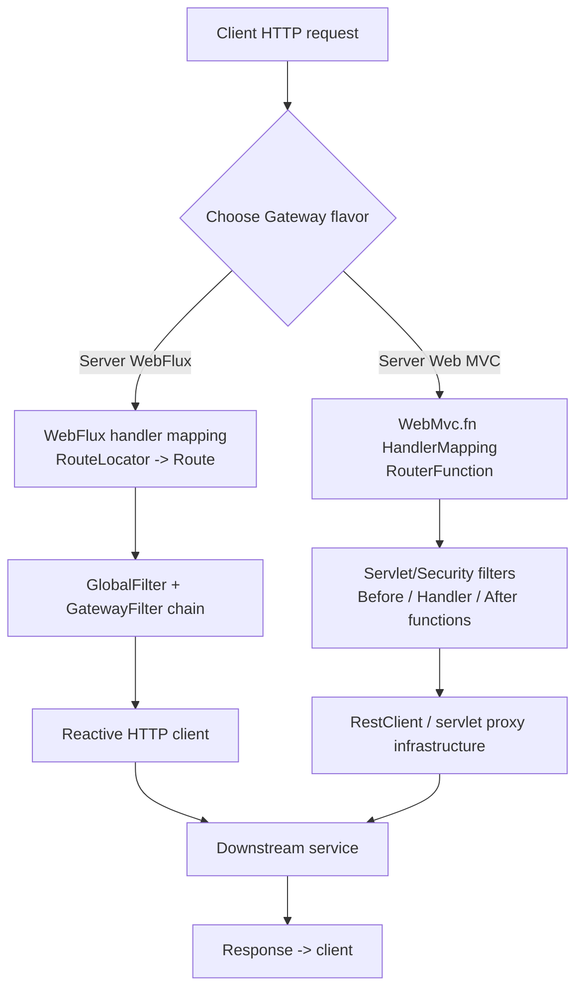
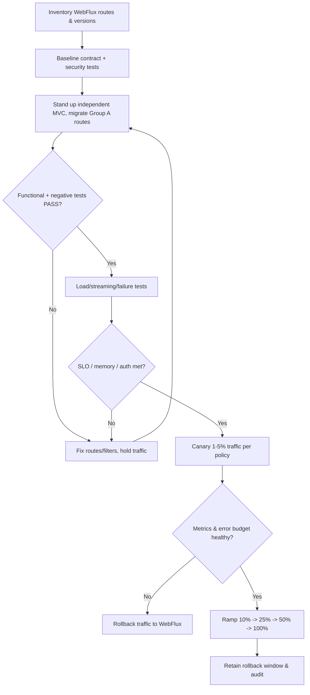

# Feature Limitations Compared to WebFlux and Migration Testing

**Chapter:** Server Web MVC  
**Module:** `SPRING_CLOUD_GATEWAY` — Spring Cloud Gateway

Spring Cloud Gateway has two different **Server** implementations: **Server WebFlux** running on Spring WebFlux/Reactor and **Server Web MVC** built on Spring MVC, WebMvc.fn, and the Servlet runtime. Both target building an API Gateway with route predicates, filter chains, request forwarding, path/header transformations, and service connectivity; however, **neither a single GatewayFilter source file nor a configuration YAML can be swapped as-is between the two stacks**.

When migrating from WebFlux to Web MVC, the right question is not simply "Does MVC have filter X?". You need to identify the **version**, **starter/property names**, **APIs used for filters**, **I/O and body streaming handling**, **load balancing**, **security**, **retry/circuit breaker**, **rate limiting**, **TLS**, **WebSocket**, **request observability**, and **behavior under overload**. Even when both flavors share a filter name such as `StripPrefix` or `CircuitBreaker`, they may use different classes/abstractions and configuration rules.

This lesson focuses on **per-version feature limitations and how to test equivalence during migration**. We will build a mock backend, configure two independently running Gateways, compare REST, paths, headers, request/response bodies, HTTP errors, security, load balancing, and streaming; then construct a matrix of "supported / equivalent but configured differently / needs verification / needs redesign". The security and operations sections tie directly back to the module objectives: route predicates, filter chains, service discovery, authentication, rate limiting, circuit breakers, retries, TLS, and observability.

> **Scope limitation:** Primary examples are based on **Spring Cloud Gateway Server Web MVC/WebFlux 5.x** using the namespaces `spring.cloud.gateway.server.webmvc.*` and `spring.cloud.gateway.server.webflux.*`. In Gateway 4.x and earlier releases, starters, APIs, properties, or behaviors may differ. Do not put a feature into the "unsupported" column just because you did not spot it on one docs page; **you must verify against the exact release train and write integration tests**. Server Web MVC is **different from** Proxy Exchange MVC — Proxy Exchange is not an equivalent replacement for Gateway Server.

## 1. Learning Objectives

After this lesson, you will be able to:

1. Identify whether a Gateway is running **Servlet/WebMvc.fn** or **WebFlux/Reactor** and explain the differences in threading, blocking I/O, and backpressure.
2. Compare `RouterFunction<ServerResponse>`, `HandlerFilterFunction`, `BeforeFilterFunctions`/`AfterFilterFunctions` against `RouteLocatorBuilder`, `GatewayFilter`, `GlobalFilter`, and `Mono<Void>`.
3. Write equivalent `Path`/`Method`/`StripPrefix`/header routes in YAML and Java DSL **for the right flavor**.
4. Inventory critical capabilities: Retry, CircuitBreaker, Bucket4j/RedisRateLimiter, body rewriting, WebSocket, SSE/streaming, LoadBalancer, TLS, authentication, and route management.
5. Design **contract tests** that can be re-run across both Gateways, separating Gateway differences from backend or infrastructure differences.
6. Verify the semantics of `401`/`403`/`404`/`429`/`502`/`503`, CORS preflight, redirects, cookies, request bodies, and retries.
7. Build **capacity tests** for high load / slow downstream, rather than substituting claims like "MVC is definitely slow" or "WebFlux is definitely fast" for actual measurements.
8. Plan a canary/rollback strategy with SLOs, protect security boundaries, and monitor routes/metrics during migration.

## 2. Two Execution Models: Servlet/WebMvc.fn vs. Reactor/WebFlux

| Aspect | Gateway Server WebFlux | Gateway Server Web MVC |
|---|---|---|
| Web runtime | Spring WebFlux, typically Reactor Netty and event loops | Spring MVC/WebMvc.fn on a **Servlet container** (Tomcat/Jetty, depending on Boot) |
| Request flow language | `Mono`, `Flux`, `ServerWebExchange`, `Publisher` | `ServerRequest`, `ServerResponse`, `RouterFunction`, Servlet request |
| Downstream I/O | Reactive HTTP client path, typically Reactor Netty | Client based on Spring Boot `RestClient`/HTTP client infrastructure |
| Route filters | `GatewayFilter`/`GatewayFilterFactory` | `HandlerFilterFunction`, `BeforeFilterFunctions`, `AfterFilterFunctions` |
| Global filters | `GlobalFilter` + `GatewayFilterChain` | Servlet/Spring MVC interceptors/filters and Gateway MVC functions at corresponding extension points |
| Thread model | Non-blocking event loop, reactive scheduling | Servlet request/worker threads; can use **virtual threads** when supported |
| Backpressure | Reactor supports demand signaling across Publishers | Servlet/proxy streams have their own buffering, timeout, and flow-control mechanisms; no automatic end-to-end Reactor backpressure |
| Controllers in same app | WebFlux handlers | Spring MVC handlers |
| Security filter chain | `SecurityWebFilterChain` | `SecurityFilterChain` |
| Java DSL | `RouteLocatorBuilder` | `GatewayRouterFunctions.route(...)` and WebMvc.fn |

**MVC does not mean everything necessarily blocks a platform thread forever.** Modern Spring Boot releases can use virtual threads, efficient HTTP clients, and streaming support. However, **enabling virtual threads does not turn WebMvc.fn into Reactor**, does not make `Mono`/`Flux` `GatewayFilter` implementations run on Servlet, and does not automatically provide backpressure for every consumer.

### 2.1. Visualizing an HTTP Proxy Request



A filter written for `ServerWebExchange` does not have the same signature as a WebMvc.fn `ServerRequest`. For example, WebFlux may use:

```java
public Mono<Void> filter(ServerWebExchange exchange,
                         GatewayFilterChain chain) {
    return chain.filter(exchange);
}
```

In Web MVC, a typical custom filter has the type:

```java
HandlerFilterFunction<ServerResponse, ServerResponse>
```

and pre-/post-handler manipulation uses the corresponding functions of the Servlet stack. **Do not copy the `GlobalFilter` interface from WebFlux to MVC**; identify the filter's intent first, then choose the equivalent WebMvc.fn API.

### 2.2. "Non-Blocking" Is Not the Only Criterion

With 10,000 concurrent HTTP connections to a very slow backend, thread/memory allocation models and HTTP connection pools can yield different results. WebFlux often has an advantage when the entire path is non-blocking; MVC with virtual threads can fit many I/O-bound workloads while reusing the Servlet ecosystem. However:

- Reactor backpressure **does not** protect custom code that calls `.block()` on an event-loop thread.
- Virtual threads **do not** remove outbound socket, TLS, heap, connection pool, or backend concurrency limits.
- Buffering large request/response payloads can exhaust memory in either stack.
- Retry counts, body caching, logging, and compression can affect performance more than the name of the web stack.

**Decide using p95/p99 latency, error rate, memory, threads, active connections, and cost metrics** under the same contract; do not infer from benchmarks that lack matching dependencies and configuration.

## 3. Similarities and Version-Dependent Limitations to Verify

Instead of a static "MVC lacks A, B, C" list that quickly goes stale, use a **migration scoping table**:

| Capability Group | Gateway Server WebFlux | Gateway Server Web MVC | Action During Migration |
|---|---|---|---|
| `Path`, `Host`, `Method`, `Header`, `Query` predicates | Has predicate factories | Has WebMvc.fn `RequestPredicate` and custom predicates | Test matching, URL encoding, precedence |
| `StripPrefix`, `RewritePath`, header filters | Has `GatewayFilter` factories | Has `Before/AfterFilterFunctions` and filter configuration | Compare actual path/headers received at backend |
| HTTP `http`/`https` routing | Netty reactive routing | RestClient-based proxy | Test HTTP status, streaming, timeout, redirect, TLS |
| `lb://service` | `ReactiveLoadBalancerClientFilter` | MVC LoadBalancer filter with `LoadBalancerClient` | Test discovery instance selection and 503 |
| Retry | Reactive Gateway retry filter | MVC `Retry`, 5.x selects Spring Retry or Spring Framework 7 retry | Check defaults, body caching, filter ordering |
| CircuitBreaker | Spring Cloud CircuitBreaker reactive integration | **Has MVC filter**, official docs specify the Reactor starter | Verify starter against **exact-version** filter docs, fallback/statusCodes |
| Rate limiting | Typically `RequestRateLimiter` + reactive `RedisRateLimiter` | `RateLimiter` uses **Bucket4j**, `AsyncProxyManager` | Do not copy WebFlux key resolver/Redis properties as-is |
| Request/response body mutation | `modifyRequestBody/ResponseBody` Java DSL | MVC also has `ModifyRequestBody`/`ModifyResponseBody` **Java DSL** | Rewrite code to match signature; test codecs, size, no-body |
| Response caching | `LocalResponseCache` with Caffeine | Some MVC docs also list `LocalResponseCache`; docs contain inconsistent examples | Verify version/beans, keys, max-age, privacy |
| WebSocket | `ws`/`wss` and `lb:ws` in WebFlux | MVC supports WebSocket with `spring-boot-starter-websocket` and separate Upgrade rules | Test handshake, ping/pong, size/buffers |
| SSE/chunked streaming | Publisher/backpressure, HTTP streaming | MVC proxy streaming/buffering on Servlet | Test chunk latency, flush, memory, disconnect |
| Security | Reactive Spring Security | Servlet Spring Security | Replace `SecurityWebFilterChain` with `SecurityFilterChain`, test 401/403 |
| Outbound TLS | Reactor Netty client TLS settings | Spring Boot `spring.http.client` + `spring.ssl.bundle` | Test trust/hostname, mTLS, timeouts |
| Dynamic routes/Actuator | Documented `RouteDefinitionRepository`, Gateway Actuator API | MVC route lifecycle/WebMvc.fn extensions differ | Do not assume WebFlux `RedisRouteDefinitionRepository`/Actuator behavior |
| Global metrics/tracing | Gateway WebFlux tags, Reactor instrumentation | MVC/Servlet + Gateway metrics/observation by version | Compare tag cardinality, route ID, spans |

**Takeaway from the table:** "Available in both" **does not guarantee 100% parity** in semantics, constructors, headers, error mapping, concurrency, or property binding. "Needs verification" **does not** mean a feature is permanently absent on MVC. Implementers must lock down versions, consult the documentation for both flavors, and run a contract test suite.

### 3.1. Common Fallacies to Avoid

- **Wrong:** "MVC cannot proxy WebSockets." **Right:** Recent MVC docs include WebSocket proxying, requiring a dedicated starter, Upgrade rules, and buffer limits.
- **Wrong:** "MVC has no circuit breaker." **Right:** There is a `CircuitBreaker` filter; the integration starter is documented in Gateway MVC docs, though you must verify for your version.
- **Wrong:** "MVC has no body modification." **Right:** `ModifyRequestBody` and `ModifyResponseBody` exist via Java DSL; signatures differ from WebFlux.
- **Wrong:** "Just copy WebFlux's `RedisRateLimiter` to MVC." **Right:** Gateway MVC 5.x `RateLimiter` docs specify Bucket4j.
- **Wrong:** "Just copy Retry config from WebFlux because the filter name is the same." **Right:** MVC uses `cacheBody`/`AdaptCachedBody`, and the Spring Retry / Framework Retry implementation differs.
- **Wrong:** "A route YAML with the same `uri` forwards identically." **Right:** You must inspect actual paths, headers, host, redirects, TLS, timeouts, statuses, and streaming.

### 3.2. Always Pin Your Version Matrix

Example verification matrix (fill in your project's **actual** versions instead of copying illustrative ones):

| Component | Current WebFlux Gateway | Target MVC Gateway |
|---|---|---|
| Spring Boot | Record exact version | Record exact version |
| Spring Cloud BOM/release train | Record release train | Record compatible release train |
| Spring Cloud Gateway artifact | `spring-cloud-starter-gateway-server-webflux` | `spring-cloud-starter-gateway-server-webmvc` |
| Spring Framework/Reactor | Per BOM | Servlet + WebMvc.fn/RestClient |
| Container | Netty/other per deploy | Tomcat/Jetty per starter/deploy |
| HTTP client/TLS | Reactor Netty | RestClient + Boot client/SSL bundle |
| Retry/CircuitBreaker/RateLimiter dependencies | Record actual | Select per MVC docs/version |
| Observability/Security | Reactive | Servlet |

Never guess dependency versions from memory; use a managed BOM, release train documentation, and dependency tree checks outside of writing documentation. **Do not add both Gateway starters to the same project to "migrate gradually"** unless you actively manage the web application type, auto-configuration, and route ownership. This lab uses **two independent Gateway applications** for safe comparison.

## 4. Migration Preparation: Lock Down Contracts Rather Than Filter Names

Before rewriting code, inventory every route running on the WebFlux Gateway:

- **Route ID and owner:** Is the route configured via YAML, Java `RouteLocatorBuilder`, service discovery, or a dynamic repository?
- **Predicates:** `Path`, `Host`, `Method`, `Header`, `Cookie`, `Query`, `RemoteAddr`, `Weight`, and custom predicates.
- **Filters:** ordering of `StripPrefix`/`RewritePath`, headers, auth/`TokenRelay`, retry, circuit breaker, rate limiter, response transformation, caching.
- **Destination:** `http://`, `https://`, `lb://`, `ws://`/`wss://`, `forward:`, gRPC, or other protocols if used by the system.
- **Management:** Actuator write/refresh, Config Server, Redis route repository, config rollout, rollback.
- **Payloads:** small JSON, large bodies, multipart uploads, streaming, SSE, WebSocket, chunked transfer, gzip/deflate, conditional requests.
- **Constraints:** authentication/authorization, TLS/mTLS, CORS, quotas, SLOs, auditing, and incident runbooks.

The output of the inventory phase should be **one contract per route**, not merely a `uri` line. Example:

| Attribute | Example `catalog-route` Contract |
|---|---|
| Client | `GET /api/items/{sku}` |
| Routing | `Path=/api/items/**`, backend `/items/{sku}` |
| Downstream | `http://catalog:8081` or `lb://catalog-service` |
| Security | Valid JWT token, scope `catalog:read` |
| Headers | Do not forward client-supplied `X-Internal-Role`; attach trusted trace ID |
| Status | `200` when item exists; `404` if missing; `503` when backend unavailable |
| Limits | Max body/headers, timeout, and concurrency |
| Resilience | Retry GET up to N times on transient errors; per-service breaker |
| Observability | Route ID, status class, p95/p99, trace propagation |
| Sensitivity | Response must not contain user-specific data if public cache is enabled |

### 4.1. Route Classification Matrix

To avoid migrating everything at once, classify routes into groups:

| Group | Characteristics | Strategy |
|---|---|---|
| **A — Near-equivalent** | GET JSON, simple `Path`/`StripPrefix`/headers | Migrate first, run standard contract tests |
| **B — Needs config adaptation** | Rate limit, Retry, security, LoadBalancer, TLS | Port to MVC integrations, inspect defaults |
| **C — Needs code rewrite** | Custom `GatewayFilter`, `GlobalFilter`, Reactor context, `Mono`/`Flux` transforms | Rewrite to WebMvc.fn/Servlet equivalents and unit tests |
| **D — Needs redesign** | Heavy streaming, WebSocket/SockJS, custom reactive backpressure, dynamic route storage | PoC/benchmark first, architecture review |
| **E — Unclear support** | Rare protocols, single-version-dependent extensions | Hold back from migration until evidence/tests exist |

**Do not assume Group D is always impossible on MVC.** For example, WebSocket proxying is supported in MVC 5.x, but semantics around ping/pong, session buffering, and post-upgrade retries must be analyzed differently from WebFlux.

## 5. Shared Lab: Spring Boot MVC Backend Returning a Clear HTTP Contract

We prepare three independent applications:

| Application | Port | Role |
|---|---:|---|
| `contract-backend` | `8081` | MVC backend testing GET, POST, status, redirect, slow, and SSE |
| `gateway-webflux` | `8080` | Current Gateway Server WebFlux (baseline) |
| `gateway-webmvc` | `8082` | Target Gateway Server Web MVC (candidate) |

**The two Gateways do not need to share a codebase.** Each Gateway has its own starter and configuration; both call the **same backend on `8081`**. When comparing responses, normalize internal headers that intentionally differ (`X-Gateway-Flavor`, `Date`, `Server`, `Transfer-Encoding`), but **never ignore** headers that affect the API contract such as `Location`, `Content-Type`, `Set-Cookie`, `Cache-Control`, CORS, and security headers.

### 5.1. Create the Backend

On Spring Initializr, create a Spring Boot Maven project with **Spring Web**, package `com.example.contract`. For Spring Boot 3.x use Java 17+; for Boot 4.x select the starter provided by that Initializr version. Backend `application.yml`:

```yaml
server:
  port: 8081
spring:
  application:
    name: gateway-contract-backend
```

`ContractBackendApplication.java`:

```java
package com.example.contract;

import org.springframework.boot.SpringApplication;
import org.springframework.boot.autoconfigure.SpringBootApplication;

@SpringBootApplication
public class ContractBackendApplication {
    public static void main(String[] args) {
        SpringApplication.run(ContractBackendApplication.class, args);
    }
}
```

`ContractController.java`:

```java
package com.example.contract;

import java.net.URI;
import java.time.Duration;
import java.util.LinkedHashMap;
import java.util.Map;
import java.util.concurrent.atomic.AtomicInteger;
import jakarta.servlet.http.HttpServletRequest;
import org.springframework.http.CacheControl;
import org.springframework.http.HttpStatus;
import org.springframework.http.MediaType;
import org.springframework.http.ResponseEntity;
import org.springframework.web.bind.annotation.GetMapping;
import org.springframework.web.bind.annotation.PathVariable;
import org.springframework.web.bind.annotation.PostMapping;
import org.springframework.web.bind.annotation.RequestBody;
import org.springframework.web.bind.annotation.RequestHeader;
import org.springframework.web.bind.annotation.RestController;
import org.springframework.web.servlet.mvc.method.annotation.SseEmitter;
import org.springframework.web.context.request.ServletWebRequest;

@RestController
public class ContractController {

    private final AtomicInteger calls = new AtomicInteger();

    @GetMapping("/items/{sku}")
    public ResponseEntity<Map<String, Object>> item(
            @PathVariable String sku,
            @RequestHeader(value = "X-Gateway-Flavor",
                           required = false) String gateway,
            HttpServletRequest request) {
        Map<String, Object> body = new LinkedHashMap<>();
        body.put("sku", sku);
        body.put("path", request.getRequestURI());
        body.put("gateway", gateway);
        body.put("callNumber", calls.incrementAndGet());
        return ResponseEntity.ok()
            .cacheControl(CacheControl.noStore())
            .body(body);
    }

    @GetMapping("/cache/{sku}")
    public ResponseEntity<Map<String, String>> cache(
            @PathVariable String sku,
            ServletWebRequest webRequest) {
        String etag = "\"stable-" + sku + "-v1\"";
        long modified = java.time.Instant
            .parse("2026-11-01T00:00:00Z").toEpochMilli();
        CacheControl policy = CacheControl
            .maxAge(Duration.ofSeconds(5)).cachePublic();

        if (webRequest.checkNotModified(etag, modified)) {
            return ResponseEntity.status(HttpStatus.NOT_MODIFIED)
                .eTag(etag)
                .lastModified(modified)
                .cacheControl(policy)
                .build();
        }
        return ResponseEntity.ok()
            .eTag(etag)
            .lastModified(modified)
            .cacheControl(policy)
            .body(Map.of("sku", sku, "version", "v1"));
    }

    @PostMapping(path = "/echo",
                 consumes = MediaType.APPLICATION_JSON_VALUE)
    public ResponseEntity<String> echo(@RequestBody String json) {
        return ResponseEntity.ok()
            .contentType(MediaType.APPLICATION_JSON)
            .header("X-Origin", "contract-backend")
            .body(json);
    }

    @GetMapping("/status/{code}")
    public ResponseEntity<Map<String, Object>> status(
            @PathVariable int code) {
        return ResponseEntity.status(HttpStatus.valueOf(code))
            .body(Map.of("status", code));
    }

    @GetMapping("/redirect")
    public ResponseEntity<Void> redirect() {
        return ResponseEntity.status(HttpStatus.FOUND)
            .location(URI.create("/items/SKU-42"))
            .build();
    }

    @GetMapping("/slow")
    public ResponseEntity<Map<String, String>> slow()
            throws InterruptedException {
        // Simulates an MVC backend only; never call Thread.sleep on a WebFlux event loop.
        Thread.sleep(1200L);
        return ResponseEntity.ok(Map.of("mode", "slow"));
    }

    @GetMapping(path = "/events",
                produces = MediaType.TEXT_EVENT_STREAM_VALUE)
    public SseEmitter events() {
        SseEmitter emitter = new SseEmitter(10000L);
        Thread worker = new Thread(() -> {
            try {
                for (int i = 1; i <= 3; i++) {
                    emitter.send(SseEmitter.event()
                        .id(String.valueOf(i))
                        .name("tick")
                        .data("event-" + i));
                    Thread.sleep(300L);
                }
                emitter.complete();
            } catch (Exception ex) {
                emitter.completeWithError(ex);
            }
        });
        worker.setDaemon(true);
        worker.start();
        return emitter;
    }
}
```

**Example limitations:** `status/{code}` must only be used with valid status codes (200, 404, 500, 503...) in the lab; never expose an unchecked raw integer status API in production. `callNumber` is a **per-backend-process** counter to help observe calls/retries, not a durable metric. The `/items` endpoint has a dynamic counter so it uses `Cache-Control: no-store` and does not declare a stable ETag for a changing body. The `/cache/{sku}` endpoint intentionally returns an immutable v1 body with stable ETag/Last-Modified and supports conditional GET/304 to test cache semantics. SSE spawns a small thread solely for demo purposes; production should use a managed executor that bounds lifecycle/concurrency rather than `new Thread` per request.

### 5.2. Test the Backend Directly

Start the backend:

```bash
./mvnw spring-boot:run
```

In another terminal:

```bash
curl -i "http://localhost:8081/items/SKU-42"
curl -i -X POST "http://localhost:8081/echo" \
  -H "Content-Type: application/json" \
  --data '{"message":"hello"}'
curl -i "http://localhost:8081/status/404"
curl -i "http://localhost:8081/cache/SKU-42"
curl -i -H 'If-None-Match: "stable-SKU-42-v1"' \
  "http://localhost:8081/cache/SKU-42"
curl -i "http://localhost:8081/redirect"
curl -i "http://localhost:8081/slow"
curl -N -i "http://localhost:8081/events"
```

Before testing the Gateways, record the backend responses, timings, and key headers. If the backend is not running or paths do not match, **do not use Gateway migration to mask backend bugs**.

### 5.3. Why Use the Same Backend?

If the WebFlux Gateway points to backend A while the MVC Gateway points to backend B, differences in JSON/status/latency could come from **backend deployment** rather than the gateway framework. Keep the backend, inputs, authentication, dependencies, and network hops as constant as possible. For repeatability tests, endpoints with counters or random timestamps must be **intentionally normalized**, not treated as false positives.

## 6. Set Up the Gateway Server WebFlux Baseline

Create a **separate Spring Boot project** with the Maven dependency:

```xml
<dependency>
    <groupId>org.springframework.cloud</groupId>
    <artifactId>spring-cloud-starter-gateway-server-webflux</artifactId>
</dependency>
```

The Spring Cloud BOM must be compatible with your Spring Boot version. Do not add only `spring-boot-starter-webflux` without the Gateway Server starter, and do not arbitrarily add `spring-boot-starter-web` to the baseline.

Create `src/main/resources/application.yml`:

```yaml
server:
  port: 8080

spring:
  application:
    name: gateway-webflux-baseline
  cloud:
    gateway:
      server:
        webflux:
          routes:
            - id: contract-route
              uri: http://localhost:8081
              predicates:
                - Path=/api/**
              filters:
                - StripPrefix=1
                - AddRequestHeader=X-Gateway-Flavor, WebFlux
```

Requests to `/api/items/SKU-42` are routed to `http://localhost:8081/items/SKU-42`. The route does not restrict `Method` so it can be shared across GET, POST, and SSE tests; **do not mistake omitting `Method` for an authorization policy**: if production only allows GET on a path, preserve that contract.

### 6.1. Equivalent WebFlux Java DSL (Alternative Option)

If the baseline uses `RouteLocatorBuilder` instead of YAML:

```java
package com.example.webfluxgateway;

import org.springframework.cloud.gateway.route.RouteLocator;
import org.springframework.cloud.gateway.route.builder.RouteLocatorBuilder;
import org.springframework.context.annotation.Bean;
import org.springframework.context.annotation.Configuration;

@Configuration
public class ContractWebFluxRoutes {

    @Bean
    RouteLocator contractRoute(RouteLocatorBuilder builder) {
        return builder.routes()
            .route("contract-route", r -> r
                .path("/api/**")
                .filters(f -> f
                    .stripPrefix(1)
                    .addRequestHeader("X-Gateway-Flavor", "WebFlux"))
                .uri("http://localhost:8081"))
            .build();
    }
}
```

**Choose one:** do not declare both a YAML route and a Java route with the same `id`/`Path` in the same project without intentionally designing precedence. The WebFlux Java DSL uses `RouteLocator`, and does not have Servlet WebMvc.fn's `RouterFunction<ServerResponse>`.

### 6.2. Start and Verify

In the WebFlux Gateway project terminal:

```bash
./mvnw spring-boot:run
```

Verify:

```bash
curl -i "http://localhost:8080/api/items/SKU-42"
curl -i -X POST "http://localhost:8080/api/echo" \
  -H "Content-Type: application/json" \
  --data '{"message":"baseline"}'
```

The backend should see `gateway=WebFlux` and `path=/items/SKU-42`. Record the statuses, bodies, and essential headers as the **baseline contract**; do not benchmark performance yet while the backend or apps are still being stabilized.

## 7. Set Up Gateway Server Web MVC Alongside the Baseline

Create a **separate Spring Boot project** for Server Web MVC, with the Maven dependency:

```xml
<dependency>
    <groupId>org.springframework.cloud</groupId>
    <artifactId>spring-cloud-starter-gateway-server-webmvc</artifactId>
</dependency>
```

Per the docs, this starter uses **Spring MVC + WebMvc.fn**, running on a Servlet runtime such as Tomcat/Jetty. Do not put `spring-cloud-starter-gateway-server-webflux` into the Web MVC project just because you are migrating, and do not conflate WebMvc.fn with Proxy Exchange.

### 7.1. Gateway Web MVC `application.yml`

```yaml
server:
  port: 8082

spring:
  application:
    name: gateway-webmvc-candidate
  cloud:
    gateway:
      server:
        webmvc:
          routes:
            - id: contract-route
              uri: http://localhost:8081
              predicates:
                - Path=/api/**
              filters:
                - StripPrefix=1
                - AddRequestHeader=X-Gateway-Flavor, WebMVC
```

Equivalent elements:

- Keeping the Route ID `contract-route` makes it easy to compare metrics/config inventory (the two Gateways remain **two separate processes**).
- The `Path=/api/**` predicate preserves the public URL contract.
- The `StripPrefix=1` filter ensures the backend still receives `/items/SKU-42`, `/echo`, and `/events`.
- The `AddRequestHeader` filter adds a different marker to identify the candidate; in production this can be removed or replaced with internal telemetry that is never trusted for security.
- The URI `http://localhost:8081` is for local use only. In Docker/Kubernetes, `localhost` inside the Gateway container does not point to another backend service.

**Namespace difference:** Modern releases use `spring.cloud.gateway.server.webmvc.routes`; MVC 4.x releases may use `spring.cloud.gateway.mvc.routes`. Do not copy `spring.cloud.gateway.server.webflux.routes` from the baseline, because the MVC Gateway can start up cleanly yet **create zero routes** from the wrong prefix.

### 7.2. Equivalent WebMvc.fn Java DSL (Alternative Option)

`RouteLocatorBuilder` is not used for Gateway MVC. Example Java DSL:

```java
package com.example.mvcgateway;

import org.springframework.context.annotation.Bean;
import org.springframework.context.annotation.Configuration;
import org.springframework.web.servlet.function.RouterFunction;
import org.springframework.web.servlet.function.ServerResponse;

import static org.springframework.cloud.gateway.server.mvc.filter.BeforeFilterFunctions.addRequestHeader;
import static org.springframework.cloud.gateway.server.mvc.filter.BeforeFilterFunctions.stripPrefix;
import static org.springframework.cloud.gateway.server.mvc.filter.BeforeFilterFunctions.uri;
import static org.springframework.cloud.gateway.server.mvc.handler.GatewayRouterFunctions.route;
import static org.springframework.cloud.gateway.server.mvc.handler.HandlerFunctions.http;
import static org.springframework.web.servlet.function.RequestPredicates.path;

@Configuration
public class ContractMvcRoutes {

    @Bean
    RouterFunction<ServerResponse> contractRoute() {
        return route("contract-route")
            .route(path("/api/**"), http())
            .before(uri("http://localhost:8081"))
            .before(stripPrefix(1))
            .before(addRequestHeader("X-Gateway-Flavor", "WebMVC"))
            .build();
    }
}
```

Key points to remember:

1. `RouterFunction<ServerResponse>` and `http()` come from **org.springframework.cloud.gateway.server.mvc.handler.HandlerFunctions**.
2. `uri(...)` and `stripPrefix(...)` are **BeforeFilterFunctions**, modifying the outbound request/URI.
3. `path(...)` is a WebMvc.fn `RequestPredicate`; when writing a custom predicate, the input API is `ServerRequest` (Servlet), not `ServerWebExchange`.
4. Chained `.before(...)` and `.filter(...)` calls have wrapper ordering/semantics; do not assume line order in the DSL always matches WebFlux `GatewayFilter` execution order. Test the resulting backend path and headers.
5. If using the Java DSL, **remove the YAML route with the same ID** to avoid conflicts.

### 7.3. Do Not Put a Target Path in `uri` and Skip `StripPrefix`

The Gateway Server MVC *How It Works* page notes that **a path in the route URI may be ignored**. Therefore:

```yaml
# Do not rely on this as proof that /extra will be preserved:
uri: http://localhost:8081/extra
```

If you want the backend to receive `/items/SKU-42` from `/api/items/SKU-42`, use `StripPrefix`/`SetPath`/`RewritePath` with corresponding contracts and tests. Do not embed part of the path in the URI without checking the implementation.

### 7.4. Start the MVC Gateway and Run a Quick Comparison

In the MVC Gateway project terminal:

```bash
./mvnw spring-boot:run
```

Compare:

```bash
curl -i "http://localhost:8080/api/items/SKU-42"
curl -i "http://localhost:8082/api/items/SKU-42"

curl -i -X POST "http://localhost:8080/api/echo" \
  -H "Content-Type: application/json" \
  --data '{"message":"same-contract"}'

curl -i -X POST "http://localhost:8082/api/echo" \
  -H "Content-Type: application/json" \
  --data '{"message":"same-contract"}'
```

Both Gateways are expected to forward to the backend while preserving the HTTP method, JSON body, `Content-Type`, and exact path; the `gateway` field or certain transport headers **intentionally differ**. If MVC returns 404 while WebFlux returns 200, inspect **route/DSL/prefix configuration** before concluding that MVC lacks a feature.

### 7.5. Do Not Copy Reactive Infrastructure into Servlet

In the MVC candidate, you should not port code verbatim such as:

```java
GlobalFilter myFilter = (exchange, chain) -> chain.filter(exchange);
```

or:

```java
Mono<Void> response = webClient.get().retrieve()
    .bodyToMono(Void.class);
```

and attach it to a `RouterFunction`. If you must integrate a reactive client inside an MVC service, that belongs in a separate application layer, whereas **Gateway Server MVC proxy routes** inherently use WebMvc.fn/RestClient and do not need `.block()` wrappers around Reactor APIs to emulate `GatewayFilter`. In any major migration, custom filters must be **rewritten according to semantic intent** rather than just changing imports.

## 8. Limitations When Migrating Custom Predicates and Filters

### 8.1. Abstractions That Cannot Be Replaced via Imports

| WebFlux Code | MVC Equivalent/Extension | Required Work |
|---|---|---|
| `RouteLocatorBuilder` | `GatewayRouterFunctions.route(...)` | Rewrite route DSL, verify predicates/order |
| `GatewayFilterFactory` | `HandlerFilterFunction`, `BeforeFilterFunctions`, `AfterFilterFunctions` | Redesign filter API and lifecycle |
| `GlobalFilter`, `GatewayFilterChain` | Servlet Filter/Security filter chain or appropriate Gateway MVC extension | Determine pre-/post-routing placement, avoid double execution |
| `ServerWebExchange` | `ServerRequest`/`ServerResponse` + Servlet request context | Do not mutate exchange attributes the old way |
| `Flux<DataBuffer>` request body | Servlet request body / WebMvc.fn message readers | Test body reading, buffering/replay, and limits |
| `Mono.just(...)`/`Mono.error(...)` | Synchronous values/exceptions or corresponding MVC APIs | Adapt error propagation and fallback handling |
| Reactive context | ThreadLocal/SecurityContext/Servlet request context | Test propagation with virtual threads/async tasks |
| Netty `HttpClient` config | Boot `RestClient`/Servlet proxy client config | Rewrite timeouts, TLS, pooling |

A WebFlux filter such as:

```java
// WebFlux mindset: reactive pipeline and response object.
return chain.filter(exchange)
    .doOnError(error -> metrics.record(error));
```

cannot be converted to `.doOnError(...)` in MVC simply by importing Reactor. In MVC, you need to determine which exceptions propagate through `HandlerFilterFunction`/Servlet and which layer records metrics. A completed `500` response may **not throw an exception**, so observing status codes must be handled differently from catching exceptions.

### 8.2. Custom Before/After Filters and WebMvc.fn Immutability

WebMvc.fn's `ServerRequest` and `ServerResponse` are relatively immutable abstractions; Gateway MVC provides helpers to construct requests/responses for proxying. For simple header needs, use the documented `BeforeFilterFunctions.addRequestHeader` instead of mutating `HttpServletRequest` directly.

Conversely, a custom Servlet Filter placed in front of the Gateway can apply to **every** request (including Actuator, login, static resources), not just business routes. When porting from a route-specific `GatewayFilter` to a Servlet Filter, you must define the **scope**; do not unintentionally apply rewrites or auth to administrative paths.

### 8.3. Body Modification Is Supported on MVC with a Different API

MVC documentation covers:

- `ModifyRequestBody` via Java DSL with `BeforeFilterFunctions.modifyRequestBody`.
- `ModifyResponseBody` via Java DSL with `AfterFilterFunctions.modifyResponseBody`.

The MVC Java DSL snippet below only illustrates **the concept of reading a JSON string and modifying its representation**:

```java
// Inside a WebMvc.fn RouterFunction builder,
// apply the appropriate filter per the official example:
.before(modifyRequestBody(
    String.class,
    String.class,
    "application/json",
    (request, body) -> body == null
        ? "{}"
        : body.trim()))
```

In real code, check the exact overload/signature for your release train (especially handling no-body requests), converter/content-type, and imports. **Do not paste a WebFlux lambda** that accepts `ServerWebExchange` and returns `Mono<?>` into an MVC lambda. Do not expect to copy `ModifyResponseBody` from YAML if the docs state the filter is Java DSL only.

Mandatory tests for body mutation:

1. `Content-Type: application/json`, UTF-8/Vietnamese characters.
2. Empty body, missing body, and `Content-Length: 0`.
3. JSON with nested arrays/numbers/booleans without unintended type coercion.
4. Large bodies exceeding size limits and compressed bodies.
5. `Transfer-Encoding: chunked`/HTTP/2 where applicable, avoiding reliance on `Content-Length`.
6. Resulting `Content-Length`, `Content-Encoding`, ETag, and response signatures after transformation.
7. Client cancellation/disconnect mid-request or mid-response stream.

### 8.4. Body Caching Pitfalls During Retry

In WebFlux, a streaming HTTP request body typically cannot be consumed arbitrarily many times without a cache/replay mechanism. Likewise, in MVC you must not assume a once-read `InputStream` body automatically rewinds. For **MVC Retry 5.x**, the docs describe:

```yaml
filters:
  - name: Retry
    args:
      retries: 2
      series: SERVER_ERROR
      methods: GET,POST
      cacheBody: true
  - name: AdaptCachedBody
```

Depending on the version, `cacheBody=true` and `AdaptCachedBody` are used to replay the body. This **may read the entire body into memory**; do not enable it for large uploads just to allow retries. In particular, payment POSTs are unsafe to retry if the backend might already have recorded an order before the response was lost. An **idempotency key**, retry policy, and HTTP body size limit are required.

## 9. Resilience: Retry, CircuitBreaker, and RateLimiter

### 9.1. MVC Retry Is Not the WebFlux Implementation

According to the MVC 5.x docs:

- If **Spring Retry** is on the classpath, MVC `Retry` may select `GatewayRetryFilterFunctions` based on Spring Retry.
- Otherwise, it may use `FrameworkRetryFilterFunctions` based on **Spring Framework 7** retry support.
- The property `spring.cloud.gateway.server.webmvc.use-framework-retry-filter=true` forces selecting the Framework filter even when Spring Retry is present, if supported by your version.
- Documented defaults include roughly **3 retries**, `5XX`, `GET`; do not assume MVC and WebFlux share identical constructors, exception lists, backoff settings, or body replay mechanics.

Example MVC route with Retry for lab use only:

```yaml
spring:
  cloud:
    gateway:
      server:
        webmvc:
          routes:
            - id: retry-get-lab
              uri: http://localhost:8081
              predicates:
                - Path=/unstable/**
                - Method=GET
              filters:
                - StripPrefix=1
                - name: Retry
                  args:
                    retries: 2
                    series: SERVER_ERROR
                    methods: GET
                    backoff:
                      firstBackoff: 100ms
                      maxBackoff: 500ms
                      factor: 2
```

**Do not add the `/unstable/**` route to the contract baseline at the same time** if it interferes with status tests. Retry must be tested separately with a backend endpoint intentionally returning 500 for N attempts before succeeding, while counting **how many requests the backend actually receives**. Seeing a final 200 status alone does not prove the exact retry count.

### 9.2. MVC CircuitBreaker Does Exist

The **Gateway Server Web MVC 5.x** `CircuitBreaker` Filter page describes Spring Cloud CircuitBreaker/Resilience4j integration and specifies the dependency:

```xml
<dependency>
    <groupId>org.springframework.cloud</groupId>
    <artifactId>spring-cloud-starter-circuitbreaker-reactor-resilience4j</artifactId>
</dependency>
```

This is a **surprising detail**: the starter name includes `reactor`, even though Gateway MVC is Servlet-based. General **Spring Cloud CircuitBreaker** documentation still distinguishes the non-reactive starter for MVC apps calling `CircuitBreakerFactory.run(Supplier)`. However, the **Gateway Server MVC filter** has its own integration contract; do not swap the dependency from the docs page for the non-reactive starter merely because the app is "MVC".

Example MVC YAML:

```yaml
filters:
  - name: CircuitBreaker
    args:
      name: catalogBreaker
      fallbackUri: forward:/fallback/catalog
      statusCodes:
        - 500
        - 503
```

The filter's `fallbackUri` supports `forward:` to an internal Gateway handler. A completed HTTP `500` response may require `statusCodes` for the breaker to count it as a failure, unlike a downstream exception. Test CLOSED/OPEN/HALF_OPEN states, thresholds, TimeLimiter, fallback status codes, and handler security.

**Do not attach `CircuitBreaker` to an MVC WebSocket route and assume it monitors every post-101 message**; the MVC WebSocket docs explicitly note that retry and circuit breaker filters do not apply to WebSocket messages/sessions after upgrade.

### 9.3. RateLimiter: MVC 5.x Uses Bucket4j

Per the current MVC `RateLimiter` page, the filter uses a **Bucket4j** token bucket, with a `keyResolver` of type `Function<ServerRequest,String>`. Custom `keyResolver` configuration is currently documented via **Java DSL**, rather than arbitrarily copying WebFlux SpEL/string configuration:

```java
// MVC snippet per docs; use only after configuring
// AsyncProxyManager and the appropriate Bucket4j dependencies.
.filter(rateLimit(c -> c
    .setCapacity(100)
    .setPeriod(Duration.ofMinutes(1))
    .setKeyResolver(request -> {
        var principal = request.servletRequest().getUserPrincipal();
        return principal == null ? "anonymous" : principal.getName();
    })))
```

This is a **DSL fragment** from the guide, not a standalone runnable Java file: you need to import `Bucket4jFilterFunctions.rateLimit`, configure the `AsyncProxyManager` type/bean, and design a proper key resolver. Notably, an `"anonymous"` key groups all unauthenticated users into a single bucket; in a public app that might be a deliberate policy choice, though not always desirable. Never trust a client-supplied `X-User` header without identity validation.

In WebFlux, common examples use `RequestRateLimiter`/`RedisRateLimiter` and a reactive `KeyResolver`. **Do not rely on WebFlux's `RedisRateLimiter` dependencies/properties as proof that MVC is rate limiting.** To maintain consistent quotas during a canary across both stacks, you need a shared policy/tenant key and tests executed with the same principal across both gateways.

### 9.4. Retry, Rate Limit, and Circuit Breaker Cannot Be Treated as Equivalent by Name Alone

| Test | Question |
|---|---|
| Retry before/after breaker | Does the breaker count each attempt or the overall operation result after retries? |
| POST timeout after commit | Are there duplicate side effects, and is an idempotency key used? |
| Backend returns 500 | Is the HTTP response recorded as a failure by the breaker via `statusCodes`? |
| Gateway returns 429 | Does the rate limiter enforce limits per user/tenant/key the same way as baseline? |
| Key resolver missing principal | How are anonymous requests throttled or permitted by policy? |
| Large-body retry | Does body caching cause abnormal heap growth? |
| Backend unavailable | Do timeout/fallback latencies and HTTP status codes meet SLOs? |

**Rule:** verify behavior using **backend call counts + filter metrics + client HTTP status**. Never inspect only the JSON response. And never configure unbounded retries during a full outage, because a retry storm can delay backend recovery.

## 10. LoadBalancer and Service Discovery: Same `lb://`, Different Integration

A Gateway route targeting `lb://catalog-service` requires Spring Cloud LoadBalancer and a `ServiceInstance` source (Eureka, Consul, Kubernetes, `SimpleDiscoveryClient`...). Both flavors can select an instance, yet they do not use the same Java classes.

### 10.1. WebFlux

```yaml
spring:
  cloud:
    gateway:
      server:
        webflux:
          routes:
            - id: catalog-lb
              uri: lb://catalog-service
              predicates:
                - Path=/api/catalog/**
              filters:
                - StripPrefix=2
```

For a WebFlux route, `ReactiveLoadBalancerClientFilter` selects a `ServiceInstance` via reactive LoadBalancer when a request enters the route. If no instance is available, the typical status is `503` under current configuration; `lb://` does not register backends by itself.

### 10.2. Web MVC

```yaml
spring:
  cloud:
    gateway:
      server:
        webmvc:
          routes:
            - id: catalog-lb
              uri: lb://catalog-service
              predicates:
                - Path=/api/catalog/**
              filters:
                - StripPrefix=2
```

In the **MVC Java DSL**, the docs use `LoadBalancerFilterFunctions.lb(...)`:

```java
// WebMvc.fn DSL fragment: filter ordering must be considered.
return route("catalog-lb")
    .route(path("/api/catalog/**"), http())
    .before(stripPrefix(2))
    .filter(lb("catalog-service"))
    .build();
```

In MVC, the documentation warns that **`lb()` should come after path-transforming filters**, otherwise the downstream URL may be wrong; when `lb://` is used in configuration, the gateway places the load-balancer filter with the appropriate ordering automatically. Do not reuse WebFlux's `ReactiveLoadBalancerClientFilter`/`ReactorLoadBalancer` code directly.

### 10.3. Do Not Add `@LoadBalanced RestClient` to the Internal Proxy

Gateway Server Web MVC uses an internal `RestClient` to proxy traffic. The MVC `LoadBalancer Filter` docs warn: **do not annotate the `RestClient` builder used by the Gateway proxy with `@LoadBalanced`**, or double resolution, a null service ID, or runtime errors may occur. Gateway routes use the **`lb()` filter or `lb://` URI** for load balancing. Only apply `@LoadBalanced` to a client belonging to **your own application code calling services directly**, kept isolated with controlled bean scoping.

### 10.4. Mandatory Tests When Migrating LoadBalancer

1. Does the backend/registry return the exact service ID (any case sensitivity or alias differences)?
2. Do Gateway A and Gateway B observe the same healthy instance count?
3. Are downstream URIs, HTTP/HTTPS schemes, and `ServiceInstance.isSecure` identical?
4. When no instances exist, does the client observe the expected status (503/404 per policy)?
5. When an instance restarts, is traffic routed to stale nodes due to discovery caching?
6. Are `StripPrefix`/`RewritePath` combined with `lb` in the right order?
7. Do metrics/tags capture the route ID and selected service without leaking internal hosts publicly?

## 11. TLS/HTTPS and Security: Two Distinct Configuration Paths

### 11.1. Outbound TLS

In WebFlux, the outbound client is typically Reactor Netty; TLS/handshake/pooling configuration lives under `spring.cloud.gateway.server.webflux.httpclient.*` (exact names vary by release train).

In Web MVC, the **TLS and SSL** docs state that backend proxying uses Spring Boot `RestClient` infrastructure and SSL bundles via:

```yaml
spring:
  http:
    client:
      ssl:
        bundle: gatewayBackend
      connect-timeout: 5s
      read-timeout: 30s
  ssl:
    bundle:
      pem:
        gatewayBackend:
          truststore:
            certificate: classpath:internal-ca.pem
```

This example applies to **Boot/Gateway versions supporting `spring.http.client.ssl.bundle`**. For older Spring Boot or other releases, consult the matching docs; `spring.cloud.gateway.mvc.http-client.ssl-bundle` has already been marked on a deprecation path in Gateway MVC docs. Do not copy WebFlux's `useInsecureTrustManager=true` to MVC, and **never disable certificate verification in production** as a quick fix for handshake errors.

Public TLS (client -> gateway) and outbound TLS (gateway -> backend) are **two independent hops**. If ingress terminates TLS and the Gateway calls the backend over plain HTTP internally, you cannot claim end-to-end encryption merely because browsers show HTTPS.

### 11.2. Servlet and Reactive Spring Security Have Completely Different Interfaces

WebFlux Gateway:

```java
SecurityWebFilterChain
```

Web MVC Gateway:

```java
SecurityFilterChain
```

An illustrative Spring Security MVC Java bean (for a project with Spring Security Resource Server and properly configured JWT issuer/audience):

```java
package com.example.mvcgateway;

import org.springframework.context.annotation.Bean;
import org.springframework.context.annotation.Configuration;
import org.springframework.security.config.Customizer;
import org.springframework.security.config.annotation.web.builders.HttpSecurity;
import org.springframework.security.web.SecurityFilterChain;

@Configuration
public class GatewayMvcSecurity {

    @Bean
    SecurityFilterChain securityFilterChain(HttpSecurity http)
            throws Exception {
        http.authorizeHttpRequests(auth -> auth
                .requestMatchers("/actuator/health").permitAll()
                .requestMatchers("/api/**").authenticated()
                .anyRequest().denyAll())
            .oauth2ResourceServer(oauth2 ->
                oauth2.jwt(Customizer.withDefaults()));
        return http.build();
    }
}
```

This snippet is **not runnable on its own** without Spring Security / OAuth2 Resource Server dependencies, a JWT decoder, and a trusted issuer. To proxy POST requests with a bearer token through a Servlet security chain, test **a CSRF policy suited to your client type**; default CSRF protection on state-changing requests can return 403 before routing runs. Never disable CSRF application-wide just to make a lab POST succeed when browser cookie sessions are present.

**During migration:** preserve scope/role/tenant requirements and keep enforcement at the backend Resource Server as well; replace the reactive chain with a Servlet chain without widening permissions. `TokenRelay` depends on the OAuth2 Client/context and access token audience; it **does not perform authentication by itself**.

### 11.3. `StrictHttpFirewall` Can Change Route Path Outcomes

Servlet Spring Security's `StrictHttpFirewall` can reject requests before routing if the URL contains `%2F`, `//`, `\\`, or suspicious sequences. In the WebFlux stack, request parsing and security filter rules may differ. A request like `GET /api/files/a%2Fb` may be rejected by MVC with `400` **before** the `Path` predicate executes, even if the WebFlux baseline behaves differently.

**Do not relax the firewall globally** just to "match the baseline 200" if that URL encoding opens path traversal or authorization bypasses. First establish the true backend contract and normalize/encode at the proper layer; if encoded slashes must be supported, perform threat modeling and test double-encoded and path-normalization variants.

### 11.4. CORS Preflight and WebSocket Origin

Browser APIs calling `fetch` with cross-origin headers may send an `OPTIONS` preflight. A `Method=GET`/`Method=POST` route will not automatically match `OPTIONS`; CORS can be handled by a Servlet filter, Spring MVC mapping, or Gateway configuration depending on version. Verify that **preflight requests are not wrongly rejected with 401/403 by Security** and are not unintentionally forwarded to the backend.

WebSockets **do not use CORS preflight like `fetch`**, but browsers send an `Origin` header during the HTTP handshake. Gateway MVC docs provide `spring.cloud.gateway.server.webmvc.websocket.allowed-origins`, defaulting to same-origin/no-Origin. Do not substitute a REST API's `Access-Control-Allow-Origin: *` for WebSocket Origin security.

### 11.5. Forwarded Headers and Trusted Proxies

When TLS terminates at ingress, `Forwarded` and `X-Forwarded-*` headers affect scheme/host/redirects and security decisions. Both flavors have release-train-specific trusted-proxy configurations. When migrating:

- Upstream proxies must strip client-supplied `Forwarded`/`X-Forwarded-*` headers.
- The Gateway should trust only allowlisted proxies, never arbitrary IP addresses.
- Inspect `Host`, `X-Forwarded-Proto`, and actual `Location` redirects.
- Never log raw Authorization headers, cookies, or tokens in access logs.

If the frontend starts redirecting from HTTPS to HTTP after migration, the cause may be trusted-proxy/scheme forwarding configuration **rather than** the route predicate.

## 12. Streaming, WebSocket, and Large Request Bodies Need Dedicated Testing

### 12.1. SSE / Chunked HTTP Streaming

The lab `/events` backend sends three SSE events spaced roughly 300 ms apart. Call both Gateways:

```bash
curl -N -i "http://localhost:8080/api/events"
curl -N -i "http://localhost:8082/api/events"
```

cURL's `-N` flag disables client buffering; it **does not force** the proxy to stop buffering. Observe the **time to first event**, spacing between events, `Content-Type: text/event-stream` response header, and client disconnect behavior. Gateway MVC 5.x docs/configprops include `streaming-media-types` and `streaming-buffer-size`; these are Servlet proxy knobs, not Reactor `Flux` backpressure. Do not claim MVC cannot stream at all.

Tests should cover:

| Scenario | What to Check |
|---|---|
| Three small SSE events | Are events flushed promptly or buffered until completion? |
| 5-minute SSE stream | Are Gateway/ingress timeouts and memory stable? |
| Client disconnect | Is the backend worker/stream closed and released? |
| `Transfer-Encoding: chunked` response | No corrupted body or premature termination |
| HTTP/2 client, HTTP/1.1 backend | Are stream semantics and proxy buffering intact? |
| Compression | Does it introduce extra buffering/delay or broken content encoding? |

Do not judge SSE solely by "eventually receiving all three lines": if three events meant to arrive 300 ms apart are all flushed together after 1 second by the proxy, the real-time contract has changed.

### 12.2. MVC WebSocket Is **Supported**, with Specific Limitations

Current Gateway Server Web MVC documentation describes **WebSocket proxying** when this dependency is present:

```xml
<dependency>
    <groupId>org.springframework.boot</groupId>
    <artifactId>spring-boot-starter-websocket</artifactId>
</dependency>
```

Routes can use `ws://`/`wss://`, or `http://`/`https://`/`lb://` with `Upgrade: websocket` proxied as WebSocket. The WebMvc.fn Java DSL offers `HandlerFunctions.websocket()`. This is **not identical** to the `lb:ws://` syntax documented for WebFlux: verify the exact flavor behavior when WebSocket load balancing is required.

Key differences **highlighted in the MVC docs**:

- Text, binary, and Pong messages are proxied; **Ping frames are not relayed** through the Servlet WebSocket API, and containers typically answer with Pong themselves. Therefore a Pong from the Gateway **does not prove the backend is healthy**.
- Request filters such as `StripPrefix`/`AddRequestHeader`/`TokenRelay` apply during the handshake; once the connection opens, messages flow over the session.
- Response body filters, Retry, and CircuitBreaker **do not apply** to WebSocket messages after upgrade.
- Servlet WebSocket has no Reactor backpressure; Gateway MVC enforces send-buffer/time/message-size limits and may close connections with code `1009` if messages are too large.

5.x configuration properties documented in the guide:

```yaml
spring:
  cloud:
    gateway:
      server:
        webmvc:
          websocket:
            enabled: true
            connect-timeout: 10s
            send-time-limit: 10s
            send-buffer-size-limit: 512KB
            max-message-size: 64KB
```

The values above illustrate **documented knobs and defaults**, not thresholds suitable for every application. For binary streams or chat, design separate quotas, connection admission, heartbeats, reconnect logic, and shared brokers; do not expect HTTP Retry to recover an already-upgraded `101` WebSocket session.

### 12.3. Uploads/Multipart and Backpressure

For `POST /upload` file uploads or `Transfer-Encoding: chunked` request bodies:

- Verify `Content-Type` and multipart boundaries remain intact and data is unaltered.
- Enforce limits across **Servlet container + Gateway + backend**; do not check only `Content-Length`, since chunked/HTTP/2 requests may omit it.
- Do not enable `Retry cacheBody=true` for large files without knowing your memory budget.
- Test mid-upload client cancellation, slow backend connections, and socket timeouts.
- Measure heap/direct memory/threads/connection pools under concurrent uploads.
- If the WebFlux baseline streamed `DataBuffer` chunks via a non-buffering custom filter, switching to an MVC body filter that reads the full payload can markedly change memory/latency; test with real payloads.

### 12.4. Response Caching and Conditional Requests

Gateway MVC releases include a `LocalResponseCache` page, though some examples on the current page still display **old WebFlux `RouteLocatorBuilder`/prefixes**. That is a clear signal to inspect the **exact-version source/issues/release notes and write integration tests**, rather than blindly copying snippets.

Specifically test GET `Cache-Control: public, max-age=30`, `ETag`, `If-None-Match`, `If-Modified-Since`, `304 Not Modified`, `Vary`, `no-store`, and per-user responses. In production, never cache `/me` or `/orders` responses carrying tokens/cookies in a shared cache without a proven key-isolation and privacy design.

## 13. Mandatory Contract Test Suite Before Enabling MVC Traffic

Do not stop at "GET returns 200." Build a **per-route matrix** of inputs, expected responses, and backend observations, then run the exact same suite against **WebFlux baseline `8080`** and **MVC candidate `8082`**.

### 13.1. Routing and HTTP Semantics

| Case | Sample Request | What to Compare |
|---|---|---|
| T1 — GET JSON | `GET /api/items/SKU-42` | 200, backend path, body fields/headers |
| T2 — POST JSON | `POST /api/echo` | Unicode body, Content-Type, unchanged method |
| T3 — Unmatched route | `GET /does-not-exist` | 404 from Gateway, backend untouched |
| T4 — Backend 404 | `GET /api/status/404` | 404 from backend, not turned into fallback 200 |
| T5 — Backend 500 | `GET /api/status/500` | 500/response body, retry policy when enabled |
| T6 — Redirect | `GET /api/redirect` | `302`/`Location`, not silently followed |
| T7 — Query | `GET /api/items/SKU-42?lang=vi&currency=VND` | Query params preserved |
| T8 — Trailing slash | `GET /api/items/SKU-42/` | Matching, normalization, status per contract |
| T9 — URL encoded | `GET /api/items/a%2Fb` | Firewall/path parsing, no authz bypass |
| T10 — Multi-value headers | `Accept-Language`, `Cookie`, `Forwarded` | Allowed/stripped/forwarded headers |
| T11 — Conditional GET | `GET /api/cache/SKU-42` with `If-None-Match`/`If-Modified-Since` | Consistent `304` vs `200` and ETag |
| T12 — Other HTTP methods | `DELETE /api/echo` | `404`/`405` per route/backend |
| T13 — Slow backend | `GET /api/slow` | Timeout, status, latency, in-flight calls |
| T14 — Large request | `POST /api/echo` with large test payload | 413/431 or 2xx per configured limits |
| T15 — Compression | `Accept-Encoding: gzip` | Body, Content-Encoding/Length/ETag |
| T16 — Stream | `GET /api/events` | Per-SSE-event flush, not fully buffered |

**Do not try to force byte-for-byte identity across every transport layer.** `Date`, `Server`, chunked framing, header order, and connection reuse may validly differ. However, **status codes, business data, access control, `Location`, CORS, cookies, `Cache-Control`, and semantic headers** must obey the approved contract.

### 13.2. Manual Comparison cURL Commands

```bash
curl -i "http://localhost:8080/api/items/SKU-42"
curl -i "http://localhost:8082/api/items/SKU-42"

curl -i -X POST "http://localhost:8080/api/echo" \
  -H "Content-Type: application/json; charset=utf-8" \
  --data '{"message":"xin chào, 世界"}'
curl -i -X POST "http://localhost:8082/api/echo" \
  -H "Content-Type: application/json; charset=utf-8" \
  --data '{"message":"xin chào, 世界"}'

curl -i "http://localhost:8080/api/status/404"
curl -i "http://localhost:8082/api/status/404"
curl -i -H 'If-None-Match: "stable-SKU-42-v1"' \
  "http://localhost:8080/api/cache/SKU-42"
curl -i -H 'If-None-Match: "stable-SKU-42-v1"' \
  "http://localhost:8082/api/cache/SKU-42"
curl -i "http://localhost:8080/no-route"
curl -i "http://localhost:8082/no-route"

# Omit -L to observe the raw Location header as returned.
curl -i "http://localhost:8080/api/redirect"
curl -i "http://localhost:8082/api/redirect"

# -N disables cURL client buffering; it does not disable proxy buffering.
curl -N -i "http://localhost:8080/api/events"
curl -N -i "http://localhost:8082/api/events"
```

The goal is comparing **two independent systems**; do not hit a browser cache on the baseline and an uncached cURL on the candidate when comparing latency. If you need to inspect raw HTTP/2 vs. HTTP/1.1, use the appropriate client flags supported by your tool and record protocol negotiation at each hop.

### 13.3. Normalize Intentional Differences Without Hiding Real Bugs

Because the lab backend increments `callNumber` on every request, two responses may differ even when the Gateways behave identically. Use `jq` to strip only **these two test-only fields**:

```bash
curl -sS "http://localhost:8080/api/items/SKU-42" \
  | jq -S 'del(.callNumber, .gateway)' > /tmp/webflux-body.json
curl -sS "http://localhost:8082/api/items/SKU-42" \
  | jq -S 'del(.callNumber, .gateway)' > /tmp/webmvc-body.json
diff -u /tmp/webflux-body.json /tmp/webmvc-body.json
```

**Never** strip business fields such as `tenantId`, prices, permissions, response security fields, or `Location` during normalization. Business-significant differences must be caught, not hidden to make tests pass. On Windows, use equivalent JSON/diff tools instead of `/tmp`.

### 13.4. Minimal Bash Smoke Test for CI

Sample script to run **after all three applications are ready**:

```bash
#!/usr/bin/env bash
set -euo pipefail

check_status() {
  local base="$1" path="$2" expected="$3"
  local actual
  actual=$(curl -sS -o /dev/null -w '%{http_code}' "$base$path")
  if [[ "$actual" != "$expected" ]]; then
    printf 'FAIL base=%s path=%s expected=%s actual=%s\n' \
      "$base" "$path" "$expected" "$actual" >&2
    return 1
  fi
}

for base in http://localhost:8080 http://localhost:8082; do
  check_status "$base" "/api/items/SKU-42" 200
  check_status "$base" "/api/status/404" 404
  check_status "$base" "/api/status/500" 500
  check_status "$base" "/api/redirect" 302
  check_status "$base" "/no-route" 404
done

echo "Smoke statuses PASS; run header/body/security tests separately."
```

This script is **insufficient** as a migration acceptance test: it does not validate headers, JSON/Unicode payloads, origin paths, auth, CORS, SSE, load balancing, or concurrency. Once Retry/CircuitBreaker are enabled, `/api/status/500` may transition to an approved fallback status; update expectations per your **contract**, rather than forcing 500 across every policy.

### 13.5. Quick Windows PowerShell Commands

```powershell
curl.exe -i "http://localhost:8080/api/items/SKU-42"
curl.exe -i "http://localhost:8082/api/items/SKU-42"
curl.exe -i "http://localhost:8080/api/status/500"
curl.exe -i "http://localhost:8082/api/status/500"

$body = @{ message = "hello" } | ConvertTo-Json -Compress
Invoke-WebRequest -Uri "http://localhost:8082/api/echo" -Method Post -ContentType "application/json; charset=utf-8" -Body ([Text.Encoding]::UTF8.GetBytes($body))
```

`ConvertTo-Json` produces a deterministic payload; compare the exact same body bytes across both Gateways. These commands are illustrative only—do not use them with real personal data or bearer tokens.

### 13.6. Test at Three Vantage Points

| Vantage Point | Observations | Reason |
|---|---|---|
| **Client** | Status, body, headers, latency, SSE frame timing | External contract |
| **Gateway** | Route ID, predicate match, filter outcomes, retry/breaker, TLS | Layer changing in migration |
| **Backend** | Path, method, query, Host/headers, body, call count | Proves accurate proxy forwarding |

Do not just observe a client 200 and conclude the path was rewritten properly if the backend returns the same JSON for multiple URLs. In this lab, `ContractController` echoes `path` for verification.

## 14. Security Regression Tests: Migration Must Never Widen Access

Security must be an **independent acceptance gate** alongside functional tests. A "working" MVC route that lets a user read another tenant's data is a **failed migration**, even if latency improved.

### 14.1. Authentication/Authorization Matrix

| Case | Client | Contract Outcome |
|---|---|---|
| No token on protected route | Anonymous | 401 or login redirect per design; does not reach protected backend |
| Expired token / wrong issuer | Auth attempt | 401; never returns fallback containing data |
| Valid token, missing scope | Authenticated | 403; resource not forwarded |
| Valid token, right scope and tenant | Allowed user | Business 2xx/4xx matching backend |
| Forged `X-User`/`X-Role` headers | Anonymous or wrong user | Never grants access from client-declared headers |
| Cross-origin cookie session | Browser | Correct SameSite/Origin/CSRF behavior |
| OPTIONS preflight | Browser | Correct CORS policy; no bearer token required on OPTIONS when unnecessary |
| Redirect to external host | Client | Never leaks tokens/cookies via Location |
| Encoded slash / dot-segment | Client | Firewall/path normalization does not bypass deny rules |
| TokenRelay to wrong-audience backend | Authenticated | Never relays tokens across audience/trust boundaries |
| Management/Actuator | Unauthorized | Never exposes route secrets or allows route writes |

Exact 401/403/redirect results follow your **security contract**, not a single code applied blindly to every Spring Boot app. Test both through the Gateway and directly against the backend if network topology permits; backends should not rely solely on the Gateway to protect sensitive data.

### 14.2. CORS Preflight

```bash
curl -i -X OPTIONS "http://localhost:8080/api/echo" \
  -H "Origin: https://frontend.example.test" \
  -H "Access-Control-Request-Method: POST" \
  -H "Access-Control-Request-Headers: Authorization,Content-Type"

curl -i -X OPTIONS "http://localhost:8082/api/echo" \
  -H "Origin: https://frontend.example.test" \
  -H "Access-Control-Request-Method: POST" \
  -H "Access-Control-Request-Headers: Authorization,Content-Type"
```

**The default lab does not configure CORS**, so neither Gateway can be expected to return 200/204/`Access-Control-Allow-Origin` yet. When migrating a real system, configure equivalent CORS policies and compare `Access-Control-Allow-Origin`, `-Methods`, `-Headers`, `-Credentials`, `Vary: Origin`, `Access-Control-Max-Age`, and duplicate headers added by ingress or the backend.

`OPTIONS` preflight requests must not be erroneously blocked by Security or route method predicates, nor forwarded unexpectedly to backends. Do not fix preflight failures by opening every origin and credentials to the entire Internet.

### 14.3. Token Forwarding and Response Privacy

When using `TokenRelay`, verify that access tokens are forwarded **only to the intended audience/backend**, never leaking to fallback services or public routes. The backend Resource Server must still validate issuer, audience, and scopes. Never use `RemoveRequestHeader=Authorization` to "fix a 401" if the backend relies on token validation.

If the Gateway caches responses, user/session-bound endpoints like `/me` or orders require proper `Cache-Control` and cache-key isolation; never turn on a shared response cache to improve p99 without proving zero cross-user/cross-tenant data leakage.

### 14.4. Security Chain Scope

In MVC, `SecurityFilterChain` is Servlet-based; it can execute **before route selection**. In WebFlux, `SecurityWebFilterChain` runs in the reactive web filter chain. Test:

1. Unauthenticated requests are blocked prior to route matching.
2. Higher-priority routes do not accidentally bypass authorization.
3. Fallback handlers never leak private data or stack traces.
4. Actuator/management ports are protected by both network isolation and roles.
5. Preflight/health endpoints are exposed strictly per policy.
6. URLs with special characters do not evade strict firewall protections.

Never rely solely on `200 OK` happy-path checks to evaluate security filters; **negative tests** are mandatory.

## 15. Dynamic Routes, Actuator, and Operational Configuration

### 15.1. WebFlux `RouteDefinitionRepository` Does Not Automatically Apply to MVC

Gateway Server WebFlux provides `RouteDefinitionLocator`, `RouteDefinitionRepository`, `CachingRouteLocator`, `RefreshRoutesEvent`, and a dedicated documented Gateway Actuator API. For deployments using a Redis route repository or API-driven dynamic route creation/deletion, these may be **core runtime components**.

Gateway Server Web MVC builds routes from WebMvc.fn `RouterFunction` and its own route configuration. **Do not assume WebFlux's `InMemoryRouteDefinitionRepository` or `RedisRouteDefinitionRepository` beans have matching lifecycles, mappings, or Actuator read/write semantics in MVC**. To evaluate migration:

1. Check the **Server Web MVC** reference docs and configprops for your exact release train.
2. Determine what documented mechanisms the MVC target supports for loading routes from a config repo, DB, or refresh flow.
3. Verify whether runtime route refreshes apply atomically and how in-flight requests behave.
4. If existing dynamic route contracts are not met, put them in the **redesign** bucket; use a control plane publishing config, canary restarts, or officially supported extensions instead of reflexively copying repository interfaces.
5. Ensure route changes cannot bypass authentication, rate limiting, or route policies.

### 15.2. Do Not Assume the WebFlux Actuator Endpoint Schema in MVC

WebFlux docs describe `POST /actuator/gateway/routes/{id}`, `DELETE`, and `POST /actuator/gateway/refresh`. If the MVC app also exposes Actuator or custom management endpoints, **do not assume** they share identical payloads, write privileges, refresh behaviors, or consistency semantics; verify the exact implementation and version.

Any endpoint capable of **writing URIs/filters/routes** is sensitive infrastructure privilege that can enable SSRF, route shadowing, or directing traffic to non-allowlisted backends. Never expose `management.endpoint.gateway.access=unrestricted` on public networks just to test migration. Manage administration via dedicated RBAC/MFA, network isolation, auditing, and validation.

### 15.3. Compare Running Runtime Config, Not Only Git YAML

A deployment may inject routes from service discovery, environment variables, Config Server, or custom repositories. Thus **identical YAML in Git is insufficient**. Record:

- Exact app version, Spring Cloud BOM, Gateway starter;
- Route IDs, predicates, filters/order, and resolved URIs;
- Observed service discovery instances;
- Feature flags / canary weights;
- Security/TLS/timeout configs;
- Desired vs. applied config revision per replica.

Under configuration drift, one gateway instance may return 404 while another returns 200 despite running the exact same binary. Always inspect **per-replica runtime state**.

## 16. Performance and Capacity Testing: Do Not Compare via One cURL

### 16.1. Testing Goals

Define SLOs and acceptance criteria **before benchmarking**. Illustrative metrics (not Spring defaults):

| Metric | WebFlux Baseline | MVC Candidate Condition |
|---|---|---|
| HTTP success rate | Measured under same workload | Not lower than contract threshold |
| p50 latency | Measured at client | Meets SLO and expectations |
| p95/p99 latency | Measured at client | Within SLO / error budget |
| Sustained throughput | RPS at target concurrency | Meets required capacity |
| Heap/direct memory | Peak/RSS/GC | Within Pod/VM limits |
| Active threads / virtual threads | Measured via JVM/runtime | No thread/pool saturation |
| Outbound connections | HTTP pool/active sockets | Does not overload backend |
| Error rate 429/5xx/timeout | Per route/exception | Does not exceed policy |
| Streaming first-event latency | SSE | Does not buffer against real-time contract |
| WebSocket active sessions | Concurrent connections | Sustains workload and resource limits |
| CPU/GC pause | Host/Pod | Within production budget |

**Never fabricate benchmark numbers** without actually running tests. Even if WebFlux hits p99 150 ms vs. MVC p99 180 ms on a dev laptop, that proves nothing for production: warm-up, JIT, container limits, backend latency, and load-test tooling can skew results.

### 16.2. Workloads Must Reflect Real Traffic

At minimum, cover four profiles:

1. **Fast JSON:** high-rate small GET/POST requests to benchmark request-response throughput.
2. **Slow downstream:** a proportion of requests waiting 500–2,000 ms to test queuing and concurrency.
3. **Large body:** 1, 10, and 50 MB uploads per contract; verify limits and rejections.
4. **Long-lived connections:** open SSE/WebSocket streams with realistic message rates, not just handshake rates.

Include mixed error traffic (`404`/`401`/`429`/`503`), retry/circuit breakers, and TLS if production uses them. Match **test data, backend, and resource limits** before comparing frameworks.

### 16.3. Example HTTP k6 Load Test (Run by Learners in the Lab Environment)

An illustrative k6 script (**not a file to be generated during lesson authoring**):

```javascript
import http from "k6/http";
import { check, sleep } from "k6";

export const options = {
  vus: 20,
  duration: "30s",
  thresholds: {
    http_req_failed: ["rate<0.01"],
    http_req_duration: ["p(95)<500"]
  }
};

const base = __ENV.GATEWAY_URL || "http://localhost:8082";

export default function () {
  const res = http.get(base + "/api/items/SKU-42");
  check(res, { "status 200": r => r.status === 200 });
  sleep(0.2);
}
```

To compare:

```bash
GATEWAY_URL=http://localhost:8080 k6 run gateway-load.js
GATEWAY_URL=http://localhost:8082 k6 run gateway-load.js
```

Learners should place `gateway-load.js` in their own test project **outside the scope of STEP 4**; this lesson only shows the example. The 1% error rate and 500 ms p95 thresholds are **illustrative lab conditions**, not production targets to copy blindly. Never run load tests against unauthorized public or production endpoints.

### 16.4. Warm-Up and Interpreting Results

A fair methodology:

1. Fix CPU/memory limits, replica counts, backend version, and network topology.
2. Start the backend and both Gateways; wait until health checks report ready.
3. Warm up the JVM/JIT and connection pools.
4. Run identical-duration workloads against WebFlux and MVC; alternate order multiple times to avoid warm/cold backend bias.
5. Collect client latencies (p50/p95/p99), `http_req_failed`, CPU, heap/direct memory, threads, GC, sockets, and backend call counts.
6. Verify HTTP error semantics and response bodies remain valid under load.
7. Repeat with production-like retry/circuit breaker/rate limiter/security/TLS enabled.
8. Test failure and recovery scenarios, not only steady state.

If MVC additionally enables `spring.threads.virtual.enabled=true` on a supported version, compare **both MVC profiles (platform threads vs. virtual threads)** and do not label the comparison "apples-to-apples" against WebFlux without documenting outbound client/thread-model differences. Measure memory/CPU and client behavior differences; virtual threads still carry risks of pinning, dependency blocking, and pool/socket/DB exhaustion.

### 16.5. Testing Behavior When a Backend Dies

In an isolated environment:

- Stop one backend instance currently serving healthy traffic;
- Measure how long discovery and the gateway take to detect the failure;
- Observe `503` from LoadBalancer, HTTP client timeouts, or CircuitBreaker fallbacks;
- Measure queue lengths, active connections, retries, and OPEN breaker transitions;
- Restart the backend and verify recovery without triggering a retry storm;
- For WebSockets, test client reconnect logic rather than expecting HTTP filters to replay frames.

**Error budgets never justify bypassing security:** a setup that responds 200 faster by disabling authentication or masking 5xx as 200 is a regression, not a performance gain.

## 17. Canary Rollout, Traffic Shifting, and Rollback

A Gateway migration alters the **entry point to every microservice**. Switching 100% of traffic to MVC after a single 200 smoke test risks simultaneous outages across systems from filter, header, security, or memory regressions.

### 17.1. Recommended Phases



These percentages are **examples**, not a mandatory cadence. Sensitive APIs (payments, auth, file uploads, WebSockets) may require separate canaries or deferral until exhaustive testing passes.

### 17.2. Traffic Splitting Should Not Depend Arbitrarily on Sessions/Cookies

When using ingress or a service mesh to split requests between `gateway-webflux` and `gateway-webmvc`:

- Distinguish between **percentage of requests** and **percentage of users/sessions**.
- For login sessions or long-lived WebSockets, splitting individual requests/connections across flavors can introduce inconsistent state risks.
- Backends must receive consistent identity and tracing context per contract on both branches.
- Do not include `/api/admin/**` or `/api/payments/**` in early canaries without explicit sign-off.
- Do not use "shadow traffic" to replay **side-effecting POST requests** to a second backend unless side effects are disabled and synthetic data is used.

**A canary must never become an accidental double-write.** Sending a shadow copy of an order-creation POST to a live backend can create duplicate transactions.

### 17.3. Telemetry Must Distinguish Flavors

Attach a **low-cardinality, trusted** dimension such as `gatewayFlavor=webflux/webmvc` or deployment label in metrics/traces/logs. Compare:

| Signal | WebFlux | MVC | Rollback Trigger |
|---|---|---|---|
| Per-route p95/p99 latency | Baseline | Candidate | Exceeds SLO/error budget |
| HTTP 4xx/5xx classification | Baseline | Candidate | Spike in 401/403/404/5xx outside policy |
| Upstream errors/timeouts | Baseline | Candidate | Wrong backend calls / rising timeouts |
| Retry attempts / backend call count | Baseline | Candidate | Abnormal amplification |
| Auth denies & tenant isolation | Baseline | Candidate | Any bypass |
| WebSocket/SSE errors | Baseline | Candidate | 101 failures / dropped streams / latency breach |
| Heap/RSS/threads/GC | Baseline | Candidate | Memory/thread exhaustion |
| TLS/connect failures | Baseline | Candidate | Truststore/handshake mismatch |

Keep route IDs and metric labels controlled; never put raw URLs containing user IDs into high-cardinality metric labels. If framework metric names/labels differ, define a mapping in your observability platform before comparing.

### 17.4. Rollback Conditions

A runbook should pre-define:

1. **Immediate rollback** for any authorization bypass, token/PII leak, misrouted backend traffic, or critical security failure.
2. Rollback if error rates, timeouts, or latency breach agreed thresholds over the observation window.
3. Rollback if outbound connections, heap, or threads climb past capacity without safe load shedding.
4. Halt traffic increases if SSE/WebSocket sessions fail to honor their contract.
5. Revert ingress/mesh route weights back to the WebFlux baseline first; do not wait for full config reloads if safe traffic-shifting rollback exists.
6. After rollback, inspect stateful connections: WebSocket sessions already open on MVC will not automatically migrate back to WebFlux, so clients may need to reconnect.
7. Capture incident evidence, exact config revisions, and observed diffs to fix before the next canary.

### 17.5. Binary Rollback Does Not Undo Side Effects

If POST/PUT requests already hit the backend during the canary, rolling back the Gateway does not reverse committed transactions. Business-level idempotency, compensation, or reconciliation is required. Likewise, reverting from `lb://service-v2` to `service-v1` neither revokes already-issued JWTs nor flushes browser/CDN caches.

## 18. Common Pitfalls When Migrating WebFlux -> Web MVC

| Symptom | Primary Cause | How to Check/Fix |
|---|---|---|
| MVC starts but every route returns 404 | Used `server.webflux.routes` or wrong MVC 4.x prefix | Inspect exact-version configprops and runtime routes |
| Code compiles yet no HTTP proxying happens | Wrong `HandlerFunctions.http` import or non-matching path | Use Gateway Server MVC namespace, test WebMvc.fn |
| WebFlux `GlobalFilter` does nothing in MVC | Wrong interface / web stack | Rewrite as `HandlerFilterFunction` / Servlet filter |
| `RouterFunction` bean throws type mismatch | Copied `RouteLocatorBuilder` into MVC | Pick the right DSL and do not mix starters |
| Backend receives `/api/items` instead of `/items` | Missing or misconfigured `StripPrefix` | Check backend path echo and route filter order |
| Backend path is missing a segment | Used `StripPrefix=2` instead of `1` | Document exact segment count and test path |
| URI contains `/extra` but downstream omits it | MVC ignores paths in route URI | Use `SetPath`/`RewritePath`/`StripPrefix` |
| `lb://` returns 503 | Missing LoadBalancer/DiscoveryClient/instances | Check service ID, metadata, and routes |
| MVC `lb()` picks the wrong URL | Placed filter before path transform | Per docs, place `lb()` after `stripPrefix()` |
| Error `Service Instance cannot be null` | `RestClient` builder annotated `@LoadBalanced` twice | Let Gateway `lb()`/`lb://` resolve the route |
| Retried POST sends empty/broken body | Missing `cacheBody`/`AdaptCachedBody`, body already consumed | Design bounded replay, check backend call counts |
| Heap spikes during upload retries | Entire request body cached in RAM | Do not retry large payloads; bound body size/concurrency |
| CircuitBreaker filter is not created | Different integration starter or version mismatch | Check Gateway MVC CircuitBreaker docs |
| 500 does not trigger fallback | Response status not treated as failure | Configure `statusCodes` and check breaker state |
| WebFlux RateLimiter config has no effect | MVC `RateLimiter` uses Bucket4j integration | Port dependencies, key resolver, and distributed state |
| Security 401/403 differs from baseline | Servlet `SecurityFilterChain`/CSRF/issuer configuration | Run negative tests, inspect session/cookie policy |
| Encoded URL request gets 400 | `StrictHttpFirewall`/path parser | Perform threat model review; do not blindly relax firewall |
| Browser CORS errors | Preflight OPTIONS/mapping/security differs | Compare ACAO/Vary/Origin/preflight responses |
| HTTP redirect `Location` has wrong scheme | Different forwarded/trusted proxy/TLS termination | Check `Host`/`X-Forwarded-Proto`/redirect headers |
| Backend TLS fails after migration | MVC uses RestClient/SSL bundles rather than Netty | Inspect truststore/SNI/mTLS/timeouts |
| SSE delivers all events but flushed at the end | MVC streaming buffer/flush or intermediate proxy | Test first-event latency and media-type config |
| WebSocket returns 403 from another origin | MVC WebSocket `allowed-origins` not configured | Set explicit allowlist; avoid wildcards for user data |
| WebSocket Pong succeeds while backend hangs | Servlet container answers Pong at gateway | Add application-level heartbeat |
| WebSocket disconnects on large messages | MVC `max-message-size`/send buffer | Test close code 1009, align limits with contract |
| MVC Actuator differs from WebFlux | API/read-write semantics are not identical | Check exact-flavor/version docs |
| Cache serves stale/wrong-user data | Wrong cache key/Vary/privacy policy | Disable caching on risky routes, conduct security review |
| Latency looks good yet throughput drops | Thread/connection/pool/GC saturation | Run load tests and check JVM/Netty/Servlet metrics |
| WebFlux is faster than MVC in lab for unclear reasons | Unpinned backend/CPU/warm-up | Standardize environment and run repeated trials |
| 404 happens only on certain replicas | Config/route revision drift | Inspect per-replica routes and discovery state |

### 18.1. Ordered Debugging Workflow

1. **Right flavor and version?** Boot, Spring Cloud BOM, starter, Servlet vs. WebFlux.
2. **Are routes bound?** `spring.cloud.gateway.server.webmvc.routes` and Route IDs.
3. **Do predicates match?** `Path`/`Host`/`Method`/`Header` and route priority.
4. **Is the filter chain right?** `StripPrefix`/`SetPath`, request/response headers, body.
5. **How does the backend behave directly?** Avoid fixing backend bugs via Gateway filters.
6. **Are LB/TLS/HTTP client configured properly?** `ServiceInstance`, `RestClient`, trust bundle, timeouts.
7. **Is Security blocking before routing?** Servlet `SecurityFilterChain`, CORS preflight, firewall.
8. **Do Retry/CircuitBreaker/RateLimiter differ by version?** Dependencies, config, metrics.
9. **How do Streaming/WebSocket behave?** Buffered events, 101, Ping/Pong, close codes, memory.
10. **Compare logs/metrics across all three vantage points**, separating logic bugs from capacity issues.

Never "fix" issues by removing security, raising timeouts infinitely, or turning fallback errors into 200. That may hide a migration defect while silently breaking the API contract.

## 19. Hands-On Exercises

Exercises are strictly for **lab environments** with synthetic data and controlled backends. Never run benchmarks or take down backends in production without explicit authorization.

### Exercise 1 — Identify Flavor and Extension Point

Show the team two code snippets:

```java
// A
@Bean
RouteLocator routes(RouteLocatorBuilder builder) { ... }
```

```java
// B
@Bean
RouterFunction<ServerResponse> routes() { ... }
```

Questions: Which Gateway flavor do A and B belong to? Which classes can be used as custom filters in each stack? Why cannot a WebFlux `GlobalFilter` be copied into WebMvc.fn?

### Exercise 2 — Migrate a Simple Route

Given the baseline:

```yaml
uri: http://localhost:8081
predicates:
  - Path=/api/**
filters:
  - StripPrefix=1
  - AddRequestHeader=X-Gateway-Flavor, WebFlux
```

Write both the MVC YAML and the equivalent WebMvc.fn Java DSL. Use the lab backend to verify `/items/SKU-42` and the POST `/echo` body. Never enable two route definitions with duplicate IDs simultaneously in one project.

### Exercise 3 — URL Encoding and `StrictHttpFirewall`

Send requests:

```text
/api/items/a%2Fb
/api/items/a%252Fb
/api/items/../admin
/api//items/SKU-42
```

Compare WebFlux and MVC responses in an authorized test environment. If MVC returns `400` before routing while WebFlux behaves differently, inspect Servlet `StrictHttpFirewall`/path normalization and decide on a **safe policy** rather than opening encoded slashes globally.

### Exercise 4 — GET Retry and Backend Call Count

Create a test backend endpoint that returns 503 on the first two attempts and 200 on the third. Enable GET Retry on each Gateway using its respective API, match the attempt count and backoff policy, and measure backend call counts and latency. Is a final 200 response enough to prove the two implementations behave equivalently?

### Exercise 5 — POST Retry with Body

Send `POST /api/echo` with a ~1 KiB JSON payload and then a ~5 MB payload in a **test environment**. With MVC `Retry cacheBody=true` + `AdaptCachedBody`, measure memory usage and verify whether JSON is replayed accurately. Design idempotency before testing any side-effecting POST.

### Exercise 6 — Per-User Rate Limiting

Configure WebFlux `RequestRateLimiter` with a test policy; on MVC configure `RateLimiter`/Bucket4j and an appropriate `AsyncProxyManager`. Run requests from two test users and measure accepted requests/`429` counts per user on both Gateways. Why cannot you simply copy `redis-rate-limiter.replenishRate` into MVC?

### Exercise 7 — Circuit Breaker and Fallback

Use a backend returning HTTP 500/slow responses and a `/fallback/catalog` handler inside each Gateway:

1. Enable the breaker using the **Gateway filter** starter documented for each flavor.
2. Configure `statusCodes` and `fallbackUri: forward:/fallback/catalog` where supported by the API.
3. Test successful requests, 500s, timeouts, OPEN, and HALF_OPEN transitions.
4. Observe response codes, call counts, and breaker metrics.

Explain why the word `reactor` in the starter listed by the Gateway MVC docs cannot be deduced solely from a naive "Servlet -> non-reactive" rule.

### Exercise 8 — SSE Event Timing

Call `/api/events` with cURL `-N` through both WebFlux and MVC. Record arrival timestamps for `id: 1`, `id: 2`, and `id: 3`, comparing them to the backend's 300 ms interval. Test under bounded load; identify which proxy/container/client layer is buffering if all three events appear only at the end.

### Exercise 9 — WebSocket with Ping/Pong

With WebSocket support enabled on the target MVC Gateway:

- Open a WebSocket connection to an echo backend;
- Test text/binary frames and subprotocols;
- Send Ping frames from a client capable of sending control frames;
- Observe Pong responses and application heartbeats;
- Send a message exceeding `max-message-size` in the lab and observe close code 1009;
- Stop the backend after 101 and observe how the client reconnects.

Why does a Pong returned by the Servlet container not necessarily prove the backend is processing messages?

### Exercise 10 — TLS and Certificates

Set up a test HTTPS backend with a privately trusted certificate, then configure the WebFlux Gateway truststore and MVC `spring.http.client.ssl.bundle` accordingly. Compare:

1. Successful TLS handshake.
2. Certificate hostname mismatch.
3. Untrusted internal CA.
4. mTLS where the backend requires a client certificate.
5. Timeout when the backend is unresponsive.

**Never disable hostname/certificate verification** to make tests pass; fix truststores and endpoints properly.

### Exercise 11 — Authentication/CSRF/CORS

Design equivalent `SecurityFilterChain`/`SecurityWebFilterChain` configurations requiring `/api/**` to present a JWT with the right scope. Send:

- No token;
- Invalid JWT;
- Valid token, wrong role;
- Valid token, correct role;
- `OPTIONS` preflight from an allowlisted frontend origin;
- POST with a cookie session missing a CSRF token per policy.

Record client status/headers, backend call counts, and denial reasons. In which cases is a `403` response considered **correct behavior**?

### Exercise 12 — Dynamic Configuration

Suppose production WebFlux uses Redis `RouteDefinitionRepository` and `POST /actuator/gateway/refresh`. Before migrating to MVC, draft a design addressing:

1. What route-reloading extensions exist in your target MVC version?
2. What is the authoritative route source?
3. Can routes update without restarts? If not, what staged config/canary/restart rollout applies?
4. How do you guarantee identical per-replica revisions?
5. Is there a rollback mechanism if a new route is faulty?

Never copy the WebFlux repository bean name as evidence that MVC will dynamically load new routes.

### Exercise 13 — LoadBalancer and Path Ordering

Switch the route to `lb://catalog-service` with two running `ServiceInstance` entries. Using the MVC Java DSL, test the ordering of `stripPrefix()` and `lb()` per the docs. Inspect the path received at the backend. Intentionally misorder them in the lab, record the difference, then restore the valid order.

### Exercise 14 — Balanced Benchmark

Run the same 20-VU / 30s HTTP GET workload against both Gateways after warm-up under equal CPU/memory limits; record p50, p95, p99, 5xx, CPU/RSS/GC, and threads. Repeat against the `/slow` backend and with concurrent open SSE streams.

Write a **qualified conclusion**: which workload performed better, why it aligns or diverges from expectations, and what remains unproven? Never conclude "WebFlux is always faster" or "MVC is always slower."

### Exercise 15 — Canary/Rollback Plan

Design a migration following route groups A -> E from Section 4, rolling out public GETs first; specify:

- Criteria to advance to higher traffic percentages;
- Mandatory security gate / negative tests;
- Immediate rollback triggers;
- What happens to open WebSocket/SSE sessions during traffic shifts;
- Who owns incident response and rollback;
- How to prevent shadow traffic on payment POSTs from causing double-writes.

### Post-Practice Self-Assessment

| Competency | Achieved When |
|---|---|
| Stack identification | Distinguishes Servlet WebMvc.fn from Reactive WebFlux |
| Route semantics | Backend receives exact expected path/method/query/headers |
| DSL APIs | Does not mix `RouteLocatorBuilder` with `RouterFunction` |
| Feature parity | Knows features sharing names can differ in dependencies/semantics |
| Body/Retry | Understands `cacheBody`/`AdaptCachedBody` and memory cost |
| CircuitBreaker | Chooses starter per exact-version filter docs |
| Rate limiting | Does not copy `RedisRateLimiter` config into Bucket4j |
| Streaming/WebSocket | Measures flush/close/ping behavior and connection limits |
| Security | Negative tests and tenant/role isolation pass |
| TLS/LoadBalancer | Correct service IDs, path filter order, and SSL bundles |
| Performance | Uses measured p95/p99/memory/threads, not guesses |
| Deployment | Has canary plan, SLO gates, and rollback procedures |

## 20. Review Questions and Guided Answers

**1. What is the core difference between Spring Cloud Gateway Server Web MVC and Gateway Server WebFlux?**  
MVC is built on **Spring WebMvc.fn/Servlet** using `RouterFunction`/`HandlerFilterFunction` and Spring Boot's HTTP client. WebFlux is built on **Reactor/WebFlux** using `RouteLocator`/`GatewayFilter`/`Mono`/`Flux`. Both proxy HTTP requests, yet they do not share the same pipeline or APIs.

**2. Can you swap the WebFlux starter for the Web MVC starter and keep existing Java `GlobalFilter` classes?**  
No. WebFlux `GlobalFilter` uses `ServerWebExchange`/`GatewayFilterChain`; MVC requires its own extension points (`Before/AfterFilterFunctions`, Servlet Filters, or WebMvc.fn handler filters).

**3. Does Gateway MVC support `Path`/`StripPrefix`/`AddRequestHeader`?**  
Yes, per current MVC documentation; however, you must configure them using the MVC namespace/DSL and verify the actual path and headers received by the backend.

**4. Does Gateway MVC force you to use YAML instead of a Java DSL?**  
No. MVC supports WebMvc.fn `RouterFunction` and `GatewayRouterFunctions.route(...)`. Some capabilities such as `ModifyRequestBody`/`ModifyResponseBody` are documented **only via Java DSL**.

**5. In Gateway 5.x, what is the MVC route configuration prefix?**  
`spring.cloud.gateway.server.webmvc.routes`. WebFlux uses `spring.cloud.gateway.server.webflux.routes`; some MVC 4.x versions use `spring.cloud.gateway.mvc.routes`. Always verify against your exact release train.

**6. Why might `uri: http://localhost:8081/extra` fail to pass `/extra` to the backend in MVC?**  
The *How It Works* docs note that paths in route URIs are ignored; use `StripPrefix`, `SetPath`, or `RewritePath` to transform paths per contract.

**7. Can MVC perform load balancing with `lb://`?**  
Yes, per the LoadBalancer Filter docs; the Java DSL offers `lb(serviceId)` while YAML uses `lb://serviceId`. Discovery instances and LoadBalancer are required; note that `lb()` must come after path filters in MVC.

**8. Should the Gateway MVC internal `RestClient` be annotated with `@LoadBalanced`?**  
No. The Gateway already uses `lb()`/`lb://` to resolve routes; adding `@LoadBalanced` to the internal proxy builder can cause double resolution and `ServiceInstance` null errors.

**9. What does MVC 5.x `RateLimiter` use?**  
`RateLimiter` uses Bucket4j, with a `Function<ServerRequest,String>` key resolver in Java DSL; this differs from the reactive `RequestRateLimiter`/`RedisRateLimiter` commonly used in WebFlux.

**10. Is MVC really missing `CircuitBreaker` because it runs on Servlet?**  
False. MVC has a `CircuitBreaker` filter. Current Gateway MVC CircuitBreaker docs instruct using `spring-cloud-starter-circuitbreaker-reactor-resilience4j` despite `reactor` in the artifact name; follow exact-version filter docs rather than guessing.

**11. What must be considered for MVC Retry when requests have a body?**  
`cacheBody=true` and `AdaptCachedBody` may be required to replay requests, and may buffer the entire body in memory. For side-effecting POSTs, idempotency and safe retry policies remain mandatory.

**12. Can MVC proxy WebSockets?**  
Yes, with `spring-boot-starter-websocket` per current docs. Servlet WebSocket Ping frames may be answered with Pong by the container at the Gateway; never use Pong alone to prove backend health.

**13. Is SSE on MVC always buffered until the end of the response?**  
Never assume that. MVC provides streaming settings; measure per-event timing, buffering, timeouts, and disconnects to verify behavior in your exact version and runtime.

**14. Do virtual threads make MVC identical to Reactor in every dimension?**  
No. Virtual threads change scheduling for certain blocking operations; they do not convert Servlet into Reactive Streams, guarantee backpressure, or eliminate socket/pool/memory limits.

**15. Why does `SecurityFilterChain` differ from `SecurityWebFilterChain`?**  
They belong to two different integration stacks: Spring Security Servlet and Spring Security Reactive. Migrating requires preserving the authentication/authorization contract while rewriting beans and filter chains for the target stack.

**16. What can cause HTTP `400` on encoded paths in MVC?**  
`StrictHttpFirewall` or path parsers can reject the request before Gateway route matching runs. Never relax the firewall without assessing path traversal/bypass risks and backend contracts.

**17. Where should you start checking outbound TLS in MVC Gateway?**  
Per current Gateway MVC docs, look at Spring Boot `RestClient` and `spring.http.client.ssl.bundle`/`spring.ssl.bundle`; do not copy Netty-specific WebFlux config.

**18. Is getting 200 from both Gateways enough to declare migration successful?**  
Not yet. You must also verify bodies, headers, paths, security negative tests, CORS, caching behavior, retries, timeouts, SSE/WebSocket, capacity, and runtime observability.

**19. For retries, why does backend call count matter more than client status alone?**  
Because both Gateways might return 200 while issuing different numbers of downstream calls, inflating load or duplicating side effects. Counters and metrics confirm true retry behavior.

**20. Why do JSON responses not have to match byte-for-byte?**  
Header ordering, transport framing, `Date`, `Server`, and demo counters can validly differ. Compare **semantic fields and security headers**, intentionally normalizing test metadata without discarding business data.

**21. Will WebFlux's Redis dynamic routes automatically become an MVC repository?**  
Do not assume so. Inspect MVC route lifecycle/extensions for your version and design a dedicated control plane or config refresh mechanism if needed.

**22. During a canary rollback, are active WebSocket sessions moved back to WebFlux?**  
Not automatically. Already-open connections remain tied to the old Gateway/backend; clients may need to reconnect and resume session/application state.

**23. Why can shadowing payment POST requests be dangerous?**  
Sending a duplicate copy of a side-effecting request to a live backend can create duplicate orders or charges. Only shadow traffic when side effects can be suppressed or test infrastructure/synthetic data is used.

**24. Why can you not take a single WebFlux/MVC benchmark on a dev machine to declare "which framework is faster"?**  
Differences in JIT/warm-up, CPU/memory, networking, backend latency, connection pooling, TLS, and concurrency can dominate results. You must test multiple workloads under matched resources and the same SLOs.

**25. When is it safe to finalize a 100% cutover?**  
When contract, security, performance, and failure tests pass, real canary telemetry looks clean within error budgets, and rollback/audit plans are ready. Never cut over merely because the build and deployment succeeded.

## 21. Pre-Migration Review Checklist

- [ ] Document current Gateway flavor, exact starter, Spring Boot/Cloud BOM/release train.
- [ ] Inventory **all route sources**: YAML, Java DSL, discovery, dynamic repositories, config service.
- [ ] List `Route ID`, URI, predicates, filter chains, ordering, and owners.
- [ ] Flag custom `GlobalFilter`/`GatewayFilterFactory` classes needing rewrite to MVC extensions.
- [ ] Classify routes into simple, resilience, body/streaming, WebSocket, and dynamic/unknown support.
- [ ] Migrate to `spring-cloud-starter-gateway-server-webmvc` in a **separate project**, without mixing starters.
- [ ] Use the exact `spring.cloud.gateway.server.webmvc.routes` namespace (or legacy prefix if on an older release train).
- [ ] Replace `RouteLocatorBuilder` with WebMvc.fn `RouterFunction`/`GatewayRouterFunctions.route` where Java DSL is used.
- [ ] Verify `Path/Method/Host/Header/Query` route predicates and precedence.
- [ ] Test `StripPrefix`/`RewritePath`/`SetPath` and ensure route URI paths are not misunderstood.
- [ ] Test JSON GET/POST, 404/500, redirects, cookies, cache/ETag, Unicode, compression, and request headers.
- [ ] Test body rewriting via Java DSL, including no-body, content length, encoding, large payloads, and cancellation.
- [ ] Migrate Retry to MVC APIs, measuring body replay/backoff/backend call counts; never retry side-effecting POSTs blindly.
- [ ] Select the CircuitBreaker starter **per Gateway MVC filter docs** and test fallback/OPEN/HALF_OPEN/`statusCodes`.
- [ ] Migrate rate limiting from WebFlux `RedisRateLimiter` to the exact-version MVC Bucket4j integration; align user/tenant quotas.
- [ ] Test LoadBalancer `lb://`, service instances, `lb()` filter order, and avoid `@LoadBalanced` on the internal `RestClient`.
- [ ] Use MVC `RestClient`/`spring.http.client.ssl.bundle` per Boot version, testing TLS/mTLS/hostname/timeouts.
- [ ] Implement Servlet `SecurityFilterChain` in place of reactive `SecurityWebFilterChain`, keeping authn/authz contracts intact.
- [ ] Verify JWT issuer/audience/scopes, session/CSRF, CORS preflight, Origin, HTTP firewall, and trusted proxies.
- [ ] Ensure no token/cookie/PII leaks in logs, redirects, fallbacks, or shared response caches.
- [ ] Test SSE flush timing, stream disconnects, long-lived connections, and proxy buffers.
- [ ] Test WebSocket starter/Upgrade/101, subprotocols, Ping/Pong, message-size limits, and reconnects.
- [ ] Never assume WebFlux dynamic route repositories or Actuator write endpoints work identically in MVC.
- [ ] Maintain automated contract smoke tests, integration tests, and security negative tests per route.
- [ ] Run load tests tracking p50/p95/p99, CPU/RSS/heap/threads/sockets, SSE/WebSocket, and backend failures.
- [ ] Emit consistent telemetry tags for flavor/deployment/route ID without using raw URLs or credentials as labels.
- [ ] Design canary traffic splitting to prevent double-write POSTs and session instability.
- [ ] Define **rollback triggers** for security bypasses, 5xx/429 spikes, p99 breaches, OOM, and streaming issues.
- [ ] Maintain a rollback runbook accounting for in-flight WebSocket sessions and business side effects.
- [ ] Confirm route/security/observability owners approve results prior to cutover.

## 22. Summary

Spring Cloud Gateway **Server Web MVC** is not a "WebFlux missing important filters." It is **a distinct implementation** built on WebMvc.fn/Servlet with its own route/filter APIs and outbound client stack. Most core features are present: route predicates, path/header rewrites, LoadBalancer, Retry, CircuitBreaker, RateLimiter, OAuth2/TokenRelay, TLS, and—on supported modern releases—WebSocket and response body transforms. Still, **feature existence never guarantees 1:1 configuration or behavioral parity**.

Differences most likely to cause migration incidents include:

- **Reactive vs. Servlet API:** `GatewayFilter`/`GlobalFilter`/`RouteLocatorBuilder` must be rewritten to WebMvc.fn `HandlerFilterFunction`/`RouterFunction`, not just swapped via starter.
- **Timeouts/threading/streaming:** WebFlux uses Reactor/Netty and reactive backpressure; MVC uses Servlet/RestClient with different buffering, virtual-thread options, and limits. Measure SSE event timing, memory, active connections, and long-lived workloads.
- **Resilience:** MVC 5.x `Retry` offers Spring Retry or Framework Retry with `cacheBody`/`AdaptCachedBody`; `RateLimiter` is Bucket4j-based; the `CircuitBreaker` filter specifies its own dependency in Gateway MVC docs.
- **Security/TLS:** `SecurityWebFilterChain` differs from `SecurityFilterChain`, and Netty TLS differs from Spring Boot `RestClient`/SSL bundles; test JWTs, CSRF/CORS, HTTP firewall, certificates, and token forwarding.
- **WebSocket/dynamic routes:** MVC supports WebSocket, yet Ping/Pong, buffers, and handshake behavior differ; do not assume WebFlux runtime route repositories or Actuator endpoints carry over verbatim to MVC.

A safe migration rests on **measurable HTTP and security contracts**: same backend, same requests and conditions, comparing statuses, bodies, headers, and paths, measuring retry counts, timing, SSE/WebSocket behavior, and capacity, running negative security tests, then rolling out via error-budgeted canaries with tested rollback. **Never substitute claims that "Web MVC is faster/slower than WebFlux" for benchmark data tailored to your own system.**

## Official References

1. [Spring Cloud Gateway — Overview](https://docs.spring.io/spring-cloud-gateway/reference/intro.html) — Server/WebFlux/Web MVC flavors and Proxy Exchange.
2. [Gateway Server Web MVC — How to Include](https://docs.spring.io/spring-cloud-gateway/reference/spring-cloud-gateway-server-webmvc/starter.html) — `spring-cloud-starter-gateway-server-webmvc` starter and Servlet runtime.
3. [Gateway Server Web MVC — How It Works](https://docs.spring.io/spring-cloud-gateway/reference/spring-cloud-gateway-server-webmvc/how-it-works.html) — WebMvc.fn `RouterFunction`/`HandlerFunctions`/filters and route URI paths.
4. [Gateway Server Web MVC — Writing Custom Predicates and Filters](https://docs.spring.io/spring-cloud-gateway/reference/spring-cloud-gateway-server-webmvc/writing-custom-predicates-and-filters.html) — `ServerRequest`, `HandlerFilterFunction`, before/after APIs.
5. [Gateway Server Web MVC — StripPrefix Filter](https://docs.spring.io/spring-cloud-gateway/reference/spring-cloud-gateway-server-webmvc/filters/stripprefix.html) — YAML and `BeforeFilterFunctions.stripPrefix`.
6. [Gateway Server Web MVC — AddRequestHeader Filter](https://docs.spring.io/spring-cloud-gateway/reference/spring-cloud-gateway-server-webmvc/filters/addrequestheader.html) — header rewriting.
7. [Gateway Server Web MVC — LoadBalancer Filter](https://docs.spring.io/spring-cloud-gateway/reference/spring-cloud-gateway-server-webmvc/filters/loadbalancer.html) — `lb://`, filter order, `@LoadBalanced RestClient` warning.
8. [Gateway Server Web MVC — Retry Filter](https://docs.spring.io/spring-cloud-gateway/reference/spring-cloud-gateway-server-webmvc/filters/retry.html) — Spring Retry/Framework Retry, `cacheBody`, `AdaptCachedBody`.
9. [Gateway Server Web MVC — CircuitBreaker Filter](https://docs.spring.io/spring-cloud-gateway/reference/spring-cloud-gateway-server-webmvc/filters/circuitbreaker-filter.html) — Resilience4j starter, `fallbackUri`, and filter DSL.
10. [Gateway Server Web MVC — RateLimiter Filter](https://docs.spring.io/spring-cloud-gateway/reference/spring-cloud-gateway-server-webmvc/filters/ratelimiter.html) — Bucket4j, key resolver, and `AsyncProxyManager`.
11. [Gateway Server Web MVC — ModifyRequestBody](https://docs.spring.io/spring-cloud-gateway/reference/spring-cloud-gateway-server-webmvc/filters/modifyrequestbody.html) — Java DSL and body transformation.
12. [Gateway Server Web MVC — ModifyResponseBody](https://docs.spring.io/spring-cloud-gateway/reference/spring-cloud-gateway-server-webmvc/filters/modifyresponsebody.html) — Java DSL response rewriting.
13. [Gateway Server Web MVC — WebSockets](https://docs.spring.io/spring-cloud-gateway/reference/spring-cloud-gateway-server-webmvc/websockets.html) — Upgrade, Ping/Pong, body/retry/breaker limits, buffering, and allowed origins.
14. [Gateway Server Web MVC — TLS and SSL](https://docs.spring.io/spring-cloud-gateway/reference/spring-cloud-gateway-server-webmvc/tls-and-ssl.html) — `RestClient` + `spring.http.client.ssl.bundle`.
15. [Gateway Server Web MVC — Spring Security Integration](https://docs.spring.io/spring-cloud-gateway/reference/spring-cloud-gateway-server-webmvc/spring-security.html) — Servlet `SecurityFilterChain`, resource server, HTTP firewall.
16. [Gateway Server WebFlux — Global Filters](https://docs.spring.io/spring-cloud-gateway/reference/spring-cloud-gateway-server-webflux/global-filters.html) — reactive `GatewayFilter`/`GlobalFilter` chain and Reactor Netty.
17. [Gateway Server WebFlux — Retry GatewayFilter](https://docs.spring.io/spring-cloud-gateway/reference/spring-cloud-gateway-server-webflux/gatewayfilter-factories/retry-factory.html) — reactive retry semantics and body caching.
18. [Gateway Server WebFlux — RequestRateLimiter](https://docs.spring.io/spring-cloud-gateway/reference/spring-cloud-gateway-server-webflux/gatewayfilter-factories/requestratelimiter-factory.html) — reactive `RedisRateLimiter`.
19. [Gateway Server WebFlux — Actuator API](https://docs.spring.io/spring-cloud-gateway/reference/spring-cloud-gateway-server-webflux/actuator-api.html) — WebFlux route operations; **do not assume applicable to MVC by default**.
20. [Spring Cloud Gateway — Configuration Properties](https://docs.spring.io/spring-cloud-gateway/reference/configprops.html) — comparing `server.webmvc.*`/`server.webflux.*`, streaming, and WebSocket properties.
21. [Spring Framework — WebMvc.fn](https://docs.spring.io/spring-framework/reference/web/webmvc-functional.html) — functional endpoints, `RouterFunction`, handler/filter functions.
22. [Spring Framework — WebFlux.fn](https://docs.spring.io/spring-framework/reference/web/webflux-functional.html) — functional reactive endpoints for comparison, distinct from Gateway DSL.
23. [Spring Security — Servlet Architecture](https://docs.spring.io/spring-security/reference/servlet/architecture.html) and [Reactive Architecture](https://docs.spring.io/spring-security/reference/reactive/architecture.html) — security filter chain differences.
24. [Spring Boot — SSL Bundles](https://docs.spring.io/spring-boot/reference/features/ssl.html) — outbound TLS/trust configuration.

> **Version note:** `/reference/` pages may point to different stable/preview versions depending on when they are accessed; WebFlux 4.x/5.x and Gateway Server Web MVC 4.x/5.x may change starters, properties, or defaults. In this lesson, 5.x examples represent patterns verified against current documentation, **not a guarantee of compatibility across every patch release**. STEP 4 completes writing the instructional content; it does not replace the STEP 6 academic QA review, running build/integration tests, performance benchmarks, or security reviews on real deployments.
