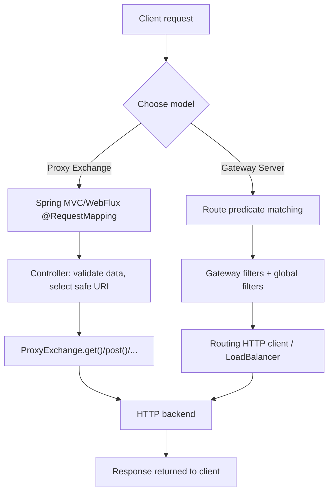
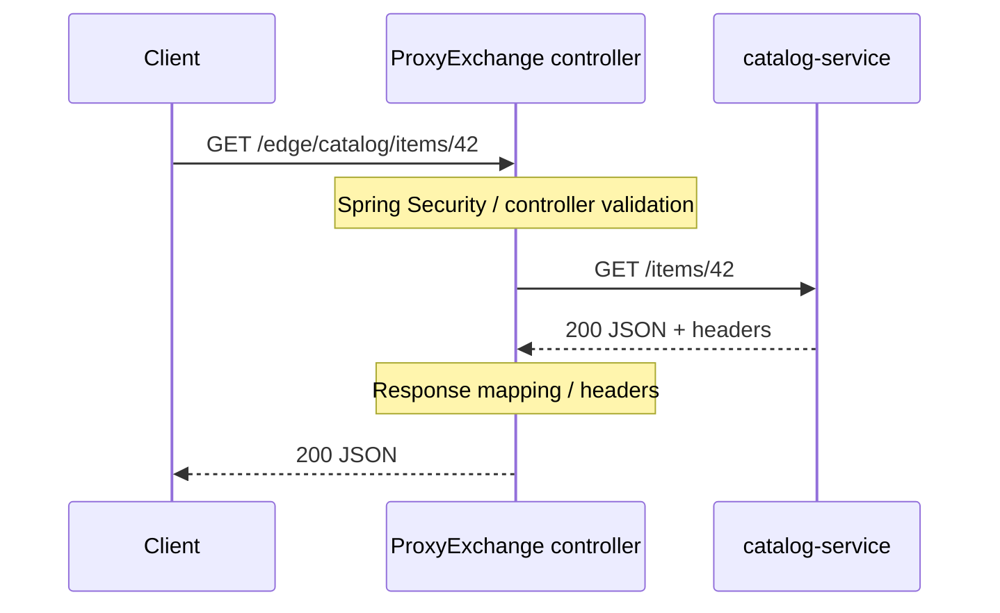
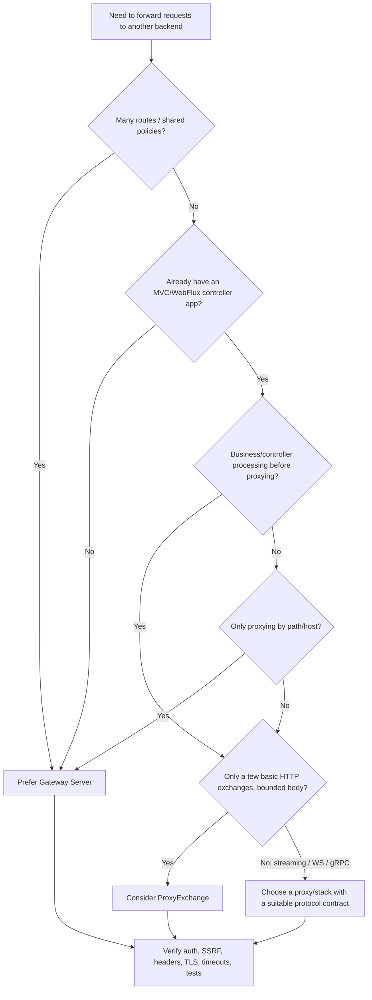

# When to Choose ProxyExchange in a Controller Instead of Gateway Server

## 1. The Practical Problem: Forwarding One API or Running an Entire API Gateway?

In microservices architectures, **Spring Cloud Gateway** can be used to organize a unified entry point, select routes by predicate, transform paths/headers, integrate service discovery, and handle authentication, rate limiting, circuit breakers, retries, TLS, and request observability. However, not every application that needs to call a downstream HTTP service has to deploy a full **Gateway Server**.

Suppose a Spring Boot application has an endpoint:

```text
GET /edge/catalog/items/42
```

The application needs to fetch data from `catalog-service` at:

```text
GET http://localhost:8081/items/42
```

There are two ways to build this:

1. **Proxy Exchange**: create a `@GetMapping` in a controller, accept a `ProxyExchange<byte[]>` parameter, and call `proxy.uri(...).get()`. Suitable when forwarding is **a controlled part of a web application**.
2. **Gateway Server**: declare routes, predicates, and `GatewayFilter`s so the Gateway automatically matches, processes, and proxies requests. Suitable when the application acts as **an entry gateway for many services and cross-cutting policies**.

Both solutions can receive an HTTP request and return backend data, but they **differ in programming model, configuration scalability, and operational responsibilities**. This lesson explains **when to choose each solution**, rather than treating ProxyExchange as a “lighter but full-featured” version of Gateway Server.

### After this lesson, you will be able to

- Distinguish the four combinations: **Gateway Server WebFlux**, **Gateway Server Web MVC**, **Proxy Exchange WebFlux**, and **Proxy Exchange Web MVC**.
- Choose an architecture based on **number of routes**, **volume of shared policies**, **streaming requirements**, **controller dependency**, and **manageability**.
- Write a basic `ProxyExchange` controller on MVC and WebFlux.
- Compare it with a Gateway Server `Path`/`StripPrefix` route configuration performing the same function.
- Recognize the limitations of `ProxyExchange` regarding the filter chain, service discovery, header security, and the durability of request/response streams.
- Test with `curl`, trace the backend, and decide when to migrate to Gateway Server.

> **Scope:** The examples use the **Spring Cloud Gateway 5.0.x** API, referencing the 5.0.5 documentation, Spring Boot 4.x, and a compatible Spring Cloud BOM. The Spring documentation clearly distinguishes **Server** from **Proxy Exchange**, and supports both Web MVC and WebFlux for each group. Artifact names from older 4.x/5.x branches may differ, so do not copy dependencies from outdated documentation.

## 2. Two Major Variants of Spring Cloud Gateway

### 2.1. Gateway Server: Route-Based Routing System

**Gateway Server** is a full-featured API Gateway. You describe:

- **Route ID** and **destination URI**.
- **Route predicates** such as `Path`, `Method`, `Host`, `Header`, and `RemoteAddr`.
- **GatewayFilters** such as `StripPrefix`, `RewritePath`, `AddRequestHeader`, `Retry`, `CircuitBreaker`, `RequestRateLimiter`, and `TokenRelay`.
- **GlobalFilters**, execution order, response handling, route metadata, and shared policies.
- Operational capabilities such as Actuator route inspection, refreshing route definitions, and service discovery/load balancing when configured appropriately.

Illustrative example:

```yaml
spring:
  cloud:
    gateway:
      server:
        webflux:
          routes:
            - id: catalog-items
              uri: http://localhost:8081
              predicates:
                - Path=/edge/catalog/items/**
                - Method=GET
              filters:
                - StripPrefix=2
```

A request to `/edge/catalog/items/42` becomes `/items/42` when sent to the backend. To accomplish this, **you do not need to write a controller for each URL**.

### 2.2. Proxy Exchange: A Proxy Utility Inside Regular Web Handlers

**Proxy Exchange** is a way to build a **controller-style gateway**. You write a `@RestController`, handle requests using Spring MVC or WebFlux, and accept a special parameter:

```java
ProxyExchange<byte[]> proxy
```

Then call:

```java
return proxy.uri("http://localhost:8081/items/42").get();
```

In MVC, the result is `ResponseEntity<?>`; in WebFlux, the result is `Mono<ResponseEntity<?>>`. `ProxyExchange` provides convenience methods corresponding to HTTP verbs to forward HTTP requests downstream.

**Key takeaway:** having `ProxyExchange` on the classpath **does not mean** the application uses Gateway Server's `RoutePredicateHandlerMapping`, `RouteLocatorBuilder`, or `GatewayFilterChain`. Spring Cloud Gateway places Proxy Exchange in **a separate module group**.

### 2.3. Four Combinations, Do Not Collapse Into Two

| Type | Runtime | How paths are declared | Characteristics |
|---|---|---|---|
| **Gateway Server WebFlux** | Spring WebFlux/Reactor Netty | Route definitions, predicates, GatewayFilters | Reactive gateway, multi-route, centralized policies |
| **Gateway Server Web MVC** | Servlet/WebMvc.fn | Gateway MVC routes and HandlerFilterFunctions | Servlet-based multi-route gateway |
| **Proxy Exchange WebFlux** | Annotation-based Spring WebFlux | `@GetMapping` and `ProxyExchange` in a controller | A few proxy endpoints with custom logic, returns `Mono` |
| **Proxy Exchange Web MVC** | Annotation-based Spring MVC | `@GetMapping` and `ProxyExchange` in a controller | A few proxy endpoints in a Servlet app, returns `ResponseEntity` |

Do not call Proxy Exchange MVC “Gateway Server MVC with controllers”: the two artifacts and routing models are **different**. The Spring Cloud Gateway documentation also warns that **Gateway Server documentation does not automatically apply to Proxy Exchange**.

### 2.4. Comparison Processing Diagram



This is a conceptual diagram. **Spring Security and servlet/web filters** can run before the handler in both models depending on the stack. The critical difference is that **the Server's Gateway filter chain does not automatically appear in a ProxyExchange controller**.

## 3. Quick Selection Rules: When to Use ProxyExchange?

### 3.1. Choose ProxyExchange When These Conditions Predominate

**Scenario A — A web application already has controllers and only needs to proxy a few endpoints.**

For example, a Backends for Frontends (**BFF**) already has `/profile`, `/settings`, and `/dashboard`; only two auxiliary APIs need to fetch data from another service and return it. Creating a `/edge/catalog/items/{id}` controller can be simpler and easier to review than operating a separate gateway routing engine.

**Scenario B — Forwarding decisions are tied to controller logic.**

For example, the handler reads a `@PathVariable Long id`, validates input and principal, selects **a fixed, pre-configured upstream**, and then forwards the HTTP request. You want to use the application's familiar `@RequestParam`, `@RequestHeader`, Bean Validation, or method-level authorization.

**Scenario C — Basic HTTP flow, bounded response body.**

For example, calling a small JSON endpoint or returning a small image by ID. `ProxyExchange<byte[]>` can be convenient for size-bounded responses; the application does not need a general-purpose streaming/proxy route.

**Scenario D — No requirement for dynamic route management.**

Handlers are managed via Git, built, and deployed alongside the application. Changing URL mappings via controllers is reasonable when there are only a few routes and operators do not need to modify routes through the Gateway Server Actuator.

### 3.2. Choose Gateway Server When System Requirements Are Foundational

**Scenario E — Many microservices and many routes.** There are dozens or hundreds of paths, hosts, methods, predicates, route groups, and shared filters.

**Scenario F — Centralized gateway policies.** Requires consistency across `RequestRateLimiter`, `CircuitBreaker`, `Retry`, `TokenRelay`, CORS, TLS, headers, caching, observability, and route ordering. Gateway Server provides the right ecosystem of routes/filters; ProxyExchange **does not automatically include all GatewayFilters**.

**Scenario G — Routes defined by configuration/discovery.** Requires `lb://service-name` routing, route metadata, inspecting routes/filters via Actuator, or refresh mechanisms. Gateway Server is usually more suitable than writing/updating controllers for each backend.

**Scenario H — Pure proxying without creating a separate controller per path.** For example, a dedicated edge gateway that only needs to apply `Path=/api/orders/**` and `StripPrefix=1` and forward to a backend, instead of adding lots of Java code.

**Scenario I — Streaming/WebSocket/gRPC or large bodies.** This is not an absolute reason to use Server in *every* case; however, `ProxyExchange<byte[]>` **should not be assumed by default to be a general-purpose streaming proxy**. You must evaluate buffering mechanisms, protocol handling, backpressure, and connection cancellation, and choose a component that directly supports that workload.

### 3.3. Architecture Scoring Table

| Criterion | Prefer ProxyExchange | Prefer Gateway Server |
|---|---|---|
| Number of routes | A few fixed endpoints | Many endpoints/destinations |
| Business logic near controller | Yes, simple and intentional | Minimal; mostly cross-cutting |
| Changing routes via config | Not needed | Needed |
| Service discovery and load balancing | Can be manually integrated, not automatic | Built-in ecosystem support |
| Shared route predicates/filters | Few needed | Many and need reuse |
| Resilience/retry/rate limiting | Can be coded/integrated in a controlled way | Prefer supported filters/policies |
| Authorization | Spring Security on controllers | Spring Security + Gateway routes/policies |
| Body processing | Small, bounded responses | Proxying varied traffic, specialized filters needed |
| WebSocket and long-lived streams | Do not choose just for a simple proxy API | Choose a stack/proxy supporting the specific protocol |
| Operations | Controller/app logs/metrics like a web app | Route/filter observability and Gateway Actuator |
| Deploying routing changes | May require code deployment | Route config sources, reload/refresh depending on setup |
| Initial complexity | Low if a web app already exists | Investing in a structured gateway layer |

**Design decision:** choose the least complex solution that **still meets non-functional requirements**. Do not write 100 `ProxyExchange` controllers to recreate every GatewayFilter; conversely, do not add a Gateway Server for a single fixed forwarding API if all policies are already adequately handled and there are no gateway-centric needs.

## 4. Dependencies and Configuration for the Two Proxy Exchange Styles

### 4.1. Proxy Exchange Web MVC

If your application uses Spring MVC on the Servlet stack, add the exact **`spring-cloud-gateway-proxyexchange-webmvc`** artifact alongside the Spring Boot 4.x web MVC starter.

```xml
<!-- pom.xml of the proxy-mvc-demo application -->
<dependencies>
  <dependency>
    <groupId>org.springframework.boot</groupId>
    <artifactId>spring-boot-starter-webmvc</artifactId>
  </dependency>
  <dependency>
    <groupId>org.springframework.cloud</groupId>
    <artifactId>spring-cloud-gateway-proxyexchange-webmvc</artifactId>
  </dependency>
</dependencies>
```

Manage versions through a compatible **Spring Boot BOM** and **Spring Cloud BOM** (for example, the Boot 4 family and the Cloud release corresponding to Gateway 5.0.x). With Boot 3.x, the common Servlet starter is `spring-boot-starter-web`. Do not pick a newer Gateway version on its own and mix it with an older Spring Framework/Spring Boot.

### 4.2. Proxy Exchange WebFlux

If the application uses annotated Spring WebFlux controllers:

```xml
<!-- pom.xml of the proxy-webflux-demo application, separate from MVC -->
<dependencies>
  <dependency>
    <groupId>org.springframework.boot</groupId>
    <artifactId>spring-boot-starter-webflux</artifactId>
  </dependency>
  <dependency>
    <groupId>org.springframework.cloud</groupId>
    <artifactId>spring-cloud-gateway-proxyexchange-webflux</artifactId>
  </dependency>
</dependencies>
```

This is a **separate application** if you want to run a lab comparing MVC and WebFlux. Do not add both the Web MVC and WebFlux starters to the same project just to try changing the handler signature: if both are on the classpath, the web application type and auto-configuration may not behave as expected.

### 4.3. Distinguishing Artifacts by Name

| Goal | Spring Cloud Dependency |
|---|---|
| Proxy in an MVC `@RestController` | `spring-cloud-gateway-proxyexchange-webmvc` |
| Proxy in a WebFlux `@RestController` | `spring-cloud-gateway-proxyexchange-webflux` |
| Gateway Server Web MVC | `spring-cloud-starter-gateway-server-webmvc` |
| Gateway Server WebFlux | `spring-cloud-starter-gateway-server-webflux` |

Older names such as `spring-cloud-gateway-mvc` and `spring-cloud-gateway-webflux` were used for Proxy Exchange in earlier releases; on the current branch, prioritize the **explicit proxyexchange names**. Do not use `spring-cloud-starter-gateway-server-webflux` in place of the Proxy Exchange dependency and assume a controller will be injected with `ProxyExchange`.

### 4.4. Configuring a Proxy Exchange Application Without Route YAML

Example `application.yml` for **proxy-mvc-demo**:

```yaml
server:
  port: 8080

spring:
  application:
    name: proxy-mvc-demo

downstream:
  catalog-base-url: http://127.0.0.1:8081
```

**Do not declare** `spring.cloud.gateway.server.webflux.routes` or `spring.cloud.gateway.server.webmvc.routes` just to build this `ProxyExchange` controller. The inbound path is handled by `@GetMapping`, while the destination URI is chosen by the controller's code/configuration.

**Security rule:** `downstream.catalog-base-url` is **vetted server configuration**. Do not take the raw destination URL from `?url=...`, `Host`, `X-Forwarded-Host`, or client-supplied headers. Configuring `http://127.0.0.1:8081` is strictly for a lab running two applications on the same host; in production, use HTTPS, proper DNS/service identity, and an allowlist.

## 5. Shared Lab: Simple Catalog Backend

To compare the results of the three proxy approaches, we have a standalone backend application on port `8081`. With Spring Boot 4.x, use the `spring-boot-starter-webmvc` starter.

### 5.1. Backend Controller

```java
package com.example.catalog;

import java.util.Map;
import java.util.concurrent.atomic.AtomicLong;
import org.springframework.boot.SpringApplication;
import org.springframework.boot.autoconfigure.SpringBootApplication;
import org.springframework.http.HttpStatus;
import org.springframework.http.ResponseEntity;
import org.springframework.web.bind.annotation.GetMapping;
import org.springframework.web.bind.annotation.PathVariable;
import org.springframework.web.bind.annotation.RequestHeader;
import org.springframework.web.bind.annotation.RequestParam;
import org.springframework.web.bind.annotation.RestController;

@SpringBootApplication
@RestController
public class CatalogApplication {

    private final AtomicLong calls = new AtomicLong();

    public static void main(String[] args) {
        SpringApplication.run(CatalogApplication.class, args);
    }

    @GetMapping("/items/{id}")
    public ResponseEntity<Map<String, Object>> getItem(
            @PathVariable long id,
            @RequestHeader(name = "X-Client-Hint", defaultValue = "none")
            String clientHint,
            @RequestParam(name = "mode", defaultValue = "ok")
            String mode) {

        long callNo = calls.incrementAndGet();
        if ("unavailable".equals(mode)) {
            return ResponseEntity.status(HttpStatus.SERVICE_UNAVAILABLE)
                .body(Map.of(
                    "error", "CATALOG_UNAVAILABLE",
                    "call", callNo));
        }

        if (id != 42L) {
            return ResponseEntity.notFound().build();
        }

        return ResponseEntity.ok()
            .header("X-Catalog-Origin", "backend")
            .body(Map.of(
                "id", id,
                "name", "Sample Headphones",
                "service", "catalog-demo",
                "clientHint", clientHint,
                "backendCall", callNo));
    }
}
```

Separate backend configuration:

```yaml
server:
  port: 8081
spring:
  application:
    name: catalog-demo
```

Run the backend first; in this lab, requests have small response bodies, making it safe in terms of size to demonstrate `ProxyExchange<byte[]>`.

### 5.2. Testing the Backend Directly

```bash
curl --noproxy '*' -i \
  -H 'X-Client-Hint: lab' \
  'http://127.0.0.1:8081/items/42'

curl --noproxy '*' -i \
  'http://127.0.0.1:8081/items/99'

curl --noproxy '*' -i \
  'http://127.0.0.1:8081/items/42?mode=unavailable'
```

Expect **200** with product JSON, **404** not found, and **503** simulated service error, respectively. The `backendCall` field increments according to how many times the handler is actually invoked. These are **expected results for the learner to practice**, not a claim that a build/test was executed while authoring this lesson.

## 6. Example 1: ProxyExchange in a Spring MVC Controller

### 6.1. Controller With a Strongly Typed Path Variable

In the **proxy-mvc-demo** application on port `8080`, create `CatalogProxyMvcController.java`:

```java
package com.example.proxymvc;

import org.springframework.beans.factory.annotation.Value;
import org.springframework.cloud.gateway.mvc.ProxyExchange;
import org.springframework.http.ResponseEntity;
import org.springframework.web.bind.annotation.GetMapping;
import org.springframework.web.bind.annotation.PathVariable;
import org.springframework.web.bind.annotation.RestController;

@RestController
public class CatalogProxyMvcController {

    private final String catalogBaseUrl;

    public CatalogProxyMvcController(
            @Value("${downstream.catalog-base-url}") String catalogBaseUrl) {
        this.catalogBaseUrl = catalogBaseUrl;
    }

    @GetMapping("/edge/catalog/items/{id}")
    public ResponseEntity<?> item(
            @PathVariable long id,
            ProxyExchange<byte[]> proxy) throws Exception {

        // Destination host is configured by the SERVER, id is constrained to an integer.
        String targetUri = catalogBaseUrl + "/items/" + id;
        return proxy.uri(targetUri).get();
    }
}
```

With the `@SpringBootApplication` main class in `com.example.proxymvc` or a parent package, the controller will be component-scanned:

```java
package com.example.proxymvc;

import org.springframework.boot.SpringApplication;
import org.springframework.boot.autoconfigure.SpringBootApplication;

@SpringBootApplication
public class ProxyMvcApplication {
    public static void main(String[] args) {
        SpringApplication.run(ProxyMvcApplication.class, args);
    }
}
```

**Important line-by-line reading:**

1. `@GetMapping` is **route matching at the Spring MVC layer**, not Gateway Server's `Path Route Predicate Factory`.
2. `@PathVariable long id` restricts the data appended to the path to **a number**, avoiding accepting arbitrary URIs from the client.
3. `ProxyExchange<byte[]>` is **a parameter supported by the Proxy Exchange MVC module**.
4. `proxy.uri(targetUri).get()` sends an HTTP GET downstream and returns `ResponseEntity<?>` from the proxy call.
5. There is no `RouteLocator`, `GatewayFilterChain`, or `StripPrefix`: the controller decides the destination itself.

### 6.2. Calling Through the Controller and Observing

```bash
curl --noproxy '*' -i \
  -H 'X-Client-Hint: mvc' \
  'http://127.0.0.1:8080/edge/catalog/items/42'
```

When the backend is running and the Proxy Exchange module is properly configured, the client receives the corresponding response from `/items/42`, for example:

```json
{
  "id": 42,
  "name": "Sample Headphones",
  "service": "catalog-demo",
  "clientHint": "mvc",
  "backendCall": 2
}
```

The `backendCall` value changes with the number of calls; JSON key order is not fixed. Do not assume a request succeeded solely because the MVC endpoint returned 200: check backend logs/headers/paths.

### 6.3. Adding Controller Processing Before Proxying

One advantage of ProxyExchange is using MVC annotations/logic before calling downstream:

```java
@GetMapping("/edge/catalog/validated/{id}")
public ResponseEntity<?> validatedItem(
        @PathVariable long id,
        ProxyExchange<byte[]> proxy) throws Exception {

    if (id <= 0 || id > 1_000_000) {
        return ResponseEntity.badRequest().body(
            Map.of("code", "INVALID_ITEM_ID"));
    }

    return proxy.uri(catalogBaseUrl + "/items/" + id).get();
}
```

This is an **additional method** in `CatalogProxyMvcController`, requiring `import java.util.Map`. It performs simple validation in the controller, then still proxies to a fixed backend. Do not turn this validation into “gateway security”: for APIs with private data, you must verify authentication/authorization (Spring Security), tenant, and resource permissions.

### 6.4. The forward() Method Exists Only in Proxy Exchange MVC

The official documentation notes that **Proxy Exchange MVC** provides `forward()` to **forward to a local Spring MVC handler**. This is an **in-application** operation, distinct from `uri(...).get()` which makes an HTTP call to an external backend.

**Do not assume** WebFlux Proxy Exchange has the same `forward()`; the 5.0.x documentation specifically describes this support for **MVC**. Likewise, this is **not** the `fallbackUri: forward:/...` of `CircuitBreaker` on Gateway Server. The two share a suggestive name but belong to **two different architectures**.

## 7. Example 2: ProxyExchange in a WebFlux Controller

### 7.1. The Core Difference Is in the Return Type

With the WebFlux module, the handler returns a **publisher**, without blocking synchronously:

```java
package com.example.proxyreactive;

import org.springframework.beans.factory.annotation.Value;
import org.springframework.cloud.gateway.webflux.ProxyExchange;
import org.springframework.http.ResponseEntity;
import org.springframework.web.bind.annotation.GetMapping;
import org.springframework.web.bind.annotation.PathVariable;
import org.springframework.web.bind.annotation.RestController;
import reactor.core.publisher.Mono;

@RestController
public class CatalogProxyWebFluxController {

    private final String catalogBaseUrl;

    public CatalogProxyWebFluxController(
            @Value("${downstream.catalog-base-url}") String catalogBaseUrl) {
        this.catalogBaseUrl = catalogBaseUrl;
    }

    @GetMapping("/edge/catalog/items/{id}")
    public Mono<ResponseEntity<?>> item(
            @PathVariable long id,
            ProxyExchange<byte[]> proxy) {

        String targetUri = catalogBaseUrl + "/items/" + id;

        // DO NOT block(), DO NOT subscribe(). Return Mono to WebFlux.
        return proxy.uri(targetUri).get();
    }
}
```

Main class in the same package:

```java
package com.example.proxyreactive;

import org.springframework.boot.SpringApplication;
import org.springframework.boot.autoconfigure.SpringBootApplication;

@SpringBootApplication
public class ProxyWebFluxApplication {
    public static void main(String[] args) {
        SpringApplication.run(ProxyWebFluxApplication.class, args);
    }
}
```

Choose port **8082** for this WebFlux app so it can run alongside Proxy MVC on port 8080:

```yaml
server:
  port: 8082

spring:
  application:
    name: proxy-webflux-demo

downstream:
  catalog-base-url: http://127.0.0.1:8081
```

### 7.2. Testing With curl

```bash
curl --noproxy '*' -i \
  -H 'X-Client-Hint: reactive' \
  'http://127.0.0.1:8082/edge/catalog/items/42'
```

The backend receives the same path `/items/42` as in the MVC example, but the WebFlux controller **returns `Mono<ResponseEntity<?>>`**. Spring WebFlux registers the subscription when handling the HTTP response; there is no need to call `.subscribe()` to trigger the request, and **do not call `.block()` on the event loop**.

### 7.3. What Is Reactive, and What Is Not Guaranteed?

- **Yes:** returning a publisher from the handler allows WebFlux to coordinate request lifecycle, errors, cancellation, and the implementation's asynchronous I/O.
- **Do not automatically infer:** that the entire application is completely non-blocking if you use synchronous JDBC, `Thread.sleep`, `Future.get`, or custom blocking code inside the controller.
- **Do not automatically infer:** that `ProxyExchange<byte[]>` is optimal for forwarding multi-GB files or infinite SSE streams. The `byte[]` type imposes constraints on body materialization/buffering, depending on how the implementation and HTTP message converters/codecs handle it.
- **Do not automatically infer:** that the full Gateway Server filter ecosystem (such as `RequestRateLimiter` or `TokenRelay` factories) is installed.

For a small JSON API with a clear size limit, this style is concise. For continuous streaming or WebSockets, choose an API/proxy with a documented and separately tested **streaming and backpressure** contract.

### 7.4. MVC and WebFlux Share the Idea but Differ in Thread Model

| Aspect | MVC Proxy Exchange | WebFlux Proxy Exchange |
|---|---|---|
| Web stack | Servlet-based | Reactive/WebFlux |
| Controller parameter | `ProxyExchange<byte[]>` | `ProxyExchange<byte[]>` |
| Return type in example | `ResponseEntity<?>` | `Mono<ResponseEntity<?>>` |
| HTTP client execution | Per MVC-compatible module/HTTP client | Reactive client per WebFlux implementation |
| Call `block()` manually? | Not needed | **No** inside request handlers |
| Call `subscribe()` manually? | Not applicable to imperative MVC | **No**, the framework is the subscriber |
| `forward()` to local handler | Documented as supported | Not assumed to be supported like MVC |
| Gateway Server route/filter config | Not present just from ProxyExchange | Not present just from ProxyExchange |

## 8. Example 3: Gateway Server Doing the Same Job Without a Proxy Controller

Run a separate **Gateway Server WebFlux** application on port **8083** with:

```xml
<dependency>
    <groupId>org.springframework.cloud</groupId>
    <artifactId>spring-cloud-starter-gateway-server-webflux</artifactId>
</dependency>
```

In `application.yml`:

```yaml
server:
  port: 8083

spring:
  application:
    name: gateway-server-demo
  cloud:
    gateway:
      server:
        webflux:
          routes:
            - id: catalog-route
              uri: http://127.0.0.1:8081
              predicates:
                - Path=/edge/catalog/items/**
                - Method=GET
              filters:
                - StripPrefix=2
                - AddRequestHeader=X-Proxy-Style,gateway-server
```

**Completely different structure:**

- `Path=/edge/catalog/items/**` and `Method=GET` are Gateway Server **route predicates**.
- `StripPrefix=2` transforms `/edge/catalog/items/42` into `/items/42`.
- `AddRequestHeader` is a **GatewayFilterFactory**; you can swap or attach other filters as needed.
- `uri` selects the backend without needing a `@GetMapping` controller.
- `id: catalog-route` identifies the route in Gateway Server logs, metrics, and Actuator.

Verify:

```bash
curl --noproxy '*' -i \
  -H 'X-Client-Hint: server' \
  'http://127.0.0.1:8083/edge/catalog/items/42'
```

The backend also receives `/items/42`. **The business HTTP response can be equivalent** to the two ProxyExchange examples, but **route configurability and observability are not equivalent**.

### 8.1. Same Path Transformation, Two Ways to Express It

| Purpose | ProxyExchange controller | Gateway Server |
|---|---|---|
| Select incoming URL | `@GetMapping("/edge/catalog/items/{id}")` | `Path=/edge/catalog/items/**` + `Method=GET` |
| Extract item ID | `@PathVariable long id` | `Path` predicate matches path string |
| Build backend path | Concatenate `"/items/" + id` onto vetted base URI | `StripPrefix=2` |
| Fetch backend response | `proxy.uri(targetUri).get()` | Gateway HTTP routing filter |
| Add request header | Code/header API depending on ProxyExchange | `AddRequestHeader` factory |
| Rate limiting | Integrate with Spring Security/filters/custom logic | `RequestRateLimiter` when configured |
| Change routing | Change controller code/config | Change route definitions and refresh/deploy by source |
| Route statistics | Controller/app metrics | Route ID, Gateway metrics/Actuator when enabled |

### 8.2. Must Gateway Server Always Be a Separate Microservice?

**No.** The Spring documentation notes that Gateway Server can run **standalone or embedded** inside a Spring Boot application. “Choosing Server” means choosing **the Gateway Server routing model and filter chain**, not necessarily deploying a standalone cluster every time.

What you should avoid is **cramming both models into the same app just for a demo endpoint**, and assuming route predicates/filter chains will run for every `@RestController`. If you need to combine them, you must explicitly design mapping priority, security chains, and filter scopes, and test request routing to prevent route/controller overlaps.

## 9. Headers, Query, Path, and How the Proxy Result Is Constructed

### 9.1. Sensitive Headers: Cookie and Authorization

The Proxy Exchange 5.0.x documentation specifies a mechanism for handling **sensitive headers**: by default, `cookie` and `authorization` are **not forwarded to the backend**. It also has a mechanism to exclude **skipped headers**, defaulting to `content-length` and `host`, when copying requests.

| Client Header | Default Status in Proxy Exchange | Reason |
|---|---|---|
| `Authorization` | **Sensitive**, not forwarded by default | Avoid sending bearer tokens across trust boundaries to upstreams |
| `Cookie` | **Sensitive**, not forwarded by default | Avoid leaking session/browser cookies |
| `Host` | **Skipped**, not copied verbatim by default | Destination host may differ from incoming host |
| `Content-Length` | **Skipped**, not copied verbatim by default | Body/transfer encoding may change |
| `X-Client-Hint` | Not in the two default lists above | May be forwarded; still verify actual filters/configuration |
| `X-Forwarded-*` | Has dedicated handling mechanism | Only trust data from an authenticated proxy |

**Note:** the default “Authorization is not automatically forwarded” behavior is a **safety feature**, not a ProxyExchange bug. However, if a backend needs a user access token, suddenly **removing the sensitive restriction** and forwarding credentials indiscriminately is a major risk. Define OAuth2 client policies, audience, scope, and trusted upstreams first.

### 9.2. Why Can't Host and Content-Length Be Copied Verbatim?

Suppose the client sends:

```http
GET /edge/catalog/items/42 HTTP/1.1
Host: frontend.example.test
Authorization: Bearer <token-redacted>
X-Client-Hint: lab
```

ProxyExchange creates a request to `http://catalog.internal.test/items/42`. Keeping `Host: frontend.example.test` unchanged could cause the upstream to select the wrong virtual host/SNI or policy. If the body is transformed while keeping the old `Content-Length`, request/response framing can break. Therefore, Proxy Exchange separates **sensitive** and **skipped** header groups.

Do not assume ProxyExchange eliminates all HTTP request smuggling, hop-by-hop headers, `Forwarded` spoofing, or header injection risks across all versions. For public-facing applications, review actual proxy configuration, test with middleboxes, and apply patches.

### 9.3. Response Headers and Response Mapper

The Proxy Exchange documentation states that you can modify response headers or pass a **mapper function** when calling `get()` (and corresponding methods) to map the downstream `ResponseEntity` into the response sent to the client.

**Conceptual model:**

```text
Downstream:
  ResponseEntity<byte[]> { status, headers, body }
         |
         v
  mapper(backendResponse)
         |
         v
Client:
  ResponseEntity<?> { status, modified headers, same/changed body }
```

Valid use cases: adding non-sensitive internal observability headers, renaming a safe header, or stripping headers that should not be exposed. Avoid overwriting `Set-Cookie`, `Location`, `Content-Type`, `Content-Length`, or `ETag` without understanding their semantics; when the body changes, `Content-Length`/`ETag` from the backend may no longer be valid.

If you need deep response body processing or continuous body streaming, consider using an API/proxy specifically designed for that scenario; do not pull the entire response into a `byte[]` just to modify one large field.

### 9.4. Query Parameters and Dynamic Data

A controller can accept `@RequestParam` just like any Spring MVC/WebFlux handler:

```java
@GetMapping("/edge/catalog/search")
public ResponseEntity<?> search(
        @RequestParam(defaultValue = "vi") String lang,
        ProxyExchange<byte[]> proxy) throws Exception {

    // Illustration snippet placed inside the MVC controller with catalogBaseUrl.
    if (!java.util.Set.of("vi", "en").contains(lang)) {
        return ResponseEntity.badRequest().build();
    }

    String targetUri = org.springframework.web.util.UriComponentsBuilder
        .fromUriString(catalogBaseUrl)
        .path("/search")
        .queryParam("lang", lang)
        .build()
        .encode()
        .toUriString();
    return proxy.uri(targetUri).get();
}
```

The example makes two intentional points: only accept **allowlisted `lang` values**, and let `UriComponentsBuilder` encode the query rather than concatenating raw user-supplied queries. The lab backend in Section 5 **does not have a `/search` endpoint yet**; to test this snippet, you must add a corresponding mapping.

**Do not** use:

```java
// EXTREMELY DANGEROUS: creates an open proxy/SSRF from client input.
@GetMapping("/proxy")
public ResponseEntity<?> unsafe(
        @RequestParam String url,
        ProxyExchange<byte[]> proxy) throws Exception {
    return proxy.uri(url).get();
}
```

A user could make the server access loopback addresses, cloud metadata endpoints, database admin ports, or internal services. Destinations must be locked down via configuration/allowlists; restrict host, scheme, port, redirects, DNS re-resolution, and credentials.

## 10. ProxyExchange Does Not Automatically Include the Gateway Server Filter Chain

### 10.1. The Most Important Boundary When Moving to Production

The Spring Cloud Gateway 5.0.x documentation clearly separates these groups. In an application that only adds `spring-cloud-gateway-proxyexchange-webmvc` or `spring-cloud-gateway-proxyexchange-webflux`:

- It makes no sense to declare `spring.cloud.gateway.server.webflux.routes` and assume it applies to a ProxyExchange controller.
- There is no Gateway Server `GatewayFilterChain` automatically attached to every `proxy.uri(...).get()` call.
- You do not implicitly get `GlobalFilter`, `StripPrefix`, `RewritePath`, `RequestRateLimiter`, `CircuitBreaker`, `Retry`, `TokenRelay`, or `LocalResponseCache` **as Gateway Server factories**.
- You do not implicitly get `/actuator/gateway/routes` Actuator endpoints to manage a `@GetMapping` controller as a route definition.
- You do not implicitly get `lb://` service discovery, route metadata/order, grouped route policies, or dynamic route refresh.

**What you still have:** the application is a standard Spring MVC/WebFlux app, so you can use Spring Security, Servlet Filters or WebFlux WebFilters, validation, Micrometer Observation, exception handlers, and suitable Spring libraries. They are **not** Gateway Server filters just because they have similar functional names.

### 10.2. Resilience Can Be Integrated Manually, but Must Be Explicitly Designed

Suppose a ProxyExchange application needs to wait at most 2 seconds for an upstream and return a fallback when the circuit breaker opens. You can integrate **Resilience4j**, HTTP client timeouts/retries, or runtime-appropriate tools, but you must define:

1. **Failure condition:** Is HTTP 5xx a response or an exception in the current API?
2. **Timeouts:** How do connect, response, total request, and client budget timeouts differ?
3. **Retry:** Is retrying idempotent GET requests allowed, how many times, and with what backoff?
4. **Fallback:** Can the controller return an alternate response without masking auth/permission errors?
5. **Circuit breaker scope:** Per backend, per route, or per business operation? Who manages state/metrics?

In Gateway Server, corresponding filter factories are available out of the box to configure as route policies. With ProxyExchange, you **own the integration code and tests** for these concerns. This is a real architectural cost.

### 10.3. The Same Applies to Rate Limiting and Auth

A `ProxyExchange` controller can be protected by Spring Security (for example, JWT Resource Server or OAuth2 Login). However, you must consider:

- Where is the incoming bearer token **validated**, and for which audience/issuer/scopes?
- Is forwarding the token to this backend **permitted**?
- Is resource/user/tenant-level authz checked before proxying or by the downstream?
- Is the quota tracked by **client identity**, user, route, or IP?
- When the limit is reached, is 429 returned before opening a downstream connection?

By default, ProxyExchange withholds `Authorization`/`Cookie` as sensitive headers, so **do not assume it acts as TokenRelay**. If inter-service delegation is required, design token exchange/client credentials or bounded propagation, and verify with backend security tests. Do not merely override header defaults to let all cookies/tokens pass through.

### 10.4. Server Filters Have Limits Too; Choose by Workload

Choosing Gateway Server does not make all bugs disappear. Route filters require proper ordering, TLS, retries, circuit breakers, security, URI rewrites, CORS, and cache keys. Before using features like `TokenRelay` or `RequestRateLimiter`, appropriate dependencies and configurations must be installed. The choice here is between **a unified set of gateway policies** and **intentional logic inside a controller**, not between “absolute safety” and “unsafe”.

## 11. Body, Streaming, WebSockets, and Protocols

### 11.1. byte[] Generally Fits Small, Bounded Payloads

Both ProxyExchange examples use `ProxyExchange<byte[]>` as shown in the Spring documentation. For JSON responses of a few KB, this type is easy to integrate. For multi-GB files, infinite SSE streams, or uploads of unknown size:

- Using `byte[]` can lead to **materializing/buffering large payloads** depending on the implementation's codecs/converters.
- Memory usage can grow with the number of concurrent requests and response size.
- Responses may lose incremental flushing or suffer high latency if aggregated.
- Cancellation/backpressure and `DataBuffer` ownership must be evaluated for the exact stack and module.

**Do not claim** that every ProxyExchange buffers bodies with the exact same algorithm across all versions; **nor claim that “WebFlux + Mono” guarantees completely zero-copy streaming**. Measure memory, latency, TTFB, and client-cancellation behavior using realistic payloads.

### 11.2. SSE and WebSockets Need Separate Verification

| Use case | Protocol constraints | Options to consider |
|---|---|---|
| Small JSON GET | HTTP request-response | Either ProxyExchange or Gateway Server can fit |
| Large download | Incremental body, Range, Content-Length, backpressure | Choose a streaming-tested proxy/route |
| Large file upload | Bounded memory, multipart, timeout, streaming | Do not buffer the entire body into `byte[]` |
| SSE | `text/event-stream`, per-event flush, reconnect, idle timeout | Gateway Server streaming route or proven dedicated solution |
| WebSocket | H1 Upgrade/`ws,wss`, handshake, frame/session lifecycle | Gateway Server WebSocket Routing Filter or dedicated WS proxy |
| gRPC | HTTP/2, trailers, message framing | gRPC-aware proxy/gateway, test native clients/trailers |

**Key lesson:** `ProxyExchange` supports **basic downstream HTTP exchanges**; its documentation **does not promise** all protocol/streaming features of Gateway Server. If a system relies on WebSockets/H2/gRPC or long-lived streams, do not choose ProxyExchange merely because it has a `get()` method.

### 11.3. HTTP Methods and Bodies Must Not Be Assumed

ProxyExchange provides convenience methods matching HTTP verbs, but before proxying POST/PUT/PATCH/DELETE you must clarify:

- Which HTTP method is actually forwarded?
- Is the request body read, preserved, or transformed?
- Do `Content-Type`/`Content-Length`/encoding remain valid?
- Could retries duplicate write operations?
- Are empty bodies and multipart requests handled properly by the MVC/WebFlux codecs?
- Are 201/204/4xx/5xx statuses and `Location`/`Set-Cookie` forwarded properly?

Do not copy the GET lab snippet, change `.get()` to `.post()`, and assume you have a general-purpose reverse proxy. Test each HTTP verb, body size, and exception path individually.

## 12. Securing ProxyExchange When Controllers Accept User Input

### 12.1. SSRF: The Biggest Risk When the Target URI Is Decided in Code

ProxyExchange lets the controller **choose the target URI**. If this URI comes from user input, the application can become an **open proxy** or a vector for **server-side request forgery (SSRF)**. An attacker could make the server access:

- `127.0.0.1`, `localhost`, and internal admin ports.
- RFC1918 IPs, Kubernetes APIs, and service mesh administration endpoints.
- Cloud instance metadata addresses.
- Services holding the proxy application's own mTLS credentials/cookies/identity.
- Attacker-controlled hosts to harvest headers, data, or timing information.

**Mitigations:**

1. Keep the **destination base URI** in server configuration/allowlists; do not accept arbitrary URIs from requests.
2. If selecting among multiple services, use a **server-side ID → allowlisted base URI mapping**.
3. Allow only `https`, specific hosts/ports, and verify DNS/rebinding/redirect behavior.
4. Do not forward `Authorization`, `Cookie`, or internal headers to hosts outside the trust boundary.
5. Create network egress policies blocking metadata/internal control planes, rather than relying solely on string validation.
6. Enforce authorization for the **accessed resource**, not just checking whether the user is logged in.

A validator like `startsWith("https://trusted.example.com")` is **insufficient**: a URL like `https://trusted.example.com.evil.test`, URLs with userinfo, DNS rebinding, or redirects can bypass string prefix checks. Parse with `URI` and structurally validate hostname/scheme/port, combined with egress network policies.

### 12.2. Header Spoofing and Forwarding Proxy Identity

Even when `X-Forwarded-For`, `X-Forwarded-Proto`, or `Forwarded` are supported by ProxyExchange, **do not trust arbitrary client-sent values**. Only an authorized ingress/service mesh should create or update forwarded identity; the edge should strip untrusted forwarded headers from the Internet and overwrite them with verified values.

If the backend makes authorization decisions based on `X-User-Id`, `X-Tenant`, or `X-Role` added by the proxy, you must:

- Verify principal/scope/tenant via Spring Security at the proxy or backend.
- Strip headers with the same names from incoming client requests and populate them only from **verified identity**.
- Protect the proxy → backend hop with TLS/mTLS and network allowlists.
- Ensure the backend cannot be called directly by Internet clients with forged headers.

### 12.3. CORS, CSRF, Cookies, and Response Headers

Because ProxyExchange is an MVC/WebFlux controller, it is subject to the web stack's **CORS**, **CSRF**, and **session/security filters**:

- CORS only controls **browser permission to read the response**, not authentication.
- CSRF matters for **cookie-based sessions** and state-changing methods; do not disable CSRF unconditionally just because “this is a proxy”.
- `Set-Cookie` from downstream may contain Domain, Path, SameSite, and Secure attributes unsuitable for the public host; define a clear policy before sending them to the browser.
- Backend `Location`/redirects may leak internal hostnames; check for necessary rewrites.
- Responses containing user data should carry `Cache-Control: private/no-store` per policy so shared proxies/caches do not serve them to the wrong user.

### 12.4. TLS and Service Credentials

The lab uses `http://127.0.0.1:8081` to minimize setup steps. Production should use:

- HTTPS with a trusted CA, hostname/SNI validation, and rotation.
- mTLS between services when required by the threat model.
- A secret manager for credentials; never place secrets in URLs/queries/public configs.
- Per-upstream timeouts, connection pools, and retry/circuit breaker policies.
- Proof that the backend matches the access token's audience/scope, if propagation is enabled.

**Never enable an insecure trust manager or `curl -k` in production** to work around a bad certificate. An HTTP 200 does not prove the connection is trusted or that data is protected from exposure.

### 12.5. Fail Closed When Authentication/Authorization Is Uncertain

If the proxy calls a policy service to decide permission, **await the decision before proxying**, apply a timeout, and default to deny/503 if the policy service is unavailable according to business policy. Especially in WebFlux:

```java
// STRUCTURAL pseudocode, requires implementing policyClient/deny in the application:
return policyClient.isAllowed(principal, id)
    .timeout(Duration.ofMillis(300))
    .onErrorReturn(false)
    .flatMap(allowed -> {
        if (!allowed) {
            return Mono.just(ResponseEntity.status(403).build());
        }
        return proxy.uri(approvedBaseUrl + "/items/" + id).get();
    });
```

This example demonstrates that **a Mono must be composed and returned**, not subscribed to separately (which could invoke downstream before the policy decides). In real production systems, distinguish **DENY (403)** from **UNAVAILABLE (typically 503)** rather than collapsing both into `onErrorReturn(false)`; error and empty cases must have explicit tests. Spring Security remains the appropriate foundation for authn/authz.

## 13. Operations: Observability and Cost When Choosing ProxyExchange

### 13.1. Logging Both Hops Properly

With a ProxyExchange controller, one client HTTP request corresponds to **at least one downstream HTTP call** when proxying. With retries, request aggregation, or conditional handling, the number of downstream calls can increase.



Include a **request ID/trace ID** to correlate the client → proxy hop with the proxy → backend hop. Observability comparison:

| Indicator | ProxyExchange controller | Gateway Server |
|---|---|---|
| HTTP server request rate/status | Spring Boot/Micrometer MVC or WebFlux | Spring Boot + Gateway metrics |
| Controller handler | Annotation mapping, method metrics/tracing | No per-route controller required |
| Downstream client metrics | According to Proxy Exchange HTTP client, separate instrumentation | Netty/Gateway HTTP client metrics depending on stack |
| Route ID | No auto-generated `Gateway Route ID` for `@GetMapping` | Has route ID when route is defined |
| Filter chain inspection | Spring web filters, controller interceptors | Gateway Actuator routes/filters when enabled |
| Failure class | Downstream call, handler exception/timeout | Route, GatewayFilter, Netty routing/circuit breaker |
| Deployment state | Tied to application version/config | Tied to route definitions and instance cache |

**Do not use `id` or free-form raw URLs as metrics tags** if cardinality is high. Use the route template `/edge/catalog/items/{id}`, status, a fixed backend service label, and non-sensitive error classes; never log bearer tokens, cookies, or PII.

### 13.2. Timeouts, Connection Pools, and Load

A simple controller does not mean optimal operations out of the box. Before production, define:

- **Connect timeout** and **response/read timeout** for ProxyExchange's HTTP client.
- Connection pool size and concurrent call limits to the upstream.
- Servlet thread count (MVC) or event loop health (WebFlux).
- Response body size and memory budget under concurrency.
- Behavior when the client cancels, the backend drops the connection, or it returns a partial response.
- Circuit breakers/retries/bulkheads if the backend is unstable.

Do not take `spring.cloud.gateway.server.webflux.httpclient.response-timeout` and assume it controls **ProxyExchange Web MVC**. That property belongs to the **Gateway Server WebFlux** HTTP client, whereas ProxyExchange uses its own HTTP client/configuration module. Choose the right properties and verify against your version.

### 13.3. Managing Routes via Actuator Differs From Managing Controllers

With Gateway Server, Actuator can list route definitions and filter chains:

```text
GET /actuator/gateway/routes
GET /actuator/gateway/routes/{id}
GET /actuator/gateway/routedefinitions
```

**Do not treat** a `@GetMapping("/edge/catalog/items/{id}")` controller as a `RouteDefinition` that can be `POST`/`DELETE`d through Gateway Actuator. If you only use ProxyExchange, observe it via Spring MVC/WebFlux handler mappings/metrics; if you need frequent path changes without redeploying, Gateway Server or a config-versioned routing service is usually a better fit.

### 13.4. Maintenance Cost Analysis

| As the application grows | What ProxyExchange controllers may face | How to address it |
|---|---|---|
| 2 proxy endpoints → 20 endpoints | Duplicated URI, header, and timeout code | Extract shared policies or consider Gateway Server |
| 20 endpoints → 200 endpoints | Many annotations/handlers, hard to review | Route definitions + reusable filters |
| Different retry/circuit breaker per route | Resilience logic scattered in code | Move policies to Gateway Server route filters |
| Multiple teams requesting new routes | Every change needs deployment/controller ownership | Source-of-truth route config, IaC, and rollouts |
| Complex service discovery/load balancing | Hardcoded host/ports drift across environments | Gateway Server `lb://` and proper discovery integration |
| Adding streaming/WebSocket/gRPC | Body/transport constraints become obvious | Proxy/protocol-specific solution and streaming tests |
| Auditing/identity becomes sensitive | Multiple token/header forwarding points | A consistent security architecture, least privilege |

**Migration cost** is also worth factoring in: switching from ProxyExchange to Gateway Server can change filter ordering, HTTP clients, header handling, timeouts, CORS, and auth. Behavioral testing is essential—do not just swap dependencies.

## 14. Decision Tree in a Real Project



### 14.1. Example A: BFF Adding Two Data-Reading Endpoints

**Requirements:**

- The application already has MVC controllers.
- Only two GET APIs fetching JSON from an internal catalog.
- Fixed downstream host, small payloads, no complex rewrites needed.
- Callers are authenticated by Spring Security; no indiscriminate token forwarding.
- URL changes follow normal release cycles.

**Recommendation:** use **ProxyExchange Web MVC** with an explicit controller; keep dependencies/modules minimal, and write integration tests for auth, 404/503, timeouts, and headers. Gateway Server is unnecessary just to forward two simple GETs.

### 14.2. Example B: Platform With 40 Microservices

**Requirements:**

- 80 routes across multiple domains and paths.
- Multiple predicates such as `Host`, `Header`, `Method`, and `RemoteAddr`.
- TokenRelay, per-client rate limiting, circuit breakers/retries, TLS, caching, and telemetry.
- Adding/removing routes per config release, with some routes discovered via service discovery.

**Recommendation:** use **Gateway Server WebFlux** or **Gateway Server Web MVC** depending on runtime stack and protocol/operational requirements. The route/filter system is designed for this job; 80 ProxyExchange controllers would create a heavy burden for policy synchronization, testing, and review.

### 14.3. Example C: Real-Time Streaming Needed

**Requirements:** An SSE API emitting events for hours and a bidirectional WebSocket channel. Clients may reconnect, and intermediate proxies have idle timeouts.

**Recommendation:** prefer a **gateway/proxy with explicit SSE/WebSocket support**. Gateway Server WebFlux includes WebSocket routing and non-blocking streaming infrastructure; however, you must still verify forwarding headers, Origin, auth, timeouts, and backpressure. Do not default to `ProxyExchange<byte[]>` for long-lived streams.

### 14.4. Example D: One Endpoint Aggregating Three Services

**Requirements:** A controller calls identity, catalog, and pricing, then aggregates a single JSON response.

This is primarily **business orchestration/BFF composition**, not proxying **one** HTTP exchange. An annotated MVC/WebFlux controller using `WebClient`/`RestClient` or a dedicated service layer to call and aggregate can be cleaner than forcing `ProxyExchange` into an aggregation framework. ProxyExchange only truly fits when **the core job of the handler is forwarding one HTTP request**.

### 14.5. Example E: Enterprise Route Policies Need Standardization

**Requirements:** Multiple teams want to add custom headers, strip prefixes, apply retries and circuit breakers, and enforce TLS under a shared standard.

**Recommendation:** Gateway Server with **versioned route definitions and reusable filters**, accompanied by security/code review. Do not use ProxyExchange with copy-pasted policy logic across numerous `@GetMapping` methods.

## 15. Migrating From ProxyExchange to Gateway Server as Needs Grow

### 15.1. Start With the Contract, Not Just the Code

Before migrating, document what clients currently observe:

1. URLs/paths, HTTP methods, and query semantics.
2. Allowed request/response headers, security headers, and cookie handling.
3. Status codes 200/201/204/301/404/429/500/503.
4. Body content types/encodings, size limits, ETag, and Cache-Control.
5. Authentication/authorization, token audience/scope, and tenant isolation.
6. Timeouts, retries, cancellation, and upstream error mapping.
7. Rate limits, circuit breaker thresholds, and CORS/CSRF.
8. Metrics/traces/route identification, upstream hosts, and service discovery.

**Do not assume** the two implementations forward `Authorization`/`Cookie` identically. ProxyExchange has its own sensitive header defaults, while Gateway Server has different filters/security mechanisms; major behavioral changes can arise if you migrate without testing.

### 15.2. Controller → Route/Filter Mapping Table

| ProxyExchange Controller | Gateway Server Equivalent | Additional Checks Required |
|---|---|---|
| `@GetMapping("/edge/catalog/items/{id}")` | `Path=/edge/catalog/items/**` + `Method=GET` | Path vars/regex/trailing slash |
| `catalogBaseUrl + "/items/" + id` | `uri` + `StripPrefix=2` | Encoded slashes, queries, path normalization |
| `proxy.uri(...).get()` | HTTP routing filter | Error mapping, TLS, body/headers |
| Validation in controller | Predicates/filters, Spring Security, or service validation | Ensure business input checks are not lost |
| Custom headers in controller | `AddRequestHeader`/`SetRequestHeader` | Prevent header spoofing and copying secrets |
| Blocking unauthorized requests | SecurityWebFilterChain / SecurityFilterChain | Do not mask 401/403 with a fallback |
| Custom timeouts/retries | Gateway client timeouts + `Retry`/`CircuitBreaker` | Attempt count and idempotency |
| Controller method metrics | Gateway route metrics | Tags, trace IDs, and cardinality |

### 15.3. Step-by-Step Migration

```text
1) Inventory ProxyExchange endpoints and contracts
2) Create route definitions on staging Gateway Server
3) Re-specify security, headers, and resilience policies
4) Parallel test 200/404/503, auth, large bodies, and streaming
5) Canary traffic per route, measure p95/p99, error rate, and upstream calls
6) Shift traffic gradually, monitor traces and rollback plan
7) Remove legacy controllers/proxy dependencies once stable
```

If ProxyExchange currently handles complex business logic, **you do not have to move all of it into Gateway filters**. Keep that logic in the BFF/backend service and use Gateway Server for edge policies (routing, auth propagation, rate limits, resilience).

## 16. Testing Matrix: Proving Correctness, Not Just Checking for HTTP 200

In the lab, you can run:

- Backend `catalog-demo` on `8081`.
- MVC ProxyExchange on `8080`.
- WebFlux ProxyExchange on `8082`.
- Gateway Server WebFlux on `8083`.

All examples send `GET` to `/items/42` when path/URI are configured correctly. Compare **status, headers, body, and backend access logs** to avoid false conclusions.

| ID | Target | Input | Verification |
|---|---|---|---|
| T1 | Direct backend `8081` | `GET /items/42` | 200, `service=catalog-demo` |
| T2 | MVC Proxy `8080` | `GET /edge/catalog/items/42` | 200, backend receives exact ID/path |
| T3 | WebFlux Proxy `8082` | Same path | 200, matching result without blocking |
| T4 | Server WebFlux `8083` | Same path | 200, `StripPrefix=2` works |
| T5 | MVC Proxy | `GET /edge/catalog/items/99` | Backend 404 handled per contract |
| T6 | WebFlux Proxy | `GET /edge/catalog/items/99` | Does not turn 404 into 200 |
| T7 | MVC Proxy | `GET /edge/catalog/items/42?mode=unavailable` | Verify whether query is forwarded per implementation/config |
| T8 | Server WebFlux | `GET /edge/catalog/items/42?mode=unavailable` | 503 from backend if no fallback/retry configured |
| T9 | MVC Proxy | `POST /edge/catalog/items/42` | Does not match `@GetMapping` (status depends on mapping) |
| T10 | Server WebFlux | `POST` same path | Does not match route with `Method=GET` |
| T11 | MVC Proxy | Incoming `Authorization: Bearer <redacted>` | Backend **does not receive** header per sensitive default |
| T12 | MVC Proxy | Incoming `Cookie: SESSION=<redacted>` | Backend **does not receive** cookie per sensitive default |
| T13 | MVC Proxy | Incoming `X-Client-Hint: lab` | Verify whether normal header is forwarded |
| T14 | MVC Proxy | Incoming `Host` differing from target | Target host/framing not broken by copying `Host` |
| T15 | MVC Proxy | Client-crafted URL query | Does not turn target URI into arbitrary external URL |
| T16 | MVC Proxy | Backend :8081 stopped | Controlled error; no stack trace leaked |
| T17 | WebFlux Proxy | Slow backend response | Timeout/cancellation managed, does not block Netty |
| T18 | MVC Proxy | 100 concurrent GETs (lab scale) | Memory/thread pool stable, no unbounded buffering |
| T19 | WebFlux Proxy | A very large response | Measure heap/TTFB/cancel, verify if `byte[]` fits |
| T20 | Server WebFlux | Route using `lb://catalog-service` in integration setup | Requires LoadBalancer/DiscoveryClient installed and backend instance ready |
| T21 | MVC Proxy | Unauthorized caller | Spring Security blocks **before** proxy per policy |
| T22 | Server WebFlux | Unauthorized caller | Security/route filters still enforce properly, no indiscriminate token relay |
| T23 | ProxyExchange | Change base URI to non-allowlisted host | Startup/config validation or policy blocks it |
| T24 | ProxyExchange | Client closes connection while backend streams body | Resources cleaned up, timeout/cancel does not leak |

Expected statuses **other than 200/404/503** can depend on Spring Security, exception handlers, and per-stack configuration. Do not assert only an HTTP code if the controller lacks failure handlers. Across all three approaches, logging the backend's request count confirms **requests actually reached the service** and were not handled by a different route.

### 16.1. Comparison Command Set

```bash
# Step 1: direct backend.
curl --noproxy '*' -i \
  'http://127.0.0.1:8081/items/42'

# Step 2: Proxy Exchange MVC.
curl --noproxy '*' -i \
  -H 'X-Client-Hint: mvc' \
  'http://127.0.0.1:8080/edge/catalog/items/42'

# Step 3: Proxy Exchange WebFlux.
curl --noproxy '*' -i \
  -H 'X-Client-Hint: webflux' \
  'http://127.0.0.1:8082/edge/catalog/items/42'

# Step 4: Gateway Server WebFlux.
curl --noproxy '*' -i \
  -H 'X-Client-Hint: server' \
  'http://127.0.0.1:8083/edge/catalog/items/42'

# Step 5: business error path (non-existent id).
curl --noproxy '*' -i \
  'http://127.0.0.1:8080/edge/catalog/items/99'

# Step 6: simulate upstream error.
curl --noproxy '*' -i \
  'http://127.0.0.1:8083/edge/catalog/items/42?mode=unavailable'
```

**Query note:** The ProxyExchange controllers in Sections 6–7 build the target URI **explicitly** with only `/items/{id}`, so **do not assume `mode=unavailable` is preserved** when sent through ProxyExchange. If business logic requires query parameters, add them explicitly from `@RequestParam` via `UriComponentsBuilder` and test. Conversely, Gateway Server routes typically preserve query strings when only `StripPrefix` is used; verify on the backend.

### 16.2. Measuring Header Forwarding Safely

The demo backend only echoes `X-Client-Hint`, not Authorization/Cookie. To test sensitive defaults, use a **test/stub backend** that records presence as a **boolean** (for example `authorizationPresent=false`), without logging or returning raw token/cookie values.

```text
Do not:
  log.info("Authorization={}", requestHeader)

Do (in a controlled test):
  authorizationPresent = requestHeaders.containsKey("Authorization")
  cookiePresent        = requestHeaders.containsKey("Cookie")
```

Do not use real bearer tokens in the lab. Use dummy values, a stub backend with a clear trust boundary, and purge logs after testing if they accidentally contain secrets.

### 16.3. Integration Testing With WebTestClient or MockMvc

Choose tools according to your stack:

| Stack | Appropriate Testing API |
|---|---|
| Proxy Exchange MVC | `MockMvc` for controller behavior and real HTTP tests for downstream forwarding |
| Proxy Exchange WebFlux | `WebTestClient`/Reactor Test for controller and downstream HTTP |
| Gateway Server WebFlux | `WebTestClient`/curl with a stub backend and route integration |
| Gateway Server Web MVC | `MockMvc` or client integration suited to Servlet/routes |

**Do not use unit tests calling the controller directly as proof that the ProxyExchange resolver/HTTP client works**: the `ProxyExchange` parameter is supplied by the framework at runtime. You need integration tests that boot a real Spring context, a countable stub backend, and test allowed/denied/error/cancel paths.

## 17. Troubleshooting: Issues When Switching Between ProxyExchange and Server

| Symptom | Possible Cause | How to Check |
|---|---|---|
| Controller cannot resolve `ProxyExchange` | Missing exact MVC/WebFlux proxyexchange artifact, unexpected stack | Check dependencies, web application type, MVC/WebFlux adapter |
| Compile error importing `ProxyExchange` | Imported wrong MVC vs WebFlux module, mismatched artifact version | Read Javadoc for the matching module and check IDE imports |
| `proxy.uri(...).get()` does not call backend | Controller mapping mismatch, wrong destination URI, client timeout | Check controller logs and backend access log |
| ProxyExchange returns differently from Gateway Server route | Two proxy styles differ in headers/filters/error handlers | Compare using identical request/path/body |
| Backend does not see Authorization | **Sensitive header default** | Evaluate whether token propagation and audience/scope are truly needed |
| Backend does not see cookie | **Sensitive header default** | Do not disable filtering just to keep sessions without a proper design |
| Backend sees Host different from client Host | **Skipped header default** | Expected when destination host differs; check SNI/virtual host |
| Backend receives 404 | Wrong destination path, encoding, missing manual rewrite | Log redacted target URI, compare against backend mapping |
| Incoming query missing at upstream | Controller built target URI without the query | Pass validated `@RequestParam` into `UriComponentsBuilder` |
| ProxyExchange app lacks `/actuator/gateway/routes` | That endpoint is for Gateway Server, not controller mappings | Use app handler mapping/metrics or choose Server |
| YAML `spring.cloud.gateway.server.webflux.routes` does not apply to controller | Server route config is not ProxyExchange config | Separate models; use `@GetMapping` in ProxyExchange |
| `StripPrefix` has no effect | Gateway Server filter chain is not running | Adjust target URI in controller or switch to Gateway Server |
| `lb://catalog-service` does not work | Lacks corresponding LoadBalancer/discovery integration | Use properly configured Gateway Server or explicit client-side discovery |
| WebFlux ProxyExchange fails on `block()` | Blocking on the event loop | Return `Mono<ResponseEntity<?>>`; do not subscribe/block |
| Large uploads/downloads spike memory | Body aggregation/`byte[]` under high concurrency | Bound body/use streaming solution, measure heap & TTFB |
| SSE events arrive in chunks | Buffering in proxy, ingress, or client | Test with `curl -N`, check streaming API support |
| WebSocket handshake fails | ProxyExchange HTTP does not replace WS routing | Use WebSocket-aware proxy/route and check Origin/TLS |
| Very long response timeout | HTTP client misconfigured; Server property applied by mistake | Configure the right ProxyExchange client/module, measure per-hop timeouts |
| Multiple controllers have inconsistent rate limiters | Copy-pasted policies | Shared infrastructure or Gateway Server filter |
| Client retrieves another user's data | Missing authz/tenant isolation, wrong headers/caching | Halt sensitive route, investigate, run security regression |
| Proxy calls internal metadata host | SSRF via target URI or redirects | Allowlist host/port/scheme, egress firewall, verify redirects |
| Request 2xx but audit log missing | Fire-and-forget/out-of-band side effects | Compose into publisher or use appropriate outbox/queue |
| Shared/canary routes overlap with controller | Combining Server and web handlers without reviewing mapping precedence | Check HandlerMappings/filter chains, separate responsibilities |

### 17.1. Diagnostic Sequence Without Guessing

1. Identify **the actual module on the classpath**: Proxy Exchange MVC, Proxy Exchange WebFlux, or Gateway Server.
2. Check **incoming mapping**: controller `@GetMapping` or Server route predicate.
3. Identify **the actual HTTP client** and target URI constructed by code/config/route.
4. Compare method, path, query, encoding, status, and headers from the backend.
5. Check Spring Security and sensitive header policies before concluding “the backend lost the token”.
6. Distinguish **connect/TLS/timeout** errors from upstream **HTTP status** errors.
7. If streaming, measure **body arrival time** and memory/backpressure/cancellation.
8. Trace requests through the exact Gateway instance/backend instance, especially behind a load balancer.
9. Audit SSRF, redirects, egress policies, cookies, and unauthorized paths.
10. After fixing, run regression tests covering success/deny/error/empty/multiuser/concurrency cases.

### 17.2. Warning When Reading Older Articles

Older Spring Cloud Gateway tutorials may use:

```text
spring-cloud-gateway-mvc
spring-cloud-gateway-webflux
spring-cloud-starter-gateway
spring.cloud.gateway.routes
```

On the 5.0.x branch, these names may be **deprecated names, different modules, or old prefixes**; use the reference docs for your exact Spring Cloud Gateway/Boot versions instead of mixing configuration snippets from different years. Specifically, “Gateway MVC” in an older article sometimes refers to **Proxy Exchange MVC**, whereas “Gateway Server Web MVC” is now a separate Server variant.

## 18. Checklist Before Choosing ProxyExchange for Production

### 18.1. Functional Scope

- [ ] Only **a few HTTP endpoints** need forwarding; no need for many shared route/filter policies.
- [ ] The application **already uses Spring MVC or annotated WebFlux**, and proxying is a small part of the controller layer.
- [ ] HTTP verbs, body/headers/status/redirect semantics for each endpoint are clearly defined.
- [ ] Destination host/port/scheme are **server-managed** and cannot be replaced by arbitrary client URLs.
- [ ] Business validation/authorization happens at the proper layer, not just in URL matching.
- [ ] **Do not** rely on Gateway Server filters automatically appearing in a ProxyExchange app.
- [ ] No requirement to manage routes via the Gateway Actuator dynamic route API.

### 18.2. Security and Transport

- [ ] Default sensitive handling for `Authorization`, `Cookie` and skipped handling for `Host`, `Content-Length` have been verified.
- [ ] If token forwarding is needed, an OAuth2/token exchange mechanism matching trust boundaries, audience, and scopes is in place.
- [ ] Incoming forwarded headers are trusted only from a **trusted proxy**, preventing spoofing.
- [ ] TLS/mTLS, DNS resolution, redirect validation, and egress policies have been tested.
- [ ] No secrets leaked in response headers, logs, metrics, URLs, or error messages.
- [ ] Spring Security enforces 401/403 properly; no fallback turns unauthorized requests into 200.
- [ ] CORS/CSRF/cookie policies are compatible with browsers and session state.

### 18.3. Performance and Operations

- [ ] `byte[]` payload size limits and concurrency have been load-tested.
- [ ] Connect/read/response timeouts and connection pools are configured **for the exact ProxyExchange HTTP client**, not mistaken Server properties.
- [ ] Avoid `block()`/`subscribe()` in WebFlux controllers; cancellation and error propagation are tested.
- [ ] If retries/circuit breakers/rate limiting are needed, consistent code/policies and metrics exist.
- [ ] SSE/WebSocket/gRPC/large files are not assumed to be fully supported just because `ProxyExchange` exists.
- [ ] Observability covers handler, backend, status, error class, latency, and request ID.
- [ ] Tests cover backend-down, 404/503, query/path encoding, headers, and cross-user authorization.
- [ ] Evaluated the route/policy threshold at which the architecture should migrate to Gateway Server.

## 19. Exercises and Self-Check Questions

**Exercise 1 — Classifying requirements.** A Spring MVC application has two endpoints that need to GET JSON data from a fixed upstream. There is no service discovery and no Gateway filter policies. Should you choose ProxyExchange MVC or Gateway Server? State why.

**Exercise 2 — Four variants.** Name the four combinations of Spring Cloud Gateway along the two axes **Server/Proxy Exchange** and **WebFlux/Web MVC**. Why is “Gateway MVC” ambiguous when reading older documentation?

**Exercise 3 — Dependencies.** Create a Proxy Exchange WebFlux application on Spring Boot 4.x. Which Spring Cloud artifact is appropriate? Is `spring-cloud-starter-gateway-server-webflux` needed just to inject `ProxyExchange`?

**Exercise 4 — Controller signature.** In MVC, what is the return type of `proxy.uri(...).get()` in the example? In WebFlux, why must you return `Mono<ResponseEntity<?>>` instead of calling `block()`?

**Exercise 5 — Paths.** A client calls `GET /edge/catalog/items/42`. Identify the backend path chosen in (a) the MVC controller `catalogBaseUrl + "/items/" + id`, and (b) the Gateway Server route `Path=/edge/catalog/items/**` with `StripPrefix=2`.

**Exercise 6 — Query mismatch.** A client calls `GET /edge/catalog/items/42?mode=unavailable`, but the ProxyExchange controller uses `proxy.uri(catalogBaseUrl + "/items/" + id).get()`. Is the backend guaranteed to see `mode=unavailable`? What must you do?

**Exercise 7 — Sensitive headers.** A browser sends `Authorization: Bearer ...` and `Cookie: SESSION=...` to ProxyExchange MVC. Why might the backend not see these headers? Should you enable forwarding everything to “fix” it?

**Exercise 8 — Gateway filters.** An engineer adds only the `spring-cloud-gateway-proxyexchange-webmvc` dependency but writes `filters: [StripPrefix=2, TokenRelay=]` in `application.yml`. Should they expect the `@GetMapping` controller to have the Gateway Server filter chain applied?

**Exercise 9 — SSRF.** A controller uses `proxy.uri(request.getParameter("url")).get()`. List at least four target types or techniques that could be exploited, along with protective measures.

**Exercise 10 — WebSocket/SSE.** A system has 50,000 WebSocket sessions and hour-long SSE streams. Why should `ProxyExchange<byte[]>` not be the default choice? What needs to be tested?

**Exercise 11 — Rate limiting.** Five `ProxyExchange` controllers implement quotas manually using five different code snippets. State the risks and when Gateway Server becomes the better option.

**Exercise 12 — Controller logic.** A BFF must call three backends to assemble a dashboard page. Is ProxyExchange the only or best solution? When should you use `WebClient`/`RestClient` and a service layer?

**Exercise 13 — Local forward.** Which variant does the Proxy Exchange documentation mention `forward()` for? Is it the same as `fallbackUri: forward:/...` on Gateway Server CircuitBreaker?

**Exercise 14 — Observability.** Why can't you use `GET /actuator/gateway/routes` by default to list every `@GetMapping` of a ProxyExchange-only app? How should you observe it?

**Exercise 15 — Migration.** An app that initially proxied two GETs now has to route 60 routes with host predicates, rate limits, retries, and service discovery. Outline a plan to migrate to Gateway Server while preserving the contract.

**Exercise 16 — CORS/CSRF.** An SPA calls ProxyExchange using a cookie session. Why are CORS and CSRF two distinct issues, and why shouldn't proxying be used to bypass them?

**Exercise 17 — TLS.** The backend switches to `https://catalog.internal.test`, but the certificate SAN is invalid. Should you use an insecure trust manager in production? What should be fixed?

**Exercise 18 — Body and memory.** There are 500 concurrent responses of 15 MB each materialized as `byte[]`. What is the risk? Suggest a better architectural direction.

**Exercise 19 — Debugging 404 errors.** Both ProxyExchange and Gateway Server return 404 for a URL. List the evidence to collect to determine whether the 404 comes from route matching, target path, or backend business response.

**Exercise 20 — Choosing an architecture.** Compare implementing a **small JSON GET** endpoint and a **gRPC bidirectional streaming** API on the same platform. Why is a blanket choice based solely on “they're both HTTP” prone to error?

### Suggested Answers

1. Usually **ProxyExchange MVC** fits: few endpoints, application already has controllers, fixed upstream, and no Gateway Server policies required.
2. Server WebFlux, Server Web MVC, Proxy Exchange WebFlux, Proxy Exchange Web MVC. Older module names might say “MVC gateway” when actually referring to Proxy Exchange.
3. `spring-cloud-gateway-proxyexchange-webflux` with the matching Spring WebFlux starter; no Server starter is needed just to use ProxyExchange.
4. MVC returns `ResponseEntity<?>`, WebFlux returns `Mono<ResponseEntity<?>>` so the framework subscribes and coordinates the non-blocking lifecycle.
5. Both route the backend to `/items/42`, but one constructs the URI in code while the other strips the path via `StripPrefix=2` in the filter chain.
6. Not guaranteed; the URI explicitly built by the controller does not include the query. Use `@RequestParam`, validate, and construct the target URI with `UriComponentsBuilder`.
7. `Authorization` and `Cookie` are in the default sensitive headers group. Do not forward indiscriminately; only implement credential propagation after designing trust boundaries, scope/audience, and security tests.
8. **No.** Proxy Exchange does not implicitly initialize the Gateway Server route/filter chain. To use those filters, choose the right Server module and configuration.
9. Loopback/internal IPs, metadata services, internal admin ports, redirects, DNS rebinding, fake host suffixes; use URI allowlists, DNS/redirect validation, egress firewalls, and authz.
10. `byte[]` can cause buffering/memory pressure; WS requires proper handshake/session/proxy support, and SSE requires flush/backpressure/cancel. Choose a proxy with streaming support and load-test it.
11. Duplicated policies lead to inconsistent quotas that can be bypassed or miscounted; Gateway Server supports shared per-route filter configuration, fitting well as route counts grow.
12. No. BFF aggregation is business orchestration; Spring `WebClient`/`RestClient` + a service layer is usually more appropriate than a single-HTTP-exchange forwarding utility.
13. `forward()` is documented for **Proxy Exchange MVC** for local forwarding; it is not synonymous with Gateway Server CircuitBreaker's `fallbackUri`.
14. `@GetMapping` is a Spring web handler, not a Gateway `RouteDefinition`. Use MVC/WebFlux handler/HTTP metrics, tracing, logs, and integration tests.
15. Document contract → staging route definitions → security/filter mapping → test headers/paths/bodies/statuses, p95/timeouts, canary → rollback → retire old handlers.
16. CORS controls browser cross-origin reads; CSRF protects state-changing actions relying on cookies. Each must be handled separately per Spring Security policy.
17. No. Fix the certificate SAN/hostname, CA trust, and SNI/TLS configuration; do not disable TLS verification.
18. Risk of retaining several GB of RAM plus overhead, causing OOM/GC pressure. Bound body size/concurrency and use an appropriate streaming proxy/API.
19. Inspect incoming handler/route ID, destination URI, rewritten path/query, backend access log, upstream status, filters, and error handlers.
20. Small JSON GETs can use ProxyExchange; gRPC bidirectional streaming requires HTTP/2/trailers/frame semantics and a gRPC-aware gateway/proxy. Never choose based on the HTTP label alone.

## Official References

- [Spring Cloud Gateway 5.0 — Introduction](https://docs.spring.io/spring-cloud-gateway/reference/5.0/intro.html) — the two flavors **Server** and **Proxy Exchange**, each available in WebFlux/Web MVC.
- [Spring Cloud Gateway 5.0 — Proxy Exchange Gateway with Spring Web MVC or WebFlux](https://docs.spring.io/spring-cloud-gateway/reference/5.0/spring-cloud-gateway-proxy-exchange.html) — proper dependencies, `ProxyExchange<byte[]>`, `get()`, `path()`, MVC `forward()` examples, and sensitive/skipped headers.
- [Spring Cloud Gateway Server WebFlux 5.0 — How It Works](https://docs.spring.io/spring-cloud-gateway/reference/5.0/spring-cloud-gateway-server-webflux/how-it-works.html) — route matching, pre/post filter chain, and HTTP routing.
- [Spring Cloud Gateway Server Web MVC 5.0 — How It Works](https://docs.spring.io/spring-cloud-gateway/reference/5.0/spring-cloud-gateway-server-webmvc/how-it-works.html) — WebMvc.fn RouterFunction, Gateway RequestPredicates, and HandlerFilterFunctions.
- [Spring Cloud Gateway Server WebFlux 5.0 — Starter](https://docs.spring.io/spring-cloud-gateway/reference/5.0/spring-cloud-gateway-server-webflux/starter.html) — Gateway **Server** dependency, distinct from ProxyExchange.
- [Spring Cloud Gateway Server WebFlux 5.0 — Route Predicate Factories](https://docs.spring.io/spring-cloud-gateway/reference/5.0/spring-cloud-gateway-server-webflux/request-predicates-factories.html) — `Path`, `Method`, `Host`, `Header`, and route selection conditions.
- [Spring Cloud Gateway Server WebFlux 5.0 — GatewayFilter Factories](https://docs.spring.io/spring-cloud-gateway/reference/5.0/spring-cloud-gateway-server-webflux/gatewayfilter-factories.html) — filter capabilities when using Server.
- [Spring Cloud Gateway Server WebFlux 5.0 — Actuator API](https://docs.spring.io/spring-cloud-gateway/reference/5.0/spring-cloud-gateway-server-webflux/actuator-api.html) — inspecting/managing route definitions on Gateway Server.
- [Spring Cloud 2025.0 Release Notes — Gateway module and property renaming](https://github.com/spring-cloud/spring-cloud-release/wiki/Spring-Cloud-2025.0-Release-Notes) — renaming of Server/ProxyExchange modules and configuration property prefixes.
- [Spring Framework — Annotated Controllers (Spring MVC)](https://docs.spring.io/spring-framework/reference/web/webmvc/mvc-controller.html) — handler mappings, method arguments, and response handling.
- [Spring Framework — Annotated Controllers (WebFlux)](https://docs.spring.io/spring-framework/reference/web/webflux/controller.html) — reactive handlers and `Mono`.
- [Spring Framework — WebClient](https://docs.spring.io/spring-framework/reference/web/webflux-webclient.html) — reactive HTTP client suited for complex workflows/aggregation.
- [Spring Security — Servlet Applications](https://docs.spring.io/spring-security/reference/servlet/) — securing MVC controllers, OAuth2/JWT, and CSRF.
- [Spring Security — Reactive Applications](https://docs.spring.io/spring-security/reference/reactive/) — securing WebFlux controllers and SecurityWebFilterChain.
