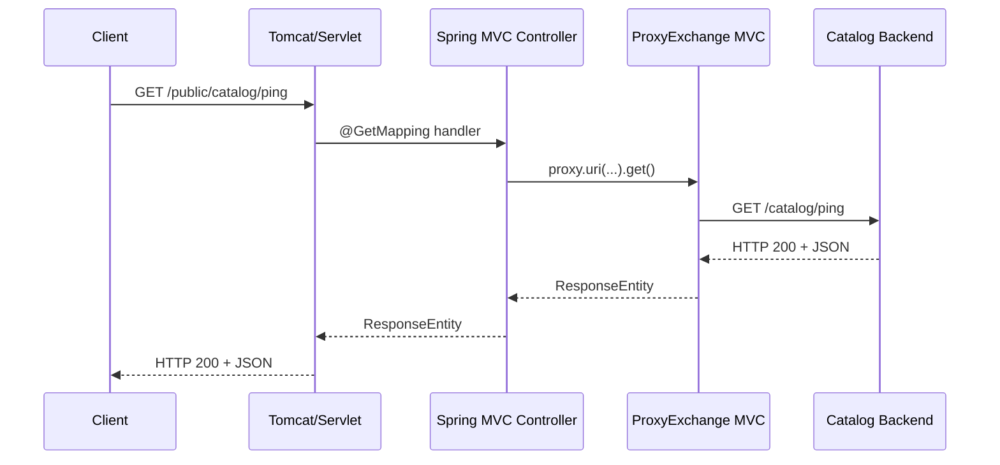

# Proxy Exchange Dependencies for Spring Web MVC or WebFlux

A Spring Boot application already has a few `@RestController` endpoints that need to forward requests to an internal microservice. For example, `GET /public/catalog/ping` must call `GET http://catalog.internal:9090/catalog/ping` and return the HTTP response to the client. The development team wants to leverage existing controllers, validation, and Spring Security, **without standing up a full API Gateway Server just to proxy a handful of endpoints**. In this case, Spring Cloud Gateway offers another option: **Proxy Exchange**.

A common pitfall is that **Spring Cloud Gateway has two product variants**: **Server** (a dedicated entry gateway with route predicates and Gateway filters) and **Proxy Exchange** (a `ProxyExchange` object injected into Spring MVC or WebFlux handlers). If you mistakenly add the Gateway Server MVC/WebFlux starter instead of the Proxy Exchange module, the application may start up without supporting the right controller API, or you may accidentally copy an entirely different routing configuration system.

This lesson belongs to the **Proxy Exchange** chapter of the **SPRING_CLOUD_GATEWAY** module. It focuses on **dependencies for Spring Web MVC or WebFlux**, how to build a small application with an HTTP proxy controller, how it differs from Gateway Server, and what must be added when you need authentication, rate limiting, circuit breakers, retries, TLS, service discovery, and request observability to protect microservices.

**After this lesson, you will be able to:**

1. Choose the right artifact and Spring Boot/Spring Cloud release train for Proxy Exchange.
2. Know when to add the **MVC** or **WebFlux** web starter and why you should not mix both server stacks needlessly.
3. Write a `@GetMapping` that proxies to a backend using `ProxyExchange<byte[]>`.
4. Understand the differences in return types, runtime, and MVC's `forward()` capability.
5. Test status/body/header forwarding and identify risks around SSRF, header trust, proxy loops, timeouts, and high load.

> **Version scope:** Primary syntax follows the Spring Cloud Gateway **4.3/5.x** documentation with the `spring-cloud-gateway-proxyexchange-webmvc` and `spring-cloud-gateway-proxyexchange-webflux` artifacts. Version 4.2 and earlier used older module names. The build examples use a Spring Boot–Spring Cloud pair **illustrated from the official compatibility table**; pick a patch suitable for your project, and do not pin a separate Gateway version outside the BOM.

## 1. What Is Proxy Exchange?

`ProxyExchange<T>` is a Spring Cloud Gateway **utility object** injected as a **handler method parameter** in a web application with annotation-based controllers. It provides basic HTTP forwarding operations through methods matching HTTP verbs, along with the ability to set the URI and process responses.

Conceptual example:

```text
Client GET /public/catalog/ping
         |
         v
@RestController
  @GetMapping("/public/catalog/ping")
  handler(ProxyExchange<byte[]> proxy)
         |
         | proxy.uri("http://catalog.internal:9090/catalog/ping").get()
         v
Backend GET /catalog/ping
         |
         v
Backend HTTP status + headers + bytes
         |
         v
Controller returns ResponseEntity<?> to client
```

**You do not need to declare `spring.cloud.gateway.server.webmvc.routes` or `spring.cloud.gateway.server.webflux.routes` for the example above.** Spring MVC/WebFlux controller mappings are where requests get matched.

### 1.1. Comparing Gateway Server and Proxy Exchange

| Feature | Gateway **Server** | **Proxy Exchange** |
| --- | --- | --- |
| Routing unit | `RouteDefinition` / `RouterFunction` depending on Server WebFlux/MVC | `@RequestMapping`, `@GetMapping` methods… |
| Programming components | Route predicates, GatewayFilter factories, per-route filters | `ProxyExchange<T>` in a controller |
| How routes are declared | Gateway Server YAML/Java DSL | Spring MVC/WebFlux annotation mappings |
| Complexity | Fits standalone API Gateways, many routes/policies | Useful when proxying only a small group of APIs in an existing web app |
| Web MVC | Dedicated Server Web MVC starter | `proxyexchange-webmvc` module + Spring MVC app |
| WebFlux | Dedicated Server WebFlux starter | `proxyexchange-webflux` module + Spring WebFlux app |
| Built-in Gateway Server filters? | Per the Server flavor's filters and dependencies | **Does not automatically inherit** Gateway Server predicates/filter factories |
| Auth, retry, circuit breaker | Typically configured at the Gateway Server layer | Must configure mechanisms suited to MVC/WebFlux/controller/HTTP client |
| Centralized route sharing | Server has route repositories/refresh per flavor | Does not create a route repository because controllers coordinate |

The Spring Cloud Gateway documentation emphasizes that Proxy Exchange is an **alternative style gateway**, and the **Gateway Server documentation does not apply verbatim** to this variant. For instance, writing `spring.cloud.gateway.server.webflux.routes` in an application that only has Proxy Exchange **does not automatically generate proxy handlers from that YAML**.

### 1.2. It Is Not “Just Swap the Starter to Become Gateway Server”

A project can contain the Proxy Exchange module without the Gateway Server starter. Conversely, an application using Server Web MVC/WebFlux does not automatically have the `ProxyExchange` parameter available if the Proxy Exchange dependency has not been added.

Distinguish three goals:

- **Building a multi-service gateway with dynamic route config and centralized predicates/filters:** prefer Gateway **Server**.
- **Adding a few proxy endpoints to an existing Spring MVC/WebFlux app:** consider **Proxy Exchange**.
- **Simply calling an HTTP backend as part of business logic:** you can use `RestClient` or `WebClient`; not every HTTP call should act as a reverse proxy.

## 2. Choosing the Right Module Dependency by Spring Web Stack

Current documentation publishes **two modules**:

| Target | Maven groupId | artifactId |
| --- | --- | --- |
| **Proxy Exchange with Spring Web MVC** | `org.springframework.cloud` | **`spring-cloud-gateway-proxyexchange-webmvc`** |
| **Proxy Exchange with Spring WebFlux** | `org.springframework.cloud` | **`spring-cloud-gateway-proxyexchange-webflux`** |

These are **module dependencies**, not the two `spring-cloud-starter-gateway-server-*` starters. The application must also have the **corresponding Spring Web runtime**, managed by Spring Boot.

### 2.1. Artifact Renaming Table by Version

| Gateway/Cloud Line | Proxy Exchange **MVC** | Proxy Exchange **WebFlux** |
| --- | --- | --- |
| **Gateway 5.x / Spring Cloud 2025.1.x** | `spring-cloud-gateway-proxyexchange-webmvc` | `spring-cloud-gateway-proxyexchange-webflux` |
| **Gateway 4.3.x / Spring Cloud 2025.0.x** | `spring-cloud-gateway-proxyexchange-webmvc` | `spring-cloud-gateway-proxyexchange-webflux` |
| **Gateway 4.2.x / Spring Cloud 2024.0.x** | `spring-cloud-gateway-mvc` | `spring-cloud-gateway-webflux` |
| **Gateway 4.1.x and some older lines** | `spring-cloud-gateway-mvc` | `spring-cloud-gateway-webflux` |

Spring Cloud 2025.0 introduced new module names to clarify the two axes: **Server vs Proxy Exchange** and **Web MVC vs WebFlux**. Older names were deprecated during the transition period; in Spring Cloud 2025.1/Gateway 5.x, the deprecated artifacts were removed according to the release notes. **Do not mix 4.2 artifact names with a 5.x BOM**.

> **Similar-name warning:** `spring-cloud-starter-gateway-server-webmvc` is **different from** `spring-cloud-gateway-proxyexchange-webmvc`; `spring-cloud-starter-gateway-server-webflux` is **different from** `spring-cloud-gateway-proxyexchange-webflux`. The words “server” and “starter” in the name indicate you are selecting a different product.

### 2.2. Choosing Spring Boot/Spring Cloud Before Writing Dependencies

According to the published Spring Cloud compatibility table:

| Spring Boot | Spring Cloud release train | Corresponding Gateway family |
| --- | --- | --- |
| **4.0.x; 4.1.x** (Boot 4.1 supported from Cloud 2025.1.2) | **2025.1.x — Oakwood** | Gateway **5.x** |
| **3.5.x** | **2025.0.x — Northfields** | Gateway **4.3.x** |
| **3.4.x** | **2024.0.x — Moorgate** | Gateway **4.2.x** |

Choose the **latest supported service release/patch** per your environment's policy. The table only identifies **compatible lines**; it does not mean every arbitrary patch in a train works with every Boot patch without verification.

**Do not manually add `<version>5.1.0</version>` to a Proxy Exchange module** in an application still running Boot 3.4.x; the Spring Cloud BOM must manage dependencies in the same family. For Boot 4.x, projects use Spring Framework 7/Jakarta; for Boot 3.x, Spring Framework 6/Jakarta.

### 2.3. Which Web Starter Goes With Proxy Exchange?

| Chosen Web Runtime | Spring Boot 4.x | Spring Boot 3.x |
| --- | --- | --- |
| **Spring MVC / Servlet** | `spring-boot-starter-webmvc` | `spring-boot-starter-web` |
| **Spring WebFlux / reactive** | `spring-boot-starter-webflux` | `spring-boot-starter-webflux` |

In a simple project, MVC typically uses embedded **Tomcat**; WebFlux typically uses embedded **Reactor Netty**. Other container/server choices may exist depending on Boot version, but **do not switch runtimes arbitrarily just by adding both web starters**.

**If building only MVC Proxy Exchange**, there is no need to pull in `spring-boot-starter-webflux` to use `ProxyExchange<byte[]>`. **If building only WebFlux Proxy Exchange**, do not add `spring-boot-starter-webmvc`. Having both web frameworks on the classpath can cause Spring Boot to prefer a Servlet web application, preventing reactive controllers or auto-configuration from behaving as intended.

## 3. Maven — Proxy Exchange Application on Spring MVC

The example focuses on **Boot 4.1.x / Cloud 2025.1.x**, Java 21. Version numbers in `pom.xml` only illustrate a compatible release train pair; in real projects, pick a patch supported by your organization and verify against Spring Initializr/release notes.

### 3.1. Minimal MVC pom.xml

```xml
<?xml version="1.0" encoding="UTF-8"?>
<project xmlns="http://maven.apache.org/POM/4.0.0"
         xmlns:xsi="http://www.w3.org/2001/XMLSchema-instance"
         xsi:schemaLocation="http://maven.apache.org/POM/4.0.0
           https://maven.apache.org/xsd/maven-4.0.0.xsd">
    <modelVersion>4.0.0</modelVersion>

    <parent>
        <groupId>org.springframework.boot</groupId>
        <artifactId>spring-boot-starter-parent</artifactId>
        <version>4.1.0</version>
        <relativePath/>
    </parent>

    <groupId>com.example</groupId>
    <artifactId>catalog-proxy-mvc</artifactId>
    <version>0.0.1-SNAPSHOT</version>

    <properties>
        <java.version>21</java.version>
        <spring-cloud.version>2025.1.2</spring-cloud.version>
    </properties>

    <dependencyManagement>
        <dependencies>
            <dependency>
                <groupId>org.springframework.cloud</groupId>
                <artifactId>spring-cloud-dependencies</artifactId>
                <version>${spring-cloud.version}</version>
                <type>pom</type>
                <scope>import</scope>
            </dependency>
        </dependencies>
    </dependencyManagement>

    <dependencies>
        <!-- Spring MVC / Servlet HTTP server -->
        <dependency>
            <groupId>org.springframework.boot</groupId>
            <artifactId>spring-boot-starter-webmvc</artifactId>
        </dependency>

        <!-- Proxy Exchange SPECIFICALLY FOR MVC -->
        <dependency>
            <groupId>org.springframework.cloud</groupId>
            <artifactId>spring-cloud-gateway-proxyexchange-webmvc</artifactId>
        </dependency>
    </dependencies>

    <build>
        <plugins>
            <plugin>
                <groupId>org.springframework.boot</groupId>
                <artifactId>spring-boot-maven-plugin</artifactId>
            </plugin>
        </plugins>
    </build>
</project>
```

Key points to notice:

1. The parent determines the **Spring Boot version** and Boot's dependency management.
2. Importing the `spring-cloud-dependencies` BOM in `dependencyManagement` manages Spring Cloud versions within the same train.
3. `spring-boot-starter-webmvc` creates an MVC/Servlet app (in the Boot 4 branch), **not the Gateway Server MVC module**.
4. `spring-cloud-gateway-proxyexchange-webmvc` brings in the proxy API for annotated MVC controllers.
5. Do not add `spring-cloud-starter-gateway-server-webmvc`, and there is no `spring.cloud.gateway.server.webmvc.routes` in this lab.
6. Spring Security, Actuator, LoadBalancer, and CircuitBreaker are not added yet because this is a **dependency setup** lesson. When adding them, pick the right stack variant and re-measure behavior.

### 3.2. MVC Variant With Boot 3.5

With **Boot 3.5.x / Cloud 2025.0.x**, switch the parent and BOM to the matching pair, and replace the Boot 4 web starter with:

```xml
<dependency>
    <groupId>org.springframework.boot</groupId>
    <artifactId>spring-boot-starter-web</artifactId>
</dependency>

<dependency>
    <groupId>org.springframework.cloud</groupId>
    <artifactId>spring-cloud-gateway-proxyexchange-webmvc</artifactId>
</dependency>
```

Use these snippets only in a `pom.xml` with a **Boot 3.5 parent and Cloud 2025.0 BOM**. Do not copy the Boot 4.1 parent verbatim and only swap one dependency.

### 3.3. Legacy Gateway 4.2 MVC Variant

With **Boot 3.4.x / Cloud 2024.0.x / Gateway 4.2.x**:

```xml
<dependency>
    <groupId>org.springframework.boot</groupId>
    <artifactId>spring-boot-starter-web</artifactId>
</dependency>

<dependency>
    <groupId>org.springframework.cloud</groupId>
    <artifactId>spring-cloud-gateway-mvc</artifactId>
</dependency>
```

**This is the old Proxy Exchange artifact name**, not `spring-cloud-starter-gateway-mvc` for Gateway Server MVC 4.2. The difference between `spring-cloud-gateway-mvc` and `spring-cloud-starter-gateway-mvc` is critical.

## 4. Maven — Proxy Exchange Application on Spring WebFlux

On WebFlux, the main differences are the **Boot web starter** and the **Proxy Exchange module**:

```xml
<!-- Use the same Boot 4.1.x parent and Cloud 2025.1.x BOM. -->
<dependencies>
    <dependency>
        <groupId>org.springframework.boot</groupId>
        <artifactId>spring-boot-starter-webflux</artifactId>
    </dependency>

    <dependency>
        <groupId>org.springframework.cloud</groupId>
        <artifactId>spring-cloud-gateway-proxyexchange-webflux</artifactId>
    </dependency>
</dependencies>
```

Do not add:

```xml
<!-- DO NOT use these dependencies for the Proxy Exchange WebFlux lesson
     unless you are designing a SEPARATE Gateway Server and understand the consequences. -->
<dependency>
    <groupId>org.springframework.cloud</groupId>
    <artifactId>spring-cloud-starter-gateway-server-webflux</artifactId>
</dependency>
```

If using Gateway 4.2, the legacy Proxy Exchange WebFlux module is `spring-cloud-gateway-webflux`. You must change the BOM/Boot accordingly. **Do not rename the dependency while keeping an incompatible version train**.

### 4.1. Two Controllers Sharing the Idea but Not the Result Type

| Detail | MVC | WebFlux |
| --- | --- | --- |
| HTTP server stack | Servlet | Reactive |
| Handler type | MVC `@RestController`/`@GetMapping` | WebFlux `@RestController`/`@GetMapping` |
| Proxy parameter | `ProxyExchange<byte[]>` from MVC module | `ProxyExchange<byte[]>` from WebFlux module |
| GET example return type | `ResponseEntity<?>` | `Mono<ResponseEntity<?>>` |
| Local forwarding | MVC `forward()` supported per docs | Do not assume MVC `forward()` applies to WebFlux |
| Security | `SecurityFilterChain` / `HttpSecurity` | `SecurityWebFilterChain` / `ServerHttpSecurity` |
| HTTP testing | `MockMvc` or HTTP integration client | `WebTestClient`/HTTP integration client |

**Do not copy the same `ProxyExchange` class from the MVC module to WebFlux just by changing the return type.** While the two modules share a similar usage API, bean resolution, server runtime, and reactive semantics differ.

## 5. Gradle — Choosing One of the Two Variants

Example **Gradle Groovy DSL** sharing the version management section:

```groovy
plugins {
    id 'java'
    id 'org.springframework.boot' version '4.1.0'
    id 'io.spring.dependency-management' version '1.1.7'
}

group = 'com.example'
version = '0.0.1-SNAPSHOT'

java {
    toolchain {
        languageVersion = JavaLanguageVersion.of(21)
    }
}

repositories {
    mavenCentral()
}

ext {
    set('springCloudVersion', '2025.1.2')
}

dependencyManagement {
    imports {
        mavenBom "org.springframework.cloud:spring-cloud-dependencies:${springCloudVersion}"
    }
}

dependencies {
    // Choose ONLY ONE pair of dependencies below.

    // MVC: Servlet application (Boot 4)
    implementation 'org.springframework.boot:spring-boot-starter-webmvc'
    implementation 'org.springframework.cloud:spring-cloud-gateway-proxyexchange-webmvc'

    // If choosing WebFlux, REMOVE THE TWO MVC lines above and use:
    // implementation 'org.springframework.boot:spring-boot-starter-webflux'
    // implementation 'org.springframework.cloud:spring-cloud-gateway-proxyexchange-webflux'
}
```

This is Groovy DSL; Gradle Kotlin DSL uses different syntax. If the project uses Boot 3.5, select Cloud 2025.0 and the MVC starter `spring-boot-starter-web`. The BOM must be a **supported version pair**, not just a way to silence Maven/Gradle “missing version” errors.

### 5.1. Do You Need to Declare a Dependency Version on Every Line?

**No.** Once the BOM is imported, declare the dependency as:

```groovy
implementation 'org.springframework.cloud:spring-cloud-gateway-proxyexchange-webflux'
```

instead of:

```groovy
// Anti-pattern: forcing a separate version can break compatibility.
implementation 'org.springframework.cloud:spring-cloud-gateway-proxyexchange-webflux:5.1.0'
```

Only override intentionally after reviewing the dependency graph, release notes, and running tests. An artifact resolving from Maven Central **does not prove it is compatible** with the Boot runtime.

## 6. Writing a Proxy Exchange Controller for Spring MVC

The next example builds a small application with:

- The gateway/proxy application running on `localhost:8080`.
- A simulated `catalog-service` backend at `http://127.0.0.1:9090`.
- Public API: `GET /public/catalog/ping`.
- Backend API: `GET /catalog/ping`.

**Key emphasis:** There is only **one annotated handler**. No Gateway Server `routes` are configured.

### 6.1. application.yml

```yaml
spring:
  application:
    name: catalog-proxy-mvc
  main:
    web-application-type: servlet

server:
  port: 8080

demo:
  catalog-base-url: http://127.0.0.1:9090
```

`spring.main.web-application-type: servlet` primarily makes the example explicit. When only `spring-boot-starter-webmvc` is present, Boot normally selects the Servlet runtime automatically. **Do not use this property to paper over a broken dependency tree mixing both MVC and WebFlux.**

### 6.2. Startup Class

```java
package com.example.catalogproxy;

import org.springframework.boot.SpringApplication;
import org.springframework.boot.autoconfigure.SpringBootApplication;

@SpringBootApplication
public class CatalogProxyMvcApplication {

    public static void main(String[] args) {
        SpringApplication.run(CatalogProxyMvcApplication.class, args);
    }
}
```

### 6.3. Simple and Complete Proxy Controller

```java
package com.example.catalogproxy;

import org.springframework.beans.factory.annotation.Value;
import org.springframework.cloud.gateway.mvc.ProxyExchange;
import org.springframework.http.ResponseEntity;
import org.springframework.web.bind.annotation.GetMapping;
import org.springframework.web.bind.annotation.RestController;

@RestController
public class CatalogProxyController {

    private final String catalogBaseUrl;

    public CatalogProxyController(
            @Value("${demo.catalog-base-url}") String catalogBaseUrl) {
        // Configured in the lab without a trailing "/".
        this.catalogBaseUrl = catalogBaseUrl;
    }

    @GetMapping("/public/catalog/ping")
    public ResponseEntity<?> ping(ProxyExchange<byte[]> proxy)
            throws Exception {
        return proxy.uri(catalogBaseUrl + "/catalog/ping").get();
    }
}
```

**Component-by-component breakdown:**

1. `org.springframework.cloud.gateway.mvc.ProxyExchange` belongs to the MVC module; **do not** pick the WebFlux package.
2. Spring MVC registers `@GetMapping` as a normal handler. Only requests matching the URL/method reach the method.
3. `ProxyExchange<byte[]>` is resolved by Spring Cloud Gateway Proxy Exchange as a **handler method argument**. The `byte[]` type here allows receiving the backend payload as bytes.
4. `proxy.uri(...)` specifies the HTTP destination; the destination is constructed from **server-side configuration**.
5. `get()` executes an HTTP GET downstream and returns `ResponseEntity<?>` to the controller.
6. The HTTP status and response data from the backend are turned into the client response via Proxy Exchange's mechanism; always test actual headers rather than assuming 100% of headers are preserved.

**Do not use a client-supplied `targetUrl` variable directly**. The example intentionally reads the base URI from application config so it does not create an open proxy/SSRF. In production, validate scheme, host, port, and canonical URI at startup, and apply network egress policies.

### 6.4. MVC Call Flow Diagram



This call path belongs to **Spring MVC/Servlet**. Neither Gateway Server WebFlux's `RoutePredicateHandlerMapping` nor `FilteringWebHandler` runs simply because the Proxy Exchange dependency was added.

## 7. Writing a Proxy Exchange Controller for Spring WebFlux

If the project is **Spring WebFlux**, the corresponding application runs on the reactive web stack. The business idea matches MVC, but the return type reflects the reactive pipeline.

### 7.1. WebFlux Configuration

```yaml
spring:
  application:
    name: catalog-proxy-webflux
  main:
    web-application-type: reactive

server:
  port: 8080

demo:
  catalog-base-url: http://127.0.0.1:9090
```

Use only with:

```text
spring-boot-starter-webflux
spring-cloud-gateway-proxyexchange-webflux
```

Do not add `spring-boot-starter-webmvc` and do not force `web-application-type: servlet` for this project.

### 7.2. Reactive Controller

```java
package com.example.catalogproxy;

import org.springframework.beans.factory.annotation.Value;
import org.springframework.cloud.gateway.webflux.ProxyExchange;
import org.springframework.http.ResponseEntity;
import org.springframework.web.bind.annotation.GetMapping;
import org.springframework.web.bind.annotation.RestController;
import reactor.core.publisher.Mono;

@RestController
public class ReactiveCatalogProxyController {

    private final String catalogBaseUrl;

    public ReactiveCatalogProxyController(
            @Value("${demo.catalog-base-url}") String catalogBaseUrl) {
        this.catalogBaseUrl = catalogBaseUrl;
    }

    @GetMapping("/public/catalog/ping")
    public Mono<ResponseEntity<?>> ping(ProxyExchange<byte[]> proxy)
            throws Exception {
        return proxy.uri(catalogBaseUrl + "/catalog/ping").get();
    }
}
```

Here:

- Import `ProxyExchange` from **`org.springframework.cloud.gateway.webflux`**, not `.mvc`.
- The method returns **`Mono<ResponseEntity<?>>`**, matching the WebFlux example in the official documentation.
- Spring WebFlux can subscribe to the pipeline when handling the response.
- Do not call `.block()` or `.subscribe()` inside the controller just to obtain the `ResponseEntity` early. Doing so breaks the reactive model, can block the Netty event loop, and detaches errors/cancellation from the HTTP lifecycle.

**Do not infer that WebFlux Proxy Exchange is the entire Gateway Server WebFlux.** WebFlux Proxy Exchange only provides a proxy utility for annotated handlers; it does not automatically load the route predicates and GatewayFilter factories of the Server flavor.

### 7.3. Difference Between MVC and WebFlux Results

```text
MVC:
  ProxyExchange<byte[]> -> proxy.uri(...).get()
  -> ResponseEntity<?>

WebFlux:
  ProxyExchange<byte[]> -> proxy.uri(...).get()
  -> Mono<ResponseEntity<?>>
```

With MVC, the call follows the synchronous MVC API; with WebFlux, the publisher represents work with an asynchronous result. **Do not label “WebFlux is always faster”**: performance also depends on downstream latency, pooling, CPU, payloads, connection limits, and security/serialization handling.

## 8. Backend Stub and Testing Real Requests

To verify Proxy Exchange, you need a backend in a **separate process/port**. For example, create a standalone Spring Boot web app running on `localhost:9090`.

### 8.1. Stub Backend Controller

```java
package com.example.catalog;

import java.util.Map;
import org.springframework.web.bind.annotation.GetMapping;
import org.springframework.web.bind.annotation.RestController;

@RestController
public class CatalogStubController {

    @GetMapping("/catalog/ping")
    public Map<String, Object> ping() {
        return Map.of(
            "service", "catalog",
            "source", "backend-stub",
            "healthy", true
        );
    }
}
```

For the stub backend, configure:

```yaml
server:
  port: 9090
```

**Note:** The backend controller is a separate practice program. Do not place it in the same Proxy Exchange app on port 8080 and treat a successful GET as proof that the HTTP proxy made a network call to a backend.

### 8.2. Testing With curl

After starting both the backend and proxy app:

```bash
# Test backend directly
curl -i http://127.0.0.1:9090/catalog/ping

# Test via MVC or WebFlux Proxy Exchange
curl -i http://127.0.0.1:8080/public/catalog/ping
```

Expected content:

```http
HTTP/1.1 200 OK
Content-Type: application/json

{"service":"catalog","source":"backend-stub","healthy":true}
```

JSON property order and headers may vary by codec/runtime. **These are expected results, not commands executed while writing this lesson.** If the proxy returns 200, also inspect the backend access log or hit counter to verify the request actually traversed the stub.

### 8.3. Layered Verification Steps

1. Call the backend directly. If the backend fails, do not debug ProxyExchange first.
2. Verify the proxy app has started and is using MVC or WebFlux.
3. Call `/public/catalog/ping` with GET.
4. Verify the backend received `/catalog/ping`.
5. Check status, content type, and body.
6. Stop the stub backend and call again: the result must be **an upstream error handled according to policy**, not an imaginary success JSON from the Gateway.
7. Hit a URL with no `@RequestMapping` to confirm 404 or the appropriate contract handler.

If you only test GET 200 without ever shutting down the backend or checking logs, you might be hitting another local controller, a response cache, or an unintended overlapping route.

## 9. ProxyExchange Parameter and HTTP Verbs

The official documentation describes `ProxyExchange` as having methods corresponding to **common HTTP verbs** and helpers for working with URIs/paths. **Do not confuse the two groups of methods**:

| Group | Example | Role |
| --- | --- | --- |
| Target configuration | `proxy.uri(target)` | Selects the downstream URL |
| HTTP execution | `proxy.get()`, methods matching verbs | Sends the downstream request |
| Extracting path suffix | `proxy.path(prefix)` | Helps extract the path portion after a prefix |
| Response headers | `proxy.header(...)` | Helps add headers via the Proxy Exchange API |
| Response transformation | `proxy.get(mapper)` | Applies a `Function` from backend response to client response |
| Local forwarding in MVC | `proxy.forward(...)` | Dispatches to a local MVC handler instead of making an HTTP call |

Specific overloads of `post/put/patch/delete`, headers/request bodies, and mappers can vary across versions; **check the Javadoc or IDE for your exact dependency before adding advanced operations**. In this basic dependencies lesson, `uri(...).get()` is chosen because it is the most straightforward official API to verify.

### 9.1. Forwarding Dynamic Path Segments

The Gateway documentation gives this pattern:

```java
@GetMapping("/proxy/path/**")
public ResponseEntity<?> proxyPath(ProxyExchange<byte[]> proxy)
        throws Exception {
    String path = proxy.path("/proxy/path/");
    return proxy.uri(catalogBaseUrl + "/foos/" + path).get();
}
```

This snippet illustrates the `path(prefix)` helper. In real systems:

- **Never use client-controlled paths to pick scheme/host/port**.
- Account for `..`, slashes, encoded characters, query delimiters, UTF-8, percent-encoding, and double-encoding.
- If an API only supports `/catalog/items/{id}`, using `@PathVariable` and validating the ID per contract is safer than proxying arbitrary trailing paths.
- Keep the base URL in server configuration/allowlists; never accept `?url=https://...` and call it directly.

### 9.2. Never Concatenate URIs From Raw Client Data

**Unsafe** example:

```java
// Anti-pattern: client dictates the entire outbound destination.
@GetMapping("/proxy-anywhere")
public ResponseEntity<?> proxyAnywhere(
        @RequestParam String url,
        ProxyExchange<byte[]> proxy) throws Exception {
    return proxy.uri(url).get();
}
```

Callers can try pointing the URI to loopback, private networks, cloud metadata endpoints, or internal admin interfaces. That is **SSRF/open proxy**, not a “convenient dynamic route” feature.

Instead:

1. Use only **base URIs** from vetted configuration.
2. Allow only policy-approved `https`/`http` schemes and allowlisted hosts/ports.
3. Define fixed paths or an explicit set of permitted paths.
4. Encode paths/queries using URI builders rather than concatenating raw input strings.
5. Block outbound traffic to metadata/loopback/private endpoints outside the required list using **network egress policies**.
6. Verify the HTTP client's redirect policy to prevent redirects from an allowed host to a disallowed host.

### 9.3. Query Parameters Are Not Automatically Preserved

An HTTP proxy must clearly define whether:

```http
GET /public/catalog/items?sort=price&page=2
```

is forwarded as:

```http
GET /catalog/items?sort=price&page=2
```

When specifying `proxy.uri("http://backend/catalog/items")` manually, **it is not guaranteed by default that all incoming query parameters automatically appear** in the target URL across every version. Build a properly encoded/validated target URI and test with a stub backend that records received queries.

Likewise, a fragment `#...` is a client-side URL component, not part of the HTTP request target sent to the server. Do not use fragments to control proxy routing.

### 9.4. Sending Requests With a Body

For POST/PUT/PATCH, clarify:

- Is the incoming body JSON, bytes, or multipart?
- Has another controller or filter already consumed the body?
- How does your ProxyExchange version support receiving and replaying the body?
- Must `Content-Type`/charset be preserved and framing updated?
- Could retries cause the backend to execute side effects twice?
- Do large payloads/streaming require a more specialized proxy technology?

**Do not assume a GET demo proves safe proxying of huge file uploads or SSE streaming.** Those workloads require dedicated testing for memory limits, timeouts, and cancellation handling.

## 10. Headers: Sensitive, Skipped, and Forwarded

An HTTP proxy **must not blindly copy all headers**. Per the documentation, Proxy Exchange handles special header groups:

| Group | Typical Default | Reason |
| --- | --- | --- |
| **Sensitive headers** | `cookie`, `authorization` | Avoid forwarding client secrets or credentials to downstream services automatically. |
| **Skipped headers** | `content-length`, `host` | Avoid keeping HTTP metadata that may no longer be accurate after the proxy step. |
| **Proxy / forwarding headers** | `x-forwarded-*` family | Carry context across proxy hops; require a clear trust boundary. |
| **Application headers** | Other headers may be processed/forwarded per implementation | Must verify allowlist/denylist and contract rather than assuming preservation. |

These defaults are described in the Proxy Exchange documentation for MVC/WebFlux. **Always verify actual behavior on your exact version** because upstream/downstream filters, HTTP clients, and front proxies can further alter headers.

### 10.1. Authorization/Cookie Are Not Forwarded Automatically

Suppose the client sends:

```http
GET /public/catalog/ping HTTP/1.1
Authorization: Bearer <USER_ACCESS_TOKEN>
Cookie: SESSION=<BROWSER_SESSION>
```

**Do not conclude the backend will receive Authorization and Cookie verbatim** after `proxy.uri(...).get()`. By default, Proxy Exchange treats these as sensitive headers. This prevents leaking credentials to a backend that has no business using them.

If the backend needs identity information, design it explicitly:

1. The gateway/front app validates the JWT or session with **Spring Security**.
2. Verify the target backend resides inside the **trust boundary**.
3. Choose **controlled Token Relay** (an appropriate OAuth2 client) or issue a backend-scoped credential/service token with a specific audience.
4. Do not simply forward browser cookies or bearer tokens to arbitrary URIs.
5. Test that the backend receives **only the authorized credential**, not unintended raw client tokens.

**Do not treat the default stripping of Authorization as a bug to fix by disabling all sensitive-header protection.** Many downstream services should never receive end-user tokens or cookies.

### 10.2. Host and Content-Length Cannot Be Copied Verbatim

During a proxy hop, the HTTP client may target a different host and repackage the body. For example:

```text
Client Host: public.example.test
Target URI: https://catalog.internal.example.test/catalog/ping
Target Host: catalog.internal.example.test

Client Content-Length: 148
Downstream body bytes: may be re-encoded/reframed
```

Keeping `Host: public.example.test` when calling the new target backend can break virtual-host routing or TLS SNI expectations. Keeping the old `Content-Length` after transforming the body can cause framing errors or truncated bodies.

Per the documentation, **`host` and `content-length` are skipped headers by default**. If a special contract requires preserving `Host`, understand the HTTP client/TLS/ingress implications, test thoroughly, and do not flip a flag blindly.

### 10.3. Forwarded / X-Forwarded-* Can Be Spoofed

Headers such as:

```http
X-Forwarded-For: 203.0.113.7
X-Forwarded-Proto: https
X-Forwarded-Host: public.example.test
```

help backends construct redirect URLs, audit client IPs, or enforce ingress-based policies. However, Internet clients can also forge these headers if the edge proxy does not sanitize or overwrite them.

**Rule:** Only trust forwarded headers from **explicitly trusted proxies**; decide how to rewrite/append them according to your infrastructure. ProxyExchange supports proxy headers, but **it does not replace trusted proxy policies and network topology**.

### 10.4. Application-Added Headers

The documentation states that `ProxyExchange.header(...)` and response mapping functions support adding/transforming response headers. In practice, distinguish:

- **Request headers sent to the backend**;
- **Response headers returned to the client**;
- **Metadata headers used only internally** within the application.

For example, what you might test:

```http
HTTP/1.1 200 OK
X-Proxy-Handler: catalog-proxy
Content-Type: application/json
```

Do not guess from the method name alone that `proxy.header(...)` replaces Authorization sent **upstream**. Per Spring's description, this is a utility for adding headers on the **downstream response**. When you need to control request headers, check the exact `ProxyExchange` and framework API for your version and test with a stub backend that logs incoming headers.

### 10.5. Hop-by-Hop Headers and Protocol Semantics

Headers such as `Connection`, `Transfer-Encoding`, `Upgrade`, `TE`, and fields listed in `Connection` must obey HTTP intermediary rules. Do not copy them verbatim across hops or force invalid headers onto HTTP/2.

Be especially careful with:

- `Set-Cookie` and cookie scope/domain/path when proxying responses.
- `Location` redirects containing an internal backend hostname instead of the public hostname.
- `Cache-Control`, `ETag`, `Vary` if the response body is transformed.
- `Content-Encoding` if the backend returns gzip/br.
- `WWW-Authenticate` and 401/403 responses.

**Proxy Exchange is not by itself a complete HTTP header security checker.** If rewriting responses or trusting headers, validate policies across ingress, controller, and backend.

## 11. Checking HTTP Status, Response Body, and Response Mapper

When the backend returns an error, the client needs a meaningful result. For example:

```http
GET /public/catalog/ping HTTP/1.1
```

The backend may return:

```http
HTTP/1.1 503 Service Unavailable
Content-Type: application/problem+json

{"type":"about:blank","title":"Catalog temporarily unavailable"}
```

Distinguish between:

- **Backend returns a valid HTTP 503:** ProxyExchange has an HTTP response from the backend.
- **HTTP client fails to connect:** There is no backend response; the app may throw an exception or build an error response via error mapping.
- **Timeout/cancellation:** Requires timeout, deadline, and exception-handling policies.
- **Client disconnect:** Should not keep retrying or transferring data needlessly.

### 11.1. What Does the Response Mapper Do?

The Proxy Exchange documentation describes overloads like `get(mapper)`: a **`Function` that takes the backend `ResponseEntity` and produces the client `ResponseEntity`**. It is well suited for tasks like adding public headers, tweaking metadata, or transforming responses in a controlled way.

Illustrative **skeleton code** showing the response pattern:

```java
// Skeleton pattern: adapter types/overloads must match the actual dependency.
return proxy.uri(target).get(downstream -> {
    return ResponseEntity
        .status(downstream.getStatusCode())
        .headers(downstream.getHeaders())
        .body(downstream.getBody());
});
```

This pattern simply conveys that the response mapper receives a `ResponseEntity` and builds the output. A real application must consider **filtering hop-by-hop headers, content-length, Set-Cookie, and PII**, rather than blindly copying every header as in the skeleton above. Avoid producing a new body while keeping the old body's ETag/length.

### 11.2. Do Not Turn Every Error Into 200 OK

Anti-pattern:

```java
// Wrong idea if the backend is failing yet the client receives a fake success.
return ResponseEntity.ok("Backend unavailable");
```

Clients will struggle to detect failures and dashboards may report false successes. If a valid fallback exists, design an explicit response contract: HTTP status, error code, data source, cache policy, and observability.

**Do not use the proxy response mapper as a mechanism to mask all HTTP 5xx responses.** Circuit breakers, retries, and fallbacks are separate concerns requiring their own policies, error budgets, and idempotency.

## 12. Internal Forward: Different From HTTP Proxying to a Backend

The official documentation notes that **MVC Proxy Exchange supports `forward()` to a local handler**. This is a mechanism to transfer handling **inside the MVC application**, not an HTTP call to another machine.

| Call | Direction | Adds an HTTP network hop? |
| --- | --- | --- |
| `proxy.uri("http://backend/...").get()` | To an HTTP backend by URI | **Yes**, uses HTTP client |
| `proxy.forward(...)` on **MVC** | To a local MVC handler | Normally **no**, local dispatch |
| HTTP redirect `302 Location: ...` | Tells **client** to call another URL | Client makes the next request |

**Do not use `forward()` as proof that Spring WebFlux Proxy Exchange also has Servlet-style local forwarding.** The documentation specifically mentions `forward()` for MVC.

### 12.1. Forward Loop Risk

Flawed conceptual example:

```text
GET /proxy/local
    -> forward to /proxy/local
        -> forward again to /proxy/local
            -> loop
```

When using local forwarding, ensure the target handler is clearly distinct, security/roles are valid, no loop is formed, and an internal endpoint is not exposed publicly without protection. **An `/internal/` prefix does not automatically create a private network zone**.

### 12.2. Proxy Exchange forward Is Not Gateway Server `forward:`

Gateway Server WebFlux has route URIs of the form `forward:///internal/path` and a `ForwardRoutingFilter` mechanism. Gateway MVC/Proxy Exchange have different APIs. Do not copy a Gateway Server WebFlux `Retry` GatewayFilter Factory or `forward:` URI design and assume `ProxyExchange.forward()` shares the same filter order/lifecycle.

**This dependencies lesson uses a simple HTTP GET proxy** and does not require local forwarding yet; this knowledge is included solely to distinguish the two forwarding mechanisms.

## 13. Service Discovery and Load Balancing

In the first example, the destination is a fixed URI:

```yaml
demo:
  catalog-base-url: http://127.0.0.1:9090
```

This is a useful choice to **isolate testing of dependencies and HTTP forwarding**. When deploying multiple backend replicas, a fixed URI is insufficient for all production needs:

- Requires external DNS/load balancer or an instance-selection mechanism.
- Requires health checks and handling when zero instances are available.
- Requires appropriate timeouts, connection pools, and TLS trust.
- Must avoid sending requests to arbitrary hosts outside the service allowlist.

**Do not assume `ProxyExchange.uri("lb://catalog-service")` works just because Gateway Server has an `lb://` filter.** That is the Server flavor's routing/load-balancing mechanism and its corresponding integrations. With Proxy Exchange, verify the application's own HTTP client/service discovery adapter; you can use an internal URL behind a service load balancer rather than trying to reuse Server route syntax.

If the architecture needs many dynamic routes, weighted routing, per-route filters, and a centralized Redis rate limiter, **Gateway Server** may be a better fit than manually writing dozens of `@GetMapping` proxy controllers.

## 14. Security: Proxy Exchange Can Become an Open Proxy If Misused

Because the controller actively chooses the target URI, any flaw in URI-construction logic can turn the Gateway into an HTTP client with greater access to the internal network than Internet clients have.

### 14.1. Inputs That Must Be Treated as Untrusted

| Client-Influenced Input | Risk | Mitigation |
| --- | --- | --- |
| Full URL via query/header/body | SSRF to admin/internal/metadata endpoints | Never let clients pick host/port/scheme |
| Dynamic path/query | Path traversal, URL parsing ambiguity, double encoding | Validate, encode, allowlist paths |
| HTTP method | Proxying unexpected sensitive methods | Restrict via `@GetMapping`/`@PostMapping` and proper permissions |
| `Authorization`/`Cookie` | Credential leakage to untrusted backends | Rely on sensitive defaults, controlled token relay |
| `Host`, `Forwarded`, `X-Forwarded-*` | Host header injection, IP spoofing | Trust only trusted reverse proxies |
| Large request bodies | Memory/CPU exhaustion, multipart abuse | Enforce size limits, timeouts, streaming policy |
| Redirects from backend | Redirect to a host outside the allowlist | Control follow-redirect behavior in the HTTP client |
| Header tracing raw user IDs | PII leakage, high-cardinality metrics | Use standardized correlation IDs |

### 14.2. Authentication on the Right Stack

If the application is **Spring MVC**, use:

```java
// MVC/SERVLET
SecurityFilterChain filterChain(HttpSecurity http)
```

If the application is **Spring WebFlux**, use:

```java
// WEBFLUX/REACTIVE
SecurityWebFilterChain filterChain(ServerHttpSecurity http)
```

These are two distinct APIs. Do not copy a WebFlux filter chain into an MVC app and assume the endpoint is protected.

In both cases, you need:

1. AuthN via session/OIDC/JWT or another valid mechanism.
2. AuthZ by scope/role/method/path and resource permissions.
3. The backend still enforcing appropriate authorization rather than trusting an arbitrary client-sent role header.
4. A CSRF policy matching the model: **Bearer-only stateless API** differs from **browser cookie session**.
5. Outbound TLS verifying certificates and hostnames.

**Do not enable `anyRequest().permitAll()` to fix a curl test returning 401** in real production systems. If adding Spring Security causes the proxy to start returning 401, that usually means security is taking effect, not that the ProxyExchange dependency is broken.

### 14.3. Protecting Sensitive Data in Logs/Metrics

Do not log:

- Full `Authorization` headers or raw refresh/access tokens.
- Cookies or session IDs.
- Passwords, request bodies containing PII, or payment payloads.
- URIs/queries containing client credentials.
- Full decoded personal identities from the backend unless strictly necessary.

Instead, record route/controller ID, HTTP method, response status, latency, backend **group**, and a safe correlation ID. For 5xx errors, log standardized exception types and never include credentials in exception messages.

## 15. Resilience and Observability in Proxy Exchange

A crucial distinction: **adding the Proxy Exchange module does not automatically add the Gateway Server filter chain** to requests. Resilience needs must be explicitly designed in the controller, Spring Security/HTTP client, or infrastructure:

| Requirement | When Using Gateway Server | When Using Proxy Exchange |
| --- | --- | --- |
| Retry | Gateway Retry filter factory per variant | Resilience4j/HTTP-client retry or controlled code, not automatically from Server factory |
| Circuit breaker | Gateway CircuitBreaker filter | Application/client circuit breaker with a fallback contract |
| Rate limiting | Gateway RequestRateLimiter or matching MVC rate limiter | Edge/WAF/Bucket4j/custom service limiter keyed by auth identity |
| Timeout | Route/client properties per Server variant | Separate HTTP client/controller deadlines and timeouts |
| TLS | Gateway outbound HTTP client config | App HTTP client and Servlet/Netty server TLS config |
| Metrics | Gateway Server route metrics | HTTP server + client metrics, custom proxy handler metrics |
| Tracing | Gateway Server filter/tracing | Spring observability/tracing for inbound controllers and outbound calls |

### 15.1. Retry Only When Business Semantics Allow

For an idempotent GET proxy, bounded retries can help ride out transient errors. However, for:

```http
POST /payments
Content-Type: application/json

{"amount":100000}
```

the backend may have already debited funds and then lost the connection **before the client received the response**. Retrying unconditionally could charge twice. Safe retries require an idempotency key, replay-safe body, retry budget, deadline, and handling for uncertain states.

### 15.2. End-to-End Latency

A model for timeout budgeting:

\[
T_{\text{total}} \approx T_{\text{inbound}} +
T_{\text{security}} + T_{\text{proxy-client}} +
T_{\text{backend}} + T_{\text{return}}
\]

This is an **approximate model**; some phases overlap and the HTTP client also spends time on DNS/TCP/TLS/connection acquisition. If the backend is slow, increasing timeouts indefinitely can tie up Servlet threads or hold reactive connections longer, degrading p99.

You should configure:

- Connect timeout;
- Response/read timeout;
- Total request deadline;
- Connection pool and max concurrency;
- Body/multipart limits;
- Retry count/backoff/jitter only if truly needed;
- Circuit breaker when a dependency fails frequently.

**Do not assume `spring.cloud.gateway.server.webflux.httpclient.*` properties control Proxy Exchange WebFlux**; that is the Gateway Server namespace. Check the HTTP client configuration actually used by your Proxy Exchange module and application.

### 15.3. Observing Inbound Separately From Outbound

One inbound request to the controller can produce:

- One outbound request when there are no retries;
- Multiple outbound attempts when retries occur;
- Zero outbound requests when security/validation blocks early;
- An outbound request already sent before the client disconnects.

Do not just count HTTP 200 statuses and conclude there is a 1:1 request/attempt ratio. Separate:

1. **Inbound requests** by mapping/method/status.
2. **Outbound calls/attempts** to the backend.
3. **Backend errors** vs **proxy transport failures**.
4. **Timeouts/cancellations**.
5. **Fallbacks** if designed.
6. **Latency p95/p99**, connection pools, and resource saturation.

Metrics can use Spring Boot Actuator/Micrometer with appropriate starters and instruments. **Do not claim the Proxy Exchange module automatically emits all Gateway Server route ID metrics.**

## 16. Checking Runtime and Dependency Tree

A project can compile cleanly yet boot **the wrong Spring web flavor**. Before diving into proxy debugging, verify dependencies and runtime:

| Check | MVC Application | WebFlux Application |
| --- | --- | --- |
| Web starter | Boot 4 `spring-boot-starter-webmvc`; Boot 3 `spring-boot-starter-web` | `spring-boot-starter-webflux` |
| Proxy module | `spring-cloud-gateway-proxyexchange-webmvc` | `spring-cloud-gateway-proxyexchange-webflux` |
| Import | `org.springframework.cloud.gateway.mvc.ProxyExchange` | `org.springframework.cloud.gateway.webflux.ProxyExchange` |
| Web application type | `SERVLET` | `REACTIVE` |
| Main stack | Spring MVC + Servlet container | Spring WebFlux + reactive web server |
| Controller return | `ResponseEntity<?>` | `Mono<ResponseEntity<?>>` |
| Test server | Tomcat/Jetty or Servlet test framework | Reactor Netty or WebFlux test |
| Local forward | MVC `forward()` mentioned in docs | Do not apply MVC API mechanically |

### 16.1. Maven Dependency Tree

In the learner's project:

```bash
./mvnw dependency:tree -Dincludes=org.springframework.cloud
./mvnw dependency:tree -Dincludes=org.springframework.boot
```

On Windows, you can use `.\mvnw.cmd`. Check:

1. Is the exact Proxy Exchange module present?
2. Were both MVC and WebFlux Proxy Exchange modules pulled in?
3. Is a Gateway **Server** starter present unintentionally?
4. Are Spring Boot/Spring Cloud managed by a parent/BOM from the same release train?
5. Does the Servlet Tomcat/Jetty or Netty server match the application type?

**Do not randomly delete every artifact containing `reactor` or `netty`.** A Servlet application can use a reactive library as an HTTP client; what matters is determining the **server web runtime** and proper `ProxyExchange` handler resolution.

### 16.2. Gradle Dependency Insight

```bash
./gradlew dependencies --configuration runtimeClasspath
./gradlew dependencyInsight \
  --dependency spring-cloud-gateway-proxyexchange-webmvc \
  --configuration runtimeClasspath
./gradlew dependencyInsight \
  --dependency spring-cloud-gateway-proxyexchange-webflux \
  --configuration runtimeClasspath
```

If the project chooses WebFlux yet `dependencyInsight` shows the Boot MVC starter on the classpath pulled in by another library, determine its effect on Boot's web-application-type detection. **Do not just add `spring.main.web-application-type: reactive` as a permanent patch** while ignoring the unnecessary dependency.

### 16.3. Checking Which Stack the App Is Running

At startup:

- MVC typically logs a Servlet web server (Tomcat/Jetty), `DispatcherServlet`, and a Servlet application context.
- WebFlux typically logs a reactive web server (Reactor Netty in standard setups) and WebFlux handler mappings.
- Spring Security MVC uses `SecurityFilterChain`; WebFlux uses `SecurityWebFilterChain`.

A log line mentioning `Netty` is **not sufficient** to prove WebFlux is the HTTP server, as it could merely be an outbound HTTP client. Likewise, having `spring-webflux` on the classpath does not prove Boot selected `REACTIVE`.

## 17. Integration Testing With an HTTP Stub Backend

A solid test must prove that **the controller is invoked, ProxyExchange sends an outbound request, the backend receives the right request, and the client gets the right response**. A unit test calling a URI-building helper cannot catch Bean resolver or HTTP serialization bugs.

### 17.1. Minimal Setup

```text
                      Client / Test runner
                             |
                             v
                ProxyExchange MVC or WebFlux
                     localhost:8080
                             |
               HTTP GET /catalog/ping
                             |
                             v
                  Backend stub 9090
                  Logs access / call count
```

Control variables:

- **One** Proxy Exchange flavor running;
- One stub backend without a real database dependency;
- Fixed base URI from server-side configuration;
- Endpoint `GET /public/catalog/ping` without retry/fallback logic during the startup test;
- Security explicitly configured as anonymous **in the sandbox** or using a valid test token when Spring Security is enabled;
- Timestamp and outcome of every call recorded.

### 17.2. Verifying Status, Body, and Media Type

WebTestClient example (for WebFlux projects or supported HTTP integration tests):

```java
// Assertion snippet in an integration test; assumes WebTestClient is
// configured to connect to the running Proxy Exchange app.

webTestClient.get()
    .uri("/public/catalog/ping")
    .exchange()
    .expectStatus().isOk()
    .expectHeader()
    .contentTypeCompatibleWith(MediaType.APPLICATION_JSON)
    .expectBody()
    .jsonPath("$.service").isEqualTo("catalog")
    .jsonPath("$.source").isEqualTo("backend-stub")
    .jsonPath("$.healthy").isEqualTo(true);
```

This is an **assertion snippet**, not a standalone compilable test class. You need the test starter, stub backend, controller, and imports. For MVC, you can use `MockMvc` for mapping/security or an HTTP integration client targeting `@SpringBootTest(webEnvironment=RANDOM_PORT)` with a stub backend on a separate port.

**Because the goal is HTTP proxying, include at least one test traversing a real HTTP server and stub backend**, rather than mocking `ProxyExchange` and assuming networking/config are right.

### 17.3. Testing Sensitive Header Defaults

Send:

```bash
curl -i http://127.0.0.1:8080/public/catalog/ping \
  -H 'Authorization: Bearer test-placeholder' \
  -H 'Cookie: session=fake-test'
```

In the stub backend, log **only the presence/absence of headers**, never raw tokens/cookies. Per Proxy Exchange defaults mentioning `authorization` and `cookie` as sensitive headers, verify the backend **does not receive unintended client credentials**.

When security is enabled, an invalid placeholder bearer token may cause the request to be rejected with **401 before the controller runs**. To test header forwarding, you need:

- Valid security configuration for the test environment, or
- A sandbox endpoint requiring no auth inside an isolated network.

**Never disable all authentication in production to run this test.**

### 17.4. Testing That URIs Are Built From Server-Side Data

Send a request like:

```http
GET /public/catalog/ping?url=http://127.0.0.1:9999/admin HTTP/1.1
```

In the sample controller, `url` is never used to select the target. The backend can only ever be the configured `demo.catalog-base-url`. If another version uses that query as the target, that is a vulnerability that must be blocked before deployment.

### 17.5. Testing Backend Errors and Timeouts

Tests should cover:

1. Backend returns 200 JSON.
2. Backend returns 404 and 503 with distinct response bodies.
3. Backend closes the connection before responding.
4. Backend responds very slowly.
5. Backend returns a non-JSON content type.
6. Client disconnects mid-flight.
7. Backend returns a redirect to a host outside the allowlist.

Expected outcomes must be documented according to a **concrete response policy**: final status, body, exception mapping, timeout, and whether the HTTP client follows redirects automatically. Do not assume every connection error turns into HTTP 503 or that Proxy Exchange turns them into smart responses by itself.

### 17.6. Testing Request Bodies When Adding POST

When expanding to POST, the stub backend should record:

- Received HTTP method;
- Content-Type/charset;
- Actual byte length;
- JSON structure (ignoring raw whitespace);
- Whether Authorization/Cookie was sent;
- Idempotency key if used by the API;
- Number of times the backend was called.

Do not rely on a single POST test and assume multipart, streaming uploads, and retries are all safe. Those mechanisms require dedicated tests for memory, framing, buffer lifecycle, and cancellation in MVC/WebFlux.

### 17.7. Dependency Selection Testing Matrix

| ID | Case | What to Verify |
| --- | --- | --- |
| P1 | Boot 4.1 + Cloud 2025.1 + `proxyexchange-webmvc` module | MVC controller resolves `ProxyExchange` and proxies GET successfully. |
| P2 | Boot 4.1 + Cloud 2025.1 + `proxyexchange-webflux` module | WebFlux controller returns `Mono<ResponseEntity<?>>` and proxies GET. |
| P3 | Boot 3.5 + Cloud 2025.0 | Uses new artifact names and proper Boot starter. |
| P4 | Boot 3.4 + Cloud 2024.0 | Uses legacy `spring-cloud-gateway-mvc` or `spring-cloud-gateway-webflux`. |
| P5 | Only Server starter added without Proxy Exchange module | Do not assume handler parameter is resolved. |
| P6 | Copy MVC `ProxyExchange` import into WebFlux | Dependency/API mismatch is caught. |
| P7 | Both MVC and WebFlux Boot starters added without reason | Check Boot application type and auto-config, clean up classpath. |
| P8 | MVC returns `ResponseEntity<?>`, WebFlux returns `Mono<ResponseEntity<?>>` | Matches documented return types. |
| P9 | GET via proxy succeeds | Backend logs one HTTP call to the exact URI. |
| P10 | Backend returns 404/503 | Status/error policy preserved, not forced to 200. |
| P11 | Backend unresponsive | Timeout/exception handler triggers within budget. |
| P12 | Request has Authorization/Cookie | Sensitive headers are not relayed unintentionally. |
| P13 | Request has arbitrary Host/Content-Length | Metadata causing wrong framing/target host is not forwarded. |
| P14 | Client-forged Forwarded headers | Not used as trusted identity/IP. |
| P15 | Query contains URL to metadata/internal admin | No open proxy/SSRF. |
| P16 | Query path has `..`/encoded slashes | Does not escape backend path allowlist. |
| P17 | Backend redirects to disallowed host | Redirect policy/HTTP client prevents SSRF. |
| P18 | MVC `forward()` to local handler | Does not become an HTTP redirect or loop. |
| P19 | Copy Gateway Server YAML routes into Proxy Exchange app | Do not expect routes to be generated from YAML of another variant. |
| P20 | Security enabled but token missing | Rejected by security, controller never calls backend. |
| P21 | Valid JWT lacking permissions | Accurate 403/authorization policy. |
| P22 | POST with side effects and retries enabled | No duplicate data; idempotency enforced. |
| P23 | Concurrent load, slow backend | Measure thread/connection pools, p95/p99, memory. |
| P24 | Response contains Set-Cookie/Location/ETag | Does not accidentally expose wrong host/cookie/validator. |
| P25 | Large streaming/multipart | Do not assume support/safe replay from the GET example. |
| P26 | Dependency graph forces version outside BOM | Build/tests catch incompatibility. |

## 18. Diagnosing Common Initialization Errors

### 18.1. “Artifact spring-cloud-gateway-proxyexchange-webmvc not found”

Check:

- Was the `spring-cloud-dependencies` BOM imported properly?
- Is the project on Cloud 2025.0/2025.1 or still on 2024.0?
- Do Maven/Gradle repositories include Maven Central?
- Was the artifact mistyped as `spring-cloud-starter-gateway-proxyexchange-webmvc` (a name **not matching the docs**)?
- Is the build using a stale offline cache or unsynced mirror?

If using Gateway 4.2/Cloud 2024.0, the module name in the 4.2 docs is `spring-cloud-gateway-mvc` or `spring-cloud-gateway-webflux`. Do not force a 4.3/5.x artifact into a 4.2 BOM just to make it resolve.

### 18.2. “Confusing spring-cloud-starter-gateway-server-webmvc with Proxy Exchange”

Gateway Server Web MVC has route definitions and WebMvc.fn filter functions; Proxy Exchange accepts `ProxyExchange` as a handler parameter. **They are two different products** even though both can run on a Servlet runtime.

If the goal is a controller:

```text
Spring Boot MVC web starter
  + spring-cloud-gateway-proxyexchange-webmvc
  + @RestController(method(ProxyExchange<byte[]>))
```

If the goal is Gateway Server MVC:

```text
spring-cloud-starter-gateway-server-webmvc
  + spring.cloud.gateway.server.webmvc.routes
  + WebMvc.fn / Gateway MVC filters
```

Do not use the second branch's configuration expecting the first branch to register handlers automatically.

### 18.3. “Controller reports unable to resolve ProxyExchange argument”

Possible causes:

1. Missing the matching Proxy Exchange module.
2. Imported the wrong MVC/WebFlux package.
3. Spring application type differs from the expected stack.
4. Auto-configuration/handler adapters failed to initialize due to a version mismatch.
5. Controller is outside component scan, or the request actually hit a different handler.

Solution: inspect the dependency tree, class imports, Servlet/Reactive context, and annotation mappings **before writing a custom argument resolver**. Spring Cloud Gateway Proxy Exchange already integrates this parameter type when the module and web stack match.

### 18.4. “App starts with Tomcat even though WebFlux proxy is desired”

Check whether `spring-boot-starter-webmvc` (or Boot 3 `spring-boot-starter-web`) is on the classpath. Spring Boot typically prioritizes Servlet when both MVC and WebFlux are present. Choose one server web stack, remove the unnecessary dependency, and verify `WebApplicationType.REACTIVE` when running WebFlux.

Do not try to solve this merely by changing the controller's return type from `ResponseEntity` to `Mono`.

### 18.5. “GET through proxy returns 404”

Identify where the 404 originates:

- Missing `@GetMapping("/public/catalog/ping")` because the controller was not scanned;
- Client used POST or wrong URL;
- Security or another handler blocked/redirected it;
- Proxy URI to backend has the wrong path;
- Backend received the request but returned 404.

Compare access logs/correlation IDs of **both the proxy app and the backend**. Do not randomly add Gateway Server's `RewritePath` filter in an app that only uses a Proxy Exchange controller.

### 18.6. “Backend receives request but does not see Authorization”

This may be the **intentional default behavior** for sensitive headers. If the backend genuinely needs credentials, design controlled OAuth2 Token Relay/service authentication rather than sending raw tokens/cookies to every destination.

### 18.7. “Content-Length/Host changed”

They are in the skipped headers group per current documentation. This is how Proxy Exchange avoids wrong framing/targets. Inspect the body bytes and HTTP client behavior; do not manually re-inject old headers without understanding the contract.

### 18.8. “proxy.uri() calls Gateway's own localhost, causing a loop”

If the target URI accidentally points to **the proxy app itself** and the path matches the same controller, requests can loop/amplify load until timeout or resource exhaustion. Allowlist backends, block unauthorized loopback calls, and test whenever configuration changes.

### 18.9. “Configured RequestRateLimiter in YAML but no 429”

Check whether you are using **Proxy Exchange** rather than Gateway Server. The Server flavor's `RequestRateLimiter` filter does not automatically wrap a Proxy Exchange controller. Enforce limits at ingress, via Spring Security/suitable filters, or a dedicated service limiter.

### 18.10. “High load saturates Tomcat threads”

MVC Proxy Exchange uses the Servlet stack. When the outbound HTTP client/backend is slow, thread/connection resources can remain tied up. Check timeouts, connection pools, backend health, load patterns, and rate limits; do not assume simply enlarging the thread pool solves it.

### 18.11. “WebFlux controller returns Mono yet app still blocks”

Check for `.block()`, blocking database/client calls, or holding synchronized locks on the event loop. `Mono<ResponseEntity<?>>` is a reactive abstraction; **it does not guarantee the entire flow is non-blocking** if the developer actively blocks.

### 18.12. “Results differ between MVC and WebFlux”

Do not assume the two modules share identical HTTP client internals, converters, codec limits, or concurrency behavior. Verify:

- Media types and serialization;
- Header forwarding/sensitive filtering;
- Error mapping and timeouts;
- Body buffering;
- Redirect handling;
- Security/CSRF/sessions;
- Load testing against the same backend.

The main commonality is **the ProxyExchange concept in annotated controllers**, not identical transport semantics everywhere.

## 19. Checklist Before Using Proxy Exchange in a Project

1. **Identify the right product:** Gateway Server or Proxy Exchange? If only a few annotated handlers are needed, Proxy Exchange can make sense.
2. **Pick one web stack:** MVC/Servlet **or** WebFlux/reactive; never mix just to “get more features”.
3. **Pick the artifact per train:** 4.3/5.x use `-proxyexchange-webmvc`/`-proxyexchange-webflux`; 4.2 uses legacy names.
4. **Import the Spring Cloud BOM** matching your Boot version; do not pin Gateway versions manually.
5. **Choose the right Boot starter:** `spring-boot-starter-webmvc` (Boot 4 MVC), `spring-boot-starter-web` (Boot 3 MVC), or `spring-boot-starter-webflux`.
6. **Verify dependency tree and web application type** before debugging controllers.
7. **Use the right ProxyExchange import and return type:** MVC `ResponseEntity<?>`, WebFlux `Mono<ResponseEntity<?>>`.
8. **Do not configure Gateway Server routes/filters for Proxy Exchange** as if they apply automatically.
9. **Source target URIs from trusted config**, encode/validate paths/queries, and restrict egress and redirects.
10. **Respect sensitive/skipped headers**, designing controlled token relay if needed.
11. **Configure Spring Security for the right stack**, default-deny sensitive APIs, and keep authorization on the backend too.
12. **Set timeout/body/connection limits** per workload and protect retry idempotency.
13. **Test against a real stub backend** covering status, headers, body, methods, URIs, cancellation, and backend errors.
14. **Observe inbound/outbound separately**: attempts, latency, status, connections/threads, and tracing.
15. **Plan for growth:** if many dynamic routes and centralized policies emerge, evaluate migrating to Gateway Server.

## 20. Self-Check Scenarios

### Scenario A — Choosing the MVC Module

An application uses Spring Boot 4.1, Spring MVC, and Tomcat, and wants to proxy `GET /image` through a controller. Which dependency should be added?

**Answer:** Keep `spring-boot-starter-webmvc`, import the matching Spring Cloud 2025.1.x BOM, and add **`spring-cloud-gateway-proxyexchange-webmvc`**. Do not add the Gateway Server MVC starter if you do not need the Server routing engine.

### Scenario B — Choosing the WebFlux Module

The application already uses WebFlux, Reactor Netty, and has controllers returning `Mono<ResponseEntity<?>>`.

**Answer:** Use `spring-boot-starter-webflux` with **`spring-cloud-gateway-proxyexchange-webflux`** via the BOM. Import `org.springframework.cloud.gateway.webflux.ProxyExchange`, not the MVC class.

### Scenario C — Legacy Dependency on Gateway 4.2

A Boot 3.4/Cloud 2024.0 project wants to use Proxy Exchange MVC. A colleague recommends `spring-cloud-starter-gateway-mvc`.

**Answer:** That is the **Server MVC starter**, not Proxy Exchange. Gateway 4.2 docs use **`spring-cloud-gateway-mvc`** for Proxy Exchange MVC.

### Scenario D — Forwarding Authorization

The client sends Authorization and Cookie, and the backend does not receive them. Is the module broken?

**Answer:** Not necessarily. These are default sensitive headers that are not forwarded automatically. Design auth/token relay across trust zones instead of forwarding credentials unconditionally.

### Scenario E — Configuring YAML Routes

An app only has the Proxy Exchange WebFlux module, adds `spring.cloud.gateway.server.webflux.routes`, and expects the Gateway to generate routes automatically.

**Answer:** Wrong variant. Proxy Exchange works through annotated controllers; Gateway Server's route properties and filter factories do not apply automatically.

### Scenario F — Query Containing a Full URL

A controller accepts `?url=http://169.254.169.254/...` and calls `proxy.uri(url).get()`.

**Answer:** Dangerous SSRF. Never let clients pick full destinations; only allow URIs from server-side allowlists/config, and control redirects and network egress.

### Scenario G — Forwarding to a Local Handler

An MVC application wants to route a request to a local handler without making an HTTP call to a backend. Should it call `get()` on localhost or is there another option?

**Answer:** MVC Proxy Exchange documentation supports **`forward()`**. Use it with clear mapping/security policies and avoid loops. Do not confuse it with an HTTP redirect or Gateway Server WebFlux's `forward:` route.

### Scenario H — WebFlux Blocking

A WebFlux controller calls `proxy.uri(...).get().block()` and returns `ResponseEntity`.

**Answer:** This is an anti-pattern that blocks the reactive pipeline. Return `Mono<ResponseEntity<?>>` instead of calling `block()` to turn it into a synchronous handler.

### Scenario I — Backend Down

The Proxy Exchange app starts cleanly, but a GET through the controller fails when the backend is stopped.

**Answer:** This **does not prove the dependency is wrong**. Distinguish startup/argument resolution from outbound connections, DNS, TLS, timeouts, and backend health.

### Scenario J — 1,000 Routes and Centralized Rate Limiting

The team wants to orchestrate thousands of routes from YAML, discovery, weighted routing, filters, and a shared rate limiter.

**Answer:** Evaluate **Gateway Server** instead of manually adding thousands of Proxy Exchange controllers. Server provides a routing/filter model far better suited to gateway management needs.

## 21. Key Takeaways

1. **Proxy Exchange is a different variant from Gateway Server**; it provides `ProxyExchange<T>` for annotated MVC/WebFlux handlers.
2. **New artifacts** are `spring-cloud-gateway-proxyexchange-webmvc` or `spring-cloud-gateway-proxyexchange-webflux`; 4.2 used legacy names `spring-cloud-gateway-mvc`/`spring-cloud-gateway-webflux`.
3. **Pick the right Boot web starter and Cloud BOM**; do not substitute a Gateway Server starter for a Proxy Exchange module.
4. **MVC returns `ResponseEntity<?>`**, while WebFlux returns **`Mono<ResponseEntity<?>>`** in equivalent GET examples.
5. **Do not configure Gateway Server route predicates/filter factories** expecting them to apply to Proxy Exchange controllers automatically.
6. **URIs must come from trusted sources**; do not create an open proxy/SSRF by accepting arbitrary client URLs.
7. **Sensitive headers `Authorization` and `Cookie` are not forwarded by default**, and `Content-Length`/`Host` are skipped headers; any changes must be tested.
8. **MVC supports local `forward()`** per docs; do not equate this with WebFlux or Server `forward:` routing.
9. **Resilience, auth, rate limiting, TLS, and observability must be designed separately** in a Proxy Exchange application when needed.
10. **Test real HTTP calls through a stub backend**, verifying dependencies, URI/path, status, body, headers, and network errors.

**Practical conclusion:** When you only want to add HTTP proxying to an existing Spring MVC or WebFlux application, choose **the exact Proxy Exchange module** rather than using Gateway Server by mistake. Before tuning speed or adding complex features, verify three things: **compatible Boot–Cloud BOM**, **the ProxyExchange handler runs on the right web stack**, and **requests/responses are forwarded accurately to an allowlisted backend**. Only from that foundation should you layer on authentication, rate limiting, retries/circuit breakers, TLS, service discovery, and monitoring per organizational policy.

### References

- [Spring Cloud Gateway — Proxy Exchange Gateway with Spring Web MVC or WebFlux](https://docs.spring.io/spring-cloud-gateway/reference/spring-cloud-gateway-proxy-exchange.html): new dependencies, MVC/WebFlux controllers, `forward()`, `path()`, and sensitive/skipped header policies.
- [Spring Cloud Gateway 4.3 — Proxy Exchange](https://docs.spring.io/spring-cloud-gateway/reference/4.3/spring-cloud-gateway-proxy-exchange.html): confirms `-proxyexchange-webmvc` and `-proxyexchange-webflux` module names on Gateway 4.3.
- [Spring Cloud Gateway 4.2 — Proxy Exchange](https://docs.spring.io/spring-cloud-gateway/reference/4.2/spring-cloud-gateway-proxy-exchange.html): legacy artifact names `spring-cloud-gateway-mvc`/`spring-cloud-gateway-webflux`.
- [Spring Cloud 2025.0 Release Notes](https://spring.io/blog/2025/05/29/spring-cloud-2025-0-0-is-abvailable/): Server vs Proxy Exchange module renaming table and namespace changes.
- [Spring Cloud 2025.1 Release Notes](https://spring.io/blog/2025/11/25/spring-cloud-2025-1-0-aka-oakwood-has-been-released/): removal of deprecated artifacts in the new train.
- [Spring Cloud — Release Train / Spring Boot Compatibility](https://spring.io/projects/spring-cloud/): selecting compatible Spring Boot and Spring Cloud BOM pairs.
- [Spring Framework — Spring Web MVC Annotated Controllers](https://docs.spring.io/spring-framework/reference/web/webmvc/mvc-controller.html): `@RequestMapping`, parameter binding, and HTTP responses in MVC.
- [Spring Framework — Spring WebFlux Annotated Controllers](https://docs.spring.io/spring-framework/reference/web/webflux/controller.html): reactive annotated handlers and `Mono<ResponseEntity<?>>`.
- [Spring Security — Servlet Authorization](https://docs.spring.io/spring-security/reference/servlet/authorization/authorize-http-requests.html): authentication and authorization on MVC HTTP requests.
- [Spring Security — Reactive Authorization](https://docs.spring.io/spring-security/reference/reactive/authorization/authorize-http-requests.html): WebFlux security boundaries.
- [OWASP — Server Side Request Forgery Prevention Cheat Sheet](https://cheatsheetseries.owasp.org/cheatsheets/Server_Side_Request_Forgery_Prevention_Cheat_Sheet.html): restricting target URLs, redirects, and network access for outbound HTTP clients.
