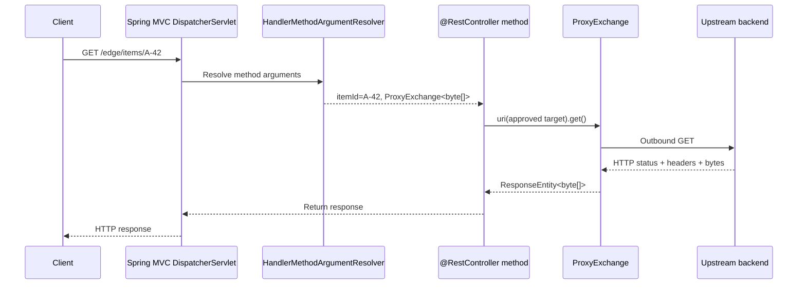

# The ProxyExchange Object as a Handler Method Parameter

## 1. Why Does ProxyExchange Appear in a Controller?

In **SPRING_CLOUD_GATEWAY**, an API Gateway can handle **route predicates**, **filter chains**, path and header transformations, service discovery, authentication, rate limiting, circuit breakers, retries, TLS, and request tracing to keep microservices safe. Those responsibilities are typically associated with **Spring Cloud Gateway Server WebFlux** or **Server Web MVC**, where routes and filters are managed by Gateway Server.

However, there are cases where an **existing Spring MVC or WebFlux application** only wants to forward a few selected endpoints to a backend, with the logic residing right inside a **controller method**:

```text
Client
  GET /edge/items/A-42?lang=vi
        |
        v
Spring MVC @RestController
  @GetMapping("/edge/items/{itemId}")
  getItem(ProxyExchange<byte[]> proxy, ...)
        |
        | validate itemId; choose fixed target URI
        | proxy.uri("http://127.0.0.1:9001/items/A-42?lang=vi").get()
        v
Catalog Backend :9001
  GET /items/A-42?lang=vi
        |
        v
ResponseEntity<byte[]> -> HTTP response sent to client
```

This is the **Spring Cloud Gateway Proxy Exchange** model — an *alternative flavor* of Spring Cloud Gateway, not a shorthand syntax for **Gateway Server**. The library lets you inject a `ProxyExchange<T>` object as a **handler method parameter** using `@GetMapping`, `@PostMapping`, or `@RequestMapping`, and then call one of its HTTP proxy methods to dispatch the request to another service.

**Shortest example in Spring MVC:**

```java
@GetMapping("/edge/hello")
public ResponseEntity<?> hello(ProxyExchange<byte[]> proxy) {
    return proxy.uri("http://127.0.0.1:9001/hello").get();
}
```

Notably, there is no `RouterFunction`, `RouteLocator`, or `GatewayFilterChain` in the method above. `ProxyExchange` is created/prepared per request by a **Spring MVC argument resolver**, then passed into the method when the controller is invoked.

### Learning Outcomes

After this lesson, you will:

1. Recognize **Proxy Exchange** as a gateway style for **annotation-based MVC/WebFlux handlers**, distinct from Gateway Server WebFlux/MVC.
2. Select the right Maven artifact: `spring-cloud-gateway-proxyexchange-webmvc` or `spring-cloud-gateway-proxyexchange-webflux`.
3. Understand how `ProxyExchange<byte[]>` is provided by a **method argument resolver**, what generic `T` represents, and how MVC/WebFlux return types differ.
4. Use `proxy.uri(...).get()`, `proxy.body(...).post()`, `path(...)`, `header(...)`, and the **response mapper** appropriately.
5. Distinguish inbound URI/path/query from outbound URI, control encoding, and avoid creating an open proxy.
6. Understand defaults for **sensitive headers**, **skipped headers**, and `X-Forwarded-*` headers; avoid forwarding `Authorization`/cookies outside policy.
7. Build a **Spring MVC + ProxyExchange** lab with `EchoBackend`, and verify it using `curl` and HTTP integration tests.
8. Know when to use Proxy Exchange and when you need Gateway Server with full route predicates, filters, discovery, auth, TLS, quotas, and resilience.

> **Version scope of this lesson:** Spring Cloud Gateway **Proxy Exchange 4.3.x**, Spring Cloud **2025.0.x**, Spring Boot **3.5.x**, JDK 17+. Starting with this release train, artifact names changed from `spring-cloud-gateway-mvc`/`spring-cloud-gateway-webflux` to `spring-cloud-gateway-proxyexchange-webmvc`/`spring-cloud-gateway-proxyexchange-webflux`. Examples use Boot `3.5.0` and Cloud BOM `2025.0.0` to illustrate compatibility; pick a supported patch when deploying in practice.

## 2. Distinguishing Proxy Exchange From the Two Gateway Server Variants

The 4.3 documentation states clearly: **Proxy Exchange is an alternative gateway style; Gateway Server guides do not automatically apply to it.**

| Criterion | **Proxy Exchange Web MVC** | **Proxy Exchange WebFlux** | **Gateway Server WebFlux/MVC** |
| --- | --- | --- | --- |
| Primary task | Proxy individual endpoints inside a Spring MVC controller. | Proxy individual endpoints inside a Spring WebFlux controller. | Run a gateway routing many routes via predicates/filters. |
| Java entry point | `@GetMapping` with `ProxyExchange<T>`. | `@GetMapping` with `ProxyExchange<T>`. | `RouteLocatorBuilder` or `GatewayRouterFunctions`/YAML. |
| Web runtime | Servlet/MVC (Tomcat/Jetty...). | Reactive/WebFlux (typically Reactor Netty). | WebFlux Server: reactive; MVC Server: Servlet. |
| Handler return | `ResponseEntity<?>`. | `Mono<ResponseEntity<?>>`. | Managed by Gateway Server pipeline. |
| 4.3 library | `spring-cloud-gateway-proxyexchange-webmvc`. | `spring-cloud-gateway-proxyexchange-webflux`. | `spring-cloud-starter-gateway-server-webflux` or `...-webmvc`. |
| Matching rules | `@GetMapping`, `@RequestMapping` annotations, Spring web stack. | `@GetMapping`, `@RequestMapping` annotations, Spring WebFlux. | Route predicates `Path`, `Host`, `Method`, `Header`... |
| Request transformation | Choose URI, body, headers in controller/web stack filters. | Same, via reactive publisher. | `GatewayFilterFactory`, before/after filters, filter chain. |
| Built-in utilities | HTTP methods, response mapper; MVC has local `forward()`. | HTTP methods/reactive return. | Rich filters: rate limiter, circuit breaker, retry, cache, discovery. |
| Primary config | Controller + Proxy Exchange dependency. | Controller + Proxy Exchange dependency. | Server Gateway routes + filter factories. |

**Three common misconceptions:**

- `ProxyExchange` is **not** `ServerWebExchange`: `ServerWebExchange` is WebFlux's HTTP exchange object, whereas `ProxyExchange<T>` is a **helper for sending requests downstream** from a handler.
- `ProxyExchange` is **not** `GatewayRouterFunctions.route(...)`: `GatewayRouterFunctions` is the DSL for Gateway **Server Web MVC**, using `RouterFunction<ServerResponse>`.
- You should not put `spring.cloud.gateway.server.webflux.routes` properties into a Proxy Exchange–only app and expect the controller to automatically gain Server's `RequestRateLimiter`/`CircuitBreaker`.

### 2.1. When Is Proxy Exchange a Good Fit?

Consider it when:

- The application already uses annotation-based `@RestController`s and only needs **a few proxy endpoints**.
- The handler needs to validate business inputs/metadata before calling a fixed backend.
- You want to leverage existing Spring MVC/Spring WebFlux argument binding, validation, exception handling, interceptors, and security filters.
- You do not need every endpoint to become a full Gateway Server route.

Conversely, if you must manage dozens or hundreds of routes from YAML/Java DSL, load balancing, route predicates, filter chains, retries, circuit breakers, rate limiting, dynamic routes/Actuator, and unified observability, **Gateway Server** is usually a better fit. These capabilities can be built with other libraries around Proxy Exchange, but **they do not appear automatically** just by adding a `ProxyExchange` parameter.

## 3. How Does Spring Inject `ProxyExchange` Into a Handler Method?

Look at the MVC signature:

```java
@RestController
class ItemController {

    @GetMapping("/edge/items/{itemId}")
    ResponseEntity<?> get(
            @PathVariable String itemId,
            ProxyExchange<byte[]> proxy) {

        return proxy.uri("http://127.0.0.1:9001/items/" + itemId).get();
    }
}
```

When Spring MVC selects the method for a request, it resolves standard arguments (`@PathVariable`, `@RequestParam`, `@RequestHeader`...) and delegates resolving the `ProxyExchange<byte[]>` parameter to **`ProxyExchangeArgumentResolver`**. The Proxy Exchange module registers this resolver in the **Spring web application** via auto-configuration when the right dependency is present.



**Do not manually instantiate** `new ProxyExchange(...)` inside the controller, and do not annotate the `ProxyExchange` parameter with `@RequestBody` or `@Autowired`. It is a **specialized method argument**, not request JSON sent by the client.

### 3.1. `ProxyExchange<T>` and `ResponseEntity<T>`

`T` is the body type the helper uses for the **backend response**. For example, `ProxyExchange<byte[]>` fits when you want to keep raw body bytes (JSON, images, text) without forcing the Gateway to parse them into a domain entity.

| Signature / Type | How to Read It |
| --- | --- |
| `ProxyExchange<byte[]> proxy` | Proxies the request and receives the outbound body as bytes. |
| `proxy.uri(url)` | Sets the target URI for the outbound request; **does not send** the request yet. |
| `proxy.get()` | Executes GET against the selected URI and returns the result. |
| `ResponseEntity<?>` (MVC) | Contains status, headers, and body returned by the proxy or adjusted by the handler. |
| `Mono<ResponseEntity<?>>` (WebFlux) | Reactive publisher of the response; must return the publisher, **never call `block()`**. |

Even though `byte[]` avoids deserializing the body into a POJO, it **does not automatically imply unbounded streaming**. For large files/SSE/multipart, verify buffering, content length, memory, codecs, and streaming support of the **actual library version**. Proxy Exchange is meant for **basic** proxying; do not assume it replaces a dedicated streaming gateway.

### 3.2. Web MVC and WebFlux Patterns Side by Side

**Spring MVC:**

```java
import org.springframework.cloud.gateway.mvc.ProxyExchange;
import org.springframework.http.ResponseEntity;
import org.springframework.web.bind.annotation.GetMapping;
import org.springframework.web.bind.annotation.RestController;

@RestController
class MvcExample {

    @GetMapping("/edge/ping")
    ResponseEntity<?> ping(ProxyExchange<byte[]> proxy) {
        return proxy.uri("http://127.0.0.1:9001/ping").get();
    }
}
```

**Spring WebFlux:** uses the `spring-cloud-gateway-proxyexchange-webflux` module, a WebFlux `@RestController`, and a reactive return type:

```java
@GetMapping("/edge/ping")
public Mono<ResponseEntity<?>> ping(ProxyExchange<byte[]> proxy) {
    return proxy.uri("http://127.0.0.1:9001/ping").get();
}
```

The WebFlux snippet illustrates the **signature**, assuming the class imports `Mono`, `ResponseEntity`, and `ProxyExchange` from the matching WebFlux module. In MVC, `get()` returns the response directly; in WebFlux, it returns a `Mono`. **Never** arbitrarily replace `Mono<ResponseEntity<?>>` with `ResponseEntity<?>` when using reactive Proxy Exchange.

## 4. `uri(...)` and HTTP Verb Methods

Most examples use the chain:

```java
return proxy.uri("http://127.0.0.1:9001/items/A-42").get();
```

Here:

1. Spring mapping determines which handler is invoked.
2. The handler selects an approved **target URI**.
3. `uri(...)` attaches the target URI to the helper.
4. `get()` executes the request and returns the response in the web stack's return type.

`ProxyExchange` supports actions for common HTTP verbs:

| Helper Method | Outbound HTTP | Application Example | Notes |
| --- | --- | --- | --- |
| `get()` | GET | Reading products, catalog, public info. | Avoid side effects on GET. |
| `head()` | HEAD | Checking metadata/resources. | Typically no response body. |
| `options()` | OPTIONS | Exchanging options with backend. | CORS preflight may be handled by Spring Security/CORS **before the controller**. |
| `post()` | POST | Creating resources. | Check body, CSRF/session, idempotency, timeouts. |
| `put()` | PUT | Replacing resources. | Control permissions and body. |
| `patch()` | PATCH | Partial modification. | Control body types and partial update handling. |
| `delete()` | DELETE | Deleting resources. | Authorization, auditing; never retry blindly. |

For methods with a body, in MVC you can specify:

```java
@PostMapping("/edge/items")
ResponseEntity<?> create(@RequestBody byte[] payload,
                         ProxyExchange<byte[]> proxy) {
    return proxy.uri("http://127.0.0.1:9001/items")
                .body(payload)
                .post();
}
```

Use appropriate body types and HTTP headers (JSON, media types, binary). **Do not replay a request body that has already been read/consumed multiple times** unless replay is designed. For large POST/PUT/PATCH, multipart, or streaming, write dedicated integration tests: generic `T` does not automatically solve buffering or backpressure.

### 4.1. `forward()` Is Not HTTP Proxying

In **MVC Proxy Exchange**, `forward(String)` can forward to a **local handler** inside the application; this is not an outbound HTTP request to a backend. Distinguish:

```text
proxy.uri("https://catalog.example.test/items/42").get()
    -> sends an HTTP request to another host.

proxy.forward("/internal/fallback")
    -> dispatches the request to a local MVC handler.
```

`forward()` is documented specifically for **MVC**; do not assume WebFlux Proxy Exchange has the same API. When using local forwarding, avoid recursion (forwarding back to the same endpoint), protect internal paths, and do not bypass permission checks.

## 5. `path(prefix)`, `@PathVariable`, and Query Strings

The official documentation illustrates a `proxy.path("/proxy/path/")` helper to extract the path segment **after a prefix** of the request:

```java
@GetMapping("/proxy/path/**")
public ResponseEntity<?> copyPath(ProxyExchange<byte[]> proxy) {
    String suffix = proxy.path("/proxy/path/");
    return proxy.uri("http://127.0.0.1:9001/foos/" + suffix).get();
}
```

This is meant to demonstrate **extracting the remaining path**, not automatic path validation or sanitization. In production, do not append an unvalidated `suffix` directly to a target URI. Characters like `..`, `/`, `%2F`, `?`, `#`, and UTF-8 encoded segments can alter the path or query. **A matching prefix does not prove the suffix is safe.**

### 5.1. Use Fixed Paths and Validated Variables for Critical Endpoints

For an API reading a single item, `@PathVariable` defines a clear contract:

```java
@GetMapping("/edge/items/{itemId}")
ResponseEntity<?> get(
        @PathVariable String itemId,
        ProxyExchange<byte[]> proxy) {

    if (!itemId.matches("[A-Za-z0-9_-]{1,32}")) {
        return ResponseEntity.badRequest().body("Invalid item ID");
    }

    String target = UriComponentsBuilder
            .fromUriString("http://127.0.0.1:9001")
            .pathSegment("items", itemId)
            .build()
            .encode()
            .toUriString();

    return proxy.uri(target).get();
}
```

This snippet assumes importing `UriComponentsBuilder` from `org.springframework.web.util`. The regex prevents slashes and encoded control characters; `pathSegment` makes the path structure explicit. In a real API, alongside format validation you must check **authorization for the item ID**.

### 5.2. Do Not Assume Query Strings Are Always Forwarded Verbatim

A controller can declare:

```java
@RequestParam(name = "lang", required = false)
String language
```

This is a query parameter bound by Spring. When building the target URI, you must decide **which queries to pass upstream**, rather than assuming every query parameter is automatically proxied verbatim across all versions and implementations.

Example:

```java
UriComponentsBuilder builder = UriComponentsBuilder
        .fromUriString(approvedBaseUri)
        .pathSegment("items", itemId);

if (language != null) {
    if (!language.matches("[A-Za-z]{2,8}")) {
        return ResponseEntity.badRequest().body("Invalid lang");
    }
    builder.queryParam("lang", language);
}
return proxy.uri(builder.build().encode().toUri()).get();
```

Use an **allowlist** of query names/values for sensitive APIs. Never forward `?backend=http://169.254.169.254`, `?tenant=someone-else`, or tokens in query parameters as a way to pick hosts or identities.

### 5.3. Distinguishing Inbound URL and Outbound URL

| Information | Example | Who Decides? |
| --- | --- | --- |
| Inbound mapping | `GET /edge/items/{itemId}` | `@GetMapping` on the controller. |
| Inbound path value | `itemId=A-42` | Sent by client, bound by Spring MVC; **untrusted**. |
| Validated item | `A-42` via regex/authorization | Handler verifies schema and permissions. |
| Target host | `127.0.0.1:9001` in lab | **Trusted configuration**, never taken directly from query/header. |
| Target path | `/items/A-42` | Handler builds from fixed structure + validated item ID. |
| Outbound method | `GET` | The `proxy.get()` call. |
| HTTP response | `ResponseEntity<byte[]>` | Upstream result, optionally shaped by a mapper. |

## 6. Request Headers: Sensitive, Skipped, and Forwarded

Proxy Exchange supports forwarding request headers, subject to **filtering rules**. The Gateway 4.3 documentation describes:

- **Sensitive headers**: by default `cookie` and `authorization` — not automatically forwarded downstream.
- **Skipped headers**: by default `content-length` and `host` — avoids copying invalid metadata when URI/body/outbound transfer encoding may change.
- **Proxy/forwarded headers**: supports handling `x-forwarded-*` style headers, but must respect the trust boundary of the actual reverse proxy/ingress.

Example:

```http
GET /edge/items/A-42 HTTP/1.1
Host: edge.example.test
Authorization: Bearer customer-token
Cookie: session=abc123
X-Gateway-Lab: forged
```

**Do not assume** the backend will receive `Authorization`/cookies as sent by the client. That is an intentional boundary. If a real API needs to pass a token, design OAuth2 Token Relay or proper proxy permissions, forwarding credentials only to **the right audience/host** while considering scopes and token exchange. Never strip away default protections unconditionally.

### 6.1. `header(...)` Targets the Downstream Request

The Javadoc for `ProxyExchange.header(String,String...)` describes **setting a header on the downstream call**:

```java
return proxy.uri("http://127.0.0.1:9001/items/A-42")
            .header("X-Gateway-Lab", "proxyexchange")
            .get();
```

In this example, `X-Gateway-Lab` is a non-sensitive technical marker. **Do not confuse it with headers on the response sent to the client**: to control response headers, use a mapper on `get(...)` or corresponding response handling.

`proxy.headers(HttpHeaders)` lets you supply or customize multiple outbound headers; avoid copying the client's entire `HttpHeaders` to the backend and accidentally bypassing sensitive/skipped header protections. When internal user/tenant identification is needed, derive it strictly from the authenticated principal and restrict which services can receive it.

### 6.2. Why Shouldn't `Host` and `Content-Length` Be Copied?

- `Host` must match the **target authority** (hostname/port) the HTTP client actually connects to. Copying `Host: edge.example.test` to `catalog.internal` can break virtual-host routing or TLS.
- `Content-Length` must match the actual byte count of the outbound request. When the helper modifies the body or uses chunked encoding, copying the inbound content length verbatim can cause parse errors, hung requests, or inconsistent connections.
- `Connection`, `Transfer-Encoding`, and other hop-by-hop headers must also be handled by the HTTP client/proxy per RFC, not preserved indiscriminately.

Therefore, when testing, do not assert that **every request header** matches the inbound request byte-for-byte. Assert **which headers are allowed to be forwarded**, and **which headers must definitely not be forwarded**.

### 6.3. `X-Forwarded-*` Is Not Automatically Trustworthy

`X-Forwarded-For`, `X-Forwarded-Host`, and `X-Forwarded-Proto` can be added or pass through multiple proxies. If clients can send them directly, values can be spoofed. In real systems:

1. Ingress must strip/overwrite forwarded headers from untrusted clients.
2. Applications configure trust rules for trusted proxies.
3. Never use a self-reported IP in `X-Forwarded-For` as a rate-limit or authorization key.
4. Never build a target URI from `X-Forwarded-Host` without controlling its source.
5. Check the behavior of your exact release/patch, as forwarded-header security configurations have evolved across versions.

## 7. Customizing Responses With a Response Mapper

Proxy Exchange supports overloads of `get()` (and other HTTP methods) that accept a `Function<ResponseEntity<T>, ResponseEntity<S>>` to **transform the response after receiving it from upstream**.

Example adding a safe marker and removing an internal response header:

```java
return proxy.uri("http://127.0.0.1:9001/items/A-42")
        .get(upstream -> ResponseEntity
                .status(upstream.getStatusCode())
                .headers(headers -> {
                    headers.putAll(upstream.getHeaders());
                    headers.remove("X-Internal-Debug");
                    headers.set("X-Proxy-Source", "edge");
                })
                .body(upstream.getBody()));
```

The mapper receives `ResponseEntity<byte[]>` from the backend and builds the response sent to the client. Be sure to **preserve status, body, and valid headers** while avoiding leaking internal metadata. Depending on policy, also verify `Cache-Control`, CORS, cookies, redirect `Location`, and security headers.

### 7.1. Do Not Turn Backend Errors Into Fake Successes

Suppose the backend returns `503 Service Unavailable`. The mapper should not blindly return `ResponseEntity.ok(...)` for every response — doing so tricks clients, retry policies, and metrics into believing the request succeeded.

The pattern above uses `.status(upstream.getStatusCode())` to preserve the original semantics. When you intentionally change the status, document the API contract clearly; a 200 fallback is only appropriate if the response genuinely provides safe substitute data permitted by business rules.

### 7.2. Hiding a Header Does Not Replace Data Masking

Removing `X-Internal-Debug` does not hide PII/secrets that might be inside the **body**. If the response contains personal data, enforce proper authentication/authorization, avoid improperly scoped global caching, and never forward content the caller is not authorized to see. The backend service must also enforce resource/tenant-level permissions.

### 7.3. Large Bodies, Streaming, and Compression

When the proxy returns a `byte[]` body, it may have to hold many bytes in memory (depending on the stack/HTTP client and codecs). A huge body or infinite stream does not fit the assumption “just call `.get()` and the mapper has all the bytes”. For SSE, multipart, video, and streaming downloads, consider Gateway Server or a dedicated HTTP streaming mechanism, set body size limits and timeouts, and test in practice.

## 8. HTTP Contract: Not Every Endpoint Needs Proxying

Proxy Exchange is invoked **inside an already-matched controller**. Before calling `.get()`/`.post()`, you have full control:

- `@GetMapping` permits only GET; route misses and method mismatches are handled by Spring MVC/WebFlux.
- `@PathVariable`, `@RequestParam`, and `@RequestHeader` can constrain requests to a schema.
- Validation can return `400 Bad Request` **without calling** upstream.
- Spring Security can return `401/403` **before** the controller runs.
- Errors like DNS, TLS handshake, connection refused, and timeouts arising when the outbound HTTP client calls the backend must be handled per policy.
- The `ResponseEntity` returned by the helper can carry `404`/`500` status from the backend; do not confuse that with a 404 from MVC handler mapping.

A “proxy handler” does not automatically possess all the **route predicates/filter chain/circuit breaker/retry/response cache** features of Server Gateway. If you need them, you must **integrate them explicitly** or switch to the appropriate Gateway Server.

## 9. Hands-On Lab: A Spring MVC Controller Accepting `ProxyExchange<byte[]>`

### 9.1. Lab Architecture

We will run two local processes:

```text
+-------------------------------------------+
| Spring Boot MVC :8080                     |
|                                           |
| @RestController                           |
| GET  /edge/items/{itemId}                 |
| POST /edge/items/{itemId}                 |
|                                           |
| Method argument: ProxyExchange<byte[]>    |
| - validate itemId/lang                    |
| - build trusted backend URI               |
| - set X-Gateway-Lab                       |
| - get() or body(...).post()               |
+---------------------+---------------------+
                      |
                      | HTTP to 127.0.0.1:9001
                      v
+-------------------------------------------+
| JDK EchoBackend                           |
| - Count actual received requests          |
| - Print method, path, query               |
| - Check presence of Authorization/Cookie  |
| - Return 200 or 503 to test status        |
+-------------------------------------------+
```

The data is **public demo data**, requiring no authentication. In production, never build a proxy that accepts arbitrary URLs/hosts from clients. The address `127.0.0.1:9001` only works when both processes run on the **same machine**. If the Gateway runs inside Docker/Kubernetes, `127.0.0.1` points to **the Gateway container/pod itself**, not another service by default.

### 9.2. Creating the Maven Project

Requirements: JDK **17+**, Maven, and `curl`. Initialize a **separate lab project** with `pom.xml`:

```xml
<?xml version="1.0" encoding="UTF-8"?>
<project xmlns="http://maven.apache.org/POM/4.0.0"
         xmlns:xsi="http://www.w3.org/2001/XMLSchema-instance"
         xsi:schemaLocation="http://maven.apache.org/POM/4.0.0
                             https://maven.apache.org/xsd/maven-4.0.0.xsd">
    <modelVersion>4.0.0</modelVersion>

    <parent>
        <groupId>org.springframework.boot</groupId>
        <artifactId>spring-boot-starter-parent</artifactId>
        <version>3.5.0</version>
        <relativePath/>
    </parent>

    <groupId>com.example</groupId>
    <artifactId>proxyexchange-handler-lab</artifactId>
    <version>0.0.1-SNAPSHOT</version>

    <properties>
        <java.version>17</java.version>
    </properties>

    <dependencyManagement>
        <dependencies>
            <dependency>
                <groupId>org.springframework.cloud</groupId>
                <artifactId>spring-cloud-dependencies</artifactId>
                <version>2025.0.0</version>
                <type>pom</type>
                <scope>import</scope>
            </dependency>
        </dependencies>
    </dependencyManagement>

    <dependencies>
        <!-- MVC / Servlet web application -->
        <dependency>
            <groupId>org.springframework.boot</groupId>
            <artifactId>spring-boot-starter-web</artifactId>
        </dependency>

        <!-- Exact Proxy Exchange module, NOT Gateway Server -->
        <dependency>
            <groupId>org.springframework.cloud</groupId>
            <artifactId>spring-cloud-gateway-proxyexchange-webmvc</artifactId>
        </dependency>

        <dependency>
            <groupId>org.springframework.boot</groupId>
            <artifactId>spring-boot-starter-test</artifactId>
            <scope>test</scope>
        </dependency>
    </dependencies>

    <build>
        <plugins>
            <plugin>
                <groupId>org.springframework.boot</groupId>
                <artifactId>spring-boot-maven-plugin</artifactId>
            </plugin>
        </plugins>
    </build>
</project>
```

**Why include these two runtime dependencies?**

- `spring-boot-starter-web`: Spring MVC with an embedded Servlet container.
- `spring-cloud-gateway-proxyexchange-webmvc`: The `ProxyExchange` type + argument resolver/auto-configuration suited for MVC.

**Do not use** `spring-cloud-starter-gateway-server-webmvc` just to get `ProxyExchange`: that is a **different flavor**. Similarly, the old `spring-cloud-gateway-mvc` artifact was used in earlier releases but was renamed in 2025.0/4.3; do not mix old and new modules.

For **WebFlux**, initialize a separate project with `spring-boot-starter-webflux` + `spring-cloud-gateway-proxyexchange-webflux`; do not place both web stacks together in one demo and guess which application type Boot will pick.

### 9.3. Entry Point

Create `src/main/java/com/example/proxy/ProxyExchangeApplication.java`:

```java
package com.example.proxy;

import org.springframework.boot.SpringApplication;
import org.springframework.boot.autoconfigure.SpringBootApplication;

@SpringBootApplication
public class ProxyExchangeApplication {
    public static void main(String[] args) {
        SpringApplication.run(ProxyExchangeApplication.class, args);
    }
}
```

### 9.4. `application.yml`

Create `src/main/resources/application.yml`:

```yaml
server:
  port: 8080

spring:
  application:
    name: proxyexchange-handler-lab

# Same-machine lab: backend URI is configured, NOT taken from the request.
lab:
  backend:
    uri: http://127.0.0.1:9001
```

You do not need `spring.cloud.gateway.server.webflux.routes`, `spring.cloud.gateway.server.webmvc.routes`, or `GatewayRouterFunctions` in this lesson: the `@GetMapping`/`@PostMapping` controller is what defines the proxy endpoints.

In real systems, `lab.backend.uri` must come from managed configuration, with URI scheme/host/port allowlists, secret protection, and change authorization. Never allow clients to pass a `targetUrl` to override this setting.

### 9.5. Complete Controller

Create `src/main/java/com/example/proxy/ItemProxyController.java`:

```java
package com.example.proxy;

import java.net.URI;
import java.util.regex.Pattern;

import org.springframework.beans.factory.annotation.Value;
import org.springframework.cloud.gateway.mvc.ProxyExchange;
import org.springframework.http.ResponseEntity;
import org.springframework.web.bind.annotation.GetMapping;
import org.springframework.web.bind.annotation.PathVariable;
import org.springframework.web.bind.annotation.PostMapping;
import org.springframework.web.bind.annotation.RequestBody;
import org.springframework.web.bind.annotation.RequestMapping;
import org.springframework.web.bind.annotation.RequestParam;
import org.springframework.web.bind.annotation.RestController;
import org.springframework.web.util.UriComponentsBuilder;

@RestController
@RequestMapping("/edge")
public class ItemProxyController {

    private static final Pattern ID_PATTERN =
            Pattern.compile("[A-Za-z0-9_-]{1,32}");

    private static final Pattern LANG_PATTERN =
            Pattern.compile("[A-Za-z]{2,8}");

    private final String backendBase;

    public ItemProxyController(
            @Value("${lab.backend.uri:http://127.0.0.1:9001}")
            String backendBase) {
        // This is internal configuration. Production requires validating
        // an allowlist of scheme/host/port before use.
        this.backendBase = backendBase;
    }

    @GetMapping("/items/{itemId}")
    public ResponseEntity<?> getItem(
            @PathVariable String itemId,
            @RequestParam(name = "lang", required = false)
            String language,
            ProxyExchange<byte[]> proxy) {

        if (!isValidItemId(itemId)) {
            return ResponseEntity.badRequest().body("Invalid item ID");
        }
        if (language != null
                && !LANG_PATTERN.matcher(language).matches()) {
            return ResponseEntity.badRequest().body("Invalid language");
        }

        URI uri = itemUri(itemId, language);

        // header(...) adds a header for the DOWNSTREAM request.
        // Do not use this marker as an authentication identity.
        return proxy.uri(uri)
                .header("X-Gateway-Lab", "proxyexchange")
                .get();
    }

    @PostMapping("/items/{itemId}")
    public ResponseEntity<?> updateItem(
            @PathVariable String itemId,
            @RequestBody byte[] payload,
            ProxyExchange<byte[]> proxy) {

        if (!isValidItemId(itemId)) {
            return ResponseEntity.badRequest().body("Invalid item ID");
        }

        // body(...) sets the outbound body for POST.
        URI uri = itemUri(itemId, null);
        return proxy.uri(uri)
                .header("X-Gateway-Lab", "proxyexchange")
                .body(payload)
                .post();
    }

    private boolean isValidItemId(String id) {
        return id != null && ID_PATTERN.matcher(id).matches();
    }

    private URI itemUri(String id, String language) {
        UriComponentsBuilder builder =
                UriComponentsBuilder.fromUriString(backendBase)
                        .pathSegment("items", id);

        if (language != null) {
            builder.queryParam("lang", language);
        }

        return builder.build().encode().toUri();
    }
}
```

**Step-by-step flow of the GET handler:**

1. Spring MVC matches `GET /edge/items/{itemId}`.
2. Spring binds `itemId` and `lang` from the inbound URL.
3. `ProxyExchangeArgumentResolver` supplies the `ProxyExchange<byte[]>` object to the final parameter — **the controller does not call `new ProxyExchange`**.
4. The handler validates the item ID and language; invalid input returns 400 **before any outbound call**.
5. The handler builds the target URL from a configured base URI and `pathSegment`, never taking the host from the request.
6. `proxy.uri(uri)` sets the destination, `proxy.header(...)` adds the outbound marker, and `.get()` proxies the request.
7. The response is returned as a `ResponseEntity` for Spring MVC to send back to the client.

**Step-by-step flow of the POST handler:**

1. Spring binds the raw body into `byte[] payload` via `@RequestBody`.
2. The handler validates the ID and builds the corresponding target URI.
3. `body(payload).post()` forwards the body downstream.
4. The backend handles business logic and HTTP status. The Gateway does not automatically enforce idempotency or authorization for POST.

**Demo limitations:** no authentication or business authorization; no explicit timeouts or body-size limits configured; `backendBase` is a local setting. A production system must add those controls before exposing endpoints to the Internet. If the project handles `Content-Type`, `Accept`, statuses, or exceptions differently, test body/binary/charset behavior accordingly.

### 9.6. Echo Backend Running on JDK 17

Create `EchoBackend.java` in a **separate directory** from the Spring Boot project (do not put it under `com.example.proxy`):

```java
import com.sun.net.httpserver.HttpServer;
import java.net.InetSocketAddress;
import java.nio.charset.StandardCharsets;
import java.util.concurrent.atomic.AtomicInteger;

public class EchoBackend {

    public static void main(String[] args) throws Exception {
        AtomicInteger counter = new AtomicInteger();

        HttpServer server = HttpServer.create(
                new InetSocketAddress("127.0.0.1", 9001), 0);

        server.createContext("/", exchange -> {
            int number = counter.incrementAndGet();
            String path = exchange.getRequestURI().getRawPath();
            String query = exchange.getRequestURI().getRawQuery();
            String method = exchange.getRequestMethod();

            String gatewayLab = exchange.getRequestHeaders()
                    .getFirst("X-Gateway-Lab");

            boolean authPresent = exchange.getRequestHeaders()
                    .containsKey("Authorization");
            boolean cookiePresent = exchange.getRequestHeaders()
                    .containsKey("Cookie");

            byte[] requestBytes = exchange.getRequestBody()
                    .readAllBytes();
            String requestBody =
                    new String(requestBytes, StandardCharsets.UTF_8);

            int status = path.endsWith("/unavailable") ? 503 : 200;
            String body = "origin-request=" + number + "\n"
                    + "method=" + method + "\n"
                    + "path=" + path + "\n"
                    + "query=" + query + "\n"
                    + "gateway-lab=" + gatewayLab + "\n"
                    + "auth-present=" + authPresent + "\n"
                    + "cookie-present=" + cookiePresent + "\n"
                    + "body=" + requestBody + "\n";

            // Never log raw Authorization or Cookie values.
            System.out.printf(
                    "ORIGIN #%d %s %s status=%d%n",
                    number, method, path, status);

            byte[] bytes = body.getBytes(StandardCharsets.UTF_8);
            exchange.getResponseHeaders().set(
                    "Content-Type", "text/plain; charset=UTF-8");
            exchange.getResponseHeaders().set(
                    "X-Origin-Request-No", Integer.toString(number));

            exchange.sendResponseHeaders(status, bytes.length);

            try (var output = exchange.getResponseBody()) {
                output.write(bytes);
            }
        });

        server.start();
        System.out.println("EchoBackend at http://127.0.0.1:9001");
    }
}
```

This backend is for **lab use only**. It prints **presence/absence** of the two sensitive headers instead of raw tokens/cookies. In production, never echo internal details in HTTP responses, never expose debug endpoints publicly, and never call unbounded `readAllBytes()` on Internet request bodies.

### 9.7. Running Both Processes

**Terminal A**, in the directory containing `EchoBackend.java`:

```bash
java EchoBackend.java
```

**Terminal B**, in the directory containing the Spring Boot `pom.xml`:

```bash
mvn spring-boot:run
```

If using Maven Wrapper: `./mvnw spring-boot:run` on Linux/macOS or `mvnw.cmd spring-boot:run` on Windows. Ensure ports `8080` and `9001` are free.

**The build/run commands in this lesson are for learners practicing in their own project.** The STEP 4 worker does not execute Maven/Gradle or platform repository content QA.

### 9.8. GET: Verifying Method, Path, Query, and Headers

**Terminal C**:

```bash
curl -i \
  -H "X-Gateway-Lab: attacker-value" \
  "http://127.0.0.1:8080/edge/items/A-42?lang=vi"
```

When the system is in a clean lab state, the expected response content is:

```http
HTTP/1.1 200 OK
Content-Type: text/plain; charset=UTF-8

origin-request=1
method=GET
path=/items/A-42
query=lang=vi
gateway-lab=proxyexchange
auth-present=false
cookie-present=false
body=
```

The `origin-request` count changes if prior requests were sent. Key assertions:

- **`path=/items/A-42`**: the `/edge` prefix is not automatically “copied” like a Gateway Server route; the controller explicitly built the target URI.
- **`query=lang=vi`**: the handler chose to forward the language parameter.
- **`gateway-lab=proxyexchange`**: the helper set the outbound header; the client's `attacker-value` was not trusted as the source.
- **`method=GET`**: `.get()` produced the downstream HTTP method.
- **Backend counter increments**: proves a real HTTP call occurred, not just a local controller response.

If the marker header does not match expectations, inspect how your exact Proxy Exchange version copies/overrides headers and adjust rules to strip client headers before adding internal metadata. Never use a lab marker to grant downstream permissions.

### 9.9. Checking Sensitive Header Defaults

Send a demo request with fake credentials:

```bash
curl -i \
  -H "Authorization: Bearer lab-only-token" \
  -H "Cookie: session=lab-only-cookie" \
  "http://127.0.0.1:8080/edge/items/A-42"
```

Under Proxy Exchange 4.3's default policy, `Authorization` and `Cookie` belong to the **sensitive headers** set that is not forwarded automatically; the demo backend is expected to return:

```text
auth-present=false
cookie-present=false
```

**This is not proof that the user is logged in.** The lab has not configured Spring Security to validate the dummy token. In a real system, authenticate the caller first, then decide whether to relay a token to an **authorized** upstream rather than forwarding every bearer token by default.

### 9.10. POST: Controlled Body Forwarding

```bash
curl -i -X POST \
  -H "Content-Type: text/plain" \
  --data-binary "payload-123" \
  "http://127.0.0.1:8080/edge/items/A-42"
```

Expected body from EchoBackend:

```text
method=POST
path=/items/A-42
body=payload-123
```

This is merely an **echo**. If a real POST endpoint mutates data, require JWT/authorization, body schema validation, media types, quotas, idempotency, and auditing. Never auto-retry a payment/order creation POST without an idempotency key.

### 9.11. Validation: Rejecting Before the Backend

ID longer than 32 characters:

```bash
curl -i \
  "http://127.0.0.1:8080/edge/items/abcdefghijklmnopqrstuvwxyz123456789"
```

Expect **400 Bad Request** from the handler's own validation; the backend counter does not increment. Invalid language input:

```bash
curl -i \
  "http://127.0.0.1:8080/edge/items/A-42?lang=vi%2Fsecret"
```

The value `vi/secret` does not match regex `[A-Za-z]{2,8}`, so it returns 400. This is **controller-level validation**, not Gateway Server's `RoutePredicateFactory` mechanism.

### 9.12. Route Miss and HTTP Method Mismatch

There is no `@GetMapping("/unknown")`:

```bash
curl -i "http://127.0.0.1:8080/unknown"
```

Normally Spring MVC returns **404** without calling the backend. If you send DELETE to a URL mapped only for GET/POST, the framework handles the method mismatch (typically 405) without proxying. Statuses can be affected by other security/exception handlers in the app; inspect the **backend counter** to tell them apart.

### 9.13. Upstream HTTP Status Must Be Preserved

The demo backend returns 503 when the path ends with `/unavailable`:

```bash
curl -i \
  "http://127.0.0.1:8080/edge/items/unavailable"
```

When `ProxyExchange.get()` receives an HTTP response and returns it as a `ResponseEntity`, the client should observe the downstream HTTP status — **do not treat 503 as 200** just because the controller ran without throwing. Some HTTP clients/exception handlers may handle statuses or exceptions differently by version/config; verify actual behavior with integration tests rather than guessing from `@GetMapping` alone.

### 9.14. When the Backend Does Not Exist

Stop `EchoBackend`, keep Spring Boot running, and send a GET. You may encounter connection refused/timeouts, usually surfacing as a server error response or via an exception handler. **Do not assert a hardcoded 502/503/504 status** unless exception mapping is configured. Inspect the root cause, TCP/HTTP client timeouts, DNS, TLS, and fallback policies. Never work around errors by disabling hostname verification or opening arbitrary target URIs.

## 10. Integration Test: MVC Handler Argument Resolver and Real Outbound HTTP

A unit test mocking `ProxyExchange` in a controller only checks Java logic; it **does not prove** Spring registered `ProxyExchangeArgumentResolver`, does not prove requests actually reach the backend, and does not test sensitive header filtering. An integration test should start **Spring Boot MVC** and an **HTTP EchoBackend** over real sockets.

Design:

1. `@SpringBootTest(webEnvironment = RANDOM_PORT)` starts the MVC application on a random port.
2. `com.sun.net.httpserver.HttpServer` starts a backend on port `0` assigned by the OS.
3. `@DynamicPropertySource` passes `lab.backend.uri` into the controller.
4. `TestRestTemplate` sends HTTP requests to the controller.
5. `AtomicInteger` counts how many HTTP calls the backend receives, distinguishing **400 validation** from errors occurring after an outbound call.
6. Tests verify GET/path/query, sensitive header defaults, POST body, and route misses.

### 10.1. JUnit Integration Test

Create `src/test/java/com/example/proxy/ProxyExchangeIntegrationTest.java`:

```java
package com.example.proxy;

import java.io.IOException;
import java.io.UncheckedIOException;
import java.net.InetSocketAddress;
import java.nio.charset.StandardCharsets;
import java.util.concurrent.atomic.AtomicInteger;

import com.sun.net.httpserver.HttpServer;

import org.junit.jupiter.api.AfterAll;
import org.junit.jupiter.api.Test;
import org.springframework.beans.factory.annotation.Autowired;
import org.springframework.boot.test.context.SpringBootTest;
import org.springframework.boot.test.web.client.TestRestTemplate;
import org.springframework.http.HttpEntity;
import org.springframework.http.HttpHeaders;
import org.springframework.http.HttpMethod;
import org.springframework.http.HttpStatus;
import org.springframework.http.MediaType;
import org.springframework.http.ResponseEntity;
import org.springframework.test.context.DynamicPropertyRegistry;
import org.springframework.test.context.DynamicPropertySource;

import static org.assertj.core.api.Assertions.assertThat;

@SpringBootTest(
        webEnvironment = SpringBootTest.WebEnvironment.RANDOM_PORT)
class ProxyExchangeIntegrationTest {

    private static final AtomicInteger CALLS = new AtomicInteger();

    private static final HttpServer BACKEND = startBackend();

    private static HttpServer startBackend() {
        try {
            HttpServer server = HttpServer.create(
                    new InetSocketAddress("127.0.0.1", 0), 0);

            server.createContext("/", exchange -> {
                CALLS.incrementAndGet();

                String method = exchange.getRequestMethod();
                String path = exchange.getRequestURI().getRawPath();
                String query = exchange.getRequestURI().getRawQuery();
                String marker = exchange.getRequestHeaders()
                        .getFirst("X-Gateway-Lab");
                boolean auth = exchange.getRequestHeaders()
                        .containsKey("Authorization");
                boolean cookie = exchange.getRequestHeaders()
                        .containsKey("Cookie");

                String inboundBody = new String(
                        exchange.getRequestBody().readAllBytes(),
                        StandardCharsets.UTF_8);

                String responseText = "method=" + method + "\n"
                        + "path=" + path + "\n"
                        + "query=" + query + "\n"
                        + "gateway-lab=" + marker + "\n"
                        + "auth-present=" + auth + "\n"
                        + "cookie-present=" + cookie + "\n"
                        + "body=" + inboundBody + "\n";

                byte[] bytes = responseText
                        .getBytes(StandardCharsets.UTF_8);
                exchange.getResponseHeaders().set(
                        "Content-Type", "text/plain; charset=UTF-8");
                exchange.sendResponseHeaders(200, bytes.length);

                try (var output = exchange.getResponseBody()) {
                    output.write(bytes);
                }
            });

            server.start();
            return server;
        } catch (IOException e) {
            throw new UncheckedIOException(e);
        }
    }

    @DynamicPropertySource
    static void backendUri(DynamicPropertyRegistry registry) {
        registry.add("lab.backend.uri", () ->
                "http://127.0.0.1:" + BACKEND.getAddress().getPort());
    }

    @Autowired
    TestRestTemplate client;

    @AfterAll
    static void closeBackend() {
        BACKEND.stop(0);
    }

    @Test
    void getProxiesMethodPathAndQuery() {
        int before = CALLS.get();

        ResponseEntity<String> result = client.getForEntity(
                "/edge/items/A-42?lang=vi", String.class);

        assertThat(result.getStatusCode()).isEqualTo(HttpStatus.OK);
        assertThat(result.getBody())
                .contains("method=GET")
                .contains("path=/items/A-42")
                .contains("query=lang=vi")
                .contains("gateway-lab=proxyexchange");
        assertThat(CALLS.get()).isEqualTo(before + 1);
    }

    @Test
    void defaultSensitiveHeadersStayOffDownstreamRequest() {
        int before = CALLS.get();

        HttpHeaders headers = new HttpHeaders();
        headers.set(HttpHeaders.AUTHORIZATION, "Bearer lab-token");
        headers.set(HttpHeaders.COOKIE, "sid=lab-session");

        ResponseEntity<String> result = client.exchange(
                "/edge/items/A-42",
                HttpMethod.GET,
                new HttpEntity<Void>(headers),
                String.class);

        assertThat(result.getStatusCode()).isEqualTo(HttpStatus.OK);
        assertThat(result.getBody())
                .contains("auth-present=false")
                .contains("cookie-present=false");
        assertThat(CALLS.get()).isEqualTo(before + 1);
    }

    @Test
    void postPassesBodyToBackend() {
        int before = CALLS.get();

        HttpHeaders headers = new HttpHeaders();
        headers.setContentType(MediaType.TEXT_PLAIN);

        HttpEntity<byte[]> request = new HttpEntity<>(
                "payload-123".getBytes(StandardCharsets.UTF_8),
                headers);

        ResponseEntity<String> result = client.exchange(
                "/edge/items/A-42",
                HttpMethod.POST,
                request,
                String.class);

        assertThat(result.getStatusCode()).isEqualTo(HttpStatus.OK);
        assertThat(result.getBody())
                .contains("method=POST")
                .contains("path=/items/A-42")
                .contains("body=payload-123");
        assertThat(CALLS.get()).isEqualTo(before + 1);
    }

    @Test
    void invalidIdIsRejectedBeforeOutboundHttp() {
        int before = CALLS.get();

        ResponseEntity<String> result = client.getForEntity(
                "/edge/items/abcdefghijklmnopqrstuvwxyz123456789",
                String.class);

        assertThat(result.getStatusCode())
                .isEqualTo(HttpStatus.BAD_REQUEST);
        assertThat(CALLS.get()).isEqualTo(before);
    }

    @Test
    void unrelatedPathDoesNotHitBackend() {
        int before = CALLS.get();

        ResponseEntity<String> result = client.getForEntity(
                "/not-routed", String.class);

        assertThat(result.getStatusCode())
                .isEqualTo(HttpStatus.NOT_FOUND);
        assertThat(CALLS.get()).isEqualTo(before);
    }
}
```

### 10.2. What Does Each Assertion Prove?

| Assertion | Contract Verified |
| --- | --- |
| Client receives HTTP 200 and body `method=GET` | Controller + argument resolver + GET proxy to real backend. |
| Body `path=/items/A-42` | Outbound URI built from validated item ID, not raw inbound path. |
| Body `query=lang=vi` | Controller intentionally forwards the allowlisted query. |
| Body `gateway-lab=proxyexchange` | Header set on the downstream call by the helper. |
| Body `auth-present=false` and `cookie-present=false` | Default sensitive-header policy prevents automatic forwarding. |
| POST has `body=payload-123` | `@RequestBody` and `body(...).post()` carry bytes over outbound HTTP. |
| Invalid ID → 400, CALLS unchanged | Controller short-circuits **before** the HTTP client. |
| Unmatched path → 404, CALLS unchanged | Spring MVC does not select the proxy handler. |

**Do not assert only HTTP status.** A 404 can come from Spring MVC or the backend; a 500 can happen before the controller or after opening an outbound connection. The backend counter and echo body help tell them apart.

### 10.3. Test Stability

`CALLS` is a static counter shared across test methods. Assertions like `before + 1` assume tests run **sequentially** without parallel JUnit execution enabled. If CI runs tests in parallel, partition counters by request ID or spin up an isolated HTTP backend per test.

Port `0` lets the OS assign an ephemeral port; `@DynamicPropertySource` supplies configuration before the controller bean is initialized. This is an integration test over **real HTTP networking**, not just a `MockMvc` test against a mock application context.

If a project already has security filters, other controllers, different base paths, or custom exception handlers, update expected statuses to match the **actual HTTP contract** instead of assuming these lab results apply to every deployment.

### 10.4. Run Command in the Practice Project

```bash
mvn -Dtest=ProxyExchangeIntegrationTest test
```

Or with Maven Wrapper:

```bash
./mvnw -Dtest=ProxyExchangeIntegrationTest test
```

This command is for **learners running in their own demo project**. In STEP 4, the worker only writes accurate Markdown and updates YAML status after readback; it does not run STEP 6 Content QA or platform builds.

## 11. When Using WebFlux: The Handler Signature Changes to a Publisher

If the application uses Spring WebFlux, select **different** dependencies from the MVC lab:

```xml
<dependency>
    <groupId>org.springframework.boot</groupId>
    <artifactId>spring-boot-starter-webflux</artifactId>
</dependency>
<dependency>
    <groupId>org.springframework.cloud</groupId>
    <artifactId>spring-cloud-gateway-proxyexchange-webflux</artifactId>
</dependency>
```

A WebFlux handler returns `Mono<ResponseEntity<?>>`, as in this condensed example from the official documentation:

```java
@GetMapping("/edge/items/{itemId}")
public Mono<ResponseEntity<?>> getItem(
        @PathVariable String itemId,
        ProxyExchange<byte[]> proxy) {

    if (!itemId.matches("[A-Za-z0-9_-]{1,32}")) {
        return Mono.just(
                ResponseEntity.badRequest().body("Invalid item ID"));
    }

    // ID is already constrained to a simple path segment.
    return proxy.uri("http://127.0.0.1:9001/items/" + itemId)
                .get();
}
```

This snippet assumes imports from the matching WebFlux and Reactor modules. Do not drop this method into the MVC project in Section 9. **Never call `block()` or manually `subscribe()`** on the Netty event loop to grab `ResponseEntity` eagerly; return the publisher so WebFlux preserves lifecycle, error, and cancellation semantics.

In both stacks, `ProxyExchange<T>` is a **framework-resolved argument**, not `ServerWebExchange`. Validation of URIs/headers/authorization and body-size limits must still be designed.

## 12. Combining Proxy Exchange With Secure Gateway Requirements

### 12.1. Authentication and Authorization

- MVC uses Spring Security **Servlet `SecurityFilterChain`**; WebFlux uses **`SecurityWebFilterChain`**.
- Never treat path variables, client-sent `X-Correlation-Id`/`X-User-Id`, or a 200 response as proof of identity.
- Backends must still enforce resource/tenant authorization, especially when URIs are constructed with `ProxyExchange.uri(...)`.
- `Authorization` and `Cookie` are stripped during **automatic forwarding** under the default sensitive-headers policy. If business logic requires token relay, explicitly define upstream **audience**, scopes, trust boundaries, and credential lifecycles.
- If the app uses cookies/sessions for write operations, enforce valid CSRF and CORS policies; CORS does not replace authentication.

### 12.2. SSRF Warning: Never Let Clients Choose the Target URI

This is a severe anti-pattern:

```java
// UNSAFE: the client decides where the Gateway sends HTTP traffic.
@GetMapping("/proxy")
public ResponseEntity<?> unsafe(
        @RequestParam String target,
        ProxyExchange<byte[]> proxy) {
    return proxy.uri(target).get();
}
```

Clients can force the Gateway to call internal services, loopback, cloud metadata endpoints, or attacker-controlled hosts, creating **SSRF/open proxy** vulnerabilities. Proper approach:

1. Source base URIs from server config and allowlist schemes, hosts, ports, and IP/CIDRs.
2. Guard against DNS rebinding, redirects, and egress to out-of-policy addresses.
3. Never let client queries, headers, or `Host` alter the target host.
4. Validate paths and query values, preventing `..`, encoded slashes, double encoding, and query injection.
5. Use network policies/firewalls to block sensitive egress rather than relying solely on Java regexes.
6. Set connect/read timeouts and cap redirects, body sizes, and connection pools.

In the lab, `lab.backend.uri` is **operator-trusted configuration**, not a `@RequestParam`.

### 12.3. TLS/mTLS and Forwarded Headers

When the outbound URI uses HTTPS, verify the CA, certificate chain, hostname/SAN/SNI, and HTTP client trust store. If microservices require mTLS, configure client certificates and rotation accordingly. **Never** use trust-all managers or disable hostname verification to bypass handshake failures.

`X-Forwarded-For`/`X-Forwarded-Host` headers can be added along a proxy chain; trust them only when ingress strips/overwrites untrusted values. Never derive identity, rate-limit IP keys, or target hosts from unverified forwarded headers.

### 12.4. Quotas, Circuit Breakers, Retries, and Discovery

A `ProxyExchange` controller **does not automatically include** `GatewayFilterFactory` components such as `RequestRateLimiter`, `CircuitBreaker`, `Retry`, or Gateway Server's `lb://` mechanism.

If business requirements demand them, integrate them explicitly in the appropriate web stack or place a Gateway Server in front. Control:

| Policy | What Must Be Explicitly Designed |
| --- | --- |
| Rate limiting | Trusted key, per-caller quota, 429 before outbound HTTP. |
| Circuit breaker | Error/slow-call thresholds, open/half-open states, semantically valid fallback. |
| Retry | Max attempts, backoff, timeout budget, idempotency for POST/PUT/PATCH. |
| Service discovery | Pick HTTP(S) URI from trusted `ServiceInstance`, verify TLS/health. |
| Cache | Never cache private/no-store/tenant-specific responses outside policy. |
| Authorization | Never let proxy logic or fallbacks bypass resource access permissions. |

Do not assume `proxy.uri("lb://catalog-service")` is automatically resolved by Proxy Exchange like a Gateway Server `lb://` route. Use an appropriate resolver/LoadBalancer, or choose full-featured Gateway Server when routes/discovery/filter policies are central.

### 12.5. Observability

Measure **both sides** of the proxy: inbound controller requests and outbound HTTP attempts. Record status, error class, latency, target alias, and retry counts; distinguish DNS/TCP/TLS timeouts from backend HTTP 5xx statuses. Never log raw `Authorization`, cookies, tokens, sensitive request bodies, or URI queries containing PII.

Spring Boot Actuator/Micrometer can instrument the web stack and client based on dependencies/config, but a Proxy Exchange–only app does not automatically expose `/actuator/gateway/routes` or **Gateway Server** route-filter metrics.

## 13. Common Troubleshooting

| Symptom | Possible Cause | How to Check |
| --- | --- | --- |
| Cannot import `ProxyExchange` | Chose Gateway Server artifact or old module. | MVC uses `spring-cloud-gateway-proxyexchange-webmvc`; WebFlux uses `...-webflux`. |
| Spring fails to resolve parameter | Auto-configuration/argument resolver not registered or wrong web stack. | Inspect dependency tree, app type, and controller. |
| Compile error on return type | Mixed MVC `ResponseEntity` and WebFlux `Mono<ResponseEntity>`. | Use the return signature matching your stack. |
| Controller not invoked | Wrong `@GetMapping`/method/context path, component scan, or security. | Inspect inbound mappings and backend call counter. |
| GET 404 but backend logs a hit | 404 is an upstream response, not a route miss. | Compare request counter and target URI. |
| Backend receives wrong path/query | String concatenation of URI, dropped query, or wrong encoding. | Validate + `UriComponentsBuilder`, inspect outbound path/query. |
| Backend does not see token/cookie | Sensitive headers filtered by default. | Decide token relay by audience/role; do not enable blind pass-through. |
| Backend sees different `Host` than client | `Host` skipped; HTTP client uses target authority. | Usually expected behavior. |
| POST body missing | Wrong `@RequestBody`, `body(payload)`, media type, or converter. | Test actual bytes reaching EchoBackend. |
| 400 yet backend counter increases | Validation ran after HTTP proxy or another filter fired a call. | Check controller flow: reject before `.get()`/`.post()`. |
| Backend returns 503 but client sees exception | HTTP client error handler/exception mapping treats statuses differently. | Distinguish transport exceptions from received `ResponseEntity`. |
| Files/SSE get buffered | `byte[]` does not guarantee unbounded streaming. | Consider a different streaming proxy, bound sizes, measure memory. |
| Retries trigger multiple backend calls | Retries added by client/policy outside Proxy Exchange. | Count attempts and enforce idempotency. |
| SSL handshake error | Wrong CA, SAN, hostname, or trust store. | Keep peer verification; fix TLS config. |
| `/actuator/gateway/routes` missing | App uses only Proxy Exchange, no Gateway Server registry. | Use app web/http-client metrics. |
| Wrong tenant data returned | Missing authorization, bad cache key, or spoofed header. | Check principal/tenant at backend, block caching sensitive data. |

## 14. Pre-Deployment Testing Matrix

| Case | Expected Client | Expected Backend |
| --- | --- | --- |
| GET `/edge/items/A-42` | Valid backend response. | One GET `/items/A-42`. |
| GET `?lang=vi` | Returns data in the right language. | Query `lang=vi`. |
| Oversized ID | 400. | No outbound call. |
| Language containing slash | 400. | No outbound call. |
| Unmatched path | 404 per lab. | No outbound call. |
| POST with body | Status/body matching backend. | POST with bytes `payload-123`. |
| Spoofed marker header | Does not become trusted identity. | Marker chosen by handler per policy. |
| Client sends Cookie/Authorization | Not relayed automatically. | Sensitive headers filtered by default. |
| Upstream 404/503 | Status/exception per HTTP client policy. | Backend actually receives the call. |
| TLS invalid SAN/CA | Verification not bypassed. | HTTP handshake fails. |
| Client-supplied target URI | Rejected/ignored input. | Only approved backend URI called. |
| Missing auth/permission | 401/403 per security. | No outbound call. |
| Quota exhausted | 429 per integrated limiter. | No outbound call. |
| Retry on POST | Only if idempotency is guaranteed. | Attempt count matches policy. |
| Large/streaming body | Appropriate limits/streaming. | No memory blow-up. |
| N concurrent requests | No mixed headers/bodies. | Request state isolated. |

A test asserting only HTTP 200 **is insufficient**: you must know **which method/path/query/headers/body** the backend received, whether it was called too many times, and that blocked requests truly never made outbound HTTP calls.

## 15. Practical Checklist

- [ ] Clearly choose **Proxy Exchange MVC or WebFlux**, never confusing it with Gateway Server.
- [ ] Correct `ProxyExchange<T>` method argument, artifact, and return type.
- [ ] `uri(...)` targets trusted destinations; HTTP verb helper matches the mapping.
- [ ] Validate and encode paths/queries; never let clients pick the URL.
- [ ] Sensitive, skipped, and forwarded headers follow trust policy.
- [ ] Never pass tokens/cookies to unauthorized backends.
- [ ] Response status/body and mappers preserve HTTP semantics; no “fake 200s”.
- [ ] Authentication and resource/tenant authorization are enforced at Gateway/backend.
- [ ] Timeouts, TLS/mTLS, redirect policies, body sizes, and outbound egress are controlled.
- [ ] Retries/circuit breakers/rate limits/discovery are explicitly configured if needed.
- [ ] Never call `block()` or manually `subscribe()` inside reactive handlers.
- [ ] Real HTTP integration tests exist with a backend counter and negative cases.
- [ ] Logs/metrics omit tokens, cookies, PII, and sensitive URLs.
- [ ] Use a supported release train/patch; verify behavior for your exact artifact.

## 16. Self-Check Questions

**1. Why can Spring MVC inject `ProxyExchange<byte[]>` directly into `@GetMapping`?**

Because the Proxy Exchange module registers a **method argument resolver**, not because the client sends JSON named ProxyExchange.

**2. Is `ProxyExchange` the same as `ServerWebExchange` or `GatewayFilterChain`?**

No. It is a helper for **making outbound HTTP calls** from a controller. The other two APIs belong to Gateway Server WebFlux's reactive pipeline.

**3. How do MVC and WebFlux differ in return types?**

MVC returns `ResponseEntity<?>`; WebFlux returns `Mono<ResponseEntity<?>>`.

**4. Has `proxy.uri(target)` already sent an HTTP request?**

No. You must call `.get()`, `.post()`, `.put()`, etc. to execute the exchange.

**5. Why doesn't `proxy.path(prefix)` replace validation?**

It only extracts the suffix of the inbound path; it does not protect against traversal, encoding issues, wrong tenants, or malicious target URIs.

**6. Where does `proxy.header(...)` place a header?**

Per the Javadoc, it sets a header on the **downstream request**, not the client response. Use a response mapper when adjusting the `ResponseEntity`.

**7. Why don't tokens/cookies appear at the backend automatically?**

They belong to **sensitive headers** stripped by default on auto-forwarding. Token relay requires audience/scope policies and a trusted caller identity.

**8. Why is `?target=http://127.0.0.1:...` dangerous?**

Because it turns the proxy into an SSRF/open proxy reaching internal hosts or metadata services outside the client's privileges.

**9. Does having `ProxyExchange` automatically give you Gateway Server's Retry/CircuitBreaker/RequestRateLimiter?**

No. Those policies must be integrated separately or implemented with Gateway Server.

**10. What assertion is stronger than a 400 status when validation rejects a request?**

**The backend counter does not increment** — proving no downstream HTTP call occurred after validation failed.

## Conclusion

Using **`ProxyExchange<T>` as a handler method parameter** is a way to build selective proxying directly inside **annotation-based Spring MVC/WebFlux** applications. Spring injects the object via an argument resolver; the controller picks the target URI, `proxy.get()`/`post()` performs the outbound HTTP call, `path(...)`/`body(...)`/`header(...)` support controlled forwarding, and response mappers allow customizing the `ResponseEntity`.

Always distinguish **Proxy Exchange** from **Gateway Server**: a controller helper does not automatically bring route predicates/filter chains, dynamic routing, rate limiting, retries/circuit breakers, or `lb://` like a Server Gateway. Before deploying, lock down target URIs against SSRF, validate paths/queries, enforce sensitive-header policies, configure authn/authz, TLS/timeouts, protect memory, and monitor requests. When routes and policies grow complex, consider Gateway Server WebFlux or Server Web MVC.

### Official References

- [Spring Cloud Gateway 4.3 — Proxy Exchange Gateway with Spring Web MVC or WebFlux](https://docs.spring.io/spring-cloud-gateway/reference/4.3/spring-cloud-gateway-proxy-exchange.html)
- [Spring Cloud Gateway — Proxy Exchange current reference](https://docs.spring.io/spring-cloud-gateway/reference/spring-cloud-gateway-proxy-exchange.html)
- [Spring Cloud Gateway 4.3 — Overview: Server vs Proxy Exchange](https://docs.spring.io/spring-cloud-gateway/reference/4.3/index.html)
- [Proxy Exchange Web MVC 4.3.5 — Javadoc](https://javadoc.io/doc/org.springframework.cloud/spring-cloud-gateway-proxyexchange-webmvc/4.3.5)
- [Proxy Exchange WebFlux 4.3.5 — Javadoc](https://javadoc.io/doc/org.springframework.cloud/spring-cloud-gateway-proxyexchange-webflux/4.3.5)
- [ProxyExchange MVC 4.1.4 — Historical Method Reference](https://javadoc.io/static/org.springframework.cloud/spring-cloud-gateway-mvc/4.1.4/index-all.html)
- [Spring Cloud 2025.0 Release Notes — Gateway module renames](https://github.com/spring-cloud/spring-cloud-release/wiki/Spring-Cloud-2025.0-Release-Notes)
- [Spring Framework — Spring MVC annotated controllers](https://docs.spring.io/spring-framework/reference/web/webmvc/mvc-controller.html)
- [Spring Framework — Spring WebFlux annotated controllers](https://docs.spring.io/spring-framework/reference/web/webflux/controller.html)
- [Spring Boot 3.5 — Testing Spring Boot Applications](https://docs.spring.io/spring-boot/3.5/reference/testing/spring-boot-applications.html)
- [Spring Cloud — Release train compatibility](https://spring.io/projects/spring-cloud/)
