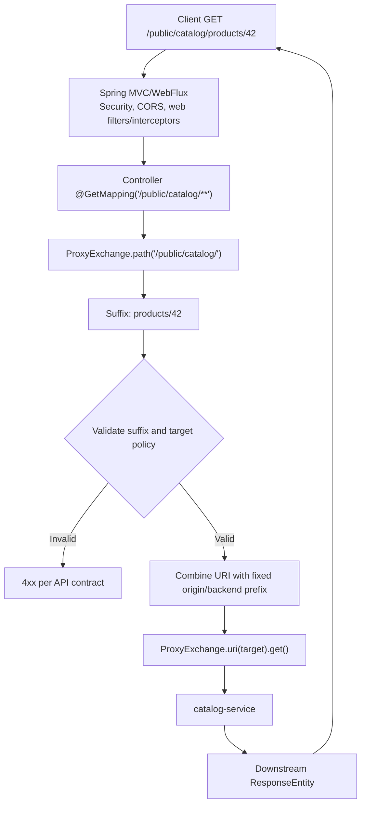
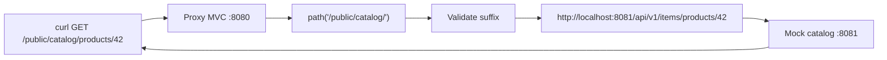
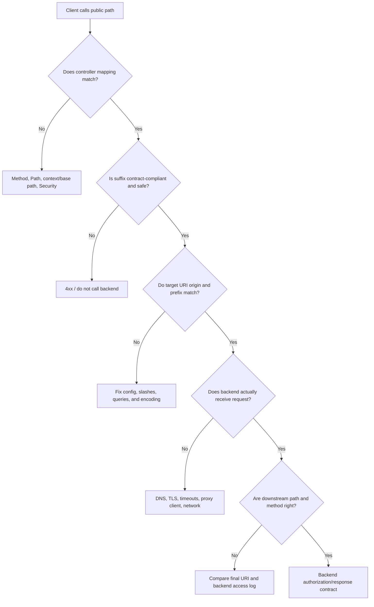

# Extracting the Remaining Path to Build the Target URI

When building an API Gateway for microservices with **Spring Cloud Gateway**, we often want to expose a client-friendly URL while forwarding requests to a different path on the backend. For example, the client calls `GET /public/catalog/products/42`, whereas `catalog-service` actually serves `GET /api/v1/items/products/42`. The solution is to **keep a fixed public prefix, extract the remaining path portion (*path suffix*), and combine that suffix with a controlled upstream base URI**.

In the **Proxy Exchange** chapter, Spring Cloud Gateway provides **`ProxyExchange`** as a parameter to a **Spring MVC or WebFlux controller handler**. The convenience method **`proxy.path(prefix)`** extracts the path portion after a prefix; the handler uses **`proxy.uri(destination).get()`** or the corresponding HTTP method to execute the downstream exchange.

This lesson belongs to the **SPRING_CLOUD_GATEWAY** module: building an API Gateway with route predicates, filter chains, path/header transformations, and service discovery; as well as practicing authentication, rate limiting, circuit breakers, retries, TLS, and observability. Crucially, **Proxy Exchange is a way to write a gateway inside a controller**, **not** the same API as Gateway Server WebFlux filters such as `StripPrefix` or `RewritePath`. The security and operational policies share the same goals, but the wiring and lifecycle differ.

> **Scope:** Examples focus on **Spring Cloud Gateway Proxy Exchange** with both **Web MVC** and **WebFlux** variants. Artifact names documented in Spring Cloud Gateway 4.3/5.0 are `spring-cloud-gateway-proxyexchange-webmvc` and `spring-cloud-gateway-proxyexchange-webflux`. Older versions used different module names. Do not apply `spring.cloud.gateway.server.webflux.routes` or `GatewayFilterFactory` configs verbatim to a ProxyExchange controller.

## 1. The URL Mapping Problem and Expected Outcome

Suppose the public and backend paths are:

```text
Public route:
  GET /public/catalog/**

Fixed backend:
  http://localhost:8081

Backend base path:
  /api/v1/items/

Client request:
  GET /public/catalog/products/42

Extract suffix after "/public/catalog/":
  products/42

Desired target URI:
  http://localhost:8081/api/v1/items/products/42
```

We can model it as:

```text
publicPath   = publicPrefix + suffix
targetURI    = fixedBackendOrigin + fixedBackendPrefix + suffix

/public/catalog/ + products/42
     ↓ extract suffix
http://localhost:8081 + /api/v1/items/ + products/42
     ↓
http://localhost:8081/api/v1/items/products/42
```

Where:

- **Public prefix** is the path portion the controller wants to hide from the upstream, such as `/public/catalog/`.
- **Suffix** is the part the client supplies after the prefix, such as `products/42`.
- **Backend origin** consists of scheme/host/port **fixed from trusted configuration**, never taken arbitrarily from the request.
- **Backend path prefix** is the internal path portion to prepend, such as `/api/v1/items/`.
- **Target URI** is the final result that ProxyExchange will call with an HTTP method.

### Example Table

| Public request path | Expected suffix | Expected downstream path |
| --- | --- | --- |
| `/public/catalog/products/42` | `products/42` | `/api/v1/items/products/42` |
| `/public/catalog/categories/keyboards` | `categories/keyboards` | `/api/v1/items/categories/keyboards` |
| `/public/catalog/a/b/c` | `a/b/c` | `/api/v1/items/a/b/c` |
| `/public/catalog/item-01` | `item-01` | `/api/v1/items/item-01` |
| `/public/catalog/` | Empty or depends on handler mapping/version | Requires explicit policy: root route, 404, or 400. |

Rows show **expected results per URL contract**; for trailing slashes, encoding, or empty segments, test on your exact MVC/WebFlux stack and path-matching configuration rather than treating the table as a specification for all framework edge cases.

## 2. Where Is ProxyExchange Used in Spring Cloud Gateway?

Spring Cloud Gateway currently has two groups of capabilities to distinguish:

| Approach | Configuration Point | How It Works |
| --- | --- | --- |
| **Gateway Server WebFlux/Web MVC** | Route definitions, route predicates, filter functions/factories, discovery. | The Gateway selects routes and runs filter chains using the Gateway Server mechanism. |
| **Proxy Exchange Web MVC** | `@RestController`/Spring MVC handler accepting `ProxyExchange<T>`. | The handler decides the destination and calls downstream, returning `ResponseEntity<?>`. |
| **Proxy Exchange WebFlux** | `@RestController`/WebFlux handler accepting `ProxyExchange<T>`. | The handler returns `Mono<ResponseEntity<?>>`, performing the HTTP exchange reactively. |

Spring's **Proxy Exchange Gateway with Spring Web MVC or WebFlux** documentation explicitly warns: this is **an alternative Gateway style**, and documentation sections meant for Gateway Server must not be applied mechanically to these examples.

### Processing Diagram



**Key takeaway:** the handler method knows both the **public URL** and builds the **downstream URI** itself. We do not add `StripPrefix=...` as in a Gateway Server route filter; instead, the controller calls `path(prefix)`.

### Advantages of Proxy Exchange

- Easy to write a short adapter/proxy inside an existing Spring MVC/WebFlux application.
- Reuses mapping annotations, request parameters, header injection, and Spring Security.
- Can combine API contract logic in the handler, such as allowing only certain valid suffixes.
- Selects the target URI from **trusted configuration** and invokes the appropriate HTTP verb.

### Limitations and Additional Responsibilities

- Does not implicitly include Gateway **Server**'s route predicates, `GlobalFilter`, `GatewayFilter`, `StripPrefix`, `TokenRelay`, `RedisRateLimiter`, or `CircuitBreaker`.
- You must define proxied URI scope, timeouts, retries, CORS, request/response headers, and observability yourself.
- The handler receives a suffix from the client: if URI construction lacks validation, it can expose unintended internal paths or path traversal bugs.
- Do not assume ProxyExchange is the optimal reverse proxy for WebSockets, gRPC streaming, large uploads/downloads, or all long-lived streams.

## 3. The Key Method: `proxy.path(prefix)`

Spring Cloud Gateway provides a utility to **extract the path segment following a prefix of the inbound URL**. Minimal pattern from the documentation:

```java
@GetMapping("/proxy/path/**")
public ResponseEntity<?> proxyPath(
        ProxyExchange<byte[]> proxy) throws Exception {

    String path = proxy.path("/proxy/path/");
    return proxy.uri("http://localhost:8081/foos/" + path).get();
}
```

If the client calls:

```http
GET /proxy/path/a/b/c HTTP/1.1
Host: gateway.example
```

then conceptually:

```text
prefix  = /proxy/path/
suffix  = a/b/c
target  = http://localhost:8081/foos/a/b/c
```

**This is the core of the lesson:** `path(...)` extracts the suffix; `uri(...)` specifies the destination; `get()` sends a downstream GET. It does not substitute arbitrary path segments by magic, and it does not automatically append query parameters to the destination just because the suffix was extracted.

### Syntax Must Match Controller Mapping

| Component | Example | Function |
| --- | --- | --- |
| `@GetMapping` | `"/proxy/path/**"` | Defines which URLs enter the handler. |
| `proxy.path` | `"/proxy/path/"` | Defines the prefix stripped to obtain the suffix. |
| `proxy.uri` | `"http://localhost:8081/foos/" + path` | Specifies the downstream URI. |
| `proxy.get()` | `get()` | Executes the downstream HTTP GET. |

Use the **exact same base prefix** per contract in both the mapping and the `path(...)` call, including any trailing slash if needed. If one side is `/proxy/path/` and the other is `/proxy/paths/`, the suffix may not be computed as expected. **Do not assume `path(prefix)` validates that the route mapping matches this prefix according to your policy.**

## 4. What Responsibilities Does the ProxyExchange Object Have?

Although this lesson focuses on `path(prefix)`, remember ProxyExchange is more than URL concatenation:

| API Group | Meaning |
| --- | --- |
| `path(String prefix)` | Extracts the path portion after the inbound request's prefix. |
| `uri(String target)` | Sets the destination URI for the downstream HTTP exchange. |
| `get()` / corresponding HTTP methods | Executes the downstream request. |
| `header(...)` / header APIs | Adjusts certain request/response headers per version capabilities. |
| Response mapper on `get(...)` / HTTP methods | Lets you transform the downstream `ResponseEntity` before returning to the caller. |
| `forward(...)` in **MVC** | Forwards to an internal handler within the same app when supported. |

Per Spring documentation, ProxyExchange has built-in handling for certain header groups:

- **Sensitive headers**: by default, **`cookie` and `authorization` are not forwarded downstream**.
- **Skipped headers**: by default, **`content-length` and `host` are excluded from forwarding** to avoid invalid headers when request body/transport changes.
- **Proxy headers**: **`x-forwarded-*`** headers are handled per ProxyExchange/framework mechanisms.

**Do not treat these defaults as guarantees for every request when code calls `headers(...)`/`header(...)` or alters configuration.** Inspect the actual HTTP request received by the backend. Do not assume “ProxyExchange handles proxying” means it has already designed your credential and proxy-trust policies.

## 5. Dependencies and Versions: MVC vs. WebFlux

According to Spring Cloud Gateway 4.3 and 5.0 documentation, Proxy Exchange has **two separate artifacts**:

### Spring MVC Proxy Exchange

```xml
<dependency>
    <groupId>org.springframework.cloud</groupId>
    <artifactId>spring-cloud-gateway-proxyexchange-webmvc</artifactId>
</dependency>
```

Typically used in Spring Boot applications with the Web MVC/Servlet stack; handlers return `ResponseEntity<?>`.

### Spring WebFlux Proxy Exchange

```xml
<dependency>
    <groupId>org.springframework.cloud</groupId>
    <artifactId>spring-cloud-gateway-proxyexchange-webflux</artifactId>
</dependency>
```

Typically used in WebFlux applications; handlers return `Mono<ResponseEntity<?>>`.

### Common Dependency Mistakes

- **Do not** add only `spring-cloud-starter-gateway-server-webflux` and expect controllers to have ProxyExchange behaving like Server route filters.
- **Do not** add both MVC and WebFlux Proxy Exchange modules to the same app without a clear reason and understanding of how Boot selects the web application type.
- **Do not** copy artifact names from Gateway 2.x docs into 5.x: older lines used `spring-cloud-gateway-mvc`/`spring-cloud-gateway-webflux`.
- **Do not** pin Spring Cloud Gateway's version independently of a compatible Spring Boot/Spring Cloud BOM.
- For Java imports, use `ProxyExchange` from the **module on your classpath**: MVC is typically in package `org.springframework.cloud.gateway.mvc`, WebFlux in `org.springframework.cloud.gateway.webflux` per the corresponding line.

### Suggested Backend Configuration in application.yml

```yaml
server:
  port: 8080

app:
  proxy:
    catalog-origin: http://localhost:8081
    catalog-path-prefix: /api/v1/items/
```

This is **custom application configuration** (`app.proxy.*`), **not** a Gateway Server route definitions property. In production, the origin should be an approved hostname/service over HTTPS with appropriate network policies. `localhost:8081` is for the lab only.

## 6. Spring MVC Example: Extracting Suffix and Calling Backend

In a Spring MVC application with the `spring-cloud-gateway-proxyexchange-webmvc` dependency, create the controller:

```java
package com.example.proxy.mvc;

import org.springframework.beans.factory.annotation.Value;
import org.springframework.cloud.gateway.mvc.ProxyExchange;
import org.springframework.http.ResponseEntity;
import org.springframework.web.bind.annotation.GetMapping;
import org.springframework.web.bind.annotation.RestController;

@RestController
public class CatalogProxyController {

    private final String catalogOrigin;

    public CatalogProxyController(
            @Value("${app.proxy.catalog-origin}") String catalogOrigin) {
        this.catalogOrigin = catalogOrigin;
    }

    @GetMapping("/public/catalog/**")
    public ResponseEntity<?> catalog(ProxyExchange<byte[]> proxy)
            throws Exception {

        String remainder = proxy.path("/public/catalog/");
        String target = catalogOrigin
            + "/api/v1/items/"
            + remainder;

        return proxy.uri(target).get();
    }
}
```

This is a **basic mechanism illustration following the Spring docs style**, showing the relationship between mapping, `path()`, `uri()`, and `get()`. **It is not yet safe to expose to the Internet**: it does not validate suffixes, encoding, access permissions, queries, or target URIs. Later sections add policies and negative cases.

### Data Flow Through the Controller

Suppose:

```yaml
app:
  proxy:
    catalog-origin: http://localhost:8081
```

Request:

```http
GET /public/catalog/products/42 HTTP/1.1
Host: localhost:8080
Accept: application/json
```

Inside the controller:

```text
proxy.path("/public/catalog/")
        ↓
"products/42"

target = "http://localhost:8081"
       + "/api/v1/items/"
       + "products/42"
        ↓
"http://localhost:8081/api/v1/items/products/42"
```

The backend needs a matching endpoint, such as `GET /api/v1/items/products/42`. An HTTP 200 response from the backend **does not by itself prove** every request was routed accurately if the backend has a catch-all; ideally, the mock backend logs the exact path it received.

### Why Return ResponseEntity?

`ProxyExchange.get()` retrieves the downstream response as provided by the implementation. The Spring MVC handler returns `ResponseEntity<?>`, allowing status, headers, and body to be returned per the HTTP contract. If you need to rewrite response headers or status, use the appropriate ProxyExchange mapper/API for your version rather than copying all headers unsafely.

## 7. Spring WebFlux Example: Same Path, Different Return Type

In a **Proxy Exchange WebFlux** application with the `spring-cloud-gateway-proxyexchange-webflux` dependency, the idea is identical, but the handler returns **`Mono<ResponseEntity<?>>`**:

```java
package com.example.proxy.webflux;

import org.springframework.beans.factory.annotation.Value;
import org.springframework.cloud.gateway.webflux.ProxyExchange;
import org.springframework.http.ResponseEntity;
import org.springframework.web.bind.annotation.GetMapping;
import org.springframework.web.bind.annotation.RestController;
import reactor.core.publisher.Mono;

@RestController
public class ReactiveCatalogProxyController {

    private final String catalogOrigin;

    public ReactiveCatalogProxyController(
            @Value("${app.proxy.catalog-origin}") String catalogOrigin) {
        this.catalogOrigin = catalogOrigin;
    }

    @GetMapping("/public/catalog/**")
    public Mono<ResponseEntity<?>> catalog(ProxyExchange<byte[]> proxy) {

        String remainder = proxy.path("/public/catalog/");
        String target = catalogOrigin
            + "/api/v1/items/"
            + remainder;

        return proxy.uri(target).get();
    }
}
```

**Different return type, same URL problem:** MVC `ResponseEntity<?>` vs. WebFlux `Mono<ResponseEntity<?>>`.

### Warning About Blocking

In WebFlux, do not call:

```java
// Anti-pattern: do not use inside a WebFlux controller.
ResponseEntity<?> response = proxy.uri(target).get().block();
```

`block()` on the Reactor Netty event loop can throw errors or bottleneck throughput. Return the `Mono` directly for the WebFlux runtime to schedule. Similarly, never use synchronous JDBC, synchronous HTTP clients, or `Thread.sleep` inside the reactive flow just to assemble a path.

### Comparing MVC and WebFlux in This Lesson

| Item | MVC ProxyExchange | WebFlux ProxyExchange |
| --- | --- | --- |
| Controller annotation | `@GetMapping`/`@RestController`. | `@GetMapping`/`@RestController`. |
| Suffix extraction method | `proxy.path(prefix)`. | `proxy.path(prefix)`. |
| Destination setup | `proxy.uri(target)`. | `proxy.uri(target)`. |
| Downstream GET dispatch | `proxy.get()`. | `proxy.get()`. |
| Return value | `ResponseEntity<?>`. | `Mono<ResponseEntity<?>>`. |
| Web runtime | Servlet/Spring MVC. | Reactor/Spring WebFlux. |
| Forward to local handler | MVC `forward()` per docs. | Do not assume identical API. |
| Non-blocking principle | Timeouts/thread pool for MVC. | **Never block the event loop** in WebFlux. |

## 8. Why Must URI String Concatenation Be Conditional?

The minimal example code:

```java
String target = catalogOrigin + "/api/v1/items/" + remainder;
```

is valid and safe **only when origin/prefix are trusted constants and the suffix obeys an approved rule set**. If arbitrary suffixes are accepted, a request may contain:

```text
../internal/admin
%2e%2e/secret
%2Fadmin
%252e%252e%252fadmin
//other
item;param=value
item?mode=admin
item#fragment
```

These strings are **test cases to handle/reject**, not permitted URLs. The HTTP container, Spring path matcher, reverse proxy, URI builder, and backend can **decode and normalize URLs differently**. If two layers disagree on the path, a check at the Gateway may fail to protect the final backend path.

### Risks Beyond SSRF

| Risk | Scenario |
| --- | --- |
| **Path traversal** | `../` or encoded variants cause the backend to access out-of-scope paths. |
| **Authorization bypass** | Gateway allows only catalog, but backend resolves the path as admin after normalization. |
| **Route shadowing** | Double slashes or matrix variables cause Gateway security matchers to diverge from backend routing. |
| **SSRF** | Handler lets client pick host/scheme or redirects to an uncontrolled internal target. |
| **Open redirect** | Target URI or `Location` header built from untrusted input. |
| **Double encoding** | `%2F` is decoded or re-encoded into a different meaning. |
| **Query injection** | Unchecked `?`/`&` concatenation overwrites parameters or triggers internal features. |
| **Information disclosure** | `Authorization`/`Cookie` headers or internal hostnames forwarded or exposed improperly. |

**Note:** `ProxyExchange.path(prefix)` **is not an input security control**. It is primarily a convenience method for path extraction. Extracting a suffix does not verify that the suffix is safe to use in a URI.

## 9. An MVC Controller Version That Explicitly Restricts the Suffix

To demonstrate hardening, the following example accepts only **ASCII path segments matching `[A-Za-z0-9_-]`**, separated by `/`. It **intentionally rejects** `%`, dots, double slashes, queries/fragments inside the suffix, matrix separators, and complex Unicode. This is a **narrow policy for the catalog lab**, not a universal parser for every valid URI.

```java
package com.example.proxy.mvc;

import java.util.regex.Pattern;

import jakarta.servlet.http.HttpServletRequest;
import org.springframework.beans.factory.annotation.Value;
import org.springframework.cloud.gateway.mvc.ProxyExchange;
import org.springframework.http.ResponseEntity;
import org.springframework.web.bind.annotation.GetMapping;
import org.springframework.web.bind.annotation.RestController;

@RestController
public class StrictCatalogProxyController {

    private static final String PUBLIC_PREFIX = "/public/catalog/";
    private static final String DOWNSTREAM_PREFIX = "/api/v1/items/";

    private static final Pattern SAFE_SUFFIX = Pattern.compile(
        "[A-Za-z0-9_-]+(?:/[A-Za-z0-9_-]+)*");

    private final String fixedOrigin;

    public StrictCatalogProxyController(
            @Value("${app.proxy.catalog-origin}") String fixedOrigin) {
        // Production: validate URI/scheme/host/port allowlist on app startup.
        this.fixedOrigin = fixedOrigin;
    }

    @GetMapping("/public/catalog/**")
    public ResponseEntity<?> getCatalog(
            ProxyExchange<byte[]> proxy,
            HttpServletRequest request) throws Exception {

        String suffix = proxy.path(PUBLIC_PREFIX);
        String rawPath = request.getRequestURI();

        if (suffix == null
                || !SAFE_SUFFIX.matcher(suffix).matches()
                || rawPath.indexOf('%') >= 0) {
            return ResponseEntity.badRequest()
                .body("Unsupported catalog path");
        }

        String target = fixedOrigin + DOWNSTREAM_PREFIX + suffix;
        return proxy.uri(target).get();
    }
}
```

### Policy and Limitations of the Sample Code

1. `SAFE_SUFFIX` protects string concatenation **within the defined ASCII scope**: it rejects `..`, `?`, `#`, `;`, `%`, and whitespace.
2. Checking `rawPath` prevents parts of the path from being percent-encoded and changing meaning across layers. However, exact API names and when normalization occurs depend on the servlet container/proxy; **test raw paths from ingress to backend**.
3. `fixedOrigin` **never comes from request queries/headers/paths**; it must load from trusted configuration and be validated at app startup.
4. The example **does not check user permissions itself** and does not guarantee the upstream endpoint contains only catalog data. Spring Security and backend authorization remain essential.
5. For Unicode product names, slugs with dots, encoded path segments, or richer URI structures, design and test a **dedicated parser/allowlist**. Do not relax the regex to `.*` and assume the check still works.
6. If the route needs query strings, add queries in a controlled manner rather than letting `?` sneak through the suffix.

### WebFlux Version With Equivalent Checks

```java
import java.util.regex.Pattern;
import org.springframework.cloud.gateway.webflux.ProxyExchange;
import org.springframework.http.ResponseEntity;
import org.springframework.http.server.reactive.ServerHttpRequest;
import org.springframework.web.bind.annotation.GetMapping;
import org.springframework.web.bind.annotation.RestController;
import reactor.core.publisher.Mono;

@RestController
public class StrictCatalogWebFluxController {

    private static final Pattern SAFE = Pattern.compile(
        "[A-Za-z0-9_-]+(?:/[A-Za-z0-9_-]+)*");

    @GetMapping("/public/catalog/**")
    public Mono<ResponseEntity<?>> catalog(
            ProxyExchange<byte[]> proxy,
            ServerHttpRequest request) {

        String suffix = proxy.path("/public/catalog/");
        String rawPath = request.getURI().getRawPath();

        if (suffix == null
                || !SAFE.matcher(suffix).matches()
                || rawPath.indexOf('%') >= 0) {
            return Mono.just(ResponseEntity.badRequest()
                .body("Unsupported catalog path"));
        }

        String target =
            "http://localhost:8081/api/v1/items/" + suffix;

        return proxy.uri(target).get();
    }
}
```

This WebFlux snippet uses the **lab's fixed origin**. Production should inject validated configuration like the MVC version. In a 100% reactive environment, avoid any blocking operations during path validation or URI construction.

## 10. Normalizing Slashes and Path Segment Boundaries

A common bug is mismatched `/` characters when joining parts:

```text
Origin:  http://localhost:8081
Prefix:  /api/v1/items/
Suffix:  products/42
Target:  http://localhost:8081/api/v1/items/products/42
```

If the origin or prefix is inconsistent:

```text
// Missing slash
http://localhost:8081/api/v1/itemsproducts/42

// Two consecutive slashes
http://localhost:8081/api/v1/items//products/42
```

### Recommended Conventions

- `catalog-origin` is a **pure origin**: scheme + host + optional port; no trailing slash, query, fragment, or userinfo.
- `backend-path-prefix` starts and ends with **a single `/`**.
- `suffix` is a non-empty string **without a leading slash**, containing only valid segments.
- Construct the target **from validated components**, never from a full client-submitted URI.
- Write tests for empty suffix, trailing slash, double slash, paths with spaces, and encoded slashes.

### Why Not Use `String.replace("/public/catalog", "")`?

Wrong example:

```java
String suffix = incomingPath.replace("/public/catalog", "");
```

`replace` can substitute multiple occurrences in unintended places or mishandle prefix segment boundaries. Use **`proxy.path("/public/catalog/")`** as the documented utility paired with a matching mapping; if an advanced design needs `PathPattern` or parsed segments, use the tested parser for your Spring/framework version.

## 11. Query Strings Are Not Path Suffixes

Two requests with the same path but different queries:

```http
GET /public/catalog/products/42?lang=vi&page=2 HTTP/1.1
```

```http
GET /public/catalog/products/42?lang=en&page=5 HTTP/1.1
```

The path portion after the prefix in both requests is still **`products/42`** per the path contract. The query follows `?` and is a separate URI component.

### Separating Three Regions

```text
https://api.example/public/catalog/products/42?lang=vi&page=2
│      │          └─────────────── path ─────────────┘└── query ──┘
│      └ host / authority
└ scheme

publicPrefix = /public/catalog/
pathSuffix   = products/42
query        = lang=vi&page=2
```

**Do not use `proxy.path(...)` to extract query params.** Spring MVC/WebFlux provides `@RequestParam` or request query maps; decide **which queries are allowed to reach the backend** rather than concatenating raw client-sent query strings.

### Example Allowing Only `lang` and `page`

In an **experimental** MVC controller, after validating `suffix` as in Section 9, we can construct the target from an allowlisted set of queries:

```java
import java.util.Set;
import org.springframework.http.ResponseEntity;
import org.springframework.util.MultiValueMap;
import org.springframework.web.bind.annotation.GetMapping;
import org.springframework.web.bind.annotation.RequestParam;
import org.springframework.web.util.UriComponentsBuilder;

// Illustrates the method inside an MVC controller that already has
// origin, proxy, and validateSuffix(...).
@GetMapping("/public/catalog/**")
public ResponseEntity<?> getCatalogWithQuery(
        ProxyExchange<byte[]> proxy,
        @RequestParam MultiValueMap<String, String> params)
        throws Exception {

    String suffix = proxy.path("/public/catalog/");
    validateSuffix(suffix); // helper must check path/encoding as in Section 9

    if (!Set.of("lang", "page").containsAll(params.keySet())) {
        return ResponseEntity.badRequest().body("Unknown query parameter");
    }

    String lang = params.getFirst("lang");
    String page = params.getFirst("page");

    if (params.values().stream().anyMatch(v -> v.size() != 1)) {
        return ResponseEntity.badRequest().body("Repeated query parameter");
    }
    if (lang != null && !Set.of("vi", "en").contains(lang)) {
        return ResponseEntity.badRequest().body("Invalid language");
    }
    if (page != null && !page.matches("[1-9][0-9]{0,2}")) {
        return ResponseEntity.badRequest().body("Invalid page");
    }

    UriComponentsBuilder builder = UriComponentsBuilder
        .fromUriString("http://localhost:8081/api/v1/items/" + suffix);
    if (lang != null) builder.queryParam("lang", lang);
    if (page != null) builder.queryParam("page", page);

    return proxy.uri(builder.build().encode().toUriString()).get();
}
```

This snippet **only illustrates policy and query construction**, not a complete copy-paste controller: `validateSuffix` must be implemented, and the raw URI path must be checked as in Section 9. **Do not register this method alongside the `@GetMapping("/public/catalog/**")` controller from Section 6 or 9**, as mappings would collide; pick one approach.

**Verify how `ProxyExchange.uri/get` handles inbound request queries on your actual version.** If the implementation has a step that automatically processes/retains queries, your design must prevent duplicate queries or allowlist bypasses by testing the final query received by the backend. When strict guarantees are needed, enforce query controls at a layer tested against real request serialization rather than trusting only the target string before the call.

### Why Not Concatenate Raw Queries?

```java
// Do not use when client queries are unvalidated.
String target = fixedBase + suffix + "?" + request.getQueryString();
```

Common bugs:

- Appending `?` even when no query exists.
- Duplicated keys like `page=1&page=999` where two systems pick different values.
- Inconsistent decoding of `%26`/`%3D`.
- Special parameters such as `redirect_url`, `debug`, or `admin` passed verbatim to the backend outside the contract.
- Sensitive query data getting logged or leaked via `Referer`.

For APIs with hundreds of valid query keys, design a dedicated schema/validator instead of allowing arbitrary inputs by default.

## 12. Percent Encoding, Unicode, and Path Traversal

URIs are not mere display strings. Forms such as:

```text
/public/catalog/products/%34%32
/public/catalog/products/42
/public/catalog/%2e%2e/internal
/public/catalog/a%2Fb
/public/catalog/a%252Fb
```

can undergo different **decoding, normalization, and re-encoding** steps across ingress, the servlet container, Spring path matchers, ProxyExchange, and the downstream HTTP client.

### Safety Principles

1. **Define the suffix contract**: for example, accept only ASCII slugs as in the lab, or allow Unicode through a specific parser.
2. **Inspect the raw path** alongside the framework-parsed path if discrepancies could affect authorization.
3. **Reject traversal and dangerous encoded separators**, including double encoding if unsupported by policy.
4. **Never decode multiple times** and reassemble manually.
5. **Never encode an entire URI string** as a single path segment: scheme, slashes, `?`, and `#` have distinct semantics.
6. When using `UriComponentsBuilder`, distinguish `path` from `pathSegment`, `build`, `encode`, and `build(true)`; test outputs against raw inputs.
7. Verify what **normalized path** the final downstream server actually receives, not just what Gateway logs show.

### Mandatory Test Cases

| Input | Verification Goal |
| --- | --- |
| `products/42` | Normal route and target behavior. |
| `products/item-01` | Hyphens/underscores valid if permitted by contract. |
| `../admin` | Rejected; does not reach backend admin. |
| `%2e%2e/` | Cannot slip past via delayed decoding. |
| `%252e%252e%252f` | Not double-decoded into traversal. |
| `a%2Fb` | No ambiguity between one segment with an encoded slash and two segments. |
| `a//b` | Handled per double-slash policy; does not normalize into an unintended route. |
| `a;b=1` | Rejects out-of-contract matrix parameters. |
| `a?debug=true` | Query is not treated as part of the path suffix. |
| `a#frag` | Fragments are not HTTP request targets like queries; not mistakenly appended to target URI. |
| `%00` | Rejects dangerous control characters/encodings. |

**Do not rely on `String.startsWith("/api/v1/items/")` on an unnormalized path to “prove” it cannot escape the prefix.** After multiple decode/normalize steps, the actual path processed by the backend may differ. Combine input validation, proper URI construction, network/route policies, and backend authorization.

## 13. Context Path, WebFlux Base Path, and Proxies in Front of the Gateway

The application may be hosted under a context/base path:

```text
External URL:
  https://edge.example/gateway/public/catalog/products/42

Application context/base path:
  /gateway

Controller mapping:
  /public/catalog/**
```

Depending on the runtime, Spring MVC `server.servlet.context-path`, WebFlux `spring.webflux.base-path`, or reverse proxy rewrites can alter **the path the controller and `ProxyExchange.path` actually see**. Never take a literal external URL and strip a prefix with substring math without verifying.

### Layers to Align

| Layer | Example | Check |
| --- | --- | --- |
| CDN/Ingress public prefix | `/gateway/public/catalog/**` | Does it preserve or strip `/gateway` before hitting the app? |
| Servlet context path | `/gateway` | How does Spring MVC's `requestURI`/`contextPath` differ from `servletPath`? |
| WebFlux base path | `/gateway` | Do handler mapping and path extraction share the same view? |
| Controller mapping | `/public/catalog/**` | Does the mapping actually match the request? |
| `proxy.path(prefix)` | `/public/catalog/` | Does the passed prefix match the path portion used by ProxyExchange? |
| Downstream base path | `/api/v1/items/` | Must be added only once to the final URI. |

### Forwarded Headers Require a Trust Boundary

Ingress may add:

```text
X-Forwarded-For
X-Forwarded-Proto
X-Forwarded-Host
X-Forwarded-Prefix
Forwarded
```

Never let Internet clients set `X-Forwarded-Prefix` and use it to assemble target URIs. Spring Boot/Framework provides forwarded-header handling, but only trust values that a trusted gateway/ingress **clears and rewrites**.

A client sending `Host: attacker.example` must never dictate the backend origin. If multi-tenant host-based routing is needed, enforce a separate **host allowlist and tenant authorization**, never raw `Host` reading.

## 14. HTTP Methods and Request Bodies

ProxyExchange supports methods corresponding to HTTP verbs per documentation. However, the **path suffix extraction** problem is independent of the HTTP method; backend paths may look the same while their contracts differ:

```text
GET    /public/catalog/products/42
POST   /public/catalog/products
PUT    /public/catalog/products/42
PATCH  /public/catalog/products/42
DELETE /public/catalog/products/42
```

### Why Start With GET?

- GET requires no request body, making path mapping easy to verify.
- A mock backend can easily record the target path.
- Retry/caching and idempotency contracts are clearer than for writes.
- Avoids testing `post()` prematurely on a route whose JSON/body handling, validation, and side effects are not yet designed.

### When Adding POST/PUT/PATCH

If the API truly needs to proxy request bodies, verify:

- How the chosen ProxyExchange variant reads and forwards bodies (`byte[]`/generic type).
- Whether `Content-Type` is accurate and `Content-Length` is omitted or recalculated properly.
- Whether JSON parsers/codecs alter encoding or schemas.
- Whether multipart/file uploads/streams are supported within real size/memory constraints.
- Whether the handler picks the matching downstream method; **not every inbound request calls `proxy.get()`**.
- Backend validation, CSRF/session policies, and authorization align with write operations.

For POSTs creating orders or payments, retrying without an **idempotency key** can duplicate business outcomes. A valid path suffix does not protect write methods from duplicate side effects.

### Do Not Treat ProxyExchange as a Default Streaming Reverse Proxy

A `ProxyExchange<byte[]>` handler may buffer request/response bodies depending on the implementation. If you are proxying large files, SSE, WebSockets, or gRPC, use a proven protocol/streaming solution rather than assuming a `byte[]` handler preserves backpressure.

## 15. Headers: Path Might Be Right While Credentials Are Wrong

An HTTP request entering ProxyExchange may carry:

```http
GET /public/catalog/products/42 HTTP/1.1
Host: api.example.com
Authorization: Bearer [redacted]
Cookie: session=[redacted]
X-Request-ID: trace-123
Accept: application/json
```

Per Proxy Exchange documentation, by default **`cookie`/`authorization` belong to the sensitive headers group** not forwarded downstream; `content-length`/`host` belong to the skipped headers group to prevent stale headers when the downstream client builds a new request.

### Why Do These Defaults Make Sense?

| Header | Risk If Forwarded Indiscriminately | How to Handle |
| --- | --- | --- |
| **`Authorization`** | Access token meant for gateway or service A leaks to service B. | Relay only when delegation policy and audience match; backend still validates token. |
| **`Cookie`** | Gateway/browser session leaks to a backend outside the trust boundary. | Do not forward by default; design separate BFF/session handling if needed. |
| **`Host`** | Virtual hosting or TLS/SNI/backend routing misinterprets hostname. | Let the HTTP client set `Host` matching the target URI, unless a special contract applies. |
| **`Content-Length`** | Body was read/transformed, so old length is invalid. | HTTP client recalculates or picks appropriate transfer encoding. |
| **`X-Forwarded-*`** | Client can spoof IP/proto/host if proxy chain is uncontrolled. | Trust only values verified and rewritten by trusted ingress. |
| **`X-Request-ID` / tracing** | Can be abused for log injection or high cardinality. | Validate format/length, generate an ID if untrusted. |
| **`Connection`/`Transfer-Encoding`** | Per-hop semantics differ when proxy opens a new HTTP connection. | Never manually copy all hop-by-hop headers. |

**Note:** ProxyExchange's `header(...)` method per documentation may add a **response header** (or request header depending on overload/version — verify!). Do not rely on memory from WebClient or Gateway Server `AddRequestHeader` to assume every `proxy.header(...)` call modifies outbound request headers. Check the Javadoc/method signature of your exact version.

### Identity Forwarding Policy

If the backend must know the user:

1. Spring Security verifies the inbound token/cookie at the gateway.
2. Check endpoint and resource access permissions by user/tenant.
3. Decide the backend's **identity contract**: appropriate OAuth2 TokenRelay, service-to-service token, mTLS service identity, or signed internal claims.
4. Send only authorized credentials/metadata to the right backend and scope.
5. The backend still validates signature/issuer/audience/scope/authorization itself.

**Do not** allow forwarding every inbound `Authorization` header by disabling default “sensitive header” protections just to clear a 401. The distinction between a *client token*, *delegated token*, and *service credential* matters.

### Response Headers and Location

Downstream may return:

```http
HTTP/1.1 301 Moved Permanently
Location: http://catalog.internal.example/login
```

If you return `Location` verbatim to the client, you may leak an internal hostname or redirect to a non-public location. A ProxyExchange response mapper can rewrite headers in a controlled manner, while preserving status/body/caching semantics and **rewriting only allowlisted locations**.

Similarly, `Set-Cookie`, `Cache-Control`, `Content-Encoding`, `ETag`, and CORS headers need clear policies; never copy or strip them indiscriminately when proxying responses.

## 16. Target URI Security: Fixed Origin Is a Necessary Condition

The highest-risk point when “extracting the remaining path to build a URI” is **mixing client-controlled data into components that determine the upstream host or scheme**.

### Severe Anti-Pattern: Client-Chosen Target

```java
// Used only to recognize a dangerous pattern; never implement.
String host = request.getParameter("host");
String suffix = proxy.path("/public/catalog/");
return proxy.uri("http://" + host + "/" + suffix).get();
```

With this design, a caller can turn the Gateway into an **HTTP request proxy to arbitrary servers**, including internal services the client cannot reach directly. That creates an SSRF attack surface and can leak headers/credentials.

**Right direction:** the downstream origin comes from a **configuration allowlist** or controlled service registry; the caller can only influence the validated suffix and **cannot change the origin**.

### Three Layers of Protection

| Layer | Policy Example | Goal |
| --- | --- | --- |
| **Controller validation** | Suffix matches allowlisted pattern/segments, no out-of-contract traversal/encoding. | Prevent requests from escaping the backend prefix semantically. |
| **Destination allowlist** | HTTPS scheme, approved hostname/port/service ID. | Prevent proxying to untrusted destinations. |
| **Network policy & backend auth** | Egress blocks metadata/internal admin, TLS trust/mTLS, backend authorizes. | Mitigate SSRF if DNS/redirects/proxy normalization diverge. |

### Beware of Redirects and DNS

Even when the initial URI is allowlisted, upstream might return `3xx Location` pointing to another host. Depending on the HTTP client/version, redirects may be handled differently. **Do not assume ProxyExchange automatically follows or ignores all redirects**; verify actual client behavior and block cross-origin redirects if the backend could be untrusted.

DNS can also resolve an allowlisted hostname to an address the Gateway should not reach. Never treat hostname string comparison as the sole defense; combine DNS trust, address ranges, egress firewalls, and backend identity.

### Resource-Level Authorization

Suppose the suffix is `orders/123` and the backend indeed serves `/api/v1/items/orders/123`. A pattern allowing letters/numbers/slashes **does not mean the user is allowed to view order 123**. If proxying an app with private APIs, you need:

- Authentication at the controller/Security layer.
- Resource/tenant access permissions tied to the authenticated identity.
- No exposure of internal endpoints merely because a suffix has a valid name.
- Independent backend authorization and cross-account testing.

**Path regexes only check string shape; they do not replace authorization.**

## 17. TLS, Discovery, and Distinguishing ProxyExchange From Gateway Server

### Outbound TLS

In production, a target such as:

```text
https://catalog.service.internal/api/v1/items/products/42
```

requires ProxyExchange's HTTP client to trust the right CA and verify the hostname. If using mTLS, configure an appropriate client certificate/identity; never hardcode trust-all “to get the proxy working”. TLS handshake and connection timeouts must fit inside the request budget.

### Service Discovery

In Gateway Server route definitions, we often see:

```yaml
uri: lb://catalog-service
```

In a **ProxyExchange controller**, `proxy.uri(...)` points to a URI selected by the handler. **Do not assume** passing `lb://catalog-service` to `proxy.uri` runs through Gateway Server's `ReactiveLoadBalancerClientFilter`. If you need dynamic service instance selection:

- Use client load balancing/service discovery integration compatible with MVC or WebFlux.
- Pick the backend service ID from an allowlist, never from a raw client URL.
- Construct `http(s)://host:port/path` targets as supported by the client stack.
- Test TLS scheme/SNI, metadata, resilience, and instance health.

### Filters That Do Not Run Automatically on Controllers

| Capability | Typical Gateway Server Usage | With a ProxyExchange Controller |
| --- | --- | --- |
| Route selection | `RoutePredicateFactory`, `RouteLocator`. | Spring MVC/WebFlux `@GetMapping` and handler logic. |
| Path rewriting | `StripPrefix`, `RewritePath`, `SetPath`. | `proxy.path(prefix)` + building target URI in controller. |
| Header changes | `AddRequestHeader`, `TokenRelay`, filters. | Web/Security filters and controlled header logic, per API. |
| Rate limiting | `RequestRateLimiter` + `KeyResolver`. | Choose rate limiter at Security/interceptor/WebFilter/edge gateway or separate integration. |
| Circuit breaker | `CircuitBreaker` GatewayFilter. | Wrap downstream calls with an appropriate resilience library or place policy at the edge. |
| Retry | `Retry` GatewayFilter. | Separate HTTP client/resilience policy with an idempotency budget. |
| Caching | `LocalResponseCache` GatewayFilter. | Spring Cache/CDN/HTTP cache with its own policy and key. |
| Metrics | Gateway Server route metrics. | Spring MVC/WebFlux/Micrometer + custom downstream spans/route labels. |

In other words: **sharing the Spring ecosystem does not mean the same filter chain executes automatically**. When moving a route from Gateway Server to a ProxyExchange controller, review **every** cross-cutting concern protecting that route.

## 18. Timeouts, Retries, Circuit Breakers, and Rate Limiting

A controller can assemble the exact right target URI and still fail when the backend is slow or overloaded.

### Timeouts

Define a time budget:

```text
Total request time = inbound processing + proxy logic
                   + connect/TLS + backend execution
                   + response transfer
```

Configure timeouts on the **HTTP client/ProxyExchange implementation**, not only `server.connection-timeout` on the inbound server. In WebFlux, timeouts and cancellation must integrate non-blockingly. In MVC, manage concurrent thread counts and connection pools.

### Retries

Never blindly retry `POST /payments` or `POST /orders`. Retrying can cause the backend to execute business logic multiple times even though the caller sent only one request. If enabling retries:

- Only on operations verified to be idempotent.
- Enforce max attempts and backoff/jitter.
- Trigger only on appropriate errors and remaining time budget.
- Do not replay large request bodies unless the HTTP client supports safe replay.
- Test backend attempt counts and idempotency keys.

### Circuit Breakers

Wrap downstream calls with a circuit breaker when a backend fails frequently. Never configure a fallback that returns another tenant's data or drops security statuses/headers. When proxying sensitive data, **failing closed with a clear message** is usually safer than returning unverified fallback data.

### Rate Limiting

If the public catalog endpoint needs quotas:

- Apply policy by authenticated user/API key or IP extracted via trusted proxy logic.
- The rate limiter can sit at the edge, in a WebFilter/Servlet filter, interceptor, or dedicated adapter.
- In multi-instance deployments, per-pod local limiters multiply effective limits; use shared state if cluster-wide quotas are required.
- Cache hits and proxy misses may have different quota costs; define an explicit contract.
- Verify HTTP `429` responses include appropriate CORS and `Retry-After` headers.

**Do not assume** Gateway Server's `RedisRateLimiter` applies automatically to a `@GetMapping` ProxyExchange handler just because both live in one Spring Boot app.

## 19. Observability: Verifying Which Suffix Went to Which Backend

To debug “the client called `/public/catalog/products/42` but the backend received `/api/v1/items/foo`”, observe **two perspectives**:

1. Which path and mapping did the Gateway handler receive?
2. Which URI/path did the downstream HTTP client actually send?

### Example Trace / Structured Log

```text
traceId:          [opaque identifier]
proxyHandler:     public-catalog
inboundTemplate:  /public/catalog/**
suffixPolicy:     catalog-safe-segments-v1
backendService:   catalog-service
backendPath:      /api/v1/items/{resource}/{id}
method:           GET
downstreamStatus:  200
durationMs:       [measured]
```

This is an **application-instrumented log pattern**, not default ProxyExchange output. Avoid logging raw URIs/queries if they contain tokens, emails, or user identifiers.

### Essential Metrics

| Metric | Purpose |
| --- | --- |
| HTTP status `2xx/4xx/5xx` by handler template | Spot routing/validation errors. |
| Downstream latency p50/p95/p99 | Identify slow backends or proxy logic. |
| Validation rejection count | Track malformed suffixes/traversal attempts. |
| Upstream timeout/connection/TLS errors | Distinguish network errors from path errors. |
| Request body/response bytes | Spot large payloads and memory pressure. |
| Retry attempts and circuit breaker state | Prevent traffic amplification. |
| Auth failures and rate-limit responses | Avoid confusing `401/403/429` with `404` paths. |
| Gateway replica/release revision | Detect config drift or single-pod issues. |

### Cardinality and Security

Never use raw suffixes like `products/42`, customer IDs, raw queries, bearer tokens, emails, or session cookies as **metric labels**. Use route templates/handler names and resource groups instead. You may record **appropriately redacted/hashed** suffixes in restricted-access trace logs when investigating incidents, but not by default for every request.

## 20. Hands-On Practice A: Building an MVC Proxy and Mock Catalog Backend

### 20.1. Objectives

Verify step by step:

1. Spring MVC mapping matches `/public/catalog/**`.
2. `ProxyExchange.path("/public/catalog/")` extracts the remainder after the prefix.
3. The downstream URI is combined with a fixed origin/path prefix.
4. The mock backend sees **`/api/v1/items/products/42`**.
5. Requests with invalid suffixes are blocked **before calling the backend**.

### 20.2. Lab Topology

| Component | Port | Role |
| --- | --- | --- |
| Spring MVC Proxy Exchange app | `8080` | `StrictCatalogProxyController`. |
| Mock MVC catalog-service | `8081` | Returns JSON echoing the received path. |
| `curl` | Terminal | Sends GET and path test cases. |



### 20.3. Configuring the Proxy Exchange App

In the Gateway Proxy MVC sample app:

```yaml
server:
  port: 8080

app:
  proxy:
    catalog-origin: http://localhost:8081
```

Add `spring-cloud-gateway-proxyexchange-webmvc` and the compatible Spring Boot MVC stack, then use `StrictCatalogProxyController` from Section 9. **Create only one controller mapping `/public/catalog/**`**—do not place all three examples from Sections 6/9/11 in the same app.

### 20.4. Mock Backend

A minimal mock controller in a separate process:

```java
package com.example.catalog;

import java.util.Map;
import jakarta.servlet.http.HttpServletRequest;
import org.springframework.web.bind.annotation.GetMapping;
import org.springframework.web.bind.annotation.RestController;

@RestController
public class CatalogMockController {

    @GetMapping("/api/v1/items/**")
    public Map<String, Object> catalog(HttpServletRequest request) {
        return Map.of(
            "service", "catalog-mock",
            "method", request.getMethod(),
            "upstreamPath", request.getRequestURI());
    }
}
```

Configure the backend with `server.port: 8081` running separately on Spring Boot MVC. The controller returns simulated JSON without a database. **Never use this mock backend in production**, especially if modified to echo headers/queries containing secrets.

### 20.5. Sending a Normal Request

```bash
curl -i \
  "http://localhost:8080/public/catalog/products/42"
```

Expected mock response:

```json
{
  "service": "catalog-mock",
  "method": "GET",
  "upstreamPath": "/api/v1/items/products/42"
}
```

This sample body is defined by the mock, **not default output from ProxyExchange**. Depending on Spring Boot's JSON serializer, JSON field order may vary.

### 20.6. Testing Nested Paths

```bash
curl -i \
  "http://localhost:8080/public/catalog/categories/keyboards"
```

The backend expects `upstreamPath=/api/v1/items/categories/keyboards`. This proves **a suffix can span multiple path segments**, not just the final segment.

### 20.7. Testing Invalid Suffixes

First command uses a raw path with dots:

```bash
curl --path-as-is -i \
  "http://localhost:8080/public/catalog/../internal"
```

Second command uses percent encoding:

```bash
curl --path-as-is -i \
  "http://localhost:8080/public/catalog/%2e%2e/internal"
```

**Security expectation:** these paths **must not be proxied to internal/admin endpoints**. Depending on Spring/container behavior, you may get 400 or 404 before entering the controller, or 400 from the controller's regex validation. Do not hardcode “always 400”: request normalization and mapping may block early.

Record the mock backend request count to prove bad requests **never go downstream**. Do not look solely at the HTTP status returned by the Gateway.

### 20.8. Testing Empty Suffix

```bash
curl -i \
  "http://localhost:8080/public/catalog/"
```

If the handler matches and `suffix` is empty, `SAFE_SUFFIX` in the example rejects it with 400. If the handler does not match, you may get 404 or another handler. Whether the root `/public/catalog/` endpoint is supported should be an explicit **API contract**, not an accident of path-matcher version behavior.

## 21. Hands-On Practice B: WebFlux Controller and Non-Blocking Verification

Run the Proxy Exchange WebFlux app on port `8080` and the mock backend on `8081`. Use `StrictCatalogWebFluxController` from Section 9 with the lab's fixed origin config.

### Checks

1. Send GET with a valid suffix; verify the path received by the backend.
2. Send `%2e%2e` and double slashes; confirm they never reach the backend.
3. Send a batch of concurrent requests; compare p95/p99 latency and memory.
4. Have the backend return HTTP 503 or delay; confirm the handler does not block the event loop or hold resources too long.
5. Disconnect the client mid-response (if the mock supports delays); check cancellation and connection lifecycle per implementation.

### Concurrent Calls in the Lab

```bash
for id in 1 2 3 4 5 6 7 8 9 10; do
  curl -s -o /dev/null \
    -w "id=$id status=%{http_code}\n" \
    "http://localhost:8080/public/catalog/products/$id" &
done
wait
```

This is a small smoke test to catch obvious bugs, **not a substitute for load testing**; results do not prove system throughput or backpressure. For real load testing, use dedicated load tools and realistic environment resource limits.

### Why Keep the Mono Intact?

When a WebFlux controller returns `Mono<ResponseEntity<?>>`, the runtime subscribes and coordinates the downstream exchange within the reactive stack's lifecycle. Calling `block()` inside the handler defeats that benefit and can trigger Reactor Netty errors. Getting the URI right is only step one; **HTTP client cancellation, connection pooling, and timeouts** still require monitoring.

## 22. Unit Testing the Suffix Validation Function

To test the suffix policy independently, extract a Java helper from Section 9's logic:

```java
package com.example.proxy.policy;

import java.util.regex.Pattern;

public final class CatalogSuffixPolicy {

    private static final Pattern SAFE = Pattern.compile(
        "[A-Za-z0-9_-]+(?:/[A-Za-z0-9_-]+)*");

    private CatalogSuffixPolicy() { }

    public static boolean allowed(String suffix, String rawPath) {
        return suffix != null
            && rawPath != null
            && rawPath.indexOf('%') < 0
            && SAFE.matcher(suffix).matches();
    }
}
```

JUnit 5:

```java
package com.example.proxy.policy;

import static org.junit.jupiter.api.Assertions.assertFalse;
import static org.junit.jupiter.api.Assertions.assertTrue;

import org.junit.jupiter.api.Test;

class CatalogSuffixPolicyTest {

    @Test
    void allowsSimpleAndNestedSegments() {
        assertTrue(CatalogSuffixPolicy.allowed(
            "products/42", "/public/catalog/products/42"));
        assertTrue(CatalogSuffixPolicy.allowed(
            "categories/keyboards",
            "/public/catalog/categories/keyboards"));
    }

    @Test
    void rejectsTraversalAndEncoding() {
        assertFalse(CatalogSuffixPolicy.allowed(
            "../internal", "/public/catalog/../internal"));
        assertFalse(CatalogSuffixPolicy.allowed(
            "products/42", "/public/catalog/products/%34%32"));
        assertFalse(CatalogSuffixPolicy.allowed(
            "a//b", "/public/catalog/a//b"));
    }

    @Test
    void rejectsEmptyOrUnsafeSuffix() {
        assertFalse(CatalogSuffixPolicy.allowed(
            "", "/public/catalog/"));
        assertFalse(CatalogSuffixPolicy.allowed(
            "a;b=1", "/public/catalog/a;b=1"));
        assertFalse(CatalogSuffixPolicy.allowed(
            "item.txt", "/public/catalog/item.txt"));
    }
}
```

**These unit tests only verify the helper**; they do not prove Spring handler mapping, `ProxyExchange.path`, or the outbound HTTP client behave properly. Dedicated integration tests against a real web server are required to verify normalization, decoding, queries, and proxy intermediaries.

### Criteria for Integration Tests

Do not assert only status 200. Assert:

- Backend host/port belongs to the allowlist.
- Backend path matches the exact formula.
- Backend query follows policy, neither dropped nor duplicated.
- Invalid requests **never call** the backend.
- Auth headers are not forwarded indiscriminately.
- Status, body, and response headers from the backend follow contract.
- Both MVC and WebFlux variants work on the chosen release train.

## 23. URL → Suffix → Target URI Test Matrix

| Code | Inbound URL (Main Path) | Expected Suffix | Target Policy |
| --- | --- | --- | --- |
| T01 | `/public/catalog/products/42` | `products/42` | Accept → `/api/v1/items/products/42`. |
| T02 | `/public/catalog/categories/keyboards` | `categories/keyboards` | Accept → nested path. |
| T03 | `/public/catalog/product_01` | `product_01` | Accept if `_` is in allowlist. |
| T04 | `/public/catalog/product-01` | `product-01` | Accept if `-` is in allowlist. |
| T05 | `/public/catalog/` | Empty/depends on mapping | Reject/no match per lab policy. |
| T06 | `/public/catalog/a//b` | Invalid | Do not send downstream. |
| T07 | `/public/catalog/../admin` | Traversal | Do not send downstream. |
| T08 | `/public/catalog/%2e%2e/admin` | Encoded traversal | Do not send downstream. |
| T09 | `/public/catalog/%252e%252e%252f` | Double encoding | Do not send downstream. |
| T10 | `/public/catalog/a%2Fb` | Encoded slash | Do not send downstream under ASCII policy. |
| T11 | `/public/catalog/a;b=1` | Matrix separator | Do not send downstream. |
| T12 | `/public/catalog/item.txt` | Dot `.` not in sample allowlist | Do not send downstream; update policy if business needs extensions. |
| T13 | `/public/catalog/café` | Unicode outside ASCII allowlist | Do not send downstream in example; do not treat Unicode as inherently unsafe. |
| T14 | `/public/catalog/products/42?lang=vi` | `products/42` | Query handled separately via allowlist. |
| T15 | `/public/catalog/products/42?admin=true` | `products/42` | Do not forward out-of-contract `admin`. |
| T16 | `/public/catalog/products/42?page=1&page=2` | `products/42` | Reject duplicated query if required by policy. |
| T17 | `/other/catalog/products/42` | Outside mapping | Do not invoke catalog proxy. |
| T18 | `/public/catalogue/products/42` | Different prefix | Must not match `/public/catalog/**`. |
| T19 | `/public/catalog/products/42/` | Trailing slash | Accept/reject per contract; sample regex rejects. |
| T20 | `/gateway/public/catalog/products/42` | Depends on context/ingress | Test with actual base path. |

**The suffix column represents the logical target or input class**, not a guarantee that `proxy.path` returns that exact string for **every** malformed URL. For dangerous inputs, the runtime may block at ingress/container/mapping before reaching the controller; tests must verify **the backend receives no request**.

## 24. Common Troubleshooting

| Symptom | Possible Cause | How to Check |
| --- | --- | --- |
| Controller not called | `@GetMapping` doesn't match path/method, context path, or blocked by Security. | Verify runtime mappings, actual `GET`, ingress rewrites, 401/403. |
| Cannot inject `ProxyExchange` | Missing/wrong dependency or argument resolver for MVC/WebFlux variant. | Check `spring-cloud-gateway-proxyexchange-webmvc/webflux` against BOM. |
| Compile error importing `ProxyExchange` | Wrong package/variant or copied code from another version. | Check imports in Javadoc/IDE for your exact artifact. |
| MVC returns `ResponseEntity` while WebFlux expects `Mono` | Mixed two programming models. | Pick the matching runtime and method signature. |
| `proxy.path(prefix)` returns unexpected suffix | Prefix mismatches mapping, trailing slash, context path, or path normalization. | Log test inputs and compare `proxy.path` with raw/parsed URIs in isolation. |
| Upstream receives `/api/v1/itemsproducts/42` | Missing `/` when joining prefix and suffix. | Enforce trailing slash on fixed prefix and no leading slash on suffix. |
| Upstream receives double slashes | Duplicate slashes across origin/prefix/suffix. | Canonicalize **trusted components**, reject non-standard suffix formats. |
| GET has query but backend receives none | Handler only builds path, lacks query policy, or implementation drops queries. | Build query allowlist and inspect real backend requests. |
| Query sent twice | Handler appends query while client/framework also appends it. | Verify how `proxy.uri/get` serializes URIs on your running version. |
| `%2F`/`..` reaches backend outside prefix | Inconsistent decoding/normalization. | Reject encoded separators/traversal, test ingress→backend, review policy. |
| `404` at Gateway | Mapping mismatch or blocked before controller. | Check controller invocations and routing logs. |
| `404` from backend | Controller called the right backend, but assembled endpoint does not exist there. | Compare expected target URI against mock/backend access logs. |
| Backend returns `401` even though caller has token | ProxyExchange skips sensitive `Authorization` by default. | Design intentional delegation/service tokens; do not disable protection globally. |
| Backend sees wrong Host | App copied incoming `Host` or custom HTTP client set wrong authority. | Use proper target host, TLS/SNI, and skipped-headers policy. |
| Redirect leaks internal hostname | Backend `Location` was not rewritten. | Response mapper/domain allowlist; test HTTP 301/302/307/308. |
| Browser reports CORS error | OPTIONS preflight unhandled or 4xx/5xx errors lack CORS headers. | Configure Spring Security/CORS at the right layer; test preflight and actual requests. |
| GET slow or times out | Slow downstream connect/TLS/backend, exhausted pool, blocking in WebFlux. | Check HTTP client metrics, trace timings, never `block()` on event loop. |
| Retries cause backend to create two orders | Retrying write operation without idempotency. | Trace downstream attempts and enforce idempotency policy. |
| Quotas multiply when scaling replicas | Each app instance has a local limiter. | Use a shared limiter or cluster-wide edge policy. |
| Containerized proxy cannot reach `localhost:8081` | `localhost` points to the Gateway container, not the backend container. | Use service DNS/port appropriate for the test environment. |
| `lb://` route does not work | ProxyExchange does not automatically traverse Gateway Server's LoadBalancer filter chain. | Integrate proper HTTP client load balancing or resolve service IDs per policy. |
| Memory grows with large responses | `ProxyExchange<byte[]>` or client adapter buffers bodies. | Bound body/response sizes and upload/download streaming constraints. |

### Debugging Flowchart



## 25. Production Deployment Checklist

### Defining the Path Contract

- [ ] Public prefix, backend origin, and backend path prefix clearly defined with request/target examples.
- [ ] `@GetMapping("/public/catalog/**")` and `proxy.path("/public/catalog/")` agree on the prefix.
- [ ] Defined which suffix segments are allowed, whether empty is permitted, and how trailing slashes are handled.
- [ ] Query strings are handled **separately** with an allowlist/schema; never concatenate raw queries blindly.
- [ ] Tested percent-encoding, double encoding, `..`, `%2F`, double slashes, matrix params, fragments, and Unicode.
- [ ] Do not use arbitrary `replace`/`substring` calls instead of contract-driven path extraction.
- [ ] Tested ingress rewrites, servlet context path/WebFlux base path, and `X-Forwarded-Prefix` with a trusted proxy setup.

### Dependencies and Runtime

- [ ] Selected the right **Proxy Exchange MVC** or **Proxy Exchange WebFlux** for the app stack.
- [ ] `spring-cloud-gateway-proxyexchange-webmvc` or `webflux` artifact aligns with a supported BOM/release train.
- [ ] Do not confuse ProxyExchange controllers with Gateway Server `GatewayFilterFactory`/route definitions.
- [ ] MVC controller returns `ResponseEntity<?>`; WebFlux returns `Mono<ResponseEntity<?>>` and never blocks.
- [ ] No overlapping path/method handler mappings declared in the same application.
- [ ] Tested HTTP client connection pool/timeouts, request cancellation, and body/response sizes.

### Security and URI Trust

- [ ] Backend origin comes from trusted config, validated for scheme/host/port and allowlisted at startup.
- [ ] Clients cannot control host/scheme/port via query, header, path, or redirect inputs.
- [ ] Egress network policy, DNS trust, and backend TLS hostname/certificate validation are enforced.
- [ ] Suffix validation does not substitute for user/tenant authentication and authorization.
- [ ] Verified default sensitive headers `Authorization/Cookie` and skipped headers `Host/Content-Length`.
- [ ] Explicit token delegation/service identity policy exists if the backend needs credentials.
- [ ] Forwarded headers are trusted only when created and controlled by a trusted ingress/proxy.
- [ ] Redirect `Location` and response headers are handled safely without leaking internal hosts/tokens.
- [ ] CORS preflight/CSRF/session policies fit the browser and protected methods.

### Operations and Resilience

- [ ] Rate limiting, retries, circuit breakers, timeouts, and tracing are wired **separately** for ProxyExchange controllers as needed.
- [ ] Do not assume Gateway Server's `RedisRateLimiter`/`TokenRelay`/`LocalResponseCache` run automatically on controllers.
- [ ] Retries apply only to idempotent operations with max attempts and time budgets.
- [ ] Multi-replica gateways share identical origin/prefix config and validation policy revisions.
- [ ] Verified actual URI/path received by the backend, not just status and response body.
- [ ] Metrics use handler templates/service IDs, never raw customer IDs, queries, or tokens as metric labels.
- [ ] Runbooks exist for 400/401/403/404/429/502/503/504, TLS, CORS, encoded paths, and backend availability.
- [ ] Ability to quickly disable the proxy endpoint or roll back if unintended route exposure is discovered.

## 26. Self-Check Questions

1. Which step of building a backend URL does `ProxyExchange.path(prefix)` solve?
2. Distinguish `publicPrefix`, `suffix`, `fixedBackendOrigin`, and `backendPrefix`.
3. For `GET /proxy/path/a/b/c`, what portion is `proxy.path("/proxy/path/")` meant to return?
4. Why must `@GetMapping("/proxy/path/**")` and `proxy.path("/proxy/path/")` agree on the prefix?
5. How does `ProxyExchange` differ from Gateway Server's `RewritePath`/`StripPrefix`?
6. Which dependency is for Proxy Exchange MVC and which is for WebFlux in Spring Cloud Gateway 4.3/5.x?
7. Why must a WebFlux controller return `Mono<ResponseEntity<?>>` instead of calling `block()`?
8. If the origin lacks a trailing slash, the prefix lacks a trailing slash, and the suffix lacks a leading slash, how can the target URI go wrong?
9. Why is the query `?lang=vi&page=2` not part of the path suffix?
10. Why shouldn't you append `request.getQueryString()` directly to a URI without validation?
11. What bugs can differences among `%2F`, `/`, and `%252F` cause across multiple proxy layers?
12. Why is a regex allowing only `[A-Za-z0-9_-]` unsuitable if a real API needs filenames containing `.` or Unicode?
13. Why is checking that the target string starts with `/api/v1/items/` insufficient to prevent path traversal?
14. How can `server.servlet.context-path`, `spring.webflux.base-path`, and ingress rewrites affect `proxy.path`?
15. Which headers does ProxyExchange mark as sensitive and skipped by default per the current reference?
16. When the backend needs the user's JWT, why shouldn't you blindly enable forwarding all Authorization headers?
17. Why can't `ProxyExchange.uri("lb://catalog-service")` be assumed equivalent to a Gateway Server `lb://` route?
18. If the backend returns 301 with `Location: http://internal-service/login`, what should you review in the proxy response?
19. When User A is authenticated and requests `orders/123`, does a valid suffix regex guarantee User A is authorized to view order 123?
20. If the backend does not receive `GET /api/v1/items/products/42`, in what order should you diagnose controller mapping, suffix, target URI, network, and access logs?
21. Does a ProxyExchange route written with `@GetMapping` automatically inherit Gateway Server's `RequestRateLimiter`?
22. When scaling up replicas of a ProxyExchange app, why can a local limiter effectively multiply quotas?
23. Which integration test cases prove that encoded traversal **cannot reach the backend**?
24. Why is observing only HTTP status 200 insufficient to prove the target URI is right?
25. When should you use a Proxy Exchange controller versus configuring Gateway Server routes/filters to manage many microservice endpoints?

## 27. References and Version Verification

The resources below help verify the `ProxyExchange.path(prefix)` API, dependencies, MVC/WebFlux handler signatures, and related boundaries. Use documentation matching your application's **release train**:

- [Spring Cloud Gateway — Proxy Exchange Gateway with Spring Web MVC or WebFlux](https://docs.spring.io/spring-cloud-gateway/reference/spring-cloud-gateway-proxy-exchange.html) — `proxy.path("/proxy/path/")`, `uri()`, `get()`, MVC/WebFlux examples, and header policies.
- [Spring Cloud Gateway 5.0 — Proxy Exchange](https://docs.spring.io/spring-cloud-gateway/reference/5.0/spring-cloud-gateway-proxy-exchange.html) — verifying artifact IDs and APIs on the 5.0 line.
- [Spring Cloud Gateway 4.3 — Proxy Exchange](https://docs.spring.io/spring-cloud-gateway/reference/4.3/spring-cloud-gateway-proxy-exchange.html) — reference for the 4.3 line.
- [Spring Cloud Gateway — Overview](https://docs.spring.io/spring-cloud-gateway/reference/intro.html) — distinguishing Gateway Server from Proxy Exchange.
- [Spring Framework — Spring MVC Request Mapping](https://docs.spring.io/spring-framework/reference/web/webmvc/mvc-controller/ann-requestmapping.html) — path matching, HTTP methods, and MVC handler mappings.
- [Spring Framework — WebFlux Annotated Controllers](https://docs.spring.io/spring-framework/reference/web/webflux/controller/ann.html) — WebFlux annotated handlers.
- [Spring Framework — URI Links](https://docs.spring.io/spring-framework/reference/web/webmvc/mvc-uri-building.html) — `UriComponentsBuilder` and encoding.
- [Spring Security — Authorization](https://docs.spring.io/spring-security/reference/servlet/authorization/authorize-http-requests.html) — authentication/authorization boundaries for MVC.
- [Spring Security — Reactive Authorization](https://docs.spring.io/spring-security/reference/reactive/authorization/authorize-http-requests.html) — WebFlux authorization boundaries.
- [HTTP Semantics — RFC 9110](https://www.rfc-editor.org/rfc/rfc9110) — paths, URIs, methods, status/headers, and redirect semantics.
- [URI Generic Syntax — RFC 3986](https://www.rfc-editor.org/rfc/rfc3986) — URI components, normalization, and percent encoding.

**Key takeaway:** In **Spring Cloud Gateway Proxy Exchange**, **`proxy.path(prefix)`** extracts the **remaining path segment** of an inbound request; the handler joins the validated suffix with a **trusted backend origin/path prefix**, then calls `proxy.uri(target).get()` or the appropriate HTTP method. This differs from Gateway Server's `StripPrefix`/`RewritePath` mechanisms. When building target URIs, control **slash boundaries, queries, percent encoding, context paths, headers, TLS, authentication/authorization, SSRF/egress, and how the backend interprets paths**. Consider a proxy route safe and correct only when integration tests prove valid requests hit the exact URI while bad requests **never reach the backend**.
