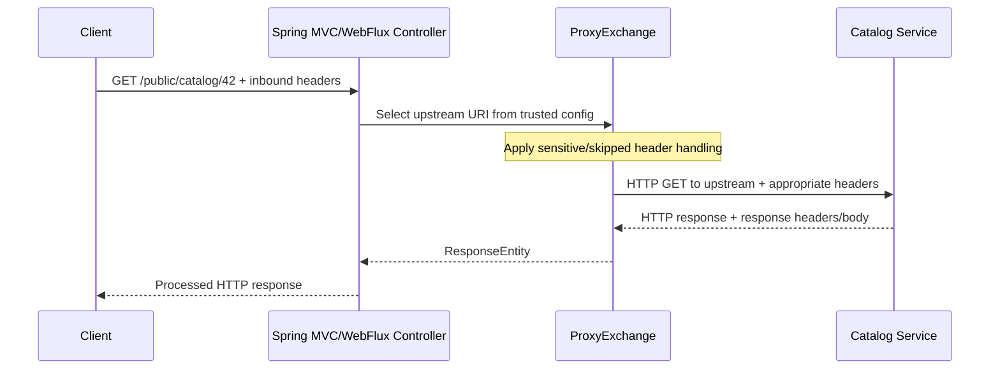
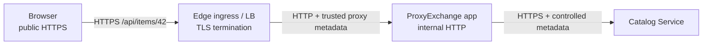
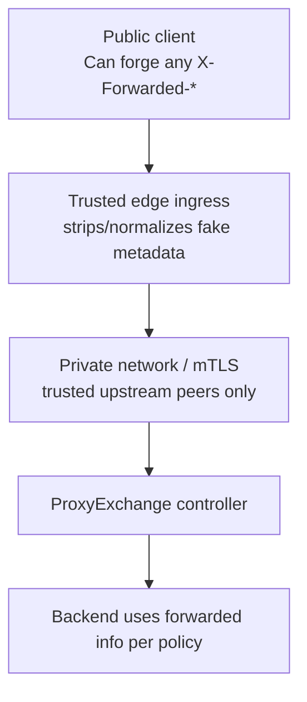

# Sensitive Headers, Skipped Headers, and X-Forwarded-*

## Lesson Objectives

In the **Proxy Exchange** chapter of the **Spring Cloud Gateway** module, this lesson explains how `ProxyExchange` handles HTTP headers when a Spring MVC or Spring WebFlux application sits between clients and backends. The focus is on **three groups to distinguish**:

1. **Sensitive headers** — headers carrying credentials or sensitive data, **not automatically forwarded** to upstreams without an explicit trust policy.
2. **Skipped headers** — headers that should not be **copied verbatim** because they belong to a single HTTP connection or must be recalculated for the new request.
3. **`X-Forwarded-*` and `Forwarded`** — metadata describing the proxy chain, client address, original hostname, and protocol; trustworthy only when created/controlled at a **trust boundary**.

After this lesson, you will be able to:

- Explain the differences between `ProxyExchange`, Gateway Server WebFlux/Web MVC, and a YAML-configured reverse proxy.
- State the ProxyExchange documentation defaults: **sensitive: `cookie`, `authorization`**; **skipped: `content-length`, `host`**.
- Distinguish **not forwarding credentials** from **not copying framing/host metadata**; understand why both groups may be stripped, yet for different reasons.
- Analyze `X-Forwarded-For`, `X-Forwarded-Host`, `X-Forwarded-Proto`, `X-Forwarded-Port`, `X-Forwarded-Prefix`, and the `Forwarded` RFC 7239 standard.
- Prevent `X-Forwarded-*` spoofing, JWT/cookie/API key leaks, SSRF, broken absolute URLs, HTTP redirect loops, and `Content-Length` errors.
- Understand the differences among **inbound headers**, **outbound headers to upstream**, **upstream response headers**, and **client-facing response headers**.
- Build a sample Java proxy controller, knowing what the library handles automatically and what requires separate review and security.
- Test with an HTTP stub backend, header attack cases, proxy TLS termination, multi-hop chains, Unicode payloads, and response redirects.

> **Scope:** `ProxyExchange` is an **alternative gateway style** provided by Spring Cloud Gateway for use inside **Spring MVC controllers** or **Spring WebFlux controllers**. It is **not** a `GatewayFilterFactory` in Gateway Server's route chain. Artifact names, properties, and header handling can change across Spring Cloud release trains; inspect the runtime, documentation, and Javadoc of the **running version**. The lesson provides safe examples and illustrative snippets, without assuming every example is a complete production configuration.

## 1. Placing ProxyExchange in the Right Architectural Position

When a user sends:

```http
GET /public/catalog/42 HTTP/1.1
Host: api.example.com
Authorization: Bearer <browser-access-token>
Cookie: session=<browser-session>
```

the application may need to forward the request to a Catalog Service at:

```text
https://catalog.internal.example/items/42
```

With **ProxyExchange**, the developer writes a **Spring web handler** accepting `ProxyExchange<byte[]>` as a parameter, then specifies the upstream URI and corresponding HTTP method:



In this approach, the controller **controls** the upstream URL, request method, response mapping, and extra rules. `ProxyExchange` performs the HTTP exchange; it **does not replace** Spring Security, destination validation, or authenticating every client.

### 1.1. Comparing Gateway Approaches

| Approach | How Declared / Coordinated | Lesson Scope |
| --- | --- | --- |
| **Gateway Server WebFlux** | Route predicates, `GatewayFilterFactory`, `GlobalFilter`, routing filters | Not `ProxyExchange`'s direct API |
| **Gateway Server Web MVC** | RouterFunction/WebMvc.fn and filter functions | Not the `ProxyExchange` controller API |
| **ProxyExchange WebFlux** | `@RestController`, returns `Mono<ResponseEntity<?>>` | **Yes** |
| **ProxyExchange Web MVC** | `@RestController`, returns `ResponseEntity<?>` | **Yes** |
| Reverse proxy outside JVM | Ingress, NGINX, Envoy, load balancer | May sit in front of or behind ProxyExchange |

Spring Cloud Gateway describes ProxyExchange as an **alternative style**, so never assume Gateway Server's `RemoveHopByHop`/`XForwardedHeadersFilter` or `trusted-proxies` properties apply identically to a `ProxyExchange` controller.

### 1.2. Dependencies

Per current documentation, choose **exactly one ProxyExchange module** matching your web stack:

**Spring MVC:**

```xml
<dependency>
    <groupId>org.springframework.cloud</groupId>
    <artifactId>spring-cloud-gateway-proxyexchange-webmvc</artifactId>
</dependency>
```

**Spring WebFlux:**

```xml
<dependency>
    <groupId>org.springframework.cloud</groupId>
    <artifactId>spring-cloud-gateway-proxyexchange-webflux</artifactId>
</dependency>
```

Select a Spring Cloud BOM compatible with Spring Boot. Never mix `spring-cloud-starter-gateway-server-webflux` and `spring-cloud-gateway-proxyexchange-webmvc` just because both mention Gateway; they are **different implementation mechanisms**.

In Spring Cloud 2025.0, the release notes state that ProxyExchange configuration prefixes moved from the legacy `spring.cloud.gateway.proxy.*` branch to separate namespaces such as:

```text
spring.cloud.gateway.proxy-exchange.webflux.*
spring.cloud.gateway.proxy-exchange.webmvc.*
```

That **does not** mean every property under those prefixes exists or shares identical defaults across all versions. When changing header policies, check the configuration metadata/Javadoc of your exact artifact; never copy Gateway Server properties assuming ProxyExchange reads them.

## 2. An HTTP Exchange Passes Through Four Header Sets

Suppose the client sends `POST /public/orders` and ProxyExchange forwards to `POST /orders`.

```text
1. Client → ProxyExchange:    Inbound request headers
2. ProxyExchange → Backend:  Outbound request headers
3. Backend → ProxyExchange:  Upstream response headers
4. ProxyExchange → Client:   Outbound response headers
```

The `sensitive` and `skipped` groups in the ProxyExchange docs primarily govern **whether inbound request headers are copied to the outbound request**. They **do not define a response header filtering policy**.

Example:

```http
POST /public/orders HTTP/1.1
Host: api.example.com
Authorization: Bearer <client-jwt>
Cookie: session=<client-cookie>
Content-Length: 52
Content-Type: application/json
X-Request-Id: 8a2f...

{"itemId":"BOOK-42","quantity":1}
```

ProxyExchange calls the backend at host `orders.internal.example`, which may need:

```http
POST /orders HTTP/1.1
Host: orders.internal.example
Content-Type: application/json
X-Request-Id: 8a2f...
Content-Length: <length-of-outbound-bytes>

{"itemId":"BOOK-42","quantity":1}
```

In the ideal case, the client's `Authorization` and `Cookie` are **not sent automatically** upstream. `Host` is derived from the new destination; `Content-Length` is determined by the HTTP stack from the actual representation. Other headers, including `X-Request-Id`, still need policies verifying trusted sources, length, and validity.

**Do not treat the headers in this example as an invariant on-wire capture.** The HTTP client, HTTP version, proxies, compression, codecs, and trust policies can affect final headers; only an integration test with an upstream stub confirms exact behavior.

### 2.1. A Proper Classification Table

| Header | Classification in This Lesson | Why Handling Is Needed? |
| --- | --- | --- |
| `Authorization` | **Default sensitive** | Client bearer tokens or authentication credentials |
| `Cookie` | **Default sensitive** | Session identifiers and domain-scoped data |
| `Host` | **Default skipped** | Header of the **HTTP hop destination** must reflect the new upstream |
| `Content-Length` | **Default skipped** | Holds the **byte count** of the representation, which may differ after proxying |
| `X-Forwarded-For` | **Proxy metadata** | Client/proxy IP chain that can be spoofed |
| `X-Forwarded-Host` | **Proxy metadata** | Original public host before reverse proxy; spoofable |
| `X-Forwarded-Proto` | **Proxy metadata** | External scheme (`https`/`http`); spoofable |
| `X-Forwarded-Port` | **Proxy metadata** | Public port; spoofable |
| `X-Forwarded-Prefix` | **Proxy metadata** | Prefix stripped or handled by proxy |
| `Forwarded` | **RFC 7239 proxy metadata** | `for`, `host`, `proto`, `by` across proxy chain |
| `X-API-Key` | **Application-sensitive** | Not in the two documented defaults, yet still a secret |
| `Proxy-Authorization` | **Special hop credential** | Must not be forwarded indiscriminately to backends |
| `Connection`, `Transfer-Encoding` | **Hop-by-hop/framing** | Never copy blindly across HTTP hops |
| `Content-Type` | End-to-end representation metadata | Must stay consistent with body bytes, codecs, and encoding |

**This classification table guides security design**; it does not claim the ProxyExchange library automatically strips every header labeled “application-sensitive”. The two default sensitive values stated in the official docs are `cookie` and `authorization`; other headers require review and additional protection.

## 3. Sensitive Headers: Not Forwarding Client Credentials by Default

A **sensitive header** is a header that can expose credentials, sessions, or data that must not cross into another trust domain automatically.

Per current ProxyExchange documentation:

```text
Sensitive defaults:
  cookie
  authorization
```

These two names are **stripped from downstream requests by default**.

Why? A controller may proxy to a service operated by a different deployment boundary. Automatically forwarding bearer tokens or cookies could mean:

- The backend receives a token not meant for its audience.
- The backend writes credentials into access logs or error traces.
- A compromised service replays the token elsewhere if scopes permit.
- Cookies meant for a public domain leak to an internal domain.
- A misrouted request sends credentials to an unapproved host.

### 3.1. Authentication at the Gateway Does Not Mean Forwarding Credentials

Example client request:

```http
Authorization: Bearer <frontend-access-token>
```

Spring Security on the proxy app can verify the token to create an `Authentication`/`Principal`. Afterwards, ProxyExchange **does not necessarily** pass the raw header straight to the backend.

```text
Client token
  ↓
Spring Security verifies identity/scope/audience
  ↓
Controller decides whether the request may call upstream
  ↓
ProxyExchange executes the HTTP exchange
  ↓
Backend verifies permissions per architecture
```

Do not see a backend 401 and immediately conclude “ProxyExchange is broken, disable sensitive headers”. The backend may expect a **service credential**, an **audience-matched OAuth2 token relay/exchange**, or a different security contract—not the raw frontend token.

### 3.2. Cookies Must Respect Domain/Session Boundaries

A browser cookie:

```http
Cookie: SESSION=<session-id>; theme=dark
```

can hold both sensitive session tokens and ordinary preferences. If ProxyExchange forwards the entire `Cookie` header, the upstream may receive session credentials it was never designed to handle.

In many architectures, the frontend uses cookie sessions while backends communicate over mTLS or service tokens. In that case:

1. Spring Security authenticates the cookie at the edge.
2. Never pass the raw browser cookie to the backend.
3. Send an appropriate credential or identity assertion, and **only from a trusted component**.
4. The backend enforces resource-level authorization rather than trusting an unauthenticated header.

**Never** assume a cookie with `HttpOnly` is safe to forward everywhere. `HttpOnly` only restricts browser JavaScript from reading the cookie; it does not govern which internal services should receive it.

### 3.3. Sensitive Defaults Are Not a Complete Secret Policy

Suppose an API uses:

```http
X-API-Key: <partner-secret>
X-Client-Secret: <secret>
X-Id-Token: <identity-token>
```

These names **are not listed as sensitive defaults** in the official docs. Without extra application policies, they may pass upstream depending on version and configuration. You should:

- Build an **allowlist of outbound request headers** when the target crosses a trust zone.
- Add sensitive headers per contract rather than relying solely on the two defaults.
- Test with requests containing dummy secrets to ensure the backend **never receives them**.
- Audit response bodies, query strings, tracing, and logs too, since secrets do not live solely in headers.

HTTP header names are case-insensitive. Variants like `authorization`, `Authorization`, and `AUTHORIZATION` must be treated as **semantically the same field name**; test with mixed casings.

### 3.4. Why Not Strip `Authorization` From Every Request at Every Layer?

A downstream service might genuinely need credentials to verify the caller. When that is a requirement:

- The contract must specify **which source credential** is permitted to propagate.
- Token **audience/scope** must match the receiving backend.
- Transmit only over TLS to approved service identities.
- Enforce policies preventing token leakage, improper caching, and logging.
- When OAuth2 token exchange/relay is needed, use proper Spring Security/OAuth2 integrations instead of copying raw headers out of habit.

The goal is **intentional credential propagation**, not “never send `Authorization` in any system”. ProxyExchange's defaults act as a guardrail, not a replacement for a full identity-to-service architecture.

### 3.5. Replacing the Sensitive List Can Weaken Defaults

Some ProxyExchange APIs/configs allow customizing the sensitive headers set. When changing the list, verify whether your exact version **overrides or merges** with defaults. A conceptually dangerous example:

```text
New sensitive set contains only:
  x-api-key

If it replaces defaults entirely:
  cookie and authorization may no longer be filtered.
```

Never assume a property like `sensitive: [x-api-key]` **appends** to defaults. To keep protections intact, the effective configuration must include **`cookie`, `authorization`, and all custom secret headers**. Write integration tests verifying the effective runtime behavior.

## 4. Skipped Headers: Not Copying Single-Hop Connection Details

Unlike sensitive headers, **skipped headers** are omitted for **HTTP proxy exchange correctness**, not necessarily because they contain secrets.

Per current ProxyExchange documentation:

```text
Skipped defaults:
  content-length
  host
```

When ProxyExchange creates an outbound HTTP request, these two headers **should not be copied verbatim from the client**.

### 4.1. Why Skip `Host`?

Client sends:

```http
GET /public/items/42 HTTP/1.1
Host: api.example.com
```

ProxyExchange routes to:

```text
https://catalog.internal.example/items/42
```

The outbound HTTP request needs the destination's authority:

```http
Host: catalog.internal.example
```

If `Host: api.example.com` is kept when connecting to `catalog.internal.example`, a virtual-host backend or internal reverse proxy may:

- Select the wrong virtual host/backend.
- Return 404/421 or trigger a certificate/SNI mismatch.
- Generate absolute redirects pointing to the wrong host.
- Violate anti-host-header-injection rules.

**Subtle point:** ProxyExchange drops the **incoming `Host`** when building the outbound request; the HTTP client still **generates a `Host` matching the upstream URI**. “Skipped” does not mean the outbound HTTP/1.1 request lacks a `Host` header altogether.

### 4.2. Why Skip `Content-Length`?

`Content-Length` specifies the **byte count** of the request representation:

```http
POST /public/notes HTTP/1.1
Content-Type: text/plain; charset=UTF-8
Content-Length: 5

hello
```

If the handler or HTTP client transforms text, encoding, or body structure before sending upstream, the byte length can change. For example:

```text
Inbound body:  "hello"
Outbound body: "xin chào"
```

Java's `String.length()` is not the UTF-8 byte count. Copying `Content-Length: 5` when the outbound body is longer can cause the receiver to read truncated bytes, hang waiting for data, abort the request, or misparse framing.

The HTTP client should generate framing matching the **outbound bytes**, choosing either a new `Content-Length` or **chunked transfer** on HTTP/1.1.

**Never manually recompute `Content-Length` with `.length()` or reuse the old value** after transforming the body. And never send conflicting framing headers such as both `Content-Length` and `Transfer-Encoding`.

### 4.3. Hop-by-Hop Headers Must Also Be Controlled

HTTP RFCs distinguish end-to-end metadata from headers scoped to **a single connection**.

Examples to check:

```text
Connection
Keep-Alive
TE
Trailer
Transfer-Encoding
Upgrade
Proxy-Authenticate
Proxy-Authorization
```

Additionally, `Connection` can list **other custom header names that are also hop-by-hop**:

```http
Connection: keep-alive, X-Internal-Hop
X-Internal-Hop: should-not-be-forwarded
```

A proxy must obey HTTP hop-by-hop semantics; having only the two skipped defaults `content-length` and `host` is **not sufficient** to declare all remaining headers safe. Verify in practice how your HTTP client/library handles these fields.

**Distinction:** `ProxyExchange`'s documented `skipped` defaults are **not** Gateway Server's full `RemoveHopByHop` list. Never use one subsystem's default list as a guarantee for another subsystem.

### 4.4. HTTP/2 and Host

HTTP/2 uses pseudo-headers like `:authority`, `:scheme`, and `:path` for request semantics. `Host` in HTTP/1.1 and `:authority` in HTTP/2 are related, but not identical raw strings to copy blindly across protocols.

If client → ingress uses HTTP/2 while ingress → ProxyExchange uses HTTP/1.1, each hop must construct valid metadata for its protocol. Testing only with HTTP/1.1 `curl` is insufficient for mixed HTTP/2/TLS topologies.

### 4.5. Response Headers Have Their Own Rules Too

`Sensitive`/`Skipped` above apply primarily to outbound **requests**. Upstream responses also require inspection:

| Response Header | Issue |
| --- | --- |
| `Set-Cookie` | Can issue cookies for wrong domain/path or leak sessions |
| `Location` | Can redirect to internal or untrusted hostnames |
| `Content-Length` | Must match final response bytes after body mapping |
| `Content-Encoding` | Must match gzip/br/identity of the representation |
| `ETag`, `Digest` | May become invalid if body changed |
| `Server`, `X-Backend-Debug` | May leak infrastructure details |
| `Access-Control-*` | May duplicate or misconfigure CORS policy |

Do not infer that because request `Cookie` is filtered, response `Set-Cookie` **is also filtered automatically**. They are opposite directions and different header sets. When proxying responses through a `ResponseEntity` mapper, design a dedicated output policy.

## 5. X-Forwarded-* Is Proxy History Metadata, Not Identity

In a multi-hop topology:



The backend may need the public URL or external client IP, whereas the backend's direct TCP connection only sees the proxy. `X-Forwarded-*` headers carry **metadata across proxies**.

### 5.1. Meaning of Each Header

| Header | Usually Represents | Risk If Trusted From Arbitrary Clients |
| --- | --- | --- |
| `X-Forwarded-For` | List of IPs along the proxy chain | IP spoofing to bypass rate limiters or IP allowlists |
| `X-Forwarded-Host` | Original public hostname | Host header poisoning, fake links/redirects |
| `X-Forwarded-Proto` | Original public scheme (`https`, `http`) | Bypassing HTTPS checks, redirect loops, or bad links |
| `X-Forwarded-Port` | Original public port | Generating URLs with wrong port |
| `X-Forwarded-Prefix` | Public URL prefix via reverse proxy | Wrong route/link generation or path confusion |

Example when edge terminates TLS:

```http
GET /catalog/42 HTTP/1.1
Host: proxyexchange.internal
X-Forwarded-For: 203.0.113.24
X-Forwarded-Host: api.example.com
X-Forwarded-Proto: https
X-Forwarded-Port: 443
X-Forwarded-Prefix: /public
```

If this metadata was **generated by a trusted edge after stripping client-supplied values**, the proxy app can reconstruct the public URL as:

```text
https://api.example.com/public/catalog/42
```

However, plain header text **carries no cryptographic signature**. A client can send `X-Forwarded-Proto: https` or `X-Forwarded-For: 127.0.0.1` itself if the edge fails to strip/overwrite it.

### 5.2. `X-Forwarded-For` Is Usually a List

Suppose:

```text
Client A: 203.0.113.24
Edge proxy: 10.10.0.12
Internal proxy: 10.20.0.18
```

A chain may look like:

```http
X-Forwarded-For: 203.0.113.24, 10.10.0.12
```

However, if the client sends:

```http
X-Forwarded-For: 127.0.0.1
```

and the edge only appends:

```http
X-Forwarded-For: 127.0.0.1, 203.0.113.24
```

then the first element **is no longer trustworthy**. Never write:

```java
String clientIp = xForwardedFor.split(",")[0]; // Unsafe!
```

Deriving the client IP requires a **trusted proxy chain** algorithm: knowing the direct remote peer, which hops are trusted, where headers are sanitized, and walking the chain from the trusted end. Without that trust model, rely on the socket peer IP or drop forwarded-IP-based decisions.

### 5.3. Append or Replace?

| Policy | When Appropriate | Risk |
| --- | --- | --- |
| **Overwrite at trusted edge** | Public edge receiving direct Internet traffic | Strips spoofed metadata, creates a clean trusted origin |
| **Append at authenticated proxies** | Internal proxy chain with known trusted hops | Requires protecting and validating earlier prefixes |
| **Forward client headers verbatim** | Almost never safe for security decisions | Attacker-controlled origin/IP/scheme |
| **Drop entirely** | Public metadata not needed | May lose info used for URLs or tracing |

You cannot pick append vs. replace purely from a desire to “keep the real IP”. The choice must match **topology**, network policy, proxy-hop verification, and upstream parsing behavior.

### 5.4. `Forwarded` RFC 7239 vs. `X-Forwarded-*`

RFC 7239 defines a single standardized header:

```http
Forwarded: for=203.0.113.24;proto=https;host=api.example.com
```

Across multiple hops, comma-separated elements may appear:

```http
Forwarded: for=203.0.113.24;proto=https;host=api.example.com,
           for=10.10.0.12;proto=http;by=10.20.0.18
```

`Forwarded` standardizes `for`, `by`, `host`, and `proto`, but it is **not inherently more trustworthy** than `X-Forwarded-*`. Both header families can coexist with conflicting values.

When the two families conflict:

- Establish **one source of authority** at the trusted edge.
- Pick a clear precedence policy or strip/regenerate explicitly.
- Ensure the backend and application framework obey the **same contract**.
- Never combine a client-supplied `Forwarded: host=...` with a proxy-verified `X-Forwarded-Proto` to mint a fake public URL.

### 5.5. `X-Forwarded-Prefix` Requires a Path Contract

Example:

```text
Public URL: https://api.example.com/gateway/catalog/42
Ingress strips /gateway → ProxyExchange receives /catalog/42
```

Metadata may carry:

```http
X-Forwarded-Prefix: /gateway
```

This helps apps build links/redirects using the public path. However, if a client injects:

```http
X-Forwarded-Prefix: /evil
```

and the app trusts it blindly, `Location`/absolute links break. `X-Forwarded-Prefix` also does not automatically alter `ProxyExchange`'s handler mapping or URI paths across every runtime; test both the received request path and the path forwarded to the backend.

## 6. Trust Boundary: Who Is Allowed to Generate Forwarded Headers?

The most important rule in this lesson: **ProxyExchange supporting proxy headers does not mean all inbound proxy headers are trustworthy.**



### 6.1. Safe Path

A common design:

1. Block direct Internet connections to the ProxyExchange app port.
2. At public ingress, **strip client-sent incoming forwarded headers**, then regenerate allowed values from edge-verified info.
3. Permit only trusted edge/mesh/services to connect to the application port.
4. Configure Spring framework/proxy integrations to process metadata **from trusted peers**.
5. If ProxyExchange generates downstream `X-Forwarded-*`, ensure it uses **trusted metadata** rather than copying client input.
6. Backends use client IP/proto/host for security only when a clear source contract and bypass-prevention network policy exist.

In practice, multi-edge/cloud setups cannot always strip all prior history; in those cases maintain a list of **trusted hop addresses** and a verified chain-parsing algorithm. Never use regex checks like “IP starts with `10.`” as proof of integrity on an attacker-editable header string.

### 6.2. `server.forward-headers-strategy`

Spring Boot provides:

```yaml
server:
  forward-headers-strategy: framework
```

Depending on version and web stack, the framework may use `ForwardedHeaderFilter` (MVC) or the WebFlux equivalent to **interpret inbound forwarded headers** when resolving request scheme, host, and port.

**Do not misunderstand:** this setting **does not distinguish Internet clients from trusted ingress**. You must ensure forwarded headers are already sanitized and only trusted proxies can reach the app. Otherwise, enabling `framework` can trick URL generation, redirects, or security logic into trusting forged metadata.

Choosing `native`, `framework`, or `none` must align with your Servlet container/reactive server, ingress, and proxy chain. Never enable overlapping mechanisms that cause double processing.

### 6.3. Gateway Server's `trusted-proxies` Differs From ProxyExchange

In newer Gateway Server lines, Spring documents properties like:

```properties
spring.cloud.gateway.server.webflux.trusted-proxies=...
spring.cloud.gateway.server.webmvc.trusted-proxies=...
```

to govern **Gateway Server's** `Forwarded`/`XForwarded` header filters. These properties **must not be assumed to act as security filters for a ProxyExchange controller**.

ProxyExchange is an alternative module. If a project uses **`spring-cloud-gateway-proxyexchange-webflux`**, check the configuration metadata, header resolvers, and HTTP client of **that exact module**; if using `proxyexchange-webmvc`, check the matching MVC version.

Specifically, advisory **CVE-2025-41235** addresses Gateway Server forwarding headers from untrusted proxies in affected versions. The takeaway is to lock down trust chains and apply patches—**do not infer from this CVE that ProxyExchange shares the exact same code or properties as Gateway Server**.

### 6.4. When Forwarded Headers Are Unnecessary

If the backend does not need the original client IP, public host, or scheme, the simplest option is **not to forward** that metadata at all. You can still pass a trace ID, route ID, or separately verified user identity.

Do not force every backend to parse `X-Forwarded-For`; that value is usually harder to interpret safely than an explicit service-to-service contract.

## 7. ProxyExchange Web MVC Example and Header Boundaries

Spring Cloud Gateway docs illustrate `ProxyExchange<byte[]>` inside an MVC controller. Below is a small handler using an **app-managed fixed backend destination**, never taking arbitrary target URIs from clients.

```java
package com.example.edge;

import java.net.URI;

import org.springframework.beans.factory.annotation.Value;
import org.springframework.http.ResponseEntity;
import org.springframework.web.bind.annotation.GetMapping;
import org.springframework.web.bind.annotation.PathVariable;
import org.springframework.web.bind.annotation.RestController;
import org.springframework.web.util.UriComponentsBuilder;

// Import ProxyExchange from the proxyexchange-webmvc module matching
// your Spring Cloud Gateway version.
@RestController
class CatalogProxyController {

    private final URI upstreamBase;

    CatalogProxyController(
            @Value("${app.catalog.base-uri}") URI upstreamBase) {
        this.upstreamBase = upstreamBase;
    }

    @GetMapping("/public/catalog/{id}")
    ResponseEntity<?> item(
            @PathVariable String id,
            ProxyExchange<byte[]> proxy) throws Exception {

        // Example contract: item IDs contain only alphanumeric characters and hyphens.
        if (!id.matches("[A-Za-z0-9-]{1,64}")) {
            return ResponseEntity.badRequest().build();
        }

        URI target = UriComponentsBuilder
            .fromUri(upstreamBase)
            .pathSegment("items", id)
            .build()
            .toUri();

        return proxy.uri(target.toString()).get();
    }
}
```

Example configuration:

```yaml
app:
  catalog:
    base-uri: "https://catalog.internal.example"
```

**Notes on the sample code:**

- Add the `ProxyExchange` import matching your artifact/version (e.g., older lines use `org.springframework.cloud.gateway.mvc.ProxyExchange`; verify Javadoc for newer lines).
- Requires a Spring MVC server, the `ProxyExchange` argument resolver, and matching certificate trust to run.
- IDs allow only allowlisted characters; for Unicode, encoded slashes, or dot segments, design an explicit contract instead of appending raw `@PathVariable` values to an arbitrary target.
- `app.catalog.base-uri` must be an **operator-approved address**, never supplied via `?target=` or client headers.
- ProxyExchange has the sensitive/skipped defaults discussed above, but on-wire output still requires real testing.

### 7.1. Reading Request Headers Does Not Mean Sending Them

A controller can inspect `@RequestHeader` or `HttpServletRequest`. However:

```text
Controller reads Authorization
  ≠ ProxyExchange always forwards Authorization

Controller reads X-Forwarded-For
  ≠ X-Forwarded-For is a trusted client IP

Controller reads Host
  ≠ Outbound Host matches inbound Host
```

Always distinguish *data visible in the handler* from *data transmitted by the proxy*.

### 7.2. Example of a Client Spoofing Headers

```bash
curl -i "http://localhost:8080/public/catalog/42" \
  -H "Authorization: Bearer demo-client-token" \
  -H "Cookie: SESSION=demo-session" \
  -H "Host: api.example.com" \
  -H "X-Forwarded-For: 127.0.0.1" \
  -H "X-Forwarded-Proto: https"
```

Use **dummy tokens only** in test environments. The stub backend should record **header names and redacted values** to verify:

- Were `Authorization` or `Cookie` sent unintentionally?
- Does `Host` reflect the actual target URI?
- Was `Content-Length` preserved erroneously?
- Does `X-Forwarded-For` still carry the client-spoofed `127.0.0.1`?
- Was `X-Forwarded-Proto` trusted as real HTTPS even though the client used plain HTTP?

Never treat `X-Forwarded-Proto: https` in a `curl` command as proof TLS was used. The actual HTTP connection determines TLS on that hop, whereas headers are spoofable data.

## 8. ProxyExchange WebFlux Example

When using the ProxyExchange WebFlux module, the handler typically returns `Mono<ResponseEntity<?>>`:

```java
package com.example.edge;

import java.net.URI;

import org.springframework.beans.factory.annotation.Value;
import org.springframework.http.ResponseEntity;
import org.springframework.web.bind.annotation.GetMapping;
import org.springframework.web.bind.annotation.RestController;
import reactor.core.publisher.Mono;

// Import ProxyExchange from the matching proxyexchange-webflux module.
@RestController
class CatalogReactiveProxyController {

    private final URI upstreamBase;

    CatalogReactiveProxyController(
            @Value("${app.catalog.base-uri}") URI upstreamBase) {
        this.upstreamBase = upstreamBase;
    }

    @GetMapping("/public/health-from-catalog")
    Mono<ResponseEntity<?>> health(ProxyExchange<byte[]> proxy) {
        return proxy.uri(
            upstreamBase.resolve("/health").toString()
        ).get();
    }
}
```

**Difference from Web MVC:** `.get()` on WebFlux ProxyExchange returns a reactive publisher; never `.block()` or manually `.subscribe()` on the HTTP request path. Spring WebFlux subscribes to the returned `Mono` and manages cancellation and error signals.

Just like Web MVC, the controller still needs security, target URI validation, and trust-boundary handling for HTTP headers. Never assume using Reactor automatically blocks header spoofing or keeps sensitive data out of logs.

### 8.1. ProxyExchange Is Not a WebFlux `GatewayFilter`

Flawed design assumption:

```text
@RestController + ProxyExchange
  → assuming GlobalFilter/NettyRoutingFilter ran
  → assuming GatewayFilterFactory Retry/RateLimiter/CircuitBreaker are active
```

`ProxyExchange` is a handler-level proxy. Policies backed by route `GatewayFilterFactory` **do not automatically execute for ProxyExchange controllers**. For authentication, rate limiting, circuit breakers, retries, and observability, configure the corresponding mechanisms in Spring Security/web layer, HTTP client, application services, ingress, or another appropriate solution.

## 9. Outbound vs. Inbound: Request Filtering Differs From Response Mapping

A request can be proxied accurately while the response still leaks internal metadata.

### 9.1. `ResponseEntity` Mapper

ProxyExchange docs describe passing a mapper to `get()` (and other HTTP methods) to transform the upstream `ResponseEntity` before returning it to the client.

Conceptual example:

```java
return proxy.uri(target.toString()).get(upstream -> {
    // Select response headers permitted to be exposed publicly.
    // Do not mutate immutable/read-only HttpHeaders directly.
    // Preserve status/body and HTTP response framing.
    return sanitizeUpstreamResponse(upstream);
});
```

`sanitizeUpstreamResponse` is an **application function you implement yourself**, not a built-in ProxyExchange API. This simply shows where the policy belongs.

A response filtering policy can:

- Keep `Content-Type`, appropriate cache headers, and approved public metadata.
- Strip `X-Backend-Debug`, `Server`, or internal headers.
- Avoid forwarding internal-domain backend `Set-Cookie` headers to the public domain without an explicit session contract.
- Inspect `Location` redirects to avoid leaking internal hosts/paths.
- Ensure `Content-Length`, `Content-Encoding`, and `ETag` match the **actual response body** if rewritten.

### 9.2. A Redirect Should Not Expose an Internal Host

Upstream returns:

```http
HTTP/1.1 302 Found
Location: http://catalog.internal.example/login
```

If the proxy returns this verbatim to the browser, the client may be sent to an unreachable or confidential internal hostname.

Verify:

- Is the redirect actually permitted to reach public clients?
- Should a relative URL be used instead of an absolute URL?
- Are public hostname/scheme derived from trusted ingress metadata?
- Is the backend building URLs from an untrusted `X-Forwarded-Host`?

Never blindly string-replace `internal.example` with `api.example.com` across response bodies/headers without analyzing encoding, URI semantics, and security.

### 9.3. CORS Is a Separate Policy

`Access-Control-Allow-Origin` belongs to the **response**. ProxyExchange's request sensitive/skipped headers do not build a CORS policy on their own.

When a browser makes a cross-origin call:

```text
https://app.example.com
  → https://api.example.com/public/catalog/42
```

configure CORS at the appropriate Spring MVC/WebFlux/Spring Security/ingress layer with one clear policy owner. `OPTIONS` preflight may be handled **before the ProxyExchange handler calls upstream**.

Never use a response header mapper to reflect every `Origin` automatically when responses involve credentials; allowlist origins and verify `Access-Control-Allow-Credentials`.

## 10. Header Injection, Canonicalization, and Multiple Values

HTTP header names are case-insensitive:

```text
Authorization
authorization
AUTHORIZATION
```

all represent the exact same header semantically. Never write filtering logic that matches only one casing.

### 10.1. One Header Can Have Multiple Values

A client or proxy might send:

```http
X-Forwarded-For: 198.51.100.10
X-Forwarded-For: 127.0.0.1
```

or:

```http
X-Forwarded-For: 198.51.100.10, 127.0.0.1
```

Never write a naive parser using `getFirst(...)` and treat it as ground truth. HTTP clients, reverse proxies, and frameworks can fold, append, or process duplicate headers differently.

Security decisions must:

1. Pick one trusted format and source.
2. Strip headers the client has no authority to supply.
3. Parse per standard and bound length/hop counts.
4. Reject or ignore conflicting values.
5. Test duplication, casing, and canonicalization across layers.

### 10.2. Never Blindly Copy `@RequestHeader HttpHeaders`

A common snippet:

```java
@RequestHeader HttpHeaders incomingHeaders
```

lets the controller read all headers. However, calling an API that copies **every** header to the outbound HTTP request can accidentally **bypass default sensitive/skipped protections** or overwrite values the HTTP client expects to generate itself. Copy/add only **allowlisted** headers in a way that respects ProxyExchange filtering.

Do not assume an API named `headers(...)` performs sanitization. Depending on usage, it can overwrite the filtered header set. Check Javadoc and verify the actual request received by the backend.

### 10.3. Header Control Characters

If setting a header from user input:

```text
?tenant=<user-controlled-text> → X-Tenant
```

validate:

- CR, LF, and control characters.
- Length limits.
- Whether the value is allowlisted, signed, or verified.
- Its relationship to the authenticated principal.

Never trust a client-sent `X-Tenant: foo` header to authorize access to tenant `foo`. The backend needs a verified tenant or a claim from a validated token.

## 11. Why Is Forwarded Metadata Especially Dangerous for Security?

### 11.1. Spoofed IP Allowlists

Logic like:

```text
If X-Forwarded-For = 127.0.0.1 → allow admin endpoint
```

is flawed because any Internet client can send that header. Even reading the first element of an appended chain fails if the edge did not strip a spoofed prefix.

**Correct policy:** administrative access must use real authentication/authorization, private networks/mTLS, and trusted proxy-chain processing. IP is at best a secondary signal where required by the environment.

### 11.2. Host Header Poisoning

An app builds a password-reset email URL from:

```http
X-Forwarded-Host: attacker.example
```

If trusted without validation:

```text
https://attacker.example/reset?token=...
```

can appear in emails or responses. This is **host-header poisoning**; ProxyExchange is only one hop, yet if it relays forged host metadata, the backend can be tricked.

Mitigations:

- Public hostnames must belong to a product allowlist.
- Token/link generation should use a configured canonical public base URL when appropriate.
- Trusted ingress must strip/overwrite untrusted forwarded hosts.
- Never treat raw `Host`/`Forwarded`/`X-Forwarded-Host` from clients as a security authority.

### 11.3. Proto Spoofing and Redirect Loops

When the client uses HTTPS to ingress and ingress uses HTTP to the application:

```text
Client --HTTPS--> Ingress --HTTP--> ProxyExchange
```

the app may need to know the public scheme is `https` to generate accurate links/redirects. Without a trusted `X-Forwarded-Proto`, the app may redirect to HTTPS endlessly because it only sees internal HTTP.

Conversely, accepting:

```http
X-Forwarded-Proto: https
```

from an Internet client can trick the app into **bypassing HTTP-to-HTTPS enforcement** even though the actual hop was insecure.

The fix is **trusted-proxy-aware processing** and per-hop TLS policies, not trusting raw text headers directly.

### 11.4. Rate Limiting by Client IP

If a Gateway rate limiter or backend keys off an unverified `X-Forwarded-For`, attackers can rotate that header on every request to bypass quotas.

Prefer:

- Keying business quotas by authenticated user/tenant.
- When IP fallback is needed, extracting client IP via a trusted proxy-chain resolver.
- Monitoring traffic amplification and keeping raw/unbounded IPs out of metric labels.

## 12. Separating Request Header Protection From Service-to-Service Credentials

A secure pattern typically looks like:

```text
Browser credential
  ↓
Spring Security at ProxyExchange app
  ↓
Verify authentication + authorization
  ↓
Dedicated outbound service credential (if required by upstream)
  ↓
Upstream verifies credential and resource permissions
```

Here, **client tokens** and **service credentials** are two distinct entities:

| Criterion | Client Credential | Service Credential |
| --- | --- | --- |
| Subject | User/browser/native client | Application/gateway/service |
| Audience | Public API, identity resource | Specific backend API/service |
| Scope | User/tenant permissions | Service permissions and delegated scopes |
| Lifecycle | Tied to session or client app | Tied to workload, mTLS/client credentials |
| Storage | Secure cookie or client token | Secret manager / workload identity |
| Copy raw via ProxyExchange? | **Not by default** | Add only via approved auth integration |

If the backend must know user identity, use token exchange / on-behalf-of flows or an **integrity-protected identity assertion**, never an unauthenticated `X-Authenticated-User: alice` header forged by clients or untrusted hops.

### 12.1. Downstream 401 Does Not Always Mean Missing Header Relay

A backend 401 can stem from:

- ProxyExchange stripping `Authorization` by default.
- The backend receiving a token with the wrong **audience**.
- Expired tokens or missing `scope`s.
- Misconfigured mTLS, issuer, or JWK settings.
- The Gateway calling the wrong service endpoint.

Resolve this by **aligning the security contract**, not by disabling sensitive filtering or logging raw tokens for debugging.

## 13. `Content-Length`, `Transfer-Encoding`, and Bodies When Proxying

ProxyExchange executes HTTP calls and may transform data between inbound and outbound forms. Any body change requires valid framing.

### 13.1. Character Count Is Not Byte Count

```text
Java String: "xin chào"
UTF-8 bytes: contains multi-byte characters
```

If a developer sets:

```java
int len = body.length();
```

and uses that value as `Content-Length`, the count will be wrong for Vietnamese text or emojis. The HTTP client/framework must compute the **actual byte length** of the outbound representation.

### 13.2. Request Bodies Can Be Sent Chunked

An HTTP client may choose:

```http
Transfer-Encoding: chunked
```

instead of:

```http
Content-Length: <known-length>
```

on HTTP/1.1 when length is unknown upfront. Business content does not change; that is purely **HTTP framing**.

Never:

- Copy inbound `Content-Length` while also sending outbound chunked encoding.
- Copy `Transfer-Encoding: chunked` from HTTP/1.1 into HTTP/2.
- Alter payload bytes while keeping the signature/digest of the old payload.
- Decompress a gzip body to text while keeping `Content-Encoding: gzip`.

### 13.3. POST/PUT/PATCH Require Replay/Idempotency Policies

A ProxyExchange controller may send:

```http
POST /payments/charge
```

If the upstream records the payment and the response is lost, retrying the same request can double-charge. **Header filtering does not solve idempotency.** You need idempotency keys, atomic backend deduplication, timeouts, and carefully designed retry policies.

Never assume `ProxyExchange` provides Gateway Server's `Retry`, `CircuitBreaker`, and body-replay semantics by default.

### 13.4. Response Bodies and Compression

An upstream response:

```http
HTTP/1.1 200 OK
Content-Type: application/json
Content-Encoding: gzip
ETag: "representation-v1"
```

may need to pass intact to the client. If a ProxyExchange mapper transforms the body:

- Decoder/encoder must match `Content-Encoding`.
- `Content-Length` may need to be removed/recalculated.
- `ETag`/Digest may no longer be valid.
- `Vary` and `Cache-Control` must remain accurate.
- `204`, `304`, `HEAD`, and `206 Partial Content` require special semantics.

Do not use a simple response mapper to mutate bytes indiscriminately across streaming, multipart, or gzip responses.

## 14. Integration Example: Ingress in Front of ProxyExchange

### 14.1. Topology

```text
Browser                203.0.113.24
  ↓ HTTPS :443
Trusted Ingress         10.10.0.12
  ↓ HTTP :8080
ProxyExchange app       10.20.0.25
  ↓ HTTPS :9443
Catalog Service         catalog.internal.example
```

Policy:

- Browsers **cannot** reach application port `8080` directly.
- Edge strips browser-sent `Forwarded`/`X-Forwarded-*` and generates trusted metadata.
- ProxyExchange resolves `Host`/public scheme per framework trusted-hop policy.
- Outbound URI comes from fixed config/allowlist.
- Sensitive client `Cookie`/`Authorization` do not flow automatically to Catalog Service.
- Upstream request `Host` reflects the upstream target.
- Backend never grants admin privileges based on raw client headers.

### 14.2. Expected Real Requests

Browser:

```http
GET /public/catalog/42 HTTP/1.1
Host: api.example.com
Cookie: SESSION=<browser-session>
Authorization: Bearer <client-token>
X-Forwarded-For: 127.0.0.1
```

Ingress creates a **sanitized** internal request:

```http
GET /public/catalog/42 HTTP/1.1
Host: proxyexchange.internal
X-Forwarded-For: 203.0.113.24
X-Forwarded-Host: api.example.com
X-Forwarded-Proto: https
X-Forwarded-Port: 443
```

ProxyExchange creates outbound:

```http
GET /items/42 HTTP/1.1
Host: catalog.internal.example
X-Forwarded-For: <controlled-chain-if-enabled>
X-Forwarded-Proto: <trusted-public-scheme-if-enabled>
```

The last two headers depict **desired values per policy**; whether they are actually generated/forwarded depends on the module, version, and config. Never rely on an illustration to assume ProxyExchange always emits `X-Forwarded-*` with exact strings.

### 14.3. Why Test Without Ingress Too?

Locally, developers may run directly:

```text
curl → localhost:8080 → ProxyExchange
```

Bypassing ingress means forged request headers are no longer stripped by a trusted edge. Verify:

- Does the app ignore/reject forwarded metadata from untrusted remote peers?
- Do security tests send `X-Forwarded-For: 127.0.0.1` and `X-Forwarded-Proto: https` directly?
- Does the production firewall block direct access to that port?

Testing solely through ingress can hide vulnerabilities if another port or service path bypasses it.

## 15. Testing Sensitive, Skipped, and Forwarded Headers

A solid test must verify **what the stub backend actually received**, not just the final HTTP status seen by the client.

### 15.1. Setting Up an HTTP Echo Backend

The stub backend should:

- Return simple statuses/bodies.
- Record method/path, target URI, `Host`, and `Content-Length`.
- Record **header names** (never log real secret values).
- Support testing response `Location`, `Set-Cookie`, and `X-Backend-Debug`.
- Count calls to avoid missing retries or extra proxy hops.

For illustration, you can use WireMock, MockWebServer, or any team-preferred test HTTP server. You do not need a service discovery cluster just to test ProxyExchange header policies.

### 15.2. Test A — Sensitive Defaults

Client sends:

```http
GET /public/catalog/42
Authorization: Bearer fake-token-for-test
Cookie: SESSION=fake-session-for-test
```

Expected at backend per documented defaults:

```text
Authorization = absent
Cookie = absent
```

Also test:

```http
AUTHORIZATION: Bearer fake
cookie: SESSION=fake
```

to verify case-insensitive semantics. Never use real JWTs or live sessions in stub logs.

### 15.3. Test B — Custom Sensitive Header

Client:

```http
X-API-Key: fake-test-partner-secret
```

If organizational policy requires blocking it, test that the backend **does not receive** that value. If it passes through by default, the test exposes **a gap to fix**; never assume `X-API-Key` is protected just because the docs mention `cookie`/`authorization`.

### 15.4. Test C — Upstream Host

Client:

```http
Host: api.example.com
```

Proxy target:

```text
http://127.0.0.1:9001/items/42
```

Expect the upstream to receive a `Host` matching **the target's address/virtual host**, not `api.example.com` verbatim unless an intentional `Host` override policy exists. This is a routing concern, not auth.

### 15.5. Test D — Content-Length

Client POST body:

```text
hello
```

If the proxy produces a Unicode outbound body:

```text
xin chào
```

assert that the backend receives the exact **bytes** and valid HTTP framing without retaining the old length. If the HTTP client uses chunked encoding, the test must not demand a `Content-Length` header; it simply requires **valid** message framing.

### 15.6. Test E — Forged X-Forwarded-For

Internet client:

```http
X-Forwarded-For: 127.0.0.1
```

Test **two paths**:

1. Through a sanitizing trusted ingress: the backend must not interpret `127.0.0.1` as the real client IP.
2. Calling the application port directly in tests: the app must not grant privileges or bypass quotas via the forged header; production ports must be network-restricted.

Do not assert only one hardcoded string, as forwarding-chain formatting varies by topology.

### 15.7. Test F — Fake X-Forwarded-Proto

Client makes a plain HTTP call:

```http
X-Forwarded-Proto: https
```

Without a trusted ingress, the app **must not** use that header to treat the connection as secure or skip HTTPS enforcement. Test redirect behavior and generated absolute links.

### 15.8. Test G — Response Header Leakage

Upstream:

```http
HTTP/1.1 302 Found
Location: http://catalog.internal.example/private
Set-Cookie: INTERNAL_SESSION=fake
X-Backend-Debug: trace-raw
```

Verify policy after response mapping:

- `Location` is handled per the public route contract.
- `INTERNAL_SESSION` is not emitted to browsers without an explicit cookie policy.
- `X-Backend-Debug` is hidden if required.
- 302 preserves its semantics rather than turning into 200 just because headers were sanitized.

### 15.9. Test H — Duplicate / Hop-by-Hop Headers

Client sends:

```http
X-Forwarded-For: 10.0.0.1
X-Forwarded-For: 127.0.0.1
Connection: keep-alive, X-Internal-Hop
X-Internal-Hop: poison
```

Verify that the library/proxy layer handles hop-related headers properly and does not dangerously forward a client-controlled `X-Internal-Hop`. Test both HTTP/1.1 and HTTP/2 hops if production uses both.

### 15.10. Testing Matrix

| Case | Input | What to Prove |
| --- | --- | --- |
| Sensitive Authorization | Dummy bearer token | Not forwarded automatically |
| Sensitive Cookie | Dummy session cookie | Not forwarded automatically |
| Custom API key | `X-API-Key` | Blocked per organizational policy |
| Header casing | `AUTHORIZATION`, `authorization` | Consistent protection |
| Host mismatch | Client host A, upstream B | Outbound `Host` matches B |
| Transformed body | ASCII input, Unicode output | Valid framing and bytes |
| Chunked outbound | Unknown body length | No conflicting `Content-Length` |
| Hop-by-hop | `Connection`, `TE`, `Upgrade` | Handled per HTTP semantics |
| Forwarded spoofing | Client `X-Forwarded-For: 127.0.0.1` | Does not bypass security |
| Proto spoofing | Client `X-Forwarded-Proto: https` | Does not bypass TLS enforcement |
| Multiple proxies | Two trusted hops | Chain interpreted accurately |
| Ingress bypass | Direct call to app port | Metadata untrusted or blocked by network |
| Host poisoning | `X-Forwarded-Host: attacker.example` | No malicious redirects/links generated |
| Prefix rewrite | `X-Forwarded-Prefix` | Public URLs accurate, no path confusion |
| RFC 7239 conflict | `Forwarded` conflicts with `X-Forwarded-*` | Follows one authority policy |
| Response `Set-Cookie` | Internal session cookie | Not leaked when disallowed |
| Response `Location` | Internal host redirect | Rewritten/stripped per contract |
| Compressed response | Gzip | Body and headers remain consistent |
| Auth backend | Upstream needs service token | Uses right-audience credential |
| Multiple Gateway replicas | Pod A/B | Consistent policies |

## 16. Common Troubleshooting

### 16.1. Backend Returns 401 Despite Client Having a Bearer Token

**Likely cause:** ProxyExchange filters `authorization` by default; backend expects a different token; or the user token lacks the right audience/scope.

**Fix:** align the security contract and use proper service credentials or token exchange where permitted—do not reflexively enable forwarding all credentials.

### 16.2. Backend Does Not Receive Session Cookie

**Likely cause:** `cookie` is a default sensitive header.

**Fix:** design the identity boundary. If the backend genuinely needs a cookie, review domain, session ownership, encryption/TTL, and delegation intent rather than merely removing `cookie` from the sensitive list.

### 16.3. Backend Sees a Different Host Than the Public Host

**This may be expected behavior:** outbound `Host` reflects the **upstream target URI**, not the public URL. If the backend must build public links, use a configured public base URL or trusted forwarded metadata per contract instead of forcing inbound `Host` onto every upstream call.

### 16.4. Upstream Returns 400, Connection Reset, or Hangs

**Likely cause:** `Content-Length` mismatches actual bytes, conflicting `Transfer-Encoding`, body conversion issues, or broken hop-by-hop headers.

**Fix:** inspect the raw HTTP request reaching the backend, comparing bytes, encoding, and `Content-Length`/`Transfer-Encoding`; avoid manually copying framing headers.

### 16.5. HTTP↔HTTPS Redirect Loop

**Likely cause:** TLS terminates at ingress, the app sees internal HTTP, trusted `X-Forwarded-Proto` is not interpreted, or multiple layers disagree on proto config.

**Fix:** configure trusted ingress and Spring framework handling with one authoritative source; never let clients spoof proto to break a redirect loop.

### 16.6. Rate Limiter Bypassed via X-Forwarded-For

**Likely cause:** limiter reads the first element of a client-supplied header.

**Fix:** use an authenticated principal/tenant key or a trusted proxy resolver; sanitize headers at the edge and test multi-value spoofing.

### 16.7. Backend Hostname Leaked in Location

**Likely cause:** upstream response passed through verbatim without redirect mapping.

**Fix:** define the public URL contract, use relative `Location`s or a response mapper allowlist, and avoid trusting unverified `X-Forwarded-Host`.

### 16.8. Configured Gateway Server `trusted-proxies`, Yet ProxyExchange Behaves Differently

**Likely cause:** the app uses the **ProxyExchange alternative style**, not the Gateway Server header filters you configured.

**Fix:** verify the exact module artifact, class, HTTP client, and property metadata; test actual outbound headers. Never confuse `spring.cloud.gateway.server.webflux.*` with `spring.cloud.gateway.proxy-exchange.webflux.*`.

### 16.9. `X-API-Key` Reaches Backend Even Though Cookie/Authorization Are Filtered

**Likely cause:** sensitive defaults cover only two names, with no custom policy for API keys.

**Fix:** extend your application's sensitive policy/allowlist, and test mixed casing, duplicate names, and bypass paths.

### 16.10. Logs Still Leak Tokens Even Though Request Headers Are Not Forwarded

**Likely cause:** sensitive filtering affects only **outbound HTTP forwarding**, not:

```text
request logging
HTTP wiretaps
exception logging
tracing query attributes
upstream response echoes
```

**Fix:** redact/mask at every layer, disable raw header/body logging in production, restrict log access, and check retention policies.

## 17. Operations and Observability

With a ProxyExchange controller, measure separately:

- **Inbound requests** by public endpoint, method, and status.
- **Outbound HTTP calls** by upstream service and outcome.
- `401/403` errors at the proxy layer vs. `401/403` from the backend.
- `4xx/5xx`, timeouts, connect failures, and TLS errors.
- Total latency and isolated upstream call latency.
- Rejections due to invalid destinations, invalid forwarded metadata, or header policies.
- Redirect loops, CORS failures, and content-framing errors.
- Header sanitization policy version during config rollouts.

A safe log entry:

```text
endpoint=/public/catalog/{id}
upstream=catalog-service
status=200
headerPolicy=standard-v3
forwardedTrusted=true
traceId=<trace-id>
```

Never log raw:

```text
Authorization: Bearer ...
Cookie: ...
X-API-Key: ...
?access_token=...
Set-Cookie: ...
```

Never put raw `X-Forwarded-For`, user IDs, or full URLs into metric labels, which cause high cardinality and data leaks. If IPs are needed for investigations, store them in a secured system with proper access control and retention rather than embedding them in metrics.

### 17.1. Retry, Circuit Breaker, and Rate Limit Layers

ProxyExchange does not automatically inherit all Gateway Server filters. If needed:

```text
Authenticated request
  ↓
Request-level rate/authorization policy
  ↓
ProxyExchange HTTP call
  ↓
Verified client-side timeout/circuit/retry policy
```

use MVC/WebFlux-compatible components, and design retry budgets and idempotency. If an upstream times out after a POST executes, retrying can duplicate side effects. Never use tokens, spoofed IPs, or headers outside the trust boundary to identify quota owners.

### 17.2. Separating Inbound and Outbound TLS

`X-Forwarded-Proto: https` merely states **a declared scheme**. It does not encrypt the hop:

```text
ProxyExchange → Backend
```

If the backend URI uses plain HTTP, the outbound hop remains unencrypted. For high security requirements, use `https://` upstreams, verify certificates/hostnames, enforce network/egress rules, and use mTLS when needed.

## 18. Production Checklist

| Item | Verification Question |
| --- | --- |
| **Correct module** | Using `proxyexchange-webmvc` or `proxyexchange-webflux`, not confused with Gateway Server? |
| **Versions** | Spring Boot/Cloud BOM compatible, property prefixes match the release train? |
| **Destination** | Upstream URI comes from an allowlist/config, never raw client URLs? |
| **AuthN/AuthZ** | Spring Security protects public endpoints and backends enforce required permissions? |
| **Sensitive defaults** | `Cookie`/`Authorization` are not forwarded by default? |
| **Custom secrets** | `X-API-Key`, `X-Client-Secret`, and session assertions filtered/allowlisted? |
| **Sensitive overrides** | When customizing the list, do defaults remain active instead of being wiped out? |
| **Skipped defaults** | `Host`/`Content-Length` not copied raw from inbound requests? |
| **Hop-by-hop** | `Connection`/`TE`/`Transfer-Encoding`/`Upgrade` handled per hop? |
| **Body** | `Content-Type`/`Length`/`Encoding` and Unicode/streaming match the representation? |
| **Forwarded trust** | Edge sanitizes headers, trusted hop list is explicit, direct bypass blocked? |
| **XFF parsing** | Never picking the first element as client IP when prefixes aren't trusted? |
| **Public host/proto** | URLs/redirects never derived from untrusted `Host`/`Proto`? |
| **Forwarded conflict** | Precedence between RFC 7239 and `X-Forwarded-*` clearly defined? |
| **Response** | `Set-Cookie`/`Location`/`Server`/Debug headers handled explicitly? |
| **TLS** | Both inbound and outbound TLS properly configured, cert verification enabled? |
| **Rate/Retry** | Never trusting spoofed IPs or blindly retrying non-idempotent operations? |
| **Metrics/logging** | Never logging tokens, raw cookies, or sensitive headers/bodies? |
| **Testing** | Stub records actual outbound headers, spoofing/casing/multi-value/ingress bypass? |
| **Operations** | Policy change audits, header/trust alerts, and rollback plan ready? |

## 19. Practice Exercises With Answers

### Scenario

A client calls a ProxyExchange endpoint:

```http
POST /public/orders HTTP/1.1
Host: api.example.com
Authorization: Bearer fake-client-token
Cookie: SESSION=fake-session
X-API-Key: fake-partner-key
X-Forwarded-For: 127.0.0.1
X-Forwarded-Proto: https
Content-Type: application/json
Content-Length: 30

{"itemId":"A-42","quantity":1}
```

The controller routes to:

```text
https://orders.internal.example/orders
```

**Questions:**

1. According to ProxyExchange docs, what are the two **sensitive defaults**?
2. What are the two **skipped defaults**?
3. Why are `Cookie` and `Authorization` stripped by default?
4. Why shouldn't `Host: api.example.com` be copied verbatim when proxying to `orders.internal.example`?
5. Why must `Content-Length` be calculated from outbound bytes rather than copying the inbound number?
6. Is `X-API-Key` automatically protected simply because docs mention `Authorization`?
7. Can we trust `X-Forwarded-For: 127.0.0.1` to allow access to an admin endpoint?
8. Does `X-Forwarded-Proto: https` prove the request used TLS?
9. If the edge appends to XFF without stripping a spoofed prefix, is the first element trustworthy?
10. Is RFC 7239 `Forwarded` automatically more trustworthy than `X-Forwarded-*`?
11. Does `ProxyExchange` automatically run Gateway Server's `GatewayFilterFactory` filters?
12. Is `Set-Cookie` from upstream automatically blocked just because `cookie` is a sensitive request header?
13. If an upstream requires a token, should you automatically forward the raw frontend token?
14. If the backend returns `302 Location: http://orders.internal.example/private`, what must be checked?
15. Can `Content-Length` be updated using Java `String.length()` after a Unicode transformation?
16. Why should you also test calling the application port directly?

**Suggested Answers:**

1. **`cookie` and `authorization`**.
2. **`content-length` and `host`**.
3. To avoid forwarding credentials/sessions across trust boundaries to upstreams unexpectedly.
4. Because outbound `Host` must reflect the target HTTP authority/virtual host unless intentionally overridden.
5. HTTP length is the **byte count of the actual representation**; body or transfer framing can change.
6. **No.** Separate policies are required for API keys and other secrets.
7. **No.** Clients can forge that header; it is not a trusted identity or remote peer.
8. **No.** Headers are metadata and can be spoofed.
9. **No.** A trusted edge must sanitize it or a proper chain resolver must be used.
10. **No.** It standardizes syntax, not source authenticity.
11. **Not automatically.** ProxyExchange is an alternative handler API.
12. **No.** `Set-Cookie` is a response header needing its own output policy.
13. **Not by default.** Verify token audience/scope and use service credentials or token exchange mechanisms.
14. Check redirect policy, public host/HTTPS scheme, and ensure no internal hostnames leak or forged `Host`s are trusted.
15. **No.** Java string length is not UTF-8 byte count.
16. To detect potential ingress sanitization bypasses and IP/header spoofing if another entry port is reachable.

## 20. Official References

- [Spring Cloud Gateway — Proxy Exchange Gateway with Spring Web MVC or WebFlux](https://docs.spring.io/spring-cloud-gateway/reference/spring-cloud-gateway-proxy-exchange.html): module dependencies, handler methods, sensitive/skipped/proxy headers.
- [Spring Cloud Gateway Server WebFlux — HttpHeadersFilters](https://docs.spring.io/spring-cloud-gateway/reference/spring-cloud-gateway-server-webflux/httpheadersfilters.html): `Forwarded`, `XForwarded`, `RemoveHopByHop` **for Gateway Server**, distinct from ProxyExchange.
- [Spring Cloud Gateway Server Web MVC — HttpHeadersFilters](https://docs.spring.io/spring-cloud-gateway/reference/spring-cloud-gateway-server-webmvc/httpheadersfilters.html): Gateway Server Web MVC header filter mechanisms, not applicable by default to ProxyExchange.
- [Spring Cloud 2025.0 release notes](https://github.com/spring-cloud/spring-cloud-release/wiki/Spring-Cloud-2025.0-Release-Notes): property prefix renames for Gateway modules.
- [Spring Security Advisory — CVE-2025-41235](https://spring.io/security/cve-2025-41235/): risk of Gateway Server trusting forwarded headers from untrusted proxies; verify affected scope and patches for your version.
- [RFC 7239 — Forwarded HTTP Extension](https://www.rfc-editor.org/rfc/rfc7239): syntax for `for`, `by`, `host`, `proto`.
- [RFC 9110 — HTTP Semantics](https://www.rfc-editor.org/rfc/rfc9110) and [RFC 9112 — HTTP/1.1](https://www.rfc-editor.org/rfc/rfc9112): `Host`, hop-by-hop headers, and HTTP message framing.

## Summary

In **Spring Cloud Gateway ProxyExchange**, both **sensitive headers** and **skipped headers** may be omitted when copying from the client request to the upstream request, yet **for different reasons**. `Cookie`/`Authorization` are omitted by default to prevent unintended credential propagation; `Host`/`Content-Length` are omitted by default so the outbound HTTP request is built with the **proper destination and framing**. These groups do not automatically protect arbitrary API keys, response cookies, `Location` headers, or logs containing secrets.

For **`X-Forwarded-*` and `Forwarded`**, the rule is to **trust verified sources, never raw header text**. Public ingress must strip forged metadata, applications must know their trusted proxy chain, and raw `X-Forwarded-For`, `Host`, or `Proto` must never serve as the basis for authorization, redirects, or HTTPS detection. In particular, **ProxyExchange differs from Gateway Server**: never apply one module's properties or filters blindly to the other. Verify exact outbound headers using an HTTP stub backend, keep request filtering separate from response mapping, and enforce TLS, authentication, rate limits, retries, and observability per contract so your Gateway proxies microservice traffic safely.
