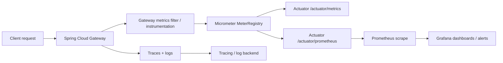
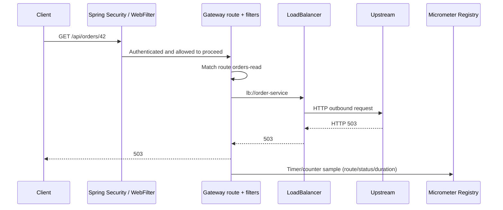
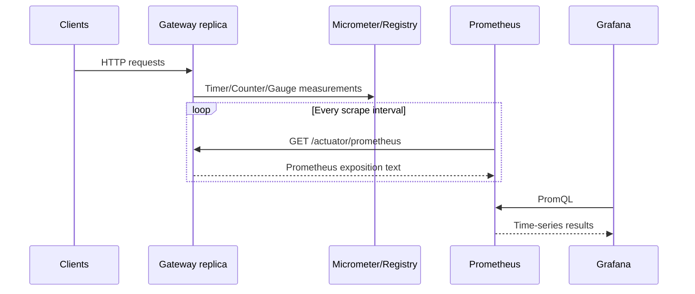

# Gateway Metrics, Actuator, and Micrometer

An API Gateway can route requests accurately from a configuration perspective and still leave users experiencing **high latency**, **HTTP 5xx**, **throttling**, a **retry storm**, or errors that only appear on a single Gateway replica. To operate **Spring Cloud Gateway** safely, you cannot simply look at `application.yml` or verify that an endpoint returns `200`. You must measure **traffic, error rate, latency, and resource utilization**, correlating them with the corresponding **route ID**, filters, and backends.

In the **Observability** chapter, this lesson introduces three layers working together: **Spring Cloud Gateway metrics** measure the processing flow at the Gateway; **Spring Boot Actuator** provides management endpoints to inspect status and metrics; and **Micrometer** is the instrumentation and export layer to backends such as **Prometheus**. The lesson uses an API Gateway scenario with route predicates, filter chains, path/header rewrites, `lb://` service discovery, authentication, rate limiting, circuit breakers, retries, TLS, and tracing to show **which metric answers which question**.

> **Scope:** The primary examples use **Spring Cloud Gateway Server WebFlux** with Spring Boot Actuator/Micrometer. Gateway Server Web MVC has its own stack and metric implementation; some property names, metric names, tags, and HTTP endpoint access configurations change across versions. This lesson explicitly notes where you should verify using `/actuator/metrics` and `/actuator/prometheus` rather than treating every JSON/PromQL snippet as immutable.

## 1. Why Must a Gateway Have Metrics?

The Gateway is the shared entry point for many microservices. An incident here can affect multiple APIs simultaneously:

```text
              +---------------------------+
Clients ----> | Spring Cloud Gateway     |
              | route predicates          |
              | rewrite / filters         |
              | authentication            |
              | rate limiting             |
              | retry / circuit breaker   |
              | load balancing            |
              +------------+--------------+
                           |
                 +---------+---------+
                 |         |         |
             orders     catalog   payments
```

Common scenarios:

- The `orders-read` route sees an increased `503` rate because `order-service` runs out of healthy instances.
- The `payments-create` route sees increased latency even without many HTTP 5xx errors, because the backend responds slowly.
- Spring Security rejects many requests with `401` before they are matched to a route.
- Retry enables the end client to receive `200`, while the backend is actually called **three times**.
- An OPEN circuit breaker returns a fallback quickly, reducing latency while increasing the number of rejected requests.
- One replica holds a stale route definition, causing its metrics to differ from the remaining replicas.
- A backend has a broken certificate/SNI, leading to TLS handshake failures during proxying.
- Response caching increases the hit ratio, but risks serving stale data or the wrong user/tenant if the policy is misconfigured.

**Looking only at the final HTTP status is not enough.** You must distinguish which requests arrive at the Gateway, which requests are matched to a route, the actual upstream calls made, and which errors occur before or after route selection.

### Four Foundational Operational Questions

| Question | Signal Group | Example |
| --- | --- | --- |
| **How many requests?** | Traffic/throughput | RPS per route |
| **How many requests fail?** | Errors | 5xx, 429, 401/403 rate by scope |
| **How slow are requests?** | Latency | p50/p95/p99, deadline exceeded |
| **Does the system still have capacity?** | Saturation/capacity | CPU, event loop, connections, memory, queue |

This approach aligns closely with the **four golden signals** of system monitoring. To detect issues early, combine Gateway metrics with backend metrics, infrastructure metrics, logs, and traces.

## 2. Three Components: Gateway, Actuator, Micrometer

| Component | Responsibility | Not Its Responsibility |
| --- | --- | --- |
| **Gateway metrics instrumentation** | Records request outcome/duration per route, depending on version | Not a long-term historical storage system |
| **Micrometer** | API/registry/timer/counter/gauge, distributes measurements | Not a dashboard or time-series database itself |
| **Spring Boot Actuator** | Exposes management endpoints such as `health`, `metrics`, `prometheus` | Does not define SLAs/SLOs or alerts on its own |
| **Prometheus** | Scrapes metrics endpoints and stores time series | Does not automatically explain the root cause of every incident |
| **Grafana/dashboard** | Visualizes and compares metrics | Does not replace proper instrumentation |
| **Distributed tracing** | Follows a single request across the Gateway and services | Not suitable as a replacement for metrics to aggregate total traffic |
| **Structured logs** | Event/error details per request/attempt | Should not use raw logs as unbounded-cardinality metrics |



Some versions have integrations based on Micrometer Observation instead of standalone metric filters; from an operational standpoint, the goal remains generating **measurements with a name, tags, and value** and forwarding them to the monitoring system.

### A Metric Is Not a Log

A log entry like:

```text
2026-11-24T12:00:00 route=orders-read status=503 latency_ms=824
```

describes **a single event**. Metrics such as counters and timers aggregate data across many requests; Prometheus can use them to compute RPS, error rate, and latency distribution. To find the root exception of a specific 824 ms request, you generally need traces/logs, not just a p95 graph.

## 3. Lifecycle of Measuring a Request at the Gateway



This diagram is a **conceptual model**. The duration measurement hook may wrap different components depending on the version; do not assume the sample is recorded at the exact moment the final response bytes are sent in every case.

### Different Checkpoints Produce Different Counts

A request may be blocked before being routed:

```text
Client request
  |
  +-- Spring Security -> 401 (does not enter Gateway route)
  |
  +-- Route predicates -> no match -> 404
  |
  +-- Route matched -> Gateway filters -> upstream
```

Consequences:

- General HTTP server metrics may count **401/404** at the web server layer.
- **Per-Gateway-route** metrics may only appear for requests that matched a route or reached the corresponding instrumentation.
- A mismatch between “HTTP requests” and “Gateway route requests” **does not automatically mean data loss**.

You must identify the **instrumentation point** of each metric before calculating error rates or reporting SLOs.

## 4. Key Gateway Metric: `spring.cloud.gateway.requests`

In many Spring Cloud Gateway Server WebFlux lines, a request timer metric is named:

```text
spring.cloud.gateway.requests
```

When Actuator/Micrometer instrumentation is enabled and a route is processed, the timer can record duration/outcome and attach tags describing the route.

Common tags across Gateway versions:

| Tag | Example | Meaning |
| --- | --- | --- |
| `routeId` | `orders-read` | Matched route ID |
| `routeUri` | `lb://order-service` | Logical URI of the route |
| `httpMethod` | `GET` | Request method |
| `httpStatusCode` | `503` | Final HTTP code according to the metric hook |
| `outcome` | `SUCCESS`, `SERVER_ERROR` | Outcome grouping |
| `status` | Version-dependent | Status classified by Gateway instrumentation |
| `path` | `/api/orders/42` | Only present if version and configuration allow; **cardinality risk** |

**Do not assume every tag exists or shares the exact same meaning across all versions.** Call `/actuator/metrics/spring.cloud.gateway.requests` to check the actual `availableTags`. In particular, the `status` tag may not represent the exact same value as `httpStatusCode`.

### What Values Does a Timer Record?

A Micrometer `Timer` typically has:

- **count**: number of recorded measurements.
- **totalTime**: total duration of the measurements.
- **max**: maximum value within the measurement window depending on the registry implementation.
- **histogram/buckets** if distribution is enabled to support Prometheus percentiles.
- Tags that categorize the metric.

If 100 requests have a total duration of 20 seconds, the average time is:

\[
\text{mean latency} = \frac{20\,\text{s}}{100} = 0.2\,\text{s}
\]

However, **the mean does not reflect tail latency**. In practice, a few 5-second requests can cause severe user issues even when the mean remains low.

### “Gateway Request Count” Does Not Necessarily Equal Upstream Attempt Count

A client request may pass through `Retry`:

```text
Client GET /api/catalog/items/42  (1 logical request)
  -> upstream attempt 1: 503
  -> upstream attempt 2: 503
  -> upstream attempt 3: 200
Client receives 200
```

The Gateway request timer may record **a single final outcome of 200**, while the backend received **three attempts**. Do not use `spring.cloud.gateway.requests` to count backend attempts if the instrumentation only observes the logical request. To observe retry amplification, combine it with HTTP client/upstream metrics or custom attempt instrumentation.

## 5. HTTP Server Metrics and Gateway Metrics Differ

Spring Boot/Micrometer may expose general HTTP server metrics (commonly `http.server.requests`), in addition to route-specific Gateway metrics.

| Metric/Perspective | Measurement Point | Answers Well |
| --- | --- | --- |
| `http.server.requests` | HTTP server layer, depending on auto-instrumentation | Total requests entering the Gateway, including many pre-routing errors |
| `spring.cloud.gateway.requests` | Requests passing through a Gateway route | RPS/latency/status per route |
| HTTP client metrics | Outbound calls of the HTTP client/transport when instrumented | Upstream attempts/latency/connect failures |
| LoadBalancer metrics | Instance selection if instrumented | Instance selection distribution, no-instance |
| Resilience4j metrics | Bound CircuitBreaker/Retry/Bulkhead/TimeLimiter | Breaker state, permitted/rejected calls, retries |
| JVM/process metrics | Runtime and host | CPU, GC, memory, threads, file descriptors |
| Backend service metrics | Inside the microservice | Handler latency, DB latency, business logic |

**Actual HTTP server metric names and tags depend on the Spring Boot/Micrometer registry.** Never add two request counter metrics together to get total traffic: they may measure **the same request at two different layers**.

### Example: Observing 401 and 404

- A `401 Unauthorized` rejected by Spring Security before Gateway route mapping may appear in HTTP server metrics, but **has no routeId**.
- A `404 Not Found` caused by no matching route may only be counted at the HTTP server layer.
- A `404` returned by backend `order-service` after matching a route may appear in **Gateway requests by routeId**.

To investigate “Gateway 404 spike”, you must distinguish **route miss** from **backend business 404**, rather than looking only at the total 404 count.

## 6. Configuring Required Dependencies

A WebFlux Gateway application using Actuator + Prometheus typically needs:

```xml
<dependencies>
    <!-- Choose the Gateway Server WebFlux starter matching your BOM version. -->
    <dependency>
        <groupId>org.springframework.cloud</groupId>
        <artifactId>spring-cloud-starter-gateway</artifactId>
    </dependency>

    <dependency>
        <groupId>org.springframework.boot</groupId>
        <artifactId>spring-boot-starter-actuator</artifactId>
    </dependency>

    <dependency>
        <groupId>io.micrometer</groupId>
        <artifactId>micrometer-registry-prometheus</artifactId>
    </dependency>
</dependencies>
```

This is a **Maven example for a version line that uses the `spring-cloud-starter-gateway` starter name**. In newer Spring Cloud Gateway lines, the specific starter may be renamed to include `server-webflux`. Use a compatible Spring Boot + Spring Cloud BOM and verify the official dependency tree/starter **in the module of the version you are deploying**.

Meaning of the three dependencies:

1. **Gateway starter:** provides the routers/filters/runtime to be measured.
2. **Actuator starter:** provides management endpoints and observability auto-configuration.
3. **Micrometer Prometheus registry:** enables exporting meters in Prometheus format when the endpoint is enabled.

Without the Prometheus registry, `/actuator/metrics` may still work, but `/actuator/prometheus` will not necessarily exist.

### Do Not Mix MVC and WebFlux Starters Just to “Get Metrics”

Server Web MVC and Server WebFlux have different auto-configurations and layering. If your docs or dependencies point to the MVC stack, use MVC metrics/Actuator and verify the corresponding names/filters; do not expect a reactive Gateway metrics filter to run inside a Servlet pipeline.

## 7. Enabling Actuator Metrics and the Prometheus Endpoint

Illustrative configuration:

```yaml
server:
  port: 8080

management:
  server:
    port: 9090
  endpoints:
    web:
      exposure:
        include: "health,info,metrics,prometheus,gateway"
  endpoint:
    health:
      show-details: when_authorized
    gateway:
      access: read-only
  metrics:
    tags:
      application: api-gateway
```

Explanation:

- `server.port=8080`: port on which the API Gateway serves clients.
- `management.server.port=9090`: port dedicated to management endpoints.
- `exposure.include`: selects which HTTP endpoints to expose.
- `health.show-details=when_authorized`: avoids exposing excessive health details publicly.
- `gateway.access=read-only`: **only compatible with Spring Boot/Gateway versions that support this property and mode**.
- `management.metrics.tags.application`: low-cardinality common tag to identify the application in the metrics backend.

**Security risk:** Enabling `/actuator/prometheus` or `/actuator/gateway/routes` exposes operational information if not protected by network/Security controls. Use firewalls, internal service discovery, and mTLS/VPN/scrape identity per policy; never expose all of Actuator to the public internet.

### Differences Across Versions

In other Spring Boot/Spring Cloud Gateway versions:

- `management.endpoint.gateway.access` may not exist yet; a different enable/access mechanism is needed.
- The route configuration prefix may be `spring.cloud.gateway.routes` or `spring.cloud.gateway.server.webflux.routes`.
- Gateway metrics enablement may be `spring.cloud.gateway.metrics.enabled` or a property under the `server.webflux` prefix.
- HTTP metrics may use Observation-based instrumentation with different names/tags.

Therefore, **read the configuration reference for your specific version** instead of copying all new and old properties blindly. For this lesson, accuracy must be verified against the **actual metric endpoints** and real request tests.

## 8. Three Endpoints to Start Observing

| Endpoint | Role | Usage |
| --- | --- | --- |
| `GET /actuator/health` | Check application/group health status | Readiness/liveness per policy |
| `GET /actuator/metrics` | List meter names visible to Actuator | Discover metric names |
| `GET /actuator/metrics/{name}` | View measurements and availableTags of a meter | Inspect Gateway meters and tag values |
| `GET /actuator/prometheus` | Export metrics in Prometheus exposition format | For Prometheus scraping |
| `GET /actuator/gateway/routes` | Inspect runtime routes when Gateway Actuator is available | Cross-check route ID, URI, filters |
| `GET /actuator/info` | Build/deployment info if configured | Correlate version and rollout |

### Testing with curl in a Lab

```bash
curl -i http://127.0.0.1:9090/actuator/health

curl -sS http://127.0.0.1:9090/actuator/metrics

curl -sS \
  http://127.0.0.1:9090/actuator/metrics/spring.cloud.gateway.requests

curl -sS http://127.0.0.1:9090/actuator/prometheus
```

The sample commands assume the management listener is on loopback and requires no credentials in a lab. In production, use authorized credentials and encrypted/protected connections; never disable Spring Security just to run `curl`.

### Actuator Health Does Not Mean Business Readiness

A Gateway application may return `health=UP` while:

- Route `lb://orders` has no service instances.
- Outbound TLS to the payment service is failing.
- The CircuitBreaker is OPEN.
- DNS for a backend is wrong.
- A critical route has not been refreshed on one replica.

Thus, general readiness **does not automatically guarantee every backend of every route is healthy**. If readiness must reflect specific dependencies, design health indicators and graceful degradation carefully so an outage in one service does not take down the entire Gateway.

## 9. Reading `/actuator/metrics/spring.cloud.gateway.requests`

An illustrative response:

```json
{
  "name": "spring.cloud.gateway.requests",
  "description": "Gateway request timing",
  "baseUnit": "seconds",
  "measurements": [
    {
      "statistic": "COUNT",
      "value": 1250
    },
    {
      "statistic": "TOTAL_TIME",
      "value": 245.5
    },
    {
      "statistic": "MAX",
      "value": 1.25
    }
  ],
  "availableTags": [
    {
      "tag": "routeId",
      "values": ["orders-read", "catalog-public"]
    },
    {
      "tag": "httpMethod",
      "values": ["GET", "POST"]
    },
    {
      "tag": "httpStatusCode",
      "values": ["200", "404", "503"]
    }
  ]
}
```

This is **illustrative JSON**, not real values or a fixed tag schema across all registries/versions. Note specifically:

- `COUNT=1250`: number of samples recorded within the endpoint's aggregation scope, not 1250 RPS.
- `TOTAL_TIME=245.5`: total time in the reported unit, not p95.
- `MAX=1.25`: maximum according to the measurement window/implementation.
- `availableTags`: lists tag values currently present in the meter registry.

### Querying Metrics by Route

The Actuator metrics endpoint accepts a tag filter query parameter:

```bash
curl -sS \
  'http://127.0.0.1:9090/actuator/metrics/spring.cloud.gateway.requests?tag=routeId:orders-read'
```

Meaning: aggregates only meter samples with `routeId=orders-read` when that tag/metric exists. You must check the actual response because a given Gateway version may use a different tag or meter name.

### Is a Missing Metric Necessarily an Error?

Not necessarily. Many meters are **registered on the first request**. If the application just started and no request has matched a route yet, `spring.cloud.gateway.requests` may not appear in `/actuator/metrics`.

Check:

1. Is Gateway metrics instrumentation enabled?
2. Did the request actually match a route?
3. Has at least one request finished under conditions that record the metric?
4. Are you querying the right endpoint/registry?
5. Was the request blocked before the route (Security/route miss)?
6. Are you querying the right Gateway replica?

Do not conclude “Prometheus lost metrics” before checking that the meter exists in the process's Actuator endpoint.

## 10. How Does Prometheus Scraping Work?

Actuator `/actuator/prometheus` returns **time series** in the Prometheus exposition format. Prometheus samples periodically—for example, every 15 or 30 seconds—stores the time series, and allows querying with **PromQL**.



When an application has multiple replicas, **each replica has its own MeterRegistry**. Prometheus should scrape each instance/pod via reliable service discovery; do not scrape a single load-balanced Service and mistake it for cluster-wide metrics.

### Why Can Scraping Through a Load Balancer Be Wrong?

Suppose there are two Gateway replicas:

```text
gateway-a: route orders-read count=1000
gateway-b: route orders-read count=2000
```

If Prometheus only scrapes `gateway-service:9090` through a load balancer, scrapes may hit A and B alternately. The observed counter jumps between 1000 and 2000, breaking `rate()` and failing to represent the cluster total.

**The right way:** Each pod/instance has a target identity (e.g., `instance`/`pod`), and you aggregate with `sum(rate(...))` in PromQL. In Kubernetes, you can use Prometheus Operator's `ServiceMonitor`/`PodMonitor` if the infrastructure supports and configures them.

## 11. Prometheus Metric Names: From Dots to Underscores

Micrometer meter:

```text
spring.cloud.gateway.requests
```

When exported to Prometheus with a Timer in seconds, you may see series like:

```text
spring_cloud_gateway_requests_seconds_count
spring_cloud_gateway_requests_seconds_sum
spring_cloud_gateway_requests_seconds_max
spring_cloud_gateway_requests_seconds_bucket
```

**`_bucket` only appears when histogram/SLO buckets are configured and supported by the registry.** Exact names can also vary by Micrometer version/naming convention. Inspect `/actuator/prometheus` before writing PromQL or dashboards.

A shortened sample exposition:

```text
# HELP spring_cloud_gateway_requests_seconds Gateway request timer
# TYPE spring_cloud_gateway_requests_seconds summary
spring_cloud_gateway_requests_seconds_count{routeId="orders-read",httpMethod="GET",httpStatusCode="200"} 1224
spring_cloud_gateway_requests_seconds_sum{routeId="orders-read",httpMethod="GET",httpStatusCode="200"} 246.8
```

**These are synthetic numbers and labels.** When histograms are enabled, the type and series/buckets may differ. Some versions change label names or do not export all tags simultaneously, so do not force a Prometheus query against an unverified schema.

## 12. RPS by Route

RPS (**requests per second**) is typically derived from the rate of increase of a counter.

If the count metric exists:

```promql
sum(
  rate(spring_cloud_gateway_requests_seconds_count[5m])
)
```

This query estimates the **total RPS** of requests measured by the Gateway timer, averaged over a 5-minute window.

RPS by route:

```promql
sum by (routeId) (
  rate(spring_cloud_gateway_requests_seconds_count[5m])
)
```

RPS for a specific route:

```promql
sum(
  rate(
    spring_cloud_gateway_requests_seconds_count{
      routeId="orders-read"
    }[5m]
  )
)
```

**Do not use `COUNT` from `/actuator/metrics` as RPS.** That is an accumulated count for the measured meters, whereas `rate()` requires **multiple scrapes over time** to estimate speed.

### How Do 1-Minute and 5-Minute Windows Differ?

- `rate(...[1m])` is more sensitive to sudden spikes, but noisy under low traffic or sparse scrapes.
- `rate(...[5m])` is smoother, but can blur short spikes.
- Alerts often use multiple windows based on the SLO, rather than a single threshold.

If Prometheus has only scraped once, `rate()` does not yet have enough data points; that is not proof that the Gateway has no traffic.

## 13. HTTP 5xx Error Rate

An illustrative PromQL query using the `httpStatusCode` label if it exists:

```promql
sum(
  rate(
    spring_cloud_gateway_requests_seconds_count{
      httpStatusCode=~"5.."
    }[5m]
  )
)
/
clamp_min(
  sum(rate(spring_cloud_gateway_requests_seconds_count[5m])),
  0.001
)
```

Meaning:

\[
\text{5xx rate} = \frac{\text{rate of requests returning 5xx}}{\text{rate of all measured requests}}
\]

Here, `clamp_min` merely prevents arithmetic division by zero; at very low traffic, the ratio still may not be meaningful enough to alert on without adding a minimum traffic condition.

**Note on the denominator:** This is the **5xx ratio within the Gateway route metrics set**, not necessarily the 5xx ratio of **all HTTP requests entering the process**. If the API Gateway rejects requests early before routing, route-based metrics may not count them.

### Error Rate by Route

```promql
sum by (routeId) (
  rate(
    spring_cloud_gateway_requests_seconds_count{
      httpStatusCode=~"5.."
    }[5m]
  )
)
/
clamp_min(
  sum by (routeId) (
    rate(spring_cloud_gateway_requests_seconds_count[5m])
  ),
  0.001
)
```

PromQL arithmetic matches vectors label by label; make sure the numerator and denominator have compatible tags and scopes. In versions using different tags, update the selectors first.

### Do 4xx Responses Always Count as Failures?

No. For example:

- `400`: client sent invalid input.
- `401`: Security rejected a missing/invalid token, which may be expected behavior.
- `403`: user lacks permission, usually not an availability failure.
- `404`: route miss or resource not found.
- `429`: rate limiter actively protecting the backend.

For **availability SLOs**, define the error classification policy according to the service contract rather than lumping every 4xx into “Gateway unavailable” by default. On the other hand, spikes in `401/403/429` are still well worth monitoring since they can indicate an auth outage, attack, or quota issue.

## 14. Latency: Mean, p95, p99, and Histograms

A request's latency can be affected by:

```text
Gateway receive
  -> Spring Security / route matching
  -> filter chain / rewrite
  -> Service discovery / load balancing
  -> DNS/TCP/TLS
  -> upstream processing
  -> Retry/backoff or fallback
  -> response transfer
```

Each duration metric measures a different **time span**. The Gateway timer may cover route processing, whereas the HTTP client timer measures only the outbound attempt, and the backend handler timer measures only internal service execution. **Never sum p95 values across layers to infer end-to-end p95**; the percentile of a sum does not equal the sum of percentiles.

### Average Latency with Prometheus

```promql
sum(
  rate(spring_cloud_gateway_requests_seconds_sum[5m])
)
/
clamp_min(
  sum(rate(spring_cloud_gateway_requests_seconds_count[5m])),
  0.001
)
```

The unit is **seconds**, assuming the Prometheus timer metric uses the `_seconds` suffix.

### p95 Requires Histogram Buckets

To compute p95 across the whole cluster:

```promql
histogram_quantile(
  0.95,
  sum by (le) (
    rate(spring_cloud_gateway_requests_seconds_bucket[5m])
  )
)
```

By route:

```promql
histogram_quantile(
  0.95,
  sum by (le, routeId) (
    rate(spring_cloud_gateway_requests_seconds_bucket[5m])
  )
)
```

**This query only works if `_bucket` actually exists.** Do not use `_sum`/`_count` to compute p95 directly; those two values only suffice for the mean. A Prometheus histogram quantile is an **estimate based on bucket boundaries**, not the full set of raw latencies.

### Enable Histograms Intentionally

In Spring Boot/Micrometer versions supporting this configuration property:

```properties
management.metrics.distribution.percentiles-histogram.spring.cloud.gateway.requests=true
```

This property uses a **metric name prefix** to enable percentile histograms. Verify the format for your version and registry; after enabling it, query `/actuator/prometheus` and confirm that `spring_cloud_gateway_requests_seconds_bucket` series appear. If not, check meter naming, Boot configuration binding, registry dependency, and traffic samples.

**Trade-off:** Histograms multiply the number of time series by the number of buckets times the number of tag combinations; weigh bucket/SLO boundaries against storage cost. Do not unconditionally enable histograms on every metric with high-cardinality tags.

### Tail Latency Alert Example

Suppose route `orders-read` has a p95 of 850 ms over 10 minutes while the SLO budget is 500 ms. That indicates roughly 5% of requests have durations above the approximate p95 threshold, **not** proof that the upstream database is the culprit. You need to compare spans/metrics across the route, HTTP client, backend, and resource saturation to isolate the cause.

## 15. Tag Cardinality: The Biggest Risk When Extending Metrics

**Cardinality** is the number of distinct time-series combinations produced by labels/tags.

Suppose you use:

```text
metric = spring.cloud.gateway.requests

tags:
  routeId = 20 values
  httpMethod = 4 values
  httpStatusCode = 10 values
  instance = 6 values
```

The number of potential combinations is already:

\[
20 \times 4 \times 10 \times 6 = 4,800
\]

If you also add `path` with 100,000 resource IDs, the series count explodes—even before counting histogram buckets.

### Tags You Should and Should Not Use

| Tag | Usually Suitable? | Why |
| --- | --- | --- |
| `routeId` from static config | Yes, if route count is managed | Cardinality is controllable |
| `httpMethod` | Yes | Small value set |
| `httpStatusCode` | Yes | Finite value set |
| `outcome` | Yes | Small group set |
| `application`/environment/region | Yes, if sourced from trusted infrastructure | Supports aggregation per deployment |
| `serviceId` with allowlist | Consider carefully | Can grow if there are too many dynamic routes |
| **Full path** `/api/users/123456` | **No** | Each user/resource ID creates a series |
| **Full query** | **No** | High cardinality and PII/secrets |
| **Raw userId/tenantId** | **No** | Exposes identity and explodes series count |
| **traceId/spanId** | **No** | Every request has a unique ID |
| **Authorization/Cookie/JWT** | **Never** | Leaks credentials |
| Exception message | **No** | May contain URIs/PII, high cardinality |
| Route URI with random host | Consider avoiding | Dynamic targets can produce unbounded values |

Even `routeId` can become high-cardinality if the application creates **one route ID per user/tenant/request**. Never assume “routeId is always safe” if a dynamic routing model exceeds reasonable bounds.

### Do Not Enable the `path` Tag Just for Debugging

Some Gateway versions support an option to attach `path` to Gateway metrics, usually disabled by default due to cardinality. If you need endpoint-level tracking, use a **normalized path template** or route ID—never record raw dynamic paths.

For example:

```text
DO NOT:
  path=/api/users/123456/orders/999

DO:
  routeId=users-orders
  operation=read-user-orders  (finite value set)
```

Never create metric labels containing emails, addresses, phone numbers, access tokens, session IDs, or request bodies. For multi-tenant monitoring, use controlled logs/traces or low-cardinality cohorts instead of exposing raw tenant IDs in Prometheus labels.

## 16. Monitoring 401, 403, 404, and 429 at the Right Layer

Not every status goes through Gateway route instrumentation.

| HTTP status | Possible Source | Metric Group to Cross-Check |
| --- | --- | --- |
| `401` | Spring Security before route or upstream auth | `http.server.requests` + security logs + route metrics if matched |
| `403` | Authorization policy, CORS/Origin guard, upstream | Security/CORS metrics/logs |
| `404` | No route match, backend resource not found | Route ID logs + HTTP server/Gateway metrics |
| `429` | RequestRateLimiter at Gateway or upstream quota | Rate limiter metrics, route metrics, HTTP server metrics |
| `502` | Proxy/Ingress or upstream gateway | Gateway/ingress/HTTP client metrics |
| `503` | No-instance, CircuitBreaker fallback, upstream unavailable | LoadBalancer, breaker, Gateway route metrics |
| `504` | Timeout at ingress/proxy/backend | Timeout metrics, trace spans, Gateway HTTP client |

A request rejected with `401` before `RoutePredicateHandlerMapping` may **not produce a `routeId` tag**. If an “Authentication failures by route” dashboard relies solely on `spring.cloud.gateway.requests`, it can miss the exact security error group you want to monitor.

### Distinguishing “Route Not Found” from “Upstream Not Found”

If `GET /api/orders/42` returns `404`:

1. Check whether the route definition/runtime route includes `orders-read`.
2. Check whether the request method/path/host matches the predicates.
3. If the route matched, inspect the upstream status/logs.
4. If the route did not match, fix the predicate/order or route source/refresh.
5. Use HTTP server metrics to count total 404s and Gateway route metrics to count post-routing 404s if instrumented that way.

## 17. Retry Metrics: Counting Logical Requests vs. Attempts

Suppose 1,000 client requests arrive:

- 900 succeed immediately.
- 80 succeed after one retry.
- 20 fail after three total attempts.

Upstream attempts:

\[
900 \times 1 + 80 \times 2 + 20 \times 3 = 1,120
\]

Client requests = `1,000`. The Gateway route metric may record 1,000 outcomes (depending on the measurement point), while the backend/HTTP client receives 1,120 calls.

| Indicator | Example Value |
| --- | ---: |
| Client requests | 1,000 |
| Client successes | 980 |
| Client failures | 20 |
| Upstream attempts | 1,120 |
| Average attempts/request | 1.12 |
| Requests retried at least once | 100 |

**`spring.cloud.gateway.requests` does not include a “retry attempts” field by default.** To calculate amplification, use the exact retry framework metrics, HTTP client attempts, or custom observation at each attempt boundary.

### How Does Retry Mask Upstream Errors?

Upstream returns `503 → 200` so the client receives `200`, keeping the Gateway 5xx rate low while the upstream is unstable. If you only watch the client success rate, you may miss the extra attempts and consumed backend capacity.

Monitor:

- Client-visible 5xx ratio.
- Upstream attempt failure ratio.
- Retry attempt count per route/operation.
- Retry exhausted count.
- Backoff time and end-to-end latency.
- Idempotency/duplicate side effects for retried POST requests.

**Avoid double-counting:** If HTTP client instrumentation measures every attempt, do not add client request metrics and upstream attempt metrics together to compute total requests.

## 18. CircuitBreaker and Resilience Metrics

If a route uses Spring Cloud CircuitBreaker + Resilience4j, you may need to add the appropriate Micrometer binder/Actuator integration to export metrics.

Information groups to monitor:

| Group | Meaning |
| --- | --- |
| Breaker state | CLOSED/OPEN/HALF_OPEN |
| Permitted/rejected calls | How many calls were allowed or blocked |
| Failure rate | Percentage of failed calls in the sliding window |
| Slow-call rate | Percentage of calls exceeding the slow threshold |
| Buffered calls | Number of calls in the sliding window |
| Fallback activations | How many requests used the fallback |
| TimeLimiter timeouts | Calls timed out inside the protected boundary |
| Retry attempts | Attempts occurring before/inside the protected call |

Resilience4j metric names depend on the binder/version; some meters look like `resilience4j.circuitbreaker.calls` or state metrics, but **do not assume they are registered automatically simply because a CircuitBreaker filter exists**. Check `/actuator/metrics` after sending traffic with the metrics dependency/integration enabled.

### Why Does Gateway 200 Not Mean the Breaker Is Healthy?

If the backend fails and a fallback returns `200` with degraded data, the client-visible success rate may be high while core functionality is degraded. Dashboards must distinguish **normal success** from **degraded/fallback success**.

Do not define SLOs solely by HTTP status when the contract requires complete, fresh data. A cached fallback `200` may be acceptable for a public catalog, but inappropriate for real-time payment reporting.

### Breaker OPEN Differs from Upstream `503`

- If the breaker is OPEN and rejects calls before the HTTP client, **there is no upstream attempt**.
- If upstream returns `503`, an attempt actually reached the backend.
- If LoadBalancer cannot find an instance, the Gateway may return `503` without the backend receiving any request.

You need all three layers of metrics/traces to tell them apart, not just the HTTP code.

## 19. LoadBalancer, Discovery, and TLS in Observability

A Gateway metric on a route with `uri=lb://order-service` tells you the **logical destination**, not necessarily the physical instance. To find the root cause of a `503` or connect timeout, you need additional details:

- Service ID selected by the route.
- Instance list from DiscoveryClient/ServiceInstanceListSupplier.
- Selected host/port for each outbound attempt.
- DNS lookup, TCP connect timeout, and TLS handshake errors.
- HTTP client connection pool utilization and wait time.
- Upstream response code/latency.
- Gateway replica ID and service discovery cache freshness.

### LoadBalancer Selecting an Instance Does Not Guarantee Success

A route may look like:

```text
Route match:
  orders-read

Logical URI:
  lb://order-service

Selected instance:
  10.20.1.15:8443

Connection:
  TLS hostname verification failed
```

In this case, the route exists and load balancing picked an instance, yet the HTTP request may never complete. Do not “fix” this by increasing Retries or disabling TLS verification; investigate certificate SAN/SNI, trust chain, secure metadata, and hostname configuration.

### DNS and Instance Caches Have Independent Lifecycles

Refreshing routes does not automatically refresh the DNS cache, LoadBalancer instance cache, or HTTP connection pool. Metrics and logs must distinguish:

- Route is inactive.
- Route is active, but no instances exist.
- Instances exist, but DNS failed to resolve.
- DNS succeeded, but TCP/TLS failed.
- Connection succeeded, but upstream returned an error.

**A single 503 metric is not enough to classify all of these scenarios.**

## 20. Actuator Gateway Endpoints and Metrics Complement Each Other

When Gateway Actuator is supported and safely exposed, you can query:

```bash
curl -sS http://127.0.0.1:9090/actuator/gateway/routes

curl -sS http://127.0.0.1:9090/actuator/gateway/routedefinitions

curl -sS \
  http://127.0.0.1:9090/actuator/gateway/routes/orders-read
```

These endpoints let you read **route configuration/runtime**, but **they are not metric counters**.

| Tool | Question Answered |
| --- | --- |
| `/actuator/gateway/routes` | Which route IDs exist at runtime? |
| `/actuator/gateway/routedefinitions` | How are route definitions declared? |
| `/actuator/gateway/routes/{id}` | What are the URI, predicates, filters, and order of a route? |
| `/actuator/metrics/spring.cloud.gateway.requests` | Which measurements/tags does the per-route request metric have? |
| `/actuator/prometheus` | Which time series are available for Prometheus scraping? |
| Tracing backend | Which route and instance did a specific request traverse? |
| Backend access logs | What exact path/status did upstream receive? |

**A route appearing in Actuator does not prove it is receiving traffic.** Conversely, seeing a `orders-read` Gateway metric in the registry does not prove the route is still active if old meters were not removed after changes; verify recent timestamps/traffic alongside runtime routes.

## 21. Securing Management Endpoints and Prometheus Scraping

An Actuator management endpoint can reveal:

- Internal service IDs/route URIs.
- HTTP statuses, traffic volumes, and operational errors.
- Filter arguments or security-related configuration.
- Application/region/instance names.
- In misconfigured systems, secrets embedded into route URIs or header filters.

### Network Isolation and Access Control

1. Use a separate **management port/internal endpoint** if the architecture permits.
2. Only expose `health`, `metrics`, `prometheus`, and `gateway` when truly required.
3. Apply network policies/firewalls so only monitoring agents/operators can reach them.
4. Require authentication/authorization or mTLS for scraping per policy.
5. Restrict Gateway Actuator to **read-only** when only inspection is needed.
6. Never expose `POST/DELETE/refresh route` endpoints publicly simply because read endpoints are enabled.
7. Audit anomalous access to management APIs.
8. Never put access tokens or Basic auth credentials into URLs or dashboards.

### Why Avoid a Public URL for Prometheus Scraping?

If `https://api.example.test/actuator/prometheus` is public, outsiders can read traffic rates, HTTP error ratios, route IDs, and internal metadata. Some organizations intentionally permit public scraping under strict policies, but by default **keep it inside the management network**.

### ServiceMonitor/PodMonitor

In Kubernetes, Prometheus Operator can use `ServiceMonitor`/`PodMonitor` to discover each individual Gateway pod. Make sure the configuration ensures:

- Each target can actually reach the management port.
- The scrape path is strictly `/actuator/prometheus`.
- TLS/authentication and network policies are properly configured.
- Pod/instance/namespace labels have controlled cardinality.
- You are not scraping through a load-balanced Service that erases target identity.

CRD names and APIs depend on the Prometheus Operator infrastructure in use; this lesson does not treat them as mandatory components of Spring Cloud Gateway.

## 22. Designing Your First Dashboard

A useful Gateway dashboard should include **cluster-wide and per-route** views:

| Panel | Source Metric/Query | Purpose |
| --- | --- | --- |
| Incoming HTTP RPS | HTTP server request counter | Total traffic entering the Gateway |
| Gateway route RPS | Gateway timer count | Traffic to each route |
| Client-visible 5xx ratio | Gateway/HTTP server status counters | Availability |
| p50/p95/p99 latency | Gateway histogram when buckets exist | Tail latency |
| 401/403/429 trends | HTTP server/Security/rate limiter | Authentication, authorization, abuse/quota |
| Retry amplification | Upstream attempts vs client requests | Detect load amplification from retries |
| CircuitBreaker state/rejections | Resilience4j metrics | Degraded state/backend protection |
| No-instance/connection/TLS errors | LB/HTTP client diagnostics | Pinpoint connection errors |
| JVM heap/direct memory/GC | JVM/Netty/process metrics | Saturation/pressure |
| Active connections/event loop | Transport metrics if instrumented | Capacity and bottlenecks |
| Gateway pod health/uptime | Process/Actuator health | Rollout and instance availability |
| Top error routes | HTTP status by routeId | Incident triage priority |

### A Dashboard Should Answer Three Questions

1. **Is there an incident?** Have traffic, 5xx, latency, or saturation changed?
2. **Which route/replica is affected?** Route ID and instance labels.
3. **Which layer should we investigate?** Security, matching, LoadBalancer, backend, Retry/CircuitBreaker, TLS, or cache?

Avoid building a 30-chart dashboard where nobody knows what action to take when a line spikes.

### Slice by Controlled Dimensions

- Route ID, application, deployment version, region, cluster, replica.
- HTTP method/outcome/status.
- Backend service ID when supported by instrumentation with bounded cardinality.
- Never use dynamic user paths, tokens, or raw tenant IDs.

## 23. Defining Meaningful SLIs/SLOs

An **SLI** is a service quality indicator; an **SLO** is a target set on that SLI. For example:

- Availability SLO: 99.9% of eligible GET `orders-read` requests succeed over 30 days.
- Latency SLO: 99% of order read requests have end-to-end latency under 500 ms.
- Error budget: the allowable failure margin within the SLO window.

### Define “Good Request” Clearly

If a `429` response happens because a client intentionally exceeded quota, does it count as an SLO failure? If a fallback returns `200` with degraded body content, does it count as a success? If a user sends an expired token and receives `401`, is that an outage?

There is no single universal answer; SLOs must reflect the **API contract and user impact**.

### Simple Availability Calculation Example

Suppose there are 100,000 eligible requests in a measurement window:

- 99,920 requests succeed per the contract.
- 80 requests fail due to the backend/Gateway.

\[
\text{Availability} =
\frac{99,920}{100,000}
= 99.92\%
\]

The 99.9% target is met in that window. However, to compute this accurately, you must exclude or weight non-eligible requests (such as health probes or invalid auth attempts) per your published policy, rather than counting every 2xx metric line indiscriminately.

### Multi-Window Burn-Rate Alerts

A monthly SLO can use fast-burn and slow-burn alerts to detect when the error budget is being consumed too quickly. Use PromQL aligned with the actual eligible-request denominator; do not apply a generic “5xx > 1%” threshold across every service without considering traffic volume, route criticality, and target.

## 24. Comprehensive Scenario Example: Slow Route but Low 5xx

Observations:

```text
Route: catalog-read
Client RPS: 200
Client 5xx: 0.1%
Gateway p95: 2.8 seconds
Backend p95: 350 ms
Retries per client request: rising sharply
CircuitBreaker: near OPEN threshold
```

Reasoning:

1. Backend p95 is lower than Gateway p95, yet **do not jump to the conclusion that Gateway CPU is slow**.
2. Retries can force a client request through two attempts, backoff, and timeouts before succeeding.
3. The end client still receives 200 so 5xx stays low, while latency climbs.
4. Check upstream attempt counts, connect/response timeouts, selected instances, and breaker events.
5. If many attempts hit an instance that just left, check discovery caches/connection pools.
6. If TLS handshakes fail repeatedly, increasing retries will only worsen latency.
7. After fixing the root cause, re-check Gateway p95, retry ratio, instance health, and client-visible success.

**Takeaway:** Metrics help you **form testable hypotheses**; they do not hand you the root cause from a single chart.

## 25. Step-by-Step Lab: Enabling Metrics for the Orders Route

Suppose the API Gateway has a route:

```yaml
spring:
  cloud:
    gateway:
      routes:
        - id: orders-read
          uri: lb://order-service
          predicates:
            - Path=/api/orders/**
            - Method=GET
          filters:
            - StripPrefix=1
```

This is a traditional WebFlux version configuration; if your version uses `spring.cloud.gateway.server.webflux.routes`, adjust the prefix accordingly. You also need an instance source and matching LoadBalancer.

### Step 1 — Include Actuator and the Prometheus Registry

Add the Actuator and `micrometer-registry-prometheus` dependencies, ensuring compatible Spring Boot/Spring Cloud BOM versions.

### Step 2 — Expose the Needed Endpoints

Allow `health`, `metrics`, `prometheus`, and optionally `gateway` on the management network only.

### Step 3 — Send a Request

```bash
curl -i http://localhost:8080/api/orders/42
```

To generate simulated error metrics, an upstream test stub can return `200` and `503` per scenario. Never inject intentional errors into production traffic.

### Step 4 — Find the Gateway Meter

```bash
curl -sS http://localhost:9090/actuator/metrics

curl -sS \
  http://localhost:9090/actuator/metrics/spring.cloud.gateway.requests
```

Inspect the metric name, measurements, and `availableTags`. If the metric does not exist yet, check version/config/traffic.

### Step 5 — Verify Prometheus Exposition

```bash
curl -sS http://localhost:9090/actuator/prometheus |
  grep 'spring_cloud_gateway_requests'
```

On Windows or environments without `grep`, use an equivalent tool or search within the response. Always take exact metric names from real output.

### Step 6 — Enable Histograms If p95 Is Needed

Enable the histogram property appropriate for your version, verify `_bucket` appears, and confirm the `histogram_quantile` PromQL query returns data. Do not try to query `_bucket` when the registry does not export buckets.

### Step 7 — Scrape Each Replica

Prometheus stores instance labels and calculates `sum by (routeId) (rate(...))` across the cluster. Never scrape a single Gateway URL randomly through a load balancer.

### Step 8 — Cross-Check with the Backend

Send controlled failing requests; compare:

- Client-visible Gateway status.
- Gateway route metric count/duration.
- HTTP client/upstream attempt count.
- Backend access log request count.
- Resilience4j metrics if the route uses a breaker/retry.

When they do not match, examine the **different measurement points** before assuming a bug.

## 26. Micrometer API: How Timer, Counter, and Gauge Differ

Micrometer provides several meter types:

| Meter | Meaning | Example Use in Gateway |
| --- | --- | --- |
| `Counter` | Number of times an event occurs, monotonically increasing | RateLimit rejections, fallback activations |
| `Timer` | Count + duration of operations | Gateway request duration, outbound HTTP call |
| `DistributionSummary` | Distribution of non-duration values | Body size, response size when appropriate |
| `Gauge` | Point-in-time observed value | Active WebSocket connections, in-flight requests |
| `LongTaskTimer` | Long-running in-progress tasks | Streaming/long-running operations if applicable |

**Do not create a Counter for everything that can already be derived from a Timer's count.** If a `Timer` already provides `count`, a parallel Counter for the same event only increases overhead and mismatch risk.

### Low-Cardinality Custom Counter Example

If an application has a custom fallback policy that needs tracking:

```java
@Component
public class FallbackMetrics {

    private final MeterRegistry registry;

    public FallbackMetrics(MeterRegistry registry) {
        this.registry = registry;
    }

    public void recordFallback(String reason) {
        // reason must be mapped to a small trusted set of values.
        String normalized = switch (reason) {
            case "timeout" -> "timeout";
            case "breaker_open" -> "breaker_open";
            case "no_instance" -> "no_instance";
            default -> "other";
        };

        registry.counter(
            "gateway.fallback.activations",
            "reason", normalized
        ).increment();
    }
}
```

This is an illustrative Java snippet for an app with Micrometer; production code needs a Java version supporting `switch` expressions, imports, tests, and should only call `recordFallback` when a fallback is **actually triggered**. Never pass exception messages, raw URLs, or user IDs into `reason`. Metric names exported to Prometheus may receive a `_total` suffix or follow another naming convention; inspect the actual registry output.

### Mapping Metric Tags from Untrusted Requests

Never write:

```java
// ANTI-PATTERN: creates one time series per user input.
registry.counter(
    "gateway.requests.by.user",
    "userId", request.getHeader("X-User-Id")
).increment();
```

This both lets attackers generate unbounded label values and risks exposing identities. If you need per-user fraud analytics, use a protected event/log system, not metric labels.

## 27. Common Pitfalls When Enabling Metrics

| Symptom | Possible Cause | How to Check |
| --- | --- | --- |
| `/actuator/metrics` returns 404 | Missing Actuator/exposure/access or wrong management port | Dependencies, URL, Actuator config |
| `/actuator/prometheus` returns 404 | Missing Prometheus registry or endpoint not exposed | Registry dependency, endpoint mapping |
| `/metrics` has different names than docs | Different version/instrumentation | List actual meter names |
| Gateway metric missing | No traffic through route yet, metric disabled, using MVC instead of WebFlux | Send test request, check stack |
| `http.server.requests` shows 401 but Gateway route metric does not | Security blocked before routing | Review request lifecycle |
| PromQL `rate` is empty | Only one scrape so far, or wrong metric name/tag | Target health, metric exposition, window |
| PromQL `_bucket` does not exist | Histogram not enabled or different naming | Registry output, distribution config |
| p95 increases after retry | Multiple attempts/backoff/timeouts | Upstream attempt metrics |
| Gateway 5xx low, backend 5xx high | Retry/fallback masking failures | Client outcomes vs upstream attempts |
| Metrics jump up and down erratically | Scraping via load-balanced service across multiple pods | Scrape each replica/instance individually |
| Prometheus storage explodes | High-cardinality `path`/userId/query tags | Metric cardinality audit |
| 429 spikes while backend is fine | Gateway rate limiter actively throttling | RateLimiter decisions/metrics |
| 503 spikes while backend sees no requests | CircuitBreaker OPEN or no-instance | Breaker/LB metrics |
| TLS failures even though Gateway route exists | Outbound TLS client error | Client SSL/SNI/hostname logs |
| Dashboard misses newly added route | Route has no traffic yet, not refreshed, filter uninstrumented | Actuator routes + test traffic |
| High CPU/GC when enabling histograms | Too many buckets × tag combinations | Reduce cardinality/bucket count |
| Too many 4xx alerts | Wrong SLO classifier | Separate auth/client errors from server availability |

## 28. Gateway Observability Test Matrix

| Test | Test Action | What to Verify |
| --- | --- | --- |
| T1 | Gateway starts up | `health`, `metrics` accessible per policy |
| T2 | Without Prometheus registry | Prometheus endpoint may not exist |
| T3 | Successful GET route | Gateway timer count increments |
| T4 | GET route returns 503 | Route/status metric reflects per instrumentation |
| T5 | Security rejects 401 before route | HTTP server and route metrics are not assumed to share the same count |
| T6 | Request matches no route | HTTP server 404; route label may not exist |
| T7 | Backend returns business 404 | Route matched, upstream received request |
| T8 | Retry `503 → 200` | Client success differs from upstream attempt count |
| T9 | CircuitBreaker OPEN | Upstream calls drop, reject/fallback metrics rise |
| T10 | LoadBalancer has no instances | Distinguish 503 caused by no-instance |
| T11 | Invalid TLS cert | SSL/transport error, not path rewrite |
| T12 | RateLimiter returns 429 | Policy decision before outbound call |
| T13 | Enable histogram | `_bucket` appears and p95 query runs |
| T14 | No recent traffic | Do not interpret empty `rate` as absolute 0 |
| T15 | Two Gateway replicas | Each replica is a distinct scrape target |
| T16 | New dynamic route ID | Metrics do not unintentionally create unbounded labels |
| T17 | Public route uses cache | Client requests differ from backend calls; distinguish cache hits |
| T18 | Request path contains user ID | Raw path is not placed into metric tags |
| T19 | Request contains JWT/cookie | Credentials do not leak into metrics/logs |
| T20 | Upgrade Spring Boot/Gateway | Metric names/tags/schema/dashboards remain compatible |
| T21 | WebSocket handshake | HTTP 101/handshake metric differs from active connection gauge |
| T22 | Streaming response | Clear definition of timer duration and cancellation |
| T23 | Fast backend response, slow Gateway | Investigate retry/network/filters instead of blaming backend blindly |
| T24 | Unauthenticated management endpoint access | Metrics/routes are not exposed to anonymous users |
| T25 | Prometheus scrape gap | Dashboard/alert distinguishes target down from traffic drop |
| T26 | Canary deploy with different route config | Compare per-replica route metrics/labels |
| T27 | SLO threshold breached | Alert has clear action and runbook |
| T28 | Trace correlated with metric spike | Representative exemplar/trace can be found without using traceId as a metric label |

Do not just verify that “the metric exists.” A reliable observability system must test **units, tag schemas, measurement lifecycles, security, and dashboard queries**.

## 29. Runbook: “Prometheus Cannot See Gateway Metrics”

1. **Confirm stack and version:** Gateway Server WebFlux or Server Web MVC? Which dependencies are active?
2. **Check Actuator:** Do `/actuator/health` and `/actuator/metrics` return data on the right management port?
3. **Check Prometheus registry:** Are `micrometer-registry-prometheus` and `/actuator/prometheus` enabled/exposed?
4. **Check authentication/network:** Does the Prometheus scrape target receive `200`, or `401/403/404`/timeout?
5. **Check traffic:** Has a real request traversed a route since startup?
6. **Check metric name/tags:** Use `/actuator/metrics` and raw exposition—never guess names.
7. **Check enablement:** Is Gateway metrics instrumentation disabled via property or version behavior?
8. **Check target identity:** Is Prometheus scraping each replica individually or mistakenly hitting a load-balanced Service?
9. **Check scrape history:** `rate()` needs multiple data points; is the query time window reasonable?
10. **Check histograms:** If p95 is needed and `_bucket` is missing, inspect distribution config.
11. **Check cardinality:** Are high-cardinality tags overloading the registry or Prometheus?
12. **Check dashboard:** Does the query hardcode `routeId`/`httpStatusCode` labels that differ from the actual version?
13. **After fixing:** Send a test request through a route, verify the meter increments in Actuator, raw Prometheus output, and then PromQL/dashboard.

### When Metrics Exist but Results Look “Wrong”

An apparently wrong metric is usually caused by **how the measured set is defined**, not an arithmetic bug in the library:

- Gateway 5xx only counts route-matched requests, while you compare it against total HTTP server traffic.
- Retries cause one client request to generate multiple outbound attempts.
- Fallbacks turn upstream failures into client-visible `200`.
- One HTTP timer measures up to response completion, while another measures upstream handler duration.
- A `routeId` label changed between deployments, starting a new time series.
- Prometheus scraping through a load balancer mixes counters across replicas.
- Histogram buckets changed, making p95 queries non-comparable using the same assumptions.

Before altering the system, document the **units, measurement start/end boundaries, tags, scope, registry, and version**.

## 30. Applied Exercise: Dashboard Protecting Orders and Payments

A Gateway has:

- `GET /api/orders/**` → `lb://order-service`, `StripPrefix=1`, bounded retry for GET.
- `POST /api/payments` → `lb://payment-service`, no automatic retry without idempotency.
- CircuitBreaker protecting orders when upstream fails continuously.
- Spring Security JWT protecting both.
- RateLimiter limiting requests by principal.
- Three Gateway replicas running behind an Ingress, with Prometheus scraping metrics via the management port.

### Task A — Baseline Metrics

Set up Actuator and the Prometheus registry. Build a minimal dashboard containing:

1. Total Gateway HTTP requests/second.
2. Requests/second by `routeId`.
3. Client-visible 5xx ratio.
4. p95 duration by route (only use histograms when buckets exist).
5. 401/403/429 counts at the appropriate instrumentation layer.
6. Retry attempts and circuit breaker rejections if meters exist.
7. JVM memory/GC, process CPU, and active connections as measurable.

### Task B — Detecting a Retry Storm

Suppose 100 client GET requests hit orders and the backend receives 280 attempts. Explain:

- Why `spring.cloud.gateway.requests` might only record 100 outcomes.
- What the average backend attempts/request is.
- Which 503 or timeout errors retry is masking.
- Whether backoff/deadlines still fit the SLO.
- Whether the CircuitBreaker is protecting the backend within the intended scope.

### Task C — Distinguishing `503` Causes

Design sequential tests for:

- Backend returning a genuine `503`.
- LoadBalancer finding no instances.
- CircuitBreaker already OPEN.
- Outbound TLS handshake failure.

Measure **Gateway outcome**, **upstream calls**, **breaker metrics**, **LB state**, and **TLS/HTTP client logs**, then explain why `httpStatusCode=503` alone cannot be used to conclude the same root cause.

### Task D — Securing Observability

Verify:

- `/actuator/prometheus` is unreachable from the public internet.
- Prometheus has an approved scrape path to each individual replica.
- No `userId`, dynamic raw `path`, `Authorization`, `Cookie`, or query strings containing secrets appear in tags.
- Operators only have read-only access to Gateway Actuator.
- Traces/logs use correlation IDs without attaching `traceId` as a time-series metric label.

### Self-Check Questions

1. What are the distinct roles of Gateway metrics instrumentation, Micrometer, and Actuator?
2. Why does `/actuator/metrics` not replace Prometheus time-series storage?
3. What is `spring.cloud.gateway.requests` typically used to measure?
4. Is `COUNT` in Actuator equivalent to RPS?
5. Why must you apply `rate()` to a counter to calculate RPS?
6. Why can `http.server.requests` and Gateway route metrics report different request counts?
7. Is a `401` blocked early by Spring Security guaranteed to carry a `routeId` tag?
8. Why does a backend `404` differ from a route miss `404` in terms of instrumentation?
9. Why can `Retry` make upstream attempts exceed client request count?
10. When a breaker is OPEN, does the backend necessarily receive requests?
11. Why can a `200` fallback cause the client-visible success rate to hide degraded functionality?
12. Are `_sum` and `_count` sufficient to calculate p95?
13. What must be enabled so Prometheus receives `_bucket` and can compute `histogram_quantile`?
14. Why does Gateway p95 not necessarily equal backend p95?
15. What risk does a tag like `path=/api/users/123` pose?
16. Should `traceId` or an access token ever be added as a Micrometer tag?
17. Why should Prometheus not scrape a single Gateway Service through a load balancer to represent the cluster?
18. Does `lb://order-service` identify a service ID or the physical instance IP just chosen?
19. From how many different layers can a `503` response originate?
20. Why does `health=UP` not guarantee every upstream route is serving successfully?
21. When upgrading Spring Boot/Gateway versions, what compatibility checks are needed for metrics/PromQL?
22. Why must read-only Actuator GET endpoints still be protected?
23. When latency is high but 5xx is low, how should you investigate retries, circuit breakers, and networking?
24. How does defining the “eligible request” set impact an availability SLO?
25. Which signals help distinguish a down scrape target from a zero request rate?

**Remember:** **Spring Cloud Gateway metrics** measure request behavior by route; **Micrometer** organizes measurements with timers/counters/gauges and registries; **Actuator** exposes metrics and management status; **Prometheus** stores time series to compute RPS, errors, and latency. Always distinguish **HTTP server requests, Gateway route requests, and upstream attempts**, especially with Security, Retry, CircuitBreaker, LoadBalancer, and fallbacks. Use only metric names and tags verified in your deployed version, avoid high cardinality and PII, scrape **each Gateway replica**, secure management endpoints, and combine metrics with traces and logs for accurate root-cause diagnosis.
