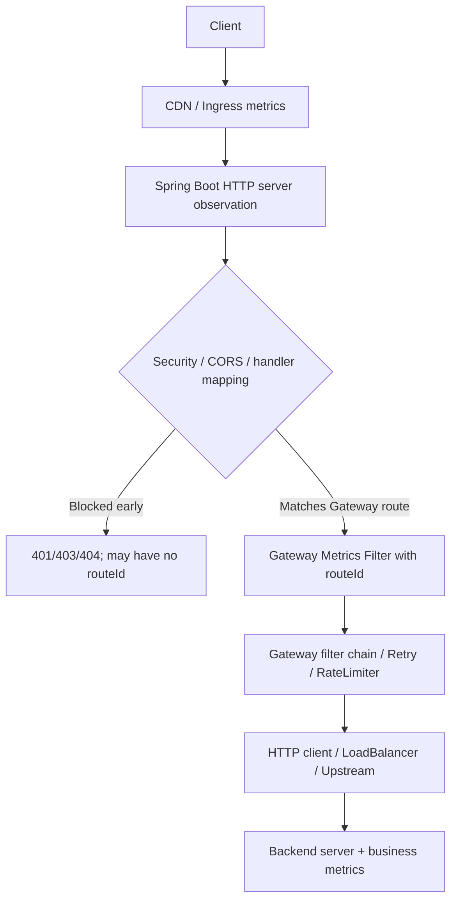
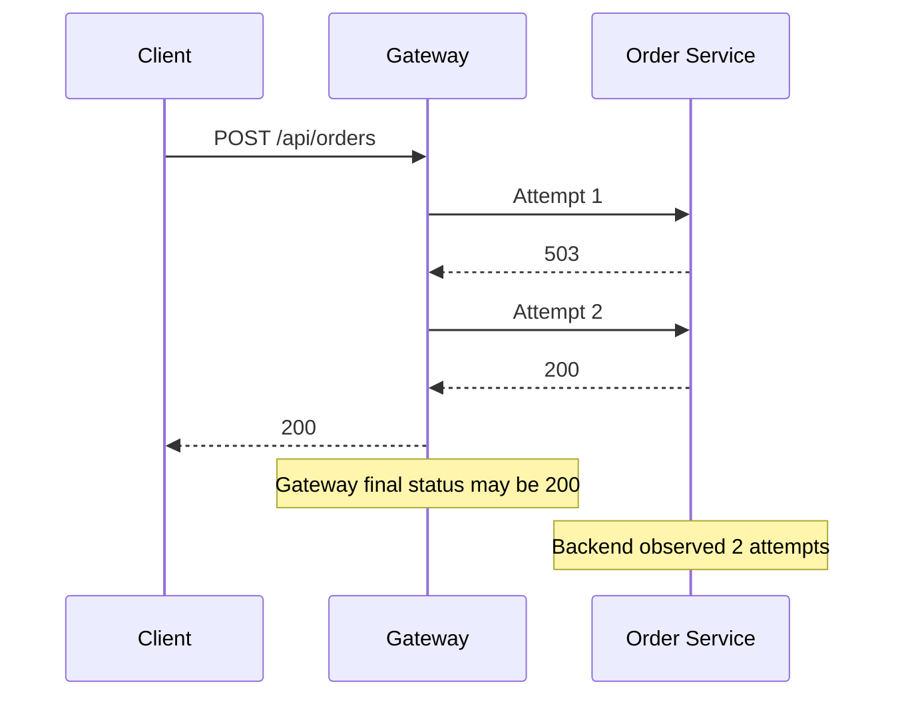
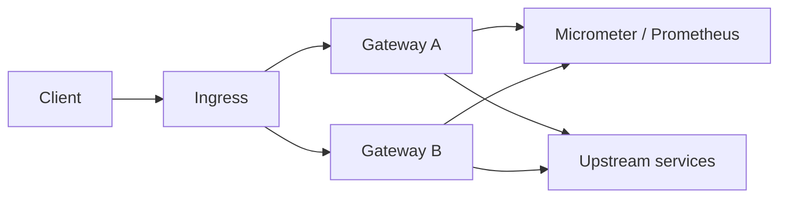

# Request Count, Latency, Outcome, and HTTP Status Codes by Route in Spring Cloud Gateway

A microservices system can return plenty of `200` HTTP responses and still perform poorly: an order API is slow, a payment route returns intermittent `502` errors, or a new route quietly blocks all traffic with `429`. If you only look at Gateway CPU and total HTTP requests, operators struggle to tell **which route** has a problem, whether the failure originates at the Gateway or downstream, and whether user experience is breaching SLO thresholds.

In **Spring Cloud Gateway**, observing traffic by **route ID** ties metrics directly to routing decisions. A useful dashboard needs at least four groups of signals:

1. **Request count**: how many requests does each route receive over an interval, and at what rate in requests per second (RPS)?
2. **Latency**: how long do requests take; how do the mean and percentiles (p50/p95/p99) compare?
3. **Outcome**: does a request fall into `SUCCESSFUL`, `CLIENT_ERROR`, `SERVER_ERROR`, or another outcome?
4. **HTTP status codes**: how many `200`, `201`, `302`, `401`, `403`, `404`, `429`, `500`, `502`, `503`, `504` responses does the route return?

This lesson belongs to the **Observability** chapter of the `SPRING_CLOUD_GATEWAY` module. Here, the Gateway acts as the entry point to microservices with route predicates, filter chains, path/header transformations, service discovery, and load balancing. Authentication, rate limiting, circuit breakers, retries, and TLS can all affect metrics; therefore, you need to know **which layer a metric measures** before inferring root causes.

**Learning objectives:** enable and inspect Micrometer/Gateway metrics, explain route/status/outcome tags, write PromQL queries for traffic and latency, recognize observability gaps for 401/404/connection errors, design SLO-driven dashboards/alerts, and verify metrics end-to-end.

> **Version scope:** The primary hands-on focus is **Spring Cloud Gateway Server WebFlux**, where official documentation describes the `Gateway Metrics Filter` and the `spring.cloud.gateway.requests` meter. Older and newer Spring Cloud Gateway branches differ in property names; Server Web MVC/Servlet has its own metrics system and conventions. Because reference docs and configuration metadata may describe different defaults, **enable metrics explicitly and verify Actuator/Prometheus on your deployed version** before drawing conclusions. Routes, URLs, numbers, and SLO targets in this lesson are illustrative examples.

## 1. Why Are Per-Route Metrics More Important Than Total Traffic?

Suppose a Gateway has three routes:

```yaml
spring:
  cloud:
    gateway:
      server:
        webflux:
          routes:
            - id: catalog-api
              uri: lb://catalog-service
              predicates:
                - Path=/api/catalog/**
              filters:
                - StripPrefix=1

            - id: orders-api
              uri: lb://order-service
              predicates:
                - Path=/api/orders/**
              filters:
                - StripPrefix=1

            - id: payments-api
              uri: lb://payment-service
              predicates:
                - Path=/api/payments/**
              filters:
                - StripPrefix=1
```

If the whole Gateway receives 12,000 requests in 5 minutes and 90% are catalog traffic, a 50% error wave on the payments route can be **masked** when looking only at the system-wide 5xx ratio.

Illustrative example:

| Route | Requests / 5 min | 5xx Count | 5xx Rate |
| --- | ---: | ---: | ---: |
| `catalog-api` | 10,800 | 11 | 0.10% |
| `orders-api` | 900 | 9 | 1.00% |
| `payments-api` | 300 | 150 | 50.00% |
| **Total Gateway** | **12,000** | **170** | **1.42%** |

An overall rate around 1.42% hides the fact that **half** of all payment requests are failing. Therefore, all RED signals (Rate, Errors, Duration) should be analyzed **per route** before aggregating across the Gateway.

### 1.1. Route Names Are an Observability Contract

A good route ID is:

- Stable over time, such as `payments-api`.
- Business-meaningful and aligned with source code/configuration.
- Free of request IDs, user IDs, order numbers, or timestamps.
- Unchanged whenever service discovery returns a new instance.
- Paired with external **stable labels** to distinguish environment/region when needed.

Generating dynamic route IDs per user or path can spike metric cardinality to the point of exhausting RAM and Prometheus storage.

## 2. Four Signal Types: Count, Latency, Outcome, and HTTP Status

These fields are related but not equivalent.

| Signal | Question | Example Answer | Mistake to Avoid |
| --- | --- | --- | --- |
| **Count** | How many requests were recorded? | 600 in 1 minute. | Confusing an accumulated counter with current RPS. |
| **Rate/RPS** | How many requests/second on average? | 10 RPS over 1 minute. | Taking a single counter sample and calling it a rate. |
| **Duration** | How long did requests take? | p95 = 280 ms. | Looking only at the average when tail latency is bad. |
| **Outcome** | What is the HTTP status category? | `SUCCESSFUL`, `CLIENT_ERROR`. | Treating all 4xx responses as server errors. |
| **Status/code** | What final code did the client receive? | `200`, `429`, `503`. | Assuming 200 means the business transaction succeeded. |

A Micrometer **Timer** typically records at least **count** and **total time**; when configured with an appropriate distribution/histogram, it can also provide buckets for calculating p95/p99.

### 2.1. Count and Rate Are Different

If a count increases from 1,200 to 1,800 over 60 seconds:

```text
Requests in 60 seconds = 1,800 - 1,200 = 600
Average RPS            = 600 / 60 = 10 requests/second
```

In Prometheus, use `rate(counter[5m])` or `increase(counter[5m])`; both handle counter resets when an instance restarts.

**Do not subtract two raw counter samples** across different replicas while ignoring restarts, missing scrapes, and time windows.

### 2.2. Average Latency Is Not p95

Two routes can share a 100 ms average while having very different distributions:

```text
Route A: most requests take 80–120 ms.
Route B: 95% of requests take 5 ms, 5% take nearly 2 seconds.

Averages may be close, while tail latency differs drastically.
```

In operations, measure p50/p95/p99, the fraction of requests under the latency SLO, and **accompany them with sample count**. A p99 computed from 12 requests in a minute is nowhere near as reliable for decision-making as a p99 from 100,000 requests.

### 2.3. Outcome Is Not Business Outcome

`outcome=SUCCESSFUL` is usually classified from `2xx` HTTP status codes; it does not guarantee that:

- Payment settled at the payment provider.
- The order actually committed.
- The backend did not serve a cached/fallback response.
- The JSON body is free of business errors.

You need backend **business success** metrics or events and tracing to connect the cause. A fallback returning HTTP `200` can still be counted as `SUCCESSFUL` even when downstream is broken.

## 3. Gateway Metrics Filter in Server WebFlux

Official Gateway Server WebFlux documentation describes the **Gateway Metrics Filter**, which records a Micrometer **Timer** named:

```text
spring.cloud.gateway.requests
```

Key tags:

| Gateway Meter Tag | Meaning | Example | Notes |
| --- | --- | --- | --- |
| `routeId` | Matched route. | `orders-api` | Primary dashboard label. |
| `routeUri` | URI defined on the route. | `lb://order-service` | Usually not the physical instance URL. |
| `outcome` | Outcome category by HTTP status series. | `SUCCESSFUL` / `SERVER_ERROR` | Good for aggregating group ratios. |
| `status` | HTTP status as tagged by the meter. | May be the status name. | **Check actual exporter values**. |
| `httpStatusCode` | Response HTTP code. | `200` / `429` / `503` | Useful for filtering 4xx/5xx. |
| `httpMethod` | Incoming method. | `GET` / `POST` | Analyzes load by operation type. |
| `path` (optional) | Request path. | `/api/orders/42` | Can cause very high cardinality. |

These tags represent the contract documented for the Gateway Metrics Filter. However, **the Prometheus exporter may normalize metric/tag names**; never write production queries based on an unverified example. In particular, `status` and `httpStatusCode` are two separate labels; if you want to filter by numeric code, prefer checking `httpStatusCode` rather than assuming `status` always holds `"500"`.

### 3.1. Gateway Branches Have Different Property Names

| Branch | Property Worth Checking | Action Needed |
| --- | --- | --- |
| Older Gateway WebFlux | `spring.cloud.gateway.metrics.enabled`. | Enable and verify filter/meter on that version. |
| Gateway Server WebFlux 5.x | `spring.cloud.gateway.server.webflux.metrics.enabled`. | Enable explicitly and check dependencies/Actuator. |
| WebFlux 5.x path tag | `spring.cloud.gateway.server.webflux.metrics.path-tags.enabled`. | Usually keep `false` to avoid raw-path cardinality. |
| WebFlux 5.x deprecated path config | `spring.cloud.gateway.server.webflux.metrics.tags.path.enabled`. | Avoid; docs note it may be removed. |
| Gateway Server Web MVC | Do not copy WebFlux filter/metrics properties mechanically. | Check MVC/Servlet meter conventions separately. |

The WebFlux `Global Filters` reference page mentions the filter running unless `spring.cloud.gateway.metrics.enabled=false` is set, whereas 5.1.0 configuration metadata lists `spring.cloud.gateway.server.webflux.metrics.enabled` with default `false`. **Do not rely on assumed defaults during deployment**: set the property for your exact variant to `true`, start the app, and verify that the meter actually emits data.

### 3.2. Not Every HTTP Metric Is a Gateway Metric

An application may simultaneously expose:

- `spring.cloud.gateway.requests`: timer recorded by **Gateway Metrics Filter**, carrying `routeId` when a route matches.
- `http.server.requests` or an equivalent HTTP server observation meter depending on the Spring Boot/Micrometer version: measures HTTP at the **server boundary**, which can capture requests rejected before Gateway routing.
- `http.client.requests`: measures an HTTP client/outbound interaction/observation when supported by instrumentation, not necessarily 1:1 with client requests.
- Reactor Netty connection pool metrics: connections, pending acquires, TLS/connect failures if enabled.

Each meter has a **different scope and lifecycle**. Never add counts from `http.server.requests` and `spring.cloud.gateway.requests` as if they were two independent traffic sources; they can describe the same request at two layers.

## 4. Enabling Actuator and Micrometer Properly

For Spring Cloud Gateway **Server WebFlux**, add Actuator:

```xml
<dependency>
    <groupId>org.springframework.boot</groupId>
    <artifactId>spring-boot-starter-actuator</artifactId>
</dependency>
```

To export metrics to Prometheus:

```xml
<dependency>
    <groupId>io.micrometer</groupId>
    <artifactId>micrometer-registry-prometheus</artifactId>
</dependency>
```

Spring Boot and Spring Cloud versions should be managed via a compatible BOM. Do not add an arbitrary registry/version that could conflict with the Micrometer API.

### 4.1. `application.yml` Example for WebFlux 5.x

```yaml
spring:
  application:
    name: edge-gateway
  cloud:
    gateway:
      server:
        webflux:
          metrics:
            enabled: true
            path-tags:
              enabled: false

management:
  endpoints:
    web:
      exposure:
        include: health,info,metrics,prometheus
```

**Explanation:**

- `metrics.enabled: true`: explicitly enables Gateway metrics under the WebFlux 5.x namespace.
- `path-tags.enabled: false`: prevents turning every raw path into a time-series label.
- `metrics` endpoint lets you inspect meters in Actuator.
- `prometheus` endpoint exports data in Prometheus format when the registry is on the classpath.

**Do not copy this YAML snippet into an older WebFlux Gateway or Server MVC without checking the actual configuration.** On older branches, the corresponding property may live under `spring.cloud.gateway.metrics.enabled`.

### 4.2. Why Actuator Exposure Alone Is Not Enough for Security

`management.endpoints.web.exposure.include` only controls which endpoints are reachable over HTTP; it **does not mean** the endpoints are properly authenticated for production.

An operational setup should:

1. Place management endpoints on a dedicated port/internal network or network policy restricted to Prometheus targets.
2. Allow only authorized collectors/observers to call `/actuator/metrics` and `/actuator/prometheus`.
3. Use TLS/mTLS, service identity, or authorization appropriate for the environment.
4. Never expose wildcard `*` just for debugging convenience.
5. Never open **Gateway Actuator write/refresh CRUD** to the internet when only reading metrics.
6. Protect route definitions, exporter labels, and metadata; they can reveal service topology.

When management runs on a separate application context/port, check the corresponding Spring Security matchers. A `401/403` from a metrics endpoint is not necessarily caused by proxy route rate limiting.

## 5. Inspecting Meters via Actuator

After the Gateway starts and requests flow through route `catalog-api`, query the **management endpoint in an authorized environment**:

```bash
curl -sS \
  "http://localhost:8080/actuator/metrics/spring.cloud.gateway.requests"
```

The output shows the meter name, measurement statistics, and available tags. An **illustrative JSON structure**:

```json
{
  "name": "spring.cloud.gateway.requests",
  "measurements": [
    {"statistic": "COUNT", "value": 42.0},
    {"statistic": "TOTAL_TIME", "value": 3.8},
    {"statistic": "MAX", "value": 0.34}
  ],
  "availableTags": [
    {"tag": "routeId", "values": ["catalog-api", "orders-api"]},
    {"tag": "outcome", "values": ["SUCCESSFUL", "CLIENT_ERROR"]}
  ]
}
```

**The JSON above is constructed for explanation**, not an actual response from a live project Gateway. Values, measurements, and tag lists vary by traffic and version.

### 5.1. Filtering by Route and Status Code

```bash
curl -sS \
  "http://localhost:8080/actuator/metrics/spring.cloud.gateway.requests?tag=routeId:orders-api"

curl -sS \
  "http://localhost:8080/actuator/metrics/spring.cloud.gateway.requests?tag=routeId:orders-api&tag=httpStatusCode:503"
```

Actuator supports `tag=key:value` syntax to filter meters; however, HTTP query serialization, permissions, and actual data must be verified on your current version.

### 5.2. If the Metric “Does Not Exist”

Walk through this checklist:

- Is the Actuator dependency present in the **Gateway process**?
- Is the metrics property for the correct server variant enabled?
- Is the app running Server WebFlux or Server MVC?
- Has any request **actually matched a route** and completed measurement?
- Was the request blocked by Spring Security/handler mapping **before** the Gateway filter?
- Is `metrics` exposed on management endpoints, and are you hitting the right port/base path?
- Is registry/observation configuration filtering or denying that meter?
- Are you inspecting a **different instance** or environment from the one receiving traffic?

Micrometer meters often **do not appear until a matching observation occurs**. Send a test request through a route, check the status and upstream, and then read the meter again.

## 6. Prometheus Exporter and How Metric Names Change

Micrometer uses the dotted name `spring.cloud.gateway.requests`. When exported to Prometheus, names are normalized and a Timer usually yields series like:

```text
spring_cloud_gateway_requests_seconds_count
spring_cloud_gateway_requests_seconds_sum
spring_cloud_gateway_requests_seconds_max
```

If histograms are enabled, you will typically also see:

```text
spring_cloud_gateway_requests_seconds_bucket
```

These are **common naming patterns for Prometheus/Micrometer timers**; suffixes, histogram types, labels, and meter prefixes may differ across registries, versions, or customizations. **Open `/actuator/prometheus` and verify the exact names and tags** before running the PromQL queries below.

### 6.1. Viewing Exported Metrics

```bash
curl -sS "http://localhost:8080/actuator/prometheus"
```

A **synthetic example** of exporter output:

```text
# HELP spring_cloud_gateway_requests_seconds ...
# TYPE spring_cloud_gateway_requests_seconds summary
spring_cloud_gateway_requests_seconds_count{routeId="catalog-api",httpMethod="GET",httpStatusCode="200",outcome="SUCCESSFUL"} 600
spring_cloud_gateway_requests_seconds_sum{routeId="catalog-api",httpMethod="GET",httpStatusCode="200",outcome="SUCCESSFUL"} 48.9
```

The numbers and label set are shortened for readability; an actual exporter may include `routeUri`, `status`, and other Micrometer/Prometheus labels. Do not paste synthetic output into an application as configuration.

### 6.2. Prometheus Scrape Config (Staging)

A simple Prometheus configuration example:

```yaml
scrape_configs:
  - job_name: spring-cloud-gateway
    metrics_path: /actuator/prometheus
    scrape_interval: 15s
    static_configs:
      - targets:
          - "gateway-a.monitoring.internal:9091"
          - "gateway-b.monitoring.internal:9091"
```

This config only illustrates topology. Production should use service discovery/Operator with transport and identity protection. When scraping multiple replicas, **aggregate** by `routeId` for cluster-wide totals, while retaining `instance` to investigate per-pod hot spots.

### 6.3. Do Not Add Different Meter Types Together

The `_count` from the Gateway timer is not an independent “separate counter” from `http.server.requests`. Both meters can be emitted for the very same client request. A single route can also generate multiple upstream attempts due to `Retry`, or one `http.client.requests` per attempt.

**Define the denominator** for every dashboard and SLO:

- Total client requests arriving at the Gateway?
- Requests that matched a route?
- Attempts sent by the Gateway to upstream?
- Backend business successes?

Never mix these denominators in the same error-rate formula.

## 7. PromQL: Computing Request Count and RPS by Route

Assume `/actuator/prometheus` actually contains the counter:

```text
spring_cloud_gateway_requests_seconds_count
```

with a `routeId` label as shown in the example.

### 7.1. RPS by Route, Across All Gateway Replicas

```promql
sum by (routeId) (
  rate(spring_cloud_gateway_requests_seconds_count[5m])
)
```

**Explanation:** `rate(...[5m])` estimates the per-second rate of increase over the last 5 minutes, handling counter resets; `sum by (routeId)` sums series sharing the same route ID across instances, methods, statuses, and outcomes.

This produces **requests/second**, not requests/5 minutes.

### 7.2. Request Count Over 5 Minutes

```promql
sum by (routeId) (
  increase(spring_cloud_gateway_requests_seconds_count[5m])
)
```

`increase` extrapolates across the sampling interval; the result can be fractional rather than an exact integer manual count.

### 7.3. RPS by Route and HTTP Method

```promql
sum by (routeId, httpMethod) (
  rate(spring_cloud_gateway_requests_seconds_count[5m])
)
```

This distinguishes `GET /api/orders/**` used for reading status from `POST /api/orders/**` creating side-effecting orders, even when sharing a route ID (if predicates/methods are structured that way).

### 7.4. Do Not Assume “Route Has No Series” Means “Route Does Not Exist”

A Prometheus query may show no data for a route because:
- No requests have traversed that route yet.
- Metrics are not enabled or not scraped.
- The route ID changed or the route hasn't matched.
- The target is down or the exporter failed.
- The range is too short for `rate` to have enough samples.

Check the route inventory, target `up` status, Actuator, ingress access logs, and a test request before drawing conclusions.

## 8. PromQL: 4xx/5xx Rates and HTTP Status Codes by Route

### 8.1. 5xx Error RPS by Route

If the exporter provides `httpStatusCode` as a numeric string label:

```promql
sum by (routeId) (
  rate(
    spring_cloud_gateway_requests_seconds_count{
      httpStatusCode=~"5.."
    }[5m]
  )
)
```

This expression measures the rate of `500–599` responses per route. On its own, it does not reveal whether the fault lies in the backend, Gateway routing, load balancer, TLS, or circuit breaker.

### 8.2. 5xx Error Rate (%)

```promql
100 *
sum by (routeId) (
  rate(spring_cloud_gateway_requests_seconds_count{
    httpStatusCode=~"5.."
  }[5m])
)
/
clamp_min(
  sum by (routeId) (
    rate(spring_cloud_gateway_requests_seconds_count[5m])
  ),
  0.001
)
```

The sample query uses `clamp_min` to guard against near-zero denominators; **do not** trigger alerts solely from this ratio on very low-traffic routes. Add a **minimum request volume** condition and handle missing data per policy.

If your exporter version uses a different label name or lacks `httpStatusCode`, check the actual labels. Do not change the regex to `status=~"5.."` when `status` holds symbolic names instead of numbers.

### 8.3. 4xx Should Not Be Lumped Into “Server Error”

```promql
sum by (routeId, httpStatusCode) (
  rate(spring_cloud_gateway_requests_seconds_count{
    httpStatusCode=~"4.."
  }[5m])
)
```

Within 4xx:

- `400` may be an invalid request schema.
- `401` is missing/failed authentication.
- `403` is insufficient authorization or another policy denial.
- `404` may come from the backend, or a route miss that is not recorded under per-route Gateway metrics.
- `409` may be a business conflict or idempotency check per contract.
- `429` is quota/rate limiting; a high 429 rate may indicate proper defense or misconfigured quotas.

Therefore, business API SLOs should not **automatically** treat every 4xx as a Gateway availability failure.

### 8.4. 429 Status by Route

```promql
sum by (routeId) (
  rate(spring_cloud_gateway_requests_seconds_count{
    httpStatusCode="429"
  }[5m])
)
```

`429` can be issued by Gateway's `RequestRateLimiter`, a CDN/WAF, or the backend. If it occurs **before route matching**, it might not appear in per-route Gateway metrics. Combine logs and traces across layers to identify the source.

### 8.5. Outcome Distribution by Route

```promql
sum by (routeId, outcome) (
  rate(spring_cloud_gateway_requests_seconds_count[5m])
)
```

Depending on Micrometer/HttpStatus series, values may include `SUCCESSFUL`, `REDIRECTION`, `CLIENT_ERROR`, and `SERVER_ERROR`. Outcome gives a quick grouped picture, while HTTP status codes help pinpoint specific causes.

### 8.6. Watching Only the “Final Status Received by the Client”

If a Gateway `SetStatus` filter rewrites a 5xx response to 200, or a circuit breaker fallback returns 200, metrics based solely on final HTTP status may count the call as successful. **Never use response status as the sole measure of downstream health or business result.**

## 9. PromQL: Average Latency by Route

If the Timer exposes `_seconds_sum` and `_seconds_count`:

```promql
sum by (routeId) (
  rate(spring_cloud_gateway_requests_seconds_sum[5m])
)
/
sum by (routeId) (
  rate(spring_cloud_gateway_requests_seconds_count[5m])
)
```

The result is in **seconds/request**. For milliseconds, multiply by 1,000:

```promql
1000 *
sum by (routeId) (
  rate(spring_cloud_gateway_requests_seconds_sum[5m])
)
/
sum by (routeId) (
  rate(spring_cloud_gateway_requests_seconds_count[5m])
)
```

### 9.1. Manual Calculation Example

Over 5 minutes, route `catalog-api` accumulates 48 seconds total duration across 600 requests:

```text
Mean duration = 48 / 600 = 0.08 seconds = 80 ms
```

If 590 requests take 20 ms and 10 requests take 3 seconds, the average hides the tail latency. Always add p95/p99 or threshold compliance.

### 9.2. What Span Does the Gateway Timer Measure?

A meter in the Gateway filter chain does not necessarily cover:

- DNS/TCP/TLS handshakes **before the request enters the Gateway pipeline**.
- Requests blocked before matching a Gateway route.
- Client-side network latency from device to ingress.
- The full lifecycle of a WebSocket after HTTP 101.
- Async business job duration after the API returns `202 Accepted`.

For normal HTTP proxying, the timer reveals request duration across the Gateway filter chain according to the implementation's hook point. **Do not automatically equate it with “end-to-end user latency”**; use synthetic probes and tracing for full-path visibility.

## 10. p95/p99: Histograms and How to Enable Them in Micrometer

To compute percentiles that can be aggregated across multiple Gateway replicas/routes, **histograms** are generally superior to client-side percentiles.

Micrometer distinguishes:

- **Percentile histograms**: export buckets so Prometheus can calculate `histogram_quantile` after aggregation.
- **Client-side percentiles**: estimated per instance/series; you typically **cannot sum or average p95 values** into a cluster-wide p95.
- **SLO buckets**: buckets at chosen latency thresholds, used to measure the share of requests below a target.

### 10.1. Example: Enabling Histograms via Spring Boot Properties

```properties
# Illustrates a common Micrometer/Spring Boot configuration.
management.metrics.distribution.percentiles-histogram.spring.cloud.gateway.requests=true

# Buckets/thresholds tailored to illustrative targets.
management.metrics.distribution.slo.spring.cloud.gateway.requests=100ms,300ms,1s
```

These properties depend on your Spring Boot/Micrometer version and can generate many time series across tag combinations. **Enable them only for meters/routes that need them**, check real `/actuator/prometheus` output for `_bucket`, and only then run the queries below.

If `spring_cloud_gateway_requests_seconds_bucket` does not exist, calling `histogram_quantile` on it yields no data; increasing the scrape interval or copying a Grafana query will not generate buckets on its own.

### 10.2. p95 by Route with Classic Histograms

```promql
histogram_quantile(
  0.95,
  sum by (le, routeId) (
    rate(spring_cloud_gateway_requests_seconds_bucket[5m])
  )
)
```

**Explanation:**

- `_bucket` represents cumulative buckets of a classic histogram.
- `le` is the bucket upper bound, which **must be preserved** when computing quantiles.
- `sum by (le, routeId)` aggregates histograms across instances while keeping the route dimension.
- The output unit is **seconds** for this Timer time series.
- `0.95` corresponds to p95, estimating that roughly 95% of observations do not exceed that threshold.

### 10.3. p99 by Route

```promql
histogram_quantile(
  0.99,
  sum by (le, routeId) (
    rate(spring_cloud_gateway_requests_seconds_bucket[5m])
  )
)
```

Do not compute:

```text
(p95 of Gateway A + p95 of Gateway B) / 2
```

to estimate cluster p95. Averaging percentiles does not preserve the distribution, especially when A and B carry unequal traffic.

### 10.4. Do Not Enable Histograms for Unbounded Tag Sets

Every combination of `routeId`, `routeUri`, `status`, `httpStatusCode`, `httpMethod`, and `outcome` multiplied by the bucket count produces many time series.

For example, 200 routes × 8 status codes × 5 methods × 20 buckets can create 160,000 series **before even multiplying by replicas and additional labels**. This is just an illustrative cardinality calculation; actual series counts depend on traffic, filters, and the exporter.

Options:

1. Keep raw `path` tags disabled.
2. Keep route IDs stable and bounded in number.
3. Enable histograms only for meters/routes requiring p95/SLO tracking.
4. Prune unnecessary status combinations with carefully controlled recording rules/filters, without stripping alert-critical labels.
5. Monitor cardinality, Prometheus storage, and memory usage.

## 11. Latency SLOs: Share of Requests Under Threshold Matters More Than Average

Suppose `catalog-api`'s SLO is **99% of requests completing under 300 ms** over 30 days. If a `le="0.3"` bucket (in seconds) exists:

```promql
sum by (routeId) (
  rate(spring_cloud_gateway_requests_seconds_bucket{
    le="0.3"
  }[5m])
)
/
sum by (routeId) (
  rate(spring_cloud_gateway_requests_seconds_count[5m])
)
```

**Prerequisite:** The `0.3` bucket must actually exist after enabling histogram/SLO buckets, and the `le` label must match the exact string exported. With native histograms, query structure may differ. Never assume a 300 ms boundary exists unless explicitly configured.

### 11.1. Latency SLI and Availability SLI Are Separate Measurements

- **Latency SLI:** share of requests completing within acceptable time.
- **Availability SLI:** share of requests succeeding per contract (e.g., non-5xx), after deciding how 4xx responses are classified.
- **Business correctness:** proper business execution—no duplicate charges, no wrong data returned.

A service with 99.99% availability and a 4-second p95 can still breach its latency SLO.

### 11.2. Do Not Measure Latency Only Across 2xx Responses

If the Gateway times out and returns 504 after 30 seconds, yet the latency dashboard filters strictly on 2xx, p95 can actually drop right as the system breaks. View **all-status latency** and **success-only latency** as complementary lenses.

## 12. Requests Without a Route ID: Observability Gaps

**Route-tagged Gateway metrics do not cover all ingress HTTP traffic.** Some requests never reach the Gateway Metrics Filter or have no matched route:

- URLs matching no predicate, returning 404 at handler mapping.
- Spring Security returning 401/403 before route selection.
- CORS preflights handled at an earlier layer.
- HTTP parser rejecting malformed requests very early.
- TCP/TLS handshake failures, or clients connecting and disconnecting before HTTP.
- Ingress/CDN/WAF returning a response that the Gateway never sees.
- Management endpoints like `/actuator/health` running on a separate pipeline.

A “route not found” 404 may **not appear in `spring.cloud.gateway.requests{routeId=...}`** because there is no route ID to attach.

### 12.1. Solution: Multi-Layer Observability



When the gap between ingress request count and Gateway route count grows, check:

1. Unmatched route requests (404).
2. Requests blocked early by Security/CORS.
3. Disabled metrics, missed scrapes, or missing histograms/time series.
4. Different measurement scopes between meters.
5. Client disconnects and incomplete requests.
6. Requests hitting an instance that Prometheus is not scraping.

### 12.2. Do Not Subtract Arbitrary Counters and Call It “Unmatched Requests”

`http.server.requests` may include actuator endpoints, health checks, or a different request scope, while the Gateway route timer follows a different filter lifecycle. Therefore:

```text
HTTP server request count - Gateway request count
```

**does not automatically equal the number of “unmatched route” requests**. Only use the delta as a diagnostic signal after aligning scopes, methods, target instances, and time windows.

## 13. Distinguishing HTTP Codes and Response Origins

The final status code the Gateway sends to the client is not always the original status from the backend.

| Client-Received Status | Possible Origin | What to Verify |
| --- | --- | --- |
| `200/201` | Backend success or Gateway fallback/transform. | Backend business result, trace, and response origin. |
| `202` | Request accepted for async processing. | Did the job/transaction complete afterward? |
| `301/302/307/308` | Redirect filter or backend. | Location/redirect policy, guard against open redirects. |
| `400` | Header/body validation at Gateway or backend. | Security/validation logs. |
| `401` | Spring Security or backend auth. | Authentication source, JWT/issuer/expiry. |
| `403` | Authorization, CORS, empty quota key denial. | Separate layer and policy. |
| `404` | No route match or backend resource not found. | Route ID/predicates and backend path. |
| `409` | Business conflict or idempotency policy. | Is this a valid outcome per API contract? |
| `429` | WAF/CDN, RequestRateLimiter, or backend. | Rate limit key, quota, and enforcement point. |
| `500` | Gateway code/filter bug or backend error. | Stack trace/trace span and upstream status. |
| `502` | Gateway/proxy received invalid response from upstream. | DNS/TLS/connect/protocol. |
| `503` | LoadBalancer has no service instances; circuit breaker or backend unavailable. | Discovery/readiness/circuit state. |
| `504` | Timeout at a gateway/proxy layer. | Deadline, backend latency, client retries. |

### 13.1. Do Not Treat Every 4xx as an Operational Outage

An authentication route can show a high `401` rate when internet traffic continuously tries invalid tokens. That can be a **security abuse** signal rather than a backend outage.

Conversely, right after a deployment, `403` jumping from 1% to 90% on a valid route likely indicates an authorization/CORS regression. Combine traffic baselines with deployment events.

### 13.2. HTTP Status Code and Outcome Are Two Analytical Dimensions

`outcome=SERVER_ERROR` groups all 5xx errors together; `httpStatusCode="503"` pinpoints a specific failure type. Dashboards should feature both **stacked outcome proportions** and **top status codes** so critical details aren't lost during triage.

## 14. Interactions with Retry, CircuitBreaker, and Fallback

A single client request can trigger **multiple upstream attempts** if the route uses `Retry`.



Result:

- **Gateway request timer** may record one request with a final status of **200**, depending on filter lifecycle.
- **Upstream HTTP client** may show multiple attempts with 503 and 200 if instrumented.
- **Backend server metrics** see two attempts.
- **Separate retry metrics** are needed to explain attempt counts and retry exhaustion.

Add these supplementary indicators:

| Supplementary Indicator | Why It Is Needed |
| --- | --- |
| Upstream attempts / client request | Detects retry amplification. |
| Retry attempts / exhausted | Exposes retry attempts hidden behind a final 200. |
| Circuit breaker open/half-open/rejected | Shows requests blocked from going upstream by policy. |
| Fallback responses | Distinguishes fallback 200s from normal backend responses. |
| Client request count | Serves as the Gateway SLI denominator. |
| Business completion/idempotency results | Prevents assuming 200/202 means business completion. |

Never use Gateway route metrics to claim the backend was only called once.

### 14.1. RateLimiter and 429

`RequestRateLimiter` can reject with 429 before upstream routing. Depending on filter ordering and metrics instrumentation, a short-circuited response may or may not be recorded in the route timer; verify **on your actual version**.

Maintain dedicated metrics for `rate_limiter.allowed`/`denied`, quota store latency/failures, and 429 responses. A rising 429 rate may indicate an attack, an overly tight quota tier, or a legitimate traffic spike.

### 14.2. CircuitBreaker Fallbacks Masking Downstream Failures

When a fallback returns 200 while the backend continuously times out, a final-status Gateway dashboard can stay “green.” To avoid being misled:

- Monitor circuit breaker open state and fallback counts.
- Watch upstream `http.client.requests` (if supported by instrumentation).
- Check backend HTTP server metrics and health.
- Use traces to tie a fallback request back to the underlying error.

### 14.3. Status Mapping/Transformation Filters

Gateway `SetStatus` or response transformation filters can alter the final status code. Remember that `httpStatusCode` in Gateway metrics usually reflects the **response sent to the client**, not necessarily the original backend status.

## 15. LoadBalancer and No-Service-Instance Errors

A route with `uri: lb://payment-service` relies on LoadBalancer instance selection during routing. If service discovery finds no instances, Gateway WebFlux may return **503** (or 404 depending on configuration in some versions). This differs from `payment-service` itself returning HTTP 503.

What to observe:

- Route ID `payments-api` and final status.
- Target service ID referenced by the route.
- Number of service instances published by discovery.
- LoadBalancer choose/no-instance metrics or logs.
- DNS/connect timeout/TLS handshake errors.
- Backend server request count: did any request actually arrive?

`routeUri=lb://payment-service` is the **target service definition**, not the selected instance IP/port. Never encode ephemeral instance IPs or raw URLs into `routeId` to create per-instance series.

## 16. Observing Multiple Gateway Replicas and Dynamic Routes

Production setups usually run multiple Gateway pods behind an ingress:



### 16.1. Aggregating Across Replicas

```promql
sum by (routeId) (
  rate(spring_cloud_gateway_requests_seconds_count{
    job="spring-cloud-gateway"
  }[5m])
)
```

This represents cluster-wide RPS **if the job label and scrape targets match your scraper configuration**. If your labels differ, adjust selectors accordingly.

To compare individual pods:

```promql
sum by (instance, routeId) (
  rate(spring_cloud_gateway_requests_seconds_count[5m])
)
```

If instance A handles 90% of traffic while B gets only 10%, inspect ingress load distribution, readiness, deployments, and weights. Note, however, that sticky routing or HTTP keep-alive can intentionally skew distribution.

### 16.2. Dynamic Route Refreshes Can Make Series Disappear

When route `orders-api` is renamed to `orders-v2`, Prometheus treats it as a **different label value**. The RPS dashboard shows a new series starting while the old one stops, even though business traffic did not change.

Best practices:

- Keep route IDs stable if the API contract hasn't changed.
- Track deployment/config revisions via annotations/events rather than constantly churning metric labels.
- Maintain a route inventory or route-count gauge.
- Use tracing or logs to confirm the effective route revision.
- Alert on missing traffic for expected routes only after accounting for planned downtime or quiet hours.

### 16.3. Scrape Target Down Differs from Zero Route Traffic

`up{job="spring-cloud-gateway"} == 0` indicates a **Prometheus scrape failure**. It does not necessarily mean the Gateway app is completely down, but it requires investigation. If a route has no data in `_count`, it may simply have received no requests or lack the meter.

Place scrape target health, JVM/CPU/GC, Netty connections, and route metrics side by side on your dashboard.

## 17. Label Cardinality: Pitfalls of `path`, User, and URI Tags

Because each combination of metric name + labels forms a distinct time series, paths embedding per-entity IDs:

```text
/api/orders/100001
/api/orders/100002
/api/orders/100003
...
```

can create huge numbers of series if raw paths are placed into the `path` tag.

### 17.1. Recommended Label Policy

| Field | Good Metric Label? | Reason |
| --- | --- | --- |
| Stable `routeId` | **Yes** | Number of routes is usually bounded and dashboard-friendly. |
| `httpMethod` | **Yes** | Small fixed set of values. |
| `outcome` | **Yes** | Finite set. |
| `httpStatusCode` | **Yes, with care** | Finite set of values, useful for debugging. |
| `region`/`environment` | **Yes, if small** | Compares regions and environments. |
| Raw `path`/query string | **No** | IDs, search queries, and cursors cause high cardinality. |
| Raw user ID/tenant ID | **No** for general request metrics | Can have millions of values and privacy risks. |
| JWT/cookie/token | **Never** | Secrets and unbounded cardinality. |
| Trace ID/request ID | **No** | Nearly unique per request; belongs in tracing/logs. |
| Ephemeral instance IP in `routeId` | **No** | Route identity churns during autoscaling. |
| Dynamic `routeURI` from user input | **No** | Unbounded and may contain sensitive data. |

### 17.2. When You Truly Need URL-Level Detail

Instead of enabling the raw `path` tag broadly:

- Split route IDs along business boundaries.
- Use a **normalized** templated path or operation ID if supported by instrumentation.
- Debug using sampled, retention-managed logs/traces.
- Put high-cardinality attributes into protected tracing spans rather than Prometheus labels.
- Restrict access to sensitive telemetry data.

Gateway WebFlux 5.1.0 docs state `spring.cloud.gateway.server.webflux.metrics.path-tags.enabled` defaults to `false`; keep it false unless you have explicitly quantified cardinality.

## 18. Designing a RED-Based Grafana Dashboard

A minimal “Gateway by Route” dashboard can include:

| Panel | Query / Information | Decision Supported |
| --- | --- | --- |
| **Total RPS** | `sum(rate(..._count[5m]))`. | Overall traffic surge or drop. |
| **RPS by route** | `sum by(routeId)(rate(..._count[5m]))`. | Which routes carry load. |
| **5xx error rate %** | 5xx divided by all route requests. | Which routes breach availability SLOs. |
| **4xx breakdown** | `sum by(routeId,httpStatusCode)`. | Separates 401, 403, 404, 409, 429. |
| **p50/p95/p99 latency** | `histogram_quantile` when buckets exist. | Tail latency breaches. |
| **Mean latency** | `rate(_sum)/rate(_count)`. | Long-term trend, not a substitute for p95. |
| **Request volume by method** | Broken down by `httpMethod`. | Unusual spikes in POST/GET. |
| **Retry/CircuitBreaker signals** | Filter/backend metrics. | Whether final status hides upstream failures. |
| **Target health** | `up`, instance count, CPU/GC. | Distinguishes scrape/down failures from zero traffic. |
| **Deployment annotations** | Rollout/config refresh timestamps. | Correlates regressions with changes. |

### 18.1. Adding Drill-Down Workflows

Starting from the per-route 5xx panel, a practical investigation sequence:

```text
Route "orders-api" 5xx spikes
  → Split 500 / 502 / 503 / 504
  → Compare p95 latency
  → Check retries and circuit breaker
  → Inspect upstream instances / HTTP client observations
  → Find representative traces for the route/time window
  → Cross-check backend logs / deployments
```

Never leave a dashboard with only a single “HTTP error total” chart that gives no clue which service or route generated the signal.

### 18.2. Avoid Plotting Too Many Series in One Panel

With hundreds of routes, plotting every status × every route becomes unreadable. Prefer:

- Top N routes by RPS or 5xx.
- Dropdown variable filtering on `routeId`.
- An overview panel grouped by outcome.
- Detailed single-route drill-down over a selected time window.
- Recording rules for frequently evaluated SLI expressions.

## 19. Per-Route Alerting and Avoiding Noisy Alerts

A good alert needs more than a threshold—it needs **volume, duration, and impact**.

Illustrative policy example:

- Route `payments-api` has a 5xx ratio above **2%** continuously for **10 minutes**.
- At least **100 requests in 10 minutes** to suppress false positives on low-traffic routes.
- Gateway scrape targets are healthy and data is not missing.
- Automatically attach route ID, region, dashboard, and runbook links.

An **illustrative** Prometheus alerting rule (using the same meter/tags as earlier queries):

```yaml
groups:
  - name: gateway-route-alerts
    rules:
      - alert: GatewayRouteHigh5xxRatio
        expr: |
          (
            sum by (routeId) (
              increase(spring_cloud_gateway_requests_seconds_count{
                httpStatusCode=~"5.."
              }[10m])
            )
            /
            clamp_min(
              sum by (routeId) (
                increase(spring_cloud_gateway_requests_seconds_count[10m])
              ),
              1
            )
          ) > 0.02
          and on (routeId)
          sum by (routeId) (
            increase(spring_cloud_gateway_requests_seconds_count[10m])
          ) >= 100
        for: 10m
        labels:
          severity: warning
        annotations:
          summary: "Route has high 5xx rate"
          description: "Check the RED Dashboard and upstream health."
```

**Note:** Verify rule syntax with `promtool`, confirm actual metric names, labels, traffic volume, and Prometheus evaluation interval. `for: 10m` requires the expression to stay true for 10 consecutive minutes; combined with the `[10m]` window, this does not fire instantaneously on a brief spike. Choose window and `for` values to match alert urgency.

### 19.1. Alerting on Zero-Traffic Routes

If `payments-api` normally sees 50 RPS and suddenly drops to 0, the route may have been deleted, ingress may have stopped forwarding, or traffic may simply be in an off-peak lull. Zero-traffic alerting requires baselines/time-of-day awareness, route inventory, and target `up` checks—never fire `absent()` blindly and declare the route dead.

### 19.2. Burn-Rate Alerts Beat Static Thresholds

For a 99.9% availability SLO, the error budget is 0.1%. Burn-rate alerts detect how fast the error budget is being consumed. Multi-window (short + long) rules catch issues quickly while minimizing alert fatigue.

Do not force a single 1% 5xx threshold onto every route. Payment, login, and public info routes have different traffic patterns and risk profiles; SLOs should be agreed upon by each service's owning team.

## 20. Distinguishing Gateway Errors from Backend Errors

A `httpStatusCode="503"` signal can originate from:

- LoadBalancer finding no service instances.
- An open Gateway circuit breaker.
- The backend genuinely returning 503.
- Connection pool exhaustion mapped to 5xx by a handler.
- An upstream proxy returning 503 during a rollout/restart.

One way to isolate the source:

| Evidence | Likely Indication |
| --- | --- |
| Gateway 503, backend sees no requests | Routing/discovery/connection/circuit breaker before backend. |
| Gateway 503, backend `http.server.requests` also 503 | Backend likely returned 503 directly. |
| Gateway final 200, upstream attempts show 503 | Retry/fallback may be masking errors. |
| Ingress 429, Gateway route counter does not rise | WAF/CDN/ingress blocked before Gateway. |
| Gateway 401, no `routeId` | Security likely rejected before route matching. |
| Gateway 404, no `routeId` | Route miss; or another source depending on status behavior. |

Confirm with concrete traces and logs rather than guessing from correlation alone—a backend might also miss metrics due to sampling or a down exporter.

### 20.1. Observing `http.client.requests`

Spring Cloud Gateway can emit **HTTP client observations**; project metadata documents `http.client.requests` with low-cardinality keys such as HTTP method, status, and route ID/URI alongside high-cardinality HTTP URI keys for tracing in supporting branches.

This provides a valuable supplementary signal for **outbound calls**, though exact call counts and semantics depend on instrumentation and version. Never assume every client request maps 1:1 between `http.client.requests` and `spring.cloud.gateway.requests` when retries are active.

### 20.2. TLS/Network Errors Before an HTTP Status Exists

If a TLS handshake fails before an HTTP response is received, there is no “502” HTTP status from the backend. A proxy layer may map it to 502/503, or the client may just encounter a network error. To observe this, collect network/Netty/ingress/TLS metrics and logs; final-route status alone cannot tell the full story.

## 21. WebSocket, SSE, and Long-Running Requests

Not every route shares the same definition of “duration.”

### 21.1. WebSocket

A WebSocket handshake may receive `101 Switching Protocols` and hold the session open for an hour. HTTP route meters do not capture WebSocket frame counts, reconnects, close codes, or message latency.

You need dedicated metrics:

- Active WebSocket connections.
- Handshake successes/failures.
- Session durations and close codes.
- Messages/bytes per second.
- Heartbeat RTT/misses and reconnect counts.
- Outbound queue/backpressure.

### 21.2. SSE / Streaming HTTP

With `text/event-stream`, responses can stay open for a long time. A timer measuring until stream completion will look “very slow” even when real-time delivery works perfectly. Separate time-to-first-byte, event delivery lag, stream lifetime, and disconnect rates.

Never apply a short JSON HTTP SLO like `p95 < 300ms` to long-lived SSE or WebSocket routes.

### 21.3. HTTP 202 Async Jobs

`POST /api/reports` returning 202 in 30 ms does not mean the report finished in 30 ms. Track queue wait time, job processing duration, job failures, and user-visible completion time in the worker/backend.

## 22. End-to-End Testing of Per-Route Metrics

Suppose staging has:

```text
Gateway Server WebFlux: localhost:8080
Mock catalog upstream: /products/*
Route ID: catalog-api
Actuator: /actuator/metrics and /actuator/prometheus
Prometheus: scraping job="spring-cloud-gateway"
```

**Use only a mock backend or staging**—never generate heavy test traffic against production.

### 22.1. 200 OK Scenario

Send 10 GET requests to `/api/catalog/products/42` with the mock upstream returning 200:

```bash
for i in 1 2 3 4 5 6 7 8 9 10; do
  curl -sS -o /dev/null -w "%{http_code}\n" \
    "http://localhost:8080/api/catalog/products/42"
done
```

Expectations:

- Route `catalog-api` matches.
- Mock backend receives the requests.
- Actuator meter records data under `routeId=catalog-api` with the HTTP method/status.
- Counters increment in line with recorded requests after completion and exporter update.
- Prometheus scraping may lag until the next scrape interval; changes do not appear instantaneously.

### 22.2. Backend Returning 503 Scenario

Switch the mock upstream to return 503 for 5 requests. Verify:

- Gateway client response status (unless modified by a filter).
- Gateway status label `httpStatusCode` reflects the final status.
- Outcome falls under `SERVER_ERROR`.
- PromQL 5xx rate by route reflects the errors.
- Tracing/backend logs confirm whether the backend genuinely returned 503 or the Gateway synthesized it.

### 22.3. 429 from RateLimiter Scenario

Configure a test route with a low quota and send a burst:

- You may see `429` at the Gateway if quota enforcement happens after route matching.
- The backend request counter **does not increase** for blocked requests.
- Dedicated rate limiter denied metrics should increase.
- Whether the Gateway route timer records short-circuited requests depends on filter implementation and order; **test directly rather than assuming**.

### 22.4. Unmatched Route Scenario

Send a request to a path matching no route:

```bash
curl -i "http://localhost:8080/unknown-path"
```

Inspect the HTTP status and Spring Boot/ingress HTTP server metrics. Do not expect the Gateway Metrics Filter to record `routeId=unknown`, since no route was selected.

### 22.5. Authentication Failure Scenario

Send a request to a JWT-protected route without a token. If Spring Security rejects early:

- HTTP response may be 401.
- Gateway route timer may record no route ID.
- HTTP server observations and Security/ingress logs capture the signal.
- Security-failure dashboards need their own source rather than relying solely on route metrics.

### 22.6. Retry Scenario

Configure the mock upstream to return 503 on the first attempt and 200 on the second. Verify:

- Client requests: 1.
- Upstream attempts: 2.
- Final HTTP response: 200 if Retry succeeds.
- Gateway timer/outcome: reflects the final response and filter semantics.
- Backend metrics: received both attempts.
- Never run this test against a side-effecting POST without idempotency.

## 23. Test Matrix and Acceptance Criteria

| Scenario | What to Verify |
| --- | --- |
| Without Actuator | Meters may not be exposed as expected. |
| Metrics enabled for correct variant | `spring.cloud.gateway.requests` appears after matching traffic. |
| Wrong namespace configured | Meter may stay inactive; inspect configuration metadata. |
| Single route, 10 requests | Count/increase/RPS match scope, accounting for scrape lag. |
| Two independent routes | `routeId` tags clearly distinguish them. |
| Two replicas | `sum by(routeId)` aggregates both series correctly. |
| One pod restarts | `rate` handles the counter reset without false dashboard spikes. |
| Route with no traffic yet | Series may not appear yet. |
| Route ID changed on deploy | Old and new business series are mapped clearly. |
| HTTP status 200 | Outcome reflects 2xx; verify business outcome separately. |
| HTTP status 429 | Distinguish limiter/ingress/backend and route tag behavior. |
| HTTP status 503 | Separate discovery, Gateway, and backend failures. |
| Auth 401 before Gateway | Do not assume metrics must include a `routeId`. |
| Unmatched 404 | HTTP server/ingress metrics may record it while route metrics lack it. |
| Filter short-circuit | Verify actual metric count per filter order/version. |
| Fallback 200 | Downstream failures remain visible via circuit metrics/traces. |
| Retry 503→200 | Gateway final status and upstream attempts measured separately. |
| Histogram enabled | `_bucket` appears and p95/p99 queries execute cleanly. |
| Histogram disabled | PromQL histogram queries return nothing; inspect `_count`/`_sum`. |
| Raw path tag enabled | Cardinality increases; evaluate and revert if excessive. |
| Prometheus scrape down | `up=0`; do not misreport as a route outage. |
| SSE/WebSocket stream | Do not apply short JSON request latency semantics. |
| 202 async response | Do not equate HTTP latency with business job completion. |
| Public management endpoint | Blocked per security/network policy. |

## 24. Diagnosing Common Metrics Issues

| Symptom | Possible Cause | Resolution |
| --- | --- | --- |
| `/actuator/metrics` returns 404. | Endpoint not exposed, wrong management port/base path, or missing Actuator. | Check dependencies and management configuration. |
| `spring.cloud.gateway.requests` missing. | Metrics disabled, no matched traffic yet, wrong server variant, or meter filtered out. | Confirm WebFlux/namespace, send test route request, inspect Actuator. |
| `/actuator/prometheus` does not exist. | Missing `micrometer-registry-prometheus` or not exposed. | Add registry, expose securely. |
| Meter in Actuator but no data in PromQL. | Different exported name, Prometheus not scraping, or target down. | Check raw Prometheus output, `up` status, and labels. |
| PromQL filter `status=~"5.."` returns empty. | `status` may hold symbolic names instead of codes. | Inspect `httpStatusCode` label and actual values. |
| p95 query returns no data. | No histogram buckets. | Enable histogram/SLO buckets for the right meter and retest. |
| RPS appears doubled. | Summing both Gateway and HTTP server metrics, or duplicate scrape targets. | Pick a single denominator and inspect Prometheus targets. |
| RPS spikes sharply after restart. | Using raw counter differences instead of `rate`. | Use `rate` or `increase` to handle resets. |
| Average latency looks good while users complain of slowness. | Tail latency, CDN, TLS, network, or async job outside the meter. | Inspect p95/p99, synthetic probes, and traces. |
| Cluster 5xx rate is low while payments fails heavily. | Aggregation masks low-traffic routes. | Split by `routeId` and compare per-route SLOs. |
| Gateway returns 503 while backend sees no 503s. | LoadBalancer or Gateway produced the error before upstream. | Check discovery/connection/circuit observations. |
| Gateway returns 200 while backend fails. | Retry or fallback hides upstream status. | Check upstream attempts, circuit metrics, and traces. |
| Unmatched 404 has no `routeId`. | No route was selected. | Use HTTP server/ingress metrics and logs. |
| JWT 401 has no `routeId`. | Security blocked before the Gateway filter chain. | Observe Servlet/WebFlux security/HTTP server layer. |
| 429 rises while backend load drops. | RateLimiter is protecting the backend, possibly as intended. | Analyze quotas, traffic sources, and tiers. |
| Prometheus RAM/disk grows rapidly. | High cardinality from raw path/user ID tags or too many histogram buckets. | Disable path tags, bound labels, monitor cardinality. |
| Route metrics vanish after refresh. | Route ID/labels changed or metrics config changed. | Keep stable IDs; check route inventory/version. |
| Target `up=0` while Gateway HTTP still serves traffic. | Management endpoint/TLS/auth/network scrape failure. | Investigate collector connectivity vs. app health. |
| HTTP 101 succeeds but WebSocket clients drop. | Handshake metric doesn't track full connection lifetime. | Use WebSocket session/close/heartbeat metrics. |
| Client receives 202 but job fails. | HTTP metric only tracks acceptance. | Track backend queue/job completion separately. |

## 25. Practice Exercises with Answers

### Exercise 1 — Calculating RPS

A route's counter grows from 1,200 to 1,800 in 60 seconds. What is the average RPS?

**Answer:** (1,800 − 1,200)/60 = **10 requests/second**.

### Exercise 2 — Per-Route 5xx Ratio

The payments route sees 300 requests and 150 5xx responses. What is the error rate?

**Answer:** 150/300 × 100% = **50%**. Even if the Gateway-wide error rate looks small, this route is experiencing a major outage.

### Exercise 3 — When a Metric Does Not Appear

A request to `/some-unknown-path` returns 404, yet no `routeId` is found. Is the Gateway Metrics Filter necessarily broken?

**Answer:** No. Requests that match no route can be rejected **before** entering the Gateway filter chain. Look at HTTP server/ingress metrics instead.

### Exercise 4 — Gateway Timer Tags

Which tag is typically used to distinguish routes in `spring.cloud.gateway.requests`?

**Answer:** **`routeId`**, such as `orders-api`; `routeUri` holds the declared destination URI like `lb://order-service`.

### Exercise 5 — Outcome vs. HTTP Status Code

Does `outcome=CLIENT_ERROR` tell you specifically whether a response was 401 or 429?

**Answer:** No. Outcome only represents the 4xx category. Check the `httpStatusCode` label or response logs.

### Exercise 6 — PromQL Route RPS

Write a query computing cluster-wide RPS per route from `spring_cloud_gateway_requests_seconds_count`.

**Answer:**

```promql
sum by (routeId) (
  rate(spring_cloud_gateway_requests_seconds_count[5m])
)
```

### Exercise 7 — Mean Latency

Total duration = 48 seconds across 600 requests. What is the mean?

**Answer:** 48/600 = **0.08 seconds = 80 ms**.

### Exercise 8 — Aggregating Percentiles

Two replicas have p95 values of 80 ms and 300 ms respectively. Can you compute the cluster p95 as 190 ms?

**Answer:** No. Percentiles cannot be averaged like that. Use **histogram buckets** aggregated by `le` and `routeId` to compute the combined p95.

### Exercise 9 — Missing Histogram Buckets

PromQL `histogram_quantile(...)` returns empty while `_count` and `_sum` have data. What are the likely causes?

**Answer:** Histogram/SLO buckets aren't enabled for that meter, or the exporter uses a different name. Check `/actuator/prometheus`.

### Exercise 10 — Status Changes via Fallback

A circuit breaker fallback returns 200 when the backend returns 503. How might the Gateway outcome look?

**Answer:** It may appear as `SUCCESSFUL` if measuring the final status sent to the client. You need circuit breaker and upstream metrics so errors aren't hidden.

### Exercise 11 — Retry Amplification

One client request to orders triggers Retry to call the backend twice (503 then 200). Are backend call count and client request count equal?

**Answer:** No. There is one client request, and **two upstream attempts**. Client RPS and upstream attempts must be measured separately.

### Exercise 12 — Prometheus Resets After Restart

A counter drops abruptly to 0 when a Gateway pod restarts. Should an RPS query take the direct difference between two samples?

**Answer:** No. Use `rate`/`increase` because they handle counter resets and scrape intervals.

### Exercise 13 — Raw Path Tag

You enable the `path` label and receive 100,000 requests to 100,000 distinct order IDs. What is the risk?

**Answer:** **High cardinality**, inflating time-series counts, RAM, and storage. Keep the path tag disabled or normalize to route templates/operation names.

### Exercise 14 — HTTP 429

A route sees rising 429s after enabling `RequestRateLimiter`. Is the system definitely broken?

**Answer:** No. The limiter may be properly blocking abuse or the quota may simply be too tight. Check traffic, tiers, backend load, and limiter decisions.

### Exercise 15 — Alerting Rules

A route receives only two requests and one 503 response in 10 minutes, giving a 50% error ratio. Should it immediately trigger a high-severity incident?

**Answer:** You cannot decide from the ratio alone; you need a **volume threshold**, duration, business criticality, and supporting signals.

### Exercise 16 — 202 Accepted

A report API returns 202 in 10 ms, while the background job finishes 10 minutes later. Does a 10 ms Gateway latency SLO prove a good user experience?

**Answer:** No. You need separate job completion/queue latency tracking and business SLOs.

### Exercise 17 — WebSocket 101

The Gateway records many 101 handshakes, yet sessions drop after 60 seconds. Are HTTP metrics enough?

**Answer:** No. You need active connection gauges, close codes, heartbeats, and session duration metrics.

### Exercise 18 — Route Count vs. Metric Presence

Actuator shows route `catalog-api`, but Prometheus has no series for `routeId=catalog-api`. Is that a contradiction?

**Answer:** No. The route may exist without having processed a matched/completed metered request yet, or there may be a scrape/metrics issue.

### Exercise 19 — Distinguishing Gateway 503 vs. Backend 503

The Gateway returns 503, yet the backend server counter does not increment. What should you investigate?

**Answer:** LoadBalancer finding no instances, connect/TLS errors, an open circuit breaker, or a Gateway filter short-circuit; inspect Gateway and discovery traces/metrics.

### Exercise 20 — A “Green” Dashboard with Business Failures

The Gateway shows 99.99% 2xx, yet payments are double-charged during retries. Which signals are missing?

**Answer:** **Business correctness metrics**, idempotency conflict/commit status, upstream attempts, and provider reconciliation. HTTP outcomes cannot replace business correctness.

## 26. Production Readiness Checklist

- [ ] Confirmed whether the app runs **Spring Cloud Gateway Server WebFlux** or **Server Web MVC**, without copying metrics configs between variants.
- [ ] Using Actuator + Micrometer registry compatible with the dependency BOM.
- [ ] Gateway metrics enabled **explicitly** with the version-appropriate property.
- [ ] `/actuator/metrics/spring.cloud.gateway.requests` displays meters after route-matched test traffic.
- [ ] `/actuator/prometheus` verified for exact metric names and tags before building PromQL dashboards.
- [ ] Management endpoints placed on an internal network with authentication; Gateway Actuator write endpoints not unintentionally exposed.
- [ ] Route IDs are stable, unique, and free of user IDs, request IDs, or sensitive data.
- [ ] Dashboard displays **count/RPS, latency, outcome, and HTTP status code** per route.
- [ ] PromQL uses `rate`/`increase` before aggregating counters across replicas.
- [ ] Clear understanding of when to use `httpStatusCode` without guessing symbolic `status` values.
- [ ] Histogram/SLO buckets enabled if p95/p99 is needed; `_bucket` verified in real output.
- [ ] Never averaging p95 across pods; using `histogram_quantile` over aggregated buckets.
- [ ] Not confusing average latency with tail latency; panels include p95/p99 and slow-request thresholds.
- [ ] Raw `path` tag and high-cardinality user/request ID labels kept off metrics.
- [ ] Route/label/bucket/replica combinations fit within Prometheus storage and memory budgets.
- [ ] Dashboard pairs Gateway metrics with HTTP server/ingress metrics for unmatched 404s and security 401/403s.
- [ ] Pre-routing HTTP errors, TLS failures, and client disconnects observed at the appropriate layer.
- [ ] Final HTTP response distinguished from backend status, business outcome, and retry attempts.
- [ ] Dedicated metrics tracked for `RequestRateLimiter`, `Retry`, `CircuitBreaker`, discovery/LoadBalancer, and backends.
- [ ] 429, 401, 403, 404, and 409 interpreted per contract rather than treating all 4xx as server outages.
- [ ] 503 isolated across service discovery, Gateway routing, and backend layers.
- [ ] Alerts include volume thresholds, duration, SLO context, and target health to avoid low-traffic noise.
- [ ] Verified whether dynamic route refreshes/deploys alter `routeId` or series labels.
- [ ] Multi-replica queries aggregate cluster-wide while retaining `instance` drill-down.
- [ ] SSE, WebSocket, and async 202 routes have separate lifecycle metrics and SLOs.
- [ ] Tested 200, 429, 503, unmatched 404, auth 401, retry, and fallback scenarios in staging.
- [ ] Recording rules, runbooks, dashboard links, and access controls for sensitive metrics/metadata are in place.

## 27. Official Reference Documentation

Always cross-check against **your application's version**:

1. **Spring Cloud Gateway Server WebFlux — Global Filters / Gateway Metrics Filter** (meter, tags, enablement conditions, path tag):  
   https://docs.spring.io/spring-cloud-gateway/reference/spring-cloud-gateway-server-webflux/global-filters.html
2. **Spring Cloud Gateway — Configuration Properties** (check `spring.cloud.gateway.server.webflux.metrics.*` prefix):  
   https://docs.spring.io/spring-cloud-gateway/reference/configprops.html
3. **Spring Cloud Gateway — Observability / Common application properties** (HTTP client observations):  
   https://docs.spring.io/spring-cloud-gateway/reference/appendix.html
4. **Spring Boot Actuator — Endpoints and metrics** (management exposure/access and registries):  
   https://docs.spring.io/spring-boot/reference/actuator/metrics.html
5. **Micrometer — Histograms and Percentiles**:  
   https://docs.micrometer.io/micrometer/reference/concepts/histogram-quantiles.html
6. **Prometheus — Query functions `rate`, `increase`, `histogram_quantile`**:  
   https://prometheus.io/docs/prometheus/latest/querying/functions/
7. **Prometheus — Histogram/Summary practices**:  
   https://prometheus.io/docs/practices/histograms/

In particular, metric and property names can change across versions: **inspect `/actuator/metrics`, `/actuator/prometheus`, and the metadata of your deployed version** instead of relying purely on dashboard screenshots or documentation snippets.

## 28. Summary

For **SPRING_CLOUD_GATEWAY**, the four per-route measurements—**request count, latency, outcome, and HTTP status code**—form the foundation for detecting issues that truly impact clients. Gateway Server WebFlux provides the **Gateway Metrics Filter** with the `spring.cloud.gateway.requests` Timer and tags like `routeId`, `routeUri`, `outcome`, `httpStatusCode`, and `httpMethod`. Via Micrometer/Actuator/Prometheus, you can compute RPS with `rate(_count)`, mean latency with `rate(_sum)/rate(_count)`, and p95/p99 from histogram buckets with `histogram_quantile`.

However, **per-route metrics do not cover every request at the edge**: unmatched 404s, pre-routing Security 401s, network/TLS errors, and long-lived WebSocket/SSE sessions require complementary signals. Furthermore, one client request can trigger multiple upstream attempts via retries, and fallbacks can mask failures behind HTTP 200. A trustworthy dashboard therefore **defines counting scopes clearly**, bounds cardinality, combines Gateway, ingress, and backend metrics with tracing, sets route/SLO/volume-aware alerts, and validates real telemetry through tests rather than relying on total HTTP 2xx counts alone.

When you measure those distinctions properly, Gateway operations teams can pinpoint **which route is failing, how slow it is, which HTTP codes are rising, and which layer caused the issue**, protecting microservices with evidence instead of guesswork.
