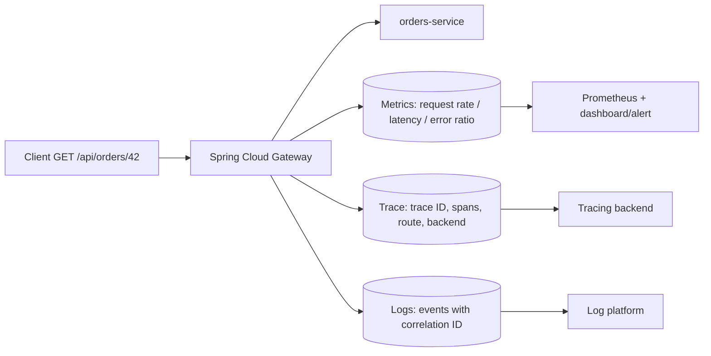
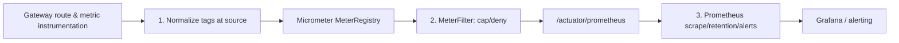

# Controlling Route, Path, and Cardinality Labels of Metrics in Spring Cloud Gateway

## 1. The Problem: Adding Even One Label Can Overload Your Observability System

In a microservices architecture, **Spring Cloud Gateway** is the entry point for many APIs: matching routes with predicates, running filter chains, rewriting paths and headers, calling backends via service discovery, authenticating, rate limiting, circuit breaking, retrying, handling TLS, and tracing requests. Measuring request counts, latency, and error rates per **route** is very helpful. However, if you attach the **actual URL of each request**, a **user ID**, or a **trace ID** as a metric label/tag, each new value can spawn an avalanche of new time series.

For example:

```text
GET /api/orders/10001 -> routeId=orders-read
GET /api/orders/10002 -> routeId=orders-read
GET /api/orders/10003 -> routeId=orders-read

Safer:     routeId="orders-read" (same for all three)
Dangerous: path="/api/orders/10001", "/api/orders/10002", ...
```

**Cardinality** here refers to the number of distinct values—and especially the **number of unique label combinations**—for a metric. A `spring.cloud.gateway.requests` metric with millions of tag combinations can inflate JVM memory, scrape duration, Prometheus storage/indexing costs, and leave dashboards or alerts slow or incomplete.

Learning objectives:

1. Properly interpret `routeId`, `routeUri`, `httpMethod`, `status`, `httpStatusCode`, `outcome`, and the optional `path` tag.
2. Understand why **stable route IDs** and **template-normalized paths** suit metrics better than full raw paths.
3. Estimate cardinality by multiplying label combinations, including multipliers from histogram buckets and Gateway replicas.
4. Configure Gateway/Micrometer so **raw path tags stay disabled** by default; verify properties per version.
5. Use Actuator, Prometheus, and PromQL to inspect request rates, error rates, and series counts.
6. Prevent **label poisoning**, PII leaks, churning route IDs, and metric explosions; design guardrails and monitoring.
7. Verify with reproducible lab tests while distinguishing **metrics**, **traces**, and **logs**.

> **Scope:** Primary examples apply to **Spring Cloud Gateway Server WebFlux 4.3+/5.x** with Spring Boot Actuator/Micrometer. In older WebFlux versions, the namespace is typically `spring.cloud.gateway.*`; Server **Web MVC** uses the Servlet stack and has different instrumentation. Compare configurations and tag names on the exact release you run rather than copying WebFlux configs to MVC and assuming they work.

## 2. Looking at Three Observability Signals Side by Side



| Signal Type | Best-Fit Question | Should Raw User ID / Path / Trace ID Be a Metric Label? |
|---|---|---|
| **Metrics** | “How many RPS is the Orders route receiving? What is the 5xx rate?” | **No.** Prefer finite, stable dimensions |
| **Distributed tracing** | “Which Gateway, CircuitBreaker, and backend did this request traverse?” | Trace IDs are used to **look up a trace**; high-cardinality attributes still obey privacy/sampling rules |
| **Structured logs** | “When and where did a specific error occur?” | Correlation IDs help investigations, subject to redaction, retention, and access control |

A trace ID is **hugely valuable in a trace** yet **extremely dangerous when turned into a timer tag**. And do not assume simply **hashing** a user ID makes it low-cardinality: with one million users, one million hashes still create one million label values and can still constitute identifying data.

## 3. What Does the Gateway Metrics Filter Measure?

For Gateway **Server WebFlux**, the documentation describes a Micrometer timer named:

```text
spring.cloud.gateway.requests
```

This timer measures the Gateway request processing lifecycle and can be inspected via `/actuator/metrics/spring.cloud.gateway.requests` or exported as Prometheus samples via `/actuator/prometheus`.

### 3.1. Tags Documented for Gateway

| Tag | Illustrative Example | Typical Cardinality | What to Watch Out For |
|---|---|---|---|
| `routeId` | `orders-read` | Low if route IDs are managed stably | **High** if route ID concatenates UUIDs/users/tenants/revisions |
| `routeUri` | `lb://orders-service` | Low when using stable logical service names | Can be high if routes dynamically generate URIs per host/tenant/request |
| `outcome` | `SUCCESSFUL`, `CLIENT_ERROR`, `SERVER_ERROR` | Low, status groups | Outcome group, **different** from specific codes like 500/502 |
| `status` | HTTP status name/code depending on convention/version | Finite | Never assume it is always numeric when writing queries |
| `httpStatusCode` | `200`, `404`, `503` | Finite | Commonly used to filter 5xx groups with regex |
| `httpMethod` | `GET`, `POST` | Low, finite methods | Custom HTTP methods can exceed expectations |
| `path` (**optional**) | `/api/orders/42` | **Very high** if raw paths include IDs | Disabled by default; enabling requires privacy and series-count review |

**Do not confuse `routeId` with `path`:** thousands of `/api/orders/{id}` URLs can share **one route ID**. The route ID identifies the selected route; `path` identifies the **actual request address**. Adding raw paths defeats the benefit of a fixed route ID label.

This tag list applies to the **Gateway Metrics Filter** and does not necessarily match tags on general Spring WebFlux `http.server.requests`, Reactor Netty, Redis client, or backend metrics. Never merge metrics with different measurement scopes and call the result a single “Gateway request count.”

### 3.2. Requests That Never Enter the Gateway Route Chain

Gateway metrics are emitted inside the **Gateway filtering chain**. A request can be rejected with `401` by a Spring Security WebFilter before matching a Gateway route, blocked by ingress/WAF, or fail to match any route. These cases are **not guaranteed** to appear in `spring.cloud.gateway.requests` with a `routeId`.

Therefore:

- Measure “total requests entering the edge” with appropriate **server/ingress HTTP metrics**.
- Measure “requests routed by the Gateway” with Gateway route metrics.
- Measure “requests actually reaching backends” with outbound/backend telemetry.

These numbers can **legitimately differ** due to cache HITs, rate limits, OPEN circuit breakers, security rejections, or client disconnects. Check the exact definition and placement of instrumentation before comparing them.

## 4. Cardinality: Multiplying Dimensions

### 4.1. Approximating Label Combinations

For a given metric:

\[
\text{Max combinations} \;\leq\; \prod_{i=1}^{n} \text{possible values of label}_i
\]

This is a **theoretical upper bound if every combination occurs**; in practice, routes and paths are correlated so many combinations never happen. Still, multiplication shows how a single “unbounded” label can blow through your time-series budget rapidly.

Suppose one `orders-read` route is called with **10,000 distinct order IDs**, across **3 Gateway pods**, **2 HTTP methods**, and **3 HTTP statuses** observed:

| Label | Hypothetical Values |
|---|---:|
| `routeId` | 1 |
| Raw `path` | 10,000 |
| `httpMethod` | 2 |
| `httpStatusCode` | 3 |
| `instance` (attached by Prometheus on scrape) | 3 |
| **Potential combinations** | **180,000** |

Without `path`, the exact same setup yields only **18** combinations across those dimensions. Real series also include `routeUri`, `outcome`, and common labels like `job`/`application`, though many values depend on one another. For a timer, Prometheus additionally emits **`_count`/`_sum`** and, if histograms are enabled, **multiple `_bucket`** series across `le` thresholds.

**Key point:** a single raw `path` label can multiply series counts by thousands. When URLs carry uploads, UUIDs, timestamps, signed tokens, or search queries, route design alone cannot bound cardinality.

### 4.2. Why Series Count Matters More Than Request Count

Two systems both serving **1,000 RPS** can have completely different metric costs:

- System A: 1,000 RPS sharing `routeId=orders-read` and low-value-count labels → low series count; only counter/timer values increment.
- System B: 1,000 RPS where each request has a unique `path` → roughly **1,000 new path values every second** during that period, constantly allocating new meters and time series.

Normal RPS growth increases **measurement values**; label cardinality growth increases **how many metric objects must be created and stored**. Those are two completely different cost axes.

### 4.3. Histograms Multiply Series Further

In Prometheus:

```text
# Timer without histogram buckets (common export format)
spring_cloud_gateway_requests_seconds_count{routeId="orders-read",...}
spring_cloud_gateway_requests_seconds_sum{routeId="orders-read",...}

# With histograms enabled, many additional samples appear:
spring_cloud_gateway_requests_seconds_bucket{routeId="orders-read",le="0.1",...}
spring_cloud_gateway_requests_seconds_bucket{routeId="orders-read",le="0.5",...}
...
```

The `_seconds` unit suffix and bucket list depend on the registry/timer definition and configuration; **inspect real output** before building dashboards. With 20 buckets per **label set**, turning on histograms for a metric already experiencing a cardinality explosion can add millions of series. Conversely, histograms across a handful of stable route IDs are extremely useful for p95/p99.

## 5. Distinguishing Route, Route Template, and Raw Path

Suppose the Gateway has:

```yaml
spring:
  cloud:
    gateway:
      server:
        webflux:
          routes:
            - id: orders-read
              uri: lb://orders-service
              predicates:
                - Path=/api/orders/**
                - Method=GET
              filters:
                - StripPrefix=1
```

Three requests:

```text
GET /api/orders/3ddfc5c5-8f2a-4d54-b47a-a6c2c0105b94
GET /api/orders/42
GET /api/orders/2026-11-24T10:00:00
```

all map to `routeId=orders-read`. Their `path` values are **distinct URLs** that can contain sensitive data or business identifiers. A normalized label like `routePattern="/api/orders/{orderId}"` has low cardinality **only if the application maps it from a finite template catalog**, since **the Gateway cannot infer business templates automatically from a `/**` wildcard**.

### 5.1. Suitable vs. Unsuitable Labels

| Proposed Label | Good as a Metric Label? | Reason |
|---|---|---|
| `routeId=orders-read` | **Yes**, if fixed per route contract | Bounded, operationally meaningful |
| `httpMethod=GET` | **Yes** | Small set |
| `outcome=SERVER_ERROR` | **Yes** | Small set |
| `region=ap-southeast-1` | Yes, if region list is finite | Manage the value set |
| `serviceTier=free/pro/enterprise` | Possible, if normalized and justified | Do not embed tenant/user IDs into tiers |
| `routePattern=/api/orders/{orderId}` | Possible if templates come from a fixed allowlist | Must design and test normalization |
| `path=/api/orders/123456789` | **No** | Varies per request |
| `userId=89431` | **No** | High cardinality + PII |
| `tenantId=customer-uuid` | Usually **no** | Tenant count can be large and dynamic |
| `traceId=...` | **No** | Virtually a new ID per request |
| `requestId=...` | **No** | Same as trace ID |
| `clientIp=...` | **No** | High cardinality, privacy/security risk |
| `query=search-text` | **No** | Unbounded user input, may hold secrets |
| `routeId=tenant-<uuid>` | **No** | Turns route ID into an unbounded dimension |

### 5.2. Never Put Raw User Input into Route IDs

An anti-pattern when generating dynamic routes:

```java
// PSEUDOCODE — contraindicated because route ID embeds a dynamic ID:
String routeId = "tenant-" + requestTenantId + "-orders";
```

If the system generates a route per user, or appends a UUID/timestamp on every deploy, `routeId` itself becomes high-cardinality—**even with `path` disabled**.

Design priorities:

- Keep `routeId` stable and tied to an **API route contract or group**, such as `catalog-read`, `orders-write`, or `notifications-sse`.
- Version by **API contract** only when genuinely needed, such as `orders-v2-read`; avoid appending build SHAs or epochs to **route IDs** on every rollout.
- If discovery yields many service IDs, enforce an **allowlist + naming convention** and cap generated route counts.
- Never concatenate raw `Host`, `Header`, tenant, client ID, or URI paths into route IDs.
- Keep deployment revisions, pods, namespaces, and zones on **bounded resource/target labels** instead of packing them into route IDs.

Keeping `routeId` stable also preserves continuous historical dashboards across deployments and reduces alert-rule churn whenever backend instances or build revisions change.

## 6. Enabling Gateway Metrics While Keeping the `path` Tag Disabled

### 6.1. Maven and Gradle Dependencies

With **Spring Cloud Gateway Server WebFlux**, you need Actuator to expose metrics and the Prometheus registry to scrape them with Prometheus:

```xml
<!-- pom.xml: versions managed by Spring Boot parent and Spring Cloud BOM -->
<dependency>
    <groupId>org.springframework.cloud</groupId>
    <artifactId>spring-cloud-starter-gateway-server-webflux</artifactId>
</dependency>
<dependency>
    <groupId>org.springframework.boot</groupId>
    <artifactId>spring-boot-starter-actuator</artifactId>
</dependency>
<dependency>
    <groupId>io.micrometer</groupId>
    <artifactId>micrometer-registry-prometheus</artifactId>
</dependency>
```

```groovy
dependencies {
    implementation 'org.springframework.cloud:spring-cloud-starter-gateway-server-webflux'
    implementation 'org.springframework.boot:spring-boot-starter-actuator'
    runtimeOnly 'io.micrometer:micrometer-registry-prometheus'
}
```

You do not need Loki/Tempo/Zipkin, Redis, or Eureka **just to emit Gateway metrics**. Those dependencies serve business features or other observability pillars, not the `spring.cloud.gateway.requests` timer itself.

### 6.2. Safe Configuration for WebFlux 4.3+/5.x

```yaml
# application.yml — Gateway Server WebFlux example, local/test environment.
server:
  port: 8080

spring:
  cloud:
    gateway:
      server:
        webflux:
          metrics:
            enabled: true
            path-tags:
              enabled: false
          routes:
            - id: orders-read
              uri: http://localhost:8081
              predicates:
                - Path=/api/orders/**
                - Method=GET
              filters:
                - StripPrefix=1
            - id: catalog-read
              uri: http://localhost:8082
              predicates:
                - Path=/api/catalog/**
                - Method=GET
              filters:
                - StripPrefix=1

management:
  server:
    port: 9090
    address: 127.0.0.1
  endpoint:
    metrics:
      access: read-only
    prometheus:
      access: read-only
  endpoints:
    web:
      exposure:
        include: health,info,metrics,prometheus
  metrics:
    tags:
      application: api-edge-gateway
```

In **Spring Cloud Gateway 5.1 configprops**, `spring.cloud.gateway.server.webflux.metrics.enabled` and `path-tags.enabled` are listed with default `false`. Gateway Metrics Filter docs describe conditional auto-enablement when Actuator is present in certain lines, so **declaring `enabled` explicitly** and **verifying the live endpoints** is far clearer than guessing defaults from another version. Setting `path-tags.enabled: false` explicitly records the decision **not to attach raw paths**.

Deployment notes:

- `management.metrics.tags.application` is a **finite label** as long as the application name comes from a fixed deployment list; never replace it with random pod names or user IDs.
- `management.server.port` separates the management listener from the API port; binding `127.0.0.1` is **local-demo only**. Inside containers, loopback stays inside the container's network namespace; scraping requires a proper management network path.
- Actuator `read-only` access and exposure do not replace authentication or network policies. Never expose `/actuator/prometheus` or `/actuator/metrics` publicly on the internet.
- Backends at `localhost:8081`/`8082` are demo-only. In Kubernetes, use service DNS/load balancers and appropriate TLS; `localhost` does not reach separate backend containers.
- When using `spring.cloud.gateway.server.webflux.observability.enabled`, note that it is a **separate control** for Micrometer Observability support. Do not assume it overrides every Gateway Metrics Filter setting or makes raw path tags safe.

### 6.3. New `path-tags.enabled` vs. Confusing Legacy Properties

Gateway 4.3/5.1 documentation describes:

```yaml
spring:
  cloud:
    gateway:
      server:
        webflux:
          metrics:
            path-tags:
              enabled: false  # Recommended: keep false in production.
```

And there is the legacy property:

```text
spring.cloud.gateway.server.webflux.metrics.tags.path.enabled
```

**`metrics.tags.path.enabled` is deprecated**: the docs warn that enabling it can cause a **side effect** where a configuration value enters the `metrics.tags` map as an actual tag. On some versions, users observed `path="enabled"` instead of a real path. **Do not set both aliases** “just to be safe.” Use `metrics.path-tags.enabled` matching your release docs and inspect actual exported samples.

In older Gateway WebFlux lines, you may also see:

```text
spring.cloud.gateway.metrics.tags.path.enabled
spring.cloud.gateway.metrics.enabled
```

These properties are **not copy-paste instructions for 5.x**. When upgrading, inspect configuration metadata and release notes for your deployed version; a wrong prefix can be silently ignored while the app boots normally.

### 6.4. Why Not Enable the Path Tag Just to Debug a Production Bug?

`path` can contain order IDs, account IDs, URL-encoded emails, invite codes, or signed URLs. Enabling it in production persists those values across:

- Micrometer meter IDs inside the JVM.
- Prometheus time series and remote-write backends.
- Observability dashboards, caches, and indexes.
- Backups and retention windows outliving API request logs.

Turning the flag back off **does not automatically purge historical data already ingested**. Use protected traces/logs to debug specific requests, or test path tags **strictly in a sandbox** with synthetic URLs for a brief window—never on real user traffic.

## 7. Inspecting with Actuator and Prometheus

### 7.1. Checking Metric Names and Available Tags

Once the Gateway and demo backends are running:

```bash
# Send traffic through matching routes.
curl -i http://localhost:8080/api/orders/42
curl -i http://localhost:8080/api/orders/43
curl -i http://localhost:8080/api/catalog/products/1

# Only from authorized management listeners/permissions.
curl -sS http://127.0.0.1:9090/actuator/metrics
curl -sS http://127.0.0.1:9090/actuator/metrics/spring.cloud.gateway.requests
```

An **illustrative example** of `availableTags` after traffic:

```json
{
  "name": "spring.cloud.gateway.requests",
  "baseUnit": "seconds",
  "measurements": [
    {"statistic": "COUNT", "value": 3.0},
    {"statistic": "TOTAL_TIME", "value": 0.136},
    {"statistic": "MAX", "value": 0.081}
  ],
  "availableTags": [
    {"tag": "routeId", "values": ["orders-read", "catalog-read"]},
    {"tag": "httpMethod", "values": ["GET"]},
    {"tag": "outcome", "values": ["SUCCESSFUL"]},
    {"tag": "httpStatusCode", "values": ["200"]}
  ]
}
```

**This is not a fixed mandatory schema**: real responses may include `status`, `routeUri`, application tags, or other values depending on observed traffic. If backends return 404/503, `outcome` and `httpStatusCode` will reflect those too. Under the recommended config, verify **no `path` tag containing order IDs appears**.

To inspect a single route:

```bash
curl -sS \
  'http://127.0.0.1:9090/actuator/metrics/spring.cloud.gateway.requests?tag=routeId:orders-read'
```

The Actuator metrics selector supports filtering with `tag=key:value`; colons `:` inside tag values must be URL-encoded properly when applicable. Never pass management credentials on publicly logged command lines or CI logs.

### 7.2. Viewing Prometheus Exposition

```bash
curl -sS http://127.0.0.1:9090/actuator/prometheus

# Extract relevant lines from test output.
curl -sS http://127.0.0.1:9090/actuator/prometheus \
  | grep 'spring_cloud_gateway_requests'
```

A **synthetic** Prometheus sample line:

```text
spring_cloud_gateway_requests_seconds_count{application="api-edge-gateway",routeId="orders-read",routeUri="http://localhost:8081",httpMethod="GET",httpStatusCode="200",outcome="SUCCESSFUL",status="OK"} 2.0
```

`_seconds_count`/`_seconds_sum` follow standard Prometheus timer conventions. The `status` value may render differently depending on version; never build alerts assuming `status="OK"` without checking live output first. Tag names and label casing can also be normalized/renamed by exporters or collectors, so rely on the **actual post-scrape names**.

### 7.3. Counting Timer Series Directly in Prometheus

Example PromQL queries (run in Prometheus/Grafana with appropriate access):

```promql
# Total _count series across scraped targets.
count(spring_cloud_gateway_requests_seconds_count{job="gateway"})

# How many label combinations exist per route?
count by (routeId) (
  spring_cloud_gateway_requests_seconds_count{job="gateway"}
)

# If someone enabled the path tag, track series with a non-empty path.
count(
  spring_cloud_gateway_requests_seconds_count{
    job="gateway", path!=""
  }
)
```

`job="gateway"` is an **example**; actual job names depend on your Prometheus configuration. The second query **counts series**, not requests. Even with `path` off, a single route typically has more than 1 series due to method, status, instance, and `routeUri` labels.

### 7.4. Checking the Right Places If the Metric Is Missing

If `spring.cloud.gateway.requests` does not appear:

1. Check that the app includes the **Server WebFlux** starter, Actuator, and registry.
2. Verify `spring.cloud.gateway.server.webflux.metrics.enabled: true` is bound.
3. Send a request that **matches a route**, not just `/actuator/health`.
4. Confirm `metrics`/`prometheus` endpoints are exposed and authorized.
5. Check whether `metrics.prefix` or a `MeterFilter` renamed/filtered the metric.
6. Inspect `/actuator/gateway/routes` on the exact replica **if read-only Gateway Actuator is enabled**.
7. Do not assume an HTTP 401 rejected by Spring Security pre-route must create a Gateway timer sample.

**Do not assume adding the Prometheus registry dependency automatically provides every request timer.** Meter names, scopes, and availability depend on the active instrumentation pipeline.

## 8. PromQL Queries Preferring Route Over Path

### 8.1. Request Rate by Route

```promql
sum by (routeId) (
  rate(spring_cloud_gateway_requests_seconds_count{job="gateway"}[5m])
)
```

This returns **requests/second recorded by the Gateway timer**, grouped by `routeId`. It is not total inbound connections, does not necessarily count requests rejected by Security pre-route, and does not replace dedicated gauges for active SSE connections.

### 8.2. 5xx Errors by Route

```promql
sum by (routeId) (
  rate(spring_cloud_gateway_requests_seconds_count{
    job="gateway", outcome="SERVER_ERROR"
  }[5m])
)
```

Filtering by `outcome` for 5xx series is concise and readable. To break out 500/502/503/504 individually, use `httpStatusCode` after confirming its values in real data:

```promql
sum by (routeId, httpStatusCode) (
  rate(spring_cloud_gateway_requests_seconds_count{
    job="gateway", httpStatusCode=~"5.."
  }[5m])
)
```

### 8.3. 5xx Error Ratio

```promql
sum by (routeId) (
  rate(spring_cloud_gateway_requests_seconds_count{
    job="gateway", outcome="SERVER_ERROR"
  }[5m])
)
/
clamp_min(
  sum by (routeId) (
    rate(spring_cloud_gateway_requests_seconds_count{job="gateway"}[5m])
  ),
  1e-9
)
```

Because Prometheus may **return no series for the numerator when zero 5xx errors occur**, dashboards and alerts must handle missing series/no-data consistently. Never equate `absent` automatically with a 0% error rate, and never alert across production on a tiny sample count—use a **minimum traffic threshold** or sufficiently long window.

### 8.4. p95 Latency Only When Histograms Exist

Once histograms are explicitly enabled on the timer (and `_bucket` is verified):

```promql
histogram_quantile(
  0.95,
  sum by (routeId, le) (
    rate(spring_cloud_gateway_requests_seconds_bucket{job="gateway"}[5m])
  )
)
```

Without buckets, this query **does not work**; `_sum`/`_count` only give the mean, from which p95 cannot be reconstructed. Before enabling histograms, budget **buckets × tag combinations × replicas**, and never turn on raw path tags alongside them.

Example Spring Boot/Micrometer distribution config (verify against your version and live meter name):

```yaml
management:
  metrics:
    distribution:
      percentiles-histogram:
        spring.cloud.gateway.requests: true
```

Histograms improve latency distribution visibility at the cost of extra series. Do not turn on histograms globally across high-cardinality timers just to populate a p95 panel.

### 8.5. Never Use the Prometheus `path` Label as a Default Dimension

Anti-pattern:

```promql
# Avoid default dashboards grouped by raw path:
sum by (path) (
  rate(spring_cloud_gateway_requests_seconds_count[5m])
)
```

With 100,000 order IDs, the chart tries to draw 100,000 lines and Prometheus suffers high cardinality. To inspect **specific failing URLs**, use sampled, access-controlled, redacted traces/logs; keep metrics bounded to route, status, and region dimensions.

## 9. Three Layers of Defense Against Label Cardinality Explosion

There is no single switch to “disable all cardinality problems.” Combine defenses at the **label source**, **in-JVM registry**, and **collector/storage layer**.



### 9.1. Layer 1 — Never Create Unbounded Labels in the First Place

This is the **most important** defense:

- Keep `path-tags.enabled` off on production traffic.
- Use static route IDs instead of embedding UUIDs, tenants, queries, or release timestamps.
- Never put `userId`, `clientIp`, `traceId`, `sessionId`, `Authorization`, or raw paths into custom metrics.
- For business grouping, use a **finite value set** such as `operation=read/write`, `backendClass=core/legacy`, or `serviceTier=free/pro/enterprise`.
- Use logical `lb://orders-service` destinations instead of generating new route URIs per client/tenant unless genuinely required.
- Offload single-request lookup to **sampled, redacted traces and logs**.

Watch both **Gateway-generated tags** and **application-added tags**: a stable Gateway setup can still suffer cardinality explosion if a developer writes `registry.counter(..., "customer", customerId)` inside a custom filter.

### 9.2. Layer 2 — `MeterFilter` Capping `routeId` Values

Micrometer offers `MeterFilter.maximumAllowableTags(...)` to block registering new meters once a tag exceeds a distinct-value cap.

Java example:

```java
package com.example.gateway.observation;

import io.micrometer.core.instrument.config.MeterFilter;
import org.springframework.context.annotation.Bean;
import org.springframework.context.annotation.Configuration;

@Configuration(proxyBeanMethods = false)
public class GatewayMetricGuardrails {

    @Bean
    MeterFilter capGatewayRouteIds() {
        // Illustrative cap for 1 MeterRegistry inside 1 Gateway instance.
        return MeterFilter.maximumAllowableTags(
            "spring.cloud.gateway.requests",
            "routeId",
            100,
            MeterFilter.deny()
        );
    }
}
```

**How to interpret this accurately:**

1. This filter applies to meter names starting with `spring.cloud.gateway.requests` and tag `routeId`.
2. Once distinct **`routeId` values** hit the threshold in that registry, new meters with unseen `routeId` values are `DENY`ed.
3. `DENY` drops/no-ops meter recording; **HTTP traffic itself is not blocked**.
4. It is **not** a mechanism to normalize route IDs or bound cardinality on other labels.
5. The cap applies **per process/MeterRegistry**, not as a cluster-wide limit across Prometheus.
6. Alert when approaching or hitting the cap, because denying meters can make metrics for a critical new route **disappear**.

**Do not treat `maximumAllowableTags` as a “safety net” to turn on raw paths.** Capping 100 route IDs while allowing 100,000 `path` values per route leaves the core explosion intact. The real fix is **disabling or normalizing `path` at the source**.

### 9.3. Layer 2 Supplement — Detecting Meter Growth in the JVM

A manual way to count current **Micrometer meter objects** for that timer:

```java
package com.example.gateway.observation;

import io.micrometer.core.instrument.MeterRegistry;

public final class MeterCountDiagnostic {
    private MeterCountDiagnostic() {}

    // Illustrative logic for internal admin tooling only.
    public static long gatewayTimerMeterCount(MeterRegistry registry) {
        return registry.getMeters().stream()
            .filter(m -> m.getId().getName()
                .equals("spring.cloud.gateway.requests"))
            .count();
    }
}
```

**Meter count** does not equal **Prometheus time-series count**: one Timer can produce `_count`/`_sum`, max, and many histogram buckets. Also, never expose a public custom endpoint that iterates over all meters on every request; run diagnostics **periodically** in internal admin tooling or via observability backends.

Recent Micrometer versions include **`HighCardinalityTagsDetector`**; Micrometer 1.18 docs describe tracking meters sharing a name and warning when thresholds are exceeded. It is a detection tool, **not an automatic fix for unbounded labels**. APIs vary across Micrometer versions; follow the configuration matching your exact dependency.

### 9.4. Layer 3 — Prometheus/Remote-Write Protecting Storage

On the collector/TSDB side, you can:

- Monitor **active series, series creation rate, target scrape duration, and samples/scrape**.
- Enforce **limits** per job/tenant/service where your ingestion stack supports them.
- Tune scrape intervals, retention, histogram buckets, and remote-write queues.
- Use metric relabeling to drop **unneeded metrics** or vetted labels.
- Alert if series counts for `spring_cloud_gateway_requests_seconds_count` jump unexpectedly after a rollout.

**Warning:** using `labeldrop: path` **only at scrape time** does not protect the Gateway JVM; meter/tag combinations were already allocated at the source. Furthermore, dropping a multi-valued label across samples of the same metric can produce **duplicate labelsets** within one scrape, causing ingestion errors. Fix **at instrumentation first**, then use relabeling only as a secondary safeguard.

A Prometheus `sample_limit` per scrape acts as a **hard guardrail**: exceeding it fails the entire scrape. It does not reduce Gateway memory consumption. Alert **before** hitting the limit rather than waiting for Prometheus to reject scrapes.

## 10. Setting a Cardinality Budget Before Adding Any New Label

### 10.1. Sample Budget by Route and Environment

Operations teams can draft an **internal budget** before introducing a label:

| Dimension | Expected Value Set | Policy |
|---|---|---|
| `routeId` | 40 production routes | Fixed catalog, reviewed when adding routes |
| `httpMethod` | Max 5–8 standard methods | Never capture arbitrary dynamic client methods |
| `outcome` | Small set of HTTP outcome groups | Used for high-level error dashboards |
| `httpStatusCode` | Finite set of observed HTTP codes | Larger than outcome, still bounded |
| `routeUri` | ~40 logical destinations or fewer | Never put user data/UUIDs into URIs |
| `instance` | 3–10 replicas under autoscaling | Account for scaling in cost projections |
| `path` | **0** in primary metrics | Keep raw path disabled |
| `tenantId`, `userId`, `traceId` | **0** in primary metrics | Only use in policy-governed traces/logs |

Illustrative estimate for 40 routes × 3 methods × 8 statuses × 3 pods:

\[
40 \times 3 \times 8 \times 3 = 2,880
\]

This is a **hypothetical combination ceiling**, not an exact measured series count. GET-only routes eliminate many combinations; `routeUri` is usually 1:1 with `routeId`, `outcome` depends on status, while histograms add buckets. Still, comparing 2,880 against adding 10,000 raw paths **per route** shows an explosion of multiple orders of magnitude.

Figures like “100 routes” or “2,880 combinations” here are **teaching examples only**, not universal SLA/cost standards for every Prometheus cluster. Real budgets depend on replicas, scrape intervals, histograms, retention, and storage hardware.

### 10.2. Review Checklist for Any New Label

Before approving tag `x`, answer:

1. Does the tag have a **finite value set**? Who controls that set?
2. Can users/clients inject **arbitrary new values** via path, query, or headers?
3. Can the tag be replaced by a **group/enum name**?
4. How much does it multiply combinations alongside existing tags and histograms?
5. Could the tag contain or leak PII, tokens, internal hostnames, or security details?
6. Does an actual dashboard or alert **genuinely use** this tag?
7. Are budgets, guardrails, tests, and a rollback plan in place?
8. Once disabled, who handles **already-ingested data** in Prometheus/remote-write?

If a label lacks an owner or a clear operational question, **do not add it to metrics** just because adding a tag is easy.

### 10.3. Route Labels During Rolling Deployments

Suppose a Gateway runs 3 pods and each deployment generates route IDs like:

```text
orders-read-sha-a1f2
orders-read-sha-b4e9
orders-read-sha-c7d0
```

During rolling deployments, new series appear under the new `routeId` labels while old ones linger throughout retention. Over many deployments, cardinality continuously **churns** even though the active route count barely changes.

Better:

```text
routeId="orders-read"              (stable)
application="api-edge-gateway"     (stable)
environment="prod"                 (small set)
pod="gateway-abc123"               (target/resource label managed by collector)
```

Build revisions can still be tracked via deployment metadata, traces, logs, or an authorized `info` endpoint **without attaching them to every Gateway timer**. Even `pod` labels churn on rollouts, so factor pod counts and retention into your budget—never add `buildSha`, `commitId`, and random release IDs to every metric unnecessarily.

## 11. When Is a Custom Tag Genuinely Useful?

### 11.1. Fixed Business Groupings Instead of Customer Names

Suppose you need to distinguish policy errors across API groups:

```text
operation="catalog-read"
operation="orders-write"
operation="notifications-stream"
operation="other"
```

The mapping function must use an **allowlist**, never raw paths:

```java
package com.example.gateway.observation;

public final class OperationLabel {
    private OperationLabel() {}

    public static String fromRouteId(String routeId) {
        if (routeId == null) return "other";
        return switch (routeId) {
            case "catalog-read", "catalog-v2-read" -> "catalog-read";
            case "orders-write", "orders-v2-write" -> "orders-write";
            case "notifications-sse" -> "notifications-stream";
            default -> "other";
        };
    }
}
```

With this switch, `operation` has at most **4** values—even with unknown route names or arbitrary client URLs. Note that **this helper does not automatically replace the Gateway Metrics Filter's `routeId` tag**; it is simply a utility your application can call **when recording custom metrics** through an appropriate extension point.

Example custom metric recording policy decisions:

```java
package com.example.gateway.observation;

import io.micrometer.core.instrument.MeterRegistry;
import org.springframework.stereotype.Component;

@Component
public class PolicyDecisionMetrics {
    private final MeterRegistry registry;

    public PolicyDecisionMetrics(MeterRegistry registry) {
        this.registry = registry;
    }

    public void record(String trustedRouteId, boolean allowed) {
        String operation = OperationLabel.fromRouteId(trustedRouteId);
        registry.counter(
            "gateway.policy.decisions",
            "operation", operation,
            "result", allowed ? "allow" : "deny"
        ).increment();
    }
}
```

This snippet **only illustrates how to assign low-cardinality tags**. To use it in a real app, invoke `record(...)` where the policy decision occurs (e.g., security/filter service) and **pass the route ID from server-side route context**, never from a client-supplied `X-Route-Id` header. Define clearly which policy decisions are counted so retries or multiple filters don't double-count.

### 11.2. Do Not Confuse Business Labels with Raw HTTP Routes

`routeId` is a **routing** label; `operation` is a label you design for **business grouping**. If you share one metric across both routing and authorization without clearly defining when it fires, dashboards can double-count a request or miss requests blocked prior to route matching.

It is cleaner to maintain:

- **Gateway request timer** for requests traversing the route chain.
- **Ingress/HTTP server metrics** for total requests entering the edge.
- **Policy decision counter** for well-defined allow/deny decisions.
- **Traces/logs** to tie these signals together when investigating a specific request.

### 11.3. Custom Tag APIs Change Across Gateway Versions

Depending on the release, you may encounter `GatewayTagsProvider` or Micrometer Observation/Convention extension points. Never paste an old 3.x `GatewayTagsProvider` class from a blog into Gateway 5.x and assume the bean will be invoked. Releases have changed path-tag properties and tag-provider mechanisms across versions.

**Invariant rule:** normalization must happen **before meter registration** and output values from a **small, controlled set**. After changing providers or conventions, always check `/actuator/metrics` and `/actuator/prometheus` to prove the new tags match expectations.

## 12. Securing Metrics Endpoints and Sensitive Labels

### 12.1. Metrics Can Reveal Topology

Even with `path` disabled, tags like `routeId`/`routeUri` can reveal:

- Internal backend service names.
- How endpoints are grouped (orders, billing, admin).
- Private URIs/hosts or staging/test targets.
- Traffic volumes, error states, and windows of backend instability.

Therefore, **Actuator metrics/Prometheus data is operational telemetry**, not a public API for arbitrary clients. Use a private management port, TLS/mTLS, RBAC/SSO/service identity, NetworkPolicies/firewalls, and access auditing. Never expose `management.endpoints.web.exposure.include: "*"` publicly just for scraping.

### 12.2. Label Injection/Poisoning and PII

When an application builds tags from `path`, `Host`, `X-Tenant-Id`, `User-Agent`, or query parameters:

1. Clients can send thousands of **unique** values to multiply meters.
2. Values can carry emails, order IDs, tokens, or sensitive information.
3. Labels can hold very long strings, inflating memory and index costs.
4. Even when exporters **syntax-escape** label values properly, attackers can cause a **cardinality DoS**.

Limiting the number of tag keys on a metric is **not enough** if a single tag accepts unbounded values. Enforce **allowlisted values**, API size/charset limits, and never feed raw user input into metric IDs.

### 12.3. Why Hashing or Truncating Raw URLs Is Still Not Enough

- `hash(userId)` still yields roughly as many distinct values as users.
- `truncate(path, 20)` introduces collisions while still leaving thousands of dynamic prefixes.
- `replaceAll("\\d+", "{id}")` misses UUIDs, emails, slugs, Base64 IDs, percent-encoding, or mixed paths—and can also collapse distinct endpoints you wanted separated.

For metric labels, **mapping from a route catalog or explicit API templates** is far safer than guessing identifiers with regexes over raw URIs. If complex normalization is unavoidable, test encoded slashes, Unicode, unknown routes, and ensure fallbacks never emit raw paths.

### 12.4. Do Not Abuse Exemplars for Private Context

Micrometer/Prometheus can support **exemplars linking metrics to trace IDs**. Unlike turning `traceId` into a **label on all series**, an exemplar provides a sample link for drill-down through your observability backend.

Even so, traces and exemplars still need sampling, retention limits, access controls, and security policies; never attach raw JWTs or PII as span attributes simply because tracing tolerates higher cardinality than metrics.

## 13. End-to-End Lab: 20 Different URLs Under One Route Tag

### 13.1. Preparing Two Applications

In a **sandbox environment free of real user data**:

1. **Gateway Server WebFlux** on `localhost:8080` with route `orders-read` and the metric config from Section 6.
2. **Orders WebFlux backend** on `localhost:8081` handling `GET /orders/{id}`.
3. Gateway Actuator exposing `metrics/prometheus` on a protected management listener `127.0.0.1:9090`.
4. If using Prometheus, configure scraping across instances over a **valid management network**. Avoid scraping the public API port unnecessarily.

Demo controller in the **backend** app (not inside the Gateway):

```java
package com.example.orders.demo;

import java.util.Map;
import org.springframework.http.HttpStatus;
import org.springframework.http.ResponseEntity;
import org.springframework.web.bind.annotation.GetMapping;
import org.springframework.web.bind.annotation.PathVariable;
import org.springframework.web.bind.annotation.RestController;

@RestController
public class OrderDemoController {

    @GetMapping("/orders/{id}")
    public ResponseEntity<Map<String, String>> get(@PathVariable String id) {
        if ("missing".equals(id)) {
            return ResponseEntity.status(HttpStatus.NOT_FOUND)
                .body(Map.of("error", "order not found"));
        }
        if ("unavailable".equals(id)) {
            return ResponseEntity.status(HttpStatus.SERVICE_UNAVAILABLE)
                .body(Map.of("error", "backend unavailable"));
        }
        return ResponseEntity.ok(Map.of("id", id, "status", "PAID"));
    }
}
```

The backend app needs `spring-boot-starter-webflux`, `@SpringBootApplication`, and `server.port: 8081`. The controller intentionally returns `id` in the **HTTP response body**, but **never adds it to custom metric labels**. In production, backends must authenticate and check resource ownership; this demo uses non-PII test IDs only.

### 13.2. Verify Routing First

```bash
curl -i http://localhost:8081/orders/1
curl -i http://localhost:8080/api/orders/1
curl -i http://localhost:8080/api/orders/missing
curl -i http://localhost:8080/api/orders/unavailable
```

Expected demo results:

| URL Through Gateway | Backend HTTP Status | Gateway `routeId` Tag |
|---|---:|---|
| `/api/orders/1` | 200 | `orders-read` |
| `/api/orders/missing` | 404 | `orders-read` |
| `/api/orders/unavailable` | 503 | `orders-read` |

Route `orders-read` uses `Path=/api/orders/**` and `StripPrefix=1`, so the backend receives `/orders/{id}`. If statuses differ from expected, check route selection, Spring Security, and the backend handler before blaming Micrometer.

### 13.3. Send 20 Distinct URLs Without Increasing Route IDs

```bash
# Sandbox only. 20 sequential requests, no heavy load.
for i in $(seq 1 20); do
  curl -sS -o /dev/null \
    -w "id=$i status=%{http_code}\n" \
    "http://localhost:8080/api/orders/$i"
done

# Filter the metric by route in the Actuator endpoint.
curl -sS \
  'http://127.0.0.1:9090/actuator/metrics/spring.cloud.gateway.requests?tag=routeId:orders-read'
```

**What to observe:**

- The route's Timer `COUNT` grows with the number of measured requests.
- `routeId` remains `orders-read` even as the URL varies from `/1` to `/20`.
- With `path-tags.enabled: false`, no dozens of `path` tag values appear for the route.
- Multiple timer meter instances may still exist if you also triggered 200/404/503 responses due to distinct `status`/`outcome` values. That is normal and **completely different** from creating a `path` value per order ID.

### 13.4. Inspect Time Series Directly

```bash
curl -sS http://127.0.0.1:9090/actuator/prometheus \
  | grep '^spring_cloud_gateway_requests_seconds_count'
```

If no samples appear, verify `metrics.enabled`, the Prometheus registry dependency, management path, and that traffic actually matched the route. With multiple replicas behind a load balancer, requests and scrapes may hit **different pods**; in a sandbox, target instances directly or manage each instance explicitly.

On a live Prometheus server scraping the target, run:

```promql
count(spring_cloud_gateway_requests_seconds_count{routeId="orders-read"})
```

The returned number is the **count of `_count` series** matching the selector, **not 20 requests**. With multiple statuses or instances it can exceed 1, but with raw `path` disabled it **does not grow linearly with the number of order IDs**.

### 13.5. Temporarily Enable `path` Only in a Sandbox to See the Difference

In a **separate test profile**, after confirming **no personal data or real traffic** is involved:

```yaml
spring:
  cloud:
    gateway:
      server:
        webflux:
          metrics:
            enabled: true
            path-tags:
              enabled: true    # FOR ILLUSTRATION ONLY, DO NOT DEPLOY TO PRODUCTION.
```

Start a clean test Gateway, call the 20 demo URLs, and inspect:

```bash
curl -sS http://127.0.0.1:9090/actuator/prometheus \
  | grep '^spring_cloud_gateway_requests_seconds_count' \
  | grep 'path='
```

Expect values like `path="/api/orders/1"`, `path="/api/orders/2"`, etc., if the flag applies to your Gateway version. **Count series before and after** rather than looking only at request counts. If output shows `path="enabled"` instead of real paths, check whether you accidentally used the deprecated `metrics.tags.path.enabled` alias or hit version-specific behavior.

Once done learning: **turn the flag back off and restart the test app**. There is no need to generate huge request volumes to prove an already clear point, and never run this experiment on production.

### 13.6. Test Dynamic Route IDs by Design Instead of Spawning Thousands of Routes

Compare two naming designs:

```text
Design A:
  id: orders-read
  uri: lb://orders-service
  path: /api/orders/**

Design B (AVOID):
  id: orders-read-customer-a1b2c3
  id: orders-read-customer-9f8e7d
  id: orders-read-customer-4c5d6e
  ... a new route per customer
```

Design B turns `routeId` into an almost unbounded label. You don't need to generate tens of thousands of routes in a sandbox to prove it; review your naming and route-discovery sources, build a small targeted test, and put policy reviews/guardrails in place before rollout.

### 13.7. Verifying the `MeterFilter` Guardrail Rule

Using `GatewayMetricGuardrails` from Section 9.2, create **a few test route IDs** (non-production) and set an intentionally low cap, such as 2:

```java
// Adjust threshold only in a demo profile; never use this low cap in production.
MeterFilter.maximumAllowableTags(
    "spring.cloud.gateway.requests", "routeId", 2,
    MeterFilter.deny()
);
```

Send requests through three distinct routes. The goal is to verify that **the third route still proxies traffic normally**, while **a new meter** exceeding the cap is not registered. When metrics for the third route don't appear, verify `DENY` rather than assuming requests returned 404/429. In production, hitting this cap is **an alertable anomaly**, not an optimization target.

### 13.8. Extra Lab: Testing Label Poisoning on a Custom Metric

Compare two snippets:

```java
// WRONG: every new requestPath can allocate a new Counter/meter.
registry.counter("gateway.policy.decisions", "path", rawRequestPath)
    .increment();
```

and:

```java
// RIGHT APPROACH: bounded labels from an allowlist helper.
registry.counter(
    "gateway.policy.decisions",
    "operation", OperationLabel.fromRouteId(trustedRouteId),
    "result", "allow"
).increment();
```

Both snippets **only illustrate usage assuming `MeterRegistry registry`, `rawRequestPath`, and `trustedRouteId` are available**; never copy the first snippet into a real app. Measure the meter count for `gateway.policy.decisions` across 20 distinct URLs: the second variant should produce only a small finite number of label combinations.

## 14. Runbook for a Post-Deploy Cardinality Spike

Suppose after a deployment, Prometheus reports surging active series, Gateway dashboards load slowly, and Gateway JVM heap rises.

### 14.1. Step-by-Step Investigation

1. **Pinpoint the change timestamp**: Gateway release/build, ConfigMap/feature flags, new filters, custom instrumentation, route/discovery changes.
2. **Identify which metric grew**: `spring_cloud_gateway_requests_seconds_*`, `http_server_requests_seconds_*`, `jvm_*`, or a custom metric? Do not blame Gateway route tags if the culprit is a backend custom metric.
3. **Count labels and series**: `count(spring_cloud_gateway_requests_seconds_count)` and `count by (routeId)(...)`; check for newly introduced `path`, `userId`, `tenantId`, or `traceId` labels.
4. **Inspect source configuration**: `path-tags.enabled`, deprecated alias `tags.path.enabled`, `metrics.tags` map, `MeterFilter`, custom tag providers/conventions.
5. **Inspect dynamic routes**: do route IDs embed UUIDs, timestamps, pod names, customer IDs, or build revisions?
6. **Estimate memory impact**: Micrometer meter count × tags and histogram buckets; check JVM heap, allocation/GC, and Prometheus ingestion sample rates.
7. **Fix at the source**: disable raw path or high-cardinality custom labels, restore stable route IDs, and roll back the offending feature/revision.
8. **Add long-term alerts/guards**: PR review rules, budgets, staging tests, `MeterFilter` guardrails, and ingestion alerts.
9. **Handle already-stored data**: coordinate retention/purging per Prometheus/remote-write/PII policy. **Fixing the source does not erase already-ingested history.**

### 14.2. Scenario: “`path` Is Disabled, Yet the `path` Label Still Appears”

Possible causes:

- A different **custom metric** is attaching `path`, not the Gateway Metrics Filter.
- The legacy `metrics.tags.path.enabled` property is still enabled, or multiple profiles override one another.
- Prometheus is still scraping **older pods** not yet rolled out, or duplicate targets exist.
- A downstream **exporter/relabeling rule** is adding or renaming labels.
- Dashboards are still displaying **historical series** within retention; inspect timestamps of fresh samples.
- You are looking at Spring WebFlux/Servlet `http.server.requests` instead of `spring.cloud.gateway.requests`.

**Never start by deleting Prometheus data** before identifying which live source continues emitting the label. Fix instrumentation/config at the source first, then address retention.

### 14.3. Scenario: “Metrics Disappeared After Adding a `MeterFilter`”

If `maximumAllowableTags` triggered `DENY` on meter registrations:

- HTTP routing may still operate normally.
- Dashboards may miss new routes or display artificially low error rates due to missing samples.
- Never assume “no 5xx metrics” means “zero errors.”
- Inspect Micrometer logs/diagnostics, route inventory, and the configured cap.
- Fix unstable route IDs or offending labels; only raise the cap once you have a **capacity plan**, rather than setting an unbounded limit.

## 15. Common Misconceptions and Configuration Mistakes

| Symptom or Claim | Common Cause | Resolution |
|---|---|---|
| “`routeId` is the request's UUID” | Confusing route ID with request ID | Keep route IDs stable per route; put request IDs in traces/logs |
| “Disabling `path` prevents seeing which URL failed” | Using metrics for a question meant for logs/traces | Keep per-route metrics and drill down via correlation IDs into traces/logs |
| `path` tag suddenly has 50,000 values | Raw path tags enabled or custom metric recording raw URIs | Disable the tag source and use finite allowlists/templates |
| `path="enabled"` instead of a URL | Using deprecated `metrics.tags.path.enabled` side effect | Switch to version-appropriate `metrics.path-tags.enabled` and verify live output |
| `spring.cloud.gateway.requests` missing | Filter/Actuator not enabled or no route-matched traffic yet | Check `metrics.enabled`, dependencies, route matching, endpoints |
| `/actuator/prometheus` returns 404 | Missing registry or endpoint not exposed | Add `micrometer-registry-prometheus` and secure exposure |
| `/actuator/prometheus` returns 401/403 | Management endpoints enforce auth/authz | Use valid service account/monitoring identity; never turn off Security |
| Prometheus has more series than routes | Status/method/outcome/`routeUri`/instance tags and histogram buckets multiply series | Calculate total combinations rather than expecting 1 route = 1 series |
| One metric has many routes despite tiny Gateway config | Discovery locator generating routes or route IDs changing per rollout | Inspect route inventory/dynamic route source and ID naming |
| `count(...)` mistaken for total requests | PromQL `count` counts matching series elements | Use `rate(..._count[5m])` or `increase(..._count[5m])` for request counts |
| `_bucket` does not exist | Histogram disabled on timer or different exporter/metric name | Inspect exposition output and configure histograms after budgeting |
| p95 breaks because query omitted `le` | Incorrect bucket aggregation | Use `sum by(routeId,le)` before `histogram_quantile` |
| 401 missing from Gateway request timer | Spring Security rejected before routing | Use HTTP server/ingress/security metrics and separate scopes |
| `routeUri` grows even though `routeId` is fixed | Dynamic backend URIs or per-instance route replacement | Use logical service destinations and stable route sources |
| Series grow post-deploy even with path tag off | New route IDs/build SHA, custom tags, or newly enabled histograms | Diff tags, routes, metric types, and release changes |
| Configured `management.metrics.tags.userId` | Common tag polluted with identifying data | Never add global user/customer ID tags; use only static bounded labels |
| `MeterFilter` blocks metrics while HTTP stays 200 | `DENY` only blocks meter registration | Alert on coverage loss and fix tags at source |
| Path disabled, yet TSDB still shows old series | Retention/stale samples or un-updated pods | Inspect sample timestamps and targets; handle retention per policy |
| Raw path carries encoded emails/tokens | URL paths are not “harmless” data | Do not collect raw paths; enforce data minimization/redaction |
| Adding `traceId` to a Counter to find individual requests | Explodes into a new series nearly every request | Use traces/exemplars/logs instead of timer labels |

### 15.1. Different Symptoms, Different Diagnostics

If **Gateway JVM heap** climbs alongside meter counts: check **tag cardinality at the source** first.

If JVM heap is stable while **Prometheus head series/remote-write** climbs: check **replica counts, buckets, target relabeling, retention, and custom metrics** first.

If dashboards show **few route 5xxs** while users report errors: check whether requests entered the Gateway route chain, whether a `MeterFilter` denied a new route, and whether targets/time windows align.

If p95 climbs while request rate is low, never turn on `path` just to “see which endpoint is slow.” Splitting logical route IDs cleanly along **API contracts** like `orders-read` vs. `orders-write` is fine—before editing route definitions, check predicate overlaps, backend behavior, and authorization impacts.

## 16. Implementation Checklist for Metric Label Governance

1. **Assign a metric owner:** who owns `spring.cloud.gateway.requests`, route labels, and dashboards?
2. **Enable intentionally:** include Actuator + registry and verify `metrics.enabled` for your Gateway version.
3. **Disable raw path tags:** `spring.cloud.gateway.server.webflux.metrics.path-tags.enabled: false`.
4. **Avoid deprecated aliases:** audit `metrics.tags.path.enabled` and legacy properties after upgrades.
5. **Define stable route IDs:** never embed tenant, user, request, UUID, timestamp, or build SHA.
6. **Control `routeUri`:** use logical destinations and a stable route catalog; never include tokens/userinfo in URIs.
7. **Allow only finite labels:** method/status/outcome/operation class, environment, and allowlisted service tiers.
8. **Keep PII out of tags:** emails, IPs, user IDs, tenant IDs, and raw URIs/queries require strict security review.
9. **Budget combinations:** routes × methods × statuses × instances and remaining dimensions.
10. **Budget histograms separately:** buckets multiply series; enable distributions only where p95/p99 is required.
11. **Set `MeterFilter` guardrails:** cap runaway route IDs and alert on meter denials; never use it as a substitute for normalization.
12. **Monitor both JVM and TSDB:** meter counts, heap/GC, samples/scrape, active series, ingest rate, remote-write queues.
13. **Keep Actuator private:** management network, TLS/identity, read-only roles, never public Prometheus endpoints.
14. **Separate metric sources:** ingress/server HTTP, Gateway route timers, outbound clients, and backend counters have different scopes.
15. **Drill down via traces/logs:** route-level metric → trace exemplar/correlation ID → redacted log.
16. **Test in staging:** send 20 distinct URLs through one route ID; verify no raw paths appear and meter counts do not grow linearly.
17. **Test multi-replica rollouts:** compare route IDs/configs across pods and avoid changing `routeId` per release revision.
18. **Prepare rollback/runbooks:** disable high-cardinality labels, verify metric coverage, and handle retention of already-ingested sensitive data.

## 17. Practice Questions with Answers

**Exercise 1 — Two kinds of cardinality.** A Gateway serves 10,000 requests/second on `routeId=orders-read`. Does it necessarily create 10,000 series/second?

**Answer:** no. As long as labels stay finite, requests simply increment count/latency measurements on existing series. Only per-request varying labels (like raw paths or user IDs) continually allocate new meters and series.

**Exercise 2 — Raw paths.** Two requests `/api/orders/42` and `/api/orders/43` hit route `orders-read`. Which label should an RPS dashboard use?

**Answer:** `routeId="orders-read"`. There is no need to attach a `path` label containing order IDs to measure route throughput or error rates.

**Exercise 3 — Optional tag.** Which property is preferred in Gateway Server WebFlux 4.3+/5.1 to **disable path tags**?

**Answer:** `spring.cloud.gateway.server.webflux.metrics.path-tags.enabled: false`. Avoid the deprecated `metrics.tags.path.enabled` alias, which can cause side effects.

**Exercise 4 — Route IDs.** `routeId` is generated as `orders-read-user-<uuid>` for every new user. Is disabling `path` enough to protect cardinality?

**Answer:** no. `routeId` itself has become an unbounded label. Use fixed route IDs per API/route group with an allowlist policy.

**Exercise 5 — Multiplication.** There is 1 route, 10,000 raw paths, 3 statuses, 2 HTTP methods, and 3 Gateway instances. What is the maximum number of label combinations across those hypothetical dimensions?

**Answer:** `1 × 10,000 × 3 × 2 × 3 = 180,000` before counting metric samples or buckets. This is an upper bound if all combinations occur, not a guarantee that all series are emitted.

**Exercise 6 — PromQL `count`.** `count(spring_cloud_gateway_requests_seconds_count)` returns 1,200. Does that mean 1,200 HTTP requests?

**Answer:** no. `count(...)` counts the number of matching **series**. Use `rate(..._count[5m])` for RPS, or `increase(..._count[5m])` for request totals over an interval when appropriate.

**Exercise 7 — Outcome.** Why does `outcome` have lower cardinality than `httpStatusCode`?

**Answer:** `outcome` only groups HTTP classes such as `SUCCESSFUL`/`CLIENT_ERROR`/`SERVER_ERROR`; codes like 200, 201, and 204 collapse into the same success group.

**Exercise 8 — P95.** A timer only exports `_sum` and `_count`. Can you compute an accurate p95 from the average `sum/count`?

**Answer:** no. Computing p95 with Prometheus histograms requires `le` buckets or another properly instrumented distribution mechanism. Enabling buckets increases series count, so budget accordingly.

**Exercise 9 — MeterFilter.** Does `maximumAllowableTags(..., "routeId", 100, DENY)` block the 101st HTTP request?

**Answer:** no. It only affects registering new meters/tags, not HTTP routing or rate limiting. If it denies meters, metrics for new routes vanish—so alert on it.

**Exercise 10 — Protecting at the source.** Does dropping `path` via Prometheus metric relabeling stop the Gateway JVM from creating meters per raw path?

**Answer:** no. By the time scrape relabeling runs, the application has already allocated the meters—and dropping labels can cause duplicate-labelset scrape errors. Fix it at the source first.

**Exercise 11 — Security.** A JWT lacking permissions is rejected with 403 by Spring Security before route matching. Is it a bug if `spring.cloud.gateway.requests` does not increment?

**Answer:** not necessarily. The Gateway route timer may not run when a request never enters the route chain. Use ingress/server/security metrics to count pre-routing 4xx responses.

**Exercise 12 — Hashed IDs.** One million user IDs are SHA-256 hashed before being used as tags. Is cardinality now low?

**Answer:** no. That still produces up to one million distinct values and carries data-privacy risks. Keep user IDs out of metrics.

**Exercise 13 — Discovery.** When discovery creates one route per service ID, what must be controlled?

**Answer:** the service ID set, allowlist, route ID naming, service additions/removals, and churn across deployments. Never inject dynamic per-request or per-tenant IDs into routes.

**Exercise 14 — Missing metrics.** A dashboard shows no 5xx errors. Can you conclude zero 5xxs happened?

**Answer:** no. Check for missing series, disabled metrics, `DENY` filters, Security/WAF rejections, time windows, failed target scrapes, and whether traffic matched a route.

**Exercise 15 — Labels in Prometheus.** A deployment adds `pod` and `zone` labels and turns on histograms while keeping `path` off. Can series still increase?

**Answer:** yes. Every additional dimension and bucket multiplies combinations even without `path`. Forecast capacity across replicas and bucket cardinality.

**Exercise 16 — Troubleshooting `path`.** You turned off `path-tags.enabled`, yet the `path` tag still shows up on a metric. What is your first step?

**Answer:** identify the **exact metric name, target/instance, and sample timestamp**. It could come from a custom metric, legacy alias, stale pod, or historical retention. Never wipe Prometheus before finding the true source.

**Exercise 17 — Route naming.** Why should you avoid embedding a build SHA into `routeId` on every release?

**Answer:** every rollout creates new label values, causing churn and breaking per-route dashboard continuity. Keep build SHAs in deployment metadata, logs, traces, or separately managed labels if needed.

**Exercise 18 — Observability roles.** When you need to locate the exact request from customer A that failed with 503, should you add `customerId=A` to the timer or use traces/logs?

**Answer:** use **traces/logs with correlation IDs and proper data access controls**—never add customer IDs to timer labels.

## 18. Official Reference Documentation

- [Spring Cloud Gateway Server WebFlux – Global Filters / Gateway Metrics Filter](https://docs.spring.io/spring-cloud-gateway/reference/spring-cloud-gateway-server-webflux/global-filters.html): `spring.cloud.gateway.requests`, `routeId`, `routeUri`, `outcome`, `status`, `httpStatusCode`, `httpMethod`, and the path option.
- [Spring Cloud Gateway – Configuration Properties](https://docs.spring.io/spring-cloud-gateway/reference/configprops.html): `spring.cloud.gateway.server.webflux.metrics.enabled`, `metrics.path-tags.enabled`, `metrics.tags`, and `observability.enabled`.
- [Spring Cloud Gateway – Configuration / RouteDefinition Metrics](https://docs.spring.io/spring-cloud-gateway/reference/spring-cloud-gateway-server-webflux/configuration.html): route sources, route definitions, and metrics separate from request timers.
- [Spring Cloud Gateway – Actuator API](https://docs.spring.io/spring-cloud-gateway/reference/spring-cloud-gateway-server-webflux/actuator-api.html): inspecting route IDs/URIs, predicates, and filters on a specific Gateway instance.
- [Spring Boot – Actuator Metrics](https://docs.spring.io/spring-boot/reference/actuator/metrics.html): Micrometer registries, `/actuator/metrics`, the Prometheus endpoint, histograms, and exemplars.
- [Spring Boot – Actuator Endpoints](https://docs.spring.io/spring-boot/reference/actuator/endpoints.html): exposure, access levels, and management endpoint security.
- [Micrometer – Meter Filters](https://docs.micrometer.io/micrometer/reference/concepts/meter-filters.html): `maximumAllowableTags`, `DENY`, tag transformations, and limitations.
- [Micrometer – High Cardinality Tags Detector](https://docs.micrometer.io/micrometer/reference/concepts/high-cardinality-tags-detector.html): why user/trace/path tags inflate series counts, detection, and guardrails.
- [Micrometer – Tag Naming](https://docs.micrometer.io/micrometer/reference/concepts/naming.html): metric/tag naming conventions across monitoring backends.
- [Prometheus – Metric and Label Naming](https://prometheus.io/docs/practices/naming/): bounded label values and avoiding high-cardinality labels.
- [Prometheus – Query Functions](https://prometheus.io/docs/prometheus/latest/querying/functions/): `rate`, `increase`, `histogram_quantile`, `clamp_min`.
- [Prometheus – Configuration](https://prometheus.io/docs/prometheus/latest/configuration/configuration/): scraping, relabeling, and resource limits.

**Remember:** metrics are valuable when every label answers an operational question **with a controlled number of values**. In Spring Cloud Gateway, keep `routeId`/`routeUri` stable, use `httpMethod`/`outcome`/`httpStatusCode` for visibility, **keep raw `path` disabled** in real environments, and never put user/tenant/request/trace IDs into meter tags. Budget label combinations alongside histograms and replicas, use `MeterFilter` as a safety latch, and investigate individual URLs through **redacted traces and logs** rather than spawning a time series per request.
