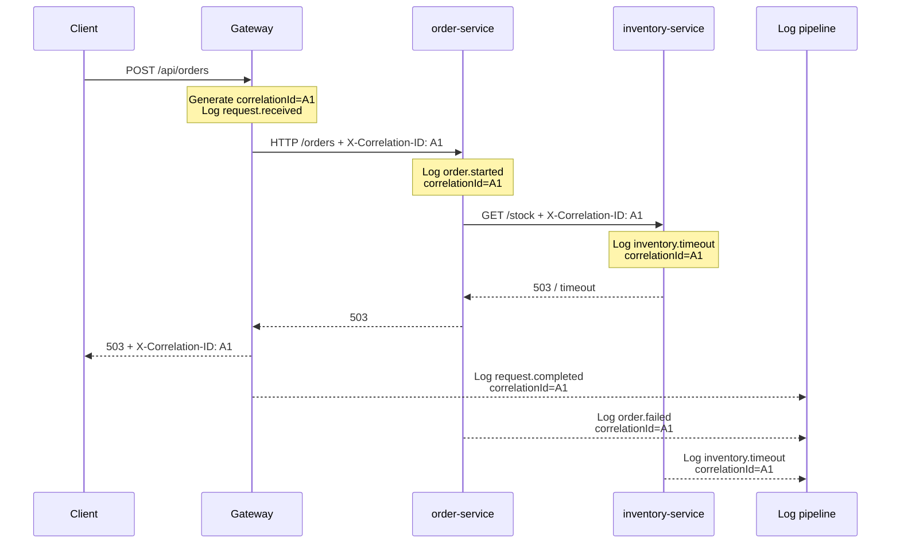
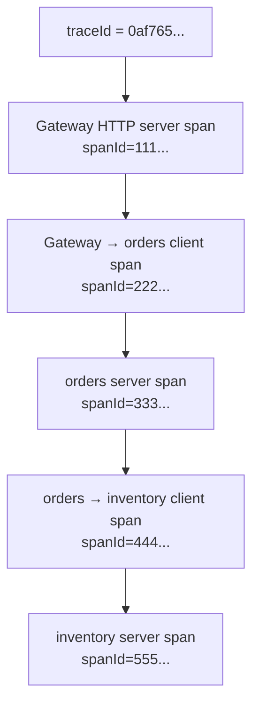
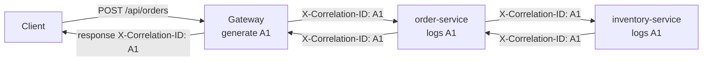
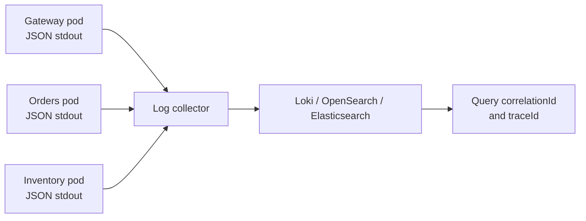

# Correlation IDs and Structured Logging Across Call Chains

In a microservices system, a single client request can travel through **API Gateway → order service → inventory service → payment service** before returning a result. When a client reports “an order creation call failed with 503,” logs for each application typically live on different pods, hosts, or storage backends. Without a linking key, engineers have to cross-reference timestamps, paths, and overlapping records to guess which events belong to the same request.

**Correlation IDs** solve that lookup problem: an identifier attached to a request at the system boundary and **propagated across HTTP hops** so related logs can be stitched back together. Combined with **structured logging** (usually JSON), we can query logs by an explicit field instead of searching arbitrary substrings inside free-form messages.

This lesson sits in the **Observability** chapter of the **SPRING_CLOUD_GATEWAY** module. It connects routing via route predicates, filter chains, path/header rewrites, and service discovery with authentication, rate limiting, circuit breakers, retries, TLS, and request observability when operating a Gateway in front of microservices.

**Learning objectives**

1. Distinguish **`correlationId`, `requestId`, `traceId`, `spanId`**, and W3C `traceparent`.
2. Define where correlation IDs are created, validated, forwarded, and returned at the Gateway.
3. Design a **JSON log schema** with stable fields while avoiding data leaks and uncontrolled cardinality.
4. Understand how **Servlet MDC** differs from **WebFlux Reactor Context**, and avoid relying on `ThreadLocal` across reactive pipelines.
5. Emit logs and propagate context across multiple services, including 401/403/404, 5xx, timeouts, retries, and async work.
6. Write tests and queries to trace a real request end to end.

> **Version scope:** Primary Gateway examples use **Spring Cloud Gateway Server WebFlux** and Spring Boot's built-in structured logging available from **3.4+** (including Boot 4.x). Certain properties and Micrometer/OpenTelemetry starters vary across Boot/Cloud trains. Java snippets are standalone practice examples, not pre-built/tested artifacts in this lesson. Separate sections explain Server Web MVC/Servlet so WebFlux filters are never misapplied to MVC.

## 1. The Problem: One Request, Many Logs Across Many Machines

Suppose:

```http
POST /api/orders HTTP/1.1
Host: api.example.test
Content-Type: application/json

{"sku":"BOOK-1","quantity":1}
```

The Gateway routes to `lb://order-service`. The order service calls inventory, where a backend timeout occurs.

Without a correlation ID, logs might look like:

```text
12:00:01 gateway    INFO POST /api/orders
12:00:01 orders     INFO calling inventory
12:00:02 inventory  WARN dependency timeout
12:00:02 gateway    WARN upstream 504

12:00:01 gateway    INFO POST /api/orders
12:00:01 orders     INFO calling inventory
```

Two users called the API nearly simultaneously. By timestamp alone, we **cannot tell for certain** which lines belong to which request.

When every hop logs the same correlation ID:

```text
gateway    correlationId=7e4d...  request.received
orders     correlationId=7e4d...  inventory.call.started
inventory  correlationId=7e4d...  inventory.timeout
orders     correlationId=7e4d...  order.failed
gateway    correlationId=7e4d...  request.completed status=504
```

Now we can query the entire call chain with a single filter condition. This cuts down the time needed to find where a failure happened, though **a correlation ID alone does not supply a span tree or timing breakdown**. To see parent-child spans and per-hop durations, true distributed tracing is required.

### 1.1. Flow Diagram



The label **A1** in the diagram is purely for readability; real correlation IDs must be sufficiently random, collision-resistant, and compliant with your system's format policy.

## 2. Four IDs That Must Not Be Conflated

| Field | Definition | Scope / Lifecycle | Example |
| --- | --- | --- | --- |
| **`correlationId`** | Application identifier linking logs across a business/request chain. | Defined by organizational contract; may span multiple hops. | UUID `c8f46d3b-...` |
| **`requestId`** | Identifier of a single HTTP request or processing step at a specific hop. | Typically **new per hop** or **per attempt**. | `req-92d8` |
| **`traceId`** | Identifier of a **distributed trace** containing multiple spans. | Persists across services when context propagation works. | 32 hex chars per W3C |
| **`spanId`** | Identifier of one operation/span within a trace. | Changes per span; normally differs between Gateway and backends. | 16 hex chars |
| **`parentSpanId`** | Parent span used to assemble the trace tree. | Establishes parent-child linkage. | 16 hex chars |

A correlation ID **can** match `traceId` if an organization standardizes on that, yet they are **not inherently identical**. For instance, an async workflow may start a new trace while keeping the same business correlation ID across a queue; conversely, a batch job might process multiple request IDs inside one trace.

**Good rule:** Define the contract clearly. If Micrometer Tracing/OpenTelemetry is already in place, prefer using **`traceId` as the technical correlation key** across instrumented hops, and add **`X-Correlation-ID`** only when separate support, operational, or business requirements call for it. Avoid generating four distinct IDs without recording how they relate.

### 2.1. W3C `traceparent` Is Not `X-Correlation-ID`

The **W3C Trace Context** standard defines the header:

```http
traceparent: 00-0af7651916cd43dd8448eb211c80319c-b7ad6b7169203331-01
```

Version `00` structure:

```text
00 - 0af7651916cd43dd8448eb211c80319c - b7ad6b7169203331 - 01
|  |                                   |                  |
|  trace-id: 16 bytes / 32 hex        |                  trace-flags
version                                parent-id: 8 bytes / 16 hex
```

- **`trace-id`** links spans belonging to the same trace.
- **`parent-id`** identifies the caller's span to which the receiver attaches.
- **`trace-flags`** carries the sampled bit; it is not an unrestricted command allowing clients to force recording every trace.
- **`tracestate`** is an auxiliary standard header for tracing vendor data; never use it to store tokens, PII, or arbitrary application IDs.

**Never hand-craft `traceparent` as `traceparent=correlationId`.** Let the Micrometer/OpenTelemetry SDK manage W3C headers, parent-child links, and sampling. With an independent `X-Correlation-ID` header, the Gateway can set or rewrite it under its own contract without breaking W3C tracing structure.

### 2.2. One Call Chain Can Contain Many Spans



All spans can share one **`traceId`** while having **distinct `spanId`s**. Logs carrying the same correlation ID still retrieve the full chain, while tracing shows parent-child relationships and timing. **Never require `spanId` to be identical across services**—that misunderstands the model.

## 3. Defining the Correlation ID Contract at the Gateway

Before writing code, answer clearly:

1. What is the standard header name? For example, **`X-Correlation-ID`** or **`X-Request-ID`**; pick one consistently.
2. Does the Gateway **always generate a fresh ID** at the public boundary, or accept one from a trusted ingress/client?
3. How are empty, oversized, multi-valued, control-character, or invalid-charset inbound headers handled?
4. Is the header forwarded across all **HTTP client requests**, messaging, and background tasks?
5. Is the ID echoed back to the client in a **response header** to aid support tickets?
6. How long is the ID retained, where is it logged, and could it carry sensitive meaning?
7. Is the correlation ID tied to `traceId` or maintained as a separate key?

An example contract:

| Aspect | Recommended Rule |
| --- | --- |
| Internet ingress | **Gateway generates UUID v4**, ignoring arbitrary caller-supplied IDs. |
| Trusted ingress / mTLS proxy | May accept an ingress-verified ID after format validation and trust-zone enforcement. |
| Internal header name | `X-Correlation-ID`. |
| Format | UUID v4, or a safe 8–64 character string matching an explicit regex. |
| Malformed inbound header | **Discard the incoming value**, generate a new ID; do not log the raw header. |
| Multiple header values | Never pick an arbitrary element from duplicate/comma-separated values. |
| HTTP outbound | Overwrite the header with the pipeline's trusted ID. |
| HTTP response | Echo the safe ID to the client, including error responses where headers can still be written. |
| Local logs | Emit a structured `correlationId` field on notable events. |
| Traces | Let the tracing SDK manage `traceparent`/`tracestate`. |
| Security | **Never** treat the ID as proof of authentication or authorization. |

### 3.1. Why Must Inbound Headers Be Validated?

Anti-pattern:

```java
String correlationId = request.getHeaders()
    .getFirst("X-Correlation-ID");
log.info("Correlation ID: {}", correlationId);
```

When accepted from public internet clients, the value can:

- Be tens of kilobytes long, bloating logs and indexes.
- Contain newlines or invalid characters intended to spoof log parsers.
- Intentionally collide with another request's ID to pollute searches.
- Contain an email, card number, or personal identifier that must not be stored.
- Arrive as multiple header values or comma-separated lists.

Even when a JSON logger escapes strings properly, **log pollution and high cardinality remain risks**. A public-facing Gateway should generate a random ID itself and return it in the response; if an ID issued by a trusted ingress must be preserved, enforce validation at that exact ingress boundary.

### 3.2. UUID v4 and Uniqueness

```java
String correlationId = java.util.UUID.randomUUID().toString();
```

UUID v4 is generally sufficient for correlating HTTP logs: nodes can generate IDs independently without calling Redis or a database for sequential counters. **Never use** second-resolution timestamps, usernames, IPs, session IDs, or per-node sequential integers as correlation IDs: they collide easily, leak information, or break across replicas.

**Note:** A correlation ID is an **observability identifier**, not an API key. Never grant a request access to someone else's order simply because it knows their correlation ID.

## 4. Propagating the ID Through Gateway and Microservices

At the Gateway, create the ID **before dispatching outbound HTTP**, then:

1. Store the ID in an **exchange attribute** or request-scoped store.
2. **Mutate the incoming request** so downstream Gateway routing sees the new header.
3. Write the ID into the **response header** before the response commits.
4. Emit structured log events on receipt, completion, or failure.
5. Ensure backend HTTP clients and services read and forward the same ID.
6. In downstream services, attach the ID to the request's local log context and forward it to the next service.



**Headers cannot “jump” across message queues automatically.** If `order-service` publishes a Kafka/RabbitMQ event processed later by `billing-service`, place the ID in **message headers/envelope metadata** per policy and extract it when the consumer logs. Do not stuff HTTP-only headers arbitrarily into business payloads unless the event contract calls for it.

### 4.1. What Should Each Hop Do?

| Location | Correlation ID Handling |
| --- | --- |
| **Ingress / WAF / API Gateway** | Generate or accept from trusted zone, validate, attach to request/response. |
| **Spring Cloud Gateway routing** | Preserve header on outbound calls to `lb://...` or target URIs; do not strip/overwrite after setting. |
| **HTTP backend server** | Read header safely, bind to log context, propagate as needed. |
| **Backend HTTP client** | Forward the active ID to the next service; do not generate a fresh ID per call if the contract specifies one chain. |
| **Message producer** | Copy ID into message metadata; do not rely on Reactor Context crossing the network. |
| **Message consumer** | Extract header, start an isolated scope, clean up context afterward. |
| **Log pipeline** | Parse JSON, index the ID field, and retain service/environment/timestamp for queries. |
| **Support team** | Look up ID from response headers or error messages and inspect timelines subject to access controls. |

For tracing to span across hops, **tracing instrumentation** must propagate W3C trace context over HTTP clients or message producers. Adding `X-Correlation-ID` alone **does not create distributed trace spans**.

## 5. Spring Cloud Gateway Server WebFlux: `WebFilter` to Create and Propagate IDs

In Gateway Server WebFlux, a **`GlobalFilter`** only runs inside the **Gateway filter chain** after a route has matched. If you want `401/403` responses rejected by Spring Security **before Gateway routing**, or `404` responses when no route matches, to also receive the correlation header, place the logic in a **Spring WebFlux `WebFilter`** with an appropriate order.

This example implements a **pre-routing `WebFilter`** that generates a fresh ID at the public boundary, mutates the request header, and registers the response header before commit—without blindly relying on `ThreadLocal` MDC.

### 5.1. WebFlux Java Code

```java
package com.example.gateway.observability;

import java.util.UUID;

import org.slf4j.Logger;
import org.slf4j.LoggerFactory;
import org.springframework.core.Ordered;
import org.springframework.core.annotation.Order;
import org.springframework.http.server.reactive.ServerHttpRequest;
import org.springframework.stereotype.Component;
import org.springframework.web.server.ServerWebExchange;
import org.springframework.web.server.WebFilter;
import org.springframework.web.server.WebFilterChain;
import reactor.core.publisher.Mono;

@Component
@Order(Ordered.HIGHEST_PRECEDENCE)
public final class CorrelationIdWebFilter implements WebFilter {

    private static final Logger log =
        LoggerFactory.getLogger(CorrelationIdWebFilter.class);

    public static final String HEADER = "X-Correlation-ID";
    public static final String CONTEXT_KEY = "correlationId";

    @Override
    public Mono<Void> filter(
            ServerWebExchange exchange,
            WebFilterChain chain) {

        // Public boundary: never trust a client-supplied ID.
        String correlationId = UUID.randomUUID().toString();

        ServerHttpRequest request = exchange.getRequest()
            .mutate()
            .headers(headers -> headers.set(HEADER, correlationId))
            .build();

        ServerWebExchange decorated =
            exchange.mutate().request(request).build();

        // Internal metadata; not automatically transmitted over the network.
        decorated.getAttributes().put(CONTEXT_KEY, correlationId);

        // Register before routing or security can commit the response.
        decorated.getResponse().beforeCommit(() -> {
            decorated.getResponse().getHeaders()
                .set(HEADER, correlationId);
            return Mono.empty();
        });

        log.atInfo()
            .addKeyValue("correlationId", correlationId)
            .addKeyValue("method", request.getMethod().name())
            .addKeyValue("event", "gateway.request.received")
            .log("Gateway accepted an HTTP request");

        return chain.filter(decorated)
            .doOnError(error -> log.atWarn()
                .addKeyValue("correlationId", correlationId)
                .addKeyValue("errorType",
                    error.getClass().getSimpleName())
                .addKeyValue("event", "gateway.request.error")
                .log("Request failed in Gateway pipeline"))
            .contextWrite(context ->
                context.put(CONTEXT_KEY, correlationId));
    }
}
```

Explanation:

- **`@Component`** registers a WebFlux `WebFilter`.
- **`@Order(Ordered.HIGHEST_PRECEDENCE)`** places the filter at the front; in real apps, test interactions with Spring Security, CORS, and other `WebFilter`s instead of relying on unverified ordering assumptions.
- **`UUID.randomUUID()`** generates the ID upon entering the public boundary. Any client header with the same name is **overwritten** rather than retaining two values.
- **`request.mutate()`** produces a request with the new header, and **`exchange.mutate().request(...)`** exposes it to downstream Gateway routing.
- **`exchange.getAttributes()`** coordinates metadata within the same exchange.
- **`beforeCommit(...)`** writes the response header while headers are still mutable, including when downstream or exception handlers set the status; of course, if an infrastructure error drops the socket before writing the response, the client will not receive the header.
- **`SLF4J addKeyValue(...)`** records the ID and event type as structured logging fields instead of concatenating them into free-form text.
- **`contextWrite(...)`** places the ID into **Reactor Context** for inner subscription operators; it is **not** MDC and does **not automatically turn into an HTTP header on new business client calls**.

**Never log raw URLs/queries/bodies, tokens, cookies, or untrusted header values.** This example logs only the method, event name, and Gateway-generated UUID.

### 5.2. Why Not Write Only a `GlobalFilter`?

A Gateway `GlobalFilter` can run after a route matches:

```java
@Component
class RoutedRequestAuditFilter implements GlobalFilter, Ordered {

    @Override
    public int getOrder() {
        return 100;
    }

    @Override
    public Mono<Void> filter(
            ServerWebExchange exchange,
            GatewayFilterChain chain) {
        return chain.filter(exchange);
    }
}
```

This is only a **`GlobalFilter` skeleton**, not a complete correlation filter. It does not share the same scope as a `WebFilter`: if `RoutePredicateHandlerMapping` finds no route or Spring Security blocks the request before entering the Gateway filter chain, a `GlobalFilter` may **never execute**.

| Placement | Scope | Best Use |
| --- | --- | --- |
| **`WebFilter`** | WebFlux HTTP pipeline, typically before Gateway route handling | Generate correlation IDs early, covering many pre-route errors. |
| **`GlobalFilter`** | Gateway requests that matched a route | Log route ID, route metadata, filters, and routing behavior. |
| **`GatewayFilter` per-route** | One specific route | Log route-specific/business events, not as the sole source for all requests. |
| **Netty wiretap / access log** | Transport layer | Protocol diagnostics when needed; not a substitute for business-level structured logs. |

A practical design pairs a **`WebFilter` generating the ID** with a **`GlobalFilter` reading the ID and route ID** to avoid generating a second ID. **Never place two filters that each generate a new ID**, or the backend request and client response may carry two different codes.

### 5.3. Logging `routeId` Once a Route Is Selected

Inside the Gateway filter chain, you can read the route attribute:

```java
Route route = exchange.getAttribute(
    ServerWebExchangeUtils.GATEWAY_ROUTE_ATTR);

String routeId = route == null ? "unmatched" : route.getId();
String correlationId = exchange.getAttribute("correlationId");
```

Expected imports:

```java
import org.springframework.cloud.gateway.route.Route;
import org.springframework.cloud.gateway.support.ServerWebExchangeUtils;
```

This snippet targets **Gateway Server WebFlux**. Do not use it in Gateway Server Web MVC or Proxy Exchange controllers. When routing fails before a route is chosen, **`routeId` may be absent**, so your log schema should permit `null` or a clearly defined sentinel instead of assuming every request has a route.

### 5.4. What to Verify During Deployment

- Does the Gateway actually forward `X-Correlation-ID` to the backend? **Confirm with a backend stub**, not just by inspecting the request header right after `mutate`.
- Does any filter such as `RemoveRequestHeader`, `SetRequestHeader`, or another `GlobalFilter` overwrite or strip the ID afterward?
- Do 401/403, 404, 429, and 502/503/504 responses carry the header whenever a response can still be written?
- Does the header appear **once**, even if the client sent duplicate values?
- Does the `Retry` filter preserve the same ID across related attempts?
- Do logs leak raw tokens, PII-bearing full paths, or credential-bearing query strings?

**If you must accept an ID from a trusted ingress**, add validation and trust-boundary enforcement where the ID is read. Never blindly replace UUID generation with `getFirst(HEADER)` without controls.

## 6. Spring MVC Backend: Putting Correlation IDs into Scoped MDC

A service behind the Gateway may run Spring MVC on Tomcat/Jetty. In **synchronous Servlet request processing**, the standard way to attach an ID to logs is **SLF4J MDC** (*Mapped Diagnostic Context*), which is bound to the current thread.

A backend should accept `X-Correlation-ID` only from a **trusted Gateway/ingress** (enforced via network policy, mTLS, or an equivalent trust model). If the backend accepts direct internet connections, the header remains untrusted input requiring its own policy. The example below **only validates format**; the trust boundary itself must be enforced by infrastructure/authorization.

### 6.1. Servlet Filter for an Internal Service

```java
package com.example.orders.observability;

import java.io.IOException;
import java.util.Enumeration;
import java.util.UUID;
import java.util.regex.Pattern;

import jakarta.servlet.FilterChain;
import jakarta.servlet.ServletException;
import jakarta.servlet.http.HttpServletRequest;
import jakarta.servlet.http.HttpServletResponse;

import org.slf4j.MDC;
import org.springframework.core.Ordered;
import org.springframework.core.annotation.Order;
import org.springframework.stereotype.Component;
import org.springframework.web.filter.OncePerRequestFilter;

@Component
@Order(Ordered.HIGHEST_PRECEDENCE)
public class CorrelationIdServletFilter
        extends OncePerRequestFilter {

    private static final String HEADER = "X-Correlation-ID";
    private static final Pattern SAFE_ID = Pattern.compile(
        "[A-Za-z0-9][A-Za-z0-9._-]{7,63}");

    @Override
    protected void doFilterInternal(
            HttpServletRequest request,
            HttpServletResponse response,
            FilterChain chain)
            throws ServletException, IOException {

        String correlationId = trustedIncomingOrNew(request);

        request.setAttribute("correlationId", correlationId);
        response.setHeader(HEADER, correlationId);

        // Close the scope after the chain so MDC never leaks into another request
        // when the Servlet thread is reused.
        try (MDC.MDCCloseable ignored =
                 MDC.putCloseable("correlationId", correlationId)) {
            chain.doFilter(request, response);
        }
    }

    private static String trustedIncomingOrNew(
            HttpServletRequest request) {
        Enumeration<String> values = request.getHeaders(HEADER);
        if (values != null && values.hasMoreElements()) {
            String incoming = values.nextElement();
            if (!values.hasMoreElements()
                    && SAFE_ID.matcher(incoming).matches()) {
                return incoming;
            }
        }
        return UUID.randomUUID().toString();
    }
}
```

Purpose of this example:

1. **Reject arbitrary header values**: discard duplicate, empty, or malformed headers.
2. **Preserve the Gateway's ID** when the service receives traffic strictly across a trusted boundary with a valid header.
3. If missing, generate a fresh ID so internal service logs can still be grouped together.
4. **`request.setAttribute`** stores the ID on local request metadata.
5. **`MDC.putCloseable(...)`** attaches `correlationId` to logs emitted on the current thread.
6. **try-with-resources** restores/clears MDC when the request exits scope, preventing ID leakage across reused container worker threads.

**Important limitation:** Across Servlet async dispatches, `@Async`, `CompletableFuture`, or custom thread pools, **ThreadLocal MDC does not follow work automatically**. `OncePerRequestFilter` also has distinct semantics for async/error dispatches. Test the request lifecycle, Spring Security/logging order, and use context-propagation/task decorators when crossing threads—never assume this synchronous filter covers async flows.

### 6.2. Writing Structured Logs in a Controller/Service

With MDC populated by the Servlet filter:

```java
package com.example.orders;

import org.slf4j.Logger;
import org.slf4j.LoggerFactory;
import org.springframework.http.ResponseEntity;
import org.springframework.web.bind.annotation.GetMapping;
import org.springframework.web.bind.annotation.RestController;

@RestController
public class OrderStatusController {

    private static final Logger log =
        LoggerFactory.getLogger(OrderStatusController.class);

    @GetMapping("/internal/orders/status")
    public ResponseEntity<String> status() {
        log.atInfo()
            .addKeyValue("event", "order.status.read")
            .addKeyValue("component", "orders")
            .log("Order status request processed");
        return ResponseEntity.ok("ready");
    }
}
```

When JSON logging is enabled and MDC is included in output, the record looks like:

```json
{
  "@timestamp": "2026-11-24T05:10:03.120Z",
  "service.name": "order-service",
  "log.level": "INFO",
  "message": "Order status request processed",
  "correlationId": "2f34a091-8301-4d64-9360-9f10c46ea232",
  "event": "order.status.read",
  "component": "orders"
}
```

This illustrates the **logical log fields**, not a byte-for-byte guarantee of a specific ECS encoder's JSON shape. Required fields and key ordering can differ across ECS, Logstash, GELF, and logger configurations.

### 6.3. Sending the Same ID When One Backend Calls Another

MDC lives inside the **current process's memory**; an inventory service in another process **cannot see `order-service`'s MDC automatically**. You must send the header over the HTTP client.

Spring MVC example using Spring Boot-managed `RestClient.Builder`:

```java
package com.example.orders;

import org.springframework.beans.factory.annotation.Value;
import org.springframework.http.ResponseEntity;
import org.springframework.web.bind.annotation.GetMapping;
import org.springframework.web.bind.annotation.RequestAttribute;
import org.springframework.web.bind.annotation.RestController;
import org.springframework.web.client.RestClient;

@RestController
public class InventoryCheckController {

    private final RestClient inventoryClient;

    public InventoryCheckController(
            RestClient.Builder builder,
            @Value("${demo.inventory-base-url}") String baseUrl) {
        this.inventoryClient = builder.baseUrl(baseUrl).build();
    }

    @GetMapping("/internal/orders/check-stock")
    public ResponseEntity<String> checkStock(
            @RequestAttribute("correlationId") String correlationId) {

        String result = inventoryClient.get()
            .uri("/internal/inventory/health")
            .header("X-Correlation-ID", correlationId)
            .retrieve()
            .body(String.class);

        return ResponseEntity.ok(result);
    }
}
```

With lab config:

```yaml
demo:
  inventory-base-url: http://localhost:9092
```

The `inventory-service` backend must also validate the header and bind it to its log context. **`RestClient` does not automatically know about arbitrary custom application MDC fields**, which is why the example sets the header explicitly. For **W3C trace context**, when tracing is enabled, Spring Boot recommends using **auto-configured `RestClient.Builder` or `WebClient.Builder`** so instrumentation propagates tracing headers properly (see Spring Boot Tracing docs in the references).

> **Never replace a business header with a homemade W3C `traceparent`**. The snippet above passes `X-Correlation-ID` separately. The tracing SDK can simultaneously inject `traceparent`/`tracestate` with proper `traceId` and `spanId` relationships.

### 6.4. One Request Can Trigger Multiple Outbound Calls

If `order-service` calls inventory and payment in parallel:

```text
Gateway (correlationId=A1)
  |
  +--> order-service (A1)
           |
           +--> inventory-service (A1)
           |
           +--> payment-service   (A1)
```

Those outbound calls share the **same correlation ID** because they belong to one request chain, yet should have **distinct `spanId` / request attempt IDs** to inspect each branch individually. If payment retries, retry attempts can keep `A1` while logging `attempt=1/2/3`.

## 7. Spring WebFlux Backends: Reactor Context Instead of Arbitrary MDC

In WebFlux/Reactor, a single request can execute across multiple threads due to `publishOn`, `subscribeOn`, non-blocking I/O, or operator boundaries. **MDC is ThreadLocal-based**, so putting a value on the entry thread and expecting it to appear in all subsequent logs is broken.

### 7.1. Distinguishing Three Context Mechanisms

| Mechanism | Scope | Survives Thread Switches? | Crosses HTTP Hops? |
| --- | --- | --- | --- |
| **Java `ThreadLocal` / SLF4J MDC** | Current thread | **Not automatically** | No |
| **`ServerWebExchange.getAttributes()`** | One HTTP exchange in-process | Travels with the exchange object, must access via exchange | No |
| **Reactor `Context`** | Per subscriber in a reactive chain | **Yes by Reactor design**, if publishers/contexts are composed properly | No |
| **HTTP `X-Correlation-ID`** | HTTP request metadata | Independent of Java threads | **Yes**, when explicitly sent |
| **W3C `traceparent`** | Distributed tracing propagation | Via instrumentation/context propagation | **Yes**, when client/server are instrumented |

**Reactor Context is local to a single subscription**, not a global variable and never sent automatically to another microservice over the network.

### 7.2. `WebFilter` Reading an ID from a Trusted Gateway

In a WebFlux backend accepting traffic strictly from a trusted Gateway:

```java
package com.example.inventory;

import java.util.List;
import java.util.UUID;
import java.util.regex.Pattern;

import org.springframework.http.HttpHeaders;
import org.springframework.stereotype.Component;
import org.springframework.web.server.ServerWebExchange;
import org.springframework.web.server.WebFilter;
import org.springframework.web.server.WebFilterChain;
import reactor.core.publisher.Mono;

@Component
public class InternalCorrelationWebFilter implements WebFilter {

    private static final Pattern SAFE = Pattern.compile(
        "[A-Za-z0-9][A-Za-z0-9._-]{7,63}");

    @Override
    public Mono<Void> filter(
            ServerWebExchange exchange,
            WebFilterChain chain) {
        List<String> values = exchange.getRequest()
            .getHeaders().get("X-Correlation-ID");

        String id = (values != null && values.size() == 1
                && SAFE.matcher(values.get(0)).matches())
            ? values.get(0)
            : UUID.randomUUID().toString();

        exchange.getAttributes().put("correlationId", id);

        return chain.filter(exchange)
            .contextWrite(context ->
                context.put("correlationId", id));
    }
}
```

This demonstrates **propagating into Reactor Context**. **It does not verify that the network caller is actually a trusted Gateway**: in production, enforce separate network/auth policies so requests come only from trusted origins and public callers cannot abuse arbitrary IDs.

### 7.3. Reading Context in the Right Place Inside a Reactive Chain

Controller example:

```java
package com.example.inventory;

import java.util.Map;

import org.slf4j.Logger;
import org.slf4j.LoggerFactory;
import org.springframework.http.ResponseEntity;
import org.springframework.web.bind.annotation.GetMapping;
import org.springframework.web.bind.annotation.RestController;
import reactor.core.publisher.Mono;

@RestController
public class InventoryController {

    private static final Logger log =
        LoggerFactory.getLogger(InventoryController.class);

    @GetMapping("/internal/inventory/health")
    public Mono<ResponseEntity<Map<String, Object>>> health() {
        return Mono.deferContextual(context -> {
            String id = context.getOrDefault(
                "correlationId", "missing");

            log.atInfo()
                .addKeyValue("correlationId", id)
                .addKeyValue("event", "inventory.health.read")
                .log("Inventory checked");

            return Mono.just(ResponseEntity.ok(
                Map.of("healthy", true)));
        });
    }
}
```

**`Mono.deferContextual(...)`** reads the context at subscription time when values are applied. This is a clean way to **include `correlationId` in log events** without assuming MDC always resides on the active thread.

### 7.4. Why Not Call `MDC.put()` Outside the Reactive Chain?

Anti-pattern:

```java
// WRONG if expecting this value to follow all Reactor operators.
MDC.put("correlationId", incomingId);
return reactiveService.handle()
    .doOnNext(value -> log.info("handled"))
    .then();
```

Risks:

- `doOnNext` runs on another thread where MDC is empty.
- Uncleaned MDC on the original thread **contaminates other requests**.
- Errors or cancellations bypass intended cleanup code.
- Calling detached `subscribe()` breaks expected Reactor Context inheritance.

**Solution:** Use `Reactor Context` for application fields and explicit structured log key-values; use Micrometer Context Propagation/Tracing for instrumented observations and trace/span MDC. If bridging MDC manually, manage scope precisely in each callback rather than installing arbitrary hooks without checking memory, performance, and cleanup.

### 7.5. Spring Boot Support for Automatic Reactor Context Restoration

Spring Boot provides the property:

```yaml
spring:
  reactor:
    context-propagation: auto
```

Boot's Observability docs explain that **`auto`** mode restores `ThreadLocal`s registered via **Micrometer Context Propagation** across reactive operators. The default may be `limited` depending on the version.

**Important:**

1. `auto` mode **does not automatically make every custom `ThreadLocal` a propagatable context key**. Custom `ThreadLocal`s require a corresponding `ThreadLocalAccessor` registration.
2. `auto` handles in-process context propagation; it **does not replace HTTP header propagation** to other processes.
3. With Micrometer Tracing, trace/span MDC is managed by instrumentation, though you should still test async callbacks and client instrumentation scopes.
4. Avoid calling `Hooks.enableAutomaticContextPropagation()` unconditionally across multiple beans when Boot manages it; pick one clear mechanism for your version and test it.
5. Reactor Context remains a solid choice for holding **application correlation IDs**, especially when logging via SLF4J fluent key-values.

### 7.6. `@Async` and Thread Pools in MVC

When `order-service` uses:

```java
@Async
public void notifyCustomer() {
    log.info("notification sent");
}
```

MDC from the Servlet thread **does not cross into the executor automatically**. Spring Boot Observability documents `ContextPropagatingTaskDecorator` for `AsyncTaskExecutor` in supporting versions; use an executor configured with context propagation. For work running after the HTTP request lifecycle ends, prefer passing the ID via **explicit method parameters or message metadata** rather than relying on a potentially expired thread context.

Specifically, if notifications are async business events, you may need a **business operation ID** that outlives an HTTP request; never hold an HTTP trace/span context open indefinitely just to log an email hours later.

## 8. Structured Logging: One Schema Usable Across Services

**Structured logging** means every log record is a typed set of stable fields, usually formatted as **one JSON object per line** (*JSON Lines*). This lets ELK/OpenSearch/Loki/Splunk index and query fields directly instead of parsing free-form log strings.

Suggested schema:

| Field | Type | Meaning | Security / Cost Note |
| --- | --- | --- | --- |
| `timestamp` / `@timestamp` | ISO-8601 UTC | Event timestamp. | Keep NTP synced with sufficient precision. |
| `service.name` | String | Gateway, orders, inventory… | Use stable names. |
| `service.version` | String | Running artifact/release. | Helpful during parallel rollouts. |
| `environment` | String | staging/prod… | Never log secrets. |
| `instance.id` / pod | String | Where the event occurred. | Keep cardinality manageable. |
| `log.level` | INFO/WARN/ERROR | Severity level. | Do not log ERROR for routine valid client behavior. |
| `event` | String | Stable event code. | E.g., `gateway.request.completed`. |
| `correlationId` | String | Cross-hop log search key. | Never use directly as a metric label. |
| `traceId` | String | Pivot to distributed traces. | May be absent if tracing is disabled. |
| `spanId` | String | Span emitting the log. | Often differs across hops. |
| `routeId` | String | Selected Gateway route. | Not a PII-bearing full path. |
| `http.method` | String | GET/POST/PUT… | Consistent casing/format. |
| `http.status_code` | Integer | Status returned to client. | Distinguish backend vs. gateway errors. |
| `duration_ms` | Number | Elapsed duration. | Numeric type, avoid `"12ms"` strings. |
| `error.type` | String | Controlled error category. | Avoid logging raw requests/bodies. |
| `attempt` | Integer | Retry attempt number per policy. | One ID may span multiple attempts. |
| `message` | String | Concise human-readable summary. | Never dump entire JSON payloads. |

### 8.1. Sample JSON Logs Across Three Services

The records below are **constructed for illustration**, not copied from a live environment:

```json
{"@timestamp":"2026-11-24T05:10:01.000Z","service.name":"edge-gateway","log.level":"INFO","event":"gateway.request.received","correlationId":"2f34a091-8301-4d64-9360-9f10c46ea232","traceId":"0af7651916cd43dd8448eb211c80319c","spanId":"b7ad6b7169203331","http.method":"POST","message":"Gateway accepted request"}
{"@timestamp":"2026-11-24T05:10:01.070Z","service.name":"order-service","log.level":"INFO","event":"order.inventory.call.started","correlationId":"2f34a091-8301-4d64-9360-9f10c46ea232","traceId":"0af7651916cd43dd8448eb211c80319c","spanId":"c1cd7bb2a65f93c2","message":"Checking stock"}
{"@timestamp":"2026-11-24T05:10:02.200Z","service.name":"inventory-service","log.level":"WARN","event":"inventory.timeout","correlationId":"2f34a091-8301-4d64-9360-9f10c46ea232","traceId":"0af7651916cd43dd8448eb211c80319c","spanId":"70ed49cf9ef64918","error.type":"ReadTimeoutException","message":"Inventory dependency timeout"}
{"@timestamp":"2026-11-24T05:10:02.230Z","service.name":"edge-gateway","log.level":"WARN","event":"gateway.request.completed","correlationId":"2f34a091-8301-4d64-9360-9f10c46ea232","traceId":"0af7651916cd43dd8448eb211c80319c","http.status_code":504,"duration_ms":1230.0,"message":"Upstream timed out"}
```

Benefits: you can filter every line by a single `correlationId` and sort by timestamp. To investigate latency, pivot to the trace view via `traceId`. To calculate error rates, **use low-cardinality metrics** rather than putting `correlationId` into Prometheus labels.

### 8.2. JSON Formatting Does Not Mean Data Is Safe

A system can emit valid JSON logs while accidentally leaking:

```json
{
  "event": "gateway.auth.failed",
  "Authorization": "Bearer <sensitive-token>",
  "requestBody": {"password": "<secret>"}
}
```

**This is an anti-pattern.** Structured logging is only a **format**, not automatic redaction. Enforce field allowlists, mask before emission, and restrict log-store access.

## 9. Configuring Structured Logging with Spring Boot

Spring Boot **3.4+** includes native support for **ECS**, **GELF**, and **Logstash** JSON formats. On modern Boot versions, you do not need to add a third-party Logstash encoder just to emit console JSON.

### 9.1. `application.yml` — Console JSON

```yaml
spring:
  application:
    name: edge-gateway

logging:
  structured:
    format:
      console: ecs
    ecs:
      service:
        environment: staging
```

When using ECS, `spring.application.name` typically populates the service name unless overridden. Spring Boot docs confirm that **MDC keys** and **SLF4J fluent key/value pairs** are included in structured JSON, with exact shapes depending on the encoder and version. Do not mix in a second JSON encoder before confirming your target logging system.

Equivalent formats:

```properties
logging.structured.format.console=ecs
# Or: logging.structured.format.console=logstash
# Or: logging.structured.format.console=gelf
```

**Pick one unified standard for your log pipeline.** If your aggregator expects ECS, use ECS. If you already run Logstash JSON, convert consistently at the collector or app—never let one service emit mixed JSON and unlabeled plain text.

### 9.2. Adding Log Fields with the SLF4J Fluent API

```java
log.atInfo()
    .addKeyValue("event", "gateway.route.selected")
    .addKeyValue("correlationId", correlationId)
    .addKeyValue("routeId", routeId)
    .addKeyValue("httpMethod", method)
    .log("Route selected");
```

Compared to:

```java
log.info("route={} correlationId={} method={}",
    routeId, correlationId, method);
```

the fluent call places values into **structured fields** when supported by the encoder. Plain-text formatters render key/value pairs differently, so **test actual JSON output**. In some older logging setups, indexing fields reliably requires a custom converter/encoder or MDC rather than just logger message placeholders.

### 9.3. Versioning Schemas for Safe Evolution

If your organization defines a custom schema instead of standard ECS, include a version field:

```json
{"schemaVersion":"gateway-logs-v1","event":"gateway.request.completed","correlationId":"2f34a091-8301-4d64-9360-9f10c46ea232","durationMs":42.5}
```

When renaming `durationMs` to `duration_ms`:

1. Publish the new schema version.
2. Update log parsers, dashboards, and alerts.
3. Run dual-read/compatibility periods if needed.
4. Plan retention for logs using the old schema.

Never change `http.status_code` from an integer to a string without updating Elasticsearch mappings and queries, or indexing errors and broken reports will follow.

### 9.4. Custom Logback Configs Can Bypass Boot Properties

If you already have a `logback-spring.xml` or `log4j2-spring.xml` defining custom appenders, `logging.structured.format.console=ecs` **may not automatically affect those custom appenders**.

Boot docs specify using `StructuredLogEncoder`/`StructuredLogLayout` and related system properties inside custom logging configs to preserve Boot's structured logging behavior. Before concluding structured logging is broken, inspect the **effective logging config**, and avoid stacking two encoders that produce double-escaped JSON.

### 9.5. One JSON Line per `stdout` Event

In containers/Kubernetes, the standard practice is emitting **one JSON event per `stdout`/`stderr` line**. A collector (Fluent Bit, Vector, OpenTelemetry Collector, or similar agent) ships them to the log backend.



The pipeline needs:

- Time synchronization across nodes.
- Enrichment of `service.name`, environment, and instance/pod metadata.
- Source-side redaction before writing to stdout (collectors act as defense in depth).
- Retention, role-based access control, encryption, and guards against exporting PII logs.
- Backpressure handling so slow collectors don't drop critical logs silently, plus fallback plans when the log backend is unavailable.

**Never perform synchronous network logging on the Netty event loop** for every request; blocking appenders or overloaded collectors will spike Gateway latency. At high throughput, consider bounded async appenders/queues with clear drop policies for lower-priority logs.

## 10. Combining Correlation IDs with Micrometer Tracing / OpenTelemetry

**Correlation IDs and distributed tracing complement each other**, but neither replaces the other:

- **Correlation ID**: lets operators ask “show me every log related to code A1.”
- **Trace ID**: lets operators open the trace tree with spans, latencies, and HTTP client/server relationships.
- **Span ID**: links a log line to the specific operation inside a trace.
- **Metrics**: answer “which route's error rate, throughput, or p99 is spiking?” without inspecting individual requests.

Spring Boot Actuator uses **Micrometer Observation/Tracing** and integrates with **OpenTelemetry** or **Brave/Zipkin**, depending on dependencies and version.

### 10.1. Boot 4.x Dependencies with OpenTelemetry

In a **Spring Boot 4.x** app compatible with Cloud Gateway 5.x, current tracing docs introduce:

```xml
<!-- Observability portion; the Gateway Server WebFlux starter is
     included separately for your compatible module/version. -->
<dependency>
    <groupId>org.springframework.boot</groupId>
    <artifactId>spring-boot-starter-actuator</artifactId>
</dependency>

<dependency>
    <groupId>org.springframework.boot</groupId>
    <artifactId>spring-boot-starter-opentelemetry</artifactId>
</dependency>
```

Configure the OTLP exporter endpoint and auth per Boot 4 docs for your train. Related properties live under **`management.opentelemetry.tracing.export.otlp.*`** in current docs. **Do not copy Boot 3.x's `management.otlp.tracing.endpoint` verbatim without checking the migration guide**, as starters and property names may differ.

A baseline configuration:

```yaml
spring:
  application:
    name: edge-gateway
  reactor:
    context-propagation: auto

logging:
  structured:
    format:
      console: ecs

management:
  tracing:
    sampling:
      probability: 0.10
```

`sampling.probability: 0.10` targets roughly 10% sampling according to the sampler/parent context, not strictly 1 out of every 10 requests. OpenTelemetry supports parent-based and custom samplers; align policies across the Gateway and downstream services.

**Logs can still be written even when a trace span is not exported to the backend.** Therefore, seeing a `traceId` in logs **does not guarantee** the corresponding span exists in Jaeger/Tempo/Zipkin if sampling, export, or ingestion dropped the trace.

### 10.2. Boot 3.4 / 3.5 Dependencies

In many **Spring Boot 3.x** apps, Micrometer Tracing docs recommend combining:

```xml
<dependency>
    <groupId>org.springframework.boot</groupId>
    <artifactId>spring-boot-starter-actuator</artifactId>
</dependency>

<dependency>
    <groupId>io.micrometer</groupId>
    <artifactId>micrometer-tracing-bridge-otel</artifactId>
</dependency>

<dependency>
    <groupId>io.opentelemetry</groupId>
    <artifactId>opentelemetry-exporter-otlp</artifactId>
</dependency>
```

This applies to the **Boot 3.x branch** and should not be combined simultaneously with Boot 4's new OpenTelemetry starter. Let the Spring Boot/Cloud BOM manage versions, and verify exporter protocol, endpoint, permissions, and tracing backend ingestion before deploying.

### 10.3. How Does Boot Automatically Add Trace/Span to Logs?

Spring Boot docs state that with **Micrometer Tracing**, Boot places **`traceId` and `spanId`** into MDC and displays correlation in the default log pattern. Example text log:

```text
2026-11-24 12:10:01 INFO [0af7651916cd43dd8448eb211c80319c-b7ad6b7169203331] Gateway accepted request
```

When **structured JSON logging** is enabled, those MDC values also appear as JSON fields. **Never add a custom `GlobalFilter` that parses `traceparent` and stuffs it into MDC `traceId`**: let valid instrumentation create and propagate span context.

If you want an **independent application `correlationId`**, keep it in its own field as shown earlier. Never create a custom span solely to mimic a correlation header if it does not represent a real timed operation.

### 10.4. Auto-Configured HTTP Clients Matter

Spring Boot recommends building `RestClient` or `WebClient` from **auto-configured `RestClient.Builder` / `WebClient.Builder`** beans so tracing headers propagate automatically:

```java
@Bean
WebClient catalogClient(
        WebClient.Builder builder) {
    return builder
        .baseUrl("https://catalog.internal.example.test")
        .build();
}
```

This requires importing `org.springframework.web.reactive.function.client.WebClient` in an app with WebClient on the classpath. Calling `WebClient.builder()` or `RestClient.create()` manually elsewhere **can bypass Boot's customizers and observations**, breaking trace propagation.

For **Spring Cloud Gateway Server WebFlux**, primary HTTP proxying runs through Gateway's routing filters and HTTP client (typically Reactor Netty), **not a controller-created `WebClient`**. Always test instrumentation and W3C `traceparent` on real Gateway routes; **do not assume route spans work just because a `WebClient.Builder` bean exists**.

### 10.5. Traces Must Never Be Used as Identity

A client can send:

```http
traceparent: 00-0af7651916cd43dd8448eb211c80319c-b7ad6b7169203331-01
```

A W3C-compliant tracer parses/validates it per spec and either joins the trace or starts a new one per policy. **Never use `traceId`, `tracestate`, or `correlationId` to derive a user ID, tenant, scope, or security-sensitive quota key**, because they are observability metadata that may originate from untrusted callers.

Even though trace context is not a credential, it can still reveal system/trace details. Across trust boundaries, enforce W3C trace context, sampler, and data-protection policies agreed upon by your observability team rather than blindly forwarding arbitrary vendor-specific `tracestate`.

## 11. Across Call Chains: Sync, Retries, Circuit Breakers, and Messaging

Real traffic is rarely a single simple GET. Gateway features create several ways correlation can be lost or duplicated:

| Scenario | Desired Behavior | Common Mistake |
| --- | --- | --- |
| **Service discovery `lb://`** | Header keeps the ID when routed to any instance | A downstream filter strips or overwrites the ID |
| **`RewritePath` / `StripPrefix`** | Correlation does not depend on path | Deriving ID from URL so path rewrites alter the ID |
| **Retry** | All attempts of a request keep the same correlation ID | Generating a new ID on every attempt |
| **Circuit breaker fallback** | Fallback logs share the same ID and flag fallback | Losing ID during internal forward |
| **Rate limiter 429** | 429 responses carry an ID for support | Creating the ID only after the Gateway route chain |
| **Authentication 401/403** | Security logs carry the ID | Using a `GlobalFilter` that runs after `SecurityWebFilterChain` |
| **Timeout 504 / backend failure** | Emit a structured error event with ID and error type | Logging in every filter, spamming unlinked entries |
| **WebSocket/SSE/streaming** | Connection/stream-scoped IDs | Generating a new ID per chunk or logging every frame |
| **Kafka/RabbitMQ async** | Put ID in message headers/envelope | Expecting MDC/`ThreadLocal` to cross process boundaries |
| **Batch/fan-out** | Clear parent correlation, distinct per-call span/attempt IDs | Reusing one `requestId` across every call, hiding individual branches |

### 11.1. Retries Should Keep One Correlation ID While Recording Attempts

Suppose the first inventory call times out, and either Gateway's `Retry` filter or `order-service` retries once:

```text
correlationId=A1 traceId=T1 attempt=1 event=inventory.call.failed status=503
correlationId=A1 traceId=T1 attempt=2 event=inventory.call.succeeded status=200
```

**One correlation ID for the request chain, multiple attempts.** Each attempt can have its own span to measure latency and link relationships. With Gateway Server WebFlux's `Retry` filter, verify actual filter ordering: filters ordered after `Retry` can execute repeatedly. **Never place fresh correlation ID generation where `Retry` re-invokes it** if you want a stable ID.

Crucially: being able to replay a request body ≠ safe business retry. For mutating POSTs like payments or order creation, require idempotency or disallow automatic retries.

### 11.2. Circuit Breakers and Fallbacks

When a backend fails and the Gateway triggers a fallback:

```text
event=gateway.circuit.open correlationId=A1 routeId=orders
event=gateway.fallback.selected correlationId=A1 routeId=orders
event=gateway.request.completed correlationId=A1 status=503
```

Do not generate a second correlation ID for the fallback if it serves the **same inbound request**. If the fallback forwards internally to another service, propagate the header and trace context appropriately.

**Never log the entire fallback body if it could contain sensitive data.** Logging the fallback code, route ID, and normalized status suffices for most operational needs.

### 11.3. HTTP Status Is Not Always Known When a Filter Finishes

A custom filter might observe `exchange.getResponse().getStatusCode() == null` while logging, because the server adapter defaults to 200 upon commit. In error pipelines, an outer exception handler may also decide the final status after the inner chain completes with an error.

To log the **true final status**, measure at an appropriate lifecycle hook (response commit, server observation, or access log) and test 401/404/5xx branches explicitly. **Never default `status=200` in logs just because the status object was temporarily null.**

### 11.4. Do Not Emit Competing “request.completed” Events

If a `WebFilter`, `GlobalFilter`, Netty access log, and backend each log a generic “HTTP completed” without distinct `event` and `component` fields, the log pipeline struggles to separate:

- **Gateway inbound request**;
- **Gateway outbound attempt**;
- **Backend inbound request**;
- **An internal span/call**.

Use semantic event names such as:

```text
gateway.inbound.completed
gateway.upstream.attempt.completed
orders.inbound.completed
orders.inventory.client.completed
inventory.inbound.completed
```

That gives **one `correlationId` with distinct event types**, preventing readers from mistaking five “completed” records for five separate client requests.

### 11.5. Correlation Across Message Queues

HTTP:

```http
POST /api/orders HTTP/1.1
X-Correlation-ID: A1
```

When publishing an event:

```text
topic: order-created
message.headers:
    correlationId: A1
    eventId: evt-772
    producedAt: 2026-11-24T05:10:03Z
```

Consumer:

1. Read and validate the metadata ID.
2. Create an isolated log scope; never reuse MDC left over from the previous message.
3. Log `correlationId=A1`, `eventId=evt-772`, and relevant processing codes.
4. When calling HTTP or publishing follow-up messages, propagate the ID per contract.
5. Clean up scope across success, error, retry, and cancellation paths.

**Correlation IDs and message IDs differ.** One message may be redelivered multiple times; `eventId` identifies that message, whereas `correlationId` links back to the originating workflow/request. Messaging tracing requires dedicated instrumentation/links and does not automatically keep the original span tree open for hours.

## 12. Never Let Observability Become a Security Risk

Before shipping logs to a central store, define strictly what data is permitted.

### 12.1. Fields to Avoid

| Field / Content | Risk | Safer Alternative |
| --- | --- | --- |
| `Authorization`, `Cookie`, `Set-Cookie` | Token/session exposure | Log only auth presence/absence if truly needed, never the value |
| Raw request/response JSON | PII, passwords, payment data, huge size | Log event code, schema version, byte count, error type |
| Full URL with query string | Tokens/emails/cards can appear in queries | Route ID or normalized path template |
| Full username/email/IP | PII and cardinality | Tokenized/hashed ID per policy and retention |
| Stack traces embedding request objects | May leak credentials or bodies | Error category and controlled stack traces |
| Raw client-supplied correlation ID | Log forging/pollution | Gateway-issued ID or validator + trust boundary |
| Arbitrary `tracestate`/`baggage` | Vendor metadata may hold sensitive info | Propagate only allowlisted keys with size caps |
| User ID / Correlation ID as metric labels | Extreme cost and cardinality explosion | Metrics grouped by route/status/environment |

### 12.2. Correlation IDs Must Never Become Access Tokens

A customer support API might accept:

```http
GET /support/request/2f34a091-8301-4d64-9360-9f10c46ea232
```

If that endpoint dumps full request history, payloads, and user info based solely on knowing the ID, that is a serious authorization flaw. Correlation IDs can be shared with clients for support reference, yet **reading detailed logs/traces must require separate authorization**, access auditing, and sensitive-data redaction.

### 12.3. Log Injection Risks

In plain-text logs, client data containing newlines can forge fake `ERROR` lines. Structured JSON escaping reduces visual spoofing, yet does not eliminate all downstream parser or indexing hazards.

Rules:

- Never log raw untrusted header IDs.
- If accepting an ID, enforce regex/length validation and single-value header checks.
- Never interpolate user input directly into `event` or `logger` fields; both should come from finite constants in code.
- Bound log message sizes and stack-trace depths.
- Use TLS transport and access controls on collectors and indexes.

### 12.4. Baggage and Privacy

Tracing baggage lets metadata cross process boundaries, but it is not a general carrier for all business attributes. **Never put JWTs, emails, full tenant objects, permissions, or payloads into baggage.** Baggage can be forwarded to external services, inflating header sizes and leak risk.

To get a correlation ID into logs, an explicit field or logging scope suffices. Only use baggage if your tracing team has defined allowed keys, trust boundaries, and size limits.

## 13. Querying Logs by Correlation ID

A centralized logging stack is only useful if engineers can **actually trace a single request from client to backend**.

### 13.1. Example Search in Elasticsearch/OpenSearch

Assuming the index mapping defines `correlationId` as `keyword`:

```text
correlationId:"2f34a091-8301-4d64-9360-9f10c46ea232"
```

This follows **KQL** syntax in KQL-enabled UIs. Actual field names may be `labels.correlationId`, `fields.correlationId`, or similar depending on JSON/collector mappings. Configure `correlationId` as an **exact-match field** in index templates, not an analyzed full-text string split into tokens.

Combine with time and environment filters:

```text
environment:"production"
AND correlationId:"2f34a091-8301-4d64-9360-9f10c46ea232"
```

Sort ascending by `@timestamp`, group by `service.name`, and inspect `event` and `status`. If a backend service shows no logs, check whether the ID was forwarded and whether the collector ingests logs from that pod/namespace.

### 13.2. Example Search in Loki/LogQL

Assuming the collector attaches a `service_name` label (check exact label names in your deployment):

```logql
{service_name=~"edge-gateway|order-service|inventory-service"}
  | json
  | correlationId="2f34a091-8301-4d64-9360-9f10c46ea232"
```

Because LogQL's `| json` parser normalizes dotted JSON field names in specific ways, check the actual **extracted fields** in your log system. Filtering on `correlationId` after `| json` rather than indexing it as a stream label trades query scan time for healthy index cardinality.

**Never add `correlationId` to Loki stream labels** just to make queries “faster”: every request creates a brand-new value, causing stream and index cardinality explosions.

### 13.3. Pivoting from Logs to Traces

Incident workflow:

1. Client provides `X-Correlation-ID` from the response.
2. Query all logs matching that ID and time range.
3. Identify which backend logged `inventory.timeout`.
4. Grab **`traceId`** from that log record (if tracing is active).
5. Open Tempo/Jaeger/Zipkin to inspect spans and per-hop latency percentages.
6. Cross-check route ID, 5xx, and p99 metrics to determine whether this is an isolated failure or widespread outage.
7. Keep dashboards, traces, and logs scoped to the same environment—never mix clusters.

If a trace was dropped by sampling or an exporter failure, **correlated logs still help**. If a log missed one hop, tracing can reveal missing spans or broken propagation. Both tools reinforce rather than duplicate each other.

### 13.4. Do Not Search Primarily by Timestamp

Timestamps are essential for ordering timelines, yet suffer from:

- Clock skew across nodes;
- Collector buffering delaying ingestion timestamps;
- Async jobs running minutes later;
- Tightly spaced retry attempts;
- Thousands of requests hitting the same path every second.

**Combining `correlationId`, `traceId`, service, `routeId`, `event`, and timestamp** beats searching by any single condition alone.

### 13.5. Per-Route Error Queries vs. Single-Request Queries

To see whether `orders-api`'s 5xx rate is climbing, use **Gateway/Micrometer metrics** grouped by `routeId` and `status`. To diagnose one failed request, search logs by **`correlationId`**. To see whether time was spent in the HTTP client or backend DB, inspect **trace spans**.

**Never stuff `correlationId` into metric tags**: Prometheus/Micrometer time series will explode in cardinality, inflating storage costs and breaking dashboards.

## 14. Pairing with Gateway Metrics and HTTP Observability

Spring Cloud Gateway Server WebFlux provides the **Gateway Metrics Filter** when paired with Actuator/Micrometer. Newer docs describe metrics like `spring.cloud.gateway.requests` with `routeId`, `routeUri`, `status`, `httpMethod`, and version-dependent tags. Verify exact metric names and activation properties on your release train.

Example:

```yaml
management:
  endpoints:
    web:
      exposure:
        include: health,info,metrics

spring:
  cloud:
    gateway:
      server:
        webflux:
          metrics:
            path-tags:
              enabled: false
```

In referenced Gateway releases, **path tags** are disabled by default to avoid high cardinality when URLs contain dynamic IDs. When enabling a Prometheus endpoint, include the proper registry and expose it strictly over a protected management network—never expose Actuator metrics, environment details, or sensitive route diagnostics on public APIs just for scraping.

### 14.1. Using the Three Pillars Together

| Question | Right Tool | Primary Key |
| --- | --- | --- |
| How many 5xx errors occurred on `orders-api`? | **Metrics** | `routeId`, `status`, `environment` |
| Where did a specific customer's request fail? | **Structured logs** | `correlationId`, `timestamp`, `event` |
| Did Gateway or inventory take 80% of the latency? | **Distributed tracing** | `traceId`, `spanId` |
| Did the fault happen on only one Gateway replica? | Logs + metrics | `service.instance` / pod |
| How many retry attempts hit the backend? | Metrics + logs/traces | `routeId`, `attempt`, `operation` |
| Was 401 caused by an expired token or missing scope? | Redacted security logs | `correlationId`, reason code |
| Are failing requests missing traces? | Logs, sampler/exporter metrics | `traceId`, sampled flag |

**A `correlationId` log does not replace SLO monitoring.** Never wait for a customer to send an ID before discovering that p99 or 5xx has spiked.

## 15. End-to-End Testing: Same ID Across Multiple Hops

A unit test that just calls `UUID.randomUUID()` or checks a regex does not prove the Gateway **actually forwarded the header**, the backend **wrote JSON logs**, or the ID **survived retries**.

### 15.1. Lab Setup

```text
WebTestClient / curl
    |
    v
Gateway Server WebFlux :8080
    |  WebFilter creates correlationId
    |  ECS JSON logs
    v
order-service :9091
    |  Servlet Filter + MDC
    v
inventory-service :9092
       WebFlux WebFilter + Reactor Context
```

When testing:

1. Run each service or HTTP stub on an **independent port**.
2. Route `/api/orders/**` → `http://localhost:9091` or a test service discovery setup with known instances.
3. Have `order-service` call `inventory-service` forwarding the same `X-Correlation-ID`.
4. Collect JSON logs from all three services/containers, not just one console.
5. Verify ID fields, spans/traces (if enabled), and events at each hop.
6. Use synthetic data only; never send real tokens or personal data.

### 15.2. Sample Gateway WebFlux Route

```yaml
spring:
  application:
    name: edge-gateway
  cloud:
    gateway:
      server:
        webflux:
          routes:
            - id: orders-api
              uri: http://localhost:9091
              predicates:
                - Path=/api/orders/**
              filters:
                - StripPrefix=1

server:
  port: 8080

logging:
  structured:
    format:
      console: ecs
```

Assume `order-service` handles `/orders/**`. `StripPrefix=1` removes `api` from `/api/orders/42`, so the backend receives `/orders/42`. Ensure the backend stub defines a matching handler.

**Version namespace:** Earlier Gateway 4.x releases widely used `spring.cloud.gateway.routes`; never mix both prefixes in one app expecting both route groups to work. These examples target newer **Server WebFlux**, not MVC.

### 15.3. Checking with `curl`

```bash
# First request; Gateway generates and returns a correlation ID.
curl -si http://localhost:8080/api/orders/42

# Client attempts to supply its own ID:
curl -si http://localhost:8080/api/orders/42 \
  -H 'X-Correlation-ID: forged-client-value'

# Sending two distinct values:
curl -si http://localhost:8080/api/orders/42 \
  -H 'X-Correlation-ID: first' \
  -H 'X-Correlation-ID: second'
```

With the **public-boundary `WebFilter`** from Section 5, expected results:

- The response carries **one** Gateway-generated UUID `X-Correlation-ID`.
- The backend receives the **Gateway-issued value**, not `forged-client-value`.
- Event logs across Gateway, `order-service`, and `inventory-service` share the **same `correlationId`** when every hop propagates properly.
- The second request gets a different ID from the first (barring negligible UUID collision probability).
- W3C tracing may generate/maintain a `traceId` distinct from the business correlation UUID.

**These are expected test criteria, not output from a live run.** If a response lacks the header due to a network error or connection reset, check whether the HTTP response ever committed rather than marking the entire policy broken because the socket closed.

### 15.4. Verifying Response Headers with `WebTestClient`

In an integration test configured with `WebTestClient` hitting a real Gateway HTTP listener:

```java
webTestClient.get()
    .uri("/api/orders/42")
    .header("X-Correlation-ID", "client-supplied-id")
    .exchange()
    .expectHeader()
    .valueMatches(
        "X-Correlation-ID",
        "[0-9a-fA-F-]{36}")
    .expectStatus()
    .isOk();
```

This is a **single assertion snippet**, requiring imports, test setup, and a backend stub returning 200. That regex checks basic format only and **does not validate every UUID version bit**. Stronger tests should:

1. Capture the actual `X-Correlation-ID` value from the response.
2. Verify the **backend stub received the exact same value** in its request header.
3. Verify JSON logs across services contain the same `correlationId`.
4. Assert the ID differs from the client-supplied value.
5. Assert a fresh ID is generated for a separate inbound request.

**Never test only the response header**, because a filter might set the response header properly while forgetting to mutate the outbound request.

### 15.5. Testing Valid JSON Logs

A JSON log collector should parse each line as a valid JSON object. For a `gateway.request.received` record, verify:

```json
{
  "event": "gateway.request.received",
  "correlationId": "2f34a091-8301-4d64-9360-9f10c46ea232",
  "message": "Gateway accepted an HTTP request"
}
```

Assertions:

- `correlationId` exists, is non-empty, and matches the expected format.
- `event` belongs to the defined event catalog.
- Timestamp parses cleanly with timezone/UTC info.
- Backend logs include the right service name.
- No raw `Authorization`, `Cookie`, `password`, or full request body appears.
- Field types remain consistent across services (e.g., `duration_ms` is always numeric).
- If `traceId`/`spanId` appear, they follow valid tracing format rather than being set to a hyphenated correlation UUID.

### 15.6. Testing Tracing

When Micrometer/OpenTelemetry is configured:

1. Send a request with a valid W3C `traceparent` in a sandbox.
2. Verify spans appear for Gateway and backend in the trace collector when sampling permits.
3. Verify `traceId` stays consistent across hops while **`spanId` is created anew per operation**.
4. Verify backend HTTP clients actually propagate `traceparent` (via auto-configured builders/instrumented clients).
5. Test with the **tracing exporter disabled**: HTTP requests must not fail just because tracing is temporarily unavailable.
6. Test with low sampling: logs remain searchable by correlation ID even without full exported spans.

Avoid injecting synthetic trace contexts into production during a real incident without explicit authorization and staging validation; it can skew sampling or clutter logs.

### 15.7. Comprehensive Test Matrix

| ID | Scenario | What to Verify |
| --- | --- | --- |
| C1 | Client sends no correlation ID | Gateway creates an ID; response and backend receive the same ID. |
| C2 | Client sends arbitrary ID | Public Gateway overwrites per policy. |
| C3 | Client sends oversized header | Raw header is not logged; safe ID is issued. |
| C4 | Duplicate header names | Neither keeps two IDs nor picks arbitrarily. |
| C5 | Distinct GET and POST requests | Each inbound request gets an independent ID. |
| C6 | `StripPrefix`/`RewritePath` | ID is preserved across path rewrites. |
| C7 | `lb://` picks different instances | Consistent propagation across all instances. |
| C8 | Gateway rejects with 401 | Correlation ID present if filter runs early enough and response can still be written. |
| C9 | Security returns 403 | ID appears in security event log and response per policy. |
| C10 | Unmatched route / 404 | `WebFilter` can attach ID; `GlobalFilter` may not execute. |
| C11 | Rate limiter returns 429 | ID returned for support lookup without leaking quota keys. |
| C12 | Backend returns 503 | Logs carry ID, backend event, and accurate route/status. |
| C13 | Backend timeout | Error type logged with ID; no credentials leaked. |
| C14 | Socket resets after response commits | Do not attempt mutating status/headers post-commit. |
| C15 | Retry two attempts | Correlation ID stays constant; attempt identifiers distinguish tries. |
| C16 | Circuit breaker fallback | Fallback logs share ID with a distinct event type. |
| C17 | MVC backend uses thread pool | MDC is cleaned up with zero cross-request leakage. |
| C18 | MVC `@Async` | Context is explicitly propagated or ID is passed as a parameter. |
| C19 | WebFlux switches threads via `publishOn` | Reactor Context stays readable in downstream operators. |
| C20 | WebFlux with manual MDC | Previous request's ID never leaks to the next request. |
| C21 | `WebClient`/`RestClient` outbound | HTTP ID header forwarded properly; W3C `traceparent` handled by instrumentation. |
| C22 | Delayed messaging/consumer processing | Correlation ID stored in event metadata; scope cleaned up afterward. |
| C23 | 10% tracing sampling | Do not require every log line to have an exported span. |
| C24 | ECS JSON logging | Collector parses cleanly with consistent field types. |
| C25 | Duplicate ID across two test requests | Inspect generator/trust source; never use timestamps as IDs. |
| C26 | Elasticsearch/Loki query | Both Gateway and backend logs retrieved by ID. |
| C27 | Correlation ID placed in metric labels | Caught and removed before production due to high cardinality. |
| C28 | Client sends raw JWT/cookie | Tokens/cookies never appear in logs or response headers. |
| C29 | Tracing backend offline | HTTP path behaves normally; export errors are monitored. |
| C30 | Multiple replicas and rolling deploy | One ID follows the request across nodes/pods/versions. |
| C31 | Async logging queue full | Drop/backpressure policy engages without blocking the event loop. |
| C32 | Backend redirects to external host | Propagation honors trust boundaries without leaking IDs/baggage arbitrarily. |

## 16. Common Operational Errors and How to Analyze Them

### 16.1. Gateway Has a Correlation ID, Backend Does Not

Check:

1. Did the `WebFilter` actually pass the mutated request into `chain.filter(...)` rather than building and discarding it?
2. Did a later filter remove or replace `X-Correlation-ID`?
3. Which request, route ID, port, and instance did the backend stub receive?
4. Does the backend have a Servlet/WebFlux filter reading the header, and is it scanned/registered by Spring?
5. Do secondary outbound calls forward the ID explicitly?
6. Did an intermediate ingress, service mesh, or proxy strip the header?

Resist cranking log levels up to TRACE across all HTTP bodies/headers: that risks exposing tokens/cookies and adding heavy overhead.

### 16.2. WebFlux Logs Intermittently Drop `correlationId`

Likely cause: code uses **ThreadLocal MDC** outside reactive operators or crosses a subscription/async boundary that drops context. Use `Mono.deferContextual` and `contextWrite` at proper scopes, and check `spring.reactor.context-propagation: auto` if Micrometer observability ThreadLocal bridging is needed.

Never “patch” this by calling `MDC.put(...)` in a `GlobalFilter` without cleanup; that can put **another user's ID into logs** when the Netty event loop handles the next request.

### 16.3. Logs Have a `traceId`, Yet No Trace Appears

Possible causes:

- Sampling dropped the trace.
- Exporter is misconfigured or the OTLP endpoint is unreachable.
- Collector failed to ingest spans, or trace retention expired.
- Querying the wrong environment or tenant.
- An HTTP client failed to propagate W3C context and started a new trace ID.

Cross-check `management.tracing.sampling.probability`, export metrics/errors, the trace backend, and actual HTTP headers in a test environment. Never promise that every `traceId` in logs guarantees a visible trace.

### 16.4. Logs Bleed Between Two Requests

Suspect:

- Servlet MDC not cleared in a `finally` block or try-with-resources scope.
- Thread pool/async callback reusing a dirty `ThreadLocal`.
- Correlation ID stored in a static field or global mutable singleton.
- Detached reactive `subscribe()` losing context.

**Never store `correlationId` in an instance field of a singleton filter or controller.** Concurrent requests will overwrite each other. Use request/exchange attributes, Reactor Context, or scoped MDC with guaranteed cleanup.

### 16.5. JSON Logs Appear Without the `correlationId` Field

Check:

1. Was the field added via `log.atInfo().addKeyValue(...)` or present in MDC at log time?
2. Is Boot's version-appropriate ECS/Logstash JSON encoder active?
3. Is a custom `logback-spring.xml` appender overriding Boot's structured logging properties?
4. Did the collector rename or drop the field?
5. In WebFlux, was MDC lost across a thread switch?
6. Did the log event happen **outside a request scope**, such as startup logs (where lacking a correlation ID is completely normal)?

Never demand a fake HTTP correlation ID on every startup or background log. Non-request logs may carry `jobId`, `messageId`, or no correlation field at all.

### 16.6. Client Received a Correlation ID, Yet a 500 Cannot Be Found in Logs

Check log ingestion lag, retention, and index mappings; a controller/filter may have failed before emitting the log event; async appenders may have dropped records; or an upstream ingress handled the request before it ever reached the Gateway. At high traffic, log **selective request received/completed events**, error events, and pipeline health checks. A client request that never reached the app won't have a Gateway log—ingress may be the only place that saw it.

### 16.7. Structured Logging Causes Log Volume to Skyrocket

Possible causes:

- Every filter logs pre and post twice and gets re-run by `Retry`.
- Both inbound and outbound clients run DEBUG/TRACE with full headers/bodies.
- Full stack traces logged on every routine 4xx request.
- Logging every WebSocket/SSE chunk.
- Failing to filter/sample repetitive high-volume info events.

Solution: define logging policies around **event severity** and SLOs, cut duplicate events, cap stack traces, keep bodies off by default, and use **metrics/traces** for aggregate volume and latency questions.

### 16.8. Two Services Show Different `traceId`s Despite Matching `correlationId`

This happens when W3C trace context is dropped by an HTTP client, one service lacks tracer instrumentation, or a trust-boundary policy intentionally starts a new trace. Check:

- Did the Gateway emit a valid outbound `traceparent`?
- Does the backend have server observation/tracing enabled?
- Do downstream calls use auto-configured/instrumented HTTP clients?
- Is a filter stripping `traceparent`/`tracestate`?
- Did a message broker or async boundary start a separate trace linked only by correlation ID?

**A matching `correlationId` does not prove distributed tracing linked spans properly.** They operate on two separate observability layers.

### 16.9. One Request Ends Up with Multiple Correlation IDs

Usually caused by every hop regenerating an ID despite a valid inbound one, a retry filter generating a new ID, or multiple `WebFilter`s setting the header. Verify **who owns ID creation at the public boundary**, whether backends honor trust policies, and whether anything overwrites downstream after routing.

### 16.10. Log Query Only Returns Gateway Entries

If backend logs are missing:

- Backend hasn't instrumented the ID/header yet.
- Collector isn't scraping logs from that namespace/pod.
- Field names differ: `correlation_id` vs. `correlationId`.
- Time range is too narrow or clock skew exists.
- Auth or rate limiting blocked the request at the Gateway before calling the backend.
- Backend async work logged after the queried window.

Check backend hit counters, tracing spans, and raw JSON output in an authorized environment rather than claiming “the backend stayed silent” from one empty search.

## 17. Designing Performant, Cost-Effective Logging

### 17.1. Which Events Are Worth Logging?

Recommendations:

| Event Type | Suggested Level | What to Log |
| --- | --- | --- |
| Request received | INFO or traffic-sampled | `correlationId`, method, route if known |
| Normal request completed | Controlled INFO | `correlationId`, `routeId`, status, duration |
| Valid client 4xx | INFO/WARN per policy | Reason code, never raw tokens |
| Sensitive 401/403 | INFO/WARN + security audit per severity | `correlationId`, redacted rule/reason code |
| Timeout / 502 / 503 / 504 | WARN/ERROR by layer and severity | `correlationId`, dependency, error type |
| Retry attempt | DEBUG or metric/tracing span | `correlationId`, attempt, retry reason |
| Circuit breaker opened | WARN (state transition) | `routeId`, breaker name, `correlationId` if applicable |
| Oversized payload rejected | WARN with rate limiting | `routeId`, size bucket, never body |
| Collector/exporter error | Internal WARN/ERROR | Logical exporter endpoint name, never secrets |

No single log level fits every system. For example, path scanners can trigger huge volumes of legitimate 404s; logging ERROR with stack traces on every 404 quickly fills storage. Separate **status metrics** from **actionable debug events**.

### 17.2. Simple Cost Model

If each inbound request emits an average of 5 JSON log lines at 0.8 KiB each, 10,000 requests/s produces roughly:

\[
5 \times 0.8\,\text{KiB} \times 10,000
\approx 39\,\text{MiB/s}
\]

This is a **cost-awareness estimate**, before counting index overhead, replicas, retries, compression, or backend logs. At scale, log costs climb rapidly. Mitigate with concise events, intentional sampling, per-route log levels, and sensible retention policies.

**Never randomly sample away critical error or security audit events** needed for investigations and compliance. Explicitly decide which events may be sampled and which must be retained in full.

### 17.3. Cardinality: Logs and Metrics Follow Different Rules

- **In logs:** `correlationId` and `traceId` are high-cardinality fields that excel at exact-match lookups and should be managed via retention and cost budgets.
- **In metrics:** using `correlationId` or `traceId` as a label/tag is an anti-pattern that creates a time series per request.
- **In traces:** `traceId` and `spanId` are trace lookup keys, not low-cardinality aggregation dimensions.

Never promote a log field into a Micrometer tag just because it helped debug one incident. That can overload Prometheus or your metrics store.

### 17.4. Avoid Blocking Logging on the Event Loop

In Gateway Server WebFlux, synchronous logging can stall the Netty event loop if an appender locks or disk/network I/O blocks. Ensure:

1. Never make HTTP calls to a log service from a custom Gateway filter.
2. Consider async log appenders with explicit bounded queue capacities.
3. Define drop/backpressure policies when queues fill up.
4. Cap message lengths and stack-trace depths.
5. Measure CPU, memory, GC, pending log queues, and p99 when enabling structured logging.
6. Keep wiretap, header, and body DEBUG logging off in production unless approved for incident triage.

**Correlation IDs are not an excuse to log entire requests and responses.** They exist to **link selected events**, not to mirror HTTP payloads into log storage.

## 18. Runbook: Tracing an Error Across a Call Chain

Suppose support receives:

```text
Time: 2026-11-24T05:10:02Z
API: POST /api/orders
HTTP status: 504
X-Correlation-ID: 2f34a091-8301-4d64-9360-9f10c46ea232
```

Procedure:

1. **Confirm environment** (production/staging), UTC timestamp, and supported request ID—never treat the ID as a credential.
2. **Search all logs by `correlationId`** over a reasonable time window, sorted chronologically.
3. **Read the initial Gateway event** to identify `routeId`, target service, method, and final status.
4. **Read `order-service` logs** to see whether inventory was called, along with responses/error types.
5. **Read `inventory-service` logs** to pinpoint HTTP client, DB, Redis, or timeout faults.
6. If `traceId` is present, **open the trace waterfall** to separate time spent in the Gateway, upstream connect, service logic, or a deeper dependency.
7. **Cross-check Gateway metrics**: are 504s spiking across the route? Are retries, circuit breakers, or rate limits involved?
8. **Scope the impact** across deployment versions and instances/pods.
9. **Apply authorized mitigations**: dial back retries, restore backends, roll back verified configs, or engage safe circuit-breaker fallbacks.
10. **Document findings with verified evidence**, linking to logs/traces/dashboards under proper access controls without pasting raw tokens or PII into tickets.

### 18.1. Triage Matrix

| Observation | Grounded Hypothesis | Verification Step |
| --- | --- | --- |
| Gateway log present, no order log | Routing/connection failed before backend, or backend logging missing | Backend access logs, route URI, and TCP/TLS metrics |
| Orders present, no inventory | Orders failed early or never sent outbound call | Log event before HTTP client and trace span |
| Inventory timeout present | Downstream dependency/DB is slow | Backend latency, pool, and database metrics |
| Same `correlationId`, multiple attempts | Retry executed | Inspect attempt sequence, idempotency, retry policy |
| `traceId` changed between orders and inventory | W3C propagation lost or fresh trace started intentionally | Check instrumented HTTP client and `traceparent` |
| 401 before route matching | Spring Security rejected | Security reason log and `WebFilter` order |
| Logs exist yet support cannot search them | Index/retention/permissions/schema mismatch | Collector health, index mapping, RBAC |

**A working correlation ID does not identify the root cause by itself**, yet it dramatically shortens data gathering so analysis becomes systematic.

## 19. Self-Check Questions

### Scenario A — One `traceId` with Multiple `spanId`s

Gateway, `order-service`, and `inventory-service` share the same `traceId`, yet each logs a different `spanId`.

**Answer:** Correct. `traceId` links the trace while `spanId` identifies each operation. Never force `spanId`s to match.

### Scenario B — Client Sets `X-Correlation-ID`

A public client sends `admin-session-123` and expects every service to log under that value.

**Answer:** Never trust blindly. Public-boundary Gateways should issue a new ID or accept one only from a trusted ingress after validation. Never treat this header as identity.

### Scenario C — Retry Generates a New ID per Attempt

A request through the Gateway triggers three retry attempts, and the backend logs three different correlation IDs.

**Answer:** This breaks grouping all attempts of one inbound request. Keep the same `correlationId` and attach distinct attempt/span IDs.

### Scenario D — WebFlux MDC Appears Intermittently

A `GlobalFilter` sets MDC on the entry thread, and later `publishOn` switches threads.

**Answer:** MDC is ThreadLocal-based; use Reactor Context / controlled automatic context propagation, or log explicit structured fields instead of relying on thread names.

### Scenario E — 401 Response Lacks an ID

`SecurityWebFilterChain` returns 401 before Gateway `GlobalFilter`s run.

**Answer:** Generate the correlation ID in a `WebFilter` ordered appropriately relative to security, not solely inside a post-matching Gateway `GlobalFilter`. Also test uncommitted/error response paths.

### Scenario F — Structured JSON Contains `Authorization`

Logs are valid structured JSON, yet contain an intact bearer token.

**Answer:** Unsafe. Structured logging does not redact automatically. Strip or mask secrets prior to emission, restrict access, and remediate already-stored records.

### Scenario G — `correlationId` Turned Into a Prometheus Label

A developer adds `correlationId` as a tag on every Micrometer timer.

**Answer:** Wrong due to extreme cardinality. Keep correlation IDs in logs/traces and use `routeId`/`status`/`environment` for metrics.

### Scenario H — `traceId` Is in Logs, Missing from Jaeger

The app enables Micrometer Tracing with 10% sampling.

**Answer:** The trace may have been unsampled, dropped, or blocked by a collector failure. Never assume a logged `traceId` guarantees a stored trace. Check the sampler and exporter.

### Scenario I — Using Redis for Sequential IDs

A team wants to call Redis `INCR` on every HTTP request for sequential correlation IDs.

**Answer:** Unnecessary for correlation. UUID v4 avoids adding a hot-path dependency/latency and avoids leaking sequential request volumes.

### Scenario J — Async Event an Hour Later

A consumer processes a Kafka event an hour later without the original HTTP request's Reactor Context.

**Answer:** Expected, since Context is local to the execution lifecycle. Pass the correlation ID in message metadata and create a fresh logging scope in the consumer rather than holding HTTP thread context indefinitely.

### Scenario K — Received Logs Without Completion Logs

The app logs `gateway.request.received` at the start of a `WebFilter`, yet misses the completion log after an HTTP connection reset.

**Answer:** Distinguish cancel/error/commit lifecycles and pair with server observations, access logs, and tracing where appropriate—never assume every request yields a final response status.

### Scenario L — Using `X-Correlation-ID` as an Access Key

A backend returns order details if a user supplies a prior request's correlation ID.

**Answer:** Critical authorization vulnerability. Correlation IDs are not secrets or access tokens; always enforce principal, tenant, ownership, and scope checks.

## 20. Implementation Checklist

1. **Define a clear ID policy:** who generates it, who may supply it, format/length/duplicate rules, and when to rotate.
2. **Standardize on one header:** e.g., `X-Correlation-ID`, avoiding multiple filters emitting competing IDs.
3. **Preserve ID across Gateway routing:** verify the mutated request enters the chain and isn't stripped downstream.
4. **Echo ID on valid responses:** set before commit, test 200/4xx/5xx, and recognize socket resets may prevent delivery.
5. **Propagate across all HTTP hops:** `RestClient`/`WebClient`/backend HTTP clients and service discovery.
6. **Propagate across async messaging:** message headers/envelopes; consumers create isolated logging scopes.
7. **Use MDC cleanly in MVC:** scoped cleanup; async executors configured with explicit propagation.
8. **Use Reactor Context cleanly in WebFlux:** never rely on `ThreadLocal` across `publishOn`/`subscribeOn`.
9. **Keep Micrometer Tracing/W3C independent:** let SDKs manage `traceparent`, `traceId`, and `spanId`; never hand-craft tracing headers.
10. **Versioned logging schema:** service, event, `correlationId`, `traceId`, `routeId`, status, duration, and error type where relevant.
11. **Version-accurate Boot JSON logging:** ECS/Logstash/GELF from 3.4+; verify custom encoders and actual output.
12. **Never log secrets or PII:** exclude raw headers/bodies/URL queries and untrusted tracing baggage.
13. **Keep metric tag cardinality low:** never put `correlationId` or `traceId` into time-series labels.
14. **Operate observability backends reliably:** log ingestion, trace exporters, metrics, retention, RBAC, latency/queue alerts.
15. **Test errors and concurrency:** 401/403/404/429/502/503/504, retries, async, Reactor thread hops, disconnects.
16. **Maintain support runbooks:** client provides ID, engineer inspects timeline, pivots to trace, identifies faulty downstream, and mitigates.
17. **Monitor logging costs:** lines/request, queue capacity, ingestion lag, index cardinality, and retention.
18. **Verify across environments and replicas:** uniform schemas and policies across every Gateway, avoiding drift during rolling upgrades.

## 21. Key Takeaways

1. **Correlation IDs link logs across hops**, though on their own they neither build parent-child spans nor measure per-hop latency.
2. **`traceId` identifies a distributed trace**, while **`spanId` identifies each operation**; they follow different rules from a custom `X-Correlation-ID`.
3. **A public-boundary Gateway should generate or validate the ID** and forward a single trusted value downstream.
4. **Structured logs need a stable schema**, not just free-form log strings wrapped in JSON.
5. **Servlet MDC requires scoped cleanup**, while **WebFlux relies on Reactor Context and context propagation** rather than manual `ThreadLocal`.
6. **The tracing SDK owns W3C `traceparent`/`tracestate`**; custom correlation IDs do not replace trace context.
7. **Never put `correlationId` into metric labels**, never log `Authorization`/Cookies/PII, and never treat IDs as credentials.
8. **Test end to end across all three layers**: response headers/client, request headers/backend, and JSON logs/collector.
9. **Metrics show how wide an incident is; logs locate a single request; traces reveal the span chain and bottleneck.**

**Practical conclusion:** To trace a request end to end across Spring Cloud Gateway and microservices, agree on **one correlation ID contract**, generate or validate it at the edge, propagate it via HTTP headers or message metadata, and emit **structured JSON logs** in every service. In Spring Cloud Gateway Server WebFlux, place logic in a **`WebFilter`** when pre-routing errors must be covered; use **Reactor Context** for request-scoped fields and Micrometer/OpenTelemetry for trace propagation. Paired with log security, bounded cardinality, retry/async testing, and centralized log search, correlation IDs become your practical key for debugging 401/403/429/5xx, timeouts, circuit breakers, and cross-service failures.

### References

- [Spring Boot — Logging / Structured Logging](https://docs.spring.io/spring-boot/reference/features/logging.html): `logging.structured.format.console`, ECS/GELF/Logstash, MDC, and SLF4J key/value logging.
- [Spring Boot — Tracing](https://docs.spring.io/spring-boot/reference/actuator/tracing.html): Micrometer Tracing, `traceId`/`spanId` in logs, auto-configured HTTP clients, sampling, and OpenTelemetry.
- [Spring Boot — Observability / Context Propagation](https://docs.spring.io/spring-boot/reference/actuator/observability.html): `spring.reactor.context-propagation=auto`, `ThreadLocal`, and reactive context.
- [Spring Cloud Gateway Server WebFlux — Global Filters](https://docs.spring.io/spring-cloud-gateway/reference/spring-cloud-gateway-server-webflux/global-filters.html): `GlobalFilter` ordering, Gateway metrics filter, route ID/tags, and HTTP routing filters.
- [Spring Cloud Gateway Server WebFlux — Developer Guide](https://docs.spring.io/spring-cloud-gateway/reference/spring-cloud-gateway-server-webflux/developer-guide.html): custom filters and mutating `ServerWebExchange`.
- [Reactor — Context Propagation Support](https://projectreactor.io/docs/core/release/reference/advanced-contextPropagation.html): Reactor Context, Micrometer context propagation SPI, and automatic mode.
- [W3C — Trace Context](https://www.w3.org/TR/trace-context/): `traceparent`/`tracestate` format and propagation rules.
- [OpenTelemetry — Context Propagation Concepts](https://opentelemetry.io/docs/concepts/context-propagation/): cross-process span context and carriers.
- [Spring Security — Reactive Authorization](https://docs.spring.io/spring-security/reference/reactive/authorization/authorize-http-requests.html): authorization before Gateway routing.
- [Spring Security — Servlet Authorization](https://docs.spring.io/spring-security/reference/servlet/authorization/authorize-http-requests.html): Spring MVC backend security chain.
