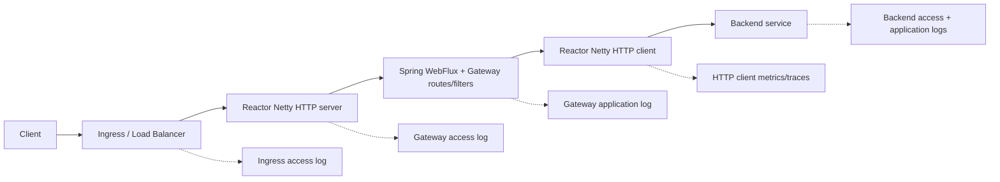
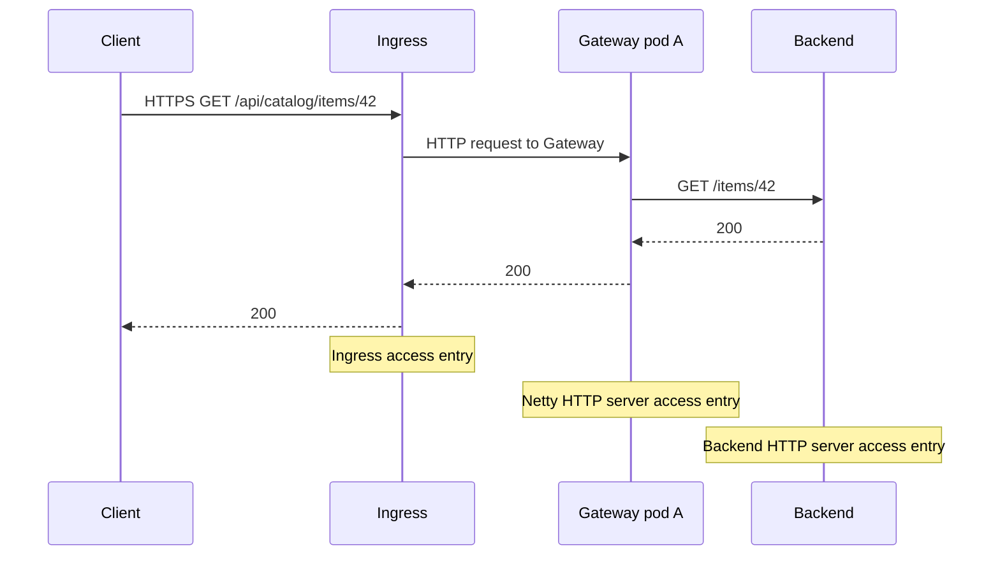

# Reactor Netty Access Logs and Distinguishing Them from Application Logs

## 1. The Problem: Gateway Returns 503, Yet Which Log Explains Why?

A **Spring Cloud Gateway** sitting in front of microservices performs many tasks during a single request: route predicates select a destination, filter chains transform paths and headers, service discovery and load balancing pick an instance, Spring Security checks permissions, rate limiters reject excess traffic, circuit breakers/retries handle failures, and TLS secures connections. To operate it, you must see **whether the request reached the edge, which route was chosen, whether the backend was called, what happened, and which layer failed**.

For that reason, teams typically maintain at least two kinds of logs:

1. **Reactor Netty access log** — records an HTTP transaction observed by the **Gateway's HTTP server** at the transport layer, such as method, request URI, HTTP version, status, and response byte count. It does not capture the full route-selection workflow.
2. **Application log** — messages emitted by Spring Boot, Spring Security, Gateway components, custom `GlobalFilter`/`GatewayFilterFactory` beans, or controllers via SLF4J/Logback; provides **business context, route IDs, error categories, and processing decisions** when properly instrumented.

Suppose a client calls:

```http
GET /api/catalog/items/42 HTTP/1.1
Host: gateway.example.test
```

The Gateway may return **503 Service Unavailable**, yet a raw access log entry typically only shows *status 503*. The cause could be service discovery having zero instances, a refused backend connection, a circuit breaker fallback, a rate limiter or custom filter, or a 503 returned directly by the backend. **Application logs and traces** reveal which branch occurred.

### Learning Objectives

After this lesson in the **Observability** chapter, you will be able to:

- Enable **Reactor Netty HTTP server access logs** with the exact **JVM system property** and read Common Log Format.
- Distinguish **access logs**, **application logs**, **wiretap/debug logs**, **metrics**, and **distributed tracing**.
- Configure Logback to separate access logs from application logs and manage log rotation and I/O overhead.
- Build a lab with Gateway Server WebFlux + a backend, using `curl` to test 200, 404, 503, and unmatched routes.
- Explain why an access log entry does not automatically carry a **Gateway route ID**, real client IP, JWT principal, or trace ID.
- Combine application logs with request IDs/tracing to investigate timeouts, retries, fallbacks, TLS, and upstream failures.
- Protect sensitive information in URLs, headers, cookies, IPs, and logs—especially behind reverse proxies.

> **Scope:** Primary examples apply to **Spring Cloud Gateway Server WebFlux 5.0.x**, Reactor Netty, and Spring Boot 4.x with a compatible Spring Cloud BOM. The route namespace is `spring.cloud.gateway.server.webflux`. **Gateway Server Web MVC** runs on a Servlet container, so Reactor Netty HTTP server JVM properties do not apply to Tomcat/Jetty. Log paths and numbers in this lesson are hands-on examples, not output from a pre-run project.

## 2. Observability Model: Which Log Is Emitted Where?

### 2.1. HTTP Transport, Gateway Filter Chain, and Backend Are Three Distinct Layers



The **Ingress → Gateway** leg is a separate HTTP connection from **Gateway → backend**. Setting `reactor.netty.http.server.accessLogEnabled` on the Gateway JVM enables access logging only on the **Gateway's inbound HTTP server**, and **does not automatically enable**:

- Access logs on ingress, service meshes, or CDNs.
- HTTP server access logs on backends.
- Detailed logs of the **outbound Reactor Netty `HttpClient`**.
- Gateway route metrics or OpenTelemetry spans.
- Application logging inside a controller or backend.

Without an ingress, clients connect directly to the Gateway; with multiple proxies, each proxy adds another log layer and trust boundary.

### 2.2. Comparing Six Types of Observability Signals

| Signal | Where Emitted | Questions It Answers Well | What It Cannot Answer Alone |
|---|---|---|---|
| **Gateway Reactor Netty access log** | Inbound Netty HTTP server | Which listener received the request, HTTP method/URI, status, basic transport metadata | Which route Gateway chose, which backend ran, why a breaker opened |
| **Gateway application log** | Spring Boot / Gateway filters / security / custom code | Routing decisions, business checks, exception types, filter actions | Not guaranteed to log every inbound request unless code logs it |
| **Ingress access log** | Proxy/CDN/LB in front of Gateway | Requests reaching the edge, client connections, upstream status, proxy latency | Internal Gateway exceptions, service logic |
| **Backend logs** | Downstream service | Whether the backend processed the request, business errors, backend state | Whether the Gateway blocked the client before reaching the backend |
| **Metrics** | Micrometer / Actuator / Reactor Netty | Error ratios, p95/p99 latency, request counts, pool saturation | Root-cause details of a single specific request |
| **Distributed tracing** | Observation / OTel spans | Request path across services, timing correlation | Full HTTP payloads (and sensitive payloads should not be recorded anyway) |

**Do not treat any single signal as the sole source of truth.** Access logs excel at confirming **traffic at the HTTP listener**; application logs explain **processing semantics**; metrics reveal **trends**; traces link **a single request across hops**.

### 2.3. “Application Log” Does Not Mean “Backend Log”

Both applications can use SLF4J:

```text
Gateway app log:  route=catalog-public, policy=allow, upstreamError=ConnectException
Backend app log: itemId=42, inventoryQuery=completed
```

These are **two separate processes**, each with its own loggers, context, and version. “Application log” refers to logs emitted by application code/infrastructure inside the **respective process**, not wire logs automatically aggregated by the Gateway.

## 3. How to Enable Reactor Netty Access Logs: One Exact System Property

### 3.1. Exact Property from Official Documentation

Both Spring Cloud Gateway Server WebFlux and Reactor Netty instruct enabling via:

```text
-Dreactor.netty.http.server.accessLogEnabled=true
```

**This must be a JVM system property**, not a Spring Boot `application.yml` property. By default, Reactor Netty HTTP server access logging is **disabled**.

Example running a built JAR (JAR name is illustrative):

```bash
java -Dreactor.netty.http.server.accessLogEnabled=true \
  -jar target/gateway-observability-demo.jar
```

Watch the `-D...` placement: it must appear **before `-jar`** so the JVM parses it as a system property. Placing it after the JAR path turns it into an application argument and **does not enable access logging**.

### 3.2. Lookalike Settings That Are Insufficient

```yaml
# WRONG PURPOSE: Spring Boot does not read this key to enable Netty access logs.
reactor:
  netty:
    http:
      server:
        accessLogEnabled: true

# Only changes log level; does NOT enable access log generation.
logging:
  level:
    reactor.netty.http.server.AccessLog: INFO
```

If you set `logging.level.reactor.netty.http.server.AccessLog=INFO` while missing the JVM system property, the logger is permitted to write yet **Reactor Netty never generates access events**. Conversely, if the JVM property is set while the logger is `OFF` or its appender drops events, no access log lines appear at the destination.

### 3.3. Ways to Pass the JVM Flag in Deployments

**Running a JAR directly:**

```bash
java -Dreactor.netty.http.server.accessLogEnabled=true \
  -jar gateway-observability-demo.jar
```

**Via the `JAVA_TOOL_OPTIONS` environment variable** where supported by the runtime/container:

```bash
export JAVA_TOOL_OPTIONS='-Dreactor.netty.http.server.accessLogEnabled=true'
java -jar gateway-observability-demo.jar
```

**Container image (Dockerfile snippet showing the start command):**

```dockerfile
ENTRYPOINT ["java", "-Dreactor.netty.http.server.accessLogEnabled=true", "-jar", "/app/gateway.jar"]
```

**Kubernetes container (env snippet, not a full manifest):**

```yaml
env:
  - name: JAVA_TOOL_OPTIONS
    value: "-Dreactor.netty.http.server.accessLogEnabled=true"
```

In production, verify that the **JVM actually receives the flag**, startup scripts don't overwrite it, configs rolled out to all pods, and the logging backend is wired up. `JAVA_TOOL_OPTIONS` affects **every Java process launched in an environment inheriting that variable**, so set it only on the Gateway container/process—you do not need to restart every microservice just to enable Gateway access logs.

### 3.4. When Is the Flag Read?

Reactor Netty reads the system property when configuring the server and initializing components. Pass the flag **at JVM startup**; never call `System.setProperty(...)` inside a filter after requests are already arriving expecting a running listener to switch modes. If dynamic toggling in code is needed, wire the server lifecycle properly and test at runtime rather than mutating JVM properties mid-request.

### 3.5. This Logs the *Server*, Not the *Client*

The property includes `http.server` because it targets the inbound HTTP server. The Gateway also uses a Netty HTTP **client** to proxy upstream, yet outbound connections follow a separate logging/metrics contract. Never infer:

```text
GET /api/catalog/items/42 access log at Gateway
  ⇒  GET /items/42 was received by the backend
```

A request can fail with `401/403/429/404` **before the router dispatches downstream**, and still emit an inbound Gateway access log line. Backends need their own access logs, metrics, or tracing to confirm actual downstream calls.

## 4. What Does a Reactor Netty Access Log Line Mean?

### 4.1. Default Format Near Common Log Format

Reactor Netty's HTTP server defaults to **Common Log Format (CLF)**. An illustrative line:

```text
127.0.0.1 - - [24/Nov/2026:05:30:01 +0000] "GET /api/catalog/items/42 HTTP/1.1" 200 93
```

The example above illustrates **typical fields**, not output from a live test run. Address, timestamp, and byte rendering can vary across Reactor Netty versions, proxies, and custom access formats.

| Component | Meaning | What Not to Assume |
|---|---|---|
| `127.0.0.1` | Remote peer address seen by the Netty HTTP server | Not necessarily the end user's IP if behind an ingress |
| `- -` | Empty identity fields | Never auto-populated with a JWT user ID |
| `[24/Nov/2026:05:30:01 +0000]` | Formatted log timestamp | May not match application log timezone |
| `"GET /api/catalog/items/42 HTTP/1.1"` | Inbound logical request line | Contains neither `routeId` nor rewritten backend path |
| `200` | HTTP status of the Gateway's response | Does not prove the backend returned 200 or was even called |
| `93` | Response size per access provider format | Not request body size; framing/compression can affect it |

### 4.2. The Access Log URI Is What the Client Sent, Not Necessarily What the Backend Received

Suppose the Gateway configures:

```yaml
filters:
  - StripPrefix=2
```

The client calls `/api/catalog/items/42`, while the backend receives `/items/42`. **Inbound access logs** typically show the **URI received by the Gateway**, not the rewritten path after `StripPrefix`. To confirm the exact path sent to the backend, rely on appropriately timed custom filter logs, backend access logs, tracing, or integration tests.

### 4.3. Does It Log 404 When No Route Matches?

If an HTTP request reaches the **Reactor Netty listener** and the Gateway returns 404 because no route matched, the server-layer access logger can still record that request. Conversely, a Gateway `GlobalFilter` may **not execute** when no route matches, since the Gateway filter chain is built only for matched routes. This is the classic scenario where **an access log line exists while custom Gateway filter application logs are absent**.

Do not assume every broken connection or client abort emits a neat CLF line: when TLS handshakes fail, HTTP parsing fails, connections reset, or responses never complete, logging behavior depends on Reactor Netty and its version. Inspect connection/error logs and ingress logs as well.

### 4.4. Why Status Codes and Byte Counts Require Caution

Reactor Netty access logs reflect what the HTTP server sent out. However, a `CircuitBreaker` filter can convert a backend error into a fallback `200`, `Retry` can call the backend multiple times to produce one `200`, and `SetStatus` can alter the status code. Therefore:

- **One access line** does not mean **one backend attempt**.
- An HTTP `200` from the Gateway does not prove the backend succeeded.
- An HTTP `503` from the Gateway does not distinguish “backend returned 503” from “Gateway couldn't connect to backend.”
- Header/body rewrites, compression, streaming, and client cancellations can make byte counts and latencies differ across layers.

## 5. Separating Access Logs and Application Logs with Logback

### 5.1. Dedicated Logger for Netty Access Logs

Spring Cloud Gateway 5.0.x documentation specifies the **exact logger name**:

```text
reactor.netty.http.server.AccessLog
```

This is the **logger category name**. Do not confuse it with the customization API class `reactor.netty.http.server.logging.AccessLog` used to build an access log entry. Setting `logging.level.root=DEBUG` is the wrong way to enable access logging and floods the logs.

For a **separate access log file**, configure this Logback logger with `additivity="false"` so access entries **do not propagate up to the root appender**. If sending access logs to container stdout, attach a **dedicated appender** with an appropriate format.

### 5.2. Example `logback-spring.xml` for a Lab Environment

This is **sample content for `src/main/resources/logback-spring.xml`** in the Gateway app (only Markdown files are edited in this documentation task):

```xml
<?xml version="1.0" encoding="UTF-8"?>
<configuration>
    <!-- Application log: timestamp, level, logger, message. -->
    <appender name="APP_CONSOLE"
              class="ch.qos.logback.core.ConsoleAppender">
        <encoder>
            <pattern>%d{yyyy-MM-dd'T'HH:mm:ss.SSSXXX} %-5level [%thread] %logger{36} - %msg%n</pattern>
        </encoder>
    </appender>

    <!-- Reactor Netty access log: raw CLF line without app prefix. -->
    <appender name="ACCESS_FILE"
              class="ch.qos.logback.core.rolling.RollingFileAppender">
        <file>./logs/gateway-access.log</file>
        <rollingPolicy
            class="ch.qos.logback.core.rolling.SizeAndTimeBasedRollingPolicy">
            <fileNamePattern>./logs/gateway-access.%d{yyyy-MM-dd}.%i.log.gz</fileNamePattern>
            <maxFileSize>10MB</maxFileSize>
            <maxHistory>7</maxHistory>
            <totalSizeCap>1GB</totalSizeCap>
        </rollingPolicy>
        <encoder>
            <pattern>%msg%n</pattern>
        </encoder>
    </appender>

    <appender name="ACCESS_ASYNC"
              class="ch.qos.logback.classic.AsyncAppender">
        <queueSize>8192</queueSize>
        <discardingThreshold>0</discardingThreshold>
        <neverBlock>true</neverBlock>
        <appender-ref ref="ACCESS_FILE" />
    </appender>

    <!-- Isolate access logs from root application logs. -->
    <logger name="reactor.netty.http.server.AccessLog"
            level="INFO" additivity="false">
        <appender-ref ref="ACCESS_ASYNC" />
    </logger>

    <root level="INFO">
        <appender-ref ref="APP_CONSOLE" />
    </root>
</configuration>
```

**Two distinct outputs:**

- `./logs/gateway-access.log`: Netty access log lines **when the JVM property is enabled**, with log rotation.
- Console/stderr per Logback config: application logs from `com.example.gateway`, Spring, and enabled loggers.

**`AsyncAppender` limitation:** `neverBlock=true` prevents caller threads from stalling when the queue fills, yet can **drop events** during overload; `discardingThreshold=0` does not turn the queue into durable storage. Thus, this favors **protecting throughput** in a lab and **does not guarantee zero-loss delivery for mandatory audits**. If legal compliance requires recording every request durably, build a durable log collector/queue and explicit backpressure strategy—not fire-and-forget `.subscribe()` calls or default file appenders.

### 5.3. Why Use `logback-spring.xml`?

Spring Boot supports both `logback.xml` and `logback-spring.xml`; Boot recommends `-spring` when integrating Spring Boot Logback extensions or profiles. Either way, **the Netty logger element cannot replace the JVM flag**.

`logging.file.name` in `application.yml` only enables **Spring Boot's default file logging**, which does not automatically separate access logs. When supplying a custom `logback-spring.xml` that redefines root/appenders, inspect the full output so you don't inadvertently lose Boot's structured logging, trace context, or console logs.

### 5.4. Where Should Kubernetes Deployments Write Logs?

In containers, many platforms prefer **stdout/stderr → collector → log store** instead of writing files onto ephemeral filesystems. Example console appender formatting access logs separately:

```xml
<appender name="ACCESS_CONSOLE"
          class="ch.qos.logback.core.ConsoleAppender">
    <encoder>
        <pattern>ACCESS %msg%n</pattern>
    </encoder>
</appender>
<logger name="reactor.netty.http.server.AccessLog"
        level="INFO" additivity="false">
    <appender-ref ref="ACCESS_CONSOLE" />
</logger>
```

This is a **replacement fragment** for `ACCESS_FILE/ACCESS_ASYNC` above—never attach both and create duplicates. The `ACCESS` prefix helps collector pipelines classify log types, though the line is **no longer pure CLF**, so log parsers must account for it. If you want a uniform JSON schema, build a proper structured logging pipeline with normalized fields rather than blindly changing `%msg%n` to `%json%n` expecting CLF messages to turn into structured JSON fields.

### 5.5. Rotation, Retention, and I/O Pressure

A Gateway serving thousands of requests/s generates massive access log volumes. Plan for:

| Topic | Operational Question | Recommended Practice |
|---|---|---|
| Volume | How many HTTP transactions per second? | Estimate bytes/line × requests/second × retention |
| Rotation | Can a single file grow unbounded? | Configure rolling policies or stream stdout to a collector |
| Retention | How long and where must logs stay? | Align with data policy, cost, and compliance |
| Bursts | Can the async queue overflow? | Monitor queue depth/drops and set limits; never promise zero loss |
| Disk | Could access files fill the PVC/container? | Set capacity alerts, quotas, and cleanup |
| Collector | Is the collector lagging? | Monitor ingest latency, parse errors, and sampling rules |
| Security | Do URIs carry tokens/PII? | Redact/avoid raw queries; restrict log read permissions |

For real-time visibility in an IDE console during development, route the access logger to the console temporarily. In production, choose format, volume, and retention based on **observability goals and security requirements** rather than turning on DEBUG everywhere unconditionally.

## 6. Gateway Application Logs: Example `GlobalFilter` Recording Route and Duration

### 6.1. Why Add a Custom `GlobalFilter`?

Access logs know the Netty listener received `GET /api/catalog/items/42` and returned 200, yet typically **do not know `routeId`**. In Gateway Server WebFlux, once `RoutePredicateHandlerMapping` matches a route, you can retrieve the runtime route from the exchange attribute:

```java
Route route = exchange.getAttribute(
    ServerWebExchangeUtils.GATEWAY_ROUTE_ATTR
);
```

A custom `GlobalFilter` can log **`routeId`, HTTP method, exception type, Reactor termination signal, and elapsed duration** without logging URL queries or credentials. A `GlobalFilter` lives inside the **Gateway filter chain**, separate from the Netty access logger, and runs only for requests entering that chain.

### 6.2. Non-Blocking, Non-Subscribing `GlobalFilter` Example

Create `RouteOutcomeLogFilter.java` in the Gateway application:

```java
package com.example.gateway;

import org.slf4j.Logger;
import org.slf4j.LoggerFactory;
import org.springframework.cloud.gateway.filter.GatewayFilterChain;
import org.springframework.cloud.gateway.filter.GlobalFilter;
import org.springframework.cloud.gateway.route.Route;
import org.springframework.cloud.gateway.support.ServerWebExchangeUtils;
import org.springframework.core.Ordered;
import org.springframework.stereotype.Component;
import org.springframework.web.server.ServerWebExchange;
import reactor.core.publisher.Mono;

@Component
public class RouteOutcomeLogFilter implements GlobalFilter, Ordered {

    private static final Logger log =
        LoggerFactory.getLogger(RouteOutcomeLogFilter.class);

    @Override
    public int getOrder() {
        return -1;
    }

    @Override
    public Mono<Void> filter(
            ServerWebExchange exchange,
            GatewayFilterChain chain) {

        Route route = exchange.getAttribute(
            ServerWebExchangeUtils.GATEWAY_ROUTE_ATTR);
        String routeId = route == null ? "unresolved" : route.getId();
        String method = exchange.getRequest().getMethod().name();

        // Start timing when the framework subscribes.
        return Mono.defer(() -> {
            long startNanos = System.nanoTime();

            return chain.filter(exchange)
                .doOnError(error ->
                    log.warn("gateway route={} method={} errorType={}",
                        routeId, method,
                        error.getClass().getSimpleName()))
                .doFinally(signal -> {
                    long elapsedMs =
                        (System.nanoTime() - startNanos) / 1_000_000;
                    var status = exchange.getResponse().getStatusCode();

                    log.info(
                        "gateway route={} method={} responseStatus={} "
                            + "signal={} durationMs={}",
                        routeId, method,
                        status == null ? "unset" : status.value(),
                        signal.name(), elapsedMs);
                });
        });
    }
}
```

This code intentionally **avoids**:

- Calling `subscribe()` or `block()`; the framework owns request subscription.
- Logging raw `Authorization`, `Cookie`, bodies, or query strings.
- Attempting to modify HTTP response headers after the response commits.
- Making HTTP calls to a logging backend inside `doFinally`.
- Using `ThreadLocal` under the assumption that Reactor callbacks stick to one thread.

`doFinally` observes `ON_COMPLETE`, `ON_ERROR`, and `CANCEL`; note that **`ON_COMPLETE` does not mean HTTP 200**: a normally handled 404 or 503 response also completes with `ON_COMPLETE`. `getStatusCode()` can be `null` if no status was explicitly set; **never rely on that single field to prove the exact status sent on the wire**.

### 6.3. Illustrative Application Log Output

```text
2026-11-24T12:00:00.123+07:00 INFO  [reactor-http-nio-3] c.e.gateway.RouteOutcomeLogFilter - gateway route=catalog-public method=GET responseStatus=200 signal=ON_COMPLETE durationMs=41
```

This is an **application log written via SLF4J**, not Netty CLF. The two log streams can differ in timezone, thread names, timestamps, and **emission order**; never build parsers assuming access and application logs appear strictly back to back.

### 6.4. When Does the Application Filter Not Run?

| Scenario | Can Gateway `GlobalFilter` Run? | Can Netty HTTP Server Access Log Record? |
|---|---|---|
| Route `catalog-public` matches | **Yes** | **Yes**, if enabled and HTTP request processed |
| No route matches → 404 | **Not necessarily** (typically no Gateway chain) | **Likely yes** at listener |
| Spring Security `WebFilter` rejects 401 early | **Not necessarily** | **Likely yes** |
| CORS preflight handled before routing | **Not necessarily** | **Likely yes** |
| Ingress rejects before Gateway | **No** | **No**, request never reached Gateway |
| TCP/TLS handshake fails before HTTP | **No** | Typically **no complete HTTP access entry** |
| HTTP request enters Gateway and client cancels | May have run partially | Log/counters depend on cancel timing and runtime |

**Never conclude “the Gateway never received the request” just because `RouteOutcomeLogFilter` logged nothing.** Check inbound access logs, ingress logs, security logs, and Netty connection errors first.

### 6.5. Why Avoid Logging Request Bodies Inside Filters?

In WebFlux, `getRequest().getBody()` is a `Flux<DataBuffer>`. Calling a separate `subscribe()` just to log it can **consume the body before routing**, break backpressure, drop data meant for the backend, spike memory, and leak PII. If body debugging is truly required, use bounded filtering/redaction, sampling, strict retention, and supported transformation APIs—never log bodies on login, payment, or token endpoints by default.

## 7. Differential Diagnosis Across 200, 404, 503, 401, and 429

### 7.1. Same Status Code, Different Causes

| Client-Visible HTTP Response | Gateway Access Log | Application Log to Inspect | Did Backend Likely Receive Request? |
|---|---|---|---|
| 200 success | HTTP 200 | Route matched, business/filters completed | Yes, or served via cache/fallback |
| 404 unmatched route | HTTP 404 | Likely **no** route `GlobalFilter` entry | No |
| 404 returned by backend | HTTP 404 | Matched `routeId` and downstream response | Yes |
| 503 returned by backend | HTTP 503 | `routeId`, upstream status/latency | Yes |
| 503 from connect timeout | HTTP 5xx (503/504 depending on handler) | Connect/timeout exception category | Not processed successfully |
| 503 from circuit breaker fallback | HTTP 503 (or fallback status) | Breaker state / fallback route | Backend may have been bypassed |
| 401 Spring Security pre-route | HTTP 401 | `SecurityWebFilterChain` / authentication | Likely no |
| 429 rate limiter | HTTP 429 | Rate limiter / key resolver / quota | Usually no backend call if blocked pre-routing |

**Note:** timeout/rejection status codes vary by exception handler, fallback, and version. This table illustrates evidence layers, **not a guarantee that every connect timeout returns 503** or that every route shares identical filter ordering.

### 7.2. What Do Access Logs Reveal About Circuit Breakers?

A circuit breaker may:

1. Call the backend; backend errors, and the breaker records a failure.
2. While OPEN, serve a fallback immediately without calling the backend.
3. Return 200 with degraded content or 503 depending on fallback policy.

All three produce **one Gateway access entry per inbound HTTP request**, even though backend attempt counts differ. To prove a circuit breaker opened, inspect **breaker application logs/metrics** alongside backend logs—never infer it solely from 200/503 in access logs.

### 7.3. Retries Can Trigger Multiple Attempts Behind One Access Entry

Suppose:

```text
Client → Gateway GET /api/catalog/items/42
Gateway → backend attempt #1: 503
Gateway → backend attempt #2: 503
Gateway → backend attempt #3: 200
Gateway → Client: 200
```

Gateway's inbound access log normally records **one** `200` response at the HTTP server, while backend access logs record **three** requests. Application logs from Retry filters/observability can reflect the attempts. This is **not double logging**; the two logs measure two different event sets.

### 7.4. When Upstream Was Never Called

A `403` from Spring Security, `404` from a route miss, `429` from a rate limiter, or `503` from an OPEN breaker can all terminate at the Gateway. In those cases, **no matching backend access log exists** because the backend never saw a request. Gateway's access log answers **“did the client talk to the Gateway listener?”**, while the backend log answers **“did the service receive a request on that hop?”**

## 8. Lab: Two Spring Boot Apps and Four HTTP Calls

### 8.1. Lab Architecture

```text
curl / Browser
   |
   v
Gateway Server WebFlux :8080
   |         |
   |         +--> Reactor Netty AccessLog  --> ./logs/gateway-access.log
   |         +--> RouteOutcomeLogFilter    --> console application log
   |
   +--> catalog-backend :8081
           |
           +--> Spring MVC application log
```

To avoid conflating logs between two processes, run the Gateway and backend as **two separate Spring Boot applications** on the same loopback host in the lab. Test these cases:

| Case | URL Through Gateway | Outcome Source |
|---|---|---|
| A | `GET /api/catalog/items/42` | Backend returns **200** |
| B | `GET /api/catalog/items/0` | Backend returns **404** |
| C | `GET /api/catalog/fail` | Backend returns **503** |
| D | `GET /not-a-route` | **Gateway** matches no route, typically returns **404** |

Cases B and D return the exact same HTTP 404 status for **completely different reasons**. This is the key exercise for telling access logs apart from application logs.

### 8.2. Gateway Dependencies and Configuration

Add dependencies (versions managed by BOM) to the **gateway-observability-demo** project:

```xml
<dependencies>
    <dependency>
        <groupId>org.springframework.cloud</groupId>
        <artifactId>spring-cloud-starter-gateway-server-webflux</artifactId>
    </dependency>
    <dependency>
        <groupId>org.springframework.boot</groupId>
        <artifactId>spring-boot-starter-actuator</artifactId>
    </dependency>
</dependencies>
```

Gateway `application.yml`:

```yaml
server:
  port: 8080

spring:
  application:
    name: gateway-observability-demo
  cloud:
    gateway:
      server:
        webflux:
          routes:
            - id: catalog-public
              uri: http://127.0.0.1:8081
              predicates:
                - Path=/api/catalog/**
                - Method=GET
              filters:
                - StripPrefix=2
                - AddRequestHeader=X-Gateway-Lab,true

management:
  endpoints:
    web:
      exposure:
        include: health,metrics
```

The `application.yml` above **intentionally omits** `reactor.netty.http.server.accessLogEnabled`. Access logging must still be enabled via the **JVM flag** at launch. To separate files with Logback, apply `logback-spring.xml` from Section 5 and place `RouteOutcomeLogFilter` from Section 6 in a Spring-scanned package.

Routing behavior:

```text
GET http://127.0.0.1:8080/api/catalog/items/42
   ↓ Path and Method predicates match
   ↓ StripPrefix=2
GET http://127.0.0.1:8081/items/42
```

Similarly, `/api/catalog/fail` becomes `/fail`. This config **does not enable** retries, circuit breakers, or rate limiters automatically, so the backend 503 is proxied as the upstream status unless other filters/security intervene.

### 8.3. MVC Backend Returning Intentional Statuses

Create a **separate backend app** using Spring Boot 4.x `spring-boot-starter-webmvc`. File `CatalogBackendApplication.java`:

```java
package com.example.backend;

import java.util.Map;
import java.util.concurrent.atomic.AtomicLong;
import org.slf4j.Logger;
import org.slf4j.LoggerFactory;
import org.springframework.boot.SpringApplication;
import org.springframework.boot.autoconfigure.SpringBootApplication;
import org.springframework.http.HttpStatus;
import org.springframework.http.ResponseEntity;
import org.springframework.web.bind.annotation.GetMapping;
import org.springframework.web.bind.annotation.PathVariable;
import org.springframework.web.bind.annotation.RestController;

@SpringBootApplication
@RestController
public class CatalogBackendApplication {

    private static final Logger log =
        LoggerFactory.getLogger(CatalogBackendApplication.class);
    private final AtomicLong calls = new AtomicLong();

    public static void main(String[] args) {
        SpringApplication.run(CatalogBackendApplication.class, args);
    }

    @GetMapping("/items/{id}")
    public ResponseEntity<Map<String, Object>> item(
            @PathVariable long id) {

        long count = calls.incrementAndGet();
        log.info("backend action=item id={} invocation={}", id, count);

        if (id == 0L) {
            return ResponseEntity.status(HttpStatus.NOT_FOUND)
                .body(Map.of("error", "NOT_FOUND", "call", count));
        }

        return ResponseEntity.ok(Map.of(
            "id", id, "service", "catalog-backend", "call", count));
    }

    @GetMapping("/fail")
    public ResponseEntity<Map<String, Object>> failure() {
        long count = calls.incrementAndGet();
        log.warn("backend action=simulated-failure invocation={}", count);
        return ResponseEntity.status(HttpStatus.SERVICE_UNAVAILABLE)
            .body(Map.of("error", "DEMO_UNAVAILABLE", "call", count));
    }
}
```

Backend `application.yml`:

```yaml
server:
  port: 8081
spring:
  application:
    name: catalog-backend
```

**Important point:** controller log `backend action=item` belongs to the backend process, **not Gateway's Reactor Netty access log**. Since this backend runs Servlet/Tomcat, enabling Gateway's Netty access flag does not turn on Tomcat access logs on the backend.

### 8.4. Startup Using Two Separate Terminals

1. Backend terminal: start `catalog-backend` on `8081` using your project's build/run method.
2. Gateway terminal: launch the Gateway JAR **with `-Dreactor.netty.http.server.accessLogEnabled=true`** and the Logback config from Section 5.
3. From a third terminal, run `curl`.

```bash
# ILLUSTRATIVE command with JAR name after building; not for the backend.
java -Dreactor.netty.http.server.accessLogEnabled=true \
  -jar target/gateway-observability-demo.jar
```

Inside Docker, `127.0.0.1:8081` inside the Gateway container **points to the Gateway container itself**, not the host or another backend container. In containers/Kubernetes, update the route URI to a DNS/service name reachable from the Gateway.

### 8.5. Sending Four Requests

```bash
# A: backend 200.
curl --noproxy '*' -i \
  'http://127.0.0.1:8080/api/catalog/items/42'

# B: backend 404 while route still matches.
curl --noproxy '*' -i \
  'http://127.0.0.1:8080/api/catalog/items/0'

# C: backend 503 through a valid route.
curl --noproxy '*' -i \
  'http://127.0.0.1:8080/api/catalog/fail'

# D: Gateway matches no route.
curl --noproxy '*' -i \
  'http://127.0.0.1:8080/not-a-route'
```

In the lab without extra filters, expected statuses are **200, 404, 503, 404**. Exact results depend on runtime, Spring Security, and custom exception handlers in your project.

### 8.6. Inspecting the Access File and Console Application Logs

With `logback-spring.xml` configured, inspect the access log:

```bash
# From the working directory where the Gateway JVM runs.
tail -n 20 ./logs/gateway-access.log
```

An **illustrative** set of results:

```text
127.0.0.1 - - [24/Nov/2026:05:41:11 +0000] "GET /api/catalog/items/42 HTTP/1.1" 200 49
127.0.0.1 - - [24/Nov/2026:05:41:12 +0000] "GET /api/catalog/items/0 HTTP/1.1" 404 30
127.0.0.1 - - [24/Nov/2026:05:41:13 +0000] "GET /api/catalog/fail HTTP/1.1" 503 43
127.0.0.1 - - [24/Nov/2026:05:41:14 +0000] "GET /not-a-route HTTP/1.1" 404 0
```

In the **Gateway application console**, you may see:

```text
INFO c.e.gateway.RouteOutcomeLogFilter - gateway route=catalog-public method=GET responseStatus=200 signal=ON_COMPLETE durationMs=23
INFO c.e.gateway.RouteOutcomeLogFilter - gateway route=catalog-public method=GET responseStatus=404 signal=ON_COMPLETE durationMs=8
INFO c.e.gateway.RouteOutcomeLogFilter - gateway route=catalog-public method=GET responseStatus=503 signal=ON_COMPLETE durationMs=9
```

In the **backend console**, you may see:

```text
INFO c.e.backend.CatalogBackendApplication - backend action=item id=42 invocation=1
INFO c.e.backend.CatalogBackendApplication - backend action=item id=0 invocation=2
WARN c.e.backend.CatalogBackendApplication - backend action=simulated-failure invocation=3
```

**Reading the differences:**

- Case **B** has a 404 access log **and** a Gateway app log `route=catalog-public` **and** a backend app log. That is a **404 from the backend**.
- Case **D** has a 404 access log yet **no** `GlobalFilter` route log and **no** backend log. That indicates **no route matched**.
- Case **C** has a 503 access log and a backend simulated-failure log. If the Gateway had generated 503 itself due to a connect timeout, that backend app log would be absent.

Do not treat timestamps, ordering, or byte counts in illustrative blocks as golden snapshots: they vary by clock, timezone, async appenders, and versions.

### 8.7. Follow-Up Test: Does the Filter Run on a Route Miss?

Temporarily change the request path:

```bash
curl --noproxy '*' -i \
  'http://127.0.0.1:8080/api/unknown/items/42'
```

Because it fails to match `Path=/api/catalog/**`, **route-specific filters** like `StripPrefix` and `GlobalFilter`s inside the Gateway chain typically do not run. Yet the HTTP listener still receives the request and can emit an access line. This directly demonstrates the difference between **transport logging** and **Gateway route processing**.

## 9. Distinguishing Access Logs from Wiretap and DEBUG/TRACE

### 9.1. Wiretap Is Protocol Debugging, Not an Access Log

Spring Cloud Gateway Server WebFlux exposes flags for Reactor Netty wiretap:

```yaml
spring:
  cloud:
    gateway:
      server:
        webflux:
          httpserver:
            wiretap: true
          httpclient:
            wiretap: true
```

This is **debugging configuration strictly for isolated environments**, distinct from `-Dreactor.netty.http.server.accessLogEnabled=true`. Wiretap emits detailed byte/header/data logs for the HTTP server or client under the corresponding Netty loggers depending on log levels and byte-buffer formatting.

**Never enable wiretap broadly in production** just to see “what status each request got”: I/O and memory overhead are high, and it risks exposing `Authorization` headers, cookies, tokens, bodies, and personal data. Bounded access logs, redacted application logs, and metrics/tracing are far more appropriate.

### 9.2. Quick Comparison

| Mechanism | Enabled By | Typical Content | Risks |
|---|---|---|---|
| Reactor Netty access log | JVM `-Dreactor.netty.http.server.accessLogEnabled=true` | One line per HTTP transaction, method/URI/status/bytes | URIs/queries and client IPs may be sensitive |
| Logback app log INFO | SLF4J `log.info` and logging config | `routeId`, status, errors logged intentionally by code | Leaks PII if poorly formatted; misses uninstrumented paths |
| Spring framework DEBUG | `logging.level.org.springframework...=DEBUG` | Handler/filter behavior, logger exceptions | Verbose multi-line output, not equivalent to CLF |
| Reactor Netty wiretap | `httpserver.wiretap` / `httpclient.wiretap` and logger levels | Protocol/connection/buffer events | Can leak payloads and add heavy load |
| Actuator metrics | Actuator starter + metrics config | Counters/timers by route and status | No per-request detail |
| Distributed tracing | Observation/tracing bridge/exporter | Per-request spans and correlations | Requires context propagation and sampling |

### 9.3. When Should Wiretap Be Turned Off Immediately?

Once you have captured enough information in staging to diagnose handshake, framing, or header bugs, disable wiretap right away to cut overhead and sensitive data exposure. Never capture full headers/bodies hoping to “sanitize them later” as a primary strategy: sensitive data may already reach stdout/collectors before pipeline scrubbing runs. Use bounded, authorized, TTL-limited captures with strict deletion policies.

## 10. What Do Metrics and Tracing Add Beyond Access Logs?

### 10.1. Gateway Metrics: Trends, Not Per-Request Records

Spring Cloud Gateway Server WebFlux provides the route-level metric `spring.cloud.gateway.requests` when Gateway metrics instrumentation is enabled. Common tags include `routeId`, `routeUri`, `status`, `httpStatusCode`, `outcome`, and `httpMethod` (depending on version/config).

On the Gateway 5.0.x branch, to **avoid relying on version defaults**, declare explicitly:

```yaml
spring:
  cloud:
    gateway:
      server:
        webflux:
          metrics:
            enabled: true
            path-tags:
              enabled: false
          observability:
            enabled: true

management:
  endpoints:
    web:
      exposure:
        include: health,metrics
```

This is a **replacement/additive snippet** for the lab Gateway `application.yml`—do not create duplicate root `spring` or `management` blocks in the same file. If Prometheus is needed, add `micrometer-registry-prometheus`, expose `prometheus`, and restrict access.

Verify after sending traffic:

```bash
curl --noproxy '*' -sS \
  'http://127.0.0.1:8080/actuator/metrics'

curl --noproxy '*' -sS \
  'http://127.0.0.1:8080/actuator/metrics/spring.cloud.gateway.requests'
```

In Actuator, metrics may not appear in the list until a matching request/registry/filter fires. Meter names can also be **normalized** differently when exported to Prometheus; never query `/actuator/metrics/...` with a snake_case Prometheus name and assume the metric is missing. Verify **exact configuration properties for your BOM**, especially those under 5.0.x's `server.webflux` namespace.

### 10.2. Why Metrics Do Not Replace Access Logs

Metric aggregations excel at alerting on:

- Spiking `5xx` ratios by `routeId`.
- Rising p95/p99 latency on a route.
- Backend or connection-pool saturation.
- Increasing circuit breaker transitions or rate-limiter rejections.

Yet a counter like `spring.cloud.gateway.requests{routeId="catalog-public", status="503"}` lacks specific paths, backend attempt counts, exception stacks, or client request IDs. When an alert fires, use **logs and traces** to drill down from the trend to the root cause.

### 10.3. Separating HTTP Server Metrics from Gateway Route Metrics

Spring Boot WebFlux can emit `http.server.requests` for inbound server observations, while Gateway adds route-level `spring.cloud.gateway.requests`. They measure **different instrumentation scopes**:

| Metric | Conceptual Scope | Important Note |
|---|---|---|
| `http.server.requests` | HTTP server observations | May include requests matching no Gateway route, depending on Boot/WebFlux |
| `spring.cloud.gateway.requests` | Gateway route/filter requests | Carries `routeId`; typically does not track route misses like normal routes |
| Reactor Netty connection/pool metrics | Transport/connection acquisition | Not necessarily 1:1 with HTTP request count |
| Backend `http.server.requests` | Backend HTTP requests received | Retries make backend request counts differ from client requests |

Never divide `backend requests / gateway requests` blindly and call it a “cache hit ratio”: retries, auth rejections, fallbacks, health probes, and ingress routing all skew that ratio.

### 10.4. Tracing: Following One Request Across Services

When **Micrometer Observation + tracing bridge (OpenTelemetry/Brave) and an exporter** matching Spring Boot/Cloud are configured, requests carry a W3C trace context such as `traceparent`. Conceptually:

```text
traceId=4c3a...  [client → ingress]
traceId=4c3a...  [Gateway server span]
traceId=4c3a...  [Gateway HTTP client span, outbound]
traceId=4c3a...  [catalog-service server span]
```

This diagram shows **expected behavior when context propagation is configured properly**—simply adding `spring-boot-starter-actuator` does not export end-to-end spans automatically. Tracing requires a bridge/exporter, propagation policies, sampling, and storage/collectors. If downstream services are uninstrumented or proxies strip context, the trace breaks.

### 10.5. Default Access Logs Do Not Guarantee `traceId`

Reactor Netty's Common Log Format **does not include Gateway `routeId` or `traceId` by default**. Application logs can carry `traceId`/`spanId` via MDC when Micrometer Tracing/Logback integration is enabled and context propagation works. **Never** assume every MDC key is populated on the Netty access logger thread or shares identical timing with application logs.

To correlate them:

1. Pick one reliable **correlation ID** mechanism (such as W3C tracing or an ingress/Gateway-generated request ID).
2. Propagate it cleanly across Gateway → backend hops.
3. Log the ID in application logs **after configuring context propagation** and bounding cardinality.
4. If you also need it in Netty access logs, use a **custom `AccessLogFactory`** (Section 11) and read only **trusted headers**—never treat raw client-supplied IDs as identity.
5. When correlation isn't wired yet, narrow down tentatively using time windows, routes, statuses, and peer IPs without claiming exact 1:1 matching.

### 10.6. The `path` Tag Can Cause Cardinality Explosion

If a metric uses raw request paths:

```text
/api/catalog/items/1
/api/catalog/items/2
/api/catalog/items/3
...
```

each distinct path spawns new time series, driving up Prometheus/Grafana/collector costs. In Gateway 5.0.x, `spring.cloud.gateway.server.webflux.metrics.path-tags.enabled` defaults to `false`; enable it only after designing path normalization and bounding tag cardinality. **Prefer controlled `routeId`s** over URLs/queries carrying user IDs, tokens, or transaction codes.

## 11. Advanced Access Log Customization: Formatting and Filtering Requests

### 11.1. When CLF Is Not Enough

Common Log Format works well for traditional access parsing, yet usually lacks:

- The `routeId` chosen by the Gateway.
- The backend/service instance chosen by LoadBalancer.
- The `traceId` emitted by tracing.
- Circuit breaker outcomes or retry attempt counts.
- Fields scrubbed of sensitive query params per application policy.

To include such details, **do not rely solely on changing the Logback pattern**. In Logback, `%msg` from the access logger is already a pre-formatted Netty string; `%d %level %msg%n` only prepends a prefix and **cannot conjure `routeId` out of thin air**.

### 11.2. Reactor Netty Provides `accessLog(boolean, AccessLogFactory)`

The Reactor Netty HTTP server exposes a customization API:

```java
HttpServer.accessLog(
    boolean enable,
    AccessLogFactory accessLogFactory
)
```

`AccessLogFactory` receives an `AccessLogArgProvider`, exposing `method()`, `uri()`, `protocol()`, `status()`, `duration()`, `contentLength()`, `requestHeader(...)`, and connection details. This lives at the **HTTP server/transport layer**, not directly on Gateway's `ServerWebExchange`.

**Standalone Reactor Netty HTTP server example** (illustrating the API, not a complete Boot Gateway bean):

```java
import reactor.netty.DisposableServer;
import reactor.netty.http.server.HttpServer;
import reactor.netty.http.server.logging.AccessLog;

public class StandaloneAccessLogExample {

    public static void main(String[] args) {
        DisposableServer server = HttpServer.create()
            .port(9099)
            .accessLog(true, args -> AccessLog.create(
                "method={} protocol={} status={} durationMs={}",
                args.method(),
                args.protocol(),
                args.status(),
                args.duration()))
            .bindNow();

        server.onDispose().block();
    }
}
```

This snippet **starts a brand-new Reactor Netty HTTP server on port 9099**; it does not replace the Spring Boot app's Gateway listener. `block()` here is the **main lifecycle boundary of a standalone program**, not blocking inside a `GatewayFilter`. To customize the **Boot Gateway's** Netty `HttpServer`, register a server customizer hook compatible with your Spring Boot/Gateway version (such as a Netty reactive web server customizer)—never spin up a separate `HttpServer.create().bindNow()` expecting Gateway `:8080` to pick up the new format.

### 11.3. Omit Raw URIs When URLs May Carry Sensitive Data

A minimal custom format can **log only essential fields**:

```java
// Illustrative AccessLogFactory lambda passed to HttpServer.accessLog(...).
args -> AccessLog.create(
    "method={} protocol={} status={} durationMs={}",
    args.method(), args.protocol(), args.status(), args.duration())
```

This **omits** URLs and headers, eliminating query-token leaks—at the cost of making it harder to tell which endpoint failed. Balance that by putting normalized `routeId`/URI templates into Gateway **application logs/metrics** while keeping only approved fields in access logs. If a custom access log must include paths, enforce tested sanitization rather than logging `args.uri()` blindly on sensitive routes.

### 11.4. Filtering Out Health-Check Access Logs

Reactor Netty provides `AccessLogFactory.createFilter(...)`. Example **written as a code fragment** for an `HttpServer` you configure:

```java
import reactor.netty.http.server.logging.AccessLog;
import reactor.netty.http.server.logging.AccessLogFactory;

// Pass into HttpServer.accessLog(true, <factory>).
AccessLogFactory factory = AccessLogFactory.createFilter(
    args -> !String.valueOf(args.uri()).startsWith("/actuator/health"),
    args -> AccessLog.create(
        "method={} status={} durationMs={}",
        args.method(), args.status(), args.duration())
);
```

This filter **skips writing log entries** for URIs starting with `/actuator/health`. It **does not block HTTP requests**, does not exclude health checks from metrics, and does not affect Gateway routes.

**Think carefully before filtering:** frequent health probes add noise, yet if compliance audits require logging every HTTP request, never silently drop endpoints. Also, a path prefix alone does not prove a request came from a real probe—any caller can hit `/actuator/health` if exposed. When filtering or sampling, document clearly that access logs **no longer represent total request volume**.

### 11.5. Can Custom Access Logs Capture the Real Client IP?

`AccessLogArgProvider` exposes connection info, yet behind a reverse proxy the **remote TCP peer** seen by the Gateway is usually the ingress or sidecar IP, not the browser. When forwarded-headers mode is enabled, certain APIs return the forwarded remote address. However, **trusting `Forwarded` / `X-Forwarded-For` without restricting trusted proxies lets callers spoof any IP**.

Follow the proper sequence:

1. Ingress strips **untrusted forwarded headers** sent by external clients.
2. Ingress sets client IP/scheme/host along the trust chain.
3. Gateway is configured to trust forwarded headers only from verified proxies/networks.
4. When logging client IPs, record the **source of the address** and whether it is the TCP peer or a proxy-verified client IP.

Never treat an access-log IP field as sole forensic proof or network authorization input unless proxy trust is strictly established.

## 12. With Ingress, Multiple Gateway Pods, or HTTP/2

### 12.1. One Request Can Produce Multiple Access Logs Across Places



A single end-user request can produce **three access log entries across three listeners**—this is not “the Gateway tripling logs.” With retries, the backend may log more entries than the Gateway; with auth rejections, the backend may log **zero** entries.

### 12.2. Comparing Status Codes at Each Hop

Suppose the backend returns 503, Gateway's `CircuitBreaker` converts it into a `200` fallback, and ingress logs `200`. Result:

| Layer | Observable Status | Why |
|---|---|---|
| Backend HTTP server access log | **503** | Backend returned an error for the attempt |
| Gateway HTTP server access log | **200** | Gateway replaced the response with a fallback |
| Ingress access log | **200** | Ingress received 200 from Gateway and returned it to client |
| Gateway application log / tracing | Upstream error + fallback decision | When policies/filters are properly instrumented |

**All of them are accurate.** During triage, always ask: **status at which hop?** Never alter or hide a 200 access log to “match” a backend 503—that erases evidence that a fallback ran.

### 12.3. HTTP/2 Changes Connections, Not Log Semantics

In HTTP/2, many request streams multiplex over **one TCP/TLS connection**. Netty HTTP server access logging records **HTTP requests/exchanges**, not one line per socket. One connection can produce many access entries, whereas connection-level and TLS handshake logs occur at a different cadence.

Furthermore:

- Client → ingress may use HTTP/2 while ingress → Gateway uses HTTP/1.1.
- Gateway → backend may use HTTP/1.1 even when inbound to Gateway is HTTP/2.
- Gateway's Netty access log reflects `protocol()` on the **inbound leg to the Gateway**, not the outbound protocol.
- H2 streams can reset independently; access/response completion and status logging depend on lifecycle.

**Do not assume every hop uses H2 just because browser DevTools shows `h2`.** Inspect ingress upstream logs, Gateway listener logs, and backend listener logs separately.

### 12.4. SSE and WebSockets Are Not Short-Lived Requests

| Scenario | What Access Logs Usually Measure | What Else to Monitor |
|---|---|---|
| GET JSON | Completed HTTP request/response | Route/exception/backend response |
| Multi-minute SSE stream | An HTTP exchange may stay open while events stream | Event rate, first-byte latency, disconnects/cancels, idle timeouts |
| WebSocket H1 Upgrade | HTTP `101` handshake if completed, not individual frames | Active sessions, close codes, ping/pong, message rate, connection lifetime |
| WebSocket over H2 (RFC 8441) | Extended CONNECT handshake/stream if supported | H2 SETTINGS/CONNECT support, stream resets, session lifecycle |
| Large file download | HTTP outcome upon completion/cancellation | Bytes sent, partial content, downstream backpressure |

For an open SSE stream, **do not wait for an access log line right after the first event arrives** and conclude logging is broken. Dedicated per-event/per-connection metrics and tracing are the right tools for long-lived streams.

### 12.5. One Backend Log on Pod B Does Not Prove How Routing Chose Instances

Service discovery/load balancing can pick among many instances. To analyze behavior:

- Log **`routeId`** in Gateway application logs (never raw user-chosen `lb://` targets).
- Log **service instance/pod identity** in backend logs/metrics.
- To see which instance the Gateway picked, instrument at the load balancer/outbound transport layer.
- Keep NTP and timezones synced, and correlate via tracing IDs.
- Remember a single request may retry across **multiple** backend pods.

Never inject `routeId` into Netty access logs unless custom code actually supplies that field. Separate “route matched” from “backend instance chosen” and “backend processed.”

## 13. Security and Privacy of Access and Application Logs

### 13.1. URL Query Strings Can Leak Secrets Even Without Header Logging

Examples **to avoid in real applications**:

```text
GET /reset-password?token=VERY_SECRET_VALUE
GET /api/payment?cardNumber=...
GET /auth/callback?code=...
```

Default access logs record the **request URI**, including the query string—so **never claim “access logs are safe because they exclude bodies.”** Some APIs also embed emails, account numbers, order IDs, or session IDs directly in URL paths.

**Priority defenses:**

1. Design APIs so bearer tokens, passwords, payment details, and PII never appear in URLs or query strings.
2. Use route templates or normalized paths for metrics.
3. Redact approved fields in the log pipeline **before storage or export**.
4. Under strict requirements, configure custom access logs without raw URIs, or strip queries using a thoroughly tested parser.
5. Enforce retention, encryption at rest, RBAC, and access auditing on logs.

### 13.2. DEBUG/TRACE Loggers Can Leak More Than Access Logs

With `logging.level.reactor.netty=DEBUG`, Spring Security DEBUG, or Netty wiretap, loggers can emit internal metadata, headers, or bodies depending on formatting. Before enabling them:

- Confirm the **environment**: local/staging with fake data, or approved production incident triage.
- Define **start and shutoff times**.
- Target narrow logger categories rather than `root=TRACE`.
- Enforce redaction and avoid capturing secrets.
- Verify collectors don't mirror debug logs into long-retention buckets.

If handling healthcare or payment data, apply **data minimization** prior to logging rather than relying solely on post-hoc log deletion.

### 13.3. Client-Supplied Request IDs Are Not Verified Identity

Headers like `X-Request-ID` or `X-Correlation-ID` from the internet can be crafted by callers. Logging raw arbitrary values risks:

- Control characters/newlines causing **log injection**.
- Oversized strings inflating log volume or breaking parsers.
- Deliberate collisions across requests muddying correlation.

When correlation IDs are needed:

1. Have ingress/Gateway **generate or normalize** IDs under strict format/length policies.
2. Never treat the ID as authentication or authorization proof.
3. Propagate via controlled headers upstream.
4. Log as a safe structured field, escaping/encoding invalid characters.
5. Where W3C trace context already exists, prefer standard tracing over inventing incompatible ID schemes.

### 13.4. IP Addresses Are Also Regulated Data

Client IPs may qualify as personal data under applicable regulations; do not retain them indefinitely simply because CLF includes them. Behind multiple proxies, an IP may also represent NAT, ingress, or a sidecar. For incident analysis, record source and trust level with appropriate retention, and never infer user identity from an IP address alone.

### 13.5. Log Integrity Differs from Log Availability

Access logs help **post-incident investigation**, yet:

- Async appenders can drop logs on overload or abrupt termination.
- Container filesystems are wiped when pods restart.
- Collectors can lag, sample, or drop events.
- Clock skew misaligns timestamps across services.
- Log parsers may silently skip malformed lines.

If your business requires **zero-loss transaction auditing** (such as money transfers), never use Reactor Netty access logs as the **sole business audit record**. Persist reliable audit events inside application/database/outbox boundaries with proper transactions, access controls, and retention. Access logs provide **operational HTTP evidence**, not confirmed business events.

## 14. Troubleshooting: Why Are Access or Application Logs Missing or Wrong?

### 14.1. Common Issues Table

| Symptom | Possible Cause | Check or Fix |
|---|---|---|
| No access logs even though Gateway returns 200 | Missing JVM `-D...`, flag placed after `-jar`, logger level OFF, wrong appender | Check launch command, `reactor.netty.http.server.AccessLog` logger, output path |
| `application.yml` has `reactor.netty.http.server.accessLogEnabled: true` but nothing logs | This is **not** a Spring Boot property enabling Netty access logging | Pass `-Dreactor.netty.http.server.accessLogEnabled=true` at JVM startup |
| `logging.level.reactor.netty.http.server.AccessLog=INFO` set, still no logs | Only allows logger output; Netty isn't generating access events | Enable JVM property or configure `HttpServer` programmatically |
| Access logs appear on console despite file config | Logback root/additivity, wrong appender, Logback config not loaded | Check `additivity=false`, active `logback-spring.xml`, duplicate loggers |
| Access logs appear in both console and file | Logger propagating to root or attached to two appenders | Attach only the desired appender and check `additivity` |
| Access log file missing under `./logs` | Different working directory, read-only filesystem, permissions, bad config | Check cwd/volume mounts, Logback startup errors, rolling policy |
| Access log file vanishes after pod restart | Ephemeral container filesystem | Stream stdout to a collector or mount durable storage per policy |
| Access log shows 404, no `GlobalFilter` log | Unmatched route, or Security/CORS responded before Gateway chain | Check inbound path/method, `HandlerMapping`, security filters |
| Access log shows 403, backend received nothing | Gateway/Spring Security blocked before routing | Check Spring Security authz, `RateLimiter`, or custom filters |
| Access log shows 503, backend shows no 503 | Connect error, circuit breaker/fallback, timeout, or proxy layer | Correlate route logs, exceptions, backend requests, and traces |
| Backend logged three 503s while Gateway logged one access line | `Retry` issued multiple upstream attempts | Check `Retry` filter and attempt metrics |
| Gateway access IP is always the ingress IP | Netty sees the reverse proxy as TCP peer | Verify trusted forwarded headers; never trust raw `X-Forwarded-For` from the internet |
| Access URI differs from backend path | `StripPrefix`/`RewritePath` or ingress path rewrite | Compare inbound access logs, route filters, and backend logs |
| No log for requests served from CDN cache | Requests never reached Gateway | Inspect CDN/ingress access logs |
| Log missing right after first SSE event | HTTP response hasn't finished; stream remains open | Use stream metrics/event logs and watch disconnects |
| No HTTP access line on TLS handshake failure | No valid HTTP exchange occurred | Check TLS/connection error logs and ingress |
| Event loop slows down with file logging enabled | Synchronous I/O, queue saturation, high volume | Use async collectors, consider sampling, measure CPU/disk; avoid blocking loggers |
| `AsyncAppender` drops logs | Full queue, `neverBlock=true`, process killed | Track drops and collector capacity; never use as sole audit log |
| Raw token appears in query log | API puts credentials in URI; CLF logs URI | Fix API, sanitize pre-ingest, minimize access log format |
| App log missing `traceId` | Tracing bridge/MDC propagation unconfigured, or no active context | Check Micrometer Tracing + propagators + Logback integration |
| Netty access log lacks `routeId` | Default CLF doesn't read Gateway route attributes | Use application logs/metrics or intentional instrumentation |
| `/actuator/metrics/spring.cloud.gateway.requests` empty | Metrics disabled, Actuator missing, endpoint unexposed, or no route traffic yet | Enable 5.0.x config, send test route traffic, re-check |
| Wiretap floods logs and leaks headers | Unbounded debug logging | Disable wiretap, restrict access, tighten retention |
| Reactor Netty JVM flag does nothing on Server Web MVC | MVC runs on a Servlet server/container | Configure Tomcat/Jetty access logging separately |

### 14.2. Debugging Workflow: “Missing Access Log Lines”

**Step 1 — Confirm requests actually reach the Gateway.** Call the exact listener/pod directly with `curl` to verify an HTTP response, and check ingress routing; if a CDN served a cache HIT, the Gateway JVM cannot log traffic it never received.

**Step 2 — Verify the JVM flag.** Inspect the startup command / Java process flags. Exact form:

```bash
java -Dreactor.netty.http.server.accessLogEnabled=true \
  -jar target/gateway-observability-demo.jar
```

**Step 3 — Verify the logging destination.** Without a custom Logback file, access entries may go to the console under default logging. With `logback-spring.xml`, locate the file/console appender and check for Logback initialization errors.

**Step 4 — Verify logger name and level.** Must be `reactor.netty.http.server.AccessLog`, `level=INFO` (or appropriate), with proper `additivity`. Setting `org.springframework.cloud.gateway=DEBUG` does not enable Netty access logging.

**Step 5 — Confirm the stack.** This guide targets **Server WebFlux on Reactor Netty**. If running Gateway Server Web MVC/Tomcat, Reactor Netty's JVM flag will not produce Tomcat access logs.

**Step 6 — Check the request type.** Test with a short completed GET JSON call. Long-lived SSE/WebSockets, client aborts, or TLS handshake failures may not emit entries when you expect.

**Step 7 — Check volume and collectors.** Async queues, log rotation, log agents, storage permissions, and sampling can stop log lines from reaching their destination even when Netty emitted them.

### 14.3. Debugging Workflow: “Access Log Shows 500, Cause Unknown”

1. Gather the **timestamp**, HTTP method, sanitized host/path, and status from the access log.
2. Confirm which **ingress → Gateway pod** handled the request; align timezones.
3. Search Gateway application logs by **`routeId` and trace/request ID** if available, not by IP alone.
4. Distinguish Gateway **route miss**, Security rejection, `RateLimiter` rejection, `Retry`/`CircuitBreaker`, backend HTTP error, and transport timeout.
5. Check backend access/application logs on the **specific service instance**. If no backend request exists, inspect the Gateway error path before blaming the backend.
6. Inspect distributed trace spans, exception categories, and connection pool metrics if enabled.
7. Check final status after header/body filters, fallbacks, and error handlers.
8. For streams/WS, inspect handshakes, client disconnects, and connection lifecycles separately.
9. Record hypotheses, per-hop evidence, and staging reproduction results.
10. After fixing, add a regression test covering that distinction.

### 14.4. Do Not Debug by Turning On Global DEBUG/TRACE First

For a single failure, the least invasive stack is:

```text
HTTP access log  +  route-specific application log
                 +  targeted metrics/traces
                 +  backend access/app log
```

Only raise debug levels or enable wiretap once you know **which hop or route** is suspect, with strict time limits and data-protection safeguards. Flooding logs during peak traffic can trigger secondary disk/I/O/CPU outages.

## 15. Gateway Server Web MVC: Same Problem, Different Switch

### 15.1. Why Must They Be Distinguished?

**Gateway Server WebFlux** in this lesson uses the Reactor Netty HTTP server. **Gateway Server Web MVC** builds on Servlet/`WebMvc.fn`, typically running Tomcat or Jetty. `-Dreactor.netty.http.server.accessLogEnabled=true` **does not control** Tomcat Servlet container access logging.

| Component | WebFlux (Reactor Netty) | Web MVC (Tomcat Example) |
|---|---|---|
| HTTP listener | Netty `HttpServer` | Tomcat Servlet connector |
| Access log switch | JVM `-Dreactor.netty.http.server.accessLogEnabled=true` | `server.tomcat.accesslog.enabled=true` |
| Access logger | `reactor.netty.http.server.AccessLog` | `AccessLogValve` / Tomcat integration |
| Log destination | Logback appender (per example) | Tomcat access log configuration |
| Gateway route app log | Reactive `GlobalFilter` / route metrics | Corresponding Servlet/`WebMvc.fn` filter/observation |
| Outbound HTTP client | Netty `HttpClient` | Runtime/client configured by Gateway MVC |

### 15.2. Reference Tomcat Access Logging Config

Spring Boot documents:

```yaml
server:
  tomcat:
    basedir: my-tomcat
    accesslog:
      enabled: true
      pattern: "%t %a %r %s (%D microseconds)"
```

This is an **example for Tomcat-based apps**, not for the Gateway Server WebFlux Netty lab. Tomcat writes access logs under `logs` inside its base directory by default per server config. For Jetty, configure `server.jetty.accesslog.*`; for another Servlet container, check its documentation.

### 15.3. Server vs. Proxy Exchange Also Differs

An app using **Proxy Exchange WebFlux** runs on the Reactor Netty HTTP server and can use that listener's Netty access log mechanism—yet **does not automatically include Gateway Server `routeId`s or filter chains**. Conversely, Proxy Exchange Web MVC on Servlet uses the Servlet container's access log.

**Rule:** choose access logging based on the **actual HTTP server receiving connections**, and application logging based on the **web stack and business code**. Never assume every project named “Gateway” uses the same logging property.

## 16. Pre-Production Checklist for Access Logging

### 16.1. Configuration and Scope

- [ ] Confirmed the app runs **Gateway Server WebFlux on Reactor Netty**, not Web MVC/Tomcat.
- [ ] Passed `-Dreactor.netty.http.server.accessLogEnabled=true` **to the JVM before `-jar`**.
- [ ] Not trying to enable access logging via a `reactor.netty.*` key inside `application.yml`.
- [ ] Logger name is `reactor.netty.http.server.AccessLog` at INFO level with the right appender.
- [ ] If using a separate file, `additivity=false` is verified to prevent duplicates.
- [ ] Chose stdout collector vs. rolling file per platform; never relying on ephemeral container local files as durable storage.
- [ ] Verified working directory, file permissions, disk/pod storage quotas, rotation, and retention.
- [ ] Tested 200, backend 404, route-miss 404, and Gateway error 5xx cases.
- [ ] Not expecting the server flag to enable outbound HTTP client access logs automatically.

### 16.2. Observability Semantics

- [ ] Clearly distinguish **inbound Gateway logs**, **ingress logs**, and **backend logs**.
- [ ] Emit application logs/metrics keyed by **`routeId`** for route-matched requests.
- [ ] Never treat access status 200 as proof of backend 200; account for retries/fallbacks/caching.
- [ ] Never treat missing application logs as proof a request never reached the Gateway.
- [ ] Tested HTTP/2, SSE, WebSocket, and cancellation lifecycles appropriately.
- [ ] For trace correlation, configured Micrometer Tracing/propagation properly instead of assuming MDC inside Netty's access logger.
- [ ] Interpreted `spring.cloud.gateway.requests` and HTTP server metrics within their separate scopes.
- [ ] Kept metric tag cardinality controlled; excluded raw URIs/queries and user IDs.
- [ ] Across multiple pods, logs carry instance/pod IDs and collectors preserve provenance.
- [ ] Clocks, timestamps, and timezones aligned for cross-service investigations.

### 16.3. Security and Cost

- [ ] No tokens, passwords, or payment details placed in URLs or query strings.
- [ ] No raw `Authorization`, `Cookie`, JWTs, bodies, or untrusted forwarded headers logged.
- [ ] PII-bearing paths/queries sanitized or anonymized per policy.
- [ ] Client IPs classified clearly as TCP peer vs. forwarded client IP with a strict trust boundary.
- [ ] Log read permissions, retention, deletion, encryption, and collector access strictly controlled.
- [ ] Tested against log injection via custom request IDs, paths, or headers where applicable.
- [ ] Measured `AsyncAppender` drop/backpressure behavior; never used as an exactly-once audit log.
- [ ] Load-tested disk I/O, queue saturation, and CPU/GC overhead.
- [ ] Wiretap/DEBUG/TRACE enabled only for targeted investigations with tight scope and expiration.
- [ ] Critical business audits backed by dedicated storage and transaction boundaries.

## 17. End-to-End Test Matrix

The lab in Section 8 and the optional checks below confirm **logs originate from the expected source**; you do not have to run all of them before studying the concepts.

| Test | Action | Expected Access Log | Expected Application / Backend Log |
|---|---|---|---|
| T01 | Enable JVM flag, GET route 200 | Status 200 at inbound Gateway | Route log + backend log |
| T02 | Add YAML `reactor.netty...` only, no JVM flag | Netty access logging not expected to enable | App logs may still emit |
| T03 | Enable JVM flag, set access logger OFF | Nothing visible in output | App logs still work |
| T04 | GET backend returns 404 | Status 404 | Route log + backend `item=0` |
| T05 | GET matches no route | Status 404 likely | Gateway `GlobalFilter` log not expected |
| T06 | GET backend returns 503 | Status 503 | Backend simulated failure |
| T07 | Backend completely down | HTTP error at Gateway per handler | Gateway exception, backend receives nothing |
| T08 | Request rejected by Spring Security | HTTP 401/403 at Gateway if listener received it | Route `GlobalFilter` log may be absent |
| T09 | RateLimiter returns 429 | HTTP 429 | Rate limiter log/metric; usually no backend call |
| T10 | Retry three attempts, last succeeds 200 | Usually one inbound 200 access entry | Multiple backend attempts |
| T11 | CircuitBreaker OPEN, fallback | One access response at Gateway | Breaker/fallback metrics, likely no backend call |
| T12 | Remove `additivity=false` | Duplicate log entries at root | Not duplicate HTTP requests |
| T13 | Attach access logger to file appender | CLF lines in target file | App logs stay on console |
| T14 | Container restart | Ephemeral local file may be lost | Verify collector/retention |
| T15 | Client calls URL with query `?lang=vi` | Inspect URI field per config | Ensure no PII/tokens leak |
| T16 | Ingress converts H2 → Gateway H1 | Gateway access reflects H1 hop | Ingress access reflects client H2 |
| T17 | Multiple Gateway pods | Only the handling pod emits the access entry | Includes instance identity |
| T18 | SSE held open for several seconds | May not emit completion entry immediately | Monitor stream/events/cancels separately |
| T19 | WebSocket echoes several frames | Do not expect one access entry per frame | Monitor handshake/session metrics |
| T20 | Client disconnects mid-request | Access completion depends on runtime | `doFinally(CANCEL)` when pipeline cancels |
| T21 | Enable Netty wiretap | Protocol details surge | Guard header/payload secrets |
| T22 | Call `/actuator/metrics` before any traffic | List may be incomplete | After route traffic, Gateway meter appears if enabled |
| T23 | Send huge `X-Request-ID` with weird chars | Default CLF doesn't promise logging this header | Custom app logs must validate/sanitize |
| T24 | Test Proxy Exchange MVC/Tomcat | Reactor Netty JVM flag doesn't enable Tomcat access logs | Use `server.tomcat.accesslog.*` |

### 17.1. Recording Test Results Clearly

For each test, record:

```text
timestamp (UTC):          ...
environment / pod:        gateway-...
request method / route:   GET /api/catalog/items/42
client-visible status:    200
ingress access status:    200 / not applicable
gateway Netty access:     present / absent / delayed
gateway application log:  routeId=catalog-public, signal=ON_COMPLETE
backend access:           present / absent; status=200
backend application log:  item=42 / errorType=...
trace ID:                 ... (if tracing enabled)
conclusion:               root cause & evidence
```

**Never put raw tokens, cookies, PII, or bodies into test reports.** Use synthetic accounts, payloads, and lab routes.

### 17.2. Regression Tests After Changing Logback or Upgrading

1. Send a small HTTP 200 request and verify **an access line is emitted** when the JVM flag is set.
2. Send a 404 route miss and confirm separation between **transport access** and **route application logs**.
3. Verify `additivity=false` keeps access lines from duplicating across console and file unexpectedly.
4. Verify the collector parser handles the actual format, including any `ACCESS` prefix if configured.
5. Test rotation/retention with synthetic traffic; ensure files cannot grow without bound.
6. Test `AsyncAppender` overload: document drop behavior and alerting policies.
7. Verify zero `Authorization`/cookie/query secrets leak into logs.
8. If tracing/metrics are enabled, verify `routeId`/status/trace correlation survives upgrades.
9. If proxy chains change, verify IP fields cannot be spoofed.
10. When deploying new pods, compare startup flags, logging config hash/version, and health across all instances.

## 18. Practice Exercises and Self-Check Questions

**Exercise 1 — Enabling in the right place.** Why is adding `reactor.netty.http.server.accessLogEnabled: true` to Gateway's `application.yml` insufficient? Write the correct JVM command.

**Exercise 2 — Separating the two logs.** One line reads `GET /api/catalog/items/42 HTTP/1.1 200`; another reads `route=catalog-public durationMs=17`. Which is the access log and which is the application log? Why?

**Exercise 3 — Twin 404s.** Request A to `/not-a-route` and Request B to `/api/catalog/items/0` both return 404. Use access, application, and backend logs to prove how they differ.

**Exercise 4 — Header/URI.** Why do inbound Netty logs usually show `/api/catalog/items/42` while the backend receives `/items/42`?

**Exercise 5 — JVM arguments.** Between `java -Dreactor.netty.http.server.accessLogEnabled=true -jar app.jar` and `java -jar app.jar -Dreactor.netty.http.server.accessLogEnabled=true`, which correctly sets the JVM flag?

**Exercise 6 — Dedicated logger.** In `logback-spring.xml`, why is `<logger name="reactor.netty.http.server.AccessLog" ... additivity="false">` needed? What happens if the same access event reaches the root `ConsoleAppender`?

**Exercise 7 — Async queue.** `AsyncAppender` sets `neverBlock=true`. Why does that protect throughput yet fail strict every-request exactly-once auditing?

**Exercise 8 — Backend silent.** The client gets a Gateway 503, yet the backend has no logs. List four possible causes at the Gateway or between hops.

**Exercise 9 — Retries.** Gateway access log shows one `200` line, while backend access logs show three entries: 503, 503, 200. Explain why the counts differ.

**Exercise 10 — Security.** A Spring Security `WebFilter` returns 401 before route selection. Why might `RouteOutcomeLogFilter` log nothing even though Reactor Netty's access logger still logs a 401 line?

**Exercise 11 — Real IP.** Gateway access logs show `10.10.1.8` (the Ingress IP) for 1,000 users. Can you treat that as every user's real IP? Design a trust chain for forwarded headers.

**Exercise 12 — PII.** An API uses `GET /login?token=abc123`. Why do default access logs risk leaking the token even without logging the request body? How would you fix both the API and logging?

**Exercise 13 — Log injection.** A client sends an `X-Correlation-ID` containing newlines or 10,000 characters. If the app logs the raw value, what risks arise and how do you prevent them?

**Exercise 14 — Metrics.** When should you use `spring.cloud.gateway.requests` instead of scanning access log lines for alerting? Why avoid enabling raw `path` tags with dynamic IDs?

**Exercise 15 — Trace correlation.** Can you assume `traceId` in the application's Logback MDC automatically appears in Netty CLF? If not, design a safe correlation strategy.

**Exercise 16 — HTTP/2.** The browser displays H2 while the Gateway access log shows HTTP/1.1. Is that necessarily a bug?

**Exercise 17 — SSE.** A backend streams one SSE event per second for 20 minutes. Why might no access log appear when the client receives the first event? What additional metrics/logs do you need?

**Exercise 18 — MVC.** A project migrates to Gateway Server Web MVC running Tomcat. Does the Reactor Netty flag still enable Tomcat access logging? Provide the right config.

**Exercise 19 — Customization.** You want access logs with only method/status/duration and no raw URI. Which Reactor Netty API enables that? Why can't a bare `%msg%n` Logback pattern strip the URI from already-built CLF?

**Exercise 20 — Auditing.** A company requires zero loss of payment events. Should HTTP access logs + `AsyncAppender` serve as the sole business audit source? Propose a more reliable architecture.

### Suggested Answers

1. Reactor Netty reads a **JVM system property**; launch with `java -Dreactor.netty.http.server.accessLogEnabled=true -jar app.jar`. YAML alone does not enable the logger.
2. The CLF request/status line is the **HTTP listener access log**; the `route=...` line is an **application log emitted via SLF4J**, adding Gateway context.
3. A has a 404 access log without a `GlobalFilter` route log or backend request; B has a 404 access log **plus** `route=catalog-public` and backend processing `id=0`.
4. `StripPrefix=2` rewrites the outbound path after the Gateway receives the URI; Netty's access log records the **inbound request**, not the rewritten URI.
5. Put `-D...` **before `-jar`**. Placing it after the JAR does not register it as a JVM system property.
6. A dedicated logger routes to its own file/stdout appender; `additivity=false` stops events from bubbling up to root and getting written twice. Duplicate log lines do not mean duplicate HTTP requests.
7. A full queue **drops entries** to avoid stalling the event loop; crashes, flush failures, or collector issues also lose logs. Business audits require durable event/outbox/database persistence.
8. Unmatched route, pre-routing Security/RateLimiter block, zero service-discovery instances, connect/DNS/TLS/timeout errors, OPEN `CircuitBreaker`, or fallback.
9. **`Retry`** makes multiple backend attempts for one inbound request. Gateway access logs reflect the final response sent to the client; the backend logs every attempt.
10. `GlobalFilter` sits inside the Gateway route chain and may never run when Spring Security rejects in a `WebFilter`; the Netty HTTP listener still receives and returns HTTP 401.
11. `10.10.1.8` is normally the Gateway's TCP peer; to get real client IPs, ingress must validate/overwrite forwarded headers and the Gateway must trust only authorized proxies. Never trust raw `X-Forwarded-For` from the internet.
12. CLF logs the request URI, exposing query tokens. Move credentials out of URLs into standard secure mechanisms, avoid tokens in URLs, use minimal/sanitized access formats, and enforce retention.
13. Log forging/poisoning, parser breakage, and inflated log volume; generate or validate length/charset, use structured encoding, and never treat request IDs as auth proof.
14. Metrics support rates, error ratios, and p95/p99 latency per route/status; raw paths with dynamic IDs cause high cardinality and risk leaking PII.
15. **No.** Netty's access logger is transport-level, and MDC propagation has a different thread/lifecycle model. Use a tracing bridge + trusted correlation IDs, app logs, and trace spans; customize access fields carefully via API only if needed.
16. **Not necessarily**: ingress can terminate H2 and open HTTP/1.1 to the Gateway. Measure protocols per hop.
17. The HTTP stream hasn't ended yet, and access entries typically tie to HTTP exchange completion; track event counts/arrival intervals, active connection gauges, heartbeat/cancel logs, and client-side timings.
18. **No.** For Tomcat, use `server.tomcat.accesslog.enabled=true` with an appropriate pattern and base directory.
19. `HttpServer.accessLog(true, AccessLogFactory)` lets you pick fields from `AccessLogArgProvider`. Pattern `%msg` simply prints the already-constructed Netty string without altering how it was built.
20. **No.** Access logs can be dropped, rotated away, or lost on crash; use transactional database audits/outboxes/durable queues, idempotency, and independent reconciliation, keeping access logs for HTTP triage.

## Official Reference Documentation

- [Spring Cloud Gateway Server WebFlux 5.0 — Reactor Netty Access Logs](https://docs.spring.io/spring-cloud-gateway/reference/5.0/spring-cloud-gateway-server-webflux/reactor-netty-access-logs.html) — mandatory JVM property and sample Logback logger/appender.
- [Reactor Netty — HTTP Server, HTTP Access Log](https://projectreactor.io/docs/netty/release/reference/http-server.html) — disabled by default, Common Log Format, `HttpServer.accessLog(...)`, and `AccessLogFactory.createFilter(...)`.
- [Reactor Netty — `HttpServer` API](https://projectreactor.io/docs/netty/release/api/reactor/netty/http/server/HttpServer.html) — `accessLog` overloads and programmatic precedence.
- [Reactor Netty — `AccessLogArgProvider` API](https://projectreactor.io/docs/netty/release/api/reactor/netty/http/server/logging/AccessLogArgProvider.html) — method, URI, protocol, status, duration, content length, and connection information.
- [Spring Boot 4.0 — Logging](https://docs.spring.io/spring-boot/4.0/reference/features/logging.html) — `logback-spring.xml`, logging levels, patterns, and logging system lifecycle.
- [Spring Boot 4.0 — Embedded Web Servers / Access Logging](https://docs.spring.io/spring-boot/4.0/how-to/webserver.html) — Tomcat/Jetty access logs and forwarded proxy considerations.
- [Spring Cloud Gateway Server WebFlux 5.0 — Global Filters](https://docs.spring.io/spring-cloud-gateway/reference/5.0/spring-cloud-gateway-server-webflux/global-filters.html) — `GlobalFilter`, Gateway route metrics, and filter chain.
- [Spring Cloud Gateway Server WebFlux 5.0 — How It Works](https://docs.spring.io/spring-cloud-gateway/reference/5.0/spring-cloud-gateway-server-webflux/how-it-works.html) — route selection and pre/post filter processing.
- [Spring Cloud Gateway 5.0 — Configuration Properties](https://docs.spring.io/spring-cloud-gateway/reference/5.0/configprops.html) — `httpserver.wiretap`, `httpclient.wiretap`, `metrics.enabled`, and observability properties.
- [Spring Boot 4.0 — Metrics](https://docs.spring.io/spring-boot/4.0/reference/actuator/metrics.html) — `http.server.requests`, Actuator metrics endpoint, and Micrometer instrumentation.
- [Spring Boot 4.0 — Tracing](https://docs.spring.io/spring-boot/4.0/reference/actuator/tracing.html) — Micrometer Tracing, context propagation, and exporters.
- [Project Reactor — Reactor Context](https://projectreactor.io/docs/core/release/reference/advancedFeatures/context.html) — subscription-bound context instead of thread-local assumptions.
- [RFC 9113 — HTTP/2](https://www.rfc-editor.org/rfc/rfc9113.html) — multiplexing, streams, and connection lifecycles.
