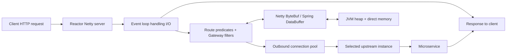
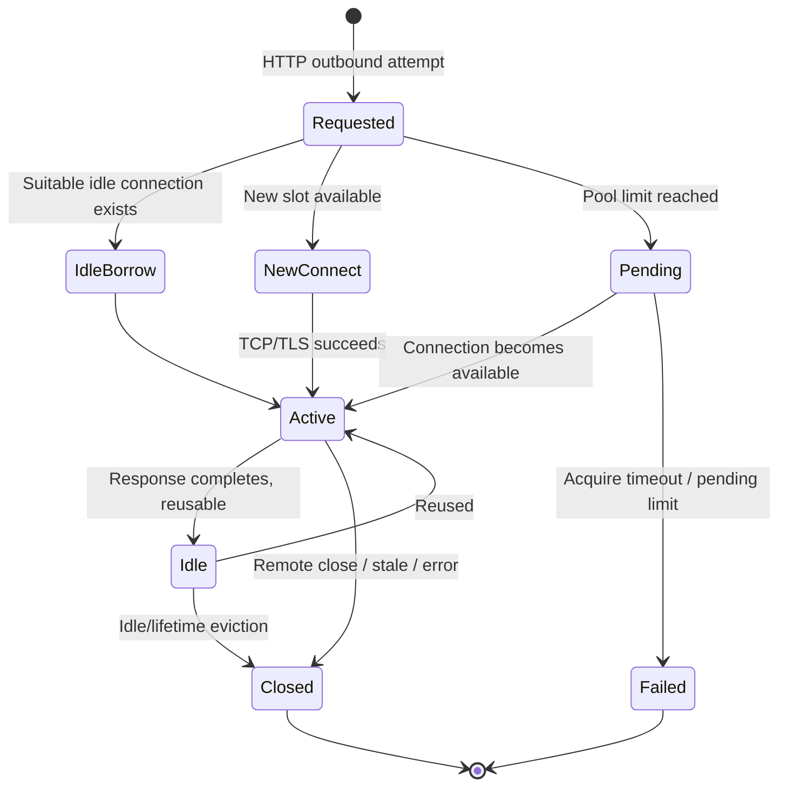
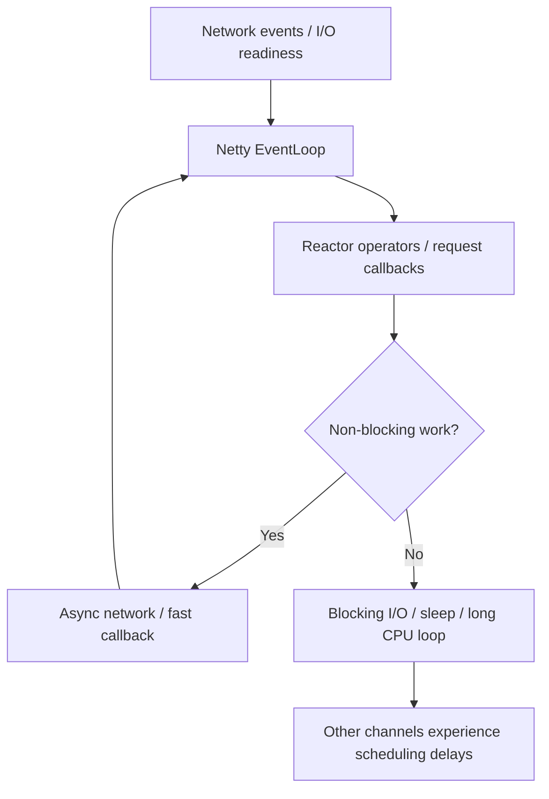
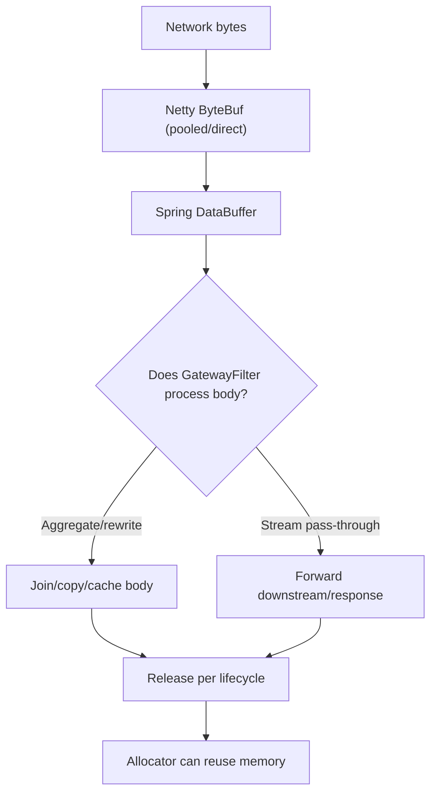
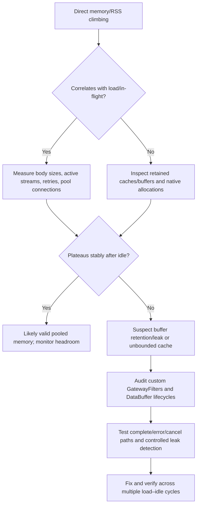

# Monitoring Connection Pools, Event Loops, Memory, and Buffers

In **Spring Cloud Gateway**, many performance incidents do not surface as a clear exception. The API still returns HTTP `200`, yet p95 latency climbs sharply, some requests suddenly return `503/504`, the Gateway restarts due to out-of-memory, or just one replica slows down. The root cause often lies in the **connection pool**, **Netty event loop**, **heap/direct memory**, or **`DataBuffer` retention**.

This lesson in the **Observability** chapter guides you through measuring, interpreting, and diagnosing those four resource groups when running **Spring Cloud Gateway Server WebFlux**. They tie closely to building an API Gateway for microservices: route predicates, filter chains, path/header rewrites, `lb://` service discovery, authentication, rate limiting, retries, circuit breakers, TLS, and end-to-end request tracing.

> **Scope and versions:** Focus is Spring Cloud Gateway **Server WebFlux** using Reactor Netty as its HTTP server/client. Gateway Server Web MVC runs on a Servlet container and may use a different client transport, so Reactor Netty metrics do not map 1:1. Property, meter, and label names in Reactor Netty/Micrometer/Spring Boot vary by version; always inspect `/actuator/metrics` and `/actuator/prometheus` on the live application before finalizing dashboards or PromQL queries. Thresholds in examples are purely illustrative starting points for load testing, not universal production defaults.

## 1. Four Resources to Observe Together

A request traversing the Gateway can consume multiple resources simultaneously:



| Group | Primary Role | Signals to Measure | When Abnormal |
| --- | --- | --- | --- |
| **Connection pool** | Reuses outbound HTTP client connections from Gateway to upstream | Active, idle, pending, capacity, acquire time | Pending rises, connection acquire timeouts, latency |
| **Event loop** | Executes non-blocking I/O tasks and Reactor Netty callbacks | Pending tasks, CPU, blocked thread stacks, scheduling delay | Multiple routes slow down together, cascading timeouts |
| **Memory** | Holds Java objects, HTTP buffers, native/direct allocations | Heap used, GC, RSS/container memory, direct memory | GC spikes, OOM, pod OOMKilled |
| **Buffers** | Hold HTTP request/response bytes during streaming or body transforms | Used/active pooled buffers, request sizes, buffer retention, leak warnings | Direct memory climbs, body buffering eats RAM, leaks |

**Never collapse everything into one memory chart.** Pool starvation makes requests wait while RAM stays flat; a blocked event loop causes timeouts even with low active connections; a `DataBuffer` leak can drive RSS up while JVM heap barely moves.

## 2. Two Connection Directions: Inbound vs. Outbound

Spring Cloud Gateway sits between two connection networks:

```text
                       Spring Cloud Gateway
                         +-------------+
Clients -- inbound --->  | Netty HTTP  |  -- outbound ---> microservices
connections             | server      |    HttpClient / connection pool
                         +-------------+
```

**Inbound:** Connections from clients/Ingress to the Gateway's Reactor Netty **HTTP server**. These depend on open client count, HTTP keep-alive, TLS, HTTP/2, WebSocket/streaming, and server/Ingress limits.

**Outbound:** Connections opened by the Gateway's Reactor Netty **`HttpClient`** toward backends. A **`ConnectionProvider`/connection pool** typically reuses TCP/TLS connections for the same set of remote addresses.

Key points:

- 1,000 inbound connections do not mean exactly 1,000 outbound connections.
- A request can be rejected by Security/RateLimiter **before** touching the outbound pool.
- `Retry` can issue **multiple outbound attempts** per client request.
- HTTP/2 supports multiplexing, so concurrent requests do not equal connection counts.
- WebSockets hold long-lived connections; do not treat them like short REST GETs.
- An outbound connection held **idle** for reuse still consumes a file descriptor and some memory.

When monitoring, separate inbound server metrics, outbound provider metrics, and upstream client metrics instead of summing both directions and calling it “Gateway connection pool.”

## 3. How Does the Reactor Netty Connection Pool Work?

A backend connection pool follows this general lifecycle:



This diagram illustrates logical states. Exact counter names, keep-alive lifecycles, per-remote pools, and HTTP/2 behavior vary across implementations.

### Core Terminology

- **Active connections:** connections currently leased to operations or in use per provider semantics.
- **Idle connections:** idle connections retained in the pool for reuse.
- **Total connections:** connections currently owned by the pool according to the meter; typically related to active + idle, though check exact counting rules.
- **Max connections:** connection cap per pool or per remote pool scope—not always a JVM-wide global limit.
- **Pending acquire:** requests/attempts waiting for a connection because no slot is free.
- **Pending acquire timeout:** maximum wait time before failing connection acquisition.
- **Max pending acquire:** maximum queue size waiting for connections.
- **Max idle/life time:** lifecycle caps for evicting old connections.

Limits always belong to a **scope**: provider name, remote address, scheme/protocol, and active configuration. Never multiply gauges mechanically to claim cluster-wide connection counts.

### Connection Starvation Example

Suppose the Gateway caps an HTTP/1.1 destination group at **100 outbound connections** and the backend holds each request for 2 seconds. When a burst of 500 requests arrives:

```text
100 requests get connections to call the backend
400 remaining requests:
  -> wait in pending acquire
  -> time out or fail due to the pending queue limit
```

If retries trigger immediately while the pool is saturated, attempt counts surge further. Raising `max-connections` to 500 **will not necessarily help**: the backend may only sustain 100 concurrent operations and degrade or crash under 500.

## 4. Little's Law for Estimating In-Flight Concurrency

In a steady-state system, Little's Law gives an approximation:

\[
L = \lambda W
\]

where:

- \(L\): average number of requests/operations in flight.
- \(\lambda\): average throughput (requests/s).
- \(W\): average residence time (s).

For example, route `orders-read` handles 600 RPS with an average upstream response time of 0.25 seconds:

\[
L = 600 \times 0.25 = 150\text{ operations}
\]

Roughly 150 upstream operations are in flight **on average**, though that does not automatically mean 150 TCP connections: HTTP/2 multiplexing, retries, connection reuse, and timeouts change the mapping. Conversely, 3-second tail latencies or sudden bursts push peak concurrency well above the average.

**Proper usage:** use the formula to form a capacity hypothesis, then measure p95/p99, active/pending pool gauges, backend concurrency, and real load. Never treat `maxConnections = RPS × timeout` as a rigid config rule.

## 5. Common Connection Pool Metrics

Reactor Netty exposes familiar meters on instrumented releases:

| Micrometer Meter (Example) | Typical Type | Meaning |
| --- | --- | --- |
| `reactor.netty.connection.provider.total.connections` | Gauge | Connections currently in the provider/remote pool |
| `reactor.netty.connection.provider.active.connections` | Gauge | Active connections |
| `reactor.netty.connection.provider.idle.connections` | Gauge | Idle connections |
| `reactor.netty.connection.provider.pending.connections` | Gauge | Waiting acquire requests |
| `reactor.netty.connection.provider.max.connections` | Gauge | Allowed capacity |
| `reactor.netty.connection.provider.max.pending.connections` | Gauge | Acquire queue capacity |
| `reactor.netty.connection.provider.pending.connections.time` | Timer | Acquire wait time per instrumentation |

**Meter names, types, units, and tags vary across Reactor Netty versions.** Some meters remain absent until metrics are enabled or traffic flows; names can also shift under Prometheus conventions. Always verify the live registry before building dashboards from this table.

### Which Labels Are Useful?

Metrics typically include tags distinguishing **`ConnectionProvider` name/id**, **remote address**, and possibly other network attributes depending on version. When one logical `lb://order-service` fans out across multiple backend instances, pool metrics may group by **remote address**, not **`routeId`**.

Therefore:

- Gateway request metrics by `routeId` pinpoint which route is slow.
- Pool metrics by provider/remote pinpoint which connection pool is congested.
- Traces/backend telemetry map a route's requests to the physical host/port.

Do not assume from `IP:port` labels that “one IP equals one route”: many routes can share one backend pool, and one `lb://` route can hit many addresses.

## 6. Enabling Metrics for the Outbound `HttpClient`

Illustrative configuration for Spring Cloud Gateway WebFlux versions supporting these properties:

```yaml
spring:
  cloud:
    gateway:
      httpclient:
        pool:
          type: FIXED
          max-connections: 200
          acquire-timeout: 3000
          metrics: true

management:
  server:
    port: 9090
  endpoints:
    web:
      exposure:
        include: "health,metrics,prometheus"
```

Intent:

- Cap outbound connections instead of letting them grow unbounded.
- Enforce a timeout when waiting for a connection.
- Enable pool metrics when `metrics` is supported by that version.
- Expose Actuator metrics/Prometheus on the management port.

**Version/syntax warning:** in some releases, the Gateway Server WebFlux prefix moved from `spring.cloud.gateway.httpclient` to `spring.cloud.gateway.server.webflux.httpclient`; valid `type` values and `acquire-timeout` units must also be checked against configuration metadata. This is **not a recommended production config with values 200/3000**. Use it strictly as a lab starting point after verifying compatible properties and dependencies.

### Standalone Reactor Netty Options to Understand Semantics

When building a custom Reactor Netty `HttpClient` (not automatically replacing Gateway's `HttpClient`), you configure the provider as:

```java
ConnectionProvider provider =
    ConnectionProvider.builder("gateway-outbound-demo")
        .maxConnections(200)
        .pendingAcquireMaxCount(400)
        .pendingAcquireTimeout(Duration.ofSeconds(3))
        .maxIdleTime(Duration.ofSeconds(30))
        .maxLifeTime(Duration.ofMinutes(5))
        .evictInBackground(Duration.ofSeconds(60))
        .metrics(true)
        .build();

HttpClient client = HttpClient.create(provider)
    .metrics(true, uri -> "/upstream-template");
```

This is **illustrative Reactor Netty code** requiring imports/dependencies, and wiring it into Gateway differs by version. Simply declaring a `ConnectionProvider` bean does not automatically make all Gateway routes use it. `HttpClient.metrics(true, mapper)` should normalize URI metrics into a **low-cardinality path template**—never emit raw user IDs or query tokens.

### When Should You Tune the Pool?

Only after inspecting:

- Active and idle counts per pool.
- Pending acquire counts and wait times.
- Connection errors and timeouts.
- Backend capacity, response time, and concurrency.
- Memory, file descriptors, and ephemeral ports.
- Gateway replica counts and traffic patterns.

Raising pool max can shrink pending queues while **increasing sockets/file descriptors, TLS overhead, and backend load**. Setting pool max too low creates artificial queuing even while the backend still has headroom.

## 7. Reading Pool State via Actuator

In a lab with Actuator enabled:

```bash
curl -sS http://127.0.0.1:9090/actuator/metrics

curl -sS \
  http://127.0.0.1:9090/actuator/metrics/reactor.netty.connection.provider.active.connections

curl -sS \
  http://127.0.0.1:9090/actuator/metrics/reactor.netty.connection.provider.pending.connections
```

If a meter name is missing:

1. Check Reactor Netty and Micrometer/Actuator dependencies.
2. Confirm Gateway runs WebFlux/Reactor Netty, not MVC.
3. Verify `httpclient.pool.metrics` or the version-appropriate metrics setting is enabled.
4. Send real traffic through a route to a backend (do not just GET `/actuator/health`).
5. List actual meter names to check for newer naming conventions.
6. Verify you are querying the **right Gateway replica**.
7. If missing from Prometheus, check `micrometer-registry-prometheus` and endpoint exposure.

**Meters appearing only after the first request is normal** across many instrumentations. “Missing right after startup” does not prove instrumentation is broken.

### Illustrative Actuator JSON

```json
{
  "name": "reactor.netty.connection.provider.active.connections",
  "baseUnit": null,
  "measurements": [
    {"statistic": "VALUE", "value": 74}
  ],
  "availableTags": [
    {"tag": "name", "values": ["gateway-outbound"]},
    {"tag": "remote.address", "values": ["orders.internal:8443"]}
  ]
}
```

Values, tag names, and structure are **synthetic**. Do not hardcode `remote.address` if your version emits another label. In Prometheus, dots in metric names convert to underscores, and label-name conversion also depends on the registry.

## 8. PromQL for Pool Utilization

When `/actuator/prometheus` exports the corresponding series, view active connections per target:

```promql
reactor_netty_connection_provider_active_connections
```

Pending acquisitions:

```promql
reactor_netty_connection_provider_pending_connections
```

Capacity limit:

```promql
reactor_netty_connection_provider_max_connections
```

Utilization ratio, strictly when gauges share compatible labels and aggregation scope:

```promql
100 *
reactor_netty_connection_provider_active_connections
/
clamp_min(
  reactor_netty_connection_provider_max_connections,
  1
)
```

**Watch vector matching carefully:** label sets may differ slightly and return empty results. Inspect raw series, group by provider/remote/pod appropriately, and use `on(...)`/`ignoring(...)` only once you understand the schema. Never collapse multiple pools with different limits into one ratio without preserving scope.

### Pending Acquire Time

If `pending.connections.time` is exported as sum/count (e.g., `..._seconds_sum`/`count`), average wait time over 5 minutes is:

```promql
sum(
  rate(
    reactor_netty_connection_provider_pending_connections_time_seconds_sum[5m]
  )
)
/
clamp_min(
  sum(
    rate(
      reactor_netty_connection_provider_pending_connections_time_seconds_count[5m]
    )
  ),
  0.001
)
```

**Do not assume those exact suffixes exist.** Verify the exact metric name, Timer type, and unit in `/actuator/prometheus`. The `pending.connections` Gauge counts **how many are waiting**, not **how long they waited**—pair pending counts with acquire timers and timeout errors.

## 9. When Is a Connection Pool Overloaded?

A typical cascade:

```text
Backend response time rises
  -> outbound active connections stay leased longer
  -> idle connections drop
  -> active approaches max
  -> pending acquires begin climbing
  -> acquire wait time climbs
  -> client p95/p99 climbs
  -> request timeouts / 503 / 504
  -> retries amplify the problem
```

**Do not wait until `active == max` to raise an alarm.** Steady pending growth over 5 minutes or rising acquire latency is an early warning before HTTP errors surge.

| Symptom | Hypothesis | What to Verify |
| --- | --- | --- |
| Active near max, pending rising | Insufficient pool capacity or slow backend | Upstream latency, RPS, concurrency |
| Low active, high pending | Scope/label mismatch or unusual pool starvation | Per-provider series, logs, instrumentation |
| Very high idle, large direct memory | Pool retaining many idle channels/buffers | Idle timeout, count of remote pools |
| Rising connect/TLS errors | Backend network/TLS failure | DNS/SNI/certs, chosen instance |
| Low pending, high client p95 | Bottleneck is outside pool acquire | Event loop, backend, retries, response transfer |
| 503 while backend receives no requests | No-instance, OPEN breaker, or pending/connect failure | Traces, LB/breaker metrics |
| High pool churn post-deploy | Max-life/idle eviction or backend closing policy | TCP/TLS handshakes, connection reuse |
| Pending on just one remote address | Specific instance degraded | Per-remote metrics, backend readiness |

One pool metric may aggregate across multiple routes; never blame a single route filter without trace evidence.

## 10. Connection Pool Tuning: Capacity Is Not Unlimited

Key parameters to understand:

| Parameter | What It Controls | Trade-Off |
| --- | --- | --- |
| Max connections | Sockets active/managed per pool scope | Raises potential throughput, yet increases backend load, FDs, RAM |
| Pending max count | Queued acquire requests | Longer queues reduce immediate rejections, yet raise latency and memory |
| Pending acquire timeout | Max wait for a slot | Too short fails fast; too long inflates tail latency |
| Max idle time | How long idle sockets stay pooled before eviction | Too short increases TCP/TLS churn; too long holds sockets |
| Max life time | Maximum connection lifetime | Too short cuts reuse; too long hits stale endpoints |
| Eviction interval | Background eviction frequency | Affects cleanup cadence and management overhead |
| HTTP/2 settings | Concurrent streams per connection | Multiplexing changes the request-to-connection ratio |
| Response/connect timeout | How long an attempt holds resources | Too long pressures pools; too short causes false timeouts |

**Never set a huge pending queue to hide congestion.** Queues hold users until their deadline, pin request/buffer memory, and spark retry storms when queued requests time out together. Align with timeout budgets, rate limits/bulkheads, and backend capacity.

### Time Budgets Must Be Consistent

Suppose a client has a 2-second deadline, yet:

```text
Pending acquire timeout = 3 s
Connect timeout         = 2 s
Response timeout        = 5 s
Retry                   = 2 retries + backoff
```

This configuration lets processing run several times longer than the client's deadline. After the client gives up, the Gateway may keep burning resources if cancellation doesn't propagate or upstream keeps running. Designing the overall deadline and cancellation propagation matters more than tuning individual timeouts in isolation.

## 11. What Is the Event Loop in Reactor Netty?

The **event loop** consists of threads serving I/O readiness, running callbacks, and driving non-blocking network operations. Each thread manages many connections; the golden rule is **never blocking it** with long work.



An event loop is not “one thread per request.” Consequently, a single handler calling `Thread.sleep(1000)` or blocking JDBC on the event loop stalls **many unrelated requests and connections**—even when the backend is healthy and the connection pool has spare slots.

### Dangerous Operations

- `.block()` / `.blockOptional()` on non-blocking threads.
- `Thread.sleep(...)`.
- JDBC, synchronous HTTP clients, or blocking filesystem I/O inside reactive callbacks.
- Heavy CPU, catastrophic regex backtracking, or slow JSON parsing on the event loop.
- Slow synchronous logging or formatting/truncating huge payloads.
- Custom `GatewayFilter`s reading the entire request/response body and processing synchronously.
- Unbounded heavy cryptography.
- Lock contention or monitor blocking.

**Not every CPU operation is forbidden**; small, bounded callbacks are normal. The danger is letting a callback occupy the event loop long enough to eat into the latency budget.

## 12. Event Loop Pending Tasks Metric

Reactor Netty can expose a gauge such as:

```text
reactor.netty.eventloop.pending.tasks
```

Meaning: number of queued tasks waiting to execute on the event loop, scoped per implementation.

Prometheus typically normalizes the name to:

```promql
reactor_netty_eventloop_pending_tasks
```

**Verify actual scope and labels.** Some versions instrument per event loop/thread, while others aggregate or emit different labels. If missing, check metrics enablement, event loop instrumentation version, and sample traffic.

### Reading the Metric Properly

- **`pending.tasks > 0` momentarily** does not automatically mean saturation; brief bursts are normal.
- **Continuously climbing `pending.tasks`** alongside rising p95 and socket read/write latency warrants immediate investigation.
- **`pending.tasks = 0`** does not guarantee callbacks aren't blocking: a thread may be stuck inside the currently executing task before the queue backs up or before the measurement captures it.
- **High CPU + rising pending tasks** suggests event-loop CPU saturation.
- **Low CPU + slow requests** may indicate network/backend/pool delays, or threads blocked waiting on locks or blocking I/O.

### PromQL for Watching Pending Task Trends

```promql
max_over_time(
  reactor_netty_eventloop_pending_tasks[5m]
)
```

Peak per pod (only if the `pod` label exists):

```promql
max by (pod) (
  max_over_time(
    reactor_netty_eventloop_pending_tasks[5m]
  )
)
```

This is a **gauge**, so never apply `rate()` as if it were a counter yielding “tasks/second.” To measure queue growth rates or task execution times, use dedicated instrumentation.

## 13. Finding Event Loop Blocking with Evidence

When suspecting a blocked event loop, follow this order:

1. Check whether **Gateway p95/p99** jumped across many routes or just one.
2. Check **event loop pending tasks**, process CPU, JVM GC pauses, and thread counts.
3. Compare **outbound pool pending**: if the pool is empty while latency spikes, look elsewhere.
4. Capture a **thread dump** or Java Flight Recorder (JFR) recording in an authorized environment, focusing on Netty event loop threads.
5. Search stacks for `Thread.sleep`, JDBC, synchronous HTTP, file I/O, lock waits, or `block()`.
6. Correlate with recent custom `GatewayFilter`/`GlobalFilter` changes, libraries, or deploy revisions.
7. Validate in a controlled test with load testing and BlockHound.
8. Fix the root cause and re-measure p95, pending tasks, CPU, and memory.

Never leave full stack-trace logging turned on across production traffic long-term: log I/O overhead can worsen the slowdown.

### Anti-Pattern Example

```java
// DO NOT DO THIS inside a reactive GatewayFilter.
public Mono<Void> filter(ServerWebExchange exchange,
                         GatewayFilterChain chain) {
    String customer = blockingCustomerService.lookup(
        exchange.getRequest().getHeaders().getFirst("X-Customer"));
    return chain.filter(exchange);
}
```

A synchronous lookup executed before returning the `Mono` blocks the calling thread—typically the event loop. Furthermore, a client-supplied `X-Customer` header is never proof of authorization for that customer/tenant.

One way to offload blocking work **until the dependency can be replaced**:

```java
public Mono<Void> filter(ServerWebExchange exchange,
                         GatewayFilterChain chain) {
    return Mono.fromCallable(() ->
            blockingCustomerService.lookupValidatedCustomer(
                exchange))
        .subscribeOn(Schedulers.boundedElastic())
        .flatMap(customerContext ->
            chain.filter(exchange));
}
```

This is an **illustrative skeleton**, requiring imports, validation, error handling, and timeouts. `boundedElastic` merely shifts blocking work onto a bounded scheduler; **it does not make JDBC or blocking I/O non-blocking**, does not increase backend capacity, and introduces its own thread queue. Prefer truly reactive/non-blocking clients whenever possible.

### BlockHound and Testing

In an appropriate test suite, BlockHound can catch certain blocking calls on non-blocking threads. Manage compatibility with Reactor/JDK/test libraries and maintain explicit allowlists carefully. Never assume green tests mean zero blocking exists: some native calls, locks, or custom code can bypass detection.

## 14. CPU, GC, and Event Loop: Isolating the Cause

| Observation | Hypothesis | Verification |
| --- | --- | --- |
| High event loop pending, high CPU | CPU-bound callbacks or event overload | JFR CPU profile, stack traces |
| High pending, moderate/low CPU | Blocking I/O or locks, scheduling delay | Thread dumps, blocked states |
| Rising JVM GC pauses, all routes slow | Heap pressure / GC | `jvm.gc.pause`, heap occupancy, allocations |
| High CPU yet low pending | CPU spent on worker/GC/other threads | Per-thread CPU, process profile |
| Rising RPS, stable p95, brief pending blips | Likely normal operation | Baselines, saturation thresholds |
| Route A slow, B fast | Route-specific backend/pool/filter | Per-route metrics, upstream spans |
| All routes slow after custom logging filter | Global blocking work | Filter metrics, logging latency |

A single gauge is a clue, not a root cause. Cross-check multiple signals so you don't resize pools when the real culprit is CPU blocking or GC.

## 15. JVM Heap, Non-Heap, Direct Memory, and RSS

These four concepts are **not the same**:

| Memory Type | Main Contents | Tools / Metrics |
| --- | --- | --- |
| JVM **heap** | Java objects, collections, cached request bodies as objects/arrays | `jvm.memory.used{area="heap"}`, GC, heap dumps |
| JVM **non-heap** | Metaspace, code cache, runtime structures | `jvm.memory.used{area="nonheap"}` |
| **Direct/native buffers** | Netty direct `ByteBuf` memory, NIO direct allocations | Netty allocator metrics, JVM direct `BufferPoolMXBean` (not identical) |
| **Process RSS / container memory** | Committed heap, native allocators, thread stacks, code, direct buffers, mmap, page accounting | OS/container metrics like working set / RSS |

**Note:** `jvm.memory.used` is not total container memory. A Gateway with modest heap usage can still be OOMKilled due to direct memory, thread stacks, native allocations, or other process memory.

### What Is Direct Memory?

Netty uses **off-heap/direct `ByteBuf`s** to cut memory copies and speed up network I/O. Those bytes do not appear in a JVM heap histogram. A Spring WebFlux `DataBuffer` can wrap a pooled direct Netty `ByteBuf`.

Thus, a flat `heap used` chart **does not rule out buffer retention or a direct memory leak**.

### Pooled Allocators Hold Memory for Reuse

Netty's pooled allocator retains allocated chunks/arenas even when buffers are no longer active, enabling fast reuse. **Used/reserved memory will not necessarily drop back near zero after every request.**

Distinguish between:

- Memory **reserved/cached** by the allocator.
- Memory actively **referenced/held** by in-use buffers.
- Native RSS billed against the container.
- Direct memory, heap, and container limits.

A direct memory curve that reaches a steady plateau under load behaves very differently from one that **climbs relentlessly across repeated load–idle cycles**.

## 16. JVM and Netty Allocator Meters to Monitor

Common names in Micrometer/Actuator:

| Meter | System | What to Read |
| --- | --- | --- |
| `jvm.memory.used` | JVM | Heap/nonheap usage by area/id |
| `jvm.memory.max` | JVM | Max when reported by the JVM |
| `jvm.gc.pause` | JVM | GC pause counts and durations |
| `jvm.buffer.memory.used` | JVM NIO | Buffer pool memory by id, if available |
| `jvm.buffer.count` | JVM NIO | Count of buffers in observed pools |
| `process.cpu.usage` | Process | Relative CPU usage |
| `process.files.open` | OS/process when available | Open file descriptors |
| `reactor.netty.bytebuf.allocator.used.heap.memory` | Netty | Allocator heap memory used/held |
| `reactor.netty.bytebuf.allocator.used.direct.memory` | Netty | Reported allocator direct memory |
| `reactor.netty.bytebuf.allocator.active.direct.memory` | Netty, version-dependent | Active direct allocations per allocator semantics |
| `reactor.netty.bytebuf.allocator.direct.arenas` | Netty, version-dependent | Number of direct arenas |
| `reactor.netty.bytebuf.allocator.threadlocal.caches` | Netty, version-dependent | Per-thread caches |
| `reactor.netty.eventloop.pending.tasks` | Netty | Event loop pending tasks |

**Never assume all meters above are always available.** Netty/Reactor Netty versions and metrics configuration govern exact names, labels, and availability. `active.direct.memory` may not be instrumented on every version—when missing, you cannot infer active buffer bytes from `used` alone.

### PromQL for Heap Used by JVM Memory Area

Prometheus exposition typically normalizes names:

```promql
sum by (area) (
  jvm_memory_used_bytes
)
```

To compute heap occupancy ratios, align `jvm_memory_max_bytes` and `area/id` labels; never divide vectors across mismatched memory pools.

### PromQL for Netty Direct Bytes

```promql
sum by (instance) (
  reactor_netty_bytebuf_allocator_used_direct_memory
)
```

This query works only if your exporter uses that exact name and `instance` label. Some registries append `_bytes`, rename meters, or expose allocator metrics differently. **Inspect raw `/actuator/prometheus` output** before putting queries in production.

In particular, never assume `jvm_buffer_memory_used_bytes` and `reactor_netty_bytebuf_allocator_used_direct_memory` can be added together for total direct memory: they can measure **overlapping or differently scoped sets**.

## 17. Real Memory Limits Form a Stack of Budgets

A Gateway container has multiple layered budgets:

```text
Container memory limit
  ├─ JVM heap max (-Xmx or container-aware sizing)
  ├─ Direct memory / Netty allocator
  ├─ Metaspace / code cache
  ├─ Thread stacks
  ├─ Native allocator / runtime overhead
  ├─ TLS / network buffers
  └─ Other native memory consumers
```

With a 2 GiB container limit and `-Xmx=1.8g`, you leave very little room for direct buffers and native overhead—especially under HTTP load. That **can** trigger `OOMKilled` even while `jvm.memory.used{area="heap"}` stays below max.

Relevant JVM/Netty flags:

- `-Xms` / `-Xmx` bound the JVM heap.
- `-XX:MaxDirectMemorySize` bounds NIO direct memory limits.
- Netty direct-memory accounting follows specific rules depending on JVM and Netty flags.
- Container `memory.limit`/cgroups track overall native allocations.
- `-XX:NativeMemoryTracking=summary` supports JVM native-memory diagnostics when enabled at startup.

**Never assume `-XX:MaxDirectMemorySize` covers all native or container memory.** NMT may also omit allocations from certain native libraries. Always compare against RSS/container metrics and allocator metrics.

### Illustrative Budget Example

Suppose a Gateway pod has a 2 GiB memory limit. A rough initial budget might allocate:

```text
Heap max                 : 900 MiB
Direct/native buffers    : size via load testing
Metaspace/code cache     : inspect JVM metrics
Thread stacks + TLS      : measure under concurrency
File/socket/page overhead: measure under load
Headroom for bursts/GC   : mandatory buffer
```

Never finalize settings from a table alone. Run load tests (covering large bodies, streaming, retries, and TLS), measure p95 memory and peak RSS, and preserve headroom for rolling deployments and traffic spikes.

## 18. `ByteBuf` and `DataBuffer` in WebFlux

In Spring WebFlux, HTTP request and response bodies flow as streams of `DataBuffer`s. Over Reactor Netty, each `DataBuffer` can wrap a **pooled, reference-counted Netty `ByteBuf`**.



**Buffer lifecycles are managed resources**, especially when writing custom `GatewayFilter`s, `GlobalFilter`s, response decorators, or body logging. If a reference-counted buffer isn't released when done, the pooled allocator cannot reclaim and reuse that memory.

### Reference Counting

A pooled `ByteBuf` tracks `refCnt()`:

- Retaining increments the reference count.
- Releasing decrements the reference count.
- When it reaches 0, the allocator reclaims the buffer for reuse.
- Missing releases cause memory retention/leaks.
- Extra releases or use-after-release cause data corruption or `IllegalReferenceCountException`.

**Ownership is critical:** never blindly `release` every `DataBuffer` you inspect. The framework may still own it and release it per contract. Only retain/release when custom code explicitly takes extra ownership or aborts/consumes a buffer whose contract requires your code to clean it up.

## 19. Places Where Buffers Easily Stay Retained Too Long

| Scenario | Risk |
| --- | --- |
| Custom `GatewayFilter` reads body to log | Holds whole body in memory or forgets to release |
| `ModifyRequestBody` / `ModifyResponseBody` | Decodes/aggregates large payloads, inflating heap/direct memory |
| Retrying requests with bodies | Must cache/replay request body; memory grows with concurrency |
| Response cache | Holds response payloads per TTL; risks caching personal data if policy is wrong |
| WebSocket streaming | Long-lived connections, inbound/outbound queues, slow consumers |
| SSE / streaming | Long-lived responses where buffers queue up for slow clients |
| Large file uploads | Unbounded copying or aggregation |
| Mid-flight error/cancellation | Cleanup code skipped unless tied to reactive lifecycle hooks |
| Codec `join` or `collectList` | Accumulates many buffers before processing |
| Unbalanced buffer copy/retain | Reference-counted memory leak |
| Logging sensitive payloads | PII/token exposure in addition to memory pressure |

**Do not lump all of these into “Netty memory leak.”** Sometimes it is **intentional caching**, unbounded aggregation, or unhandled backpressure—even when reference counts are completely balanced.

### Body Size and Concurrency

If the Gateway aggregates up to 8 MiB responses across 200 concurrent requests:

\[
8\,\text{MiB} \times 200 = 1,600\,\text{MiB}
\]

That is **an estimate for just one layer of buffered payloads in RAM**, excluding intermediate copies, JSON objects, TLS buffers, and pool allocations. Even a “few MiB per body” policy can cause OOM at high concurrency.

## 20. Why Streaming and Backpressure Help—Yet Are Not Magic

**Streaming** forwards response chunks as they arrive without buffering the entire body in memory. **Backpressure** prevents upstream from pushing data faster than downstream can consume along Reactive Streams-compliant segments.

However:

- Calling `collectList()` in a filter deliberately buffers the whole stream, defeating streaming.
- Buffering still occurs inside HTTP clients, TLS, compression, and kernel sockets.
- Slow consumers grow queues unless custom code enforces limits.
- Spec-violating publishers or unbounded logging queues break backpressure.
- Body replay for retries and response caching inherently retain data and are never “zero-copy.”

**Good design:** stream end to end wherever possible, cap request/body sizes, enforce cancellation cleanup, and track in-flight streams/connections alongside memory.

## 21. Anti-Pattern Example: Holding Every `DataBuffer` in a List

```java
// ANTI-PATTERN: NEVER use in production Gateway code.
List<DataBuffer> saved = new CopyOnWriteArrayList<>();

Flux<DataBuffer> inspect(Flux<DataBuffer> body) {
    return body.doOnNext(saved::add);
}
```

This holds references to every buffer passing through without bounds, clear ownership, or cleanup on cancellation/errors—causing memory to grow indefinitely or retaining buffers already released by the framework.

**A safer inspection strategy usually avoids logging bodies altogether.** If payload auditing is required:

1. Prefer metadata: `routeId`, status, request size, `Content-Type`, correlation ID.
2. Inspect only a narrow allowlist with strict size limits and data classification.
3. Never store raw `Authorization`, cookies, secrets, or PII.
4. Use framework APIs/filters with explicit body-management contracts.
5. Wire cleanup across complete, error, and cancel signals.
6. Measure memory and test under high concurrency.

### `DataBufferUtils.release`

When custom code truly **owns** a `DataBuffer` that needs cleanup, Spring provides `DataBufferUtils.release(buffer)`. With buffered data or cancellation, a pipeline may need `doOnDiscard(DataBuffer.class, DataBufferUtils::release)` per operator contracts.

```java
// Conceptual pattern: use only when this code owns discarded buffers.
Flux<DataBuffer> body = source
    .doOnDiscard(DataBuffer.class, DataBufferUtils::release);
```

**Never copy a `doOnDiscard` line into random streams assuming leaks are solved.** Understand which operator owns the buffer, where it was retained, whether it was handed to a response writer, and exact discard/error/cancel lifecycles. Double-releasing is also a bug.

## 22. `DataBufferUtils.join`, Body Limits, and Codecs

Some APIs use `DataBufferUtils.join` to merge buffers into a single `DataBuffer`. For large payloads or untrusted callers, enforce a **max byte count** when supported by your API version:

```java
Mono<DataBuffer> joined =
    DataBufferUtils.join(sourceBody, 1024 * 1024);
```

This illustrates a **1 MiB cap** on aggregation per compatible Spring API. Exceeding it can raise `DataBufferLimitException` (depending on usage and version).

Key points:

- `join` does not magically turn payloads into streaming.
- The resulting `DataBuffer` has a lifecycle; the consumer must use and release it per contract.
- `spring.codec.max-in-memory-size` applies to **framework codecs/operations**, not as a “global limit on every byte passing through the Gateway.”
- The `RequestSize` `GatewayFilter` (when available in your variant/version) enforces request-size policy separately; it does not replace memory budgeting inside custom filters.
- Body rewrites often copy, deserialize, and re-serialize, so peak memory can exceed raw body size.

**Never crank limits up arbitrarily to “fix” `DataBufferLimitException`.** Revisit API contracts, reasonable body sizes, concurrency, and direct streaming/upload designs.

## 23. Retries + Body Buffering Can Amplify Memory

Suppose a client sends a 10 MiB POST and the Gateway has a `Retry` filter:

```text
Client POST body 10 MiB
  -> Gateway needs body for upstream attempt 1
  -> Attempt 1 times out
  -> For attempt 2, request body must be replayed
  -> Body stays cached/retained in Gateway
```

At 100 concurrent requests, potential retained raw payloads reach ~1 GiB before counting copies and metadata. **Retrying mutating requests also risks duplicate business side effects.**

Safeguards:

- Avoid retrying non-idempotent POST/PATCH/DELETE requests.
- Require idempotency keys where business workflows demand retries.
- Cap request body sizes and concurrency.
- Set sensible retry counts, backoffs, and deadlines.
- Monitor direct memory, heap, in-flight requests, pool pending, and upstream attempts.
- Test cached-body cleanup on cancellation and errors.

**Never assume Gateway request count metrics equal the number of body buffers allocated.** One request can spawn multiple attempts and allocations.

## 24. Memory Leak or Legitimate Pool Cache Retention?

Confusing these two often leads to wrong tuning.

### Scenario A: Healthy Plateau

```text
Startup     : Direct memory 100 MiB
Load test   : Climbs to 500 MiB
Idle 10 min : Stays at 480 MiB
Reload      : Still hovers around 500 MiB
```

Pooled allocators keep memory for reuse. If active buffers, throughput, GC, and RSS stabilize and **subsequent load rounds do not climb further**, that is likely healthy pooling.

### Scenario B: Abnormal Buffer Retention

```text
Startup     : Direct memory 100 MiB
Load round1 : 500 MiB
Idle        : 495 MiB
Load round2 : 850 MiB
Idle        : 845 MiB
Load round3 : 1.2 GiB
Idle        : 1.19 GiB
```

When used/active memory or RSS climbs with every identical load round even after idling, suspect:

- Unreleased `DataBuffer`/`ByteBuf`s.
- Caches with misconfigured TTL or size caps.
- Slow consumers / backpressure queues.
- Stuck in-flight requests that never terminate.
- Connection churn / per-remote pools never evicted.
- Native memory fragmentation or allocator behavior.

**Never diagnose a leak from a single `used.direct.memory` line alone.** Compare active allocations, pool connections, request counts, heap, RSS, GC, error/cancel rates, and stabilization time.

## 25. Netty Leak Detection: A Diagnostic Tool with Overhead

Netty offers leak detection for reference-counted buffers. Enable by level strictly in **controlled test/diagnostic environments**:

```text
-Dio.netty.leakDetection.level=advanced
```

Common levels are `simple`, `advanced`, `paranoid`, and `disabled`, depending on Netty version. Higher levels track more call-site metadata with significant CPU and memory overhead.

**Never run `paranoid` indefinitely across all production traffic** just for “peace of mind.” Use it purposefully, time-box runs, measure overhead, and protect logs since stack traces can expose internals.

When leak warnings appear:

1. Identify the implicated stack trace.
2. Inspect custom filters, response decorators, body logging, and retry body caching.
3. Audit complete, error, and cancel code paths.
4. Write tests exercising mid-flight cancellation and repeated load.
5. Align retain/release lifecycles with ownership contracts.
6. Confirm memory plateaus and leak warnings disappear.

Never call `System.gc()` as a “fix” for reference-counted buffer leaks.

## 26. When a Container Is `OOMKilled` While JVM Heap Is Not Full

Example:

```text
Container memory limit  : 1536 MiB
JVM heap used           : 520 MiB
JVM heap max            : 768 MiB
Netty direct memory     : rising rapidly
Process RSS             : approaching 1536 MiB
Kubernetes pod          : OOMKilled
```

Likely causes:

- Direct buffers/native allocations exceeded container headroom.
- Too many open connections inflating TLS/network buffers.
- Body aggregation, retries, or caches holding payloads.
- Thread stacks or off-heap allocations growing.
- Committed heap exceeding used heap alongside native overhead.
- Other container memory accounting consumers.

Checklist:

1. Check `kubectl describe pod`/container status (with access): `OOMKilled` or Java `OutOfMemoryError`?
2. Plot RSS/working set/limits over time.
3. Compare JVM heap used/committed/max with GC activity.
4. Inspect Netty direct/heap allocator metrics and pool/connection counts.
5. Inspect body sizes, active streams, retries, and response caching.
6. Check thread counts, file descriptors, and TLS session/connection churn.
7. Run JFR/NMT/allocator profiling suitable for your environment if needed.
8. Fix the root cause; raise container limits only with a capacity plan and load test proof.

**Java `OutOfMemoryError: Direct buffer memory` and container `OOMKilled` are not the same signal.** `OOMKilled` comes from the OS/cgroup; Java OOME can fire earlier due to JVM/Netty limits. Separate the source first.

## 27. Complementary HTTP Client and Transport Metrics

Reactor Netty HTTP client meters can report:

- Connection time.
- TLS handshake time.
- Response time.
- Data received/sent.
- HTTP client errors.
- Connection errors.
- Address resolution timings depending on instrumentation.

Names often look like `reactor.netty.http.client.*`, though never hardcode them without checking version, transport, and enablement.

| Symptom | Suspect Layer |
| --- | --- |
| Pending acquire rises, connect time low | Pool starvation rather than TCP |
| Connect time rises | Network/backend accept backlog, proxies |
| TLS handshake time/errors rise | Certificates, truststore, SNI, TLS capacity |
| Response time rises while connect is normal | Backend processing / slow responses |
| Data sent/received very high | Large payloads / streaming, buffer pressure |
| Event loop pending rises alongside HTTP client latency | Local scheduling delay may be amplifying latency |
| Backend metrics look healthy while Gateway latency spikes | Retries, queued acquires, TLS, filters, slow clients |

**Check what response time covers:** HTTP client response time may stop at headers or full body completion depending on meter and version. Before comparing Gateway, HTTP client, and backend p95s, verify instrumentation semantics or test directly.

## 28. PromQL: Minimal Operational Dashboard Queries

The queries below are **templates** assuming metrics/labels match common names. Verify `/actuator/prometheus` first.

### A. Outbound Active Connections

```promql
sum by (instance) (
  reactor_netty_connection_provider_active_connections
)
```

### B. Pending Connections

```promql
sum by (instance) (
  reactor_netty_connection_provider_pending_connections
)
```

### C. Pool Saturation Across Compatible Label Sets

```promql
100 *
sum by (instance) (
  reactor_netty_connection_provider_active_connections
)
/
clamp_min(
  sum by (instance) (
    reactor_netty_connection_provider_max_connections
  ),
  1
)
```

**Meaningful only if total max covers the exact same scope as active gauges.** When one instance owns multiple pools/remote targets, preserve `name`/`remote_address` labels so an idle pool B doesn't mask an overloaded pool A.

### D. Event Loop Pending Tasks

```promql
max by (instance) (
  reactor_netty_eventloop_pending_tasks
)
```

### E. JVM Heap Used

```promql
sum by (instance) (
  jvm_memory_used_bytes{area="heap"}
)
```

### F. JVM GC Pause Rate / Time

If `jvm_gc_pause_seconds_sum` exists:

```promql
sum by (instance) (
  rate(jvm_gc_pause_seconds_sum[5m])
)
```

This measures total **seconds of GC pause per second** over the window, not pause count. For pauses per second, query `jvm_gc_pause_seconds_count` if available.

### G. Direct Memory

```promql
sum by (instance) (
  reactor_netty_bytebuf_allocator_used_direct_memory
)
```

Check whether your live meter includes a `_bytes` suffix before adding it to dashboards.

### H. Gateway p95 Latency

If the Gateway Timer exports histograms:

```promql
histogram_quantile(
  0.95,
  sum by (le, routeId) (
    rate(spring_cloud_gateway_requests_seconds_bucket[5m])
  )
)
```

Enable histograms on the Gateway metric and confirm `_bucket` exists. **Never apply `rate` to gauges** like `active.connections` or `used.direct.memory` expecting “connections/s” or “bytes/s”; `rate` is strictly for counter-like series.

## 29. Alerting: Combine Multiple Signals Instead of One Static Threshold

A practical alert suite:

| Alert | Illustrative Combined Condition | Action |
| --- | --- | --- |
| Pool saturation | High active/max **and** sustained rising pending/acquire latency | Check backend latency, concurrency, pool scope |
| Pending acquire timeout | Rising error counts + rising client p95 | Review connection budget and timeouts |
| Event loop starvation | Rising pending tasks/lag **and** rising p95 | Thread dump/JFR; look for blocking filters |
| Direct memory pressure | Unusual direct/RSS growth approaching container budget | Inspect buffer retention, active streams, pooling |
| GC pressure | Rising GC pause time + high heap occupancy | Inspect allocations/heap and body aggregation |
| Connection churn | Rising TCP/TLS handshakes + low idle reuse | Check eviction, keep-alive, proxy idle timeouts |
| FD exhaustion | Open FDs near limit or connect errors | Inspect pool/connection leaks and OS limits |
| Memory leak suspicion | Direct/RSS climbs across repeated load–idle cycles | Run leak detection and cancellation tests |
| Streaming backlog | Rising active streams/queues with flat throughput | Check slow consumers, backpressure, limits |
| Backend saturation | Upstream p95 climbs alongside pool pending | Check backend scaling/latency and rate limits |

**Never slap an 80% threshold on every pool and call it an SLO.** An HTTP/2 pool has different concurrency semantics than HTTP/1.1, and a pool running steadily at 80% active can be completely healthy. Tie alerts to **user impact** (such as client p95/5xx or timeouts), then use resource gauges to diagnose why.

### Lab Threshold Examples, Not Production Standards

```text
For 10 minutes:
  active / max > 85%
  AND pending_connections > 0
  AND p95 latency exceeds baseline
=> Investigate pool saturation.

For 15 minutes:
  eventloop_pending_tasks rising continuously
  AND Gateway p99 rising
=> Investigate event loop blocking.

Across 3 comparable load-idle cycles:
  direct_memory or RSS keeps climbing,
  never returning to a stable plateau
=> Investigate buffer retention/leak.
```

Pair alerts with absolute thresholds, minimum traffic guards, hold durations, and appropriate severities; without conclusive proof, frame alerts as **suspect conditions** rather than declaring a root cause prematurely.

## 30. Compound Incident: Pool Pending, Slow Event Loop, and Rising Direct Memory

Suppose route `GET /api/reports/**` uses a custom filter that reads the body to compute a hash via a blocking library.

```text
09:00  Throughput 500 RPS, p95=180ms, direct=300MiB.
09:15  New GlobalFilter deployed logging bodies.
09:20  p95=950ms, eventloop pending climbs.
09:25  Outbound active nears max, pending climbs.
09:30  Direct memory hits 900MiB, container RSS climbs.
09:35  Requests fail with 503/504, replicas start restarting.
```

Do not jump straight to “the pool is too small.” The causal chain may be:

1. Blocking filter slows down event loop I/O responsiveness.
2. Connections stay active longer because response completion lags.
3. Pending acquires climb because slots free up more slowly.
4. Body logging retains `DataBuffer`s longer and creates allocations.
5. Memory pressure/GC worsens event-loop scheduling delays.
6. Retries multiply outbound attempts and keep more body buffers alive.
7. Requests exceed client deadlines while upstream still works on them.

**Priority remediation:** roll back or disable the offending filter once evidence confirms it, stop raw body logging, replace blocking code with async/non-blocking calls, cap body sizes, fix buffer lifecycles, and limit retries. Only after stabilizing should you consider pool tuning if capacity is still short.

## 31. Another Case: Full Pool Yet Healthy Event Loop

Suppose:

```text
Gateway CPU          : low
Event loop pending   : near baseline
Direct memory        : stable
Pool active/max      : 100/100
Pool pending         : climbing steadily
Backend response p95 : 4 seconds
```

Here, the backend is likely slow or the pool is undersized for traffic—**not event loop blocking**.

Steps:

1. Check backend p95, DB/I/O, and thread pools.
2. Use Little's Law to estimate concurrency.
3. Verify `maxConnections` on the actual remote/pool.
4. Verify response and acquire timeouts align with deadlines.
5. Shed/bound upstream load using rate limits, bulkheads, or circuit breakers if needed.
6. Increase pool size cautiously only if the backend has capacity and FD/memory headroom permits.
7. Re-run load tests checking end-to-end p95/p99, error rates, and upstream resource metrics.

Never blindly set `max-connections` to an unbounded number.

## 32. Multiple Gateway Replicas: Metrics Must Be Attached to Targets

Suppose three replicas report:

```text
Gateway-A: active=80/100, pending=0, direct=400MiB
Gateway-B: active=100/100, pending=300, direct=1.1GiB
Gateway-C: active=70/100, pending=0, direct=420MiB
```

If you only aggregate cluster-wide:

```text
Active=250/300 (83%)
Pending=300
```

you can easily miss that **B is severely overloaded locally**.

**Inspect per-pod first**, then aggregate for a cluster overview:

- Pod/instance labels.
- `routeId` and traffic distribution.
- `ConnectionProvider` name / remote address.
- Event loop pending tasks.
- Heap/direct memory and RSS.
- Deployment version / route config revision.
- Selected upstream instances.
- Prometheus scrape target health.

Prometheus must **scrape each Gateway replica individually**; never scrape a single load-balanced Service that mixes counters and gauges across pods. When aggregating, watch labels so you don't erase pool scopes.

## 33. How Do WebSockets/SSE Differ from Short HTTP Requests?

WebSockets and Server-Sent Events (SSE) keep connections/responses open long-term:

- One socket can stay open for hours.
- HTTP request timers may not complete until the stream closes, depending on instrumentation.
- High active connections do not automatically mean a pool leak.
- Slow consumers build up outbound buffer queues.
- Idle timeouts, keep-alives, and ping/pong control connection lifetimes.
- Long-lived connections get severed during Gateway or backend rolling deploys.
- Authorization and session revocation must be enforced across the connection's lifetime.

For WebSockets, never size capacity by RPS alone. Monitor **active sessions, connection duration, frame rates, close codes, queue sizes, and reconnect rates**.

A slow SSE client causing outbound transfer/backpressure buffer growth is not automatically a `ByteBuf` leak. Measure queue depth/sustained growth and verify proper cancellation cleanup.

## 34. HTTP/2 and Connection Pools: Avoid Inferring from HTTP/1.1

HTTP/1.1 keep-alive typically allows one in-flight request per connection at a time per transport model. HTTP/2 multiplexes streams over a single TCP/TLS connection, so:

- One connection can carry many concurrent requests.
- Active pool connections can look low even at very high RPS.
- Stream concurrency limits become an extra cap.
- Flow control and per-stream buffering matter greatly.
- Connection-level packet loss or flow control can affect tail latency across streams.
- Pool metrics alone do not reveal exact in-flight HTTP/2 request counts.

**Never apply “one HTTP request = one connection”** when tuning both H1 and H2 pools. Measure the actual protocol spoken between Gateway and upstream and check H2 support on your Gateway/HTTP client version.

## 35. Memory During Response Caching or Body Rewriting

A route may enable `LocalResponseCache` (where supported) to cut upstream calls, or `ModifyResponseBody` to transform JSON. Both carry memory costs:

- Caches intentionally retain response bodies per TTL/size rules.
- Body modification decodes, encodes, and aggregates payloads.
- Retries or middleware can duplicate/copy buffers.
- Compression/decompression adds intermediate allocations.
- A bad cache key risks cross-user/tenant data leaks on top of memory pressure.

**Never cache shared responses containing personal/tenant data** just to reduce pool load. Performance tuning must never bypass authentication, authorization, or data isolation.

Measure:

| Indicator | Question |
| --- | --- |
| Cache hit/miss/evictions | Is response caching effective? |
| Cache entry bytes/TTL | How long is memory held? |
| Request/response body size distribution | How big are payloads? |
| Direct vs. heap memory | Where do buffers mostly live? |
| Active streams / in-flight | How many payloads are held concurrently? |
| GC pauses | Is aggregation creating excessive Java objects? |
| Buffer leak warnings | Are there reference-counting bugs? |

## 36. Testing: Verifying Zero Leaks Across Errors, Cancels, and Retries

Passing happy-path tests is not enough. A custom filter may release buffers cleanly on 200 OK while leaking on:

- HTTP client timeouts.
- Client disconnects/cancellations.
- Upstream 5xx + retries.
- `CircuitBreaker` fallbacks.
- Request bodies exceeding size limits.
- JSON decode errors.
- Gateway shutdown/rolling restarts.
- Backpressure from slow consumers.

### Buffer Lifecycle Test Matrix

| Test | Scenario | Verification |
| --- | --- | --- |
| B1 | Normal small body | Stable memory, accurate response |
| B2 | Body near size limit | Does not aggregate beyond budget |
| B3 | Body over limit | Rejects with proper status, retains no buffers |
| B4 | Client cancels mid-upload | Cleans up/closes, zero leaks |
| B5 | Backend times out mid-response | Releases body buffers |
| B6 | Retry 503 then success | Replays body cleanly, stable memory |
| B7 | Retries exhausted | Cleans up when all attempts fail |
| B8 | `CircuitBreaker` fallback | Does not retain request/response buffers |
| B9 | JSON parse error | Releases partially aggregated body |
| B10 | 1,000 concurrent requests | Peak memory stays under budget, zero leaks |
| B11 | 3 load–idle cycles | Direct memory reaches a steady plateau |
| B12 | Slow SSE client | Queues/backpressure/close policies stay bounded |
| B13 | WebSocket disconnect | Active sessions/queues drop cleanly |
| B14 | Gateway pod shutdown | Connections drain and resources clean up |
| B15 | Production-like TLS | Direct memory and handshake buffers measured |

**Define leak-free behavior using trends and ownership tests**, not by asserting heap used drops to a specific number right after GC.

## 37. Testing: Verifying the Event Loop Is Not Blocked

| Test | Scenario | Expected |
| --- | --- | --- |
| E1 | 1 simple route under low load | Event loop pending stays near baseline |
| E2 | Intentional `Thread.sleep` inside `GlobalFilter` test | p95/pending climb; test catches it |
| E3 | Replace with async client | p95/pending return to baseline |
| E4 | Unavoidable Redis/JDBC blocking code | Bounded scheduler selected explicitly |
| E5 | CPU-heavy JSON/filter | Profiling isolates the bottleneck |
| E6 | 10x RPS burst | Remains stable within deadline budget |
| E7 | Slow backend, healthy event loop | Pool pending rises without misdiagnosing local blocking |
| E8 | Large GC pause | GC pauses correlate with latency spikes |
| E9 | Heavy custom logging | Neither blocks event loop nor leaks bodies |
| E10 | Cancellation under load | Does not retain tasks or buffers indefinitely |

In integration tests, use Reactor `StepVerifier` and BlockHound where suitable, yet to prove capacity you still need **real HTTP load tests** through the Gateway to an upstream stub—operator unit tests cannot replace that.

## 38. Testing Connection Pools Under Load

A lab scenario:

- Gateway `orders-read` route points to a backend stub.
- Backend waits 500 ms before responding.
- Pool max is set intentionally low, e.g., 20 connections for an H1 lab.
- Fire 100 concurrent GETs at the Gateway.
- Configure bounded acquire timeout and pending queue.

Expected observations:

1. Active connections climb near the configured scope capacity.
2. Pending acquisitions climb once concurrency exceeds capacity.
3. External Gateway latency grows with connection wait times.
4. Some attempts may hit acquire timeouts if deadlines are short.
5. Upstream request concurrency never exceeds expected connection/HTTP limits.
6. Once load stops, active/pending return to baseline while idle remains until eviction.
7. Direct memory does not climb without bound across repeated runs.

**Never run resource-exhaustion stress tests against production.** Use staging with quotas, resource limits, and controlled backend stubs.

## 39. Four-Resource Diagnostic Matrix

| Scenario | Pool | Event Loop | Memory / Buffers | Investigation Direction |
| --- | --- | --- | --- | --- |
| Slow backend | Active/pending rise | Usually normal | May rise with in-flight count | Backend p95 / timeouts |
| Pool max too low | Pending rises | Usually normal | Queues may grow | Capacity and acquire time |
| Event loop blocked | Active may rise indirectly | Pending/lag rises | Stable or rising | Blocking callbacks |
| `DataBuffer` leak | Usually normal | Usually normal initially | Direct/active climbs across cycles | Retain/release ownership |
| Large response cache | Upstream calls drop | Normal | Heap/direct cache grows | Cache TTL/size/eligibility |
| Retry storm | Attempts rise, pending may rise | Busier | Body buffering grows | Retry policy/deadlines |
| TLS handshake failures | Churn/errors | Tasks may rise | Temporary TLS buffers | Trust/SNI/hostname |
| Stale discovery | Connect errors | Normal | Many stale channels possible | Instance supplier/cache |
| Many WebSocket clients | Long-lived connections | Regular event activity | Per-session buffers grow | Session count/idle/queues |
| Slow SSE consumer | Long response durations | Usually normal | Outbound queues grow | Backpressure/cancellation |
| Container `OOMKilled` | Possibly many sockets | Not necessarily elevated | RSS exceeds limit | Heap/direct/native budgets |
| JVM GC pressure | Not necessarily full | Scheduling pauses | High heap/allocations | Heap/GC/body aggregation |

This table provides **hypotheses**, not 1:1 mappings. Accurate diagnosis requires aligning time-stamped metrics with traces and logs.

## 40. Runbook When Gateway p95 Latency Spikes

1. **Isolate scope:** all routes or just one? All Gateway replicas or just one pod?
2. **Quantify impact:** RPS, 5xx, 429, p95/p99, deadlines, client disconnect rate.
3. **Check pooling:** active/idle/pending/max per provider/remote and pending acquire duration.
4. **Check event loop:** pending tasks, CPU, thread dumps/JFR, GC pauses.
5. **Check memory:** JVM heap used/committed/max, direct allocator, RSS/container working set, GC.
6. **Check buffers:** body sizes, response rewriting, retry body caches, response caches, streaming queues.
7. **Check upstream:** backend handler latency, instance health, DNS/connect/TLS, service discovery freshness.
8. **Check recent filters:** `GlobalFilter`/`GatewayFilter`, logging/body inspection, or blocking SDKs.
9. **Check resilience:** retry attempts, `CircuitBreaker` OPEN/fallback, rate limiting.
10. **Controlled mitigation:** roll back offending filters, cap concurrency/sizes, curb retry amplification, tune pools based on evidence.
11. **Verify:** load test or canary traffic shows p95, pending, RSS plateau, and backend errors returning to normal.
12. **Follow up:** add alerts, dashboards, and regression tests for the discovered failure mode.

### Actions Not to Take Immediately

- **Never raise `maxConnections` blindly** when the backend is already overloaded.
- **Never raise `-Xmx` to consume the whole container limit** when direct memory is high.
- **Never leave Netty `paranoid` leak detection on long-term** without measuring overhead.
- **Never disable TLS validation** to silence outbound connect errors.
- **Never crank up `Retry`** while pending acquires are already climbing.
- **Never log raw request/response bodies** to debug memory issues.
- **Never expose metrics endpoints publicly** just to stand up a quick dashboard.

## 41. Dedicated Runbook for Continuously Rising Direct Memory



Note: the allocator itself retains memory, so combine active allocation, RSS, and response throughput to tell a leak apart from healthy pooling. Never call `System.gc()` once and treat the observation as conclusive.

## 42. Protecting Telemetry and Managing Cardinality

Any metric, trace, or log can leak sensitive information if instrumented carelessly.

**Safe to attach:**

- Managed `routeId`s.
- `httpMethod`, status/outcome groups.
- Gateway instance/pod, environment, region.
- `ConnectionProvider` name / remote pool when series counts stay bounded.
- Allowlisted error categories such as `acquire_timeout`, `tls_failure`, `no_instance`.

**Never attach:**

- Raw access tokens, `Authorization`, `Cookie`, session IDs.
- Raw `userId`/`tenantId`, emails, order numbers.
- Full request paths/queries carrying dynamic identifiers or secrets.
- Trace/span IDs as metric labels.
- Exception messages or unbounded client-controlled remote URLs.
- Body contents and response payloads.

For dynamic routes generating an ID per tenant/user, even `routeId` causes **high cardinality**; group or normalize by route class instead.

### Actuator and Prometheus Must Sit Behind Management Boundaries

- Expose `metrics`/`prometheus` over a secured management listener.
- Enforce TLS/mTLS, authentication, and network policies per environment.
- Scrape each Gateway pod individually rather than through a random load balancer.
- Restrict Gateway Actuator write/refresh privileges separately.
- Never allow internet clients to read memory/pool stats or internal backend addresses unauthenticated.
- Audit enabling debug or leak-detection flags.

## 43. Capstone Exercise: Three-Replica Gateway and Large Report API

A system runs:

- Three Gateway Server WebFlux replicas.
- `GET /api/reports/**` → `lb://report-service`.
- `POST /api/reports/export` → backend generates reports with potentially large bodies.
- A custom filter transforms JSON responses for certain clients.
- GET retries up to twice when upstream returns 503.
- `RateLimiter` protects upstream.
- Prometheus scrapes `/actuator/prometheus` on every replica.

After a deployment, symptoms appear:

```text
Gateway-A: p95=180ms; direct=350MiB; pending=0
Gateway-B: p95=2.5s; direct=1.1GiB; pending=100
Gateway-C: p95=200ms; direct=380MiB; pending=0
```

### Task 1 — Scope the Anomaly

Inspect per-replica metrics and compare route IDs/route revisions. Never average all three replicas into a single line that hides Gateway-B's localized failure.

### Task 2 — Compare Pool and Event Loop

On Gateway-B, inspect:

- Active/max/pending per remote pool.
- Pending acquire latency.
- Event loop pending tasks.
- CPU and GC pauses.
- HTTP client response/connect/TLS timings.
- Selected backend instances and backend p95.

If event loop pending is high, inspect custom filters for blocking work. If event loop is healthy while the pool is full and backend p95 climbed, investigate upstream capacity.

### Task 3 — Inspect Memory

Compare heap, direct allocator, RSS, and request body sizes. Run load–idle cycles in staging; if direct memory climbs unboundedly after cancellations or timeouts, audit `DataBuffer` ownership in the response-rewriting filter and retry body caching.

### Task 4 — Propose Remediations

- Cap body aggregation and response transforms.
- Fix any filter performing blocking I/O.
- Bound retries, backoffs, and deadlines.
- Tune pool settings only if upstream has capacity and FD/memory headroom exists.
- Consider route-specific concurrency limits.
- Roll back the revision if the leak/latency regression traces to the deploy.
- Security check: ensure zero raw request/response bodies enter logs.

### Task 5 — Prove Recovery

A fix is verified only when:

1. Client-visible latency and 5xx return to baseline.
2. Pool pending stops climbing persistently.
3. Event loop pending tasks stabilize.
4. Direct memory/RSS plateaus across multiple load rounds.
5. Backend sees no excessive retry amplification.
6. Telemetry contains zero sensitive data.
7. All three Gateway replicas exhibit consistent policies and metrics.

## 44. Self-Check Questions

1. How do inbound client connections differ from the Gateway's outbound `HttpClient` pool?
2. Why does concurrent request count not always equal TCP connection count, especially with HTTP/2?
3. What states do active, idle, and pending connections represent?
4. Does rising pending acquire necessarily mean the backend ran out of instances?
5. Why can increasing `maxConnections` overload a backend?
6. What hypothesis does Little's Law help form regarding in-flight concurrency?
7. Why check provider/remote scope before computing active/max utilization?
8. Does the `pending.connections` gauge measure acquire wait time?
9. Why does `rate()` on an `active.connections` gauge not return RPS?
10. How does Reactor Netty's event loop differ from a thread-per-request model?
11. Why can calling `.block()` on an event loop degrade multiple unrelated routes?
12. Does `boundedElastic()` turn a blocking SDK into non-blocking I/O?
13. Is `eventloop.pending.tasks == 0` proof that no blocking is occurring?
14. When event loop pending and GC pauses rise together, which metrics should you compare?
15. Does JVM heap used equal process RSS / container working set?
16. Why can Netty direct memory climb while JVM heap stays flat?
17. Is a pooled allocator holding memory during idle always a leak?
18. How do `DataBuffer` and Netty `ByteBuf` relate to reference counting?
19. When is a custom filter responsible for retaining or releasing a buffer?
20. Why is over-releasing just as dangerous as under-releasing?
21. Why can aggregating 8 MiB/request cause OOM under high concurrency?
22. How should `DataBufferUtils.join` be bounded?
23. Does `spring.codec.max-in-memory-size` cap every byte streaming through the Gateway?
24. How can retrying a POST both inflate buffer usage and cause duplicate side effects?
25. Why can't `System.gc()` fix a Netty reference-counting leak?
26. Should `io.netty.leakDetection.level=paranoid` stay enabled long-term in production?
27. When a pod is `OOMKilled` with heap below max, which memory regions should you inspect?
28. What evidence separates pool starvation from event loop blocking?
29. How do outbound TLS handshake failures affect pool metrics?
30. Why can scraping Prometheus through a load-balanced Gateway Service corrupt counters and gauges?
31. When only Gateway-B is slow, why inspect per-pod metrics before aggregating?
32. How does HTTP/2 multiplexing change how connection counts are interpreted?
33. Which extra metrics should long-lived WebSocket/SSE routes monitor?
34. Why must user IDs or access tokens never enter Micrometer tags?
35. When direct memory climbs across repeated load–idle cycles, where should diagnosis begin?
36. When client p95 rises while pool pending stays low, which layers should you investigate next?
37. Why can't pool tuning fix a backend `404` caused by a broken `RewritePath`?
38. When `CircuitBreaker` is OPEN, does a request necessarily consume an outbound connection?
39. Which signals should a pool-saturation alert combine to avoid false positives?
40. What should integration tests inspect besides final HTTP status to prove filter, body, and resource lifecycles are clean?

**Remember:** In Spring Cloud Gateway Server WebFlux, the **connection pool** governs outbound connection reuse, the **event loop** drives non-blocking I/O progress, **heap/direct/native memory** define the process budget, and **`DataBuffer`/`ByteBuf`** control the lifecycle of bytes flowing through the filter chain. Measure **active/idle/pending/acquire time**, **event loop pending tasks/CPU**, **heap/GC/RSS/direct allocator memory**, and **body buffering/cancellation** on every Gateway replica—and pair them with route metrics, upstream attempts, TLS, retries, and circuit breakers before changing settings. Never treat “bump `maxConnections`/`Xmx`/retries” as a reflex: **pinpointing the bottlenecked resource, respecting buffer ownership, load testing, and protecting telemetry** are what keep a Gateway reliable.
