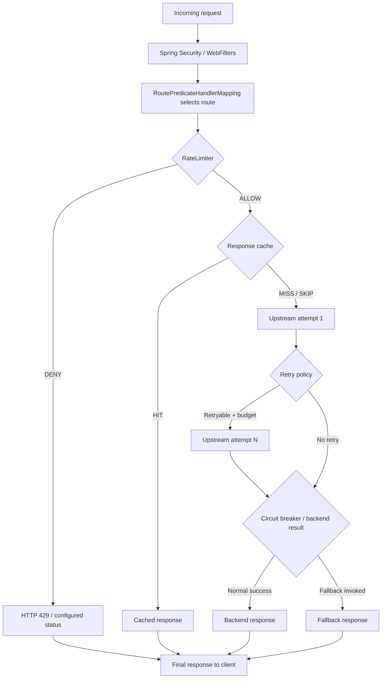
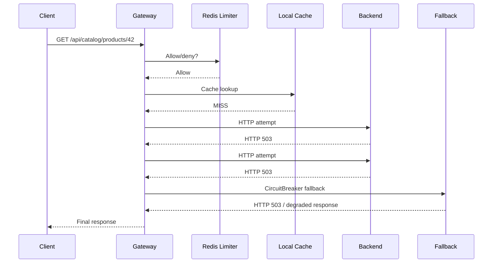
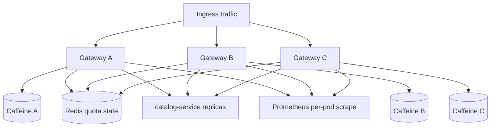
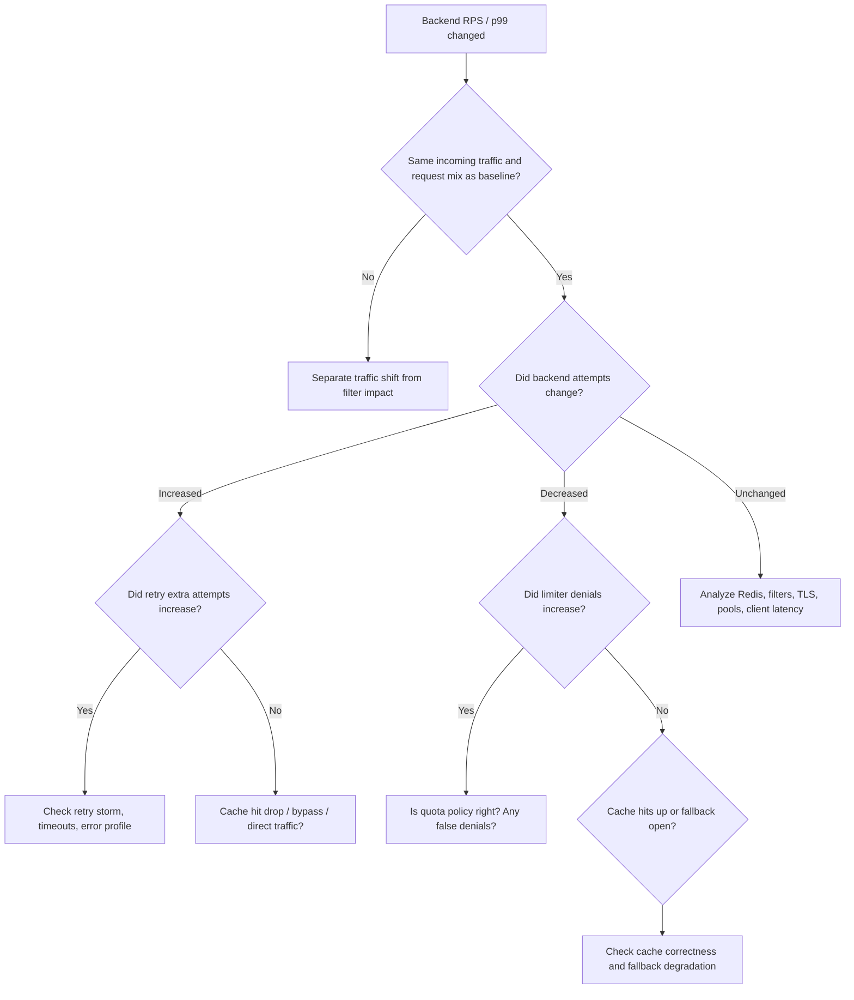

# Measuring the Impact of Rate Limiting, Retries, Fallbacks, and Caching

**Spring Cloud Gateway** serves as the entry point to microservices: routing via predicates, running `GlobalFilter`/`GatewayFilter` chains, rewriting paths and headers, resolving backends via `lb://`, relaying tokens, enforcing rate limits, retrying, circuit breaking, managing TLS, and observing requests. Once you enable **rate limiting**, **retries**, **fallbacks**, or **response caching**, a request may be rejected **before reaching the backend**, generate **multiple upstream attempts**, receive a **substitute response**, or **skip calling the backend entirely**. Consequently, tracking only HTTP 200 counts or Gateway latency cannot answer: *which mechanism is helping, which is adding load, and what are users actually experiencing?*

This lesson belongs to the **Observability** chapter in the **SPRING_CLOUD_GATEWAY** module. The goal is designing an **auditable, cross-verifiable** measurement system instead of building a noisy dashboard full of charts. We will combine **Micrometer/Actuator**, Prometheus, tracing, Gateway and backend metrics, and controlled verification tests for `RequestRateLimiter`/`RedisRateLimiter`, `Retry`, `CircuitBreaker` fallbacks, and `LocalResponseCache`.

> **Scope:** Examples primarily target **Spring Cloud Gateway Server WebFlux**. Gateway Server Web MVC and Proxy Exchange differ in filters, runtimes, and properties; never copy YAML, metric names, or instrumentation APIs verbatim without verifying against your version. Custom metric names defined in this lesson are explicitly marked **custom**, not promises that Gateway emits them out of the box.

## 1. Observe to Decide, Not Just to Know the HTTP Status

Suppose in 60 seconds, **1,000 requests** hit route `catalog-public`. Four mechanisms can create these effects:

| Mechanism | Question to Measure | Easy Misreading If Watching Only HTTP Status |
| --- | --- | --- |
| **Rate limiting** | How many requests were allowed vs. denied? Were the right callers blocked? How much load was shed from the backend? | `429` may be an **intentional protective decision**, not automatically a backend error. |
| **Retry** | How many upstream attempts stemmed from one request? Did retries recover transient errors? How much did backend load and p99 climb? | One HTTP `200` after retries may have cost **three backend calls**. |
| **Circuit breaker fallback** | How many requests hit the fallback? What data did the fallback return, does it meet the SLO, and is it masking real outages? | An HTTP `200` produced by a fallback **is not automatically a normal business success**. |
| **`LocalResponseCache`** | What are cache hit/miss/eviction rates, saved backend calls, data freshness, and memory usage? | Identical responses do not prove a cache hit; browsers or CDNs may have cached before the Gateway. |

A solid measurement setup must separate:

1. **Incoming request** at the Gateway boundary.
2. **Routing decision**: which route matched, and before or after auth/CORS?
3. **Rate-limit decision**: allow/deny by quota key and route.
4. **Cache decision**: hit/miss/skip/not-eligible.
5. **Upstream attempt**: each outbound HTTP client call to the backend.
6. **Circuit-breaker decision**: permitted, rejected because circuit is open, or fallback invoked.
7. **Final client response**: HTTP status, latency, and business meaning.

### One Status Code, Many Stories

```text
Client receives HTTP 200
    ├─ backend called exactly once and returned 200
    ├─ first attempt 503, second retry returned 200
    ├─ LocalResponseCache HIT, backend received zero requests
    └─ fallback returned degraded data with HTTP 200
```

If all four record `success=1`, dashboards stay “green” while the backend is flapping, cache memory is climbing, or fallback traffic is surging.

## 2. Event Model of a Request Through the Gateway



**This diagram is a measurement model, not a fixed execution order for every filter.** Actual execution order among `RequestRateLimiter`, `Retry`, `CircuitBreaker`, `LocalResponseCache`, and `GlobalFilter`s depends on `Ordered`, Gateway version, and route config. In particular, WebFlux runs **pre-phase and post-phase** steps; a high-priority filter runs first in the pre-phase yet last in the post-phase.

Consequently, instrumentation must clearly record its **measurement point**. If a limiter sits **after** a short-circuiting cache filter, cache hits bypass the limiter. If `Retry` sits ahead of a downstream filter, **filters ordered after it can run multiple times**. Test actual filter order with real requests instead of guessing from YAML indentation.

### Heterogeneous Components

| Component | Useful Telemetry Data | Can It Happen Multiple Times per Request? |
| --- | --- | --- |
| HTTP inbound server | Request ID, method, path template, final status, latency. | Normally once per inbound exchange. |
| Route matching | `routeId`/`routeUri`/metadata. | Evaluates predicates, ultimately picks one route. |
| `RedisRateLimiter` | Allow/deny decision, quota config, Redis errors. | Depends on filter ordering/retries; never blindly assume once. |
| Netty outbound client | Attempt, backend host/service, connect/TLS, response status, duration. | **Can run multiple attempts** due to retries. |
| Resilience4j circuit breaker | State/permission/call outcomes. | Depends on placement and attempt count. |
| Fallback handler | Actual execution count, status, and degradation reason. | Typically once or per flow; measure explicitly. |
| Caffeine `LocalResponseCache` | Per-pod/per-cache hit/miss/eviction if instrumented. | Cache lookup per eligible request/filter run. |

## 3. Four Metric Layers to Keep Separate

| Layer | Measurement Source | Purpose |
| --- | --- | --- |
| **Client-facing** | `http.server.requests` and Gateway timer. | What status and latency did callers experience? |
| **Gateway policy decisions** | RateLimiter, cache, fallback, and circuit breaker counters. | What did Gateway policies decide? |
| **Network / upstream** | Reactor Netty HTTP client / backend access counters / traces. | How many attempts hit the backend? Were there connection errors? |
| **Business correctness** | Backend application metrics, synthetic checks, verification data. | Did responses match the right tenant, freshness, and business outcome? |

### Why Not Share One Generic Counter?

Giving everything a vague name like `requests_saved_total` causes confusion:

- `RateLimiter` **blocks requests**: it may shed backend load, yet may also reject legitimate customers.
- `Cache` **reuses responses**: it cuts load, yet risks serving stale data.
- `Retry` **increases attempts** to improve final success: it can recover transient errors or amplify backend overload.
- `Fallback` **substitutes responses**: it preserves minimal UX or hides ongoing incidents.

Every counter needs an explicit **definition, emission point, and unit**. Never compare counts with different units as though they shared a denominator.

## 4. Micrometer, Actuator, and Prometheus: The Essential Foundation

### Reference Maven Dependencies

For a Gateway **Server WebFlux** app with compatible Spring Boot and Spring Cloud BOMs:

```xml
<dependencies>
    <dependency>
        <groupId>org.springframework.cloud</groupId>
        <artifactId>spring-cloud-starter-gateway-server-webflux</artifactId>
    </dependency>
    <dependency>
        <groupId>org.springframework.boot</groupId>
        <artifactId>spring-boot-starter-actuator</artifactId>
    </dependency>
    <dependency>
        <groupId>io.micrometer</groupId>
        <artifactId>micrometer-registry-prometheus</artifactId>
    </dependency>
</dependencies>
```

This is a **dependency excerpt**, not a complete POM. In older Gateway lines, the starter may be named `spring-cloud-starter-gateway`. Manage versions via BOMs, match the Spring Boot/Cloud release train, and **never mix Gateway Server WebFlux with Web MVC or Proxy Exchange** just to get metrics.

### WebFlux Configuration on Gateway Lines with the Newer Prefix

```yaml
spring:
  cloud:
    gateway:
      server:
        webflux:
          metrics:
            enabled: true
            path-tags:
              enabled: false
          observability:
            enabled: true

management:
  endpoints:
    web:
      exposure:
        include: health,info,metrics,prometheus
  metrics:
    distribution:
      percentiles-histogram:
        spring.cloud.gateway.requests: true
```

**Critical version note:** Gateway 5.0.5/5.1.0 Configuration Properties tables list `spring.cloud.gateway.server.webflux.metrics.enabled`, while some Gateway Metrics Filter doc sections still mention `spring.cloud.gateway.metrics.enabled` (from older lines). **Check metadata binding, release train, and whether Actuator meters actually appear** rather than declaring both prefixes blindly. On older branches, the matching properties may be `spring.cloud.gateway.metrics.enabled` and `spring.cloud.gateway.metrics.tags.path.enabled`.

`path-tags.enabled: false` is intentional: putting **raw request paths** like `/customers/123/orders/456` into metrics blows up cardinality and risks leaking data. Use `routeId` or a **normalized route template** as your stable label.

`percentiles-histogram.spring.cloud.gateway.requests: true` enables histogram buckets for that timer where supported. Prometheus bucket series and cardinality increase accordingly; **enable histograms only where needed** and verify memory and series counts in a realistic environment.

### Metrics Endpoint vs. Scrape Endpoint

Actuator uses the original dotted meter name:

```http
GET /actuator/metrics/spring.cloud.gateway.requests
```

Prometheus scrapes the converted names:

```http
GET /actuator/prometheus
```

For example, `spring.cloud.gateway.requests` typically appears in Prometheus as `spring_cloud_gateway_requests_seconds_count`, `spring_cloud_gateway_requests_seconds_sum`, and `_bucket` **if histograms are enabled**. Verify exact names and labels directly from `/actuator/prometheus`, as registry/version/config changes affect formatting.

### Securing Actuator

- Never expose `/actuator/prometheus` or `/actuator/metrics` publicly without controls.
- Use a dedicated management port/interface, network policies, and authentication for Prometheus scrapers.
- Never emit credentials, full personal URIs, or sensitive route metadata in meter tags.
- `/actuator/health` and readiness/liveness serve a different purpose from metrics; exposing scrape endpoints internally never means opening management endpoints to the internet.

## 5. Built-In Metrics vs. Metrics You Must Build Yourself

Per Gateway WebFlux docs, the Gateway Metrics Filter provides the **`spring.cloud.gateway.requests`** timer with tags:

| Tag | Meaning | Notes |
| --- | --- | --- |
| `routeId` | Matched route ID. | Keep stable across deploys; dynamic route IDs cause high cardinality. |
| `routeUri` | Target upstream URI. | Can expose internal hosts/services; avoid on public dashboards if unnecessary. |
| `outcome` | HTTP status category. | Does not distinguish cache hits, fallbacks, or retries. |
| `status` | HTTP status returned to client. | `200` can still be a cached or fallback response. |
| `httpStatusCode` | Final HTTP status code. | May overlap with `status`; inspect live tags for your release. |
| `httpMethod` | Inbound HTTP method. | Not the outbound attempt count. |
| `path` (when opted in) | Request path. | **Do not enable casually** due to cardinality/PII. |

In newer Gateway versions, `spring.cloud.gateway.server.webflux.observability.enabled` controls Micrometer Observability support per config metadata; **Observations/tracing do not automatically equate to full policy-decision metrics**. Verify which meters and spans your exact stack emits.

### Measurement Responsibility Table

| Question | Is the Gateway Timer Enough? | What to Add |
| --- | --- | --- |
| Total route requests / latency | Usually yes, when enabled and filter executes. | HTTP server metrics for traffic rejected by Security pre-routing. |
| How many requests did the rate limiter deny? | Partially inferable from `429`, **not exact**. | Decision counter at the limiter or reliable instrumentation. |
| How many retries occurred? | **No.** | Downstream attempt counters/traces; retry instrumentation. |
| How many requests actually hit the fallback? | **No.** | Fallback invocation counter / Resilience4j metrics. |
| How many cache hits occurred? | **No** from the global timer. | Caffeine cache statistics or instrumented hit/miss + backend counters. |
| How much did backend RPS drop? | **No.** | Backend access metrics + outbound HTTP attempt metrics. |
| Are TLS, Redis, and connection pools healthy? | **Insufficient.** | Client pool, Redis connection, TLS handshake, and JVM metrics. |

**Never add a fake `X-Cache: HIT` header or `gateway.cache.hit` meter and claim it's built-in**: expose such numbers only when the filter or instrumentation genuinely produces trustworthy data.

## 6. Defining Unambiguous Counting Units

Define notation within **one time window, one route, one client cohort, and a fixed Gateway replica count**:

| Symbol | Definition |
| --- | --- |
| `N` | Valid incoming requests reaching route/policy evaluation. |
| `A` | Rate limiter **allow** decisions. |
| `D` | Rate limiter **deny** decisions. |
| `H` | Cache **hits** genuinely served from Gateway local cache. |
| `M` | Well-defined cache **misses/skips**. |
| `I` | Initial upstream attempts for accepted requests. |
| `R` | **Extra** upstream attempts generated by retries. |
| `U` | Total upstream attempts, equal to `I + R` when all attempts are measured. |
| `F` | Actual executions of the fallback handler. |
| `C2xx` | Client-facing final `2xx` responses. |
| `C429` | Final `429` responses (may include non-limiter causes). |
| `C5xx` | Final `5xx` responses. |

If every request passes through **exactly one limiter decision**, then:

\[
N = A + D
\]

If *cache hit/miss* partitions **all accepted requests with no other bypass**, then:

\[
A = H + M
\]

If every miss triggers **one initial backend call** with no other short-circuits:

\[
I = M, \qquad U = I + R
\]

**These equations are assumptions of a controlled POC, not universal laws of the Gateway.** In production, requests can fail to match routes, get blocked by Security before the limiter, be rejected by a circuit breaker before upstream, bypass caching due to methods/headers, or get cancelled. Add counters for branches like `security_denied`, `cache_skip`, `circuit_rejected`, and `cancelled` accordingly.

### A Purely Synthetic Numerical Example

In one test window: `N=1,000`, `D=100`, `A=900`; among allowed requests, `H=540` cache hits and `M=360` misses. The backend receives `I=360` initial attempts, retries add `R=45` attempts, so `U=405`. Fallback runs `F=20` times returning 503. Clients receive 880 `200`s, 100 `429`s, and 20 `503`s.

| Indicator | Illustrative Value | Interpretation |
| --- | ---: | --- |
| Incoming requests `N` | 1,000 | Traffic denominator at the POC boundary. |
| Limiter deny `D` | 100 | 10% of requests intentionally denied. |
| Limiter allow `A` | 900 | 90% proceed further. |
| Local cache hits `H` | 540 | **60% hit ratio on accepted requests**, assuming all were cache-eligible. |
| Cache misses `M` | 360 | Require downstream calls absent other short-circuits. |
| Initial attempts `I` | 360 | First-try requests reaching the backend. |
| Extra retry attempts `R` | 45 | +12.5% over initial attempts. |
| Total backend attempts `U` | 405 | Backend actually absorbed 405 calls. |
| Fallback invocations `F` | 20 | 20 degraded requests failing normal contract. |
| Final HTTP 200 | 880 | Mixes cached and backend successes, undistinguished here. |
| Final HTTP 429 | 100 | Equals `D` if all 429s came from the limiter. |
| Final HTTP 503 | 20 | Fallback designed to return 503 in this POC. |

**Do not conclude** “Gateway saved 595 backend calls” purely from `1,000 - 405`: 100 requests were rejected by the limiter, 540 were served from cache, 45 extra attempts came from retries, alongside shifts in traffic mix and client behavior. Separate each mechanism before judging **useful offload** vs. **UX trade-off**.

## 7. Measuring the Impact of `RequestRateLimiter` and `RedisRateLimiter`

`RequestRateLimiter` delegates to a `RateLimiter` to decide whether a request proceeds. When denied, Gateway defaults to HTTP **429 Too Many Requests** (configurable). The Redis implementation uses a **token bucket** with:

- `replenishRate`: token refill rate.
- `burstCapacity`: maximum bucket capacity.
- `requestedTokens`: tokens consumed per request.
- `KeyResolver`: resolves the quota identity/domain (such as the authenticated principal).

### Four Essential Indicators

| Indicator | Unit | Usage |
| --- | --- | --- |
| **Allowed decisions** | Decisions | How many requests the limiter let pass. |
| **Denied decisions** | Decisions | How many requests the limiter blocked. |
| **Denied ratio** | Denied / total decisions | Evaluates quota strictness and distribution by route/tier. |
| **Post-limiter backend RPS** | Upstream calls / sec | Verifies whether the limiter truly reduces backend load rather than just emitting 429s. |

For requests **evaluated exactly once**:

\[
\text{deniedRatio} = \frac{D}{A + D}
\]

**Never treat `HTTP 429` as the sole ground truth** because:

- Backends can also return 429.
- Gateway can be configured to return a status other than 429 on denial.
- Redis or `KeyResolver` exceptions can produce different statuses.
- Security/CORS/route matching can block requests before the limiter.
- A custom filter or `Retry` replay can make decision counts diverge from incoming requests if ordering is wrong.

### Distinguishing “Protecting” from “Breaking”

Suppose an API has an SLO for paying customers. After enabling rate limiting:

- Backend CPU drops 40%.
- Gateway 429s rise from 0% to 15%.
- 429s concentrate on callers **genuinely exceeding quota**, not normal users.

That looks like a healthy policy; conversely, if 429s rise by 15% **for customers well within quota** due to a `KeyResolver`/Redis bug, that is a regression. Track additionally:

1. Finite **decision reasons**: `quota_exceeded`, `key_missing`, `limiter_error`, `policy_denied`, normalized by application instrumentation.
2. **Quota policy/tier** along published tiers (`basic`, `pro`)—never put customer IDs in labels.
3. **Redis health, latency, errors**, and connection counts.
4. **Success/latency of allowed requests** so 429s aren't confused with backend 5xxs.
5. **Per-replica traffic** and cluster-wide quota sharing.

### Watch Response Headers

`RedisRateLimiter` docs list optional headers such as `X-RateLimit-Remaining`, `X-RateLimit-Replenish-Rate`, `X-RateLimit-Burst-Capacity`, and `X-RateLimit-Requested-Tokens`. They aid debugging, yet:

- **Never treat them as backend workload metrics or exact cluster-wide quota proof.**
- Never log headers alongside bearer tokens or customer PII.
- Headers may be absent if the limiter didn't run, Security blocked earlier, or the version/config disables them.
- Verify client handling of `429` and `Retry-After` if required by the API contract.

### Redis Outage: Fail-Open or Fail-Closed?

Redis unavailability breaks quota checks; behavior depends on implementation, customization, version, and exception handling. **Never assume `RedisRateLimiter` is universally fail-open or fail-closed.** Test on your exact artifact and record:

| State | What to Measure |
| --- | --- |
| Redis healthy | Allow/deny matches expected limits. |
| High Redis latency | Gateway p95/p99 latency, timeouts, Redis connection pool. |
| Redis unavailable | Final HTTP status, allowed request count, backend load, exception/circuit policy. |
| Redis recovers | Cross-replica quota distribution and burst recovery behavior. |

If a business chooses fail-open to preserve availability, put **backup protective limits** at the edge/backend. If choosing fail-closed to protect systems, measure **impact on legitimate customers** and publish the policy.

## 8. Measuring `Retry`: Recovering Requests While Amplifying Upstream Attempts

`Retry` retries based on `statuses`, `series`, `methods`, `exceptions`, plus `backoff`, `jitter`, and `timeout` settings. Per Gateway WebFlux reference docs, `retries` specifies **additional retry attempts**, not total requests. With `retries: 2`, a single request can make **up to three attempts** if conditions and budgets allow.

### Core Indicators

| Indicator | Unit | Meaning |
| --- | --- | --- |
| **Initial backend attempts** | Calls | Requests trying the backend for the first time. |
| **Extra retry attempts** | Calls | Additional calls triggered by retries. |
| **Attempt amplification** | Attempts / initial call | How much retries multiply upstream load. |
| **Recovered-after-retry** | Inbound requests | Requests failing initially that ultimately met the contract via retry. |
| **Exhausted retries** | Inbound requests | Requests still failing after exhausting retry budget. |
| **Time spent retrying** | Duration | Backoff + attempt durations added to client latency. |
| **Retry by reason** | Attempts | Finite groups such as HTTP 502/503, `IOException`, `TimeoutException`. |

Definition:

\[
\text{attemptAmplification} = \frac{I+R}{I}
\]

With `I=360` and `R=45`, amplification ≈ **1.125**: each initial backend call averages 1.125 attempts—**12.5% extra backend calls** compared to no retries on the same miss set.

**Never use “Gateway route requests” as the denominator for upstream attempts** when some requests are rate-limited or cache hits—that hides amplification among requests that actually go upstream.

### Special Note on Filter Ordering

Per WebFlux `Retry` docs, the `Retry` filter can **re-execute filters ordered after it**. If a custom filter incrementing counters, checking quotas, mutating headers, or triggering side effects sits after `Retry`, it runs multiple times. Placing `counter.increment()` in the wrong spot counts **attempts** while mislabeling them as `request`s.

**Instrumentation placement rules:**

- Count **inbound requests** at the server/outer exchange boundary.
- Count **outbound attempts** as close as possible to the HTTP client transport/backend boundary.
- Count **retries** via extra-attempt metrics or direct `Retry` instrumentation, not from final response status alone.
- Propagate **controlled correlation/trace IDs** to tie attempts back to one inbound request.

### Successful Retries Are Not Free

Consider a request seeing:

```text
T0:  Upstream attempt #1 → 503 after 120ms
T1:  Backoff 100ms
T2:  Upstream attempt #2 → 200 after 90ms
T3:  Client receives HTTP 200
```

Even ignoring overhead, latency ≈ 310 ms instead of ~90 ms for a healthy call—despite ending in 200. Retries buy **conditional availability** at the cost of higher p95/p99 and extra load on a struggling backend.

### Memory and Requests with Bodies

Gateway reference docs warn that retrying methods with request bodies can **buffer the body in memory** for replay. For POST/PUT/PATCH or large uploads, measure:

- Heap/direct memory, buffer allocations, GC, and concurrency.
- Actual attempt counts, timeouts, and cancellations.
- Idempotency keys and backend deduplication.
- Final responses and committed business side effects (e.g., was an order created once or multiple times?).

**Never enable retries on write methods just to boost HTTP 200 rates** without an idempotency contract.

## 9. Measuring `CircuitBreaker` and Fallbacks

`CircuitBreaker` wraps a route; when calls fail or the circuit opens, `fallbackUri` forwards the request to another handler. In Gateway Server WebFlux, docs illustrate `fallbackUri` using **`forward:`**. A fallback handler can return:

- HTTP 503 with a safe body telling clients the service is temporarily unavailable.
- An approved **degraded** HTTP 200 response (e.g., a read-only catalog with acceptably fresh cached items).
- An error response honoring API contracts, CORS, and security headers.

### Measure Three Independent Dimensions

| Dimension | Indicator | Why Needed |
| --- | --- | --- |
| **Circuit state** | `CLOSED`, `OPEN`, `HALF_OPEN`; not-permitted calls. | Shows whether the backend is protected or traffic is rejected early. |
| **Fallback invocations** | Handler entry count and returned status. | Prevents successful fallbacks from hiding backend outages. |
| **Business degradation** | Share of degraded responses, staleness, missing features. | HTTP 200 does not guarantee full SLA compliance. |

### SLOs When Fallback Returns 200

Suppose the catalog backend fails and the fallback returns:

```json
{"products":[],"degraded":true,"source":"fallback"}
```

with HTTP 200 so the frontend keeps rendering. If dashboards only track `2xx / total`, the outage is **masked**. Emit a dedicated `gateway.fallback.invocations` metric and, if contractually appropriate, separate user-facing `full_success` from `degraded_success`. Never leak internal backend/exception details into JSON just for metrics.

### Are `CircuitBreaker` Metrics Guaranteed to Appear?

When using **Resilience4j**, meters for circuit state, calls, buffered calls, and not-permitted calls appear depending on dependencies, auto-configuration, and tagging. However, **metric names, labels, and availability vary across Resilience4j/Micrometer release trains**—never hardcode a query assuming it always exists.

Verify `/actuator/metrics` and `/actuator/prometheus`; a fallback-handler metric remains essential because **circuit-open counts do not equal fallback responses delivered to clients**.

### Fallbacks Can Be Called Directly

If the fallback handler is exposed as a regular HTTP endpoint, clients can call it directly—inflating counters or bypassing policy to receive degraded data. Use an **internal-only path** and verify Gateway forwarded via the circuit breaker, such as checking the `ServerWebExchangeUtils.CIRCUITBREAKER_EXECUTION_EXCEPTION_ATTR` exchange attribute where provided, backed by Security/routing controls.

**Never trust a client-sent `X-Fallback: true` header** as proof of a circuit breaker failure.

## 10. Measuring `LocalResponseCache`: Hit Ratio Must Pair with Freshness and Memory

`LocalResponseCache` uses **Caffeine** to store response bodies/headers **inside a single Gateway instance**, caching only eligible responses. Per Gateway WebFlux reference docs:

- Request must be a **bodyless GET**.
- Response status must be **200, 206, or 301**.
- Request must lack `Cache-Control: no-store`.
- Response must lack `Cache-Control: no-store` or `private`.
- TTL and cache size are configurable per route.

### Distinguishing Four States

| State | Meaning | Triggers Backend Attempt? |
| --- | --- | --- |
| **HIT** | Eligible, valid entry served from local cache. | Usually no backend call; verify via backend counter. |
| **MISS** | Eligible request with no valid entry/expired entry. | Calls backend unless blocked by another mechanism. |
| **SKIP / INELIGIBLE** | POST, `private`/`no-store` response, non-cacheable status, etc. | Calls backend, **stores no cache entry**. |
| **EVICTION / EXPIRED** | Entry evicted due to size or TTL. | Next request may MISS. |

**Never measure cache hits by “same 200 response as before”**: the backend might simply return identical data, or a browser/CDN may have cached before the Gateway.

### Metrics to Collect

1. **Hit/miss** across *eligible cache lookups*, not all GETs.
2. **Backend request delta**: downstream call count for identical URLs and traffic.
3. **Hit vs. miss response latency**; without a hit label, verify in a POC with backend counters.
4. **Eviction count / cache size** and per-pod heap/direct memory.
5. **Freshness**: response age/`max-age`, count of stale responses beyond SLA.
6. **Cache key safety**: language, query, tenant, `Origin`, and `Vary` when responses vary.

\[
\text{hitRatio}=\frac{H}{H+M}
\]

Apply this formula only when `H` and `M` strictly partition **eligible lookups**; never fold `SKIP` into the denominator while still calling it hit ratio.

### Multiple Gateway Replicas

Three Gateway pods hold **three independent caches**. One URL can HIT on pod A and MISS on pod B. After a rolling deploy, cold caches cause a temporary backend load spike. Monitor:

- Cache stats **per pod** first, cluster total second.
- Backend RPS during warm-up and steady state.
- Size/TTL **per pod**—never mistake a single pod's `16MB` for a shared cluster cache.
- Staleness window/rate after backend updates.

**Do not assume that because `RedisRateLimiter` uses Redis, `LocalResponseCache` is also shared via Redis**: they are completely separate mechanisms.

### Never Trade Data Security for Hit Ratio

Never cache shared responses on endpoints like `GET /api/me`, shopping carts, private orders, tokens/sessions, or multi-tenant data requiring isolation. Responses with `Cache-Control: private`/`no-store` must be excluded per policy. **A high hit ratio that leaks user data is a severe failure.**

## 11. Composite Indicators: Impact on Backends and Users

| Composite Indicator | Formula / Source | How to Interpret |
| --- | --- | --- |
| **Incoming RPS** | Rate of Gateway server counter. | Total traffic at measurement boundary, including unmatched if server metrics cover it. |
| **Allowed RPS** | Rate limiter allow decisions. | Requests passing policy, not backend calls. |
| **Backend RPS / attempts** | HTTP client / backend access counter. | **Reduced** by limiter/cache and **increased** by retries. |
| **Retry amplification** | `U/I`. | Meaningful only when initial and extra attempts are separated. |
| **Fallback rate** | `F` / eligible requests or `F` / CB calls, per contract. | Always state the denominator. |
| **Cache hit ratio** | `H/(H+M)`. | Eligible lookups only, split per pod. |
| **User-facing success** | Status + business contract. | Deliberately classify 429s and 200 fallbacks. |
| **Gateway p95/p99** | Histogram/timer. | Can drop via caching, or rise from retry/backoff or Redis latency. |
| **Backend p95/p99** | Backend / HTTP client metrics. | Compare across matching request mixes; never infer client latency from backend latency alone. |
| **CPU/memory/network** | JVM/OS/Netty/Redis/Caffeine. | Caching and retrying consume different resources. |

### Defining Availability Without Gaming SLOs

For example, an organization decides:

- `HTTP 5xx` = availability failure.
- `HTTP 429` from valid quotas is reported as **policy-denied** (separate from 5xx), yet **never vanishes from client outcome dashboards**.
- Fallback HTTP 200 returning **degraded** data is reported separately and may not count toward the *full service* SLO.
- Caller-input 4xxs are categorized carefully so Gateway-misconfiguration 4xxs aren't hidden.

**SLOs are product contracts, not Micrometer defaults.** Stripping 429s and fallbacks out of denominators without formal approval creates misleadingly rosy “success” rates.

## 12. From Correlation IDs to Traces: Linking One Request to Many Attempts

A request may traverse:



Traces shine when one inbound span spawns multiple **outbound client spans**. Link every attempt to the same context, keeping in mind:

- Trace sampling drops a share of requests.
- Filters may emit different span structures across versions.
- Trace counts in a sample **never replace aggregate counters**.
- Never put raw `Authorization`, cookies, PII, or full request bodies into span attributes.

### Classifying Events in Traces

A trace can carry **normalized** tags/events:

```text
gateway.route.id       = catalog-retry
gateway.policy.variant = retry-2
http.method            = GET
http.status_code       = 503
gateway.retry.attempts = 2      # custom, when instrumented
gateway.fallback.used  = true   # custom, when instrumented
upstream.service       = catalog-service
```

These are **illustrative semantic metadata defined by an implementation team**, not built-in default tags. Any labels touching **dynamic IDs** require cardinality budgets and data governance.

### Do Not Infer Attempts by Grepping Logs for “retry”

Some retries happen due to HTTP client transport exceptions, and some logs don't appear at INFO. Traces with spans, HTTP client metrics, or backend access logs **linked by reliable correlation IDs** provide far stronger evidence. If a request dies before any bytes reach the backend, an outbound attempt may be counted at the Gateway while absent from backend access logs—distinguish **attempt initiated** from **backend request received**.

## 13. Prometheus/Grafana Dashboard for Gateway Routes

The PromQL queries below are **analytical templates**. They assume the Gateway `spring.cloud.gateway.requests` timer exports as `spring_cloud_gateway_requests_seconds_*` with a `routeId` tag. **Before using them, verify live series/label names** via `/actuator/prometheus`, since exporters, versions, and relabeling alter formats.

### 13.1. RPS by Route

```promql
sum by (routeId) (
  rate(spring_cloud_gateway_requests_seconds_count[5m])
)
```

This counts requests **recorded by the Gateway timer**, which may exclude traffic rejected by Security **before route matching**. For total inbound at the HTTP server boundary, cross-check `http.server.requests`.

### 13.2. HTTP 5xx Ratio from Final Responses

```promql
sum by (routeId) (
  rate(spring_cloud_gateway_requests_seconds_count{
    status=~"5.."
  }[5m])
)
/
clamp_min(
  sum by (routeId) (
    rate(spring_cloud_gateway_requests_seconds_count[5m])
  ),
  0.000001
)
```

**Limitation:** when a fallback returns 200, the 5xx ratio hides backend outages. If `status` is not a three-digit numeric string on your release, adjust to the actual label (e.g., `httpStatusCode`).

### 13.3. HTTP 429 RPS by Route

```promql
sum by (routeId) (
  rate(spring_cloud_gateway_requests_seconds_count{
    status="429"
  }[5m])
)
```

This counts **final HTTP 429s**, not guaranteeing every one came from `RequestRateLimiter`. For policy analysis, compare custom limiter decision metrics against backend 429s and other traffic.

### 13.4. p95 Latency with Histograms

```promql
histogram_quantile(
  0.95,
  sum by (le, routeId) (
    rate(spring_cloud_gateway_requests_seconds_bucket[5m])
  )
)
```

Works only when `_bucket` is exported (histograms enabled). **Never sum or average p95 values across pods**; aggregate buckets by `le, routeId` before calling `histogram_quantile`.

### 13.5. Average Final HTTP Latency

```promql
sum by (routeId) (
  rate(spring_cloud_gateway_requests_seconds_sum[5m])
)
/
clamp_min(
  sum by (routeId) (
    rate(spring_cloud_gateway_requests_seconds_count[5m])
  ),
  0.000001
)
```

This is the mean of the **client-facing Gateway timer**; it does not isolate Redis latency, cache lookups, retry backoffs, or backend execution time.

### 13.6. Panels to View Side by Side

- Incoming Gateway/server RPS.
- Upstream/backend attempt RPS.
- Limiter deny RPS.
- Cache hit RPS.
- Retry extra-attempt RPS.
- Fallback invocation RPS.

If a dashboard only displays client statuses and HTTP latency, you cannot tell why backend workload shifted after enabling multiple filters.

## 14. PromQL for Custom Policy Metrics: Do Not Mistake for Built-In

To measure live policy events, suppose the platform team **explicitly added** these Micrometer counters and verified them in `/actuator/prometheus`:

| Custom Micrometer Name | Assumed Prometheus Name | Bounded Labels |
| --- | --- | --- |
| `gateway.policy.decisions` | `gateway_policy_decisions_total` | `route`, `policy`, `decision`. |
| `gateway.upstream.attempts` | `gateway_upstream_attempts_total` | `route`, `kind=initial/retry`, `result`. |
| `gateway.fallback.invocations` | `gateway_fallback_invocations_total` | `route`, `result`. |
| `gateway.cache.lookups` | `gateway_cache_lookups_total` | `route`, `result=hit/miss`. |

**This table does not describe built-in Gateway metrics.** Run these PromQL queries only after your code actually emits these events; in particular, `LocalResponseCache` does not guarantee built-in hit/miss meters with these names.

### Deny Ratio by Route

```promql
sum by (route) (
  rate(gateway_policy_decisions_total{
    policy="rate-limiter",decision="deny"
  }[5m])
)
/
clamp_min(
  sum by (route) (
    rate(gateway_policy_decisions_total{
      policy="rate-limiter",decision=~"allow|deny"
    }[5m])
  ),
  0.000001
)
```

### Retry Amplification

```promql
sum by (route) (
  rate(gateway_upstream_attempts_total{
    kind=~"initial|retry"
  }[5m])
)
/
clamp_min(
  sum by (route) (
    rate(gateway_upstream_attempts_total{
      kind="initial"
    }[5m])
  ),
  0.000001
)
```

A value of `1.25` means **25% more upstream attempts than initial calls**, not that 25% of inbound requests were retried.

### Cache Hit Ratio Across Eligible Lookups

```promql
sum by (route) (
  rate(gateway_cache_lookups_total{result="hit"}[5m])
)
/
clamp_min(
  sum by (route) (
    rate(gateway_cache_lookups_total{
      result=~"hit|miss"
    }[5m])
  ),
  0.000001
)
```

Accurate only when the counter increments right at the **cache lookup decision**; you cannot derive reliable hit/miss counts simply by inspecting HTTP 200 in a post-filter.

### Fallback Invocation Rate

```promql
sum by (route) (
  rate(gateway_fallback_invocations_total[5m])
)
```

This returns **actual fallback handler executions per second** when instrumented properly. To compute a fallback ratio across breaker-protected calls, the denominator must be **breaker-protected calls**, not all Gateway requests when rate limiters or caches short-circuit earlier.

### Verifying PromQL Accuracy

- `rate(...[1m])` reacts quickly yet is noisy at low traffic.
- `rate(...[5m])` is smoother yet can blur short spikes.
- `increase(...[1h])` is convenient for summing counters over an experiment.
- Counter resets on restarts are handled by `rate`, though full scrape coverage is still required.
- If Prometheus misses a pod or fails scrapes, cluster totals break; watch target `up` and scrape errors.
- Dividing by `clamp_min` prevents divide-by-zero in graphs, yet **does not turn zero traffic into a meaningful ratio**; hide or display N/A when sample counts are too small.

## 15. Java Code: Counting Fallbacks Inside the Handler Itself

With `fallbackUri: forward:/__internal/fallback/catalog`, Spring Cloud Gateway's `CircuitBreaker` attaches the failure exception to the exchange via `ServerWebExchangeUtils.CIRCUITBREAKER_EXECUTION_EXCEPTION_ATTR`. Use that server-side attribute so **direct HTTP hits to the fallback URL are not miscounted as real fallbacks**.

```java
package com.example.gateway.observability;

import java.util.Map;

import io.micrometer.core.instrument.Counter;
import io.micrometer.core.instrument.MeterRegistry;
import org.springframework.cloud.gateway.support.ServerWebExchangeUtils;
import org.springframework.http.HttpStatus;
import org.springframework.http.ResponseEntity;
import org.springframework.web.bind.annotation.GetMapping;
import org.springframework.web.bind.annotation.RestController;
import org.springframework.web.server.ServerWebExchange;
import reactor.core.publisher.Mono;

@RestController
public class CatalogFallbackController {

    private final Counter fallback503;

    public CatalogFallbackController(MeterRegistry registry) {
        this.fallback503 = Counter.builder(
                "gateway.fallback.invocations")
            .description("Verified catalog fallback calls")
            .tag("route", "catalog-fallback")
            .tag("result", "unavailable")
            .register(registry);
    }

    @GetMapping("/__internal/fallback/catalog")
    public Mono<ResponseEntity<Map<String, Object>>> catalog(
            ServerWebExchange exchange) {

        Object failure = exchange.getAttribute(
            ServerWebExchangeUtils.CIRCUITBREAKER_EXECUTION_EXCEPTION_ATTR);

        if (failure == null) {
            return Mono.just(ResponseEntity.status(HttpStatus.NOT_FOUND)
                .body(Map.of("error", "Not found")));
        }

        fallback503.increment();
        return Mono.just(ResponseEntity
            .status(HttpStatus.SERVICE_UNAVAILABLE)
            .body(Map.of(
                "error", "Catalog temporarily unavailable",
                "degraded", true)));
    }
}
```

**Limitations of this code:**

- WebFlux Gateway Server example, not a `GatewayFilterFactory`.
- Counts **fallback events verified by the exchange attribute**, never trusting raw client headers.
- On certain status-code fallback paths or specific versions, the exception attribute might not be set as expected; verify source/tests before claiming 100% coverage.
- Protect the handler with **internal routing/security policies**, not solely by returning 404 when the attribute is missing.
- Returns HTTP 503 in the POC so outages aren't hidden; if a degraded 200 fallback is approved, track `degraded_success` separately.
- Never leak `Throwable.getMessage()` or stack traces into client responses or metric tags.

### Tests to Include

1. Direct request to fallback URL without attribute → meter does not increment.
2. CircuitBreaker forward with attribute → counter increments by 1, response 503.
3. N verified fallbacks → total increases by N.
4. Request carrying `X-Fallback: true` header without attribute → does not increment.
5. Request blocked by Spring Security pre-routing → fallback counter does not increment.

**This counter only tracks handler invocations**; it does not replace Resilience4j circuit state and not-permitted call metrics.

## 16. Instrumenting Limiter Decisions at the Source Instead of Reading Status Codes

An instrumentation wrapper can increment counters **right after `RateLimiter.isAllowed(routeId, key)` completes**. Crucially, record **what the limiter decided**, rather than inferring it from the final HTTP status.

### Simple Micrometer Helper

```java
package com.example.gateway.observability;

import io.micrometer.core.instrument.Counter;
import io.micrometer.core.instrument.MeterRegistry;
import org.springframework.stereotype.Component;

@Component
public class RateLimitDecisionMeters {

    private final Counter allowed;
    private final Counter denied;
    private final Counter errors;

    public RateLimitDecisionMeters(MeterRegistry registry) {
        allowed = Counter.builder("gateway.policy.decisions")
            .tag("route", "catalog-rate-limited")
            .tag("policy", "rate-limiter")
            .tag("decision", "allow")
            .register(registry);

        denied = Counter.builder("gateway.policy.decisions")
            .tag("route", "catalog-rate-limited")
            .tag("policy", "rate-limiter")
            .tag("decision", "deny")
            .register(registry);

        errors = Counter.builder("gateway.policy.errors")
            .tag("route", "catalog-rate-limited")
            .tag("policy", "rate-limiter")
            .register(registry);
    }

    public void recordDecision(boolean isAllowed) {
        if (isAllowed) {
            allowed.increment();
        } else {
            denied.increment();
        }
    }

    public void recordError() {
        errors.increment();
    }
}
```

**This is a recording helper; it does not wire itself into `RedisRateLimiter` automatically.** To capture real decisions, integrate it into an **explicitly wired `RateLimiter` wrapper/decorator** or the component handling decisions:

```java
// Pseudocode placed in the callback of the active rate limiter.
return delegate.isAllowed(routeId, quotaKey)
    .doOnNext(response ->
        meters.recordDecision(response.isAllowed()))
    .doOnError(error -> meters.recordError());
```

This pseudocode is not an auto-registered `@Bean`: check dependency injection/`@Qualifier`, filter arguments, and the `RateLimiter` interface on your Gateway version. Never use raw `quotaKey`, principal/email, or JWTs as metric tags.

### Avoid Double-Counting Decisions

If one decision is counted inside the wrapper and `429` responses are also counted in a `GlobalFilter`, those are **two metrics with different definitions**. They might match in one test, yet **must never be summed together**. If a `Retry` filter re-invokes the wrapper multiple times, document clearly whether the meter counts **decisions** or **unique denied inbound requests**.

### `KeyResolver` Failing Before a Decision

A `KeyResolver` may return empty or `Mono.error` when a principal is missing or Redis fails. If no `RateLimiter.Response` arrived, do not increment `deny` falsely; record an error/`key_missing` event per policy alongside final HTTP status. Only classify a missing key as a denial when the system intentionally enforces deny-on-missing-key—never guess.

## 17. Measuring Outbound Attempts: Separating Netty Requests, Retries, and Backend Receives

There is no accurate way to deduce **backend call counts** solely from the Gateway timer and final HTTP status. Choose **one or more independent measurement points**:

| Measurement Point | What It Distinguishes | Limitation |
| --- | --- | --- |
| **Reactor Netty HTTP client metrics** | Transport-layer requests/latency/connection pool when enabled. | Meter names/tags vary by Reactor Netty/Gateway version; usually no retry attempt ordinal. |
| **Backend access/request counter** | How many requests the backend actually received. | Attempts failing at connect/TLS before reaching the backend are missing. |
| **Instrumented downstream client decorator** | Attempt start/end, latency, outcome. | Must sit at the exact right spot in the Gateway routing chain to avoid double-counting. |
| **Distributed tracing** | Multiple client spans under one incoming span when sampled/instrumented. | Not an exact total count when sampling is < 100%. |
| **Test mock backend** | Exact counters in a POC; can return 503→200 by attempt. | Not identical to production performance or proxy topology. |

### A Metric Contract per Attempt

Tag each attempt with:

```text
route           = catalog-retry
kind            = initial | retry
backend_service = catalog-service
result          = success | status_5xx | connect_error | timeout
```

**Never put raw backend hosts from untrusted route configs into unbounded metric labels**; use approved service IDs. Both `result` and `kind` have finite cardinality.

When tracking attempt ordinals, keep `1, 2, 3` inside **trace/span events** or a label strictly bounded to `1..maxRetries`—never put request IDs in metrics. An outbound attempt can fail on connect timeout before reaching the backend; never equate backend receive counters with total **attempted** calls in that case.

### Conditionally Enabling Reactor Netty Pool Metrics

Newer WebFlux Configuration Properties include:

```yaml
spring:
  cloud:
    gateway:
      server:
        webflux:
          httpclient:
            pool:
              metrics: true
```

These are **pool metrics**, not a guarantee that every HTTP attempt or retry counter is exported. To inspect other HTTP client meters, check Reactor Netty metrics/Observation integration and HTTP client configuration. Watch `active connections`, `pending acquire`, and TLS/connect latency alongside backend attempts to separate **overloaded backends** from **congested pools**.

## 18. An Independent Route Set for Learning Each Mechanism

To avoid mixing causes, create **four isolated lab routes** pointing to the same mock backend on `localhost:8081`. Each route isolates one feature—**never turn on all four filters on a single route at first**.

### Optional Lab Dependencies

In addition to Gateway/Actuator/Prometheus from Section 4:

```xml
<dependencies>
    <!-- RedisRateLimiter -->
    <dependency>
        <groupId>org.springframework.boot</groupId>
        <artifactId>spring-boot-starter-data-redis-reactive</artifactId>
    </dependency>
    <!-- Spring Cloud CircuitBreaker / Resilience4j -->
    <dependency>
        <groupId>org.springframework.cloud</groupId>
        <artifactId>spring-cloud-starter-circuitbreaker-reactor-resilience4j</artifactId>
    </dependency>
    <!-- LocalResponseCache -->
    <dependency>
        <groupId>org.springframework.boot</groupId>
        <artifactId>spring-boot-starter-cache</artifactId>
    </dependency>
    <dependency>
        <groupId>com.github.ben-manes.caffeine</groupId>
        <artifactId>caffeine</artifactId>
    </dependency>
</dependencies>
```

Pick compatible BOM versions, especially matching Spring Cloud CircuitBreaker/Resilience4j to your Gateway version. Never assume fallback, retry, or cache configs take effect if the underlying dependency or filter factory is missing.

### Illustrative WebFlux YAML Configuration

```yaml
spring:
  data:
    redis:
      host: localhost
      port: 6379
  cloud:
    gateway:
      server:
        webflux:
          metrics:
            enabled: true
          global-filter:
            local-response-cache:
              enabled: false
          filter:
            local-response-cache:
              enabled: true
          routes:
            - id: catalog-rate-limited
              uri: http://localhost:8081
              predicates:
                - Path=/lab/limited/**
                - Method=GET
              filters:
                - StripPrefix=2
                - name: RequestRateLimiter
                  args:
                    key-resolver: "#{@labKeyResolver}"
                    redis-rate-limiter.replenishRate: 5
                    redis-rate-limiter.burstCapacity: 10
                    redis-rate-limiter.requestedTokens: 1

            - id: catalog-retry
              uri: http://localhost:8081
              predicates:
                - Path=/lab/retry/**
                - Method=GET
              filters:
                - StripPrefix=2
                - name: Retry
                  args:
                    retries: 2
                    statuses: SERVICE_UNAVAILABLE
                    methods: GET
                    backoff:
                      firstBackoff: 100ms
                      maxBackoff: 300ms
                      factor: 2

            - id: catalog-fallback
              uri: http://localhost:8081
              predicates:
                - Path=/lab/fallback/**
                - Method=GET
              filters:
                - StripPrefix=2
                - name: CircuitBreaker
                  args:
                    name: catalogCB
                    fallbackUri: forward:/__internal/fallback/catalog
                    statusCodes:
                      - 503

            - id: catalog-cache
              uri: http://localhost:8081
              predicates:
                - Path=/lab/cache/**
                - Method=GET
              filters:
                - StripPrefix=2
                - LocalResponseCache=30s,16MB
```

With `StripPrefix=2`, `/lab/retry/products/42` maps to `/products/42` on the mock backend. Separating the four routes keeps observations clean. **This is a lab config**, not a production policy.

**Version warning:** some `LocalResponseCache` docs still reference the legacy `spring.cloud.gateway.filter.local-response-cache.enabled` namespace; newer WebFlux Config Props tables use `spring.cloud.gateway.server.webflux.filter.local-response-cache.enabled`. Verify exact binding and startup behavior on your live artifact.

### Lab-Only `KeyResolver`

```java
package com.example.gateway.lab;

import org.springframework.cloud.gateway.filter.ratelimit.KeyResolver;
import org.springframework.context.annotation.Bean;
import org.springframework.context.annotation.Configuration;
import reactor.core.publisher.Mono;

@Configuration
public class LabLimiterConfiguration {

    @Bean
    KeyResolver labKeyResolver() {
        return exchange -> Mono.just("shared-lab-key");
    }
}
```

Every request shares one quota bucket, making `429` easy to trigger in a POC; **never use this `KeyResolver` in production**. Production should resolve verified principals/JWT claims, isolate customers/routes/tiers per contract, handle missing keys safely, and **never let callers choose raw quota keys**.

### What Capabilities Does the Mock Backend Need?

| Endpoint After `StripPrefix` | Test Behavior | Measurement Purpose |
| --- | --- | --- |
| `GET /products/42` | Returns 200 JSON, `Cache-Control: public, max-age=60`. | Limiter and cache; backend counter. |
| `GET /flaky` | Per scenario, returns 503 for first N requests, then 200. | Counting retry attempts and recovery. |
| `GET /always-503` | Always returns 503. | Fallback/CB and final HTTP 503. |
| `GET /private` | Returns `Cache-Control: private, no-store`. | Verifying non-cacheable responses aren't cached. |

These endpoints must be **implemented on your mock server** with safe counters/resets; the Gateway doesn't invent `/flaky` or `/always-503`. Use an `X-Test-Scenario` header or test control API **strictly in isolated environments**—never use test headers to force errors on production backends.

## 19. Lab A: Rate Limiting — Shedding Load Properly or Blocking Legitimate Users?

### 19.1. Setup

- Gateway on `localhost:8080`, Redis on `localhost:6379`, mock backend on `localhost:8081`.
- Lab `KeyResolver` returns `shared-lab-key` for all requests.
- Route `catalog-rate-limited` with `replenishRate=5`, `burstCapacity=10`, `requestedTokens=1`.
- Mock backend counts `GET /products/42` and returns HTTP 200.

### 19.2. Measure Baseline Before Enabling the Limiter

Create a control route **without `RequestRateLimiter`** or toggle the feature cleanly in a controlled rollout test. Send a controlled batch and record:

```text
incoming_count
gateway_http_status_distribution
backend_request_count
backend_latency_p95
gateway_latency_p95
```

If comparing against **another route**, ensure identical backend path, request mix, auth, HTTP client, network, and method. Never compare a cacheable GET route against a body-bearing POST route and call the difference the limiter's effect.

### 19.3. Send a Burst Through the Rate-Limited Route

```bash
for n in $(seq 1 20); do
  curl -s -o /dev/null \
    -w "request=$n status=%{http_code}\n" \
    "http://localhost:8080/lab/limited/products/42" &
done
wait
```

**Lab command only.** Because the Redis token bucket refills continuously over time and 20 requests schedule across OS/network threads, never expect an exact “10× 200 and 10× 429” split. Results depend on prior Redis bucket state, concurrency, filter ordering, and versions.

### 19.4. Metric Pairs to Cross-Check

| Measured at Gateway | Measured at Backend | Verifiable Conclusion |
| --- | --- | --- |
| `allow` decisions | Accepted upstream request count | Did allowed requests actually reach the backend? |
| `deny` decisions | Backend receive count stays flat | Did the limiter block before calling the backend? |
| HTTP 429 RPS | Backend 429 RPS | Did 429 come from Gateway or downstream? |
| Gateway p95 | Redis decision latency | Did the limiter add latency to allowed requests? |
| Redis error count | Gateway 5xx / 429 | What behavior does a Redis outage trigger? |

### 19.5. Testing Two Gateway Replicas

Run Gateway A on `8080` and Gateway B on `8083`, sharing **the same Redis** and **the same quota key/route policy**. Send bursts through both Gateways:

```bash
curl -i "http://localhost:8080/lab/limited/products/42"
curl -i "http://localhost:8083/lab/limited/products/42"
```

Compare total allowed/denied counts against backend traffic. If replicas hit different Redis instances or keys, effective cluster quota doubles unexpectedly. Also remember `replenishRate` is not a hard per-second cap in every second—token buckets allow bursts up to `burstCapacity` depending on refill timing.

### 19.6. Controlled Redis Failure Test

In the POC, stop/mock **only** the test environment's Redis—never touch production quota Redis. Record Redis connection failures, Gateway final statuses, allowed requests, backend CPU/RPS, and recovery timing.

**Evaluation criteria:** over-quota traffic is denied while in-quota customers pass; the backend stays protected; Redis itself does not become a single point of cascading outage.

## 20. Lab B: `Retry` — Measuring Attempts and Recovery Cost

### 20.1. Flaky Backend Scenario

Mock `GET /flaky`:

```text
request #1 -> HTTP 503
request #2 -> HTTP 503
request #3 -> HTTP 200
```

Allow resetting the counter between runs. Gateway route `catalog-retry` is configured with `retries: 2`, `statuses: SERVICE_UNAVAILABLE`, `methods: GET`.

### 20.2. Send One Inbound Request

```bash
curl -i \
  "http://localhost:8080/lab/retry/flaky"
```

When the mock returns 503/503/200 as scripted without intervening timeouts or filters, the inbound request finishes with HTTP 200 after **three upstream attempts**.

### Evidence to Collect

| Location | Expected in Ideal Scenario |
| --- | --- |
| Gateway incoming counter | 1 request. |
| Gateway final HTTP 200 counter | 1 response. |
| Mock backend counter | 3 received requests. |
| Custom upstream-attempt counter | 1 initial + 2 retries. |
| Gateway latency | Higher than a single clean call due to 2 failures + backoff. |
| Trace | 1 inbound span, multiple outbound spans if instrumented. |

### 20.3. Comparing Against No Retry

Run the same request against a non-Retry control route with the **same mock reset sequence**:

- Without Retry: 1 backend 503, 1 Gateway 503 (absent other filters).
- With `Retry=2`: 3 backend attempts, Gateway returns 200 if attempt 3 succeeds.

**Never conclude “Retry boosts whole-service availability” from one manual test**; test across sustained traffic, mixed errors, p95/p99, queuing, and backend saturation. Under overload, retries create **positive feedback** that worsens failures.

### 20.4. Unrecoverable Failure Case

Point to the mock always returning 503:

```bash
curl -i \
  "http://localhost:8080/lab/retry/always-503"
```

Expected in a healthy setup: Gateway returns 503 after up to three attempts (or another status/exception if timed out or cancelled). Measure `retry_exhausted` (if instrumented), attempt counts, total latency, and backend RPS.

### 20.5. Never Retry Non-Idempotent POSTs

To extend the test, create a POST fixture with a side-effect counter. **Never enable Retry on real POST APIs** without idempotency keys and backend deduplication. Replaying POSTs also pins request bodies in heap/direct memory and inflates latency. POCs must report **side effects**, not just final HTTP 200s.

## 21. Lab C: `CircuitBreaker` Fallback — Knowing Exactly When Degradation Happens

### 21.1. Scenario

Route `catalog-fallback` configures a `CircuitBreaker` named `catalogCB` with an internal `fallbackUri`. Mock `GET /always-503` returns 503. `statusCodes: [503]` tells the filter to treat 503 as a failure per docs.

```bash
curl -i \
  "http://localhost:8080/lab/fallback/always-503"
```

With the handler from Section 15 on a compatible version, the fallback returns HTTP 503 with body:

```json
{
  "error": "Catalog temporarily unavailable",
  "degraded": true
}
```

**This response comes from the example handler**, not a built-in Gateway default. `CircuitBreaker` must be configured with the matching Resilience4j dependency.

### 21.2. What to Confirm

1. Mock backend receives the initial call while the circuit is closed.
2. `ServerWebExchangeUtils.CIRCUITBREAKER_EXECUTION_EXCEPTION_ATTR` is populated in that scenario, or another verified instrumentation attribute exists.
3. Fallback handler executes; `gateway.fallback.invocations` increments accordingly.
4. Gateway returns final 503; clients know normal data is unavailable.
5. Once the breaker is `OPEN`, **zero backend attempts** occur for rejected requests while the fallback still runs (per config).
6. `CLOSED`/`OPEN`/`HALF_OPEN` transitions appear in Resilience4j metrics if enabled.

### 21.3. Avoid Relying Solely on HTTP 200

If the business genuinely permits a 200 fallback serving stale cache data, instrument:

```text
gateway.fallback.invocations{route="catalog-fallback",result="degraded"}
gateway.business.result{route="catalog-fallback",kind="full|degraded"}
```

These are **suggested metric semantics**, not auto-created meters. Track freshness and access control as part of the contract, since a “fallback 200” can leak wrong data if user/tenant context mixes.

### 21.4. Combining `Retry` and `CircuitBreaker`

Only after measuring each mechanism individually, combine them on one route and test **both filter orderings** deliberately. Check:

- Does `CircuitBreaker` wrap the **whole retry chain** or each individual attempt?
- How many failures does one client request record on the circuit breaker?
- Does the fallback trigger before or after the retry budget exhausts?
- How many attempts reach the HTTP client and backend?
- How do final status and latency change?

Never guess from YAML list order; **verify runtime `Ordered` and pre/post behavior on your exact Gateway version**.

## 22. Lab D: `LocalResponseCache` — Does a Cache Hit Actually Cut Backend Traffic?

### 22.1. Mock Backend and Cache Route

Mock `GET /products/42` returns:

```http
HTTP/1.1 200 OK
Content-Type: application/json
Cache-Control: public, max-age=60

{"id":42,"backendCounter":1}
```

`backendCounter` increments **only when the backend actually receives a request**. Route `catalog-cache` sets `LocalResponseCache=30s,16MB` with the global cache filter disabled.

### 22.2. First and Second Requests Within TTL

```bash
curl -i \
  "http://localhost:8080/lab/cache/products/42"

curl -i \
  "http://localhost:8080/lab/cache/products/42"
```

Expected if the cache filter is active and the response qualifies:

- First call: MISS, `backendCounter` increments to 1.
- Second call within TTL: HIT, `backendCounter` **does not increment**.
- `Cache-Control: max-age` may adjust based on TTL and remaining age.
- Gateway latency on hits drops; measure across many calls rather than one `curl`.

Do not rely solely on `backendCounter` inside the body (a mock might hardcode it)—also check an independent **backend access counter**.

### 22.3. After TTL Expiry or Eviction

Call again after more than 30 seconds in the lab:

```bash
curl -i \
  "http://localhost:8080/lab/cache/products/42"
```

Once expired, `backendCounter` increments again. If responses aren't cacheable, dependencies are missing, or global/route config is wrong, **every call will MISS**. If a browser or CDN sits ahead of the Gateway, requests may never reach Gateway at all—call Gateway directly in the lab to isolate.

### 22.4. `private`/`no-store` Must Never Be Cached

Configure mock `GET /private` to return:

```http
Cache-Control: private, no-store
```

```bash
curl -i "http://localhost:8080/lab/cache/private"
curl -i "http://localhost:8080/lab/cache/private"
```

Backend counters must confirm private responses are never shared from cache. If an earlier test cached a public response at the same URL, isolate with a fresh URL or restart the lab process to avoid false conclusions.

### 22.5. Cached 200 Does Not Guarantee Variant Safety

Test at minimum:

- `?lang=vi` vs. `?lang=en`.
- `Accept-Language: vi` vs. `en` when bodies differ.
- Different `Origin` headers with CORS/`Vary: Origin`.
- User A vs. User B on authenticated endpoints (must never share cache).
- `Cache-Control: no-store` vs. `no-cache` per version behavior.
- `206 Partial Content` across different `Range` headers if serving downloads.

**Never enable caching on private responses just to inflate hit ratios.** One cross-tenant cache leak invalidates every p95 improvement.

### 22.6. Two Gateway Replicas

Run Gateway A on `8080` and Gateway B on `8083`, sharing the route/backend while holding separate Caffeine caches:

```bash
curl -i "http://localhost:8080/lab/cache/products/42"
curl -i "http://localhost:8080/lab/cache/products/42"
curl -i "http://localhost:8083/lab/cache/products/42"
curl -i "http://localhost:8083/lab/cache/products/42"
```

You should see **an initial MISS on each pod**, because `LocalResponseCache` is not shared across replicas. Monitor cluster-wide backend RPS alongside per-pod cache metrics; during deploys/restarts, cold-cache spikes hit backends hard for seconds or minutes.

## 23. Designing Reliable Before/After Measurements

A dashboard showing only charts *after* enabling a filter proves nothing. You need a **baseline, a controlled treatment, identical traffic mixes, and sufficient duration**.

### Factors That Must Stay Constant

| Factor | Why It Skews Conclusions |
| --- | --- |
| Request mix | Cacheable GETs differ from write POSTs; basic/pro users hit different quotas. |
| Backend workload/data | Repeated URLs inflate cache hits or warm backend query caches accidentally. |
| Gateway replica count | Affects local cache fragmentation, per-pod load, and local limiter multipliers. |
| Redis availability/latency | Alters limiter latency and allow/deny outcomes. |
| Network/TLS/connection pools | Latency shifts aren't caused solely by filters. |
| JVM warm-up/GC | Cold starts, JIT compilation, and memory pressure swing p95/p99. |
| Cache state | Cold caches and warm caches yield completely different backend RPS. |
| Retry error injection | 503/connect error rates must match between baseline and treatment. |
| Sampling / scrape health | One missing pod corrupts denominators. |
| Client concurrency / think time | `20 requests` sequentially is not 20 sustained RPS. |

### A Sound A/B Experiment Plan

1. **Baseline:** run without the new feature on a fixed request mix, measuring at least incoming RPS, backend attempts, final statuses, p95/p99, and CPU/memory.
2. **Change one feature at a time:** enable limiter *or* retry *or* fallback *or* cache.
3. **Warm-up:** wait explicitly for caches, connection pools, and JIT to stabilize; separate cold vs. warm phases.
4. **Steady-state window:** hold request rate and backend failure profiles steady; record `start`/`end`, `routeId`, and revision.
5. **Failure window:** inject controlled 503s, latency, or Redis outages in the lab to verify graceful degradation.
6. **Rollback:** disable the feature and confirm metrics return to baseline.
7. **Repeat:** run multiple trials to dampen noise; compute confidence intervals if sample sizes allow.
8. **Review:** evaluate client UX, backend load, resource cost, and correctness/security together.

When running production canaries, never split cohorts arbitrarily by user demographics or sensitive data. Use **stable policy-driven feature assignment** with matching request mixes and full observability per cohort. Never claim causality simply because p95 dropped alongside a deploy bundling many unrelated changes.

### Illustrative Synthetic A/B Results Table

<table>
<thead>
<tr><th>Indicator</th><th>Baseline</th><th>Limiter + cache + retry + fallback</th><th>Assessment</th></tr>
</thead>
<tbody>
<tr><td>Incoming requests/60s</td><td>1,000</td><td>1,000</td><td>Total traffic held constant in POC.</td></tr>
<tr><td>Limiter deny</td><td>0</td><td>100</td><td>Verify all 100 matched quota rules.</td></tr>
<tr><td>Cache hits</td><td>0</td><td>540</td><td>Must satisfy freshness and privacy checks.</td></tr>
<tr><td>Backend calls</td><td>1,000</td><td>405</td><td>Net calls dropped, yet includes 45 retry extras.</td></tr>
<tr><td>Retry extras</td><td>0</td><td>45</td><td>Extra cost incurred on upstream-bound subset.</td></tr>
<tr><td>Fallback invocations</td><td>0</td><td>20</td><td>Classify degraded outcomes separately.</td></tr>
<tr><td>Final 2xx</td><td>960</td><td>880</td><td>Do not compare raw ratios ignoring 429s.</td></tr>
<tr><td>Final 429</td><td>0</td><td>100</td><td>Intentional throttling or false denials?</td></tr>
<tr><td>Final 5xx</td><td>40</td><td>20</td><td>Inspect contract compliance and failure mix.</td></tr>
</tbody>
</table>

**These are illustrative numbers**, not an official Spring Cloud Gateway benchmark. Client outcome counts add up to `1,000` requests for the example, while production A/B results depend heavily on cache warmth, error mix, and caller distribution.

### Label Conclusions Precisely

- **Backend call reduction:** 1,000 → 405 within the POC's identical traffic mix and window.
- **Limiting trade-off:** 100 requests were denied—never label all denied traffic as pure “savings.”
- **Retry cost:** 45 extra attempts (+12.5% over 360 initial calls).
- **Fallback burden:** 20 events requiring tracking of degradation and upstream root failures.
- **Correctness gate:** if caching serves the wrong tenant or stale data beyond SLA, the experiment fails regardless of speedups.

## 24. Multiple Gateway Replicas: Which Metrics Can Be Summed and Which Cannot?

A Gateway cluster runs multiple pods/instances. Each pod has its own JVM metrics, connection pool, and **`LocalResponseCache`**, while `RedisRateLimiter` typically shares a Redis cluster.



### Counters, Gauges, and Percentiles Have Different Aggregation Rules

| Metric Type | Can Be Aggregated Across Pods? | How |
| --- | --- | --- |
| Request / counter rates | Yes, when units and policies match. | `sum(rate(...))`; avoid duplicate scrapes. |
| Upstream attempts | Yes, if each attempt is counted once. | Sum by route/cluster; never add Gateway and backend counters as separate attempts. |
| Cache hit/miss counters | Yes for cluster ratio, yet inspect per pod too. | Sum hits and misses separately before dividing. |
| Current active connections | Sum for cluster total; watch per-pod skew. | Sum gauges at matching timestamps. |
| Memory heap used | Sum for cluster footprint; use max/p95 for per-pod scaling. | Track sum and per-pod max; never misread cross-pod averages. |
| Per-pod p95 | **Never sum or average p95 values.** | Aggregate histogram buckets or use a backend supporting global percentiles. |
| Cache size limit | Per-pod budget. | Never mistake a `16MB` limit for a cluster-wide shared cache. |
| Redis limiter quota | Shared per key/policy, **not per-pod by default**. | Verify live Redis/`KeyResolver` behavior and total decisions. |

### Computing Cluster Hit Ratio Properly

Example:

```text
Gateway A: H=900, M=100  -> 90% hit
Gateway B: H=10,  M=90   -> 10% hit
```

Averaging the two ratios gives 50%, whereas the **true cluster hit ratio across eligible requests** is:

\[
\frac{900 + 10}{900 + 100 + 10 + 90}
= \frac{910}{1100}
\approx 82.7\%
\]

**Never average ratios with unequal denominators.** In Prometheus, `sum(rate(hit)) / sum(rate(hit+miss))` over the same window and pod set is accurate.

### Before and After Rolling Deploys

When pods restart:

- Counters reset; `rate`/`increase` handles resets given proper scrape coverage.
- Caffeine caches start cold; backend RPS jumps temporarily.
- Redis quotas preserve per-key state across pods.
- Route definitions/revisions can temporarily drift mid-rollout.
- Tag traces/metrics with **bounded** Gateway build/revision labels rather than unbounded random deploy hashes.

Inspect `routeId`, pod, version, `backend RPS`, and cache warm-up before declaring the cache “broken” after scaling.

## 25. Alerting and Dashboards: From Data to Action

A dashboard should let operators answer three questions quickly: **who is impacted, what changed, and should we roll back or scale the backend?**

### Minimal Dashboard

| Panel | Axes / Series | Actionable Signal |
| --- | --- | --- |
| Incoming RPS, route statuses | RPS by `routeId`, HTTP 2xx/4xx/429/5xx | Traffic surge, security errors, or policy denials? |
| Gateway latency | p50/p95/p99 and histogram buckets | Are retries, Redis, or caching inflating tail latency? |
| Backend RPS & attempts | Initial, retry, total upstream | Retry storm or effective cache offload? |
| Rate-limit decisions | Allow/deny/errors by policy tier | Are quotas right; is Redis failing? |
| Circuit breaker | Calls/state/not-permitted + fallback invocations | Backend outage or fallback masking errors? |
| Cache | Hit/miss/evictions, memory, backend requests | Effective caching, or staleness/memory pressure? |
| Infrastructure | Redis latency, Netty pool, JVM heap/direct/GC, TLS | Approaching resource saturation? |
| Rollout | Pod/revision, canary vs. stable | Metrics divergence from config drift or feature? |

### Suggested Alerts

| Alert | Conceptual Condition | Avoiding False Positives |
| --- | --- | --- |
| **High retry amplification** | Attempts/initial calls exceeds budget for ≥5 min. | Scope to Retry-enabled routes with minimum traffic. |
| **Fallback surge** | Abnormal rise in fallback invocations even if 2xx stays high. | Separate planned chaos tests from production outages. |
| **High limiter errors** | Rising Redis/`KeyResolver` errors or off-policy 429s. | Don't alert on every 429 when quota denials are expected. |
| **Cache hit drop** | Hit ratio drops while backend RPS rises past baseline. | Account for cold starts/deploys, traffic mix, and TTL changes. |
| **Cache memory pressure** | High heap/direct memory/evictions + long GC pauses. | Check entry sizes and concurrency, not hit ratio alone. |
| **Gateway p99 breaches SLO** | p99 exceeds threshold for API class. | Separate backend latency, Redis, retry backoff, and cache misses. |
| **Per-pod divergence** | One pod diverges sharply on the same route/config. | Compare traffic mix and rollout revisions. |

**Alert thresholds must reflect SLOs, capacity, and test baselines**—never copy a rigid rule like “429 > 1% is always critical” across all APIs. Public abuse-prevention endpoints may legitimately deny heavy traffic, whereas VIP APIs may tolerate zero 429s when within quota.

### Burn-Rate Alerts Must Track the Right Event

Calculating error-budget burn solely from HTTP 5xx misses 200 fallbacks and Redis-error 429s. For SLOs requiring full-quality responses, define a **`full_success`** event combining status + business contract, while keeping separate panels for quota denials, fallbacks, and cache correctness.

### Safety Signals Requiring Dedicated Alerts

- Cache returning another user/tenant's response or private data: **priority security incident**, never wait for a high percentage.
- `TokenRelay` or routing sending tokens outside trust boundaries: **security incident**.
- Retries duplicating non-idempotent writes: **correctness incident**, even with high HTTP 200 rates.
- 429s caused by `KeyResolver` identity collapse sharing one quota across all customers: **customer-impact incident**.
- Fallbacks hiding backend failure volume or serving stale data past SLA: **degradation incident**.

## 26. Troubleshooting Blank Charts or Contradictory Numbers

| Symptom | Possible Cause | How to Check |
| --- | --- | --- |
| `/actuator/metrics` lacks Gateway meters | Gateway metrics disabled, wrong prefix, missing Actuator, no route traffic yet. | Verify version dependencies/configprops, hit a matching route, re-check meters. |
| `/actuator/prometheus` returns 404 | Missing `micrometer-registry-prometheus` or endpoint not exposed. | Check runtime classpath and `management.endpoints.web.exposure.include`. |
| Prometheus scrape fails | Management endpoint blocked by network/Security or wrong target. | Check target `up`, status, TLS, token/port. |
| Prometheus has `_count`/`_sum` without `_bucket` | Histogram not enabled for timer, different meter name, or bad config. | Check `management.metrics.distribution.percentiles-histogram` and scraped series. |
| `http.server.requests` RPS exceeds Gateway route timer | Security/CORS/unmatched requests don't reach Gateway filtering. | Compare statuses and handlers at the HTTP server boundary. |
| `gateway_policy_decisions_total` missing | Helper not wired into limiter callback or no traffic yet. | Verify bean wiring/wrapper execution and label names. |
| 429 rises while limiter `deny` stays flat | 429 came from backend, custom handler, or uncovered instrumentation. | Trace matched route, backend 429s, and `RateLimiter` decisions. |
| Limiter `deny` rises yet backend still receives calls | Counter placed wrong, retry/filter order issue, or mixed traffic. | Check emission point, send one denied test request, check backend access logs. |
| Limiter `allow + deny` exceeds inbound requests | Counting per attempt/decision, `Retry` re-running filter, or multiple limiters on route. | Trace decision count per single inbound request. |
| Retry attempts missing from Gateway timer | Gateway timer measures the final logical request, not each upstream attempt. | Use HTTP client metrics/traces/backend counters. |
| Backend RPS high while Gateway RPS is low | Retries, another ingress, scheduled jobs, or direct callers bypassing Gateway. | Separate traffic sources, trace IDs, and backend access logs. |
| `Retry` returns 200 yet p99 climbs | Backoff, timeouts, and multiple attempts. | Compare attempt timelines, total latency, and backend latency. |
| Retry attempts surge during backend outage | Retry storm or retrying unsuitable statuses/methods. | Cap attempts/backoff; consider circuit breakers and load shedding. |
| Circuit open yet HTTP 5xx stays low | Fallback returns 200; requests never hit backend. | Check fallback invocations and degraded metrics. |
| Fallback counter rises from external callers | Internal fallback endpoint left unprotected. | Check exchange attribute, Security, and internal-only routing. |
| Fallback handler runs without exception attribute | Different version/failure path, direct call, or missing instrumentation. | Check `CircuitBreaker` factory behavior, trace, and test status vs. exception paths. |
| 100% cache hit ratio yet backend RPS stays high | Broken cache metric, hits on small subset only, multiple pods/CDN, or other routes. | Compare eligible cache keys, per-pod caches, and backend access logs. |
| Cache hit ratio drops after deploy | Cold local caches, or route/revision/TTL changes. | Compare pod restarts, warm-up, and request mix. |
| Repeated 200 responses yet backend counter climbs | No cache hits; backend returns static data for ineligible requests. | Check `Cache-Control`, method/body, status, and Caffeine dependency. |
| Browser never calls Gateway a second time | Browser/CDN cached ahead of the Gateway. | Test Gateway directly with `curl` and check upstream/CDN headers. |
| Cache returns another user/tenant's data | Unsafe shared response cache key or policy. | **Disable route cache immediately**; assess breach and authorization. |
| Backend attempts abnormally low | Limiter/cache/fallback short-circuiting pre-transport, or missing pod scrapes. | Compare branch decisions and per-pod scrape coverage. |
| p95 differs between Grafana and Actuator | Different windows, local percentiles vs. global histogram, missing buckets. | Compare queries, histograms, scrape intervals, and aggregation. |
| Memory climbs during POST retries | Request body caching/replay, concurrency, `DataBuffer` pressure. | Check heap/direct memory, cached body limits, and GC. |
| Redis latency climbs while final 5xx stays flat | Requests denied or fail-open/fallback, final status hides dependency slowdown. | Track Redis decision duration/errors and allowed-request p99. |
| Prometheus cardinality spikes abruptly | Raw `path`, customer IDs, dynamic route URIs/versions, or exception labels enabled. | Audit active series and label cardinality; remove unbounded labels. |

### Quick Decision Tree



## 27. Pre-Production Checklist for Policy Observability

### A. Right Platform

- [ ] Confirmed **Spring Cloud Gateway Server WebFlux** (or explicitly accounted for MVC/Proxy Exchange differences).
- [ ] Compatible Spring Boot, Spring Cloud BOM, Gateway, Resilience4j, and Micrometer versions.
- [ ] `spring-boot-starter-actuator` and `micrometer-registry-prometheus` (or target registry) included.
- [ ] Metrics enabled via the **release-accurate namespace property** and verified after traffic.
- [ ] Management/Prometheus endpoints exposed strictly to trusted scrapers.
- [ ] Verified live `routeId`/`routeUri`/`status`/`outcome` tags on the exporter.
- [ ] Histograms enabled only on necessary meters with cardinality and retention budgets.
- [ ] Raw `path`, tokens, cookies, customer IDs, emails, and full queries kept out of metric labels.

### B. Metric Semantics

- [ ] Clearly defined **incoming requests, limiter decisions, eligible cache lookups, initial attempts, retry attempts, and fallback invocations**.
- [ ] Aware that Security/CORS/route matching can reject requests before the Gateway timer.
- [ ] Limiter denials not inferred solely from 429 when backends can also emit 429.
- [ ] `KeyResolver` and Redis errors tracked separately rather than lumped into quota denials.
- [ ] Initial and extra upstream attempts counted at reliable points with backend counter cross-checks.
- [ ] Fallback 200s cannot mask outages: custom degraded/fallback meters exist.
- [ ] Resilience4j metrics/labels verified on your live version rather than assumed.
- [ ] Cache hit/miss metrics genuinely reflect cache lookups or Caffeine stats.
- [ ] Cache hit ratio divides over eligible lookups without mixing `SKIP` into the denominator unlabeled.
- [ ] HTTP 2xx/4xx/5xx and business correctness separated per SLO.

### C. Policy Correctness

- [ ] Rate limiting uses verified quota keys/tiers/routes without letting raw client headers spoof quota identity.
- [ ] Redis fail-open/fail-closed behavior tested with backup protective limits.
- [ ] Retries restricted to idempotent operations with bounded attempts, backoff, and deadlines.
- [ ] POST/body-buffering retries evaluated for heap/direct memory and duplicate side effects.
- [ ] Fallbacks return safe responses leaking no internals and zero cross-user/tenant data.
- [ ] Fallback endpoints cannot be spoofed via external requests or headers.
- [ ] `LocalResponseCache` used strictly on public/eligible routes with approved TTL, size, and freshness.
- [ ] Tested `private`/`no-store`, `Vary`, languages, queries, CORS, and multi-tenant cache safety.
- [ ] Gateway filter ordering tested when combining limiter, `Retry`, `CircuitBreaker`, and cache.
- [ ] Discovery/LoadBalancer/TLS trust/HTTP client pools verified not to skew experiment results.

### D. Multi-Replica Operations

- [ ] Prometheus scrapes all Gateway pods with missing-target alerts.
- [ ] Redis limiter shares cluster/quota state properly while `LocalResponseCache` stays pod-local.
- [ ] Counters aggregated via `rate`/`increase`; percentiles computed from histogram buckets instead of averaging p95s.
- [ ] Pre-change baselines and matched windows include cold vs. warm cache phases.
- [ ] Canary vs. stable route revision metrics available for rollout comparison.
- [ ] Dashboards show incoming RPS, backend attempts, limiter denials, retries, fallbacks, and cache hits together.
- [ ] SLOs and alert thresholds derived from intentional policies rather than alerting on every 429 as an outage.
- [ ] Runbook/switches ready to disable cache, dial back retries, or roll back on wrong data, overload, or user impact.
- [ ] Runbooks ready for Redis outages, retry storms, fallback surges, stale caches, TLS failures, and missing metrics.
- [ ] Zero PII/tokens leaked in logs, metrics, spans, body captures, or public actuator endpoints.

## 28. Self-Check Questions

1. Why does an HTTP 200 at the Gateway not prove the backend was called exactly once?
2. What does `spring.cloud.gateway.requests` measure, and which tags does it usually carry?
3. Why can `http.server.requests` and Gateway route timers report different counts?
4. Why must you enable `spring.cloud.gateway.server.webflux.metrics.enabled` on newer releases instead of relying only on legacy names?
5. What is the right denominator for **limiter denied ratio** if every request undergoes exactly one decision?
6. Why doesn't HTTP 429 always equal `RedisRateLimiter` denied decisions?
7. What should be monitored separately when Redis connections fail while Gateway still returns 200 or 429?
8. How do `replenishRate`, `burstCapacity`, and `requestedTokens` affect rate-limiting tests?
9. Which counters increment when a request retries twice and then receives 200?
10. How can `Retry` cause `GatewayFilter`s ordered after it to run repeatedly?
11. Why is `upstreamAttempts / incomingRequests` not an accurate retry amplification ratio when limiters or caches are active?
12. How do you distinguish an attempt that failed at TLS/connect before reaching the backend from a request the backend received?
13. When a fallback returns 200 with `degraded=true`, how should the SLO record it?
14. Why doesn't the number of circuit breaker `OPEN` transitions equal fallback invocation count?
15. Which exchange attribute helps a fallback handler verify a forward came from `CircuitBreaker`?
16. Why must you never trust a client-sent `X-Fallback: true` header as proof of fallback?
17. Which HTTP requests and responses does `LocalResponseCache` cache under baseline rules?
18. Why must cache hit ratio use `H/(H+M)` over eligible lookups instead of all incoming requests?
19. If cache hit ratio is high yet backend request counts do not fall, what should you check?
20. Why can the same URL HIT on Gateway A yet MISS on Gateway B?
21. Why must you never average p95 latency across two Gateway pods?
22. When writing PromQL, how do metric names in `/actuator/metrics` differ from `/actuator/prometheus`?
23. What series type is required to compute p95 using `histogram_quantile`?
24. Why are paths and customer IDs bad high-cardinality metric tags?
25. When designing an A/B test, why hold request mix, load profile, backend error injection, and cache state constant?
26. If `Retry` increases backend RPS while lowering final 5xxs, how do you report that trade-off?
27. Which short-circuit branches can occur on a Gateway route combining rate limiting, caching, retries, and fallback?
28. Which metrics warn of a **retry storm**, **fallback masking**, **cache stampede**, and **limiter misconfiguration**?
29. When browsers cache responses ahead of the Gateway, how do incoming Gateway request counts shift?
30. Why do you need business correctness and authorization metrics alongside latency and HTTP status?

## 29. References and Version Cross-Checks

Use these Spring/Micrometer/Prometheus references to verify APIs, metric tags, configs, and limits. **Always prioritize documentation matching your deployed artifact version**:

- [Spring Cloud Gateway Server WebFlux — Global Filters / Gateway Metrics Filter](https://docs.spring.io/spring-cloud-gateway/reference/spring-cloud-gateway-server-webflux/global-filters.html) — `spring.cloud.gateway.requests` timer and tags.
- [Spring Cloud Gateway — Configuration Properties](https://docs.spring.io/spring-cloud-gateway/reference/configprops.html) — metrics enablement, path-tag flags, HTTP client pool, and local cache prefixes.
- [Spring Cloud Gateway Server WebFlux — RequestRateLimiter GatewayFilter](https://docs.spring.io/spring-cloud-gateway/reference/spring-cloud-gateway-server-webflux/gatewayfilter-factories/requestratelimiter-factory.html) — Redis token bucket, quota keys, status 429, and policies.
- [Spring Cloud Gateway Server WebFlux — Retry GatewayFilter](https://docs.spring.io/spring-cloud-gateway/reference/spring-cloud-gateway-server-webflux/gatewayfilter-factories/retry-factory.html) — retries/status/method/backoff and body memory.
- [Spring Cloud Gateway Server WebFlux — CircuitBreaker GatewayFilter](https://docs.spring.io/spring-cloud-gateway/reference/spring-cloud-gateway-server-webflux/gatewayfilter-factories/circuitbreaker-filter-factory.html) — `forward:` fallback, exception exchange attribute, and status codes.
- [Spring Cloud Gateway Server WebFlux — LocalResponseCache GatewayFilter](https://docs.spring.io/spring-cloud-gateway/reference/spring-cloud-gateway-server-webflux/gatewayfilter-factories/local-cache-response-filter.html) — GET/status/`Cache-Control`/TTL/size/Caffeine.
- [Spring Boot — Metrics](https://docs.spring.io/spring-boot/reference/actuator/metrics.html) — Micrometer registries, Prometheus, histogram config, management endpoints.
- [Spring Boot — Observability](https://docs.spring.io/spring-boot/reference/actuator/observability.html) — Micrometer Observation/tracing.
- [Micrometer — Concepts](https://docs.micrometer.io/micrometer/reference/concepts.html) — Counters, timers, gauges, tags, and histograms.
- [Resilience4j — CircuitBreaker](https://resilience4j.readme.io/docs/circuitbreaker) — state/permission/calls and resilience semantics.
- [Prometheus — Query Functions](https://prometheus.io/docs/prometheus/latest/querying/functions/) — `rate`, `increase`, `histogram_quantile`.
- [Prometheus — Best Practices: Naming](https://prometheus.io/docs/practices/naming/) — metric units and labels.
- [OpenTelemetry — Semantic Conventions](https://opentelemetry.io/docs/specs/semconv/) — HTTP/client spans and attribute semantics.

**Remember:** Measuring the impact of **rate limiting, retries, fallbacks, and caching** depends on **observing real events at the right layer**. The Gateway timer reveals final route requests, statuses, and latency, yet never automatically exposes limiter decisions, extra upstream attempts, fallback executions, or local cache hits. Combine Micrometer/Actuator, Prometheus, backend metrics, and tracing to separate **incoming requests – policy decisions – upstream attempts – cached responses – fallback outcomes – business correctness**. Only by comparing matching traffic, exact denominators, accurate versions, and individual Gateway replicas can operations teams fairly evaluate performance, backend protection, data freshness, customer impact, and policy safety.
