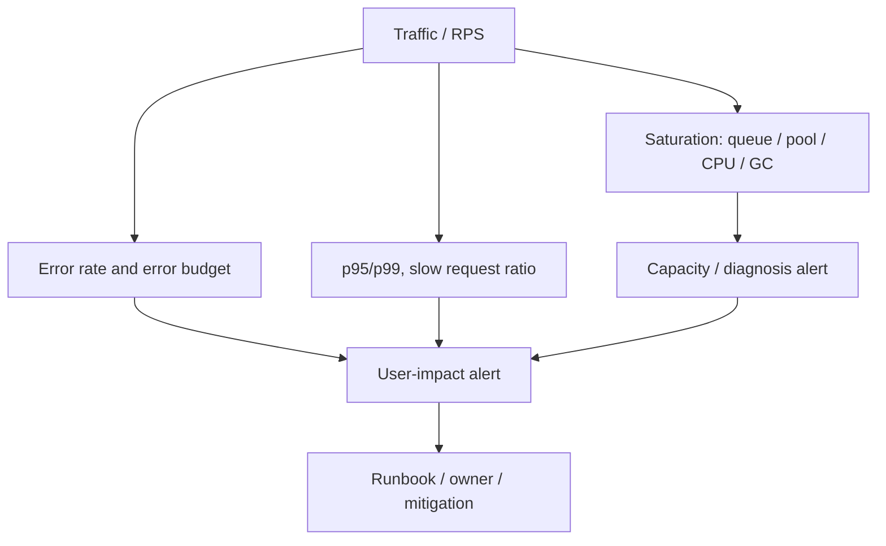
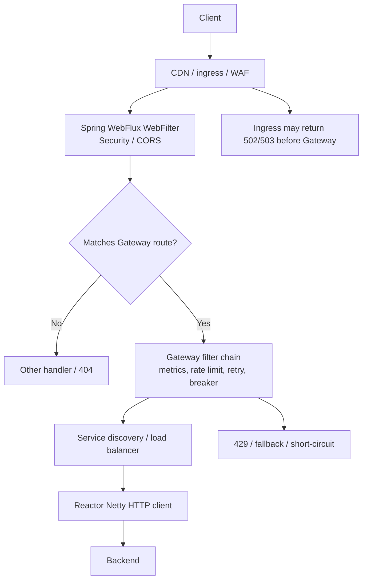
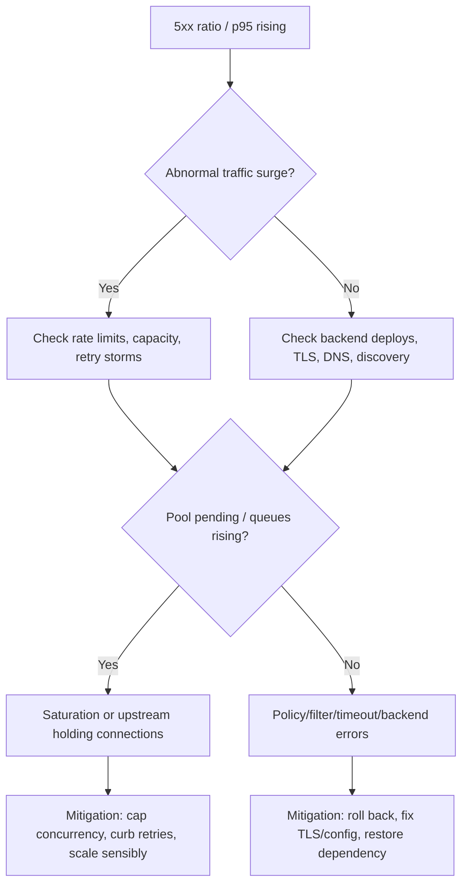
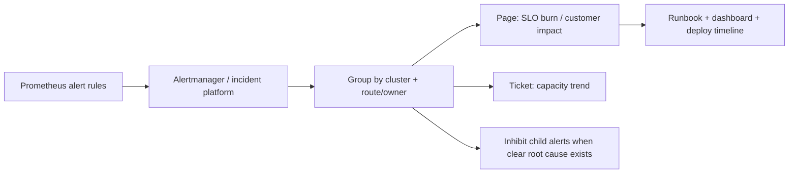

# Designing Alerts Around Error Rates, Latency, and Saturation

An **API Gateway** can keep returning healthy `/actuator/health` responses while customers suffer `502/503/504` errors, spiking wait times, or long queues of outbound connections. If you only monitor “is the pod alive,” operations learns a service died **far too late**. If you only set a rule like “CPU over 80%,” engineers get paged for normal traffic even when users aren't impacted. Good alerting combines **user-experience signals** with **infrastructure serving-capacity signals**.

In **Spring Cloud Gateway Server WebFlux**, each matched request can pass through route predicates, filter chains, authentication, rate limiting, circuit breakers, retries, TLS, load balancing, and the Reactor Netty HTTP client before reaching a microservice. A user-visible error can originate from the **Gateway**, **discovery**, **backend**, **ingress**, or an intentional filter rejection. Therefore, proper alerting logic goes well beyond “count every status other than 200.”

This lesson belongs to the **Observability** chapter of the **SPRING_CLOUD_GATEWAY** module. The focus is **designing alerts around error rates, latency, and saturation**: defining accurate denominators, using per-route metrics, applying SLIs/SLOs and error budgets, calculating p95/p99 from histograms, catching saturation before collapse, and routing alerts to owners who can act.

**Learning outcomes:**

1. Distinguish RED (Rate, Errors, Duration) and the four Golden Signals (Latency, Traffic, Errors, Saturation).
2. Define error ratios over **eligible requests**, avoiding confusing client `4xx` responses with platform `5xx` errors.
3. Collect Gateway metrics via **Actuator + Micrometer + Prometheus** with bounded tags.
4. Write PromQL for RPS, error ratios, p95, and the percentage of requests meeting latency limits.
5. Recognize saturation across **connection pools, event loops, CPU, memory/GC, thread pools**, and upstream layers.
6. Design alerts using **SLO burn rates** and multi-window rules while suppressing low-traffic false positives.
7. Test alerts using simulated failures and write actionable runbooks.

> **Scope:** Metrics and HTTP client saturation examples use **Spring Cloud Gateway Server WebFlux** 5.x + Reactor Netty. Route config uses `spring.cloud.gateway.server.webflux.routes`; WebFlux 4.3.x typically uses `spring.cloud.gateway.routes`. **Gateway Server Web MVC** uses Servlet/`WebMvc.fn` with different metrics and concurrency models; **Proxy Exchange** controllers also do not pass through `GatewayMetricsFilter` by default. Never copy Netty thresholds to MVC without checking live instrumentation.

## 1. Good Alerts Answer Three Questions

An alert should help the on-call responder decide:

1. **Who is affected?** For example, callers of route `orders-api`, not merely “JVM CPU is high.”
2. **How severe is it?** Is the SLO/error budget burning rapidly, or is this a capacity warning for business hours?
3. **What action can we take right now?** Roll back a route/filter, dial down retries, add capacity, restore service discovery, or engage the backend owner.

Examples:

| Poor Alert | Better Alert |
| --- | --- |
| “Many HTTP errors” | “`orders-api` exceeded 1.44% 5xx across both 5m and 1h windows with sufficient request volume” |
| “Gateway is slow” | “`catalog-api` p95 latency exceeded 500 ms for 10 minutes, after filtering out low-traffic noise” |
| “CPU 85%” | “HTTP client pool pending acquires rising steadily, active/max near ceiling, and p95 climbing” |
| “503 detected” | “503 caused by `lb://order-service` lacking instances coinciding with registry rollout” |
| “One pod missing metrics” | “Prometheus cannot scrape one Gateway target; not yet claiming users see 5xxs” |

**The goal is not creating more alerts**, but catching critical incidents early with enough context to act decisively.

## 2. RED and the Four Golden Signals in a Gateway

**RED** fits request/response services well:

- **Rate:** requests processed per unit time, usually `requests/second` (RPS).
- **Errors:** failed requests or the fraction failing the service contract.
- **Duration:** distribution of processing times (p50, p95, p99, SLO buckets).

SRE's **Golden Signals** are **Latency, Traffic, Errors, Saturation**. They mirror RED while adding **Saturation**: how close a resource or queue is to its limit.

| Signal | Gateway Question | Suggested Metric |
| --- | --- | --- |
| Traffic | How many requests/sec hit `orders-api`? | Timer count + `rate()` |
| Errors | How many requests return `5xx` or breach the SLI? | Timer count by `httpStatusCode` |
| Latency | What is p95/p99, or share under 500 ms? | Timer histogram buckets |
| Saturation | Are connection pools waiting on acquires? Is the event loop backed up? | Reactor Netty pool, CPU, GC, thread/queue metrics |

**Traffic is context, not an automatic alert.** QPS rising from 100 to 200 can be business growth; the same jump paired with rising queues, 5xxs, and latency signals overload.



Never treat “CPU isn't high” as proof the system isn't saturated: a Gateway can still stall on **DNS/TLS, pool acquires, upstream timeouts, event-loop blocking, or socket limits**.

## 3. Request Paths Determine Which Signal Sees the Error

Not every request arriving at the edge is recorded by a per-route Gateway metric.



Different cases:

- **Ingress returns 502** because no Gateway pod is available: the Gateway process **never sees the request**.
- **Spring Security returns 401/403** before route matching: the Gateway route timer may **never see the request**.
- **Unmatched route**: the request may get a 404 outside `FilteringWebHandler`.
- **Gateway `RequestRateLimiter` returns 429**: route matched, yet backend is not called.
- **`CircuitBreaker` fallback returns 200**: client sees 200 while the backend is failing; separate fallback/breaker metrics are needed.
- **Retry `503 → 200`**: client-result metrics may record **one 200 request**, while upstream received **two attempts**.
- **Client disconnects**: there may be no complete HTTP status; inspect cancellation/transport logs.

Therefore, maintain **at least two measurement layers**:

1. **Edge/inbound HTTP metrics** at ingress or HTTP server, capturing every request entering that layer.
2. **Gateway per-route metrics** for requests that matched a route, paired with backend, retry, breaker, and pool metrics.

**Never rely solely on `spring.cloud.gateway.requests` to claim you measure every client-visible failure.**

## 4. Classifying HTTP Errors by Operational Meaning

An HTTP status can indicate a client error, a backend fault, or an **intentional policy decision**.

| Code / Type | Common Interpretation | Counted in 5xx Error SLI? | Additional Alert |
| --- | --- | --- | --- |
| `200/201/204` | HTTP success | No | Latency, payload correctness |
| `301/302/304` | Redirect / cache | Usually no | Redirect loops if occurring |
| `400` | Invalid input | Usually no | Spikes after client/API changes |
| `401` | Unauthenticated / bad token | Not in 5xx SLI | IdP/token issues, auth failure spike |
| `403` | Unauthorized | Not in 5xx SLI | Security/policy rollout |
| `404` | Missing route or missing resource | Per contract; usually not by default | No-route spikes, route regressions |
| `408` | Request timeout from client/specific path | Depends on SLI | Proxy/client networking |
| `429` | Intentional rate limiting | Not in 5xx SLI, though may breach separate availability SLO | Quota abuse or capacity/policy fault |
| `500` | Server error | **Yes** | Backend/Gateway exceptions |
| `502` | Bad Gateway | **Yes** | DNS/TLS/upstream proxy |
| `503` | Service unavailable | **Yes** | No instance, breaker OPEN, overload |
| `504` | Gateway timeout | **Yes** | Connect/response timeouts, retry budget |
| Cancel / client-closed | May lack a standard status | Define explicitly | Client aborts, timeout chains |

**Distinguish your defined SLI from raw HTTP codes:** a GET returning 200 with corrupted body or invalid fallback data **is still a bad event** under business contracts. Conversely, a legitimate 404 on `GET /items/nonexistent` is not downtime.

**Consistency rule:** if the availability SLI is defined as “eligible requests not receiving 5xx,” apply the **eligible request** filter consistently to both numerator and denominator.

## 5. Defining Clear Denominators and Alert Scopes

Simple error ratio:

\[
\text{Error Ratio}(W) =
\frac{\text{Error requests in window }W}
     {\text{Total eligible requests in }W}
\]

Suppose `orders-api` sees in 5 minutes:

- 9,800 requests returning 2xx/3xx.
- 100 client 4xx requests.
- 100 5xx requests.

If the SLI is **5xx across all route-matched requests**, the error ratio is:

\[
\frac{100}{9800+100+100}=1\%.
\]

If the contract **excludes invalid 4xxs from the denominator**, the ratio becomes:

\[
\frac{100}{9800+100} \approx 1.0101\%.
\]

Both can be valid depending on the **SLI definition**, yet never mix them between dashboards and alerts. On routes with heavy 401/404 traffic, leaving all 4xxs in the denominator **dilutes real 5xx errors**.

### Scope: Route, Group, or Whole Gateway

| Scope | Pros | Cons |
| --- | --- | --- |
| Whole Gateway | Spots widespread outages quickly | High-traffic routes mask broken small routes |
| By `routeId` | Hits the exact impacted API and owner | Many routes → many time series and alerts |
| By critical route group | Simplifies shared SLO design | Requires stable route ownership catalog |
| By instance/pod | Spots single-pod faults and saturation | Pod-level faults don't always equal user outages |
| By region/cluster | Highlights zonal/regional infra issues | Requires standardized labels |

**Recommendation:** page on **critical service/route SLOs**, while keeping pod/CPU/pool alerts for diagnostics or capacity triage. Never let one cluster-wide fault fire 200 duplicate pages.

## 6. Defining SLIs, SLOs, and Error Budgets

Suppose the `orders-api` owners set two **illustrative** SLOs (not universal standards):

1. **Availability SLO:** Over 30 days, at least **99.9%** of eligible GET requests do not receive `5xx`.
2. **Latency SLO:** Over 30 days, at least **99%** of successful GET requests complete within **500 ms** as measured at the Gateway.

The availability **error budget** is:

\[
1 - 0.999 = 0.001 = 0.1\%.
\]

With **1,000,000** eligible requests over 30 days, the bad-event budget is roughly:

\[
1,000,000 \times 0.001 = 1,000.
\]

This is calculated on the window's request volume; real volumes vary. If traffic grows over 30 days, the absolute bad-event count scales while the **percentage** budget stays 0.1%.

### Latency SLO Must Be Distinguished from p95

“**p95 under 500 ms**” means roughly **95%** of samples meet the limit—insufficient for “**99% of successful requests under 500 ms**.”

To evaluate a 99%-under-500 ms SLO, measure the share of samples in the **`≤ 0.5 s` bucket**, not just a single p95 figure. p95/p99 still help diagnose tail latency and catch regressions early.

### Stay User-Centric

If users fail at the CDN/ingress before reaching the Gateway, an **end-to-end** availability SLO must measure at the edge/synthetic probes rather than Gateway metrics alone. You may maintain an internal `gateway-routed-availability` SLO separately, without presenting it as total user experience.

## 7. Enabling Gateway Metrics with Actuator, Micrometer, and Prometheus

Per **Gateway Server WebFlux 5.1** docs, `GatewayMetricsFilter` records a **Timer** named:

```text
spring.cloud.gateway.requests
```

Documented tags:

| Tag | Meaning | Notes |
| --- | --- | --- |
| `routeId` | Matched route ID | Great for per-API alerting |
| `routeUri` | Route URI | Avoid grouping by arbitrary dynamic URIs |
| `outcome` | HTTP outcome group | E.g., `SUCCESSFUL`, `SERVER_ERROR` |
| `status` | Returned HTTP status | Representation depends on mapping/version |
| `httpStatusCode` | Specific HTTP status code | Use `5..` regex after verifying label |
| `httpMethod` | GET/POST/... | Split SLOs by method if contracts differ |

5.1 docs state metrics run when Actuator is present unless `spring.cloud.gateway.metrics.enabled` is disabled, while 5.x configuration properties tables list `spring.cloud.gateway.server.webflux.metrics.enabled`. Due to differences across doc pages, this example **explicitly enables the WebFlux 5.x namespace** and requires **verifying live metrics** instead of assuming a config line bound properly.

Dependencies:

```xml
<dependency>
  <groupId>org.springframework.boot</groupId>
  <artifactId>spring-boot-starter-actuator</artifactId>
</dependency>

<dependency>
  <groupId>io.micrometer</groupId>
  <artifactId>micrometer-registry-prometheus</artifactId>
</dependency>
```

Use compatible Spring Boot and Spring Cloud BOMs; never pin random versions on those two dependencies.

### Illustrative `application.yml` for WebFlux 5.x

```yaml
spring:
  cloud:
    gateway:
      server:
        webflux:
          metrics:
            enabled: true
            path-tags:
              enabled: false
          httpclient:
            pool:
              metrics: true

management:
  server:
    port: 9090
  endpoints:
    web:
      exposure:
        include: health,info,metrics,prometheus
  metrics:
    distribution:
      percentiles-histogram:
        spring.cloud.gateway.requests: true
      slo:
        spring.cloud.gateway.requests:
          - 100ms
          - 300ms
          - 500ms
          - 1s
          - 2s
```

Explanation:

- `metrics.enabled: true`: enables Gateway metrics under the WebFlux 5.x property where supported.
- `path-tags.enabled: false`: keeps **raw paths** containing resource IDs/tokens out of metric labels.
- `httpclient.pool.metrics: true`: enables Reactor Netty **connection pool metrics**; defaults to **`false`** in 5.x config properties.
- `management.server.port: 9090`: separates the management listener **within the same app** (does not create network isolation on its own).
- `percentiles-histogram`: enables histogram buckets to compute cluster p95/p99 in Prometheus.
- `slo`: adds explicit boundaries—especially **500 ms**—to measure latency SLO compliance directly.

**Performance note:** histograms multiply time series by **routes × methods × statuses × instances × buckets**. Never enable them globally on every metric, and never put raw paths, `userId`, `sessionId`, tokens, or query strings into labels.

### WebFlux 4.3.x and Gateway MVC

WebFlux 4.3.x uses different property namespaces (such as `spring.cloud.gateway.httpclient.pool.metrics` or `spring.cloud.gateway.routes`). Gateway MVC emits Servlet/MVC meters and **does not include Netty pool metrics by default**. Check your version's configuration properties, send a test request, and inspect Actuator to confirm which meters actually exist.

## 8. Verify Real Metrics Exist Before Writing Alerts

A common mistake is writing 20 PromQL alerts for metrics **never actually exported**. Always start by verifying against your exact binary and starters.

Once the app is running and at least one request matched a route:

```bash
# Check the meter by Micrometer name (on the management network only).
curl -fsS \
  http://localhost:9090/actuator/metrics/spring.cloud.gateway.requests

# Check Prometheus exposition: inspect both labels and series names.
curl -fsS \
  http://localhost:9090/actuator/prometheus \
  | grep '^spring_cloud_gateway_requests_seconds'
```

Micrometer Prometheus Timers typically export:

```text
spring_cloud_gateway_requests_seconds_count
spring_cloud_gateway_requests_seconds_sum
spring_cloud_gateway_requests_seconds_max
spring_cloud_gateway_requests_seconds_bucket  # when histograms are enabled
```

`_seconds_*` names match current Prometheus/Micrometer conventions; **older metrics, other exporters, native histograms, or custom configs can change representations**. Verify live output rather than building queries on assumptions.

Illustrative sample line:

```text
spring_cloud_gateway_requests_seconds_count{
  routeId="orders-api",
  httpStatusCode="503",
  httpMethod="GET",
  outcome="SERVER_ERROR",
  job="gateway-prod"
} 125
```

This is a **structural example**, not mandatory live output. `job` is typically attached by Prometheus at scrape time rather than appearing in `/actuator/prometheus`, and labels vary across versions.

### If Metrics Are Empty

1. Are Actuator and Prometheus registry dependencies present?
2. Were Gateway metrics disabled via properties or a `MeterFilter`?
3. Did a request actually **match a Gateway route**?
4. Are you querying the right management **port and base path**?
5. Is Prometheus scraping the right endpoint with `up=1`?
6. Do `routeId` and `httpStatusCode` match the live label names?
7. Did histograms actually emit `_bucket` series?
8. Are you accidentally running Gateway Web MVC / Proxy Exchange instead of WebFlux?

**Never** turn “no data” into “0% errors” when targets aren't scraped or the route timer isn't running.

## 9. Prometheus Scraping and Securing Endpoints

Minimal scrape job in an internal management environment:

```yaml
scrape_configs:
  - job_name: gateway-prod
    scrape_interval: 15s
    metrics_path: /actuator/prometheus
    static_configs:
      - targets:
          - gateway-a.internal:9090
          - gateway-b.internal:9090
```

In Kubernetes, `ServiceMonitor`/`PodMonitor` or discovery configs replace static targets; keep **`environment`/`cluster`/`instance` labels clean and explicit**.

**Security:**

- `/actuator/prometheus` can leak route topology, backend instances, and memory/CPU details.
- Place it on a management plane/port with **network isolation and authentication/TLS** per policy.
- Never expose `/actuator/metrics` or `/actuator/prometheus` to anonymous internet traffic.
- Keep Gateway Actuator routes **read-only** when only observing; route-mutation endpoints require separate privileges.
- Never embed scrape usernames/passwords or bearer tokens in docs or command logs.
- If the exporter overloads, metrics drop and blind monitoring—monitor scrape duration and `up` too.

## 10. Basic PromQL: Traffic / RPS

Prometheus counters grow monotonically and **reset on process restarts**. To obtain RPS, apply `rate()` to the counter rather than reading raw cumulative counts.

Gateway-wide RPS (for routes recorded by the timer):

```promql
sum(
  rate(spring_cloud_gateway_requests_seconds_count{
    job="gateway-prod"
  }[5m])
)
```

RPS by route:

```promql
sum by (routeId) (
  rate(spring_cloud_gateway_requests_seconds_count{
    job="gateway-prod"
  }[5m])
)
```

RPS for `orders-api` specifically:

```promql
sum(
  rate(spring_cloud_gateway_requests_seconds_count{
    job="gateway-prod",
    routeId="orders-api"
  }[5m])
)
```

**Why use `sum by (routeId)`?** Each Gateway replica owns its own counters; `rate()` calculates per-series rates (handling counter resets), and `sum` combines cluster traffic afterward. Never sum raw counters across pods and compare against a static threshold.

### Traffic Drops Need Baselines

`RPS = 0` can mean:

- Low overnight usage.
- A deployment accidentally disabled routing.
- Ingress stopped forwarding traffic to the Gateway.
- Broken metrics or scrapes.
- A brand-new route with no callers yet.

For **low-traffic yet critical** routes, prefer synthetic checks or business heartbeats over paging on `rate == 0`. For high-traffic routes, alert on **sharp drops relative to time-of-day/day-of-week baselines**, accounting for seasonality.

## 11. PromQL: 5xx Error Ratio with Exact Numerator and Denominator

A common denominator is **all requests recorded by the Gateway route timer**, with `5xx` as the numerator.

```promql
sum by (routeId) (
  rate(spring_cloud_gateway_requests_seconds_count{
    job="gateway-prod",
    httpStatusCode=~"5.."
  }[5m])
)
/
clamp_min(
  sum by (routeId) (
    rate(spring_cloud_gateway_requests_seconds_count{
      job="gateway-prod"
    }[5m])
  ),
  0.000001
)
```

The output ranges from `0` to `1`. Multiply by `100` for percentages. `clamp_min` prevents division by zero while the series exists; **it does not solve missing metrics or failed scrapes**.

**Important:** when a route experiences zero 5xx errors over a window, Prometheus may **have no numerator series**, returning empty instead of `0`. To display `0` on dashboards whenever the denominator has traffic, write:

```promql
(
  sum by (routeId) (
    rate(spring_cloud_gateway_requests_seconds_count{
      job="gateway-prod",
      httpStatusCode=~"5.."
    }[5m])
  )
  or on (routeId)
  (
    0 * sum by (routeId) (
      rate(spring_cloud_gateway_requests_seconds_count{
        job="gateway-prod"
      }[5m])
    )
  )
)
/
clamp_min(
  sum by (routeId) (
    rate(spring_cloud_gateway_requests_seconds_count{
      job="gateway-prod"
    }[5m])
  ),
  0.000001
)
```

`or on (routeId)` fills **`0` strictly for routes with live traffic**, without fabricating zeros if the Gateway or Prometheus goes down. Catch no-data outages via separate `up`/missing-data alerts.

### Eligible-Request-Only Denominators

If an SLO excludes client-side 4xx errors, enforce the **exact same eligibility filter** on the denominator consistently. For example, excluding 401/403/404 from eligible requests:

```promql
sum by (routeId) (
  rate(spring_cloud_gateway_requests_seconds_count{
    job="gateway-prod",
    httpStatusCode=~"5.."
  }[5m])
)
/
clamp_min(
  sum by (routeId) (
    rate(spring_cloud_gateway_requests_seconds_count{
      job="gateway-prod",
      httpStatusCode!~"401|403|404"
    }[5m])
  ),
  0.000001
)
```

This is **one SLI choice**, not a rule that 401/403/404 should always be ignored. If an auth or routing change causes client-visible 401/404 spikes, monitor them with separate alerts or SLIs.

## 12. Error Alerts: Combine Ratio with a Traffic Guard

A route receiving **1 request in 5 minutes** that fails returns a `100%` error rate. Paging the team over one sample creates noise—yet ignoring low-traffic routes completely is also risky.

Illustrative Prometheus alert **starting point for higher-traffic routes**:

```yaml
groups:
  - name: gateway-basic-errors
    rules:
      - alert: GatewayHigh5xxRatio
        expr: |
          (
            sum by (routeId) (
              rate(spring_cloud_gateway_requests_seconds_count{
                job="gateway-prod", httpStatusCode=~"5.."
              }[5m])
            )
            /
            clamp_min(
              sum by (routeId) (
                rate(spring_cloud_gateway_requests_seconds_count{
                  job="gateway-prod"
                }[5m])
              ),
              0.000001
            )
          ) > 0.02
          and on (routeId)
          (
            sum by (routeId) (
              increase(spring_cloud_gateway_requests_seconds_count{
                job="gateway-prod"
              }[5m])
            ) > 100
          )
        for: 3m
        labels:
          severity: warning
          team: gateway
        annotations:
          summary: "Gateway route {{ $labels.routeId }} exceeds 2% HTTP 5xx"
          description: "Check backend, route, retries, breaker, and ingress."
```

This requires:

- `5xx ratio > 2%` over 5 minutes.
- **More than 100 requests** in 5 minutes for that route.
- Condition held for `for: 3m` before firing.

**2%**, **100 requests**, and **3 minutes** are **illustrative values**, not universal defaults for every SLO. For low-traffic critical routes, replace the volume guard with synthetic checks or an explicit **absolute-error + impact** rule.

**Common mistake:** running `sum(errors) / sum(total)` cluster-wide and paging on that. One healthy high-volume route can hide a smaller payments route failing 100%.

## 13. Latency: Why Not Watch the Average Alone?

Suppose 100 requests run:

- 95 requests take 100 ms.
- 5 requests take 5 seconds.

The average is:

\[
\frac{95 \times 0.1 + 5 \times 5}{100}
=0.345\text{ seconds}.
\]

An average of 345 ms looks benign while 5% of users waited 5 seconds. Percentiles expose the **distribution tail**:

- **p50**: median, typical experience.
- **p95**: roughly 95% of observations fall at or below this value.
- **p99**: slowest 1%, sensitive to tail spikes.
- **SLO bucket**: fraction of observations within a fixed threshold.

**Never average p95 values across Gateway pods.** Quantiles are not additive; aggregate **histogram buckets** first and compute p95 across the combined distribution.

### Time Units

Micrometer Timers exported to Prometheus normally use **seconds** for `_seconds_*`. Thus:

| Target | PromQL Threshold |
| --- | ---: |
| 100 ms | `0.1` |
| 300 ms | `0.3` |
| 500 ms | `0.5` |
| 1 second | `1` |
| 2 seconds | `2` |

Never write `p95 > 500` trying to alert at 500 ms—on a `_seconds` metric, that alerts at **500 seconds**.

## 14. Computing p95/p99 Properly with `histogram_quantile`

Once `spring_cloud_gateway_requests_seconds_bucket` is exported, p95 by route is:

```promql
histogram_quantile(
  0.95,
  sum by (routeId, le) (
    rate(spring_cloud_gateway_requests_seconds_bucket{
      job="gateway-prod"
    }[5m])
  )
)
```

p99 uses the same structure with `0.99`:

```promql
histogram_quantile(
  0.99,
  sum by (routeId, le) (
    rate(spring_cloud_gateway_requests_seconds_bucket{
      job="gateway-prod"
    }[10m])
  )
)
```

**Why preserve `le`?** In **classic Prometheus histograms**, `le` is the bucket upper bound, and `histogram_quantile` needs the bucket distribution. `sum by (routeId, le)` aggregates across pods per route while keeping bucket boundaries intact.

### Measure Successful Requests Separately

Some systems fail **very fast with 5xxs**. Mixing errors into p95 can make p95 **look better** right as availability collapses. Useful dashboards include:

- p95 **of successful requests** to measure latency of successful experiences.
- **5xx ratio** separately.
- Overall p95 across all traffic to see total impact.
- **Slow-request ratio** against the SLO if needed.

Example p95 across 2xx/3xx responses:

```promql
histogram_quantile(
  0.95,
  sum by (routeId, le) (
    rate(spring_cloud_gateway_requests_seconds_bucket{
      job="gateway-prod",
      httpStatusCode=~"2..|3.."
    }[5m])
  )
)
```

Never compute `avg(quantile="0.95")` across pods—that is statistically meaningless for cluster-wide percentiles.

### Histograms Are Estimates

Prometheus interpolates within buckets, so p95/p99 are **estimates** whose accuracy depends on bucket layout. For a **`≤ 500 ms` SLO**, configure an explicit **0.5 s bucket** to measure threshold compliance directly rather than only comparing estimated p95 against `0.5`.

## 15. Latency SLI: How Many Requests Meet 500 ms?

For an SLO of “**99% of successful requests ≤ 500 ms**,” compute the successful share inside the `≤ 0.5 s` bucket:

```promql
sum by (routeId) (
  rate(spring_cloud_gateway_requests_seconds_bucket{
    job="gateway-prod",
    httpStatusCode=~"2..|3..",
    le="0.5"
  }[5m])
)
/
clamp_min(
  sum by (routeId) (
    rate(spring_cloud_gateway_requests_seconds_count{
      job="gateway-prod",
      httpStatusCode=~"2..|3.."
    }[5m])
  ),
  0.000001
)
```

The output is the **fraction of successful requests** meeting the latency threshold (0 to 1). To build a **unified SLO** covering both availability and latency, put **all eligible requests** in the denominator and count **`2xx/3xx ≤ 500 ms`** in the numerator. Those are two distinct definitions—document the choice explicitly in your SLO spec.

**Prerequisite:** the `le="0.5"` bucket must exist. `management.metrics.distribution.slo.spring.cloud.gateway.requests` from Section 7 defines this boundary. Without that bucket in exporter output, the query lacks accurate samples—never assume a `0.5` bucket exists automatically.

### Numerical Threshold Example

Over 5 minutes, 10,000 requests succeed, of which 9,920 finish in `≤ 500 ms`. Latency-good fraction:

\[
9,920/10,000=99.2\%.
\]

For a 99% SLO, that window **passes**, though p99 could still be high due to the slow 0.8%. Alerting on latency error-budget burn or slow-request ratio is therefore sharper than watching p95 alone.

## 16. Latency Alerts Without Low-Traffic Noise

Example warning when **successful-request** p95 exceeds **500 ms** for 10 minutes with sufficient volume:

```yaml
groups:
  - name: gateway-latency
    rules:
      - alert: GatewayHighP95Latency
        expr: |
          histogram_quantile(
            0.95,
            sum by (routeId, le) (
              rate(spring_cloud_gateway_requests_seconds_bucket{
                job="gateway-prod",
                httpStatusCode=~"2..|3.."
              }[5m])
            )
          ) > 0.5
          and on (routeId)
          (
            sum by (routeId) (
              increase(spring_cloud_gateway_requests_seconds_count{
                job="gateway-prod",
                httpStatusCode=~"2..|3.."
              }[5m])
            ) > 100
          )
        for: 10m
        labels:
          severity: warning
          team: gateway
        annotations:
          summary: "Route {{ $labels.routeId }} p95 exceeds 500ms"
          description: "Inspect 5xx, upstream latency, and pool pending together."
```

This threshold **does not replace** availability alerts; a route returning 100% fast 503s has **no** successful p95, which availability alerts must catch.

**For streaming/SSE/WebSockets:** long connection/stream lifetimes cannot be compared directly to JSON GET latency SLOs. Separate routes/endpoints by transport and track handshake latency, time-to-first-byte, and stream duration independently if needed.

## 17. What Is Saturation in an API Gateway?

**Saturation** measures how close a resource is to its ceiling or whether **queuing/waiting** has started. On Gateway WebFlux, watch several places:

| Bottleneck | Signal |
| --- | --- |
| Reactor Netty outbound connection pool | Active/max, pending acquires, pending acquire time |
| Event loop | Blocking tasks, queue delay, event-loop lag |
| CPU | CPU usage vs. allocated **quota/cores**, throttling |
| JVM heap / GC | Heap pressure, GC pauses, allocation rate, OOM |
| TLS / DNS | TLS handshake latency/errors, DNS lookup failures/timeouts |
| Network | Socket errors, packet drops/retransmissions, bandwidth |
| Redis rate limiter | Redis latency/errors, key resolution errors |
| `CircuitBreaker` / `Retry` | `OPEN` states, rejected calls, retry amplification |
| LoadBalancer / discovery | No-instance `503`, stale instances, discovery refresh lag |
| Ingress | Pending requests, upstream connect errors, proxy timeouts |

A single `CPU=90%` metric is **not enough** to declare an outage. Conversely, steadily rising `pending acquire` **alongside rising p95/5xx** is a strong signal that the Gateway or an outbound dependency is saturating.

### Saturation Is Not Utilization

- **Utilization:** percentage of capacity currently in use.
- **Saturation:** whether **requests are queuing** or failing due to capacity limits.
- **Queueing latency:** extra delay incurred waiting for a resource.

As utilization approaches 100%, queueing latency climbs nonlinearly. Still, where “85% becomes dangerous” depends on pool type, workload, burstiness, and headroom—calibrate via load testing.

## 18. Reactor Netty Connection Pool Metrics

Reactor Netty exposes `ConnectionProvider` metrics when pool metrics are enabled:

| Micrometer Meter | Meaning |
| --- | --- |
| `reactor.netty.connection.provider.active.connections` | Connections currently in use |
| `reactor.netty.connection.provider.idle.connections` | Idle connections |
| `reactor.netty.connection.provider.total.connections` | Total connections |
| `reactor.netty.connection.provider.max.connections` | Pool connection cap when bounded |
| `reactor.netty.connection.provider.pending.connections` | Waiting acquire requests |
| `reactor.netty.connection.provider.max.pending.connections` | Pending queue cap |
| `reactor.netty.connection.provider.pending.connections.time` | Acquire wait duration |

Prometheus names typically become:

```text
reactor_netty_connection_provider_active_connections
reactor_netty_connection_provider_max_connections
reactor_netty_connection_provider_pending_connections
reactor_netty_connection_provider_pending_connections_time_seconds_count
reactor_netty_connection_provider_pending_connections_time_seconds_sum
```

Verify exact names and tags via `/actuator/prometheus`. Reactor Netty may attach `name`, `id`, and `remote.address`; exporters normalize tag names into Prometheus labels.

### When Metrics Do Not Appear

- `spring.cloud.gateway.server.webflux.httpclient.pool.metrics` is not enabled.
- The connection provider has seen no traffic yet, or metrics are lazily registered.
- Gateway isn't using the Reactor Netty pool on that code path.
- Pool type semantics differ from a fixed pool.
- `MeterRegistry`/exporter filtered out the meter or isn't scraped.

With **elastic/unbounded semantics**, “active/max > 85%” may be meaningless or lack a comparable max. Focus on **pending/time/errors** and measure true capacity via load tests.

## 19. PromQL: Pool Saturation

**Pending connections** are often a more direct HTTP client pool signal than CPU.

```promql
sum by (instance, name) (
  reactor_netty_connection_provider_pending_connections{
    job="gateway-prod"
  }
)
```

Suggested alert:

```yaml
groups:
  - name: gateway-saturation
    rules:
      - alert: GatewayHttpClientPoolPending
        expr: |
          sum by (instance, name) (
            reactor_netty_connection_provider_pending_connections{
              job="gateway-prod"
            }
          ) > 10
        for: 5m
        labels:
          severity: warning
          team: platform
        annotations:
          summary: "High HTTP client pool pending on {{ $labels.instance }}"
          description: "Check active/max, upstream latency, DNS/TLS, retries, and egress."
```

`10 pending` and `5 minutes` are **illustrative starting points**. On a max-50 pool, 10 pending is serious; on a max-10,000 pool, calibrate to your SLO and load. Pair this alert with **active/max, pending acquire duration, and 5xx/latency panels**.

### Utilization Ratio for Fixed Pools

```promql
sum by (instance, name) (
  reactor_netty_connection_provider_active_connections{
    job="gateway-prod"
  }
)
/
clamp_min(
  sum by (instance, name) (
    reactor_netty_connection_provider_max_connections{
      job="gateway-prod"
    }
  ),
  1
)
```

**Caution:** grouping by `instance, name` is safe only if pools within that group share the same capacity semantics. When multiple `remote.address` labels or duplicate pool names exist, inspect raw vector labels and adjust aggregation so you don't sum incompatible caps.

When connections stay leased too long and pending queues climb while CPU stays low, investigate **slow upstreams, keep-alive leaks, SSE/WebSocket traffic, timeouts, and connection release** rather than reflexively scaling pods.

## 20. CPU, Memory, Event Loop, and Saturation Are Not One Number

### CPU

`process_cpu_usage` or node/container CPU metrics help spot pods near limits, though keep distinctions clear:

- Process CPU is measured in the process host context.
- Container CPU compares against allocated requests/limits/quotas.
- Cgroup CPU throttling spikes latency even before process usage hits 100%.
- Multi-core CPU utilization cannot be read on a single 0–1 scale without normalization.

Illustrative query (only when the meter exists with matching semantics):

```promql
max by (instance) (
  process_cpu_usage{job="gateway-prod"}
)
```

**Never** assume `> 0.8` always warrants a page. Combine with pending, latency, and throttling/trends.

### JVM and GC

Key signals:

- Heap used vs. max, allocation rate.
- GC pause count/duration and stop-the-world lengths.
- Netty direct/off-heap memory and `ByteBuf` allocator metrics.
- Container `OOMKilled` and restart counts.
- Open file descriptors / sockets.

A Reactor Netty Gateway can run out of **direct memory** even while Java heap stays low. Watching only `jvm_memory_used_bytes{area="heap"}` misses that completely.

### Event Loop

If a custom `GlobalFilter` calls `Thread.sleep()`, `WebClient.block()`, or synchronous JDBC on the event loop, requests stall while overall machine CPU stays moderate. You should:

- Monitor event-loop scheduler/lag where instrumented.
- Inspect thread dumps and blocking detectors in staging.
- Compare inbound p95 latency, Netty client latency, and pending acquires to separate causes.
- Never try to “fix” blocking work solely by increasing event-loop thread counts.

**Gateway MVC differs:** on a Servlet stack, thread pool/queue and blocking HTTP client metrics matter more than Netty event-loop lag. Never share one saturation alert set across both stacks.

## 21. From Error Ratios to Error Budget Burn Rates

A 99.9% SLO has an **error budget fraction** of `0.001`. Burn rate measures **how many times faster** than the sustainable pace the budget is being consumed at steady traffic.

\[
\text{Burn rate}
=\frac{\text{observed bad-event ratio}}
       {\text{allowed bad-event ratio}}.
\]

Examples:

- 99.9% SLO → 0.1% error budget = `0.001`.
- 1% error ratio = `0.01` → burn rate = `10`.
- 1.44% error ratio = `0.0144` → burn rate = **14.4**.
- 0.6% error ratio = `0.006` → burn rate = **6**.

Values like **14.4×** and **6×** follow sample guidance from the *Google SRE Workbook* as **starting points** for a 30-day SLO.

| Tier | Long Window | Short Window | Burn Rate | Error Ratio at 99.9% SLO |
| --- | --- | --- | ---: | ---: |
| Fast page | 1 hour | 5 minutes | 14.4× | > 1.44% |
| Slower page | 6 hours | 30 minutes | 6× | > 0.6% |
| Ticket | 3 days | 6 hours | 1× | > 0.1% |

Organizations may use `24h/2h` at `3×` or `3d/6h` at `1×` for tickets. Adjust thresholds whenever your error budget or SLO window differs.

### Why Must Both Windows Exceed the Threshold?

If you only inspect the **1-hour** error ratio, a brief 2-minute outage that already recovered keeps the 1-hour average high and keeps paging. The paired condition:

```text
error_ratio_1h > 1.44%
AND
error_ratio_5m > 1.44%
```

requires **both significant budget burn over the long window and ongoing errors in the short window**, preventing lingering pages after recovery.

## 22. Recording Rules for Burn-Rate Alerts

To avoid repeating long PromQL expressions in alerts, create recording rules. The example below computes per-`routeId` ratios on Gateway WebFlux with metrics from Section 7.

> **Assumptions:** `httpStatusCode=~"5.."` defines bad events, all route-matched requests are eligible, and `job="gateway-prod"` contains only production targets. If your SLI excludes 4xxs or includes 429s/slow requests, update all expressions **consistently** before deploying.

```yaml
groups:
  - name: gateway-slo-recording
    interval: 30s
    rules:
      - record: gateway:requests:increase5m
        expr: |
          sum by (routeId) (
            increase(spring_cloud_gateway_requests_seconds_count{
              job="gateway-prod"
            }[5m])
          )

      - record: gateway:error_ratio:5m
        expr: |
          (
            sum by (routeId) (
              rate(spring_cloud_gateway_requests_seconds_count{
                job="gateway-prod", httpStatusCode=~"5.."
              }[5m])
            )
            or on (routeId)
            (
              0 * sum by (routeId) (
                rate(spring_cloud_gateway_requests_seconds_count{
                  job="gateway-prod"
                }[5m])
              )
            )
          )
          /
          clamp_min(
            sum by (routeId) (
              rate(spring_cloud_gateway_requests_seconds_count{
                job="gateway-prod"
              }[5m])
            ),
            0.000001
          )

      - record: gateway:error_ratio:1h
        expr: |
          (
            sum by (routeId) (
              rate(spring_cloud_gateway_requests_seconds_count{
                job="gateway-prod", httpStatusCode=~"5.."
              }[1h])
            )
            or on (routeId)
            (
              0 * sum by (routeId) (
                rate(spring_cloud_gateway_requests_seconds_count{
                  job="gateway-prod"
                }[1h])
              )
            )
          )
          /
          clamp_min(
            sum by (routeId) (
              rate(spring_cloud_gateway_requests_seconds_count{
                job="gateway-prod"
              }[1h])
            ),
            0.000001
          )

      - record: gateway:error_ratio:30m
        expr: |
          (
            sum by (routeId) (
              rate(spring_cloud_gateway_requests_seconds_count{
                job="gateway-prod", httpStatusCode=~"5.."
              }[30m])
            )
            or on (routeId)
            (
              0 * sum by (routeId) (
                rate(spring_cloud_gateway_requests_seconds_count{
                  job="gateway-prod"
                }[30m])
              )
            )
          )
          /
          clamp_min(
            sum by (routeId) (
              rate(spring_cloud_gateway_requests_seconds_count{
                job="gateway-prod"
              }[30m])
            ),
            0.000001
          )

      - record: gateway:error_ratio:6h
        expr: |
          (
            sum by (routeId) (
              rate(spring_cloud_gateway_requests_seconds_count{
                job="gateway-prod", httpStatusCode=~"5.."
              }[6h])
            )
            or on (routeId)
            (
              0 * sum by (routeId) (
                rate(spring_cloud_gateway_requests_seconds_count{
                  job="gateway-prod"
                }[6h])
              )
            )
          )
          /
          clamp_min(
            sum by (routeId) (
              rate(spring_cloud_gateway_requests_seconds_count{
                job="gateway-prod"
              }[6h])
            ),
            0.000001
          )
```

**Prometheus note:** recording rule names follow `level:metric:operations` with colons, such as `gateway:error_ratio:5m`. Across multiple clusters/regions, preserve `cluster`/`region` labels in aggregations or filter `job` tightly so production never mixes with staging or separate SLOs.

These recording rules emit **per-route** ratios and return 0 for routes carrying traffic with zero 5xx samples in the window. They cannot detect requests rejected by ingress **before the Gateway**, so maintain separate edge/synthetic SLIs.

## 23. Paging Alerts: Multi-Window, Multi-Burn-Rate

Once the recording rules are active:

```yaml
groups:
  - name: gateway-slo-alerts
    rules:
      - alert: GatewayFastErrorBudgetBurn
        expr: |
          (
            gateway:error_ratio:1h > 0.0144
            and on (routeId)
            gateway:error_ratio:5m > 0.0144
          )
          and on (routeId)
          gateway:requests:increase5m > 100
        for: 2m
        labels:
          severity: page
          team: gateway
        annotations:
          summary: "Route {{ $labels.routeId }} burning error budget too fast"
          description: "Burn rate >14.4x across both 1h and 5m. See Gateway 5xx runbook."

      - alert: GatewaySlowErrorBudgetBurn
        expr: |
          (
            gateway:error_ratio:6h > 0.006
            and on (routeId)
            gateway:error_ratio:30m > 0.006
          )
          and on (routeId)
          gateway:requests:increase5m > 100
        for: 5m
        labels:
          severity: page
          team: gateway
        annotations:
          summary: "Route {{ $labels.routeId }} sustaining high error budget burn"
          description: "Burn rate >6x across both 6h and 30m."
```

**Note:** these alerts are **lesson templates** without Alertmanager grouping/inhibition/deduplication, team-based ownership routing, or low-volume critical-route logic. Both alerts can fire together; in production, **group/inhibit** them so on-call receives one clean notification.

### Illustrative Numbers

Over 1 hour, a route receives 100,000 requests with 1,500 5xx responses:

\[
1,500 / 100,000 = 1.5\% > 1.44\%.
\]

In the most recent 5 minutes, it sees 20,000 requests and 320 errors:

\[
320 / 20,000 = 1.6\% > 1.44\%.
\]

Both windows exceed the threshold, and the `> 100` traffic guard passes. Once sustained for `for`, `GatewayFastErrorBudgetBurn` fires. This is a **customer-impact** signal, taking clear priority over a standalone CPU warning.

## 24. Warnings or Tickets for Latency and Saturation

Not every alert should wake someone up at midnight.

| Scenario | Recommended Handling |
| --- | --- |
| Fast availability budget burn impacting users | **Page**, act immediately |
| Critical route fails synthetic checks | **Page**, even when real traffic is low |
| p95 exceeds target without severe SLO burn | **Warning/ticket**, investigate capacity |
| Pool pending rising, latency unaffected so far | **Warning**, tune proactively |
| One pod scrape `up=0` while fleet capacity is healthy | **Infrastructure alert** per policy, not automatically a user outage |
| 401 burst right after IdP config change | Security/identity alert, route to owner |
| 429 rises due to expected rate-limit policy | Monitor/ticket to tune quotas; don't mistake for upstream outage |
| 503 from OPEN breaker across multiple replicas | Page if SLO is burning; debug breaker + backend |
| Unexpected route count shift after dynamic refresh | Config validation alert; don't rely on count alone |
| Metrics/traces vanish | Monitoring pipeline alert—risk of flying blind during outages |

**Rule:** pages demand immediate action and a clear responder; warnings/tickets track capacity trends or issues not immediately burning SLOs. Any alert lacking a runbook or owner is noise.

## 25. Separating Retries, Circuit Breakers, Rate Limiters, and Fallbacks in Alerts

### Retries Can Hide Upstream 5xxs

Logical request:

```text
Client GET /api/catalog/42
  → Backend attempt #1: 503
  → Retry backoff 100ms
  → Backend attempt #2: 200
  → Client sees 200
```

The Gateway timer records one successful logical request, yet the dependency absorbed **two attempts** and backoff added latency. High retry rates reveal an unhealthy backend before client-visible 5xx climbs.

Measure:

- **Gateway logical request RPS**.
- **Outbound attempts per logical request** via HTTP client / Retry instrumentation.
- **Retry count and retry-exhausted count**.
- **Pre-retry backend error rate**.
- **Total logical request duration**, including retries and backoffs.

**Never add backend attempts into the client SLI denominator**: one client request does not become two customer requests just because the Gateway retried.

### Circuit Breakers Can Mask Errors with Fallbacks

```text
Client GET /api/reports
  → CircuitBreaker OPEN
  → fallbackUri returns HTTP 200 with stale data
```

When business contracts **disallow stale data**, an HTTP 200 fallback is still a **bad event**. Track breaker `OPEN` states, rejected calls, fallback counts/statuses, and **business success** separately. Resilience4j metric names depend on integration (e.g., `resilience4j_circuitbreaker_state` when supported)—verify live output.

### `RequestRateLimiter` and 429

`429` enforces fair protection, yet sudden post-deploy spikes can stem from a broken `KeyResolver`, Redis outage, or overly tight quotas. Monitor 429s by route/tenant **at aggregated label levels**, avoiding raw tenant IDs if cardinality is high.

### `LoadBalancer` and 503

If `lb://order-service` finds no `ServiceInstance`, Gateway returns `503` without ever calling the backend. Check discovery/registry and health/readiness. Increasing Gateway retries **cannot create service instances** when the registry is empty.

## 26. Traffic and Saturation Must Be Measured Together

A useful triage pipeline:



**Why never auto-scale purely on `pending > 10`?** If the backend DB is deadlocked, adding Gateway replicas opens **even more connections** to a struggling backend. Sometimes the right mitigation is shedding load, tightening timeouts/backoffs, or opening circuit breakers to protect the dependency.

### Monitor Upstream Systems Too

The Gateway is not the only observation point. At minimum monitor:

- Backend service errors and latency.
- DB/Redis/queue saturation.
- `LoadBalancer` service-instance health and counts.
- Gateway outbound DNS/TLS/connect errors.
- Ingress HTTP statuses ahead of the Gateway.
- Container restarts, pod readiness, and network errors.

Link alerts **`routeId` → upstream service → owning team/runbook** so responders don't waste time hunting down owners.

## 27. Designing Alert-Supportive Dashboards

A good dashboard does not contain 100 charts. For `orders-api`, order panels logically:

| Panel | Contents |
| --- | --- |
| 1. User impact | Current availability SLO, error budget consumed, active alerts |
| 2. Throughput | Total and per-route RPS |
| 3. Errors | 5xx ratio and 500/502/503/504 breakdown |
| 4. Latency | p50/p95/p99, `≤ 500 ms` SLO bucket |
| 5. Dependencies | Backend attempts/latency/errors, `LoadBalancer` 503s |
| 6. Resilience | Retry attempts, breaker `OPEN`/fallbacks, 429 rate limits |
| 7. Saturation | Active/max/pending pool, queue wait time |
| 8. Runtime | CPU/quota, JVM heap/direct memory, GC, event loop |
| 9. Fleet | Healthy pods, scrape status, version/revision/region |
| 10. Timeline | Deploys, route refreshes, cert rotations, IdP/Redis changes |

Keep **`routeId`**, `cluster`, and time ranges synchronized across panels. Use standardized correlation/`traceId` in logs and traces to drill down to a single request, while keeping raw trace IDs out of metric tags.

**Percentiles and histograms:** pick bucket layouts clustered around your latency SLO (e.g., 100/300/500/1,000 ms) instead of watching averages alone. Never copy an old dashboard querying `gateway_requests_seconds_count` when your version exports `spring_cloud_gateway_requests_seconds_count`.

## 28. When to Use Tracing and Logs?

**Metrics** answer “is there a problem, and how big is it?” **Traces** and **logs** answer “which request failed, and why?”

Example 5xx alert on `orders-api`:

1. Dashboard shows 503s spiking right after a route refresh.
2. Read-only Actuator confirms `orders-api` targets `lb://order-service`.
3. Distributed traces show requests stopping at the LoadBalancer without reaching a backend.
4. Discovery/registry logs report zero healthy instances.
5. Runbook restores registrations/readiness instead of blindly bumping retries.

### Observability Must Respect Privacy

- Never log `Authorization`, `Cookie`, refresh tokens, or API keys.
- Never put raw URL queries, `userId`, emails, or high-cardinality `tenantId`s into metric labels.
- Never log sensitive Gateway request/response bodies by default for debugging.
- Trace sampling can miss rare events; rely on metric counters/histograms for SLO math.
- Protect access logs, traces, and Actuator endpoints with RBAC and retention policies.
- Follow an explicit correlation ID contract; still validate client-supplied IDs before logging.

**Never let a metrics filter call `block()` or serialize huge bodies on the Reactor Netty event loop**—observability instrumentation must never noticeably slow down the Gateway.

## 29. Sample Runbook: Gateway Route 5xx Spike

### Step 1 — Confirm Impact

- Which alert fired? Which `routeId`, cluster, severity, and burn rate?
- Is RPS large enough? Any no-data or scrape outage?
- Is the 5xx breakdown 502, 503, or 504?
- Does ingress see the same errors, or only Gateway metrics?

### Step 2 — Isolate by Layer

| Signal | Priority Check |
| --- | --- |
| `502` spike after TLS rotation | SNI, certificate chain/truststore, upstream proxy |
| `503` while service instance count hits 0 | Registry / `LoadBalancer` / readiness |
| `503` with breaker `OPEN` | Backend health, failure rate, fallback behavior |
| `504` with rising p95 | Connect/response timeouts, pool pending, slow upstream |
| Sudden `429` spike | RateLimiter Redis, `KeyResolver`, quota policy |
| `401/403` spike post-deploy | OAuth2/IdP audience/scopes, security matchers |
| 5xx on one pod only | Pod version/config, pool, DNS, CPU/GC |
| 5xx after route refresh | Predicate/filter ordering, URI, metadata, rollback |

### Step 3 — Safe Mitigation

- If caused by route config, roll back to the **last-known-good definition**, refresh pods, and verify.
- If caused by a failing backend, inspect breaker/fallback and curb retry amplification before scaling Gateway.
- If pools saturated due to slow backends, cap concurrency and fix the slow dependency.
- If TLS failed, fix trust/certificates—**never disable TLS verification**.
- If discovery is empty, restore service registry/health instead of flooding retries.
- Never alter security or rate-limiting policies mid-crisis without impact review.

### Step 4 — Verify Recovery

- Short-window 5xx ratio returns below threshold.
- SLO burn slows down and traffic normalizes.
- p95 and pool pending trend downward.
- Backend attempts/retries return to baseline.
- All Gateway replicas/regions run the right config.
- No expired silences or maintenance suppressions remain active.

## 30. Sample Runbook: High p95 While 5xx Stays Low

**Assumption:** `catalog-api` p95 jumped from 300 ms to 1.2 s while 5xx `< 0.1%`.

Never say “no incident” just because HTTP status is 200—users may be breaching the latency SLO.

Sequence:

1. Check RPS before/after p95 climbed; was there a traffic surge?
2. Compare p95 across backend, Gateway HTTP client, and ingress.
3. Inspect Reactor Netty pool pending and acquire wait times.
4. Check retry attempts per logical request, backoffs, and breaker states.
5. Check event-loop blocking, heap/direct memory, and GC pauses.
6. Check DNS/TLS handshake latency if targets or certs changed recently.
7. Check whether uploads, SSE, or WebSockets accidentally mixed into JSON API latency metrics.
8. Mitigate: curb retries, fix slow downstream queries, tune pools, separate streaming routes, or scale the bottlenecked dependency.

**Never use Gateway-wide p95** to analyze a single slow route: fast high-volume routes mask localized slowdowns.

## 31. Sample Runbook: Rising Pool Pending Before Errors Appear

A pod reports:

```text
HTTP client pool active: 190
HTTP client pool max:    200
Pending acquire:        35
5xx ratio:              0.1%
p95:                    climbed from 250ms to 420ms
```

Utilization:

\[
190/200 = 95\%.
\]

**Assessment:** this is **developing saturation**, even though 5xx hasn't breached the SLO yet. Operations has lead time to act before timeouts/exhaustion cause 5xx errors.

Actions:

- Identify which upstream keeps connections leased long.
- Check outbound connection leaks, keep-alive, streaming, and backend latency.
- Curb retry storms/concurrency where appropriate.
- Check DNS/TLS/pool acquire timeouts and true connection requirements.
- Raise `max-connections` only if backends, file descriptors, and network capacity have headroom.
- Verify post-change: pending drops, p95 improves, and the backend isn't overloaded.

If request rate is low and no pool-max metric exists because the pool is elastic, **never apply a 95% formula mechanically**. Inspect live gauges and actual config.

## 32. Designing Alert Routing, Ownership, and Preventing Alert Fatigue

An alert pipeline should be clear:



**Grouping and deduplication rules:**

- Group alerts sharing `routeId`/cluster/incident rather than paging per HTTP status or per pod.
- Inhibit downstream symptoms when a clear root-cause alert fires (e.g., whole Gateway fleet down), without **suppressing all SLO visibility blindly**.
- Use stable routing labels: `team`, `service`, `severity`, `cluster`, `runbook`.
- Link dashboards, traces, and runbooks in annotations.
- Never put `pod UID` or `request ID` into route-level alert labels causing alert explosions.
- Tune `for` and windows per severity; pages must catch real outages promptly.
- Enforce audited maintenance windows/silences with expiration and approvers.
- Track alert precision: actionable pages vs. false positives vs. missed incidents.

**If routes have distinct owners**, the control plane can maintain ownership metadata—never let clients set `owner` via request headers, and never treat route metadata as incident-platform auth/RBAC.

## 33. Testing Alerts Before Production

An untested alert in staging may never fire due to a typo in a metric name or label.

### Recommended Test Suite

| Case | How to Simulate in Staging | Expected |
| --- | --- | --- |
| 1. Zero errors, steady traffic | Backend always 200 | Error ratio near 0; no page |
| 2. Single error, tiny traffic | 1 GET → 503 | Low-volume guard suppresses noisy page |
| 3. 10% errors for 10 min | Backend periodically returns 503 | High error ratio; alert fires per window/`for` |
| 4. 503 then 200 via `Retry` | Retry 1 attempt | Gateway logical 200, backend attempts = 2 |
| 5. Backend slow by 1 s | Controlled delay | p95 / latency bucket reflects slowdown |
| 6. Pool connections held | Stub caps concurrent responses | Pending metric rises |
| 7. `CircuitBreaker` `OPEN` | Backend fails past threshold | Backend attempts drop, breaker/fallback metrics rise |
| 8. `RateLimiter` 429 | Exceed test quota | 429s rise, not counted as 5xx |
| 9. OAuth2 401/403 | Invalid test principal/token | Security alert fires, no `Retry` |
| 10. Gateway pod restarts | Restart staging pod | `rate()` handles counter reset cleanly |
| 11. Scrape target down | Close metrics endpoint | `up=0`/no-data alert fires, not “0% error” |
| 12. Unmatched route | Request a 404 path | Not expected in Gateway route timer |
| 13. Ingress returns 502 pre-Gateway | Mock ingress-to-pod fault | Edge metrics rise; Gateway timer may stay flat |
| 14. Dynamic route renames ID | Controlled route update | Dashboards/alerts reflect updated route labels |
| 15. Multi-pod, one pod failing | Isolate faulty canary pod | Cluster SLI vs. pod diagnostics clearly separate |

### Alert Acceptance Criteria

An alert passes review when:

1. Its query returns real data using live **metric names and labels**.
2. Threshold units match (seconds vs. ms, ratio vs. percentage).
3. Numerator/denominator match the SLI without 4xx or no-data dilution.
4. It fires under simulated failure and resolves cleanly on recovery.
5. It does not page on a single stray error on low-traffic routes unless explicitly required.
6. Dashboard, runbook, and owner links exist without leaking secrets.
7. Pre-route requests bypassing the Gateway route timer have separate coverage.
8. Multi-pod incidents do not spam duplicate pages.

## 34. Common Mistakes in Gateway Alerting

| Mistake | Why Dangerous | Fix |
| --- | --- | --- |
| Using raw `spring_cloud_gateway_requests_seconds_count` for RPS | Counters climb forever and reset on restarts | Use `rate(counter[5m])` |
| Treating every `status != 200` as server failure | 201/204/3xx/4xx can be valid | Base SLI on contract; isolate 5xx |
| Computing 5xx only cluster-wide | Large healthy routes mask failing small routes | Group by critical route / SLO owner |
| Dividing 5xx by an unfiltered raw total | Mismatched denominator dilutes error ratio | Align eligibility filters |
| Treating missing metrics as 0% errors | Hides monitoring outages | Add separate `up`/missing-data alerts |
| Averaging per-pod p95s | Quantiles cannot be averaged | Aggregate histograms via `sum by (le, routeId)` |
| Writing `p95 > 500` on a `_seconds` metric | Threshold is off by 1,000× | 500 ms = `0.5` |
| Forgetting to enable `_bucket` | `histogram_quantile` returns empty | Enable histogram/SLO buckets |
| Enabling raw `path` labels | Cardinality explosion and PII risk | Keep path tags off, bound `routeId` |
| Omitting traffic guards | Single stray failure triggers a page | Require minimum samples or synthetic checks |
| Paging on standalone high CPU | Users may be completely unaffected | Combine with latency, errors, and queues |
| Ignoring pool pending | CPU stays low while acquires time out | Enable pool metrics and watch queues |
| Treating 200 fallbacks as full business success | Hides ongoing outages | Track breaker/fallback + business SLIs |
| Counting retries as client requests | Corrupts SLIs and inflates denominators | Separate logical requests from attempts |
| Treating 429s as 5xxs | Misclassifies rate-limit policy | Monitor 429s and quotas separately |
| Assuming every 503 came from the backend | May be no-instance, breaker, or ingress | Trace the exact 503 source |
| Watching only the Gateway timer | Misses ingress 502s, Security 401s, unmatched 404s | Combine edge/server + Gateway metrics |
| One alert per pod without grouping | Wakes responders repeatedly for one incident | Group/inhibit by incident |
| Picking thresholds by intuition | False positives or missed outages | Calibrate with baselines, load tests, and SLOs |
| Not re-testing alerts after upgrades | Meter names/labels can shift | Run CI/staging alert tests |
| Using Netty metric names on Gateway MVC | Wrong runtime/transport | Use MVC/Servlet-specific metrics |

## 35. Practice Exercises

### Exercise 1 — Calculating Error Ratio

In 5 minutes, `orders-api` receives 12,000 eligible requests and 180 `5xx` responses.

**Question:** What is the error ratio?

**Answer:**

\[
180/12,000=0.015=1.5\%.
\]

Against a 2% threshold it stays below; against a 1.44% burn-rate threshold it exceeds the short window, though it still requires the **long window** and traffic guard to fire.

### Exercise 2 — Error Budget

A route has a 99.9% availability SLO over 30 days and 2,000,000 eligible requests.

**Answer:** Bad-event budget is roughly `2,000` over the window under a request-based 5xx SLI.

### Exercise 3 — Dual-Window Burn Rate

1h error ratio = 1.7%, 5m error ratio = 0.2%, SLO = 99.9%.

**Question:** Does the `14.4×` fast burn-rate alert fire?

**Answer:** No; 1h exceeds 1.44%, yet 5m **does not**. The outage likely already recovered. Still inspect window/`for` behavior and total consumed error budget.

### Exercise 4 — Per-Pod p95

Pod A p95 = 100 ms, Pod B p95 = 900 ms. Can you report 500 ms as cluster p95?

**Answer:** No. Quantiles cannot be averaged. Aggregate histogram buckets via `sum by (le, routeId)`.

### Exercise 5 — 5xx During Retries

A client GET hits the Gateway; the backend returns 503 on attempt 1 and 200 on attempt 2.

**Question:** Does that count as two client requests—one failed and one succeeded?

**Answer:** No. It is **one logical client request** with two outbound attempts. The client sees 200, while Retry instrumentation records the dependency's 503 attempt.

### Exercise 6 — Low CPU Yet High Pending

Gateway CPU is only 35%, outbound pool pending sits at 40 requests, and p95 climbs steadily.

**Answer:** The Gateway or upstream is saturating at the **connection pool or remote latency** despite low CPU. Inspect active/max, acquire times, timeouts, TCP/TLS, and backend health before adding pods.

### Exercise 7 — 404 Route Missing from Metric

A client calls a nonexistent path and gets 404, yet `spring.cloud.gateway.requests` records nothing.

**Answer:** The request likely failed to match any Gateway route and bypassed `GatewayMetricsFilter`. Use ingress/HTTP server metrics and separate synthetic checks if unmatched routes matter operationally.

### Exercise 8 — Histogram `le`

Latency SLO is `≤ 500 ms`. You only export buckets `le=0.1` and `le=1`.

**Question:** Is querying `le="0.5"` valid?

**Answer:** No `0.5` bucket exists. Configure the explicit `500ms` SLO boundary or adjust your histogram design rather than interpolating a nonexistent bucket.

### Exercise 9 — Monitoring 429s

After raising `RedisRateLimiter` limits, 429s drop while backend 503s climb.

**Answer:** Rate limiting was protecting the backend. Never optimize purely to minimize 429s; evaluate capacity, breakers, backend SLOs, and overall stability.

### Exercise 10 — Missing Metrics

Prometheus reports `up{job="gateway-prod"} == 0` for one pod, and the 5xx ratio query returns no samples.

**Answer:** Never interpret that as “0% errors.” You lost **observability** on that pod; alert on target/scrape failures and check ingress and service readiness.

### Exercise 11 — p95 Drops While Errors Spike

The backend begins returning fast 503s; all-status p95 drops from 400 ms to 100 ms.

**Answer:** Latency looks better while availability collapsed. Keep a **separate error SLI** and watch successful-request p95.

### Exercise 12 — Wrong Stack Configuration

An app runs **Gateway Server Web MVC**, yet the team queries `reactor_netty_connection_provider_pending_connections` and sees nothing.

**Answer:** MVC does not use the Reactor Netty outbound pool by default; query actual Servlet/MVC HTTP client metrics and verify the exporter.

## 36. Production Alerting Implementation Checklist

- [ ] Confirmed **Gateway WebFlux** vs. MVC/Proxy Exchange without mixing metric or filter properties.
- [ ] Defined **eligible requests, good/bad events, and SLO windows** per API contract.
- [ ] Separated 5xx errors, valid 4xxs, 429s, client cancellations, and misleading fallback 200s.
- [ ] Enabled Actuator + Prometheus registry; confirmed `spring.cloud.gateway.requests` emits real data.
- [ ] Verified live Prometheus `_seconds_count`/`_seconds_bucket` names and labels before finalizing alerts.
- [ ] Applied `rate()`/`increase()` to counters rather than raw cumulative totals.
- [ ] Aggregated replicas via `sum by (routeId)` without mixing staging and production.
- [ ] Disabled raw path labels to avoid cardinality explosions and PII exposure.
- [ ] Enabled appropriate histogram/SLO boundaries; verified `le="0.5"` exists for 500 ms SLOs.
- [ ] Computed p95/p99 from histograms, never by averaging pod p95s.
- [ ] Created distinct alerts for **availability/error ratio** and **latency**.
- [ ] Added traffic guards on high-volume routes and synthetic monitors on critical low-volume routes.
- [ ] Implemented multi-window burn-rate alerts tied to error budgets rather than single static thresholds.
- [ ] Added separate alerts for `up`/missing metrics, ingress failures, and unmatched 404s.
- [ ] Enabled version-accurate Netty pool metrics if monitoring saturation; verified pending/active/max appear.
- [ ] Avoided paging solely on CPU, heap, or pending spikes without checking impact and capacity.
- [ ] Monitored Redis/discovery/`LoadBalancer`, TLS/DNS, breakers, retries, rate limiters, and fallbacks.
- [ ] Separated logical Gateway requests from outbound attempts.
- [ ] Measured end-to-end latency appropriately, with separate SLIs for streaming/SSE/WebSockets.
- [ ] Attached `team`/`cluster`/`routeId` labels linking to owners and runbooks.
- [ ] Grouped/inhibited alerts by incident rather than paging per pod for one user impact.
- [ ] Tuned `for`, routing, and silences deliberately, testing both firing and resolution.
- [ ] Secured Actuator/Prometheus endpoints against leaking tokens, queries, or route topology publicly.
- [ ] Bounded metric cardinality, histogram bucket counts, and body log sampling.
- [ ] Built dashboards tying together traffic, errors, latency, saturation, and deploy timelines.
- [ ] Tested backend `503→200` retries, `OPEN` breakers, 429s, unmatched routes, ingress 502s, and scrape outages.
- [ ] Tested multi-pod rolling deploys, counter resets, and `routeId` changes.
- [ ] Calibrated thresholds using baselines, load tests, and SLOs rather than keeping illustrative defaults.
- [ ] Reviewed non-actionable alerts and missed incidents periodically.
- [ ] Declared “observability ready” only once **real alerts fire, route to owners, and link to tested runbooks**.

## Conclusion

Alerting for **Spring Cloud Gateway** requires combining three signals: **error rates reflecting request outcomes**, **latency reflecting response quality**, and **saturation reflecting capacity exhaustion risks**. Gateway Server WebFlux provides the `spring.cloud.gateway.requests` Timer to compute per-route traffic, 5xx ratios, and latency; Micrometer/Prometheus histograms enable p95/p99 and SLO-threshold compliance; Reactor Netty connection pool metrics reveal pending queues before errors erupt.

Alerts become far more actionable when built on **SLIs, SLOs, and error budgets** using **multi-window burn rates**, **traffic guards**, and clear separation between no-data and zero-error states. Remember that `Retry` can mask backend errors, `CircuitBreaker` fallbacks can return 200 while unhealthy, `RateLimiter` issues intentional 429s, and ingress/Security can reject requests before the Gateway route timer runs. Always correlate **edge, route, dependency, and capacity metrics**.

A complete monitoring system never stops at a dashboard: every alert needs an owner, severity, testable trigger condition, linked dashboard, and clear runbook so on-call responders can act quickly. That is how you operate a microservices API Gateway **safely, measurably, and with minimal alert noise**.

## References

- [Spring Cloud Gateway Server WebFlux 5.1 — Gateway Metrics Filter](https://docs.spring.io/spring-cloud-gateway/reference/spring-cloud-gateway-server-webflux/global-filters.html)
- [Spring Cloud Gateway Server WebFlux 4.3 — Metrics Filter](https://docs.spring.io/spring-cloud-gateway/reference/4.3/spring-cloud-gateway-server-webflux/global-filters.html)
- [Spring Cloud Gateway — Configuration Properties WebFlux metrics/httpclient pool](https://docs.spring.io/spring-cloud-gateway/reference/configprops.html)
- [Spring Cloud Gateway — Actuator API](https://docs.spring.io/spring-cloud-gateway/reference/spring-cloud-gateway-server-webflux/actuator-api.html)
- [Spring Boot Actuator — Metrics and Distribution Statistics](https://docs.spring.io/spring-boot/reference/actuator/metrics.html)
- [Micrometer — Prometheus Registry and Timer Export](https://docs.micrometer.io/micrometer/reference/implementations/prometheus)
- [Micrometer — Histograms and Percentiles](https://docs.micrometer.io/micrometer/reference/concepts/histogram-quantiles.html)
- [Prometheus — Histograms and Summaries](https://prometheus.io/docs/practices/histograms/)
- [Prometheus — Query Functions including `histogram_quantile`](https://prometheus.io/docs/prometheus/latest/querying/functions/)
- [Prometheus — Alerting Rules, `for`/`keep_firing_for`](https://prometheus.io/docs/prometheus/latest/configuration/alerting_rules/)
- [Prometheus — Recording Rules](https://prometheus.io/docs/prometheus/latest/configuration/recording_rules/)
- [Reactor Netty — Observability and Connection Provider Metrics](https://projectreactor.io/docs/netty/release/reference/observability.html)
- [Google SRE Workbook — Alerting on SLOs, Multiwindow/Multi-Burn-Rate](https://sre.google/workbook/alerting-on-slos/)
- [Google SRE Book — Monitoring Distributed Systems, Golden Signals](https://sre.google/sre-book/monitoring-distributed-systems/)
