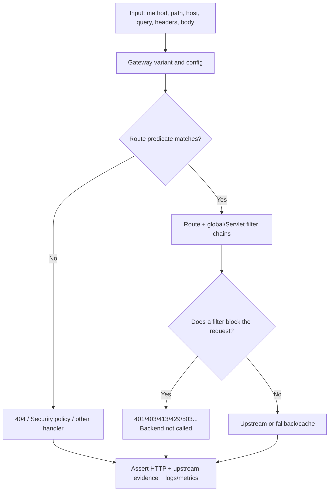
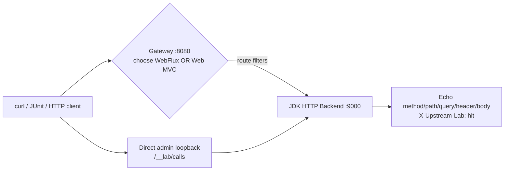
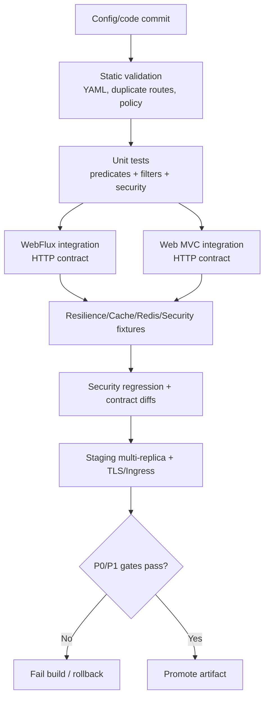

# Test Matrix by Variant, Route, and Filter Group in Spring Cloud Gateway

Spring Cloud Gateway is the **API Gateway** of the Spring ecosystem, supporting predicate-based routing, filter chain organization, path/header transformation, discovery-based service lookup, and policies for authentication, rate limiting, circuit breaking, retries, TLS, and request observability. A configuration that works for a single URL **does not mean** the Gateway is handling every route, every HTTP method, or every filter group properly in failure scenarios.

For example, `GET /public/catalog/42` returning `200 OK` can hide a host of issues: a route matching the wrong backend, incorrect `StripPrefix`, a session cookie leaking downstream to an upstream service, a spoofed client header not being overwritten, caching returning stale data, or the Gateway failing to limit requests when the backend errors out. These bugs usually surface only when we test **multidimensionally** rather than running a few "happy-path smoke tests".

This article belongs to the **Testing** chapter of the `SPRING_CLOUD_GATEWAY` module. Its focus is building a **test matrix along three primary axes — Gateway variant, route, and filter group** — combined with request types, input boundaries, security, and failure modes; then turning that matrix into an automated test suite that can run whenever YAML, Java config, dependencies, or multi-replica deployments change.

> **Version and scope:** Examples reference **Spring Cloud Gateway Server 5.0.x** on Spring Boot 4.x/Spring Framework 7 and its two variants, **Server WebFlux** and **Server Web MVC**. The starters and YAML namespaces are **different**; do not run both starters in the same lab app. This document distinguishes standard behavior defined by the HTTP contract from behavior that depends on implementation/version or optional dependencies. Do not infer from similar filter names that the APIs, ordering, default state, exception mapping, and caching mechanisms of the two variants are identical.

## 1. Learning Outcomes

After this lesson, you will be able to:

1. Identify the axes of a test matrix: `variant × route × filter-group × input × outcome`.
2. Inventory routes by `id`, `Path`, `Method`, `Host/Header/Query`, `order`, upstream, and auth policy.
3. Build a **compatibility matrix** between Server WebFlux and Server Web MVC instead of assuming every filter shares the same mechanism.
4. Select **match/no-match, overlap, boundary, invalid input, and upstream failure** cases for each route predicate.
5. Test filter groups for request path/query/header, response status/header/body, Security, rate limit, retry, circuit breaker, cache, TLS, and streaming.
6. Distinguish between a **Gateway-generated status**, a **backend status**, a **fallback response**, a **cached response**, and the outcome when a request matches no route.
7. Stand up an independent test backend, run either Gateway variant against the same contract, and use `curl`/an HTTP client to assert the results.
8. Automate smoke, integration, contract, concurrency, resilience, and regression tests; manage test data, clocks, retries, and environments.
9. Measure route coverage, matrix coverage, upstream observation results, and security/consistency risks without causing a combinatorial explosion.

## 2. Why Is "Send a Request and Check for 200" Not Enough?

A simple test:

```bash
curl -i http://localhost:8080/public/catalog/42
```

Looking only at `HTTP/1.1 200 OK`, we still do not know:

- Did the request actually reach **catalog-service** or a catch-all route?
- Was the path received by the backend `/catalog/42`, `/public/catalog/42`, or `/42`?
- Were `Cookie`/`Authorization` forwarded to an unauthorized service?
- Did `SetRequestHeader` replace all client-sent values or merely append?
- Is the response fresh from the backend, from cache, or from a fallback?
- Does the protective filter still run on the same route when requests hit another instance?
- Would a `POST`/`OPTIONS` request or invalid header be matched by mistake?
- When the backend returns 404 or 503, does the Gateway preserve the contract or translate it to another status?
- When no route matches, was the backend truly **not** called?

**A good test needs both an oracle and evidence.** A *test oracle* is the condition that defines what is correct. Beyond status, assert body/path, headers, upstream hit count, route ID/instance if instrumentation is available, the Security decision, and the **absence of side effects** when a request is rejected.



Note that this diagram is conceptual. With **Server Web MVC**, the Servlet `SecurityFilterChain` runs before the MVC handler/route is selected. With **WebFlux**, the Reactive `SecurityWebFilterChain` can also reject early. The exact ordering of each `GlobalFilter`/`GatewayFilter`/MVC filter must be verified on the actual application.

## 3. Designing a Multi-Axis Test Matrix

### 3.1. Five Primary Axes

| Axis | Example values | Risk if omitted |
|---|---|---|
| **V — Variant** | `WEBFLUX`, `WEBMVC` | One variant works while the other uses different API/filter behavior |
| **R — Route** | `catalog-special`, `catalog-generic`, `public-catchall`, `guarded`, `ingest` | Route shadowing, wrong `order`, wrong Method/Path |
| **F — Filter group** | Path/header/body/security/rate/retry/circuit/cache/TLS/streaming | Incorrect filter interaction, wrong status/mutation |
| **I — Input class** | Happy, no-match, boundary, malformed, unauthorized, concurrent | Testing only valid GET misses critical bugs |
| **O — Observable outcome** | HTTP status, headers, body, backend QPS, timing, metrics | False 200, request forwarded when it should have been blocked |

A matrix row can be described using a **test ID**:

```text
ID:   GW-WF-CAT-HEADER-NEG-004
V:    WEBFLUX
R:    catalog-generic
F:    REQUEST_HEADER
I:    Client sends Cookie and spoofed X-Lab-Route
O:    Upstream does not see Cookie; X-Lab-Route is "generic"
```

With MVC:

```text
ID:   GW-MVC-CAT-HEADER-NEG-004
V:    WEBMVC
R:    catalog-generic
F:    REQUEST_HEADER
I:    Equivalent to the input above
O:    Equivalent HTTP contract; same log/filter class not required
```

Two cases can share the **same business contract** while differing in unit-test setup, filter chain, threading model, and exceptions.

### 3.2. Do Not Multiply Every Axis Into a Full Cartesian Product

If there are 2 variants × 30 routes × 12 filter groups × 8 input classes × 5 outcomes, there are:

\[
2 \times 30 \times 12 \times 8 \times 5 = 28{,}800\ \text{combinations}.
\]

Most are meaningless: a `public-catalog` route may have no JWT, a WebSocket route has no HTTP response cache, and many outcomes cannot occur on the same request.

Instead of 28,800 tests, build **risk-based coverage**:

1. Each route has at least **one positive match**, one **negative match**, and one **overlap/priority** case when competing routes exist.
2. Each filter group has **happy path + refusal/failure path + boundary** cases on the routes where it applies.
3. High-risk interactions have **pairwise/cross-filter tests**: auth × cache, retry × non-idempotent POST, rate limit × multi-replica, TLS × forwarded headers, body modify × content length, WebSocket × ingress timeouts.
4. Cases with **risk of data leak/financial loss/auth bypass** receive deeper coverage than variants that only differ in cosmetic headers.
5. For untested combinations, record a **rationale** in the test inventory; do not claim "100%" just because every route has a single GET 200.

### 3.3. A Test Matrix Row Must Contain Enough Information to Reproduce

A test case has the following minimum structure:

| Field | Example |
|---|---|
| `id` | `GW-WF-RTE-007` |
| `variant/version` | `Server WebFlux 5.0.x` |
| `routeId / configRevision` | `catalog-special` / `rev42` |
| `environment` | Lab loopback, stub catalog backend |
| `preconditions` | Upstream healthy, cache reset, auth fixture A |
| `input` | `GET /public/catalog/special` + headers/Host |
| `expected route` | `catalog-special` instead of `catalog-generic` |
| `expected upstream` | `/catalog/special`, header `X-Lab-Route=special` |
| `expected HTTP` | `200`, `X-Edge-Lab: matrix` |
| `negative assertion` | Does not hit catch-all, does not send Cookie |
| `evidence` | Backend log/counter, response, trace/route metric |
| `cleanup` | Reset stub/counter, delete test session/token |
| `owner/priority` | Gateway team / P1 |

**Do not rely solely on a route ID in the HTTP response.** By default, the Gateway does not expose `routeId` to the client; if you need to assert the selected route, use an upstream marker or safe test instrumentation, and inspect secured Actuator routes to verify effective routing.

## 4. Matrix by **Server WebFlux vs Server Web MVC Variant**

First, distinguish the two architecturally different runtimes:

| Aspect | Server WebFlux | Server Web MVC | What must be tested |
|---|---|---|---|
| HTTP runtime | Reactor Netty + WebFlux reactive | Servlet container + Spring MVC/WebMvc.fn | Thread model, timeout, body/stream handling |
| Starter | `spring-cloud-starter-gateway-server-webflux` | `spring-cloud-starter-gateway-server-webmvc` | Do not mix on classpath |
| YAML route prefix | `spring.cloud.gateway.server.webflux.routes` | `spring.cloud.gateway.server.webmvc.routes` | Effective config and route loading |
| Route model | `Route`, `RoutePredicateFactory`, `GatewayFilterFactory` | `RouterFunction`/`HandlerFunctions`, MVC predicates/filters | Matcher, route order, filter phase |
| Request/response filters | `GatewayFilter`/`GlobalFilter`, Reactor | `HandlerFilterFunction`/`BeforeFilterFunctions`/`AfterFilterFunctions`, Servlet | Header/path/body mutation and order |
| Spring Security | `ServerHttpSecurity` / `SecurityWebFilterChain` | `HttpSecurity` / `SecurityFilterChain` | 401/403/CSRF/session behavior |
| Session | Reactive `WebSession` (if used) | Servlet `HttpSession` (if used) | Cookie, store, invalidation, scale |
| HTTP client test | `WebTestClient` (WebFlux unit/integration/live) | `MockMvc` for Servlet; live HTTP tests | Runtime-appropriate test harness |
| Stream/upgrade | Reactor Netty WebSocket / streaming | Servlet MVC/HTTP streaming + MVC WebSocket proxy behavior | Handshake/session/flush/idle |
| Resilience/cache | Filters and optional dependencies per WebFlux release | Dedicated MVC filter implementations and optional dependencies | Do not assume identical defaults/exception mapping |
| Route config introspection | Gateway WebFlux Actuator APIs | Gateway MVC Actuator/diagnostics per version | Observing effective loaded routes |

The Gateway 5.0.x documentation is the authoritative source for each variant. Two configurations with the same `Path=/public/**` and `StripPrefix=1` can be expected to share the same **HTTP contract**; however, that does not mean every filter shares the same class name, parameters, body streaming support, or fallback semantics.

### 4.1. Test Groups That Must Run on **Both** Variants

- Route matching (Path/Method/Header/Host/Query) and priority ordering.
- Path transformations (StripPrefix/SetPath/RewritePath) supported by the variant.
- Header add/set/remove and response status/header.
- Status forwarding / Gateway 404 vs backend 404; HTTP semantics.
- Request body forwarding and content-type/transfer encoding.
- Authentication/authorization **using the respective Security stack**.
- Outbound TLS/hostname validation, ingress forwarded headers, request-size limit.
- Observability route ID, 5xx, timeout, and latency if instrumentation APIs are available.

### 4.2. Tests That Must Be Designed **Per Variant** Instead of Copied

- Unit tests for `GatewayFilter`/`GlobalFilter` using `MockServerWebExchange`/Reactor `StepVerifier` apply only to WebFlux; do not port them to MVC.
- Servlet `SecurityFilterChain`/`MockMvc`/`HttpSession` apply only to Server Web MVC; WebFlux requires reactive security fixtures.
- `ModifyRequestBody`/`ModifyResponseBody` in WebFlux are typically configured via Java DSL and require codecs/rewrite functions; do not mechanically copy YAML body filters from MVC.
- `Retry` in MVC 5.0 may use Spring Retry or Spring Framework retry depending on classpath/properties; WebFlux retry uses Reactor-specific semantics. Assertions should measure **attempt counts**, body preservation, and idempotency.
- `LocalResponseCache`/Caffeine, shared Redis store, WebSocket handshake, and custom filter availability must be verified for the **exact version and variant**.
- When using `forward:` to fall back to a local handler, test committed-response errors in each runtime; do not assume a WebFlux fallback test proves MVC behavior.

### 4.3. A Variant Label Is Not an Environment Label

A matrix should distinguish:

```text
variant = WEBFLUX | WEBMVC
deployment = LOCAL | CI | STAGING | PRODUCTION
replicas = 1 | N
tlsMode = DIRECT | INGRESS_TERMINATION | MTLS_OUTBOUND
configVersion = git SHA / route revision
```

**Passing** `WEBFLUX / LOCAL / 1 replica` does not mean `WEBFLUX / STAGING / 8 replicas` will also behave properly for auth/caching/rate limiting. Those require distributed-environment tests.

## 5. Matrix by **Route and Route Predicates**

Suppose a Gateway exposes five routes:

| Route ID | Predicate | `order` | Destination and filters |
|---|---|---:|---|
| `catalog-special` | `GET /public/catalog/special` | -10 | Catalog, StripPrefix=1, header route=special |
| `catalog-generic` | `GET /public/catalog/**` | 0 | Catalog, StripPrefix=1, header route=generic |
| `public-catchall` | `GET /public/**` | 10 | Public service, StripPrefix=1, header route=catch |
| `guarded` | `GET /guarded/**` + `Header=X-Scenario,allow` | 0 | Guarded service, StripPrefix=1 |
| `ingest` | `POST /ingest/**` | 0 | Ingest service, StripPrefix=1, keep body |

A smaller `order` value takes precedence **when multiple routes match**, but it never makes a route with a non-matching `Path`/`Method` match. Depending on the variant, route matching is also influenced by framework handler mappings, default route predicates, and preceding Security filters.

### 5.1. Positive/Negative/Overlap Cases

| ID | Input | Expected route | Expected backend path | Expected outcome |
|---|---|---|---|---|
| R01 | `GET /public/catalog/special` | `catalog-special` | `/catalog/special` | `200`; marker `special` |
| R02 | `GET /public/catalog/42` | `catalog-generic` | `/catalog/42` | `200`; marker `generic` |
| R03 | `GET /public/other` | `public-catchall` | `/other` | `200`; marker `catch` |
| R04 | `GET /guarded/ping` + `X-Scenario: allow` | `guarded` | `/ping` | `200`; upstream called |
| R05 | `GET /guarded/ping` **without header** | None | — | 404 if no other handler; upstream **not** called |
| R06 | `GET /guarded/ping` + `X-Scenario: deny` | None | — | 404; upstream not called |
| R07 | `POST /ingest/items` + JSON | `ingest` | `/items` | Body/Content-Type preserved |
| R08 | `GET /ingest/items` | None | — | 404; backend not called |
| R09 | `POST /public/catalog/42` | None | — | 404 or Security refusal per config |
| R10 | `GET /missing` | None | — | Gateway/handler 404, no upstream marker |
| R11 | `GET /public/status/404` | `public-catchall` | `/status/404` | **Backend 404** with upstream marker |
| R12 | `GET /public/status/503` | `public-catchall` | `/status/503` | **Backend 503**, if no fallback/retry |
| R13 | `GET /public/catalog/special?lang=vi` | `catalog-special` | `/catalog/special?lang=vi` | Query preserved per contract |
| R14 | `HEAD /public/catalog/42` | None if Method is GET only | — | Do not assume HEAD always routes like GET |
| R15 | `GET /public/catalog/42` + `Cookie: secret=...` | `catalog-generic` | `/catalog/42` | Upstream does not see Cookie if route removes it |
| R16 | `GET /public/catalog/42` + `X-Lab-Route: forged` | `catalog-generic` | `/catalog/42` | Upstream sees the header value set by Gateway `Set` |
| R17 | `GET /PUBLIC/CATALOG/42` | Depends on exact Path case matching | — | Test per variant/config, do not assume |
| R18 | `GET /public/catalog/42/` | May differ from path without trailing slash | — | Assert contract/normalization |
| R19 | `GET /public/catalog/%2Fadmin` | Depends on container/firewall/decoding | — | Must not bypass auth or path policy |
| R20 | `GET /public//catalog/42` | Depends on normalization | — | Must not bypass constraints |
| R21 | `GET /public/catalog/42` with a different Host | May still match if no Host predicate | `/catalog/42` | Must test Host/tenant policy separately |
| R22 | Two conflicting `X-Scenario` headers sent | Depends on implementation/Header predicate | — | Do not accept arbitrary values and ignore the contract |
| R23 | Route `catalog-special` deleted/reordered | `catalog-generic` may receive request | `/catalog/special` | Detects route shadow/regression |
| R24 | Dynamic route updated, one instance not refreshed | Old revision on that instance | Per old revision | Detects route drift across replicas |

**Do not collapse every 404 into the same assertion.** R10 is a *Gateway route miss*; R11 is an *upstream 404*. In the lab, the backend attaches `X-Upstream-Lab: hit` to responses, allowing us to tell which side produced the status. Production can use tracing/route metrics instead of a marker; do not rely solely on status.

### 5.2. `Host` and `Header` Predicates Must Test Spoofing

For example, when organizing routes by tenant:

```yaml
predicates:
  - Host=tenant-a.example.test
  - Path=/api/**
```

The matrix must test:

- Matching/non-matching Host; port and casing per HTTP semantics.
- Requests sent to the Gateway IP while the client sets `Host` itself.
- **Sanitized** `X-Forwarded-Host` from the ingress versus spoofed headers from an Internet client.
- Tenant A's token accessing tenant B's Host: authentication succeeds, but **authorization must fail**.
- Multiple header values, duplicate names with different casing, whitespace/invalid bytes.

**Host/Path matching is not a complete tenant security boundary.** Access control must rely on verified identity and policy at the Gateway/backend; an attacker can send any Host header in an HTTP client.

### 5.3. Testing Route Precedence and Namespace Overlap

A common mistake:

```yaml
# Illustrates OVERLAP RISK; do not copy to production.
- id: overly-broad
  uri: http://backend-a
  order: -100
  predicates:
    - Path=/**
- id: payments
  uri: http://backend-payments
  order: 0
  predicates:
    - Path=/api/payments/**
```

If the broad route has higher precedence, it can capture payments traffic without running the filters/authorization expected on the narrower route. Mandatory tests:

1. Every sensitive route has a positive test confirming the right upstream and the right security policy.
2. Broad `/**`/`/api/**` routes have negative tests proving they **do not** shadow specific routes.
3. Regression tests run whenever `order` changes, wildcards/Host/Method are added, or discovery locator is enabled.
4. Check for duplicate route IDs across YAML, Java code, discovery, and dynamic sources.

## 6. Matrix by **Filter Group**

This is the axis most likely to diverge, because filters operate **before and after proxying** and can block requests, mutate requests, consume bodies, return fallbacks, cache responses, or alter statuses/headers.

| Group | Typical filter/capability | Positive | Negative/boundary | Key evidence |
|---|---|---|---|---|
| **F01 Path** | `StripPrefix`, `SetPath`, `RewritePath` | Backend sees expected new path | Regex unmatched, encoded slash, trailing slash | Upstream raw/decoded path; path traversal test |
| **F02 Query** | `AddRequestParameter`, `RewriteRequestParameter` | Query contains expected values | Duplicate keys, `%20` encoding, Unicode | Raw query and parsed params at backend |
| **F03 Request header** | `Add/Set/RemoveRequestHeader` | Header value set/modified/removed | Client spoofing, multiple values, casing | Headers received at backend |
| **F04 Response header** | `Add/Set/RemoveResponseHeader`, `DedupeResponseHeader` | Response headers correct | Duplicate CORS, Set-Cookie, newline | Headers reaching client, not just upstream |
| **F05 Redirect/status** | `RedirectTo`, `SetStatus`, `RewriteLocationResponseHeader` | 3xx and Location match contract | Relative vs absolute, host poisoning, status masking | HTTP status + Location + no backend call on redirect |
| **F06 Request body** | `ModifyRequestBody` / request-size / body caching | Content-Type/JSON body correct | Empty/invalid/too large/streaming | Byte payload, status 413, backend count |
| **F07 Response body** | `ModifyResponseBody`, header length adjustment | Output body validly transformed | Binary/gzip, empty body, chunked | Actual bytes + Content-Length/Encoding |
| **F08 Authentication** | Spring Security `SecurityWebFilterChain`/`SecurityFilterChain`, TokenRelay | Authorized principal reaches right route | Missing/expired/bad token; wrong tenant | 401/403, upstream not called, identity boundaries |
| **F09 Rate limit** | `RequestRateLimiter`/provider limiter | Allows request while quota remains | Quota exceeded, unknown key, concurrent bursts | 429/configured status, no backend call, quota state |
| **F10 Circuit breaker** | `CircuitBreaker`, `FallbackHeaders` | Healthy upstream returns directly | Timeout/5xx/error, OPEN/HALF_OPEN, fallback failure | Backend attempts, fallback marker, breaker metrics |
| **F11 Retry** | `Retry` | Transient error then success | Non-idempotent POST, retry storm, body replay | **Attempt count**, side effects, latency, response |
| **F12 Cache** | `LocalResponseCache`, edge/shared cache | Repeated safe GET can hit | `no-store`/`private`, invalidation, variant, multi-replica | Upstream call count, freshness, cache hit/miss |
| **F13 Service discovery** | `lb://...`, service instance resolution | Selects healthy instance | Empty registry, stale instance, scheme/port mismatch | Instance ID + backend call + 503/other error |
| **F14 TLS** | HTTPS outbound, mTLS, forwarded headers | Trusted CA/SAN accepted | Untrusted/expired cert, wrong hostname | Handshake/HTTP failure **without bypassing TLS verify** |
| **F15 WebSocket** | `ws://`/`wss://` WebSocket proxy | HTTP 101 + messages round-trip | Origin, 401/403, close, ping/pong, long-lived | WebSocket client session, close codes, backend messages |
| **F16 Streaming** | SSE/streaming, HTTP chunking | Incremental data delivered | Buffering, timeout, cancellation | First-byte/first-event latency, resource cleanup |
| **F17 Observability** | Global filters, metrics, tracing, request ID | Route/trace recorded | Errors, fallback, cache hit, body redaction | Logs/metrics/traces without secrets |
| **F18 Global filter order** | WebFlux `GlobalFilter`/`Ordered`, MVC servlet/functional filters | Pre- and post-order correct | Short-circuit, exception, route filter interaction | Execution trace/mocks in correct stack |

**Not every name in this table has an identical factory across both variants.** Treat this as a **catalog of contracts to test**, then cross-check the filter documentation for each Server WebFlux/MVC release and mark `N/A` rows with a rationale. In particular, body transform, retry, rate limiter, local cache, WebSocket, circuit breaker, and `TokenRelay` have variant-specific mechanisms that require reading the right docs.

### 6.1. Path/Query/Header Transformation Group

A thorough `RewritePath` test needs:

- Matching regex, resulting backend path, and query after rewrite.
- Non-matching regex and whether the filter handles it according to contract.
- Named capture groups, YAML escaping of `$`/`\\`, and Unicode.
- Encoded paths `%2F`/`%2E`, duplicate slashes, `..`; must not bypass Security.
- Filter ordering when combining `StripPrefix`, `SetPath`, `RewritePath`, or `lb://`.
- Spoofed client `X-User-Id` header; whether set/remove filters overwrite it as expected.
- Whether `Host`/`Forwarded` and CORS response headers are handled by trusted proxy layers.

**Distinguish `AddRequestHeader` from `SetRequestHeader`:** Add can retain client-sent values; Set replaces header values of the same name. For Gateway-controlled security/identity headers, test **client spoofing** and use a trusted mechanism rather than just appending a new value.

### 6.2. Body and Request-Size Group

In a JSON API:

```http
POST /ingest/items HTTP/1.1
Content-Type: application/json

{"sku":"A-42","count":2}
```

Different checks to run:

| Test | What to assert |
|---|---|
| Normal body | Exact JSON bytes/structure at backend |
| Empty body | Route/filter has a clear contract for no body |
| Malformed JSON | Appropriate 4xx; backend does not process as valid JSON |
| Body exceeding `RequestSize` | Status `413 Payload Too Large`; backend does **not** receive body |
| Chunked transfer | Does not require client `Content-Length`; forwards intact or rejects per policy |
| Invalid/conflicting `Content-Length` | Server/ingress prevents request smuggling, no ambiguous parsing |
| Body with Unicode | UTF-8 and content type remain intact |
| Compressed body | `Content-Encoding` and body bytes are consistent |
| Streaming response | Body rewrite filter does not buffer unboundedly |

Do not assume `413` always comes from the Gateway: the ingress may reject earlier, the Servlet container has its own upload/request size limit, and the Gateway filter only runs when a route matches. Tests should attach markers/metrics to know **which layer rejected**.

### 6.3. Rate Limiting Must Test Both **Time and Keys**

For example, WebFlux `RequestRateLimiter` using Redis/token bucket. Matrix:

- A valid identity within quota: request is forwarded.
- Multiple requests with the same key exceeding quota: returns `429` by default (unless config changes it).
- Two users with different keys: independent quotas per resolver contract.
- Empty/unauthenticated key: **must not be allowed through** if policy is deny-empty.
- Two Gateway replicas sharing Redis: quota stays enforced **cluster-wide** per key, not doubled per pod.
- Redis unavailable: documented behavior/failure policy, not unintended fail-open on sensitive quotas/permissions.
- For WebSocket, a limiter at **handshake** does not automatically limit individual frames/messages.
- Refill interval delay/jitter: use a test clock/awaiting/tolerance; do not assert exact milliseconds with `sleep`.

Do not fire bursts of real requests at production to test 429; practice against a test Redis/provider or an isolated environment with its own quota.

### 6.4. Circuit Breaker: Verify **Fallback Does Not Mask Business Errors**

Scenarios:

| Backend outcome | Question |
|---|---|
| Normal 200 | Does the breaker avoid fallback and return the exact body? |
| 404 entity not found | Is it misconfigured into being treated as a "service failure"? |
| 401/403 unauthorized/forbidden | Does the fallback **mask security errors**? |
| 409/422 business conflict | Does not return a fake 200 or someone else's cached data |
| 503/timeout/network failure | Valid fallback/error, marker, and metrics? |
| OPEN state | Does it short-circuit without calling the backend? |
| HALF_OPEN | Permit/probe and recovery per policy |
| Fallback itself fails | No infinite recursion or `forward:` loop |
| Client disconnect/response committed | Retry/fallback does not emit a second HTTP response |

A test that only asserts "returns 200 when backend returns 500" **may be a wrong test** if the fallback is supposed to return a controlled 503. Base the failure contract on business semantics rather than assuming fallback always means success.

### 6.5. Retry Must Measure Side Effects and Call Counts

Across WebFlux/MVC, `Retry` can have different implementations and parameters; evaluate the active policy:

- Idempotent GET: upstream attempt 1 returns 503, attempt 2 returns 200 → final response is correct and **upstream attempts = 2** if configured for one retry.
- GET 404: normally not retried if policy targets 5xx only; verify in practice.
- Order/charge POST: **do not retry blindly** without an idempotency key and deduplication.
- POST with body: verify body replay/caching behavior and memory pressure when enabled.
- Retry + CircuitBreaker: measure filter order, metric counting, and total upstream attempt limits.
- Timeout after the upstream **already committed a side effect** but the response was lost: retry can create duplicate transactions if the backend is not idempotent.

**Do not assert only final status `200`:** it hides 5x retries, inflated costs, duplicate writes, or SLO-breaching latency. The stub backend must record **attempt count** and request ID.

### 6.6. Cache Must Test Freshness and Data Isolation

A local cache may hit cleanly on replica A while missing or holding a different revision on replica B. Matrix for `LocalResponseCache`:

| Condition | What to verify |
|---|---|
| Public GET, cacheable 200 | Subsequent request can hit; backend call count drops |
| `Cache-Control: private, no-store` | Sensitive response is not stored |
| POST/PUT/PATCH | Not cached like GET by this WebFlux filter |
| Different URL/query/Host/`Vary` | Does not serve the wrong response variant |
| Different Authorization/Cookie/tenant | No cross-user/cross-tenant data leak |
| TTL expired | Entry refreshes per policy and new upstream revision |
| Cache eviction | No crash/OOM; misses/evictions observable |
| Cache hit + backend unavailable | May serve stale data per cache policy; does not prove backend is healthy |
| Gateway scaled 2 → 5 replicas | Caffeine cache is **per-JVM**, cold misses occur |
| Request with `no-cache` | Verify semantics for the **exact release**; do not treat as distributed purge |

Test caching at the Gateway **and** at the CDN/browser if present; a `Cache-Control` header can be acted upon by multiple layers. For authenticated/private routes, prefer **no caching** unless key design and authorization partitioning are proven.

### 6.7. Security Is the **Highest-Priority** Test Group

| Test | Expectation |
|---|---|
| Missing credential | 401 or 302 login per security scheme; backend not called |
| Expired/bad signature/wrong issuer/audience token | Rejected before upstream |
| User has right role but does not own resource | Backend/domain authorization still denies |
| Client spoofs `X-User-Id`/`X-Tenant` | Not trusted unless verified/overwritten |
| Tenant A calls tenant B Host/path | Denied per identity/policy |
| Servlet form POST missing CSRF | 403; cannot be bypassed via Gateway route |
| WebFlux JWT chain vs MVC Servlet chain | Uses right framework API; same policy, different implementation |
| User A's cached response served to user B | **Never** leaks private data |
| Upstream `Set-Cookie` response | Cookie boundaries and SameSite/Domain/Path are correct |
| Outbound TLS to untrusted host | Fails handshake; trust-all is not enabled |
| Actuator/control plane on public interface | Cannot CRUD/refresh/configure Gateway unauthenticated |

**Never include real passwords/tokens/cookies in test logs, HAR files, failed assertions, or CI artifacts.** Fixtures must be synthetic, short-lived, and secret-masked. When checking HTTP headers, assert presence/absence or redacted values; never print raw `Authorization`.

### 6.8. WebSocket/SSE: Test Beyond the Handshake

HTTP `101 Switching Protocols` only proves the WebSocket handshake. You must continue sending/receiving frames and test close codes, heartbeats, Origin, per-message authorization, size/quota limits, and reconnect across replicas. For SSE, `200 text/event-stream` must assert that **events arrive incrementally**, rather than waiting for the stream to end before reading the body. Tests must close sessions/connections upon completion to avoid hanging CI.

## 7. Matrix of **Interactions Between Filter Groups**

Each filter passing in isolation is not enough. Some of the most severe bugs appear only when **two or three filters apply together**.

| Combination | Scenario | Key assertion |
|---|---|---|
| Security × RewritePath | Public client path rewritten to admin path | Security not bypassed due to original vs rewritten path mismatch |
| Security × Cache | Two different JWTs/cookies call same URL | User A's private data is never served to B |
| Retry × CircuitBreaker | Upstream returns 503 then 200 | Attempt/CB metrics and filter order correct; no retry past quota |
| Retry × Request body | POST with JSON body and retry | Body not lost/duplicated; idempotency key/dedup or no retry |
| Retry × RateLimiter | One client request triggers multiple backend attempts | Client quota and backend budget match contract |
| Header rewrite × TokenRelay | Client sends its own Authorization/identity header | Token relay/auth policy is not wrongly overridden |
| RewritePath × LoadBalancer | `lb://` after path rewrite | Backend receives right URI/path, port/scheme |
| Response body × Content-Length | Body length changes | `Content-Length`/encoding/chunked valid, payload not truncated |
| CORS × DedupeResponseHeader | Both Gateway and backend set Allow-Origin | Valid header, not illegally duplicated |
| RateLimiter × Multi-replica | Burst from same user hits two pods | Per-key quota remains enforced cluster-wide |
| CircuitBreaker × Fallback | Fallback calls original route | No recursion or unauthorized data returned |
| Cache × Rolling restart | New pod cache cold, old pod warm | SLO/staleness and backend QPS stay within budget |
| TLS × Forwarded headers | Ingress terminates TLS, client spoofs forwarded host | No open redirect or insecure cookie issued |
| WebSocket × Security/Origin | Cross-origin browser has session cookie | Origin allowlist, auth handshake, per-message auth |
| Streaming × Body filter | Unbounded SSE response | Does not buffer whole stream; first event within deadline |
| Response header × 304/204 | Response has no body | Does not emit invalid body or invalid headers |

### 7.1. What Is Pairwise Testing For?

Pairwise testing selects a subset such that **every pair of values across axes** appears at least once, avoiding the full Cartesian product. It works well for variations of hosts, methods, header values, TLS modes, and filter combinations.

**However, pairwise testing does not guarantee catching all bugs.** A bug like "CSRF disabled only when route rewrite + cache hit + tenant B" is a three-way interaction. For security/payment/authorization, add **targeted triples** or dedicated tests based on the threat model.

### 7.2. Risk-Based Coverage

One way to prioritize:

| P0 | P1 | P2 |
|---|---|---|
| Auth bypass, cross-tenant leak, duplicate payment, TLS trust-all | Route priority, cache staleness, retry storm, circuit breaker fallback | Cosmetic headers, secondary metrics labels |
| Exposed Gateway admin, SSRF, request smuggling | Redis outage, no-instance, body size/encoding | Human-readable error formatting |
| Security regression on variant/version change | Multi-replica consistency, rolling update | Cosmetic ordering of non-critical headers |

Do not treat P0/P1/P2 as a "Spring standard"; it is a **project-level prioritization scheme**. Actual severity depends on data sensitivity, threat model, SLA/SLO, and route contract.

## 8. Lab: Same HTTP Contract, Running Both Gateway Variants Separately

The lab intentionally uses **one independent JDK backend** and **two independent Gateway applications**. Only **one Gateway** needs to run on port `8080` at a time:



**Do not run both starters in the same lab JVM.** To compare them, stop the WebFlux Gateway and start the MVC Gateway, or use two separate projects/ports. Avoid mixing Security stacks, starters, or route prefixes on one classpath so test results stay unambiguous.

### 8.1. Building a Request-Tracing Backend

Create `MatrixUpstream.java` in your practice directory:

```java
import com.sun.net.httpserver.HttpExchange;
import com.sun.net.httpserver.HttpServer;
import java.net.InetSocketAddress;
import java.nio.charset.StandardCharsets;
import java.util.concurrent.Executors;
import java.util.concurrent.atomic.AtomicInteger;

public class MatrixUpstream {
    private static final AtomicInteger CALLS = new AtomicInteger();

    public static void main(String[] args) throws Exception {
        HttpServer server = HttpServer.create(
                new InetSocketAddress("127.0.0.1", 9000), 0);

        server.createContext("/", MatrixUpstream::handle);
        server.setExecutor(Executors.newFixedThreadPool(4));
        server.start();

        System.out.println("Matrix backend on http://127.0.0.1:9000");
        System.out.println("Diagnostics: GET /__lab/calls, POST /__lab/reset");
    }

    private static void handle(HttpExchange exchange) throws java.io.IOException {
        try (exchange) {
            String method = exchange.getRequestMethod();
            String path = exchange.getRequestURI().getRawPath();

            // Admin endpoints FOR LOOPBACK LAB ONLY.
            if ("/__lab/calls".equals(path) && "GET".equals(method)) {
                respond(exchange, 200, "calls=" + CALLS.get(), false);
                return;
            }
            if ("/__lab/reset".equals(path) && "POST".equals(method)) {
                CALLS.set(0);
                respond(exchange, 200, "reset=ok", false);
                return;
            }

            int call = CALLS.incrementAndGet();
            String rawQuery = exchange.getRequestURI().getRawQuery();
            String route = exchange.getRequestHeaders()
                    .getFirst("X-Lab-Route");
            String cookie = exchange.getRequestHeaders()
                    .getFirst("Cookie");
            String body = new String(
                    exchange.getRequestBody().readAllBytes(),
                    StandardCharsets.UTF_8);

            String result = "call=" + call
                    + "\nmethod=" + method
                    + "\npath=" + path
                    + "\nquery=" + (rawQuery == null ? "" : rawQuery)
                    + "\nroute=" + (route == null ? "" : route)
                    + "\ncookiePresent=" + (cookie != null)
                    + "\nbody=" + body + "\n";

            int status = switch (path) {
                case "/status/404" -> 404;
                case "/status/503" -> 503;
                default -> 200;
            };

            respond(exchange, status, result, true);
            System.out.println(method + " " + path
                    + " status=" + status + " call=" + call);
        }
    }

    private static void respond(HttpExchange exchange, int status,
                                String body, boolean markUpstream)
            throws java.io.IOException {
        byte[] bytes = body.getBytes(StandardCharsets.UTF_8);
        exchange.getResponseHeaders().set("Content-Type",
                "text/plain; charset=utf-8");
        exchange.getResponseHeaders().set("Cache-Control", "no-store");

        if (markUpstream) {
            exchange.getResponseHeaders().set("X-Upstream-Lab", "hit");
        }
        exchange.sendResponseHeaders(status, bytes.length);
        try (var output = exchange.getResponseBody()) {
            output.write(bytes);
        }
    }
}
```

Run the backend with JDK 21+ (Java 17 also supports `switch` expressions and `readAllBytes()`; Spring Boot 4 is compatible with Java 17+):

```bash
java --add-modules jdk.httpserver MatrixUpstream.java
```

The backend binds only to `127.0.0.1`. `/__lab/calls` and `/__lab/reset` have **no authentication** and are for testing only; **do not deploy them to production** and do not expose the port to the Internet. Production backends require proper auth, body size limits, validation, observability, and resource management.

The advantage of this backend is that we can tell a response that **went through upstream** (`X-Upstream-Lab: hit` present) from one returned directly by the Gateway due to a route miss or short-circuit. The counter records actual requests reaching the backend rather than guessing from latency.

### 8.2. Creating the WebFlux Gateway Project

Create a Spring Boot 4.x project with a compatible Spring Cloud BOM 2025.1.x. Main dependency:

```xml
<dependency>
    <groupId>org.springframework.cloud</groupId>
    <artifactId>spring-cloud-starter-gateway-server-webflux</artifactId>
</dependency>
```

Bootstrap class:

```java
import org.springframework.boot.SpringApplication;
import org.springframework.boot.autoconfigure.SpringBootApplication;

@SpringBootApplication
public class MatrixGatewayWebFluxApp {
    public static void main(String[] args) {
        SpringApplication.run(MatrixGatewayWebFluxApp.class, args);
    }
}
```

`src/main/resources/application.yml`:

```yaml
server:
  address: 127.0.0.1
  port: 8080

spring:
  application:
    name: gateway-webflux-matrix-lab

  cloud:
    gateway:
      server:
        webflux:
          routes:
            - id: catalog-special
              order: -10
              uri: http://127.0.0.1:9000
              predicates:
                - Path=/public/catalog/special
                - Method=GET
              filters:
                - StripPrefix=1
                - SetRequestHeader=X-Lab-Route,special
                - AddResponseHeader=X-Edge-Lab,matrix

            - id: catalog-generic
              order: 0
              uri: http://127.0.0.1:9000
              predicates:
                - Path=/public/catalog/**
                - Method=GET
              filters:
                - StripPrefix=1
                - SetRequestHeader=X-Lab-Route,generic
                - RemoveRequestHeader=Cookie
                - AddResponseHeader=X-Edge-Lab,matrix

            - id: public-catchall
              order: 10
              uri: http://127.0.0.1:9000
              predicates:
                - Path=/public/**
                - Method=GET
              filters:
                - StripPrefix=1
                - SetRequestHeader=X-Lab-Route,catch

            - id: guarded
              order: 0
              uri: http://127.0.0.1:9000
              predicates:
                - Path=/guarded/**
                - Method=GET
                - Header=X-Scenario,allow
              filters:
                - StripPrefix=1
                - SetRequestHeader=X-Lab-Route,guarded

            - id: ingest
              order: 0
              uri: http://127.0.0.1:9000
              predicates:
                - Path=/ingest/**
                - Method=POST
              filters:
                - StripPrefix=1
                - SetRequestHeader=X-Lab-Route,ingest
```

These lab routes **have no Security and run on loopback**. `/public/catalog/special` matches all three `Path` predicates, but thanks to `order=-10`, route `catalog-special` is selected first. `/public/catalog/42` matches generic and catch-all, with generic taking precedence. `Header=X-Scenario,allow` is specific to the `guarded` route; without the header, it does not proxy.

### 8.3. Creating a Separate Server Web MVC Gateway Project

Use a **different** Spring Boot project containing:

```xml
<dependency>
    <groupId>org.springframework.cloud</groupId>
    <artifactId>spring-cloud-starter-gateway-server-webmvc</artifactId>
</dependency>
```

Bootstrap class:

```java
import org.springframework.boot.SpringApplication;
import org.springframework.boot.autoconfigure.SpringBootApplication;

@SpringBootApplication
public class MatrixGatewayMvcApp {
    public static void main(String[] args) {
        SpringApplication.run(MatrixGatewayMvcApp.class, args);
    }
}
```

The MVC `application.yml` differs only in the **prefix** while preserving the same HTTP contract and route/filter configuration:

```yaml
server:
  address: 127.0.0.1
  port: 8080

spring:
  application:
    name: gateway-mvc-matrix-lab

  cloud:
    gateway:
      server:
        webmvc:
          routes:
            - id: catalog-special
              order: -10
              uri: http://127.0.0.1:9000
              predicates:
                - Path=/public/catalog/special
                - Method=GET
              filters:
                - StripPrefix=1
                - SetRequestHeader=X-Lab-Route,special
                - AddResponseHeader=X-Edge-Lab,matrix

            - id: catalog-generic
              order: 0
              uri: http://127.0.0.1:9000
              predicates:
                - Path=/public/catalog/**
                - Method=GET
              filters:
                - StripPrefix=1
                - SetRequestHeader=X-Lab-Route,generic
                - RemoveRequestHeader=Cookie
                - AddResponseHeader=X-Edge-Lab,matrix

            - id: public-catchall
              order: 10
              uri: http://127.0.0.1:9000
              predicates:
                - Path=/public/**
                - Method=GET
              filters:
                - StripPrefix=1
                - SetRequestHeader=X-Lab-Route,catch

            - id: guarded
              order: 0
              uri: http://127.0.0.1:9000
              predicates:
                - Path=/guarded/**
                - Method=GET
                - Header=X-Scenario,allow
              filters:
                - StripPrefix=1
                - SetRequestHeader=X-Lab-Route,guarded

            - id: ingest
              order: 0
              uri: http://127.0.0.1:9000
              predicates:
                - Path=/ingest/**
                - Method=POST
              filters:
                - StripPrefix=1
                - SetRequestHeader=X-Lab-Route,ingest
```

In MVC, routes are represented via Spring WebMvc.fn `RouterFunction`/`HandlerFunction` and MVC filter functions, **not** by WebFlux's reactive `GatewayFilter`. These two YAML files use filters with **shared syntax documented for both variants**. For more specialized filters, create separate fixtures/configs for each variant.

**Note:** These are the **core** dependencies, not a complete `pom.xml`. Each project needs a parent/BOM/plugin matching your Java/Boot/Cloud versions. Do not declare both WebMVC and WebFlux starters in one project to "compare", because Boot may choose an unexpected application type and infrastructure.

### 8.4. Starting the Lab per Variant

Keep the backend `:9000` terminal running. Open another terminal in the Gateway project you want to test:

```bash
# On Linux/macOS
./mvnw spring-boot:run

# On Windows PowerShell
.\mvnw.cmd spring-boot:run
```

First run **WebFlux** on `:8080` and execute the matrix. Then stop WebFlux, verify port `8080` is released, start **MVC**, and rerun the matrix. If you need to run them concurrently, configure **two different ports** and adjust the `GATEWAY_BASE_URL` variable in the test suite; backend `9000` can be shared, though when comparing backend counters you must reset/partition tests to avoid interference.

### 8.5. Running the Smoke Matrix with `curl`

**Reset counter (loopback backend):**

```bash
curl -i -X POST http://127.0.0.1:9000/__lab/reset
curl -s http://127.0.0.1:9000/__lab/calls
```

Expected: `calls=0`.

**Case R01 — specific route takes precedence:**

```bash
curl -i http://127.0.0.1:8080/public/catalog/special
```

Expected key signals:

```http
HTTP/1.1 200 OK
X-Upstream-Lab: hit
X-Edge-Lab: matrix
Content-Type: text/plain; charset=utf-8

call=1
method=GET
path=/catalog/special
query=
route=special
cookiePresent=false
body=
```

Headers may differ in casing/order by runtime and the `call` number changes if another test ran earlier; **assert contract values**, not header ordering. `route=special` is data the backend read from the Gateway-set header, letting you verify which route was selected.

**Cases R02/R15/R16 — generic route, cookie, and header spoofing:**

```bash
curl -i \
  -H "Cookie: SESSION=synthetic-test-only" \
  -H "X-Lab-Route: forged" \
  "http://127.0.0.1:8080/public/catalog/42?lang=vi"
```

Expected:

```text
method=GET
path=/catalog/42
query=lang=vi
route=generic
cookiePresent=false
```

`route=generic` proves `SetRequestHeader` overwrote the client's `forged` value. `cookiePresent=false` proves `RemoveRequestHeader=Cookie` ran on the **catalog-generic** route. Do not use real session cookies to test header forwarding.

**Case R03 — catch-all:**

```bash
curl -i http://127.0.0.1:8080/public/other
```

Expected `route=catch` and `path=/other`, not `route=generic`.

**Cases R04/R05 — Header predicate:**

```bash
curl -i \
  -H "X-Scenario: allow" \
  http://127.0.0.1:8080/guarded/ping

curl -i http://127.0.0.1:8080/guarded/ping
```

The first request should return 200 and the backend sees `path=/ping`. The second matches no route in the lab and normally returns 404; verify that the **upstream counter does not increment** on the second request.

**Case R07 — POST body preservation:**

```bash
curl -i -X POST \
  -H "Content-Type: application/json" \
  --data '{"sku":"A-42","count":2}' \
  http://127.0.0.1:8080/ingest/items
```

Expected: `route=ingest`, `method=POST`, `path=/items`, and the line `body={"sku":"A-42","count":2}`. There is no body-modification filter in this lab, so the **payload must be forwarded** without rewriting the JSON.

**Cases R10 vs R11 — distinguishing two sources of 404:**

```bash
curl -i http://127.0.0.1:8080/missing
curl -i http://127.0.0.1:8080/public/status/404
```

Expected:

- `/missing` matches no route; Gateway/handler returns 404 **without** `X-Upstream-Lab: hit`.
- `/public/status/404` matches catch-all; backend intentionally returns 404 **with** `X-Upstream-Lab: hit` and increments the counter.

This is one of the most important tests to avoid misdiagnosing "Gateway could not find route" as "backend returned entity not found".

**Case R12 — backend 503 without retry/fallback:**

```bash
curl -i http://127.0.0.1:8080/public/status/503
```

With retry/circuit breaker/fallback disabled, the upstream body and `X-Upstream-Lab: hit` confirm the 503 came from the backend. When resilience filters are added, **expected outcomes must be updated to match policy**; do not leave old assertions in place and assume the new filter broke the system.

### 8.6. "Not Forwarded" Tests Must Check the Counter

Example:

```bash
# Snapshot before negative test
curl -s http://127.0.0.1:9000/__lab/calls

# No GET /ingest/** route in YAML
curl -s -o /dev/null -w "%{http_code}\n" \
  http://127.0.0.1:8080/ingest/items

# Snapshot after test
curl -s http://127.0.0.1:9000/__lab/calls
```

The before and after counters must be equal if **no other requests** are hitting the backend. In parallel CI runs, a global counter is easily polluted: use per-test upstream servers, test IDs in headers with a mock backend request journal, or isolate tests.

**Do not use status 404 as sole proof that the backend was not called**, because the backend can also return 404. When Security/rate limiters are applied, a 403/429 can also originate upstream; use a request journal or instrumentation to prove short-circuiting occurred at the Gateway.

### 8.7. Minor Differences Must Still Be Defined by Contract

WebFlux/MVC variants can differ in:

- Header casing/order or hop-by-hop headers stripped by the container/proxy.
- Exception messages/`error` body format.
- `HEAD`/`OPTIONS` behavior when another framework handler is present.
- Connection reuse, transfer encoding, and chunked streaming.
- Exact timeout/retry timing and log formats.

When the business requirement is only "GET `/public/catalog/42` goes to catalog, do not forward Cookie", **do not** assert whitespace or header ordering that happens to appear on one runtime. However, when the contract requires a specific header or status, test the exact value and catch divergences between the two variants.

## 9. Testing Tiers: From Fast to Production-Like

A Gateway test does not always need Docker/Kubernetes, but you also cannot mock a single filter and claim end-to-end routing is correct.

| Tier | Target | Suggested tools | Pros | Limits |
|---|---|---|---|---|
| **L0 Static checks** | YAML/Java config, route IDs, duplicates/overlaps | Schema/Config validation, config lint/tests | Fast, runs every commit | Does not prove live HTTP proxying |
| **L1 Unit** | Individual predicate/filter/factory | JUnit 5, Mockito, Reactor Test (WebFlux), MockMvc/Spring MVC mocks | Easy to cover branches and error handling | Does not exercise Netty/Servlet/real sockets |
| **L2 Slice/component** | Single route + filter chain + upstream stub | WebTestClient, MockMvc/WebMvc.fn context, WireMock/mock server | Verifies chaining inside app context | May lack full TLS/ingress/security |
| **L3 Live HTTP integration** | Live Gateway + upstream stub | JUnit Java HttpClient/RestClient/WebTestClient, Testcontainers | Tests real proxy/headers/body/status | Slower; needs test fixture lifecycle |
| **L4 System/contract** | Gateway + auth server/Redis/discovery/services | Testcontainers + isolated environment | Realistic auth/rate limit/cb/cache/discovery | Infrastructure heavy; needs deterministic fixtures |
| **L5 Pre-prod resilience** | Multi-replica + ingress/TLS + faults | Load tests/chaos, controlled traffic | Catches consistency, cold cache, retry storms | Must not run destructively on production |

### 9.1. WebFlux Test Stack

For Gateway Server WebFlux:

- Unit test predicates/filter functions with reactive mocks (`MockServerWebExchange`, `StepVerifier`) when the code is designed for it.
- `WebTestClient.bindToApplicationContext(...)` fits testing the **WebFlux application context**; `bindToServer()` tests live HTTP.
- `@SpringBootTest(webEnvironment = RANDOM_PORT)` starts an embedded reactive server; bind the test client to the actual port.
- The stub upstream should maintain a request journal to assert whether the Gateway **forwarded or not** and record headers/body.

Never call `block()` on a Netty event-loop thread in production code; on the **test thread**, blocking to await assertions is fine as long as an explicit timeout is set.

### 9.2. MVC Test Stack

For Gateway Server Web MVC:

- `MockMvc` tests the Servlet `SecurityFilterChain`, routing/controllers, and Spring MVC HTTP behavior.
- WebMvc.fn routes may require a **full `WebApplicationContext` or embedded servlet test**; `WebTestClient` documentation does not support every direct functional-router binding the way WebFlux does.
- Use JUnit live HTTP `HttpClient` or `WebTestClient.bindToServer()` when you want a **contract test** decoupled from WebFlux/MVC internals on the client side.
- Test Servlet sessions/CSRF with Spring Security Test on the right stack instead of bringing reactive `SecurityWebFilterChain` into MVC.

### 9.3. Tests Closer to Real Routes Carry More Value

When a route combines Security, `StripPrefix`, `RemoveRequestHeader`, and `CircuitBreaker`:

- A unit test for `StripPrefix` can pass.
- A unit test for `SecurityFilterChain` can pass.
- Yet an integration test can uncover that `Path=/api/**` is rewritten before or after a rule, leaving a sensitive path unprotected.

That is why you need **at least one L3 end-to-end test** for every critical production route and dangerous filter pair, alongside fast L1/L2 tests.

## 10. JUnit 5: One HTTP Contract for Both Variants

Because Gateway WebFlux and MVC have different runtimes, a useful approach is writing **HTTP black-box contract tests** using JDK `java.net.http.HttpClient`. The suite knows only the base URL and expected responses, without knowing whether Reactor or Servlet runs underneath.

In a JUnit 5 test project with the appropriate `junit-jupiter`/`spring-boot-starter-test` dependencies, create `GatewayParityContractTest.java`:

```java
import static org.junit.jupiter.api.Assertions.*;

import java.net.URI;
import java.net.http.HttpClient;
import java.net.http.HttpRequest;
import java.net.http.HttpResponse;
import java.nio.charset.StandardCharsets;
import java.time.Duration;

import org.junit.jupiter.api.Test;

public class GatewayParityContractTest {

    private static final String BASE = System.getProperty(
            "gateway.baseUrl", "http://127.0.0.1:8080");

    private static final HttpClient HTTP = HttpClient.newBuilder()
            .connectTimeout(Duration.ofSeconds(3))
            .followRedirects(HttpClient.Redirect.NEVER)
            .build();

    private HttpResponse<String> exchange(HttpRequest request)
            throws Exception {
        return HTTP.send(
                request,
                HttpResponse.BodyHandlers.ofString(StandardCharsets.UTF_8));
    }

    private HttpRequest.Builder request(String path) {
        return HttpRequest.newBuilder(URI.create(BASE + path))
                .timeout(Duration.ofSeconds(5));
    }

    @Test
    void exactRouteWinsOverGenericAndCatchall() throws Exception {
        var response = exchange(request("/public/catalog/special")
                .GET().build());

        assertEquals(200, response.statusCode());
        assertTrue(response.body().contains("path=/catalog/special"));
        assertTrue(response.body().contains("route=special"));
        assertEquals("hit",
                response.headers().firstValue("X-Upstream-Lab")
                        .orElse(null));
        assertEquals("matrix",
                response.headers().firstValue("X-Edge-Lab")
                        .orElse(null));
    }

    @Test
    void genericRouteDropsCookieAndOverridesUntrustedHeader()
            throws Exception {
        var response = exchange(
                request("/public/catalog/42?lang=vi")
                    .header("Cookie", "SESSION=synthetic-test-only")
                    .header("X-Lab-Route", "forged")
                    .GET().build());

        assertEquals(200, response.statusCode());
        assertTrue(response.body().contains("route=generic"));
        assertTrue(response.body().contains("path=/catalog/42"));
        assertTrue(response.body().contains("query=lang=vi"));
        assertTrue(response.body().contains("cookiePresent=false"));
    }

    @Test
    void routeMissIsNotAnUpstream404() throws Exception {
        var response = exchange(
                request("/missing").GET().build());

        assertEquals(404, response.statusCode());
        assertTrue(response.headers()
                .firstValue("X-Upstream-Lab").isEmpty());
    }

    @Test
    void upstream404KeepsEvidenceOfForwarding() throws Exception {
        var response = exchange(
                request("/public/status/404").GET().build());

        assertEquals(404, response.statusCode());
        assertEquals("hit",
                response.headers().firstValue("X-Upstream-Lab")
                        .orElse(null));
        assertTrue(response.body().contains("route=catch"));
    }

    @Test
    void postPayloadIsForwarded() throws Exception {
        String json = "{\"sku\":\"A-42\",\"count\":2}";

        var response = exchange(request("/ingest/items")
                .header("Content-Type", "application/json")
                .POST(HttpRequest.BodyPublishers.ofString(
                        json, StandardCharsets.UTF_8))
                .build());

        assertEquals(200, response.statusCode());
        assertTrue(response.body().contains("route=ingest"));
        assertTrue(response.body().contains("method=POST"));
        assertTrue(response.body().contains("path=/items"));
        assertTrue(response.body().contains("body=" + json));
    }

    @Test
    void headerPredicateRejectsMissingHeader() throws Exception {
        var denied = exchange(
                request("/guarded/ping").GET().build());
        assertEquals(404, denied.statusCode());
        assertTrue(denied.headers()
                .firstValue("X-Upstream-Lab").isEmpty());

        var allowed = exchange(request("/guarded/ping")
                .header("X-Scenario", "allow")
                .GET().build());
        assertEquals(200, allowed.statusCode());
        assertTrue(allowed.body().contains("route=guarded"));
    }
}
```

**This is an integration test that actively connects to external servers.** It requires backend `:9000` and Gateway `:8080` to already be running, and will fail if no servers are up. Do not include it in the default unit-test suite without preparing fixtures/lifecycle; run it via a dedicated Maven profile/CI integration stage or use JUnit test fixtures that start both the backend and Gateway automatically.

To run it intentionally in the lab:

```bash
./mvnw -Dtest=GatewayParityContractTest \
  -Dgateway.baseUrl=http://127.0.0.1:8080 test
```

On PowerShell, put the entire command on one line or use a PowerShell backtick for line continuation; do not use Bash `\\` to join commands.

**Sequence:** run WebFlux, test suite → stop WebFlux → run Web MVC, test suite. If both pass, you have evidence that the **HTTP contracts of these six cases match**, though it does not prove every advanced filter across the two variants is equivalent.

### 10.1. Why Use Java `HttpClient` Instead of Mocking Directly?

- The client does not depend on WebFlux/MVC, so the test logic is reusable when migrating variants.
- It goes over **real TCP HTTP** and the embedded Gateway runtime.
- It tests body/headers/status exactly as an external client sees them.
- TLS, timeouts, redirect policies, and request methods can be configured explicitly.

Downside: it does not know which `GatewayFilter` ran. That is why you need **upstream markers/counters**, secured Actuator endpoints, traces, or unit-test mocks. A passing black-box test does not prove internal filter order across every code path.

### 10.2. Do Not Test Timing with a Fixed `Thread.sleep(50)`

When testing:

- Retry backoff, CircuitBreaker OPEN/HALF_OPEN.
- Caffeine TTL/eviction.
- HPA rollout, dynamic route refresh.
- SSE first event/heartbeat.
- Redis rate limiter refill.

use a **virtual clock** where the framework supports it, or **polling with a bounded deadline** in integration tests. Set explicit timeouts, such as "route revision applied within at most 5s in CI", rather than requiring a refresh in exactly 50ms.

Pseudocode example:

```java
// PSEUDO-CODE: assertion condition depends on project API.
// Awaitility or polling helper runs only on the test thread.
await().atMost(Duration.ofSeconds(5)).untilAsserted(() -> {
    assertEquals("green", getEffectiveTargetFromGateway());
});
```

This pseudocode requires the corresponding dependency/implementation; it is **not standalone code**.

### 10.3. Dedicated Unit Tests for Security

For Server WebFlux, use `WebTestClient` with Spring Security reactive test configuration. For Server Web MVC, use `MockMvc` + Spring Security Test for Servlet:

- Unauthenticated requests return the expected entry point (302/401).
- Authenticated requests lacking authority return 403.
- Browser session POSTs missing CSRF are rejected.
- Bearer tokens with bad audience/expiry are rejected.
- Cookies/TokenRelay are not sent improperly to the backend.
- Catch-all `SecurityFilterChain`/`SecurityWebFilterChain` rules do not leave new paths unprotected.

Do not treat "mock user" unit tests as proof that production JWT signature/issuer validation works: run integration tests with an IdP/JWKs fixture or properly signed tokens.

## 11. Testing Resilience, Cache, and Distributed Behavior Needs Controlled Fixtures

### 11.1. Upstream Stubs Must Support More Than 200 Scenarios

The `MatrixUpstream` backend in section 8 is intentionally simple to avoid mixing concerns; for advanced filter groups, use WireMock, MockWebServer, or a stub controlled by **test case ID**:

```text
Case: RETRY-GET-01
Request: GET /api/items/42
Stub for this case:
    attempt 1 -> HTTP 503
    attempt 2 -> HTTP 200 {"id":42}
Expected:
    upstream attempts = 2
    final status = 200
    elapsed < test deadline
    request body not duplicated
```

Do not use a global counter ("first call 503, second call 200") if multiple tests/threads run in parallel: cases will become nondeterministic. Use an `X-Test-Case-Id`/request journal **in an isolated environment** or one stub server per test. Do not forward test-only headers to real environments.

### 11.2. Retry + Circuit Breaker + Timeout

A more complete matrix:

| ID | Upstream sequence | Filter policy | Assertion |
|---|---|---|---|
| RES01 | 200 | CircuitBreaker enabled | No fallback; backend called exactly once |
| RES02 | 503 → 200 | Retry GET once | Attempts 2, response 200 |
| RES03 | 503 → 503 | Retry GET once | Attempts 2, final response per policy |
| RES04 | 404 | Retry on 5xx only | Attempts 1, preserves 404 |
| RES05 | Connection refused | CircuitBreaker + fallback | Fallback status/body correct; no recursion |
| RES06 | Timeout after POST side effect | No unsafe retry | No duplicate write created |
| RES07 | Breaker OPEN | Short-circuit | Backend not called |
| RES08 | HALF_OPEN probe success | Resilience policy | Allows probe and transitions state per config |
| RES09 | Fallback also fails | Error handler | No infinite recursion, no fake 200 |
| RES10 | Client disconnect | Cancellation/cleanup | No memory/connection leak, no double commit |

Do not hard-code a breaker opening after exactly N requests if the library uses sliding windows, slow-call thresholds, minimum calls, and distinct state transitions. With Resilience4j, use test configuration/clocks and read metrics/state to construct deterministic cases.

### 11.3. Rate Limiter + Multiple Replicas

Test the same user key across **two Gateway instances**:

```text
Client A --> Gateway 1 --\
                          > Redis token bucket (shared policy)
Client A --> Gateway 2 --/
```

In the test, observe total accepted requests when firing concurrent traffic through both replicas and compare against the quota in the **same test Redis instance**. Do not count 429s over an arbitrary time window and conclude the config is wrong: token buckets have burst capacity/refill/jitter. You need to know the start time, replenish rate, requested tokens, and keyResolver.

If there is no Redis and each replica uses a local limiter, the test must document the limitation: quota may be multiplied by the number of replicas. Do not abuse load tests on shared dev/prod Redis where they impact other teams.

### 11.4. Cache and Dynamic Routes Across Replicas

| ID | Configuration | Expectation |
|---|---|---|
| DIST01 | Gateway A cached, B not warm yet | A can hit, B misses |
| DIST02 | Backend updates revision | A/B may return different versions within TTL |
| DIST03 | Rolling pod restart | New pod cache cold, backend QPS temporarily rises |
| DIST04 | Route source revision changed | Each pod must refresh/activate route per protocol |
| DIST05 | Refresh event reaches A only | B may keep running the old revision |
| DIST06 | Shared session/cookie with MVC | Login on A, request on B still authenticated with shared store |
| DIST07 | Redis/session store outage | Response follows fail-closed/failure policy, alert fires |
| DIST08 | Service discovery loses instance | Gateway returns controlled error, does not misroute |

If a service requires strong **consistency** (checkout pricing, payments, resource permissions), passing on one replica is not enough. You must test every replica during rollout, and never use a local cache as a source of truth.

### 11.5. TLS, WebSocket, and SSE Have Dedicated Test Cases

**TLS**: use a test CA certificate, valid and invalid hostnames/SANs, expired/wrong audience certs, and optional mTLS. Assert that the Gateway rejects untrusted outbound certificates and does not log credentials or disable SSL validation.

**WebSocket**: test `101`, text/binary messages, subprotocol/Origin/auth, close codes, and reconnect. Gateway Server WebFlux `ws:/wss:` uses `WebsocketRoutingFilter`; Web MVC has a different stack. Never assume `curl` GET 200 proves WebSocket works.

**SSE**: check `Content-Type: text/event-stream`, that the first event arrives before the deadline, and that subsequent events continue flushing while the connection remains open; test cancellation for resource cleanup. Never buffer an infinite stream into a single body and assert its final length.

**CORS/Origin**: test real browsers alongside CLI tools. CORS `OPTIONS` preflight and WebSocket Origin validation are separate mechanisms; do not use a test of one to prove the other. For WebSocket Gateway WebFlux, ensure you run a version with the relevant Origin security fixes and verify the policy on that exact release.

## 12. Managing Test Data for **Repeatable** Results

A matrix is only reliable when preconditions and cleanup are clear. Tests polluted by other tests sharing users, Redis, databases, route caches, or stub queues produce false positives and false negatives.

### 12.1. Each Case Has a Test Scenario ID

Test fixtures can be organized with:

```text
testRunId       = ci-8274
testCaseId      = GW-WF-RES-02
routeId         = inventory-public
principal       = user-fixture-42 (synthetic)
backendScenario = 503-then-200
expectedAttempts= 2
configRevision  = test-config-17
```

Do not put `testRunId`/`testCaseId` into **production request IDs or HTTP headers** unless services are explicitly designed to handle them. In test environments, these markers let the stub backend keep a **per-test journal**, preventing concurrent cases from mutating a shared global counter.

### 12.2. Sources of State That Need Resetting

| State | How to reset / isolate? | Skew if forgotten |
|---|---|---|
| Stub response sequence | Per-test mock server or scenario reset | Next retry no longer sees initial 503 |
| Redis rate limit counters | Key prefix per test run/TTL or dedicated Redis | Another case already consumed quota |
| Caffeine local response cache | Restart instance, unique route/test key, or controlled purge | Reads stale body |
| Circuit breaker registry | Fresh bean/test context or state reset via test API | Breaker still OPEN from previous case |
| Servlet `HttpSession` | Fresh cookie jar/browser context, logout/invalidate | Anonymous test happens to be logged in |
| JWT tokens | Synthetic tokens with explicit issuer/audience/exp | Test token expires mid-run |
| Dynamic routes | Reset APPROVED revision and refresh every instance | Later case matches old route revision |
| Service discovery | Controlled registry/stub instances | Random instance unavailable |
| TLS certificates | Test CA/truststore with sufficient expiry + negative fixtures | PKIX fails because test cert expired unexpectedly |
| Backend database/queue | Transaction rollback/isolated namespace/testcontainers | Side effects alter expected outputs |

### 12.3. Idempotency and Retry-Safe Fixtures

For order/charge creation APIs, each case needs a **unique idempotency key** and the backend stub must record how many times the side effect occurred, not just HTTP attempt counts.

Example:

```http
POST /orders HTTP/1.1
Idempotency-Key: test-order-742
Content-Type: application/json

{"sku":"A-42","quantity":1}
```

If a retry happens after a timeout, you may see **HTTP attempts=2** while the business state must show **order records=1** when the contract requires idempotency. A test checking only HTTP status 201 misses double-charging.

### 12.4. Controlling Time

`After/Before/Between` route predicates, retry backoff, local-cache TTL, token expiration, rate limiters, and circuit breaker timeouts are time-dependent.

Principles:

- Unit tests: use an injected `Clock`/virtual time if the implementation allows it.
- Integration: choose sufficiently wide time windows and polling deadlines; do not assert exact `300ms` timing on CI.
- NTP/synchronization: avoid testing cluster expiry across hosts with skewed system clocks.
- CORS/cookies/auth tokens: use tokens with controlled `nbf`/`exp` and reasonable tolerance.
- TTL: verify both before expiry and after expiry under isolated conditions, not with a single request.
- Do not put `Thread.sleep(60000)` across hundreds of tests; isolate slow tests or use a fake clock where appropriate.

### 12.5. Testing Must Not Introduce Vulnerabilities

- Never use real access tokens/session cookies in fixtures.
- Never enable `trustAll` SSL just to make an HTTPS case pass.
- Never expose `/__lab/reset`, `/__lab/calls`, or actuator admin endpoints publicly.
- Never allow test clients to call arbitrary private IP/metadata endpoints through a production Gateway.
- Never run destructive load tests against shared Redis/backends.
- Never use `permitAll()` to "simplify" Security tests and forget to re-enable protection.
- Never let stubs/proxies log raw bodies of sensitive APIs.

## 13. CI Pipeline: The Matrix Must Act as a **Release Gate**

A suggested CI workflow has these stages:



### 13.1. Matrix Runner Example (Conceptual)

A provider-agnostic pipeline definition can be sketched as:

```yaml
jobs:
  gateway-contract:
    matrix:
      variant:
        - webflux
        - webmvc
    steps:
      - checkout
      - install-jdk: "21"
      - start-test-backend: "127.0.0.1:9000"
      - start-gateway: "variant-specific starter / config"
      - wait-for-readiness
      - run:
          command: "mvn -Dtest=GatewayParityContractTest test"
      - collect-test-reports
      - shutdown-fixtures
```

**This is workflow pseudocode**, not YAML you can run directly in GitHub Actions/GitLab CI/Jenkins. A real pipeline requires exact runner syntax, process lifecycle, base URL, readiness checks, cleanup, and timeouts. Do not copy pseudocode into `.github/workflows` expecting it to be valid.

### 13.2. Stage Ordering Reduces Runtime and Increases Confidence

| Stage | Trigger | Tests to run | Gate |
|---|---|---|---|
| **Commit/PR** | Every code/YAML change | Static config, unit, route smoke, security P0 | Block merge on failure |
| **Integration** | PR and main branch | Both WebFlux/MVC if project supports both, backend fixtures | Contract pass |
| **Resilience** | PR touching filters or nightly | Retry/CB/RateLimiter/Cache, fault injection | No P0/P1 failures |
| **Compatibility** | Boot/Cloud/Java/library changes | Parity tests, timeout/filters/security regression | No unintended breaking contract changes |
| **Staging multi-replica** | Pre-release | Redis/discovery, TLS, HPA/rolling update, session/cache drift | Meets SLO |
| **Canary rollout** | Post-deployment | Non-destructive synthetic checks, metrics alerts | Auto-rollback per policy |

If you **only deploy WebFlux**, that service's CI does not necessarily need to run the full MVC suite; however, during a **migration from WebFlux to MVC**, both suites must run together throughout the transition to prove parity. The matrix is a way to **identify needed test scope**, not a mandate to use every variant in every project.

### 13.3. Managing Flaky Tests

A test may flake because:

1. Port 8080/9000 is still held by an old process.
2. The upstream mock server is not ready when the Gateway receives requests.
3. A Redis bucket still holds tokens/counters from another test.
4. Route refresh is asynchronous, yet the test asserts immediately.
5. Retry/timeout windows slip on slower CI CPUs.
6. JVM JIT/GC warmup shifts p99 latency.
7. A mock sequence uses a global counter under parallel execution.
8. A WebSocket/SSE test forgets to close its connection on completion.
9. A test TLS certificate expired or has a mismatched hostname.
10. Tests are order-dependent due to shared sessions/cached responses.

Resolution workflow: **reproduce → identify fixture/time dependencies → isolate state → set deadlines → assert contract**. Do not "fix" flakiness by raising every timeout indefinitely, inserting long `sleep`s everywhere, or blindly retrying tests until they turn "green".

### 13.4. Evidence and CI Reporting

Each failure should include:

```text
testId: GW-MVC-CAT-HEADER-NEG-004
variant: Server Web MVC
gatewayVersion: 5.0.x
routeId: catalog-generic
configRevision: 17
request: GET /public/catalog/42?lang=vi
expected: route=generic, cookiePresent=false
actual: route=generic, cookiePresent=true
upstreamCalls: 1
buildId: ci-8274
traceId: synthetic-opaque-id
severity: P0
```

**Do not store raw Cookies, JWTs, passwords, or sensitive request bodies** in failure reports. Logs must be rich enough to debug while redacted and bounded by retention and access controls.

### 13.5. Dependency Upgrades Must Also Run the Regression Matrix

When upgrading `Spring Boot`, `Spring Cloud Gateway`, Spring Security, Reactor Netty, Tomcat, or the HTTP client:

- Check changes to prefixes/config properties and deprecated filters.
- Check default Security behaviors (CSRF, cookies, sessions, origin).
- Check exception/status mapping, response commit, and retry logic.
- Check SSL trust/hostname validation, proxy headers, and HTTP/1.1/2 protocol handling.
- Compare every P0/P1 route before and after the upgrade using upstream evidence.
- Record the exact release version in the test report, not just "latest".

At the time of writing (24/11/2026), the official `5.0` branch documentation references Spring Cloud Gateway `5.0.5`; Spring Cloud 2025.1.5 was released on 20/11/2026 and includes Gateway 5.0.5. Every project must select compatible versions via the **Spring Cloud BOM** and check the latest security advisories before release rather than guessing versions from the current year.

## 14. Quantifying Coverage and Limits of Percentages

### 14.1. Route Coverage

\[
\mathrm{Route\ Coverage} =
\frac{\text{number of routes with passing positive + negative cases}}
{\text{total routes in scope}}
\times 100\%.
\]

For example, out of 20 routes, if 17 have both passing positive and negative cases, route coverage by this definition is `85%`. Routes that only have a GET 200 without a negative test are **not counted**.

### 14.2. Filter-Group Coverage

\[
\mathrm{Filter\ Coverage} =
\frac{\text{applicable filter groups with passing happy + failure + boundary tests}}
{\text{applicable filter groups in the release}}
\times 100\%.
\]

If eight filter groups are actually used and six have all three scenario types tested, coverage is `75%`. Unused groups must be marked `N/A` with a rationale; do not count N/A as "pass" to inflate the report.

### 14.3. Interaction Coverage

Count how many **high-risk filter pairs/combinations** have at least one verifying integration test. Examples:

- Security × Cache.
- Retry × non-idempotent side effect.
- CircuitBreaker × Retry.
- Path rewrite × authorization.
- Rate limiter × multi-replica.
- TLS × forwarded host.
- WebSocket × Origin.
- Response body × Content-Length.

Remember: coverage only tells you **what was executed** under your definition. It does not prove your test oracles are right, your fixtures are safe, or your system handles production load. Always report **uncovered P0 scenarios**, not just a 98% headline figure.

### 14.4. A Brief Report for the Release Manager

| Axis | Planned | Passed | Failed | Not Applicable | Risk |
|---|---:|---:|---:|---:|---|
| WebFlux route coverage | 24 | 24 | 0 | 0 | Low |
| MVC route coverage | 24 | 22 | 2 | 0 | High — investigate parity |
| Security P0 | 12 | 12 | 0 | 0 | Low |
| Filter groups | 18 | 15 | 1 | 2 | Medium |
| Cross-filter P0/P1 | 14 | 11 | 3 | 0 | High — block release |
| Distributed tests | 8 | 6 | 2 | 0 | High — staging |

**This table uses hypothetical numbers to illustrate presentation format**, not results from a current repository. A single failing P0 case can block a release even when the overall pass rate is very high. Agree on pass/fail criteria and N/A policy before running tests.

## 15. Common Troubleshooting Table When Building a Test Matrix

| Symptom | Typical cause | How to investigate |
|---|---|---|
| WebFlux passes, MVC fails on the same route | Different runtime/filter API/config prefix | Compare `server.webflux` vs `server.webmvc` and effective routes |
| Both return 200 but wrong upstream | Route overlap, `order`, or catch-all shadowing | Backend `route=...` marker, Actuator route list |
| Both GET `/missing` and GET `/public/status/404` return 404 | Gateway 404 and backend 404 come from different sources | `X-Upstream-Lab` marker + request journal |
| Security header keeps client-sent value | Used `AddRequestHeader` instead of `SetRequestHeader`, or filter missed | Send spoofed header, inspect backend |
| Session cookie reaches backend against policy | Forgot `RemoveRequestHeader` or another route matched | Check Cookie presence on upstream |
| `StripPrefix` passes one path, fails another | Wrong segment count, trailing slash, query/encoding | Path boundary matrix and raw upstream path |
| POST request body is empty after retry | Body consumed or not cached/replayed properly | Inspect byte-level payload on each attempt |
| POST creates two orders despite final status 201 | Non-idempotent retry after timeout | Count side effects, use idempotency key |
| Circuit breaker fallback returns 200 for business 404 | Wrong statusCodes/failure mapping | Test 401/403/404/409/422 separately from 503 |
| 429 test is consistently flaky | Token bucket refill, key resolver, or Redis state not reset | Isolate Redis keys/test clock and check quota |
| Low cache hit rate after scaling out | Local Caffeine cache, cold new pods | Test each replica, measure backend calls |
| Cache returns another tenant's data | Key not partitioned by authorization or wrong route cached | P0 security regression; disable caching on sensitive routes |
| Spoofed `X-Forwarded-Host` causes bad redirect | Proxy headers not sanitized | Test ingress + `server.forward-headers-strategy` |
| SSL test passes only when cert verification disabled | Misconfigured CA/SAN/mTLS | Use test CA and valid hostname; never trust-all |
| WebSocket handshakes 101 then disconnects | Timeout/Origin/subprotocol/heartbeat or backend state | Test message round-trip and close codes |
| SSE test hangs indefinitely | Stream never ends; client waits for full body | Read incremental events with deadline and cancel |
| MockMvc test misses WebFlux filter | Using wrong test stack | Use WebTestClient/reactive mocks for WebFlux |
| `WebTestClient.bindToRouterFunction` fails for MVC fn | Binding API not equivalent to WebFlux | Use MockMvc/full Servlet context or live HTTP |
| Test suite fails randomly in CI | Shared counters/ports, readiness, time-based asserts | Per-test stub, random ports, health wait, deadlines |
| No-match 404 test still hits upstream | Another route matched; backend returned 404 | Request journal, route marker, trace ID |
| Route passes because Security was disabled in tests | Fixtures do not reflect production chain | Run integration tests with Security enabled and real policy |
| Java HTTP client follow-redirect hides 302 | Client follows redirect to `/login` and gets 200 | Disable auto redirects, assert 302/`Location` |
| HTTP header diff fails due to casing/order | Header names are case-insensitive and order usually unimportant | Normalize header names, assert required values |
| Wrong `Content-Length` after body rewrite | Filter modified body without updating HTTP metadata | Assert bytes, encoding, chunked/length |
| Gateway returns cached response without calling backend | Cache not reset or `no-store` misconfigured | Reset cache/test key, verify `Cache-Control` |
| Actuator route looks right but request fails | Security runs before route, another handler, route order, cache/refresh | Attach correlation ID, check effective route and live traffic |
| Redis unavailable hangs tests | Missing timeout/failure policy | Inject outage, assert deadline and no fail-open |
| One replica refreshes route, another stays stale | Refresh event reached only one instance | Per-instance revision check/reconciliation |
| Passes locally but fails behind ingress | TLS, forwarded headers, WAF, timeouts | Staging live traffic through actual ingress |
| Metrics look green but backend is hit multiple times | Retries add attempts or cache misses | Measure upstream QPS and request journal |
| Test suite runs wrong Gateway version | Different BOM/lockfile or stale pipeline cache | Print version in test report, check dependency graph |
| `mvn test` skips contract test class | Naming convention/Failsafe/Surefire filter or profile | Specify `-Dtest` or dedicated stage, inspect reports |
| Route matches but backend status differs from expected | Test stub scenario race/shared state | Journal by `testCaseId` and reset fixtures |

### 15.1. Workflow for Debugging a Failed Case

When `GW-MVC-CAT-HEADER-NEG-004` fails:

1. **Verify version:** Gateway Server MVC 5.0.x and the expected profile/YAML are loaded.
2. **Verify input:** actual method, path, query, Host, request headers, and body sent.
3. **Verify selected route:** did it hit expected `catalog-generic`, or was it shadowed by `catalog-special`/catch-all?
4. **Verify filter output:** did upstream receive `Cookie`, wrong `X-Lab-Route`, or wrong body?
5. **Verify status layer:** was the response produced by Security, Gateway, fallback, cache, or upstream?
6. **Verify fixture:** backend counter/journal not reset by another case, ports correct, service healthy.
7. **Verify variant difference:** with the same input, does WebFlux pass or fail? If only one variant fails, inspect that variant's implementation/config layer.
8. **Update regression:** once fixed, add a test preventing recurrence and document the root cause instead of rewriting the test oracle to match bad output.

### 15.2. Do Not "Fix a Test" by Breaking the Contract

Things you **must not** do just to make CI green:

- Remove `upstreamCalls=0` assertions because the mock cannot observe them.
- Change expected status from 403 to 200 when Security is rightly blocking.
- Disable TLS certificate verification, CSRF, HTTP firewall, or token validation.
- Remove timeouts completely so tests can hang.
- Automatically retry flaky test cases repeatedly without fixing shared state/races.
- Allow `anyRequest().permitAll()` in a CI profile and still claim auth is tested.
- Shrink body sizes/production traffic patterns in tests without documenting the reduced scope.
- Delete P0 tests when a WebFlux → MVC migration causes them to fail.

**What needs to change is the broken fixture or code, not the definition of safety.**

## 16. Checklist for Creating a Matrix for a New Route

Before merging a new route into `application.yml` or the dynamic route store:

- [ ] Has a unique `routeId`, owner, business criticality, and security classification.
- [ ] Specifies Gateway variant(s), release version, and matching starter/namespace.
- [ ] Has positive tests for `Path`, `Method`, `Host/Header/Query` when used.
- [ ] Has negative tests for no-match and route overlap/order.
- [ ] Has tests proving the exact **upstream URL/path/query** after filters.
- [ ] Has request header assertions: `Cookie`/`Authorization`/tenant identity handled per trust boundary.
- [ ] Has response header assertions: CORS/`Location`/`Set-Cookie` if applicable to the route.
- [ ] Has body/content-type/size/encoding/chunked tests appropriate for the HTTP method.
- [ ] Has 401/403/404/413/429/5xx tests where each scenario applies.
- [ ] Distinguishes Gateway-generated errors, backend errors, fallbacks, and cached responses.
- [ ] Has authn/authz tests using the variant's **exact Security stack**.
- [ ] Has rate limiter key, quota, and failure-policy tests if enabled.
- [ ] Has retry attempt, non-idempotent write, and timeout tests if enabled.
- [ ] Has circuit breaker OPEN/HALF_OPEN, fallback, and business-error tests if enabled.
- [ ] Has cache key/freshness/tenant-isolation/TTL tests across multiple replicas if enabled.
- [ ] Has TLS CA/hostname and forwarded-header tests through ingress.
- [ ] Has WebSocket session or SSE incremental tests if it is a streaming route.
- [ ] Has load balancer discovery/no-instance/multiple-instance tests if using `lb://`.
- [ ] Has config refresh/revision tests when routes are dynamic.
- [ ] Has backend journal evidence, route trace/metrics, and safe correlation IDs.
- [ ] Has deterministic fixtures, clean setup/teardown, timeouts, and state isolation.
- [ ] Has unit tests for complex filter logic and live HTTP contract tests for critical routes.
- [ ] Has clear P0/P1 priorities and release gates; N/A entries include rationales.
- [ ] Has CI stages scoped by variant and by filter/dependency changes.
- [ ] Never exposes raw JWTs, passwords, cookies, Redis session keys, or sensitive body content in reports.
- [ ] Verifies cross-replica state/consistency when deployed with multiple replicas.
- [ ] Has regression tests after changing Boot/Cloud/Netty/Servlet/security/filter implementations.

### 16.1. Copyable Test Case Template

```yaml
id: GW-WF-CAT-HEADER-NEG-004
title: "Gateway strips Cookie and overwrites X-Lab-Route"
variant: WEBFLUX
release: "5.0.x"
routeId: catalog-generic
priority: P0
preconditions:
  - "Gateway running on loopback with test config"
  - "Backend :9000 ready and request journal reset"
request:
  method: GET
  path: "/public/catalog/42?lang=vi"
  headers:
    Cookie: "SESSION=synthetic-test-only"
    X-Lab-Route: "forged"
expected:
  status: 200
  route: catalog-generic
  upstreamPath: "/catalog/42"
  upstreamQuery: "lang=vi"
  upstreamHeaders:
    X-Lab-Route: "generic"
    Cookie: ABSENT
  upstreamCalls: 1
  responseHeaders:
    X-Upstream-Lab: "hit"
cleanup:
  - "Reset stub request journal"
```

This is a **project-defined test-case schema**, not a Spring Cloud Gateway configuration file. It can be converted into YAML-driven JUnit parameterized tests, a contract test catalog, or a test management database. When using it, parse/validate the data so that miswritten "expected" fields cannot cause a false pass.

### 16.2. Categorizing Test Cases by Value

- **Smoke**: checks only that critical routes still function after deployment.
- **Functional**: matching/transformation/status/body/headers follow the contract.
- **Security**: roles/tenants/cache/headers/CSRF/TLS.
- **Resilience**: retries, circuit breaker, rate limiting, fallback/timeout.
- **Performance**: QPS, latency, concurrency, memory.
- **Distributed**: multiple replicas, shared Redis, cache consistency, route refresh, rolling updates.
- **Compatibility**: WebFlux vs MVC, Gateway/Boot upgrades, ingress/protocol versions.

One case may belong to **multiple categories**; avoid over-splitting if doing so hides interactions. For example, `Retry × Authorization` is both Security and Resilience.

## 17. Self-Check Questions

**Question 1.** What are the three mandatory axes of the matrix in this lesson?

**Answer:** Gateway variant (**Server WebFlux / Server Web MVC**), **route**, and **filter group**. Input classes, failure modes, and observable outcomes should be added to make tests meaningful.

**Question 2.** Why do two requests that both return 404 require two different tests?

**Answer:** One request may fail to match any route and get a Gateway-generated 404; another may match a route, be forwarded, and receive a **backend** 404. You must check upstream markers, request journals, or tracing.

**Question 3.** If `GET /public/catalog/special` returns 200, how do you know the specific route was chosen rather than generic or catch-all?

**Answer:** The stub backend echoes `X-Lab-Route` set per route by `SetRequestHeader`, or you inspect the route ID from traces/metrics. In the lab, the expected marker is `route=special`.

**Question 4.** Why is `AddRequestHeader=X-User-Id,42` alone insufficient to prove safe identity propagation?

**Answer:** Add can retain values sent by the client; furthermore, user IDs must come from verified authentication. You must test spoofing, header stripping/setting, and trust boundaries instead of trusting raw headers.

**Question 5.** Do WebFlux and Web MVC use the exact same `GatewayFilter`/`SecurityFilterChain` types?

**Answer:** No. WebFlux uses reactive `GatewayFilter`/`GlobalFilter` and `SecurityWebFilterChain`; MVC uses WebMvc.fn filter functions and Servlet `SecurityFilterChain`. You can compare **HTTP contracts**, but the internal test harnesses differ.

**Question 6.** When testing a no-match case, why must you assert that the upstream counter did not increment?

**Answer:** Status 404 alone does not prove the Gateway did not forward: the backend can also return 404. The counter/request journal proves the request short-circuited before upstream.

**Question 7.** How do `R01` and `R02` differ?

**Answer:** `R01` has a path matching `catalog-special` with higher precedence `order`; `R02` matches generic. Both may return HTTP 200, yet their route markers and expected backend paths differ.

**Question 8.** Why not use a full Cartesian product matrix across every route/filter/input?

**Answer:** Combinations explode and many cases are nonsensical. Use positive/negative per route, failure/boundary per filter, pairwise testing, and targeted security/resilience interactions weighted by risk.

**Question 9.** Is pairwise testing enough to guarantee no auth bypasses?

**Answer:** No. A bug can stem from a three-way interaction or depend on data/identity; P0 scenarios need targeted tests aligned with the threat model.

**Question 10.** What does testing `Retry` by looking only at a final 200 miss?

**Answer:** It misses **attempt count**, request body replay, side effects, backoff/latency, and idempotency. A payment POST can create duplicate charges even though the final status succeeds.

**Question 11.** Which business errors should `CircuitBreaker` tests include?

**Answer:** At least 401/403, 404, 409, and 422 to ensure they are not mistaken for technical failures or masked by a wrong 200 fallback; plus 503/timeout/network failures to verify proper fallback behavior.

**Question 12.** For local response caching, is running tests on a single replica enough?

**Answer:** No. Per-JVM Caffeine caches have different hits/misses/TTLs across replicas; you must test cold/warm caches, freshness, eviction, and data isolation when scaled.

**Question 13.** Does `RequestRateLimiter` defaulting to 429 in WebFlux mean every request always returns 429 when Redis breaks?

**Answer:** No. 429 is returned when the limiter **denies due to quota** as configured, whereas Redis/network failures follow dedicated error-handling/failure policies. Tests must not infer behavior from a single status.

**Question 14.** Why should TLS tests never use `trustAll`?

**Answer:** It skips CA/hostname verification, allowing tests to "pass" even while production is vulnerable to MITM attacks. Always use a test CA and real negative certificate fixtures.

**Question 15.** Is a WebSocket 101 handshake enough to prove chat works?

**Answer:** No. You also need message round-trips, Origin/auth checks, subprotocols, close codes, reconnects, and rate/size limits after the upgrade.

**Question 16.** Is an SSE `200 text/event-stream` response tested like a regular HTTP body?

**Answer:** No. Tests must verify that events **arrive incrementally while the connection stays open** and test cancellation, rather than waiting for a finite body to finish.

**Question 17.** With Server Web MVC, can you use WebFlux's `MockServerWebExchange` to prove Servlet Security works?

**Answer:** No. MVC requires Servlet/`MockMvc` or live HTTP; reactive mocks belong to the WebFlux stack.

**Question 18.** To compare WebFlux with MVC, why does the JUnit example use Java `HttpClient`?

**Answer:** It speaks HTTP to a real server without depending on internal runtimes. We keep the same input/oracle across two separate apps and use upstream markers to verify the proxy path.

**Question 19.** Why do rate limiter tests require key isolation when running in parallel?

**Answer:** If multiple tests share the same Redis key/bucket, one test can consume another's quota, altering expected 200/429 results. Use key prefixes per test run or dedicated Redis/test namespaces.

**Question 20.** When dynamic routes change in the database, do all Gateway instances immediately pick up the new routes?

**Answer:** No. Each instance must refresh/activate its runtime routes and verify its revision to avoid A running the new version while B runs the old one.

**Question 21.** Does an unchanged route count metric before and after deployment prove the routes are correct?

**Answer:** No. Route IDs, URIs, predicates, or filters could have changed incorrectly without altering the count; you need revision diffs and smoke requests verified at the backend.

**Question 22.** When can a 302 login redirect test falsely report 200?

**Answer:** When the HTTP client automatically follows the redirect to `/login` and receives a 200 response. Disable auto redirects if you want to assert Security's 302/`Location`.

**Question 23.** Why avoid `Thread.sleep(50)` when waiting for a route refresh?

**Answer:** Refreshes and CI scheduling are asynchronous; 50ms offers no guarantee. Use polling with a finite deadline or framework event/clock test utilities.

**Question 24.** If coverage is 98% but one P0 cross-tenant data leak test fails, can we release?

**Answer:** We should not. Gates must be risk-based around P0 scenarios; a high pass rate never justifies shipping a critical security bug.

**Question 25.** What information must never be written to failed assertions or CI reports?

**Answer:** Raw session cookies, `Authorization` tokens, passwords, refresh tokens, CSRF tokens, private keys, PII/financial body data, and Redis session IDs.

## 18. Team Extension Exercises

### Exercise 1 — Build Your Own Matrix for a Public API

Given three routes:

```text
GET /api/products/**
GET /api/products/special
GET /api/**
```

Choose sensible route `order` values and write **12 test cases** covering positive/negative/overlap, query, trailing slash, backend statuses 404/503, and header spoofing. Each case must state its expected `routeId` and how backend behavior is verified.

### Exercise 2 — Add Security Without Breaking Routes

Add Spring Security to the Gateway lab using the **appropriate variant**:

- `GET /public/**` is permitted (public fixtures only).
- `GET /guarded/**` requires an appropriate identity/role.
- Any `/admin/**` path must not be publicly exposed.
- Test anonymous access, authenticated with right/wrong roles, and spoofed `X-User-Id`.
- Use the counter to prove rejected requests **are not forwarded**.

Never leave `permitAll()` on all paths in production just to make tests pass.

### Exercise 3 — Body Size and Encoding

Create a `POST /upload/**` route with `RequestSize` per the variant's docs. Use a client to send bodies that are small, right at the limit, and over the limit, asserting 413 and zero upstream calls when blocked. Test UTF-8 bodies, chunked transfer, and requests without `Content-Length` empirically rather than guessing.

### Exercise 4 — Controlled Retry

Use a stub returning `503 → 200` by test ID, enable GET retry with **one retry**, and assert `attempts=2`. Try a non-idempotent POST with a timeout after the backend already created a record; explain when you must **disable retries** or require idempotency keys/dedup.

### Exercise 5 — Contract-Compliant Fallback

Add a CircuitBreaker to a test route. Have the stub return `404`/`409`/`422` and `503`, verifying the filter does not swallow business errors, causes no recursion, and fallback does not return a fake 200. Verify the OPEN breaker case where requests never reach the backend.

### Exercise 6 — Cache Across Two Gateway Instances

Enable caching for public GETs with a short TTL on WebFlux Gateway, running instances A and B. Warm A then call B, change the backend revision, and compare staleness and upstream counts. Test `Cache-Control: private, no-store` to ensure private data is never cached.

### Exercise 7 — Rate Limiter on Redis

Use a dedicated test Redis and a keyResolver based on a verified synthetic user ID in the test environment. Send bursts across two Gateway replicas and verify total quota, refill, empty keys, and Redis unavailability. Do not flood production Redis.

### Exercise 8 — TLS and Proxy Headers

Set up a test ingress with an HTTPS certificate having a valid SAN and a certificate with a mismatched hostname. Test login redirect schemes, `Secure` cookies, forged `X-Forwarded-Host`, and outbound certificate validation; never use `-k`/trust-all as passing criteria.

### Exercise 9 — WebSocket/SSE

Build a WebSocket echo and an SSE stream. For WebSocket, assert 101, `hello`/`echo:hello` round-trip, close/Origin/auth. For SSE, assert the first event arrives within deadline and resources clean up on cancellation. Document which tests are WebFlux/MVC-specific.

### Exercise 10 — CI Parity Migration

Create two Gateway projects—Server WebFlux and MVC—using the lab baseline YAML and the same backend. Run `GatewayParityContractTest` against both and output a table:

```text
caseId | WEBFLUX | WEBMVC | difference | expected or regression?
R01    | PASS    | PASS   | none       | parity
R07    | PASS    | PASS   | none       | parity
R10    | PASS    | FAIL   | MVC 404 mapping differs | investigate
...
```

Distinguish benign error-body formatting differences from dangerous differences in route path, authorization, cookie forwarding, or status. Mark `EXPECTED_DIFFERENCE` only with a **clear rationale and contract**, never to hide a failing test.

## 19. Official References

1. [Spring Cloud Gateway 5.0 — Overview](https://docs.spring.io/spring-cloud-gateway/reference/5.0/index.html). Server WebFlux and Server Web MVC variants, Spring Boot 4/Spring Framework 7.
2. [Spring Cloud Gateway Server WebFlux — How It Works](https://docs.spring.io/spring-cloud-gateway/reference/5.0/spring-cloud-gateway-server-webflux/how-it-works.html). Route matching, gateway handler, pre/post filter chain.
3. [Spring Cloud Gateway Server Web MVC — How It Works](https://docs.spring.io/spring-cloud-gateway/reference/5.0/spring-cloud-gateway-server-webmvc/how-it-works.html). WebMvc.fn RouterFunction/HandlerFunction, before/after filters.
4. [Spring Cloud Gateway Server WebFlux — Configuration of Predicates and Filters](https://docs.spring.io/spring-cloud-gateway/reference/5.0/spring-cloud-gateway-server-webflux/configuring-route-predicate-factories-and-filter-factories.html). Shortcut and expanded YAML, filter args.
5. [Spring Cloud Gateway Server WebFlux — GatewayFilter Factories](https://docs.spring.io/spring-cloud-gateway/reference/5.0/spring-cloud-gateway-server-webflux/gatewayfilter-factories.html). Standard route filters and links to unit tests.
6. [Spring Cloud Gateway Server Web MVC — Gateway Request Predicates](https://docs.spring.io/spring-cloud-gateway/reference/5.0/spring-cloud-gateway-server-webmvc/gateway-request-predicates.html). Predicate matching in MVC.
7. [Spring Cloud Gateway Server Web MVC — Java Routes API](https://docs.spring.io/spring-cloud-gateway/reference/5.0/spring-cloud-gateway-server-webmvc/java-routes-api.html). WebMvc.fn functional routes and handler/filter functions.
8. [Spring Cloud Gateway Server Web MVC — StripPrefix Filter](https://docs.spring.io/spring-cloud-gateway/reference/5.0/spring-cloud-gateway-server-webmvc/filters/stripprefix.html). Path transformation behavior by `parts`.
9. [Spring Cloud Gateway Server Web MVC — RequestSize Filter](https://docs.spring.io/spring-cloud-gateway/reference/5.0/spring-cloud-gateway-server-webmvc/filters/requestsize.html). Request body limit and HTTP 413.
10. [Spring Cloud Gateway Server Web MVC — Retry Filter](https://docs.spring.io/spring-cloud-gateway/reference/5.0/spring-cloud-gateway-server-webmvc/filters/retry.html). Retry semantics on Servlet/MVC and body caching notes.
11. [Spring Cloud Gateway Server WebFlux — RequestRateLimiter Filter](https://docs.spring.io/spring-cloud-gateway/reference/5.0/spring-cloud-gateway-server-webflux/gatewayfilter-factories/requestratelimiter-factory.html). KeyResolver, Redis limiter, HTTP 429, and empty keys.
12. [Spring Cloud Gateway Server WebFlux — LocalResponseCache](https://docs.spring.io/spring-cloud-gateway/reference/5.0/spring-cloud-gateway-server-webflux/gatewayfilter-factories/local-cache-response-filter.html). GET/Cache-Control conditions and TTL.
13. [Spring Cloud Gateway Server WebFlux — Actuator API](https://docs.spring.io/spring-cloud-gateway/reference/5.0/spring-cloud-gateway-server-webflux/actuator-api.html). Inspecting routes/filters and refreshing.
14. [Spring Cloud Gateway — Configuration Properties](https://docs.spring.io/spring-cloud-gateway/reference/5.0/configprops.html). Namespaces and flags per release.
15. [Spring Framework — WebTestClient](https://docs.spring.io/spring-framework/reference/testing/webtestclient.html). WebFlux test client, mock context, and live HTTP server.
16. [Spring Framework — MockMvc](https://docs.spring.io/spring-framework/reference/testing/mockmvc.html). Servlet/MVC testing combined with Spring Security Test.
17. [Spring Security — Reactive Testing](https://docs.spring.io/spring-security/reference/reactive/test/index.html). Testing reactive authentication/authorization.
18. [Spring Security — Servlet Testing](https://docs.spring.io/spring-security/reference/servlet/test/index.html). Testing `SecurityFilterChain`/CSRF/session in MVC.
19. [Spring Boot — Testing](https://docs.spring.io/spring-boot/4.0/reference/testing/index.html). Test auto-configuration, integration tests, and test environments.
20. [Spring Cloud Release Train Compatibility](https://spring.io/projects/spring-cloud/). Choosing a Spring Cloud BOM compatible with Spring Boot; do not mix versions manually.
21. [Spring Cloud 2025.1.5 Release](https://spring.io/blog/2026/11/20/spring-cloud-2025-1-5-has-been-released/). Example 20/11/2026 release including Spring Cloud Gateway 5.0.5.
22. [RFC 9110 — HTTP Semantics](https://www.rfc-editor.org/rfc/rfc9110). Methods, statuses, headers, and HTTP messages used as oracles.
23. [RFC 9111 — HTTP Caching](https://www.rfc-editor.org/rfc/rfc9111). HTTP Cache-Control, freshness, and Vary.
24. [OWASP — Web Security Testing Guide](https://owasp.org/www-project-web-security-testing-guide/). Guidance on designing security test cases and threat scenarios.
25. [Java 17 HttpExchange](https://docs.oracle.com/en/java/javase/17/docs/api/jdk.httpserver/com/sun/net/httpserver/HttpExchange.html). JDK HTTP stub server used in the lab.

**Takeaway:** A Gateway test matrix is not a list of `curl` commands returning 200. It must cover **WebFlux/MVC variant × route/predicate × filter group**, combined with negative inputs, upstream errors, and critical safety interactions. Every case needs an **HTTP oracle + upstream evidence** to distinguish route misses, backend errors, short-circuits, fallbacks, and cached responses. Use a repeatable HTTP contract test suite across both variants, supplement it with stack-appropriate unit/security/resilience tests, prioritize P0/P1, and enforce the matrix as a release gate before shipping your microservices entry point.
