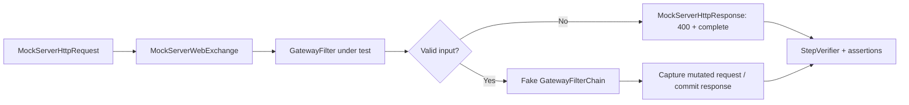
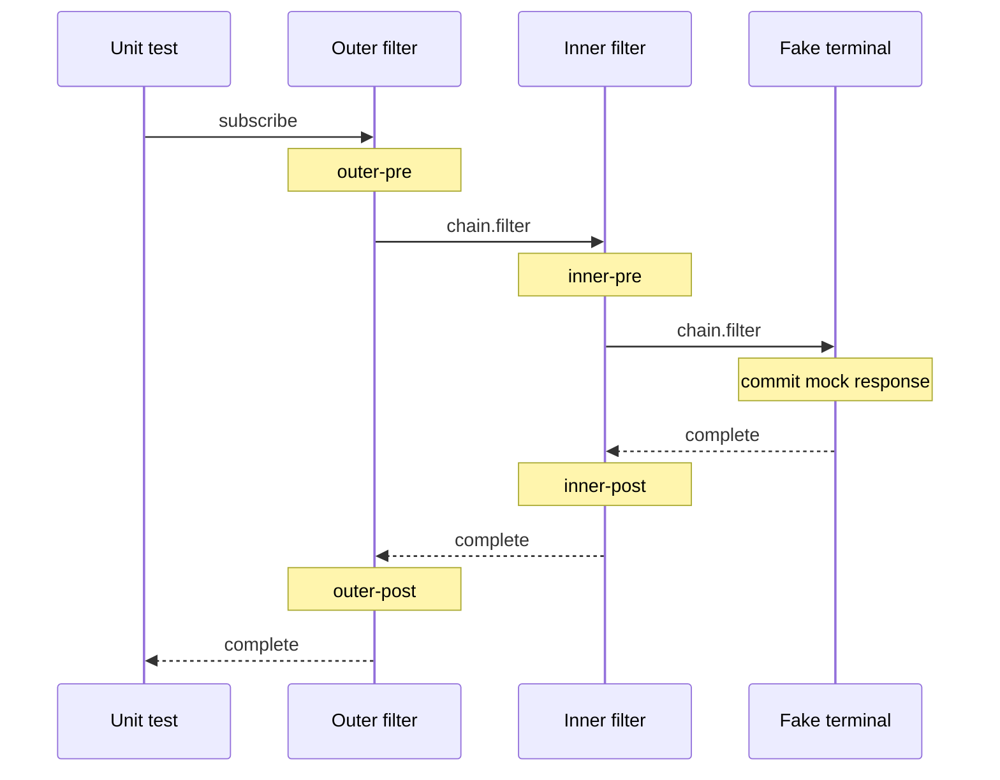

# Unit Testing Filters with MockServerWebExchange

## 1. Why Is Unit Testing a `GatewayFilter` Important?

In **SPRING_CLOUD_GATEWAY**, a client request typically traverses **route predicates**, the **filter chain**, path/header transformations, **service discovery** or load balancing, and only then reaches a microservice. Before or along that path sit policies for **authentication/authorization**, **rate limiting**, **circuit breakers**, **retries**, **TLS**, and **observability**. Even a single custom filter mishandling a header, continuing the chain when it should reject, or mutating the response after commit can alter the security boundary of the entire API Gateway.

For example, a filter requiring an `X-Correlation-Id` header:

- If the header is missing or malformed, the Gateway must return **400 Bad Request** and **must not** call the downstream chain.
- If valid, the filter overwrites `X-Verified-Trace` before forwarding downstream.
- Before the response commits, the filter adds `X-Trace-Accepted` for the client.
- If downstream errors or cancels, the filter must never self-subscribe, swallow errors, or trigger out-of-band side effects.

You could write a test that boots all of Spring Boot and sends real HTTP traffic, but such tests pull in many components, run slower, and make root-cause isolation harder. With **`MockServerWebExchange`**, we construct an **in-memory** mocked WebFlux request/response, pass that exchange into `GatewayFilter` alongside a fake `GatewayFilterChain`, and verify outcomes with **JUnit 5 + AssertJ + Reactor `StepVerifier`**.



**This lesson belongs to the Testing chapter**, focusing on **unit testing filters in Spring Cloud Gateway Server WebFlux**. Although `MockServerWebExchange` has "Server Web" in its name, it **does not start Netty**, **does not route over HTTP**, and **does not run all built-in filters**. That is an intentional unit-test boundary, not a limitation or bug.

### Learning Objectives

After this lesson, you will be able to:

1. Distinguish `MockServerHttpRequest`, `MockServerWebExchange`, `MockServerHttpResponse`, `GatewayFilter`, `GatewayFilterChain`, and `StepVerifier`.
2. Build mock exchanges via `MockServerWebExchange.from(...)` with method, path, headers, query params, and body when needed.
3. Write a custom reactive `AbstractGatewayFilterFactory<Config>` without calling `block()` or self-subscribing (`subscribe()`).
4. Create a **fake chain** via a lambda to verify downstream invocation counts and the forwarded exchange.
5. Test **short-circuiting**, **request mutation**, **response status/headers**, **beforeCommit**, error propagation, and cancellation.
6. Exercise **pre/post ordering** using a manual chain while understanding how simulated nesting differs from Gateway runtime `Ordered` sorting.
7. Distinguish **route attributes** on the exchange from live HTTP routing.
8. Know when to step up from unit tests to `@SpringBootTest`, `WebTestClient`, a stub backend, or Testcontainers to validate security, discovery, retries, and TLS.

> **Version scope:** Spring Boot 3.5.x, Spring Cloud 2025.0.x, **Spring Cloud Gateway Server WebFlux 4.3.x**, Spring Framework 6.2.x, and JDK 17+. Maven examples use Boot `3.5.0` / Cloud BOM `2025.0.0` to illustrate compatibility; real systems should use currently supported patch releases. `MockServerWebExchange` belongs to **Spring Test/WebFlux**, unlike Spring MVC's Servlet mocks (`MockHttpServletRequest`). Do not use this guide for **Gateway Server Web MVC** or Proxy Exchange.

## 2. API Overview and Unit Test Scope

### 2.1. Six Types to Distinguish

| Type | Package | Role in unit tests |
| --- | --- | --- |
| `MockServerHttpRequest` | `org.springframework.mock.http.server.reactive` | Creates a mocked inbound HTTP request (method, URI, headers, body). |
| `MockServerWebExchange` | `org.springframework.mock.web.server` | Provides a mocked `ServerWebExchange` with request, response, attributes, and optional session/principal. |
| `MockServerHttpResponse` | `org.springframework.mock.http.server.reactive` | Captures status/headers/body from the filter; provides `getBodyAsString()`. |
| `GatewayFilter` | `org.springframework.cloud.gateway.filter` | Unit under test implementing `filter(exchange, chain)`. |
| `GatewayFilterChain` | `org.springframework.cloud.gateway.filter` | Represents the rest of the filter chain; replaced by a fake lambda in unit tests. |
| `StepVerifier` | `reactor.test` | Subscribes to and verifies completion/error/cancellation of `Mono<Void>`. |

**Key relationship:**

```java
// Signature representation only,
// not code replacing the real Gateway interface.
Mono<Void> filter(ServerWebExchange exchange, GatewayFilterChain chain);
```

`Mono<Void>` normally **emits no elements**. It signals only that request processing **completed**, **errored**, or was **canceled**. Therefore, an assertion like `expectNext(1)` on `GatewayFilter.filter(...)` makes no sense.

### 2.2. What Can Unit Tests Prove?

| What needs proof | Is `MockServerWebExchange` enough? | Evidence |
| --- | --- | --- |
| Filter accepts/rejects headers properly. | **Yes**. | Set mock headers, verify status/chain count. |
| Filter mutates request header/path. | **Yes**. | Capture the exchange passed to the fake chain. |
| Filter short-circuits without calling the chain. | **Yes**. | `AtomicInteger` stays `0`. |
| Filter registers a `beforeCommit` callback. | **Yes**, if the mock chain commits the response. | Call `setComplete()`, assert response header. |
| Publisher propagates errors/cancellation properly. | **Yes**, within the fake chain scope. | `StepVerifier.expectError...` / `thenCancel()`. |
| Route predicates actually pick the right route. | **Insufficient**. | Needs Gateway route mapping/integration tests. |
| All `GlobalFilter`s and `GatewayFilter`s combine per `Ordered`. | **Not automatic**. | Needs runtime combined filter chain or integration test. |
| Real backend receives mutated headers/path. | **No**. | Needs HTTP backend capture. |
| `lb://` actually picks a service instance. | **No**. | Needs LoadBalancer/discovery integration test. |
| TLS/mTLS handshake, DNS, connect timeouts. | **No**. | Needs network HTTP(S) tests. |
| JWT/security/Redis rate limiting enforced across all layers. | **No** with a single mock exchange. | Needs Spring Security/WebFlux + external service tests. |

A unit test can prove **the filter did not call the fake chain**, but **cannot by itself prove no upstream HTTP request occurs across the full deployment**. Those are two distinct levels of evidence.

## 3. Starting with `MockServerWebExchange.from(...)`

Spring Framework provides static factories:

```java
MockServerWebExchange.from(MockServerHttpRequest request)
MockServerWebExchange.from(MockServerHttpRequest.BaseBuilder<?> builder)
MockServerWebExchange.builder(MockServerHttpRequest request)
```

Basic example without opening any HTTP port:

```java
import org.springframework.mock.http.server.reactive.MockServerHttpRequest;
import org.springframework.mock.web.server.MockServerWebExchange;

MockServerHttpRequest request = MockServerHttpRequest
        .get("/api/items/A-42?lang=vi")
        .header("X-Correlation-Id", "req_42")
        .build();

MockServerWebExchange exchange =
        MockServerWebExchange.from(request);
```

You can then inspect:

```java
exchange.getRequest().getMethod();       // GET
exchange.getRequest().getURI().getPath(); // /api/items/A-42
exchange.getRequest().getURI().getQuery();// lang=vi
exchange.getRequest().getHeaders()
        .getFirst("X-Correlation-Id");    // req_42

exchange.getResponse().getStatusCode();  // usually null before set
exchange.getAttributes();                // mutable map per exchange
```

### 3.1. Creating Multi-Value Headers

HTTP headers are multi-valued (`MultiValueMap`). Thus:

```java
MockServerWebExchange exchange = MockServerWebExchange.from(
        MockServerHttpRequest.get("/api/items")
                .header("X-Correlation-Id", "first", "second")
                .build());
```

Inside the filter, `getHeaders().get("X-Correlation-Id")` returns a `List<String>`, not a `String`. If a header is expected to carry **exactly one value**, unit tests must include duplicate-header cases and assert explicit rejection. For headers containing commas or excessive lengths, validate against a schema rather than assuming `getFirst(...)` suffices.

### 3.2. Query Parameters and Request Attributes

```java
MockServerWebExchange exchange = MockServerWebExchange.from(
        MockServerHttpRequest.get("/api/search?q=java&lang=vi").build());

exchange.getAttributes().put("lab.request.category", "catalog");
```

`exchange.getAttributes()` is an **in-process request-scoped map**, distinct from query params and HTTP headers. Gateway filters also store route/routing URI/URL history under standard keys such as `GATEWAY_ROUTE_ATTR` or `GATEWAY_REQUEST_URL_ATTR`. If your filter depends on these keys, populate **properly typed values** in unit tests—do not substitute arbitrary strings and treat them as real routes.

### 3.3. Mock Responses Do Not Auto-Commit

A filter may call:

```java
exchange.getResponse().setStatusCode(HttpStatus.BAD_REQUEST);
return exchange.getResponse().setComplete();
```

`setComplete()` returns `Mono<Void>`; committing requires **subscribing to the publisher** via `StepVerifier` or another subscriber. Calling the method to construct the `Mono` without subscribing leaves asynchronous operations unexecuted.

To read the response body after it is actually written:

```java
StepVerifier.create(exchange.getResponse().getBodyAsString())
        .expectNext("blocked")
        .verifyComplete();
```

`MockServerHttpResponse` retains the body for inspection, but **it only contains data if a filter/handler wrote it**. Do not expect `getBodyAsString()` to auto-generate error JSON when the filter only sets a status code.

## 4. Creating a Minimal Maven Project to Unit Test Custom Filters

Set up a standalone practice Maven project on JDK 17+. `pom.xml`:

```xml
<?xml version="1.0" encoding="UTF-8"?>
<project xmlns="http://maven.apache.org/POM/4.0.0"
         xmlns:xsi="http://www.w3.org/2001/XMLSchema-instance"
         xsi:schemaLocation="http://maven.apache.org/POM/4.0.0
                             https://maven.apache.org/xsd/maven-4.0.0.xsd">
    <modelVersion>4.0.0</modelVersion>

    <parent>
        <groupId>org.springframework.boot</groupId>
        <artifactId>spring-boot-starter-parent</artifactId>
        <version>3.5.0</version>
        <relativePath/>
    </parent>

    <groupId>com.example</groupId>
    <artifactId>gateway-filter-unit-lab</artifactId>
    <version>0.0.1-SNAPSHOT</version>

    <properties>
        <java.version>17</java.version>
    </properties>

    <dependencyManagement>
        <dependencies>
            <dependency>
                <groupId>org.springframework.cloud</groupId>
                <artifactId>spring-cloud-dependencies</artifactId>
                <version>2025.0.0</version>
                <type>pom</type>
                <scope>import</scope>
            </dependency>
        </dependencies>
    </dependencyManagement>

    <dependencies>
        <dependency>
            <groupId>org.springframework.cloud</groupId>
            <artifactId>spring-cloud-starter-gateway-server-webflux</artifactId>
        </dependency>

        <!-- Spring Test mock HTTP/exchange + JUnit 5, AssertJ -->
        <dependency>
            <groupId>org.springframework.boot</groupId>
            <artifactId>spring-boot-starter-test</artifactId>
            <scope>test</scope>
        </dependency>

        <!-- Reactor StepVerifier -->
        <dependency>
            <groupId>io.projectreactor</groupId>
            <artifactId>reactor-test</artifactId>
            <scope>test</scope>
        </dependency>
    </dependencies>

    <build>
        <plugins>
            <plugin>
                <groupId>org.springframework.boot</groupId>
                <artifactId>spring-boot-maven-plugin</artifactId>
            </plugin>
        </plugins>
    </build>
</project>
```

Why these dependencies?

- `spring-cloud-starter-gateway-server-webflux` provides `GatewayFilter`, `GatewayFilterChain`, `AbstractGatewayFilterFactory`, and the WebFlux Gateway runtime.
- `spring-boot-starter-test` provides JUnit Jupiter, AssertJ, Spring Test, and WebFlux **MockServer** classes on the test classpath.
- `reactor-test` provides `StepVerifier` to assert filter publishers.
- **No need to boot Spring Boot** when testing a pure `GatewayFilter`; no backend, Redis, or Docker is needed for the tests in section 6.
- Do not add `spring-boot-starter-web` (Servlet) so Server MVC is not mixed with WebFlux.
- Spring Boot BOM and Spring Cloud release BOM manage dependency versions; never mix 4.x/5.x Gateway branches in the same lab.

**Note:** This `pom.xml` illustrates a learner's practice project, **not a build change to the curriculum repository**. No build/Content QA was run during article authoring in STEP 4.

### 4.1. Suggested Directory Layout

```text
gateway-filter-unit-lab/
├── pom.xml
└── src/
    ├── main/
    │   └── java/
    │       └── com/example/gateway/
    │           └── CorrelationGateGatewayFilterFactory.java
    └── test/
        └── java/
            └── com/example/gateway/
                ├── CorrelationGateGatewayFilterFactoryTest.java
                ├── FilterOrderUnitTest.java
                └── ResponseBodyUnitTest.java
```

**No `application.yml` is required** for these pure unit tests: we invoke `factory.apply(config)` directly and construct mock requests/responses explicitly. Only when verifying YAML filter names, route binding, and real Netty routing do you need an integration test with a Spring `ApplicationContext`.

## 5. Writing a Sample Filter: `CorrelationGateGatewayFilterFactory`

This filter is small enough to read end-to-end while exercising several behaviors worth testing:

- Accepts exactly one `X-Correlation-Id`.
- Value must be 1–32 ASCII letters/digits/`_`/`-`.
- **Missing, empty, duplicated, or invalid format** → 400 and **must not call** `chain.filter`.
- Valid → **overwrites** `X-Verified-Trace` on the downstream request, discarding any client-spoofed value.
- Before response commit → adds `X-Trace-Accepted`.
- Does not read the body, make direct HTTP calls, self-subscribe (`subscribe()`), or store per-request data in a singleton field.

Ending the class name with **`GatewayFilterFactory`** is an important Spring Cloud Gateway convention: the short YAML filter name becomes `CorrelationGate`. In unit tests, however, we **do not test YAML binding**—we test the `GatewayFilter` produced by the factory directly.

Create `src/main/java/com/example/gateway/CorrelationGateGatewayFilterFactory.java`:

```java
package com.example.gateway;

import java.util.List;
import java.util.regex.Pattern;

import org.springframework.cloud.gateway.filter.GatewayFilter;
import org.springframework.cloud.gateway.filter.factory.AbstractGatewayFilterFactory;
import org.springframework.http.HttpStatus;
import org.springframework.http.server.reactive.ServerHttpRequest;
import org.springframework.stereotype.Component;
import org.springframework.util.StringUtils;
import org.springframework.web.server.ServerWebExchange;

import reactor.core.publisher.Mono;

@Component
public class CorrelationGateGatewayFilterFactory
        extends AbstractGatewayFilterFactory<
                CorrelationGateGatewayFilterFactory.Config> {

    private static final Pattern TRACE_FORMAT =
            Pattern.compile("[A-Za-z0-9_-]{1,32}");

    public CorrelationGateGatewayFilterFactory() {
        super(Config.class);
    }

    @Override
    public GatewayFilter apply(Config config) {

        if (config == null
                || !StringUtils.hasText(config.getSourceHeader())) {
            throw new IllegalArgumentException(
                    "sourceHeader must not be blank");
        }

        return (exchange, chain) -> {

            List<String> values = exchange.getRequest().getHeaders()
                    .get(config.getSourceHeader());

            if (values == null
                    || values.size() != 1
                    || !TRACE_FORMAT.matcher(values.get(0)).matches()) {

                exchange.getResponse()
                        .setStatusCode(HttpStatus.BAD_REQUEST);

                // Rejection branch: never calls chain.filter(...)
                return exchange.getResponse().setComplete();
            }

            String traceId = values.get(0);

            // Overwrite instead of appending any client-supplied value.
            ServerHttpRequest forwardedRequest =
                    exchange.getRequest().mutate()
                            .headers(headers -> headers.set(
                                    "X-Verified-Trace", traceId))
                            .build();

            ServerWebExchange forwardedExchange =
                    exchange.mutate().request(forwardedRequest).build();

            // Register callback during the PRE phase.
            // Runs only when the response is about to commit.
            exchange.getResponse().beforeCommit(() -> {
                exchange.getResponse().getHeaders()
                        .set("X-Trace-Accepted", traceId);
                return Mono.empty();
            });

            // Valid branch: let the Gateway chain proceed.
            return chain.filter(forwardedExchange);
        };
    }

    public static class Config {
        private String sourceHeader = "X-Correlation-Id";

        public String getSourceHeader() {
            return sourceHeader;
        }

        public void setSourceHeader(String sourceHeader) {
            this.sourceHeader = sourceHeader;
        }
    }
}
```

### 5.1. Security Contract of This Example

**`X-Correlation-Id` is not a JWT, session ID, or verified identity.** Any client can pick a syntactically valid correlation ID. `X-Verified-Trace` here means only **format-checked**, not user/tenant authenticity. Never use this header to grant permissions.

If downstream services need to trust an identity header, you must:

1. Authenticate the principal/JWT before generating the header.
2. Strip/overwrite all client-supplied values.
3. Protect Gateway → backend links with TLS/mTLS and network policies.
4. Block clients from reaching backends directly.
5. Enforce resource/tenant authorization on the backend.

### 5.2. Why Mutate Instead of Editing the Request Directly?

`ServerHttpRequest` is a WebFlux abstraction designed to be immutable at call sites. To replace a header:

```java
ServerHttpRequest mutated = exchange.getRequest().mutate()
        .headers(headers ->
                headers.set("X-Verified-Trace", traceId))
        .build();

ServerWebExchange downstream = exchange.mutate()
        .request(mutated)
        .build();
```

What you must test is that **the fake chain receives the mutated request**, not that the original `exchange.getRequest()` was mutated in place. If a test reads only the original exchange and finds the new header missing, it may falsely conclude the filter failed.

### 5.3. Why Choose `beforeCommit`?

In the pre phase, the filter registers:

```java
exchange.getResponse().beforeCommit(() -> {
    exchange.getResponse().getHeaders()
            .set("X-Trace-Accepted", traceId);
    return Mono.empty();
});
```

When downstream completes the response via `setComplete()` or `writeWith(...)`, the hook runs just before headers/body are committed. By contrast, a `.then(Mono.fromRunnable(...))` running after the downstream chain may be **too late** to modify response headers if downstream already committed. Unit tests must deliberately trigger response commit to actually exercise this hook.

### 5.4. Reactive Contract

Calling `filter(exchange, chain)` returns a publisher. Some synchronous pre-phase operations execute immediately on **method invocation**; asynchronous work in the chain and `beforeCommit` completes only upon **subscription**. Do not assume everything is lazy merely because the return type is `Mono<Void>`.

Do not write:

```java
// WRONG: triggers downstream on a separate detached subscription.
chain.filter(exchange).subscribe();
return Mono.empty();
```

Nor write:

```java
// WRONG on Netty event loop:
chain.filter(exchange).block();
return Mono.empty();
```

Both patterns cause double execution, broken cancellation/error propagation, request body leaks, and event-loop blocking.

## 6. Complete Unit Tests with `MockServerWebExchange` and `StepVerifier`

Now create:

```text
src/test/java/com/example/gateway/CorrelationGateGatewayFilterFactoryTest.java
```

This test class uses neither `@SpringBootTest` nor Spring bean injection: it instantiates the factory with `new` and calls `apply(Config)` to obtain `GatewayFilter`. That makes validation, request mutation, and short-circuit bugs fast to catch and independent of networking.

### 6.1. JUnit 5 Test Class

```java
package com.example.gateway;

import java.util.concurrent.atomic.AtomicInteger;
import java.util.concurrent.atomic.AtomicReference;

import org.junit.jupiter.api.Test;
import org.junit.jupiter.params.ParameterizedTest;
import org.junit.jupiter.params.provider.ValueSource;
import org.springframework.cloud.gateway.filter.GatewayFilter;
import org.springframework.cloud.gateway.filter.GatewayFilterChain;
import org.springframework.http.HttpStatus;
import org.springframework.mock.http.server.reactive.MockServerHttpRequest;
import org.springframework.mock.web.server.MockServerWebExchange;
import org.springframework.web.server.ServerWebExchange;

import reactor.core.publisher.Mono;
import reactor.core.publisher.SignalType;
import reactor.test.StepVerifier;

import static org.assertj.core.api.Assertions.assertThat;
import static org.assertj.core.api.Assertions.assertThatThrownBy;

class CorrelationGateGatewayFilterFactoryTest {

    private final CorrelationGateGatewayFilterFactory factory =
            new CorrelationGateGatewayFilterFactory();

    private final GatewayFilter filter = factory.apply(
            new CorrelationGateGatewayFilterFactory.Config());

    @Test
    void missingHeaderReturns400AndNeverCallsChain() {
        MockServerWebExchange exchange = MockServerWebExchange.from(
                MockServerHttpRequest.get("/api/items/A-42").build());

        AtomicInteger downstreamCalls = new AtomicInteger();

        GatewayFilterChain next = forwarded -> {
            downstreamCalls.incrementAndGet();
            return forwarded.getResponse().setComplete();
        };

        StepVerifier.create(filter.filter(exchange, next))
                .verifyComplete();

        assertThat(exchange.getResponse().getStatusCode())
                .isEqualTo(HttpStatus.BAD_REQUEST);
        assertThat(exchange.getResponse().isCommitted()).isTrue();
        assertThat(downstreamCalls.get()).isZero();
    }

    @Test
    void emptyHeaderReturns400AndDoesNotContinue() {
        MockServerWebExchange exchange = MockServerWebExchange.from(
                MockServerHttpRequest.get("/api/items/A-42")
                        .header("X-Correlation-Id", "")
                        .build());

        AtomicInteger downstreamCalls = new AtomicInteger();

        StepVerifier.create(filter.filter(exchange, forwarded -> {
            downstreamCalls.incrementAndGet();
            return Mono.empty();
        })).verifyComplete();

        assertThat(exchange.getResponse().getStatusCode())
                .isEqualTo(HttpStatus.BAD_REQUEST);
        assertThat(downstreamCalls.get()).isZero();
    }

    @Test
    void duplicateHeaderValuesAreRejected() {
        MockServerWebExchange exchange = MockServerWebExchange.from(
                MockServerHttpRequest.get("/api/items/A-42")
                        .header("X-Correlation-Id",
                                "req_42", "another_42")
                        .build());

        AtomicInteger downstreamCalls = new AtomicInteger();

        StepVerifier.create(filter.filter(exchange, forwarded -> {
            downstreamCalls.incrementAndGet();
            return Mono.empty();
        })).verifyComplete();

        assertThat(exchange.getResponse().getStatusCode())
                .isEqualTo(HttpStatus.BAD_REQUEST);
        assertThat(downstreamCalls.get()).isZero();
    }

    @ParameterizedTest
    @ValueSource(strings = {
            "with space", "slash/path", "bad!", "é",
            "abcdefghijklmnopqrstuvwxyz123456789"
    })
    void invalidFormatIsRejected(String value) {
        MockServerWebExchange exchange = MockServerWebExchange.from(
                MockServerHttpRequest.get("/api/items/A-42")
                        .header("X-Correlation-Id", value)
                        .build());

        AtomicInteger downstreamCalls = new AtomicInteger();

        StepVerifier.create(filter.filter(exchange, forwarded -> {
            downstreamCalls.incrementAndGet();
            return Mono.empty();
        })).verifyComplete();

        assertThat(exchange.getResponse().getStatusCode())
                .isEqualTo(HttpStatus.BAD_REQUEST);
        assertThat(downstreamCalls.get()).isZero();
    }

    @Test
    void validHeaderReplacesForgedValueAndCommitsMarker() {
        MockServerWebExchange exchange = MockServerWebExchange.from(
                MockServerHttpRequest.get("/api/items/A-42")
                        .header("X-Correlation-Id", "req_42")
                        .header("X-Verified-Trace", "attacker-value")
                        .build());

        AtomicInteger downstreamCalls = new AtomicInteger();
        AtomicReference<ServerWebExchange> observed =
                new AtomicReference<>();

        GatewayFilterChain next = forwarded -> {
            downstreamCalls.incrementAndGet();
            observed.set(forwarded);
            return forwarded.getResponse().setComplete();
        };

        StepVerifier.create(filter.filter(exchange, next))
                .verifyComplete();

        assertThat(downstreamCalls.get()).isEqualTo(1);
        assertThat(observed.get()).isNotNull();

        // Fake downstream sees the mutated request.
        assertThat(observed.get().getRequest().getHeaders()
                .getFirst("X-Verified-Trace"))
                .isEqualTo("req_42");

        assertThat(observed.get().getRequest().getHeaders()
                .get("X-Verified-Trace"))
                .containsExactly("req_42");

        // Original request was not modified in place.
        assertThat(exchange.getRequest().getHeaders()
                .getFirst("X-Verified-Trace"))
                .isEqualTo("attacker-value");

        assertThat(exchange.getResponse().isCommitted()).isTrue();
        assertThat(exchange.getResponse().getHeaders()
                .getFirst("X-Trace-Accepted"))
                .isEqualTo("req_42");
    }

    @Test
    void sourceHeaderNameCanBeConfiguredPerFactory() {
        var config = new CorrelationGateGatewayFilterFactory.Config();
        config.setSourceHeader("X-Request-Trace");

        GatewayFilter custom = factory.apply(config);

        MockServerWebExchange exchange = MockServerWebExchange.from(
                MockServerHttpRequest.get("/api/items")
                        .header("X-Request-Trace", "custom_7")
                        .build());

        AtomicReference<String> forwardedTrace =
                new AtomicReference<>();

        StepVerifier.create(custom.filter(exchange, next -> {
            forwardedTrace.set(next.getRequest().getHeaders()
                    .getFirst("X-Verified-Trace"));
            return next.getResponse().setComplete();
        })).verifyComplete();

        assertThat(forwardedTrace.get()).isEqualTo("custom_7");
        assertThat(exchange.getResponse().getHeaders()
                .getFirst("X-Trace-Accepted"))
                .isEqualTo("custom_7");
    }

    @Test
    void invalidConfigFailsBeforeAnyHttpRequest() {
        var config = new CorrelationGateGatewayFilterFactory.Config();
        config.setSourceHeader(" ");

        assertThatThrownBy(() -> factory.apply(config))
                .isInstanceOf(IllegalArgumentException.class)
                .hasMessageContaining("sourceHeader");
    }

    @Test
    void downstreamErrorIsPropagatedWithoutFakeSuccess() {
        MockServerWebExchange exchange = MockServerWebExchange.from(
                MockServerHttpRequest.get("/api/items")
                        .header("X-Correlation-Id", "req_42")
                        .build());

        AtomicInteger downstreamCalls = new AtomicInteger();

        GatewayFilterChain next = forwarded -> {
            downstreamCalls.incrementAndGet();
            return Mono.error(
                    new IllegalStateException("upstream boom"));
        };

        StepVerifier.create(filter.filter(exchange, next))
                .expectErrorMatches(error ->
                        error instanceof IllegalStateException
                        && "upstream boom".equals(error.getMessage()))
                .verify();

        assertThat(downstreamCalls.get()).isEqualTo(1);

        // Fake chain errored without committing response:
        // beforeCommit is a pre-commit hook, not a finally block.
        assertThat(exchange.getResponse().isCommitted()).isFalse();
    }

    @Test
    void cancellationReachesDownstreamPublisher() {
        MockServerWebExchange exchange = MockServerWebExchange.from(
                MockServerHttpRequest.get("/api/items")
                        .header("X-Correlation-Id", "req_42")
                        .build());

        AtomicInteger downstreamCalls = new AtomicInteger();
        AtomicReference<SignalType> terminalSignal =
                new AtomicReference<>();

        GatewayFilterChain next = forwarded -> {
            downstreamCalls.incrementAndGet();

            return Mono.<Void>never()
                    .doFinally(terminalSignal::set);
        };

        StepVerifier.create(filter.filter(exchange, next))
                .thenCancel()
                .verify();

        assertThat(downstreamCalls.get()).isEqualTo(1);
        assertThat(terminalSignal.get())
                .isEqualTo(SignalType.CANCEL);
        assertThat(exchange.getResponse().isCommitted()).isFalse();
    }

    @Test
    void twoIndependentRequestsKeepDifferentTraceHeaders() {
        MockServerWebExchange exchangeA = MockServerWebExchange.from(
                MockServerHttpRequest.get("/api/items/A")
                        .header("X-Correlation-Id", "trace_A")
                        .build());

        MockServerWebExchange exchangeB = MockServerWebExchange.from(
                MockServerHttpRequest.get("/api/items/B")
                        .header("X-Correlation-Id", "trace_B")
                        .build());

        AtomicReference<String> seenA = new AtomicReference<>();
        AtomicReference<String> seenB = new AtomicReference<>();

        Mono<Void> requestA = filter.filter(exchangeA, next -> {
            seenA.set(next.getRequest().getHeaders()
                    .getFirst("X-Verified-Trace"));
            return next.getResponse().setComplete();
        });

        Mono<Void> requestB = filter.filter(exchangeB, next -> {
            seenB.set(next.getRequest().getHeaders()
                    .getFirst("X-Verified-Trace"));
            return next.getResponse().setComplete();
        });

        StepVerifier.create(Mono.when(requestA, requestB))
                .verifyComplete();

        assertThat(seenA.get()).isEqualTo("trace_A");
        assertThat(seenB.get()).isEqualTo("trace_B");
        assertThat(exchangeA.getResponse().getHeaders()
                .getFirst("X-Trace-Accepted"))
                .isEqualTo("trace_A");
        assertThat(exchangeB.getResponse().getHeaders()
                .getFirst("X-Trace-Accepted"))
                .isEqualTo("trace_B");
    }
}
```

### 6.2. Happy-Path Tests Must Observe the Forwarded Exchange

In `validHeaderReplacesForgedValueAndCommitsMarker`, the fake chain captures **`forwarded`** (the exchange passed on by the filter), not the original exchange. This is the strongest assertion for request mutation:

```java
GatewayFilterChain next = forwarded -> {
    observed.set(forwarded);
    return forwarded.getResponse().setComplete();
};
```

If you write:

```java
// Does not prove the filter passed a mutated request down the chain.
assertThat(exchange.getRequest().getHeaders()
        .getFirst("X-Verified-Trace")).isEqualTo("req_42");
```

the test can fail even when the filter works properly, because **the original request stays unchanged** while the new request lives inside `forwardedExchange`. Likewise, a test asserting only status 200 without capturing the downstream request **misses whether a spoofed header survived**.

### 6.3. Assert Chain Call Count, Not Just Status

When input is missing:

```java
StepVerifier.create(filter.filter(exchange, next))
        .verifyComplete();

assertThat(exchange.getResponse().getStatusCode())
        .isEqualTo(HttpStatus.BAD_REQUEST);
assertThat(downstreamCalls.get()).isZero();
```

Both assertions belong together. If a filter sets 400 **yet still invokes the chain**, a downstream filter may keep executing, dispatch an HTTP call, or try writing a response after commit. In a real Gateway, that is not just a status bug—it can be a **security issue or double-write**.

A fake chain **sends no HTTP calls itself**. In integration tests, count backend requests to prove the live route made no outbound call.

### 6.4. Distinguish `StepVerifier.verifyComplete()` from `expectErrorMatches(...)`

`filter.filter(...)` returns `Mono<Void>`:

```java
StepVerifier.create(filter.filter(exchange, next))
        .verifyComplete();
```

Use this when the path is expected to **complete normally**. However, downstream can also emit an error:

```java
StepVerifier.create(filter.filter(exchange, next))
        .expectErrorMatches(error ->
                error instanceof IllegalStateException)
        .verify();
```

**Never use `verifyComplete()` on a test intentionally expecting an error**, and never modify the filter to swallow errors just to make a test pass. The right behavior may be propagating the error to a higher-level exception handler or route failure policy.

Likewise, never call `filter.filter(exchange, chain).subscribe()` and immediately assert: you have no guarantee when the publisher finishes, and errors may be dropped or handled off the test thread.

### 6.5. Cancellation Does Not Automatically Mean HTTP 499

`thenCancel()` actively cancels the subscription to simulate client/context cancellation. It proves cancellation propagates to the downstream publisher in a unit test; it **does not mean the Gateway emits status 499** or closes all real sockets.

If a filter attaches `doFinally`, check `SignalType.CANCEL`; if cleanup involves request body buffers, subscriptions, Netty connections, or Redis calls, add integration/load tests. In our example, `Mono.never()` opens no network connection, making it safe for non-hanging unit tests.

### 6.6. Testing Multiple Requests Is Not a Load Test

`twoIndependentRequestsKeepDifferentTraceHeaders` proves two exchanges retain separate trace values and that the filter does not store trace IDs in a mutable field. It **does not measure throughput, concurrency pressure, or race conditions across thousands of requests**. When needed, add bounded concurrent tests with `Flux.range(...).flatMap(...)` alongside integration/load tests checking state, memory, and latency.

### 6.7. Invalid Config and Version-Specific Binding

`invalidConfigFailsBeforeAnyHttpRequest` verifies `factory.apply(config)` rejects a blank header name. In a real Gateway, binding YAML `name: CorrelationGate` with `args.sourceHeader` also relies on Spring bean registration and `RouteDefinitionRouteLocator`. **Unit tests do not automatically test factory names or YAML binding.** Add integration tests to ensure the route actually wires this filter.

## 7. Testing Pre/Post Order with a Manual Chain

When Gateway Server WebFlux matches a route, `FilteringWebHandler` combines route `GatewayFilter`s and `GlobalFilter`s and sorts them by `Ordered`. Filters with higher precedence (lower order value) run earlier in the **pre** phase, and their **post** phase typically runs later.

A unit test can illustrate nested execution order:



Create `src/test/java/com/example/gateway/FilterOrderUnitTest.java`:

```java
package com.example.gateway;

import java.util.ArrayList;
import java.util.List;

import org.junit.jupiter.api.Test;
import org.springframework.cloud.gateway.filter.GatewayFilter;
import org.springframework.cloud.gateway.filter.GatewayFilterChain;
import org.springframework.mock.http.server.reactive.MockServerHttpRequest;
import org.springframework.mock.web.server.MockServerWebExchange;

import reactor.core.publisher.Mono;
import reactor.test.StepVerifier;

import static org.assertj.core.api.Assertions.assertThat;

class FilterOrderUnitTest {

    @Test
    void nestedFiltersRunPreInOrderAndPostInReverse() {
        List<String> events = new ArrayList<>();

        GatewayFilter outer = (exchange, chain) ->
                Mono.defer(() -> {
                    events.add("outer-pre");
                    return chain.filter(exchange)
                            .then(Mono.fromRunnable(() ->
                                    events.add("outer-post")));
                });

        GatewayFilter inner = (exchange, chain) ->
                Mono.defer(() -> {
                    events.add("inner-pre");
                    return chain.filter(exchange)
                            .then(Mono.fromRunnable(() ->
                                    events.add("inner-post")));
                });

        GatewayFilterChain terminal = exchange ->
                Mono.defer(() -> {
                    events.add("terminal");
                    return exchange.getResponse().setComplete();
                });

        MockServerWebExchange exchange = MockServerWebExchange.from(
                MockServerHttpRequest.get("/api/items").build());

        GatewayFilterChain next =
                forwarded -> inner.filter(forwarded, terminal);

        StepVerifier.create(outer.filter(exchange, next))
                .verifyComplete();

        assertThat(events).containsExactly(
                "outer-pre",
                "inner-pre",
                "terminal",
                "inner-post",
                "outer-post");
        assertThat(exchange.getResponse().isCommitted()).isTrue();
    }
}
```

**Boundary:** this test only proves the nesting order wired by the test itself (`outer` wrapping `inner`); **it does not prove the Gateway runtime sorted filters by `Ordered`**. When using `OrderedGatewayFilter`, `GlobalFilter`, or built-in filters with custom orders, verify the combined chain in an integration test.

### 7.1. Why Modifying the Response in Post Can Be Too Late

In the test above, `terminal` already called `setComplete()` before `inner-post` and `outer-post` ran. Consequently, the snippet below may fail to add a header to an already-committed response:

```java
return chain.filter(exchange)
        .then(Mono.fromRunnable(() -> {
            // Response may already be committed.
            exchange.getResponse().getHeaders()
                    .set("X-Late-Header", "value");
        }));
```

If a response header **must** appear, register `exchange.getResponse().beforeCommit(...)` in the pre phase as `CorrelationGate` does. `doFinally` does not replace `beforeCommit` either: it is meant for cleanup/metrics and does not guarantee the response is still writable.

## 8. Unit Testing a Filter That Writes Its Own Response Body

`CorrelationGate` returns only status 400 on rejection. Other filters also need a JSON body or short message. `MockServerHttpResponse` exposes `getBodyAsString()` to verify the written payload.

Create `src/test/java/com/example/gateway/ResponseBodyUnitTest.java`:

```java
package com.example.gateway;

import java.nio.charset.StandardCharsets;
import java.util.concurrent.atomic.AtomicInteger;

import org.junit.jupiter.api.Test;
import org.springframework.cloud.gateway.filter.GatewayFilter;
import org.springframework.http.HttpStatus;
import org.springframework.http.MediaType;
import org.springframework.mock.http.server.reactive.MockServerHttpRequest;
import org.springframework.mock.web.server.MockServerWebExchange;

import reactor.core.publisher.Mono;
import reactor.test.StepVerifier;

import static org.assertj.core.api.Assertions.assertThat;

class ResponseBodyUnitTest {

    @Test
    void shortCircuitWritesBodyWithoutInvokingNextFilter() {
        GatewayFilter deny = (exchange, chain) -> {
            var response = exchange.getResponse();

            response.setStatusCode(
                    HttpStatus.TOO_MANY_REQUESTS);
            response.getHeaders().setContentType(
                    MediaType.TEXT_PLAIN);

            byte[] bytes = "quota-exceeded"
                    .getBytes(StandardCharsets.UTF_8);

            return response.writeWith(Mono.just(
                    response.bufferFactory().wrap(bytes)));
        };

        MockServerWebExchange exchange = MockServerWebExchange.from(
                MockServerHttpRequest.get("/api/items").build());

        AtomicInteger downstreamCalls = new AtomicInteger();

        StepVerifier.create(deny.filter(exchange, forwarded -> {
            downstreamCalls.incrementAndGet();
            return forwarded.getResponse().setComplete();
        })).verifyComplete();

        assertThat(exchange.getResponse().getStatusCode())
                .isEqualTo(HttpStatus.TOO_MANY_REQUESTS);
        assertThat(exchange.getResponse().getHeaders()
                .getContentType()).isEqualTo(MediaType.TEXT_PLAIN);
        assertThat(downstreamCalls.get()).isZero();

        StepVerifier.create(
                exchange.getResponse().getBodyAsString())
                .expectNext("quota-exceeded")
                .verifyComplete();
    }
}
```

**Limitation:** the `deny` filter merely **simulates a 429 response** without using a Redis token bucket. This test does not prove `RequestRateLimiter` or a real quota policy works. To validate rate limiting, test `KeyResolver`, Redis policy, and backend call counts in an integration test.

### 8.1. When Filters Read/Write `DataBuffer` Bodies

`writeWith(...)` accepts a `Publisher<DataBuffer>`. If a custom filter reads or rewrites a request/response body, keep in mind:

- Bodies may arrive in multiple chunks, not a single UTF-8 string.
- Joining buffers increases memory usage; enforce body-size limits and handle oversized payloads.
- Whenever releasing a consumed `DataBuffer`, use `DataBufferUtils.release(...)` carefully to prevent leaks or double releases.
- If the body changes, `Content-Length` may need recalculation; `Transfer-Encoding` and media type must stay consistent.
- Retries or other body-reading filters can consume the publisher, requiring proper buffering/replay.
- Mid-stream cancellation must cancel the upstream publisher and clean up resources.

These contracts usually require both **unit tests for multi-chunk bodies** and **HTTP integration tests**; checking `getBodyAsString()` alone is insufficient.

## 9. Testing Route Attributes in `ServerWebExchange`

`ServerWebExchange` holds an attribute map per request. The Gateway uses standard keys to pass route/routing-URI state between filters:

| Key | Expected value type | Meaning |
| --- | --- | --- |
| `GATEWAY_ROUTE_ATTR` | `Route` | Selected route. |
| `GATEWAY_REQUEST_URL_ATTR` | `java.net.URI` | Resolved URI for the downstream request. |
| `GATEWAY_ORIGINAL_REQUEST_URL_ATTR` | Set of `URI` | URLs prior to rewrites. |
| `GATEWAY_SCHEME_PREFIX_ATTR` | Scheme prefix when applicable | Metadata for certain `lb://` filters. |
| `GATEWAY_ALREADY_ROUTED_ATTR` | Routing marker | Prevents duplicate routing depending on context. |

**Mock only the attributes your filter actually reads.** `CorrelationGate` does not depend on route ID, so the unit tests in section 6 needed no `Route` on the exchange.

### 9.1. Example with `GATEWAY_ROUTE_ATTR`

If a custom filter reads the route ID, a unit test can create a properly typed `Route`:

```java
import org.springframework.cloud.gateway.route.Route;
import org.springframework.mock.http.server.reactive.MockServerHttpRequest;
import org.springframework.mock.web.server.MockServerWebExchange;

import static org.springframework.cloud.gateway.support.ServerWebExchangeUtils.GATEWAY_ROUTE_ATTR;

MockServerWebExchange exchange = MockServerWebExchange.from(
        MockServerHttpRequest.get("/api/items").build());

Route selectedRoute = Route.async()
        .id("catalog-unit")
        .uri("http://127.0.0.1:9001")
        .predicate(swe -> true)
        .build();

exchange.getAttributes().put(
        GATEWAY_ROUTE_ATTR, selectedRoute);

Route route = exchange.getRequiredAttribute(
        GATEWAY_ROUTE_ATTR);

// route.getId() is "catalog-unit".
```

**Do not do this:**

```java
exchange.getAttributes().put(
        GATEWAY_ROUTE_ATTR, "catalog-unit");
```

A filter may cast `GATEWAY_ROUTE_ATTR` to `Route`; storing a `String` triggers a type error. Manually setting a route attribute also **does not mean the Gateway ran `RoutePredicateHandlerMapping`** or matched a real HTTP request. Unit tests simply supply metadata inputs so metadata-dependent filters can run.

### 9.2. Example with `GATEWAY_REQUEST_URL_ATTR`

```java
import java.net.URI;
import static org.springframework.cloud.gateway.support.ServerWebExchangeUtils.GATEWAY_REQUEST_URL_ATTR;

exchange.getAttributes().put(
        GATEWAY_REQUEST_URL_ATTR,
        URI.create("http://127.0.0.1:9001/items/A-42"));
```

This is the right `URI` type to test a filter reading the target URL. **It does not issue an HTTP request to the backend.** To verify rewritten paths/headers used by Netty routing, run the real Gateway against a capturing HTTP backend.

### 9.3. Missing Route Attribute and Fail-Fast Behavior

If a production filter calls:

```java
Route route = exchange.getRequiredAttribute(
        GATEWAY_ROUTE_ATTR);
```

then a unit test should also check when the attribute is **absent**. Depending on the filter contract, it should fail fast with a clear exception or skip an optional feature; it must never silently turn route ID into access rights/identity.

For filters reading `GATEWAY_ORIGINAL_REQUEST_URL_ATTR`, preserve `URI` types and ordering per Gateway conventions; never assume an empty attribute means rewrite filters did not run at runtime.

### 9.4. Mocking Session and Principal

`MockServerWebExchange.builder(...)` supports attaching a session, and certain Spring Framework 6.2.x patches offer `.principal(...)`. Yet an injected `Principal` **does not replace integration tests running a real `SecurityWebFilterChain`**. If a filter checks JWTs/sessions/authentication, add tests for token signatures/audience, security matcher order, 401/403 responses, and zero backend calls in an appropriate environment.

Never put client-supplied `X-User-Id` or `X-Forwarded-For` into a mock as trusted identity just to turn tests green. Those are spoofable inputs.

## 10. When Should You Step Up to `@SpringBootTest` and `WebTestClient`?

Unit testing with `MockServerWebExchange` answers a narrow question: **how does this filter handle an exchange when a fake chain proceeds or stops?** It does not initialize `RoutePredicateHandlerMapping`, bind YAML, run `FilteringWebHandler` with all `GlobalFilter`s, proxy over Reactor Netty, or exercise real discovery/TLS.

When the requirement is **"a real HTTP request reached the right backend with the new header"**, you need an integration test. Minimal architecture:

```text
WebTestClient --HTTP--> Gateway RANDOM_PORT
                         |
                         | Route predicate Path=/api/**
                         | CorrelationGate
                         | StripPrefix=1
                         v
                   Reactor Netty HttpClient
                         |
                         v
                    Stub backend :0
                    records request/path/headers
```

### 10.1. Declaring a Route for Integration Testing

Unlike unit tests, integration tests require a **Spring Boot application** that scans `@Component CorrelationGateGatewayFilterFactory` and registers routes:

```java
package com.example.gateway;

import org.springframework.boot.SpringApplication;
import org.springframework.boot.autoconfigure.SpringBootApplication;

@SpringBootApplication
public class GatewayApplication {
    public static void main(String[] args) {
        SpringApplication.run(GatewayApplication.class, args);
    }
}
```

`application.yml` for the **integration project**:

```yaml
spring:
  cloud:
    gateway:
      server:
        webflux:
          routes:
            - id: correlation_route
              uri: http://127.0.0.1:9001
              predicates:
                - Path=/api/**
              filters:
                - name: CorrelationGate
                  args:
                    sourceHeader: X-Correlation-Id
                - StripPrefix=1
```

In CI, use a **random backend port** and supply the URI via `@DynamicPropertySource` or indexed route property overrides instead of hardcoding 9001. Here YAML simply illustrates the route and factory name; **the unit tests in section 6 do not need this file**.

Minimal HTTP contract test (assuming a running backend stub and started Gateway):

```java
@SpringBootTest(
        webEnvironment = SpringBootTest.WebEnvironment.RANDOM_PORT)
@AutoConfigureWebTestClient
class GatewayHttpContractTest {

    @Autowired
    WebTestClient client;

    @Test
    void invalidInputIsRejectedByRealRoute() {
        client.get()
                .uri("/api/items/A-42")
                .exchange()
                .expectStatus().isBadRequest();
    }

    @Test
    void validInputGetsResponseMarker() {
        client.get()
                .uri("/api/items/A-42")
                .header("X-Correlation-Id", "req_42")
                .exchange()
                .expectStatus().isOk()
                .expectHeader().valueEquals(
                        "X-Trace-Accepted", "req_42");
    }
}
```

**This is a skeleton supplement**: to run it, add JUnit, `SpringBootTest`, `AutoConfigureWebTestClient`, `WebTestClient` imports, and **a real or stub backend listening at the route's URI**. `@SpringBootTest(RANDOM_PORT)` assigns a random Gateway port, but it does not start a backend automatically. The second test can return `200` only when an upstream server is configured and running.

A stronger integration test also inspects the stub backend:

- Did it receive **exactly one request** when the trace was valid?
- Did it receive `X-Verified-Trace: req_42` and **not** the client's spoofed value?
- Did it receive path `/items/A-42` after `StripPrefix=1`?
- When the trace was missing/invalid, **did the backend counter stay unchanged**?
- Were unexpected `Forwarded`/`X-Forwarded-*` or `Host` headers added?
- When downstream failed, did status/exception handling and retry/fallback follow policy?

Never replace backend assertions by checking only the client response status: a filter could return 400 while another branch still fires an unwanted HTTP request, or another route could match and return 200.

### 10.2. Distinguishing Three Testing Levels

| Level | Tools | What it verifies |
| --- | --- | --- |
| **Filter unit** | `MockServerWebExchange`, fake `GatewayFilterChain`, `StepVerifier`. | Branching, mutation, short-circuiting, errors/cancellation, commit callbacks. |
| **Gateway integration** | `@SpringBootTest`, `WebTestClient`, stub HTTP backend, optional Testcontainers. | Route binding, filter order, real HTTP proxying, auth, backend request counts. |
| **Staging/E2E** | Ingress, IdP, Redis, TLS/mTLS, service registry, multiple Gateway pods. | Network/identity boundaries, distributed quotas, circuit breakers, discovery, SLOs. |

Do not label a unit test "end-to-end" just because it creates a `MockServerWebExchange`. Conversely, you do not need Kubernetes to test an `if` branch in a factory; lower-level tests catch bugs earlier, faster, and with clearer diagnostics.

## 11. Testing Errors, Time, Races, and Cancellation Carefully

### 11.1. Tests Using `Mono.never()` Can Hang If You Forget to Cancel

In the cancellation test in section 6, we explicitly wrote:

```java
StepVerifier.create(filter.filter(exchange, next))
        .thenCancel()
        .verify();
```

If a test accidentally expects `verifyComplete()` on `Mono.never()`, it can block forever. For tests that risk hanging, set an explicit timeout:

```java
StepVerifier.create(filter.filter(exchange, next))
        .expectComplete()
        .verify(java.time.Duration.ofSeconds(2));
```

**Do not** make production filters block responses with `block()` just to simplify testing.

### 11.2. Test Time with Virtual Time When Appropriate

If a custom filter introduces a reactive delay with `Mono.delay`, avoid `Thread.sleep(5000)`. Reactor Test supports virtual time:

```java
GatewayFilter delayed = (exchange, chain) ->
        Mono.delay(java.time.Duration.ofSeconds(5))
                .then(chain.filter(exchange));

MockServerWebExchange exchange = MockServerWebExchange.from(
        MockServerHttpRequest.get("/api/items").build());

StepVerifier.withVirtualTime(
        () -> delayed.filter(
                exchange,
                forwarded -> forwarded.getResponse().setComplete()))
        .thenAwait(java.time.Duration.ofSeconds(5))
        .verifyComplete();
```

`withVirtualTime` requires a **publisher supplier** so time-based operators are instantiated **after** the virtual scheduler is activated. It does not simulate real DNS/TCP/TLS latency; use HTTP integration/load tests for network timeout behavior.

### 11.3. Concurrency and Request-Scoped State

A factory is normally a **Spring singleton**. Storing `currentTraceId` in a mutable factory field lets concurrent requests mix headers:

```java
// Anti-pattern to avoid:
private String currentTraceId;
```

In a proper filter, `traceId` is a **request-local variable** captured by that exchange's callbacks. The two-exchange test in section 6 catches basic shared-state bugs, but to test race conditions seriously, fire many concurrent requests via `Flux.flatMap`/`WebTestClient` and assert per-request correlation. Do not rely on manual `ThreadLocal` instead of Reactor Context and expect identity to survive scheduler hops.

### 11.4. When Downstream Emits an Error

`GatewayFilterChain` can return `Mono.error`; if the filter is not responsible for error handling, let the error propagate to the error handler. If the filter uses `onErrorResume` to build a fallback, tests must specify:

- Which exceptions/statuses trigger the fallback?
- Does the fallback return the right HTTP status and body?
- Does it accidentally turn 401/403/429 into 200?
- Is the response already committed or not?
- Does `Retry` call the backend again?
- Could fallback stale data leak across tenants?

Never write an unconditional `onErrorResume(ex -> Mono.empty())` just to make unit tests complete: it swallows backend failures and leaves callers with ambiguous responses.

## 12. Interactions with Other Parts of Spring Cloud Gateway

| Component | What mock-exchange unit tests verify | What to add at higher levels |
| --- | --- | --- |
| `RemoveRequestHeader` / `SetRequestHeader` | Fake chain observes mutated headers. | Backend HTTP capture to catch filter order/Host/forwarded behavior. |
| `StripPrefix` / `RewritePath` | Request URI/attributes after filter. | HTTP backend inspecting actual path. |
| `RequestRateLimiter` | 429 branch/chain count with mocked limiter/key resolver. | Redis quotas, trusted identity, and multiple instances. |
| `CircuitBreaker` | Mocked fallback/exception propagation. | CLOSED/OPEN/HALF_OPEN states, real faults, and backend attempts. |
| `Retry` | Idempotency and fake downstream call counts. | Live HTTP attempts, timeout budgets, and body replay. |
| `TokenRelay` / Security | Header transform with mocked principal/context. | JWT signature/audience/scope, 401/403, cross-tenant denial. |
| `LocalResponseCache` | Basic preconditions/headers. | Cache hits/expiry/eviction, privacy, multi-instance scope. |
| `lb://` LoadBalancer | Attributes/routing decisions with injected mocks. | Instance discovery/selection, 503 when no instance exists. |
| Outbound TLS/mTLS | Cannot test handshakes with mock exchange. | Test CA/SAN/SNI, client certs, and rotation. |
| Metrics/traces | Emitting signals/events from filter. | Metric names, route tags, span propagation, real latency. |

### 12.1. A `GatewayFilter` Does Not Authenticate Users by Itself

`MockServerWebExchange` can carry a mocked `Authorization` header, yet that header **does not create an authenticated principal**. If the security requirement is "requests without a valid JWT must never reach the backend", use Spring Security tests and integration tests running `SecurityWebFilterChain` rather than injecting a `Bearer test` string and calling it done.

### 12.2. Testing `lb://` and Route URLs Differs from Fake-Chain Statuses

`CorrelationGate` unit tests open no sockets, so a fake chain returning `Mono.empty()` does not prove a backend returned 200. A real pipeline also runs `RouteToRequestUrlFilter`, load-balancer filters, `NettyRoutingFilter`, and `NettyWriteResponseFilter`, which use route attributes/config to connect upstream.

When a test needs to verify **route URL handling**, set `GATEWAY_REQUEST_URL_ATTR` to a proper `URI` and assert that filter's logic; when you need proof of **real HTTP exchanges**, run the routing client against a stub backend.

### 12.3. 4xx/5xx Responses Can Originate at Multiple Layers

A request missing a header might receive:

- **400** from `CorrelationGate`.
- **401/403** from Spring Security before Gateway route filters run.
- **429** from `RequestRateLimiter`.
- **404** from a Gateway route miss or a backend HTTP 404.
- **502/503/504/5xx** from DNS/TCP/TLS/timeouts/upstream/exception policies.

Unit tests for a custom guard must assert **which branch emits the status**, without assuming every request missing a correlation ID in production returns 400: if `SecurityWebFilterChain` blocks first, the client may get 401.

## 13. Common Mistakes When Writing `MockServerWebExchange` Unit Tests

| Symptom | Common cause | How to fix |
| --- | --- | --- |
| Compiler cannot find `MockServerWebExchange` | Missing `spring-test` on test classpath or wrong import. | Add `spring-boot-starter-test`, import `org.springframework.mock.web.server.MockServerWebExchange`. |
| Compiler cannot find `StepVerifier` | Missing `reactor-test`. | Add `io.projectreactor:reactor-test` in `test` scope. |
| Test uses `MockHttpServletRequest` | Confused Spring MVC Servlet with WebFlux. | Use WebFlux `MockServerHttpRequest` / `MockServerWebExchange`. |
| Test creates `Mono` but status/header assertions fail | Never subscribed to publisher. | Use `StepVerifier.create(...).verifyComplete()` or matching terminal expectation. |
| Test expects `expectNext("OK")` on `Mono<Void>` | Filter result does not emit response body as a Reactor item. | Assert response status/headers/body via mock response. |
| Header mutated yet test still sees old value | Reading original `exchange.getRequest()` instead of the exchange passed to fake chain. | Capture the `forwarded` argument inside `chain.filter`. |
| 400 test passes even though filter still calls downstream | Asserted status without counting chain calls. | Use `AtomicInteger` and assert `0` on rejection paths. |
| `beforeCommit` never runs | Fake chain returns `Mono.empty()` without committing response. | Have fake downstream return `response.setComplete()` or write a body. |
| Post-filter misses final header | Response already committed before `.then(...)` ran. | Register `beforeCommit` early and inspect final response. |
| Error test fails due to `verifyComplete()` | Publisher properly emitted an error. | Use `expectErrorMatches` / `verifyError` per contract. |
| Test hangs forever | Used `Mono.never()` without cancel or timeout. | Add `thenCancel()` or `verify(Duration)`. |
| Cancellation test misses cleanup | Subscriber never canceled, `doFinally` did not run, or async cleanup. | Test cancel signals and cleanup explicitly; avoid arbitrary `Thread.sleep`. |
| `sourceHeader` config fails to bind | Unit test invokes factory directly without YAML route loading. | Add integration test binding `name: CorrelationGate` / `args`. |
| `GATEWAY_ROUTE_ATTR` throws `ClassCastException` | Stored a `String` route ID instead of a `Route` object. | Construct a properly typed `Route.async()...`. |
| Test passes 200 yet real backend gets wrong headers | Fake chain bypasses HTTP routing and built-in filters. | Add `WebTestClient` with an upstream HTTP stub. |
| 401/403 test fails despite working custom filter | Spring Security runs before filter or test lacks auth context. | Test `SecurityWebFilterChain` in integration tests. |
| Passes alone, fails in parallel | Shared mutable singleton state or static test counter. | Create a fresh exchange per test, isolate data, control parallel execution. |
| Route/order test passes yet production differs | Test manually nested filters instead of running `FilteringWebHandler`. | Verify combined chain and HTTP behavior in integration tests. |
| `lb://` or TLS test is meaningless | Mock exchange opens no network sockets. | Use real/stub HTTP(S) backends, Testcontainers, or staging. |

### 13.1. A Subtle Pitfall: Fake Chain Returning `Mono.empty()`

Example:

```java
GatewayFilterChain next = forwarded -> Mono.empty();
```

This fake chain suffices to prove `next` was invoked and the filter completed. However, it **does not commit the HTTP response**. Therefore, to test `beforeCommit`, write:

```java
GatewayFilterChain next =
        forwarded -> forwarded.getResponse().setComplete();
```

If a unit test checks `X-Trace-Accepted` before commit, it may not be present yet; that is the normal callback lifecycle. Never alter production code to set headers too late or outside the publisher just to work around a broken test setup.

### 13.2. A Security Pitfall: Mocking a Header Instead of a Principal

```java
MockServerWebExchange exchange = MockServerWebExchange.from(
        MockServerHttpRequest.get("/api/private")
                .header("X-Authenticated-User", "admin")
                .build());
```

This only builds a request with a **client-supplied** header. It proves neither a valid JWT nor trusted authentication or authorization. To test principals, use Spring Security test helpers, **run the security chain**, and verify the backend counter stays unchanged on 401/403.

## 14. Contract Matrix for CI

| ID | Input / condition | Expected mock response | Expected downstream chain |
| --- | --- | --- | --- |
| U01 | Missing `X-Correlation-Id` | 400, complete. | 0 calls. |
| U02 | Empty header | 400, complete. | 0 calls. |
| U03 | Duplicate header with two values | 400, complete. | 0 calls. |
| U04 | Header with space/slash/non-regex char | 400, complete. | 0 calls. |
| U05 | Header longer than 32 chars | 400, complete. | 0 calls. |
| U06 | Valid `req_42` | Complete, response marker on commit. | 1 call, right forwarded trace. |
| U07 | Client-spoofed `X-Verified-Trace` | Spoofed value dropped from forwarded request. | Receives only `req_42`. |
| U08 | Blank `sourceHeader` config | `IllegalArgumentException` when building filter. | No HTTP request. |
| U09 | Overridden source header config | Marker uses new header. | 1 call, trace from new config. |
| U10 | Downstream `Mono.error` | Error not masked as 200. | 1 call, error propagated. |
| U11 | Downstream `Mono.never` + cancel | Response not committed. | Subscription canceled. |
| U12 | Two exchanges with distinct traces | Two distinct response markers. | No mixed header/route state. |
| U13 | Fake outer/inner chain | Pre/post order matches nesting. | Terminal called once. |
| U14 | Filter emits custom 429/body | 429, body `quota-exceeded`. | 0 calls. |
| U15 | Properly typed `Route` attribute | Filter reads route ID. | Chain per contract. |
| U16 | Missing required route attribute | Fail-fast or defined fallback. | Never treats string as `Route`. |
| I01 | Valid HTTP request through real route | 200 + marker per policy. | Backend 1 request, right header/path. |
| I02 | Invalid HTTP request through real route | 400. | Backend 0 requests. |
| I03 | With `StripPrefix` / `RewritePath` | Path/headers intact. | Backend receives expected URI. |
| I04 | With JWT Security | 401/403 per policy. | Never reaches backend if unauthorized. |
| I05 | Rate limiter or breaker triggered | 429/fallback per policy. | Expected attempt count. |
| I06 | Invalid upstream HTTPS certificate | TLS failure without skipping verification. | No successful HTTP exchange. |

**U** marks checks that pure unit tests can verify; **I** requires integration tests. A solid CI table separates the two so teams never assume TLS, Redis, or JWT enforcement is verified merely because a few `MockServerWebExchange` tests pass.

### 14.1. Concurrency Race Tests Need Bounds and Timeouts

If using `Flux.range(1, 1000).flatMap(...)` to test concurrent requests, allocate **a fresh `MockServerWebExchange` per request**. Never reuse one exchange across multiple subscriptions and expect attributes/responses to stay race-free. Each response should have a single commit lifecycle.

To measure real performance, run proper benchmarks/load tests: `MockServerWebExchange` is an in-memory simulation and does not measure sockets, TLS handshakes, HTTP connection pools, or system-wide throughput.

## 15. Checklist Before Finishing Filter Unit Tests

- [ ] Project uses **Gateway Server WebFlux** and the matching mock packages; never mix MVC Servlet mocks.
- [ ] `spring-boot-starter-test` + `reactor-test` are in `test` scope.
- [ ] Each test creates its own exchange from `MockServerHttpRequest`.
- [ ] Fake `GatewayFilterChain` counts invocations.
- [ ] Rejection branches assert **status + downstream calls = 0**.
- [ ] Valid branches assert **headers/path on the exchange received by the fake chain**, not just the original exchange.
- [ ] Duplicate, empty, oversized, and invalid-character headers are all tested.
- [ ] Client-spoofed headers are overwritten/stripped before downstream.
- [ ] When testing `beforeCommit`, the fake chain actually commits the response.
- [ ] Body tests call `getBodyAsString()` only after `StepVerifier` finishes writing the response.
- [ ] `Mono<Void>` is verified for completion/error/cancel appropriately, never `expectNext`.
- [ ] No `block()`, self-`subscribe()`, or `Thread.sleep` inside production Gateway filters.
- [ ] Route attributes, when used, have exact **`Route`/`URI` types** and standard keys.
- [ ] Manual pre/post tests are not mistaken for runtime `Ordered` verification.
- [ ] Filters hold no mutable per-request state in singleton beans.
- [ ] If rewriting bodies, `DataBuffer` lifecycle, sizes, chunks, and cancellation are tested.
- [ ] Dedicated **integration/E2E tests** are planned for JWTs, quotas, retries, service discovery, and TLS.
- [ ] Logs/metrics never record access tokens, cookies, PII, or sensitive URLs.
- [ ] CI enforces reasonable timeouts, reproducibility, and supported patch versions.

## 16. Self-Check Questions

**1. Does `MockServerWebExchange` start a real HTTP server?**

No. It is a Spring Test mock exchange simulating request/response/attributes in memory.

**2. Why do `GatewayFilter` unit tests typically use `StepVerifier`?**

Because `filter(...)` returns `Mono<Void>`, which must be subscribed to in order to drive reactive steps and verify completion, errors, or cancellation.

**3. Why should tests capture the exchange passed into `GatewayFilterChain`?**

Because filters may create a **mutated request/exchange** while the original exchange keeps old headers. Only the downstream exchange shows what the filter actually forwarded.

**4. If a filter returns 400, what additional assertion proves short-circuiting?**

`downstreamCalls.get() == 0`. Status 400 alone does not prove the chain was not called.

**5. Why might `beforeCommit` fail to fire in a test using `next -> Mono.empty()`?**

Because the fake chain completes without committing the response. Call `response.setComplete()` or write a response body in the mock downstream.

**6. What is the post-phase order of two nested filters?**

The filter that runs earlier in pre typically finishes later in post. The `outer/inner` test proves **nesting** order, not that Gateway runtime `Ordered` sorting ran.

**7. Can `MockServerWebExchange` prove `NettyRoutingFilter` called a backend?**

No. You need `@SpringBootTest`/`WebTestClient` and HTTP backend capture to prove real outbound HTTP.

**8. Should `GATEWAY_ROUTE_ATTR` be populated with a string route name?**

No. That key normally holds a `Route` object; use the right type to avoid `ClassCastException`.

**9. Can a filter's `Mono<Void>` emit the response body directly for `expectNext`?**

No. The body lives on `ServerHttpResponse` and is written via `DataBuffer`; inspect the body on the mock response after the publisher completes.

**10. Why is a mock JWT header insufficient to conclude an endpoint is secure?**

Because it does not verify signatures/audience/authorities or execute `SecurityWebFilterChain`; test Spring Security and backend authorization at the appropriate layers.

## Conclusion

**Unit testing filters with `MockServerWebExchange`** is a fast, accurate way to verify local contracts in **Spring Cloud Gateway Server WebFlux**: how filters read requests, validate headers, mutate exchanges, invoke or short-circuit `GatewayFilterChain`, attach response headers before commit, and propagate errors/cancellations through `Mono<Void>`.

This lab walked through `CorrelationGateGatewayFilterFactory` using `MockServerHttpRequest`, a fake chain, `StepVerifier`, and AssertJ. The tests highlight two core rules: **invalid requests must return 400 without calling the chain**, and **valid requests must forward the mutated exchange** downstream. `MockServerHttpResponse` verifies status/headers/body; `StepVerifier` verifies completion/error/cancellation; nested-chain tests clarify pre/post execution without substituting for runtime `Ordered`.

When you need to validate **route matching, YAML binding, Netty HTTP routing, JWT/auth, Redis rate limiting, circuit breakers/retries, service discovery, TLS/mTLS, or performance**, add appropriate **integration and E2E tests**. A trustworthy Gateway test suite pairs **unit-test precision** with **evidence from real HTTP requests reaching the backend**.

### Official References

- [Spring Cloud Gateway Server WebFlux 4.3 — Developer Guide / Custom GatewayFilter](https://docs.spring.io/spring-cloud-gateway/reference/4.3/spring-cloud-gateway-server-webflux/developer-guide.html)
- [Spring Cloud Gateway Server WebFlux 4.3 — How It Works](https://docs.spring.io/spring-cloud-gateway/reference/4.3/spring-cloud-gateway-server-webflux/how-it-works.html)
- [Spring Cloud Gateway Server WebFlux 4.3 — Global Filters / Ordered Chain](https://docs.spring.io/spring-cloud-gateway/reference/4.3/spring-cloud-gateway-server-webflux/global-filters.html)
- [Spring Cloud Gateway Server WebFlux 4.3 — GatewayFilter Factories](https://docs.spring.io/spring-cloud-gateway/reference/4.3/spring-cloud-gateway-server-webflux/gatewayfilter-factories.html)
- [Spring Cloud Gateway Server WebFlux 4.3 — Starter](https://docs.spring.io/spring-cloud-gateway/reference/4.3/spring-cloud-gateway-server-webflux/starter.html)
- [Spring Framework 6.2 — MockServerWebExchange Javadoc](https://docs.spring.io/spring-framework/docs/6.2.14/javadoc-api/org/springframework/mock/web/server/MockServerWebExchange.html)
- [Spring Framework 6.2 — MockServerHttpResponse Javadoc](https://docs.spring.io/spring-framework/docs/6.2.18/javadoc-api/org/springframework/mock/http/server/reactive/MockServerHttpResponse.html)
- [Spring Framework 6.2 — WebTestClient](https://docs.spring.io/spring-framework/reference/testing/webtestclient.html)
- [Reactor — Testing with StepVerifier](https://projectreactor.io/docs/core/release/reference/testing.html)
- [Reactor Test — StepVerifier API](https://projectreactor.io/docs/test/release/api/reactor/test/StepVerifier.html)
- [Spring Boot 3.5 — Testing Spring Boot Applications](https://docs.spring.io/spring-boot/3.5/reference/testing/spring-boot-applications.html)
- [Spring Cloud — Release Train Compatibility](https://spring.io/projects/spring-cloud/)
