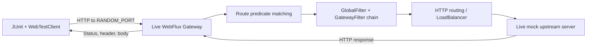
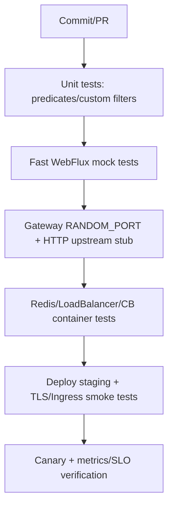

# WebTestClient for End-to-End Testing Through Gateway Server WebFlux

An API Gateway can start up cleanly, declare all its route definitions, and pass unit tests for every filter, yet still forward requests to the wrong path, strip the wrong auth header, return a different status than the backend, retry too many times, or route to a nonexistent service ID. These bugs usually surface only when testing the **entire path through the Gateway**, from an HTTP client to a real listening upstream server and back to the client.

In **Spring Cloud Gateway Server WebFlux**, Spring Framework's `WebTestClient` is well suited for writing HTTP tests with concise syntax, clear assertions, and support for response bodies, headers, statuses, JSON, and streaming. The key point of this lesson is **choosing the right client binding**: to test real HTTP proxying, connect the client to a **running Gateway server** rather than mocking a single controller or `WebHandler`.

This article belongs to the **Testing** chapter of the `SPRING_CLOUD_GATEWAY` module. The Gateway performs route predicates, filter chains, path/header transformations, service discovery, and load balancing; in practice it also enforces Spring Security/JWT, rate limiting, circuit breaking, retries, TLS, and observability. A trustworthy test suite checks these components against **input/output contracts and upstream behavior**, not merely asserting HTTP 200.

**Learning objectives:**

1. Distinguish unit tests, WebFlux mock tests, integration tests, and **end-to-end tests within the Gateway boundary**.
2. Combine `@SpringBootTest(webEnvironment = RANDOM_PORT)` with `WebTestClient.bindToServer()`.
3. Spin up a stub upstream using Reactor Netty or an equivalent tool with a dynamic port and controlled responses.
4. Test `Path`, `Method`, `Host`, `StripPrefix`, request/response headers, JSON bodies, 404s, and 503s.
5. Test pipelines involving Spring Security/JWT, Redis RateLimiter, LoadBalancer, Retry, and CircuitBreaker without confusing test scopes.
6. Design independent, non-flaky tests with explicit timeouts, resource cleanup, and negative checks.
7. Recognize when `WebTestClient` is not enough: WebSocket frames, live TLS, production ingress, and business contracts.

> **Scope:** Examples apply to **Spring Cloud Gateway Server WebFlux** running on Spring WebFlux/Reactor Netty. Gateway Server Web MVC runs on Servlet/WebMvc.fn and differs in route/filter/test wiring. The example namespace `spring.cloud.gateway.server.webflux.routes` applies to newer Gateway lines; older lines use `spring.cloud.gateway.routes`. Test annotations and starter artifacts may change packages between Spring Boot 3 and 4; check your actual BOM/version. This material is instructional and **does not run builds or tests against a repository**.

## 1. What Is End-to-End Testing Through the Gateway?

In this lesson, "end-to-end within the Gateway boundary" means:



At this level we exercise real components:

- The running Gateway application context and HTTP listener.
- Route configuration bound from properties/beans per version.
- Gateway `RoutePredicateHandlerMapping` selecting a route.
- Attached filters executing in their effective order.
- The Gateway's HTTP client opening connections to a test backend.
- Backend responses and response filters returning to the test client.

Using a "mock upstream" **does not** make this a unit test: the Gateway's inbound HTTP socket and outbound client socket both exist for real. Still, this is **not** full production-system E2E covering CDNs, ingress, identity providers, real registries, databases, and Internet users.

### 1.1. Scope Boundaries by Test Type

| Test type | Setup | Goal | What it does not prove |
| --- | --- | --- | --- |
| **Unit test** | Instantiate predicate/filter/Java class with mocked dependencies. | Small logic, branches, edge cases. | Route binding and real Netty proxying. |
| **Mock WebFlux test** | `WebTestClient.bindToController(...)`, `bindToApplicationContext(...)`, or `bindToWebHandler(...)`. | WebFlux handler chain without opening a real server. | Real TCP connect/TLS/outbound proxy sockets in all cases. |
| **Gateway HTTP integration test** | `@SpringBootTest(RANDOM_PORT)` + `bindToServer()` + test upstream. | Route/predicate/filter/Netty routing/response contract. | Internet/ingress/production registry infrastructure. |
| **System E2E** | Deployed Gateway + real or staging dependencies. | Networking, service discovery, auth, TLS, deployment integration. | Does not replace granular unit tests/fault injection. |
| **Load/soak test** | Load generators, multiple instances, SLOs. | Latency, throughput, connections/memory. | Does not prove individual filter logic is right. |

Not every test needs to boot the entire system. Pick the smallest test tier that covers the risk, while keeping a suite of **Gateway HTTP integration tests** for critical routes.

## 2. What Is `WebTestClient`?

`WebTestClient` lives in package:

```java
org.springframework.test.web.reactive.server.WebTestClient
```

It provides a fluent DSL for sending requests and asserting responses:

```java
client.get()
    .uri("/api/catalog/products/42")
    .exchange()
    .expectStatus().isOk()
    .expectHeader().exists("Content-Type")
    .expectBody()
    .jsonPath("$.id").isEqualTo(42);
```

Core flow:

1. `get()/post()/put()/method(...)` selects the HTTP method.
2. `uri(...)` sets path and query parameters.
3. `header(...)/headers(...)/bodyValue(...)` sets headers and body.
4. `exchange()` executes the request.
5. `expectStatus()/expectHeader()/expectBody()` asserts the response.

What separates `WebTestClient` from a regular `WebClient` is the **test assertion facade** after `exchange()`. Depending on how you construct it, it uses either a live HTTP client connector or a mock server-side harness.

### 2.1. Choose the Binding Mode Deliberately

| Factory | Opens HTTP connection to real server? | Suitable for full Gateway proxy tests? |
| --- | --- | --- |
| `WebTestClient.bindToController(...)` | No. | **No**: tests only a controller/handler. |
| `WebTestClient.bindToRouterFunction(...)` | No. | Does not verify full Gateway auto-configuration. |
| `WebTestClient.bindToApplicationContext(context)` | No listening server; mocks WebFlux request/response. | Good for fast handler/context tests, but **does not replace** real HTTP tests. |
| `WebTestClient.bindToWebHandler(...)` | No. | Useful for isolated handlers. |
| **`WebTestClient.bindToServer()`** | **Yes**: connects to a running server. | **Yes** when base URL points to the Gateway test server. |

A common mistake is writing:

```java
WebTestClient client =
    WebTestClient.bindToController(new HealthController()).build();
```

and naming it `gatewayEndToEndTest`. Here the client **never traverses Gateway route predicates or outbound routing**.

### 2.2. `@AutoConfigureWebTestClient`

Spring Boot can also auto-configure a `WebTestClient` inside `@SpringBootTest`. With `webEnvironment = RANDOM_PORT` and proper starter support, the injected client connects to the running server.

Example:

```java
@SpringBootTest(webEnvironment = SpringBootTest.WebEnvironment.RANDOM_PORT)
@AutoConfigureWebTestClient
class GatewaySmokeIT {

    @Autowired
    WebTestClient client;

    @Test
    void healthIsReachable() {
        client.get().uri("/actuator/health")
            .exchange()
            .expectStatus().isOk();
    }
}
```

**However:** the package of `@AutoConfigureWebTestClient` changed between Spring Boot generations (Boot 3 vs. Boot 4), and several test starters were modularized. To keep our examples less coupled to annotation packages, the main lab will **construct `WebTestClient` directly via `bindToServer()`** using `@LocalServerPort`.

This snippet is an *HTTP smoke test*, not a proxy route test, because `/actuator/health` uses its own pipeline and may not pass through a Gateway route.

## 3. Setting Up a Minimal Test Environment

The test harness consists of:

- A real Gateway Server WebFlux application started by `@SpringBootTest`.
- A **stub upstream** listening on `127.0.0.1` on an OS-assigned port.
- `WebTestClient` connecting to the Gateway at `127.0.0.1:<random-port>`.
- Route configuration **injected into the test `ApplicationContext`** via `@DynamicPropertySource`.
- Assertions verifying both the **response** and the **actual request hitting the stub**.

### 3.1. Relevant Dependencies

Conceptual Maven example for a Spring Cloud Gateway Server WebFlux project:

```xml
<!-- Main Gateway Server WebFlux dependency. -->
<dependency>
    <groupId>org.springframework.cloud</groupId>
    <artifactId>spring-cloud-starter-gateway-server-webflux</artifactId>
</dependency>

<!-- Common in Spring Boot 3.x: BOM-managed test starter. -->
<dependency>
    <groupId>org.springframework.boot</groupId>
    <artifactId>spring-boot-starter-test</artifactId>
    <scope>test</scope>
</dependency>
```

In Spring Boot 4, test starters/APIs are more modular; depending on your dependency tree, you may need `spring-boot-starter-webflux-test` or the corresponding starter to pull in `WebTestClient`/JUnit. **Never mix Boot 3 starters blindly with Boot 4 artifacts.** Reactor Netty test fixtures require `reactor-netty-http`, normally present with Netty-based Gateway WebFlux, though you should verify your dependency tree.

Dependency versions come from a compatible **Spring Boot + Spring Cloud BOM**, never by manually pinning the latest standalone Gateway version.

### 3.2. Never Hardcode Ports

Avoid:

```text
Gateway: http://localhost:8080
Stub:    http://localhost:8081
```

in CI, where parallel test suites or other processes may occupy those ports.

`@SpringBootTest(webEnvironment = RANDOM_PORT)` lets the OS pick the Gateway port; the stub likewise uses `port(0)`. Then inject the live upstream address into route properties.

### 3.3. Test Configuration Must Load Before Routes Are Built

If the Gateway binds `uri: http://localhost:12345` at startup, mutating properties after the Spring context starts **will not update existing routes**. Use `@DynamicPropertySource` to inject URIs before context creation, or use a tested, version-appropriate route-refresh mechanism.

## 4. Complete Hands-On Lab: Real Gateway, Real Netty Upstream

Suppose a client sends:

```text
GET /api/catalog/products/42
```

The Gateway must:

1. Match route ID `catalog-test`.
2. Apply `StripPrefix=2`, rewriting `/api/catalog/products/42` to `/products/42`.
3. Add request header `X-Test-From-Gateway: yes` before calling upstream.
4. Receive a JSON response from the stub upstream.
5. Add response header `X-Gateway-Response: active`.
6. Return `200` and the original JSON body to the client.

### 4.1. Self-Contained Test Class with Dynamic Ports

Place this in the test source tree of a **WebFlux Gateway application**. It assumes Spring Boot test discovers the main `@SpringBootApplication` by package convention and no competing security rules override the test path:

```java
package com.example.gateway;

import java.time.Duration;
import java.util.concurrent.atomic.AtomicInteger;
import java.util.concurrent.atomic.AtomicReference;

import org.junit.jupiter.api.AfterAll;
import org.junit.jupiter.api.BeforeEach;
import org.junit.jupiter.api.Test;

import org.springframework.boot.test.context.SpringBootTest;
import org.springframework.boot.test.context.SpringBootTest.WebEnvironment;
import org.springframework.boot.test.web.server.LocalServerPort;
import org.springframework.test.annotation.DirtiesContext;
import org.springframework.test.context.DynamicPropertyRegistry;
import org.springframework.test.context.DynamicPropertySource;
import org.springframework.test.web.reactive.server.WebTestClient;

import reactor.core.publisher.Mono;
import reactor.netty.DisposableServer;
import reactor.netty.http.server.HttpServer;

import static org.junit.jupiter.api.Assertions.assertEquals;
import static org.junit.jupiter.api.Assertions.assertNull;

@SpringBootTest(webEnvironment = WebEnvironment.RANDOM_PORT)
@DirtiesContext(classMode = DirtiesContext.ClassMode.AFTER_CLASS)
class CatalogGatewayIT {

    private static final AtomicInteger upstreamCalls =
        new AtomicInteger();

    private static final AtomicReference<String> observedPath =
        new AtomicReference<>();

    private static final AtomicReference<String> observedHeader =
        new AtomicReference<>();

    private static final AtomicInteger upstreamStatus =
        new AtomicInteger(200);

    // Real HTTP stub: opens a local socket on a dynamic port.
    private static final DisposableServer STUB =
        HttpServer.create()
            .host("127.0.0.1")
            .port(0)
            .handle((request, response) -> {
                upstreamCalls.incrementAndGet();
                observedPath.set(request.uri());
                observedHeader.set(
                    request.requestHeaders().get(
                        "X-Test-From-Gateway"));

                return response
                    .status(upstreamStatus.get())
                    .header("Content-Type", "application/json")
                    .header("X-Upstream", "catalog-stub")
                    .sendString(
                        Mono.just(
                            "{\"id\":42,\"source\":\"stub\"}"));
            })
            .bindNow();

    @DynamicPropertySource
    static void testGatewayRoute(DynamicPropertyRegistry properties) {
        String prefix =
            "spring.cloud.gateway.server.webflux.routes[0].";

        properties.add(prefix + "id", () -> "catalog-test");
        properties.add(prefix + "uri",
            () -> "http://127.0.0.1:" + STUB.port());

        properties.add(prefix + "predicates[0]",
            () -> "Path=/api/catalog/**");

        properties.add(prefix + "filters[0]",
            () -> "StripPrefix=2");

        properties.add(prefix + "filters[1]",
            () -> "AddRequestHeader=X-Test-From-Gateway,yes");

        properties.add(prefix + "filters[2]",
            () -> "AddResponseHeader=X-Gateway-Response,active");
    }

    @LocalServerPort
    int gatewayPort;

    WebTestClient client;

    @BeforeEach
    void setup() {
        upstreamCalls.set(0);
        observedPath.set(null);
        observedHeader.set(null);
        upstreamStatus.set(200);

        client = WebTestClient.bindToServer()
            .baseUrl("http://127.0.0.1:" + gatewayPort)
            .responseTimeout(Duration.ofSeconds(5))
            .build();
    }

    @Test
    void forwardsMatchingRouteAndFilters() {
        client.get()
            .uri("/api/catalog/products/42")
            .exchange()
            .expectStatus().isOk()
            .expectHeader()
                .valueEquals("X-Upstream", "catalog-stub")
            .expectHeader()
                .valueEquals("X-Gateway-Response", "active")
            .expectBody()
                .jsonPath("$.id").isEqualTo(42)
                .jsonPath("$.source").isEqualTo("stub");

        assertEquals(1, upstreamCalls.get());
        assertEquals("/products/42", observedPath.get());
        assertEquals("yes", observedHeader.get());
    }

    @Test
    void unmatchedPathDoesNotCallUpstream() {
        client.get()
            .uri("/not-a-gateway-route")
            .exchange()
            .expectStatus().isNotFound();

        assertEquals(0, upstreamCalls.get());
        assertNull(observedPath.get());
    }

    @Test
    void preservesUpstreamErrorStatusByDefault() {
        upstreamStatus.set(503);

        client.get()
            .uri("/api/catalog/products/42")
            .exchange()
            .expectStatus().isEqualTo(503)
            .expectHeader()
                .valueEquals("X-Upstream", "catalog-stub");

        assertEquals(1, upstreamCalls.get());
    }

    @AfterAll
    static void shutdownStub() {
        STUB.disposeNow();
    }
}
```

### 4.2. Interpreting Each Assertion Layer

| Assertion | What it verifies | Where to look if it fails |
| --- | --- | --- |
| `expectStatus().isOk()` | Client receives HTTP 200. | Route match, upstream, Security, filters. |
| `X-Upstream = catalog-stub` | Response truly came from stub backend. | Gateway routing / route URI. |
| `X-Gateway-Response = active` | Gateway response filter executed. | Filter binding, filter order. |
| `jsonPath("$.id") = 42` | JSON body proxied intact. | Codec / body transform / upstream response. |
| `upstreamCalls = 1` | Stub received one request in this scenario. | Retries, duplicate sends, route mismatch. |
| `observedPath = /products/42` | `StripPrefix=2` worked accurately. | Prefix count, route path. |
| `observedHeader = yes` | Gateway added header on outbound request. | Request header filter. |
| Unmatched status 404 + 0 upstream calls | No route matched and backend was skipped. | Handler mapping, other catch-all routes. |
| Upstream 503 remains 503 | No filter altered status in this test. | Fallback, `SetStatus`, Retry, exception mapping. |

**Conditions of this example:** These tests assume the application has only the test route in scope and no catch-all route or security policy altering outcomes. If your real Gateway defines a glob `Path=/**` route, security filters, or default filters, isolate them via a test profile/config or adjust assertions to match the actual contract.

### 4.3. Why Assert on the Request Received by the Stub?

Writing only:

```java
client.get().uri("/api/catalog/products/42")
    .exchange()
    .expectStatus().isOk();
```

is not enough: a mocked filter, fallback, or different route could return 200. Inspecting the actual request **reaching upstream** proves outbound routing occurred.

### 4.4. Parallel Execution Isolation Note

This test class uses static `AtomicInteger` and `AtomicReference` for illustration. They are thread-safe per operation, yet **do not isolate test methods running concurrently**. If your project enables JUnit parallel execution, give each test its own stub/route/key or enforce sequential execution on that fixture.

`@DirtiesContext` and `@AfterAll` prevent a cached Spring context from reusing a shut-down stub, at the cost of extra startup time. Across larger suites, consider test extensions managing fixture lifecycles with unique property scopes.

## 5. Replacing the Upstream: WireMock, MockWebServer, or Testcontainers

You do not have to use a Reactor Netty stub every time. What matters is having a **real HTTP server** whose responses you control and whose received requests you can inspect.

| Tool | Strengths | Caveats |
| --- | --- | --- |
| **Reactor Netty HttpServer** | Minimal extra dependencies on a WebFlux/Gateway stack; custom handlers. | Complex stateful scenarios require writing state manually. |
| **WireMock** | Method/path/header stubbing, request journal, delays, fault injection. | Pin Boot/JUnit-compatible version/extension; reset request journal. |
| **OkHttp MockWebServer** | Response queues and `RecordedRequest` inspection. | Manage lifecycle, concurrency, and extra dependency. |
| **Testcontainers** | Runs real Redis, discovery registries, or containerized backends close to prod. | Requires Docker/container runtime in CI; slower than unit tests. |
| **Embedded controller inside Gateway** | Easy to spin up. | Can **bypass outbound proxying**, failing to prove network routing. |

A WireMock pattern (pseudocode with common API names; adapter/extension varies by version):

```text
Given stub:
  GET /products/42
  require X-Test-From-Gateway = yes
  respond 200 + application/json + {"id":42}

When:
  WebTestClient → Gateway /api/catalog/products/42

Then:
  status = 200
  JSON id = 42
  WireMock request journal shows exactly 1 request
```

Do not assert only the body. Verify the stub received the **right method, rewritten path, and critical headers**.

### 5.1. Start the Upstream Before the Gateway Binds Routes

With random ports, the route URI must receive the stub's actual address **before the context binds route definitions**. If you start the stub inside `@BeforeEach` after the Gateway `ApplicationContext` is created, route properties may already be bound to a missing/stale port.

A simple solution is starting the stub in a static fixture or Testcontainer lifecycle referenced by `@DynamicPropertySource`.

### 5.2. Do Not Replace HTTP Sockets with Mock Objects When Testing Proxying

`@MockitoBean` helps test custom service/filter logic, yet mocking `WebClient` or `NettyRoutingFilter` strips away the exact things you want to verify: URI resolution, outbound HTTP, and response propagation.

Critical proxy tests should pass through the Gateway listener to a real HTTP stub.

## 6. Testing Route Predicates: Path, Method, Host, Header, Query

A route can combine multiple predicates with logical AND. `WebTestClient` sends real HTTP requests, testing these predicates through the client request API.

Dedicated route configuration example:

```yaml
spring:
  cloud:
    gateway:
      server:
        webflux:
          routes:
            - id: partner-orders
              uri: http://127.0.0.1:18081
              predicates:
                - Path=/partner/orders/**
                - Method=GET
                - Host=api.partner.test
                - Header=X-Partner-Tier,premium
```

**Port 18081 only illustrates route syntax**; never use fixed ports in parallel test suites—substitute a dynamic stub port as shown in section 4.

### 6.1. Case Satisfying All Conditions

```java
client.get()
    .uri("/partner/orders/42")
    .header("Host", "api.partner.test")
    .header("X-Partner-Tier", "premium")
    .exchange()
    .expectStatus().isOk();
```

### 6.2. Negative Cases

| Request | Failing predicate | Expectation when no other route exists |
| --- | --- | --- |
| `POST /partner/orders/42` | `Method=GET`. | 404; stub not called. |
| `GET /partner/unknown` | `Path`. | 404; stub not called. |
| Host `wrong.partner.test` | `Host`. | 404; stub not called. |
| Missing `X-Partner-Tier` | `Header`. | 404; stub not called. |
| Header `X-Partner-Tier: basic` | Tier regex. | 404; stub not called. |

**Caveat:** A Gateway with additional routes or Spring Security may return another status before/on no-route. The stronger assertion is **"never hits this upstream"**, paired with checking route inventory and contract-compliant statuses.

### 6.3. Query Parameters and Path Encoding

Tests should cover:

- Does `?page=1&size=20` reach the backend properly encoded?
- Are paths containing `%20`, plus signs, or Unicode unexpectedly decoded or rewritten?
- Does `RewritePath` preserve path variables and query strings accurately?
- Does `Host` behind a reverse proxy obey configured host/trust boundaries?

`WebTestClient.uri(...)` performs its own URI building/encoding; avoid double-encoding strings yourself and blaming the Gateway. When byte-level URI fidelity matters, use a URI builder and assert the exact request-target recorded upstream.

## 7. Testing Request and Response Filters

The filter chain is a frequent source of regressions: `StripPrefix`, `RewritePath`, `AddRequestHeader`, `RemoveRequestHeader`, `SetRequestHeader`, `AddResponseHeader`, `DedupeResponseHeader`, or `SetStatus`.

### 7.1. Did the Request Header Reach Upstream?

Example:

```yaml
filters:
  - AddRequestHeader=X-Internal-Trace,gw-test
  - RemoveRequestHeader=X-Untrusted-Role
```

The test should send `X-Untrusted-Role: administrator` and inspect the **stub**:

```text
Stub received:
  X-Internal-Trace = gw-test
  X-Untrusted-Role = absent
```

Asserting only on the client response does not prove a request header was stripped before the outbound hop.

### 7.2. Response Headers After Filters

```java
client.get().uri("/api/catalog/products/42")
    .exchange()
    .expectStatus().isOk()
    .expectHeader()
        .valueEquals("X-Gateway-Response", "active");
```

To verify `RemoveResponseHeader`, use `expectHeader().doesNotExist("X-Secret")`. For security checks, verify raw `Set-Cookie` or upstream credentials are not accidentally exposed.

### 7.3. Testing Filter Ordering

A route combining `StripPrefix` and `RewritePath` behaves differently if order changes. Design a test:

```text
Given:
  /api/public/catalog/items/42
  StripPrefix=2
  RewritePath=/catalog/(?<remaining>.*), /$remaining

Expect:
  Upstream request-target = /items/42
```

This illustrates the logic; escape `$` and regex characters per YAML/shell syntax rather than copying verbatim without checking. Place the **assertion on the stub** to observe the final filter outcome instead of just reading YAML order.

### 7.4. JSON and Binary Bodies

`WebTestClient` supports `bodyValue(...)`, `expectBody().jsonPath(...)`, `expectBody(byte[].class)`, and raw-body checks. For multipart uploads or streaming requests, test codecs, request size limits, and exact upstream body bytes.

Body transformation filters (when used) can alter `Content-Length`/`Content-Type` and body semantics; assert both content and headers. Never treat HTTP `200` as proof the payload was not truncated.

## 8. Testing Status Propagation: 2xx, 3xx, 4xx, 5xx

A Gateway normally forwards upstream response statuses unless a filter or policy overrides them.

| Stub upstream response | Checks to include |
| --- | --- |
| `200 OK` + JSON | Status, `Content-Type`, JSON fields, body integrity. |
| `201 Created` + `Location` | Status and `Location` not rewritten with wrong host/path. |
| `204 No Content` | Status and empty body. |
| `302/307 Redirect` | `Location`/headers; no open redirect or unintended method switch. |
| `400/422` | Error body/schema preserved or normalized per contract. |
| `401/403` | Did the error come from Gateway Security or the backend? |
| `404` | Backend resource 404 or route miss? |
| `429` | Gateway `RateLimiter` or upstream? Retry/quota headers. |
| `500/502/503/504` | Upstream error or Gateway failure before reaching backend? |

### 8.1. Distinguishing No-Route 404 from Backend 404

**No-route:** no route matches; upstream counter = 0.

**Backend 404:** route matches and stub receives the request, returning 404.

```text
No-route 404:
  WebTestClient → Gateway → no route matched → 404
  Stub requests = 0

Backend 404:
  WebTestClient → Gateway → route matched → Stub returns 404
  Stub requests = 1
```

Both tests may call `expectStatus().isNotFound()`, yet they prove completely different behaviors.

### 8.2. Testing LoadBalancer 503s

If a route targets `lb://inventory-service` with zero instances available, Gateway WebFlux defaults to **503** in several branches, while a config flag can change it to **404**. That differs from a real backend returning 503.

To test accurately, control the environment's `ServiceInstanceListSupplier`/registry—**do not** simply point to a stub HTTP server and shut it down: a dead stub yields **connection refused / 502 / another 5xx**, not "no service instance".

## 9. Testing `lb://` and Unstable Service Discovery

A test using `uri=http://127.0.0.1:port` verifies Gateway Netty routing, but **does not verify the LoadBalancer path**. If production uses `lb://catalog-service`, test it explicitly.

### 9.1. Two Ways to Structure the Test

1. **`SimpleDiscoveryClient`/test supplier:** register a `ServiceInstance` pointing to the stub's dynamic port; route uses `lb://catalog-service`.
2. **Real registry in Testcontainers/staging:** run Eureka/Consul/Kubernetes integration and test registration, readiness, and load balancing.

Approach 1 is fast, deterministic, and ideal for regular CI. Approach 2 mirrors production more closely at higher infrastructure cost.

### 9.2. `SimpleDiscoveryClient` Config Fragment

If your version supports `SimpleDiscoveryClient` property binding:

```properties
spring.cloud.discovery.client.simple.instances.catalog-service[0].uri=http://127.0.0.1:18081
```

In tests, **replace `18081` with the dynamic stub port**, supplied before context startup, alongside the route:

```yaml
uri: lb://catalog-service
```

The matching Spring Cloud LoadBalancer dependency is required. Without the starter/loadbalancer filter, the Gateway cannot resolve `lb://` as in production.

### 9.3. Do Not Confuse "Empty Registry" with "Stub Down"

| Setup | Interpretation |
| --- | --- |
| Discovery returns no instances for service ID. | No-instance branch; 503/404 per version/config. |
| Discovery returns an instance, socket refuses connection. | Connection failure; distinct status/exception mapping. |
| Instance responds with real 503. | Backend-originated 503. |
| Instance returns 200 but wrong tenant service ID. | Security/routing regression despite HTTP success. |

### 9.4. Testing Two Instances

Start two upstream stubs returning `X-Instance=A` and `X-Instance=B`, and register both `ServiceInstance`s. Over multiple requests, inspect distribution per LoadBalancer policy. **Do not hard-assert "request 1 hits A, request 2 hits B"** when round-robin/random selection, health checks, or connection affinity are not pinned for testing. Assert distribution contracts appropriately and inspect instance-selection logs/metrics.

## 10. Testing Spring Security, JWTs, and Trusted Headers

In Gateway WebFlux, **Spring Security WebFlux** can return 401/403 before route matching runs. A proxy test suite should verify:

- Routes are protected by a real `SecurityWebFilterChain` loaded in the test context, rather than accidentally dropping Security when slicing tests.
- Client sends no credentials.
- Client sends an expired/bad-signature/wrong-audience JWT.
- Client holds a valid JWT missing the required scope.
- Client holds a valid JWT with the right scope.
- Client sends spoofed `X-User-Id`/`X-Role` headers.

### 10.1. Live HTTP Security Tests Differ from Mock Authentication

In `WebTestClient.bindToApplicationContext(...)`, Spring Security helpers like `mockJwt()` build an in-process authentication context. **Do not assume `mockJwt()` sends a signed JWT over the wire** when using `WebTestClient.bindToServer()`. For live HTTP tests, the running Gateway expects a Bearer token verifiable by its configured resource server.

Safe approaches:

1. Run a **test identity issuer/JWK server** or a dedicated mock JWK endpoint.
2. Mint test tokens with signature/issuer/audience/expiry/scopes matching app policy.
3. Send the token via `Authorization: Bearer <test-token>`.
4. Assert 401/403/200 and verify upstream is called only when authorized.
5. Ensure test credentials are never used in production or printed to logs.

### 10.2. Testing Pre-Route 401

```java
client.get()
    .uri("/api/orders/42")
    .exchange()
    .expectStatus().isUnauthorized();
```

Assert 401 only when the active test profile **actually enforces authentication** on this path. If another route or profile uses `permitAll()`, 401 will not hold.

Also assert `stub requests = 0` to prove unauthorized requests never reach the backend.

### 10.3. Testing Insufficient Scope/Authority

```java
client.get()
    .uri("/api/orders/42")
    .headers(headers ->
        headers.setBearerAuth(validTokenWithoutOrdersScope))
    .exchange()
    .expectStatus().isForbidden();
```

`validTokenWithoutOrdersScope` is a **signed fixture token** from your test issuer, not a variable auto-injected by Spring. The test security policy must require that scope and matching issuer.

### 10.4. Never Trust Client Identity Headers

Send `X-Internal-User: admin` from an untrusted client and verify the Gateway strips/ignores it or the backend rejects it. To test **identity propagation**, compare the request received by the stub against the trusted identity from JWT/mTLS, never a self-asserted client header.

### 10.5. CORS Preflight

`WebTestClient` sending `OPTIONS`:

```java
client.options()
    .uri("/api/orders")
    .header("Origin", "https://app.example.test")
    .header("Access-Control-Request-Method", "POST")
    .header("Access-Control-Request-Headers", "authorization")
    .exchange()
    .expectStatus().isOk()
    .expectHeader()
        .valueEquals(
            "Access-Control-Allow-Origin",
            "https://app.example.test");
```

This is an **expectation for a policy configured to allow that origin**, not a default. Preflight may return 200 or 204 depending on CORS config/version; follow your API contract. CORS preflight is commonly handled before Gateway routes or in a separate `WebFilter`, so do not assume the stub must receive `OPTIONS`.

## 11. Testing `RequestRateLimiter` and HTTP 429

In Gateway Server WebFlux, `RequestRateLimiter` can use `RedisRateLimiter` and a reactive `KeyResolver`. Testing rate limits requires **stateful storage** or a deterministic mock limiter honoring the contract.

### 11.1. Invariants to Test

- Key/user A succeeds within quota.
- User A exceeding quota receives 429 (with default status config).
- Key/user B is not blocked by A under per-user policies.
- Upstream counter does not increment for rate-limited requests.
- When no key can be resolved, deny-empty policy behaves as configured.
- Untrusted headers cannot be swapped to bypass rate limits.
- Quota is not accidentally reset between requests via changing keys.

### 11.2. When Do You Need a Redis Testcontainer?

If production uses `RedisRateLimiter`, a real Redis container in integration tests verifies Lua scripts/state, key namespaces, concurrency, and failure handling far more faithfully than a mocked `RateLimiter`.

Requirements:
- Pin image/version with an isolated container lifecycle.
- Never touch production Redis.
- Use a unique key namespace per test.
- Clean up state without deleting keys belonging to other tests.
- Test token replenishment carefully rather than inserting arbitrary `Thread.sleep(...)` calls.

### 11.3. Why Are 429 Tests Frequently Flaky?

Token buckets refill continuously, so sending 11 sequential requests against capacity 10 **does not guarantee** the 11th returns 429 if enough time elapsed to refill a token.

Recommendations:
- Use small quotas and long refill windows in tests.
- Isolate keys and start from a clean state.
- Assert accepted/denied counts within a controlled burst.
- When exact timing matters, unit test the limiter with an appropriate clock/test scheduler.
- Measure both rate-limit decisions **and upstream hit counts**.

## 12. Testing `Retry`: Upstream Attempt Counts Are the Real Proof

The Gateway can retry when upstream returns matching statuses. A single client request can generate **multiple upstream attempts**.

**GET-only** policy example:

```yaml
filters:
  - name: Retry
    args:
      retries: 1
      statuses:
        - SERVICE_UNAVAILABLE
      methods:
        - GET
```

This is a **route filter fragment**, not a full application YAML. Verify filter names and arguments against your Gateway version.

### 12.1. Controlled Scenario

```text
Given upstream:
  Attempt 1 → HTTP 503
  Attempt 2 → HTTP 200

When:
  WebTestClient GET /api/catalog/products/42

Then:
  Gateway returns 200 if retry succeeds
  Upstream receives 2 requests
  Path/headers remain intact across both attempts
```

A test asserting only that the client got 200 **does not prove `Retry` ran**: the stub might have returned 200 on attempt 1. Record attempt counts and status sequences on the mock upstream.

### 12.2. Avoid Retrying Non-Idempotent POSTs

Never enable retries on `POST /api/payments` and assume no double-charging occurs. Testing POST retries is valid only when the backend enforces an idempotency contract/unique operation ID and you verify commit counts. Rate limiters bound request counts; they do not undo side effects.

### 12.3. Retries and Timeouts

If the Gateway retries after a connect timeout, total elapsed time can exceed a test client timeout. Define **end-to-end deadlines** separately from **per-attempt timeouts**, rather than cranking `WebTestClient.responseTimeout` up indefinitely just to make tests pass.

## 13. Testing `CircuitBreaker`, Fallbacks, and Final Statuses

When a Gateway route uses `CircuitBreaker`:

- When upstream is healthy, requests hit the backend and return its real status/body.
- When upstream fails per policy, a fallback may return `200` or `503` depending on contract.
- When the breaker is **OPEN**, requests can be rejected **without hitting upstream**.
- When the breaker is `HALF_OPEN`, probe counts follow configuration and concurrency.

### 13.1. Test State Transitions Without `sleep`

A good test controls the `CircuitBreaker` state/registry directly:

```text
Test 1: CLOSED
  upstream returns 200
  expect upstream hits = 1

Test 2: OPEN
  controlled breaker state = OPEN
  expect response/fallback per contract
  expect upstream hits = 0

Test 3: HALF_OPEN
  controlled clock/state + permitted probe
  expect exact probe count allowed by policy
```

Avoid firing batches of requests plus `Thread.sleep(10000)` hoping the breaker opens/transitions at the exact moment across every CI runner.

### 13.2. HTTP 200 May Be a Fallback

If a fallback controller returns 200 when upstream returns 503, asserting only status 200 produces a **false green test**. Also check:
- Fallback header/body marker.
- Upstream hit count.
- `CircuitBreaker` metrics/events.
- Traces/observations showing the underlying failure.

## 14. Timeouts: Three Layers Not to Confuse

Integration tests involve at least three distinct timeout layers:

| Timeout | Where does it live? | Meaning |
| --- | --- | --- |
| **Test client response timeout** | `WebTestClient.bindToServer().responseTimeout(...)`. | Prevents test client from waiting forever. |
| **Gateway connect timeout** | Gateway HTTP client to upstream. | Limits TCP/TLS connection establishment time. |
| **Gateway response timeout** | HTTP proxy/client route config. | Limits waiting for upstream response per contract/version. |
| **Mock upstream delay** | HTTP stub. | Simulates a slow or unresponsive backend. |
| **JUnit/build timeout** | Test runner/CI. | Prevents jobs from hanging indefinitely. |

`WebTestClient.responseTimeout(Duration.ofSeconds(5))` **does not** change the Gateway's `connect-timeout` or `response-timeout`. If the test client times out first, you know only that **the client saw no response within 5 seconds**—not which status the Gateway would have mapped the upstream timeout to.

### 14.1. Timing Tests Must Not Assert Tight Wall-Clock Sleeps

Instead of testing "Gateway must time out after exactly 500 ms":
- Configure the mock upstream delay comfortably past the Gateway timeout.
- Pick bounded deadlines with margin away from the threshold.
- Assert status/exception per contract.
- Monitor stub requests and cancellation/connection closes.
- Never demand millisecond precision when CI runners vary in load, GC, and network scheduling.

### 14.2. `Connection refused` Differs from No-Instance 503

If discovery returns an instance address whose stub has stopped, the Gateway sees connection refused/reset/timeout. The returned Gateway status depends on exception handling/version/filters; do not assume every failure maps to a no-instance 503.

Each test should name the **specific fault**: no instance, socket refused, slow response, TLS failure, or backend HTTP 503.

## 15. HTTP Request and Response Bodies: JSON, Form, Multipart

A Gateway must not alter JSON payloads unless the route configures a body-modification filter.

JSON request example:

```java
client.post()
    .uri("/api/orders")
    .contentType(org.springframework.http.MediaType.APPLICATION_JSON)
    .header("Idempotency-Key", "operation-test-42")
    .bodyValue("""
        {"sku":"A-42","quantity":2}
        """)
    .exchange()
    .expectStatus().isCreated()
    .expectBody()
    .jsonPath("$.orderId").exists();
```

**Note:** Java text blocks require Java 15+ and work on modern Java 17 or 21. This assumes a route configured to **allow POST and return 201**, with the stub prepared to emit that response.

### 15.1. Headers/Bytes to Verify Upstream

When testing `Content-Type: application/json`, `Idempotency-Key`, or multipart uploads:

- Did the stub receive the right headers?
- Were body bytes preserved intact?
- Did the Gateway accidentally consume or release the request body prior to routing?
- Were query encoding and path variables preserved cleanly?
- Which status is returned when max request size is exceeded?
- Does `Retry` replay the body cleanly, with bounds/idempotency?

Multipart and binary payloads may not suit byte-for-byte raw comparisons if boundaries/transfer encoding vary; verify **part structure, filenames, content, and size limits**.

### 15.2. Never Log Sensitive Bodies in Test Output

Wiretap/Gateway debug logs can record JWTs, cookies, payment payloads, or uploaded files. Enable them only in isolated staging, use synthetic tokens, redact credentials, and restrict CI artifact retention.

## 16. Testing SSE/Streaming: Do Not Wait for the Stream to End

`WebTestClient` supports HTTP streaming tests. With `text/event-stream` or NDJSON, responses may **never terminate**; calling `expectBodyList(...)` to collect everything will hang the test.

A Spring Framework pattern uses `FluxExchangeResult` with Reactor Test `StepVerifier`:

```java
import java.time.Duration;

import org.springframework.http.MediaType;
import org.springframework.test.web.reactive.server.FluxExchangeResult;

import reactor.test.StepVerifier;

FluxExchangeResult<String> result =
    client.get()
        .uri("/api/events")
        .accept(MediaType.TEXT_EVENT_STREAM)
        .exchange()
        .expectStatus().isOk()
        .expectHeader()
            .contentTypeCompatibleWith(MediaType.TEXT_EVENT_STREAM)
        .returnResult(String.class);

StepVerifier.create(result.getResponseBody())
    .expectNextCount(2)
    .thenCancel()
    .verify(Duration.ofSeconds(10));
```

**Condition:** the stub backend must actually emit at least two data elements decodable by `String` decoder. If the backend emits only SSE comment heartbeats with no data events, `expectNextCount(2)` will never complete. Tests need a **bounded event fixture** and cancellation observation.

### 16.1. What Streaming Tests Should Check

- Correct HTTP status and `Content-Type`.
- Client receives events incrementally, not only once the stream closes.
- Gateway/proxy does not buffer the entire stream unboundedly.
- Canceling the subscription cleans up upstream connections/handlers per contract.
- A slow consumer does not grow queues without bound.
- Stream timeouts/liveness are handled separately from short JSON HTTP requests.

### 16.2. WebSocket Frames Are a Separate Problem

`WebTestClient` is an HTTP test client suited for testing **HTTP handshake preparation** or WebFlux HTTP streaming. It is **not a full tool for sending/receiving WebSocket frames after Upgrade**.

For Gateway WebFlux `ws://`/`wss://`, use a dedicated **WebSocket client** such as `ReactorNettyWebSocketClient` or `StandardWebSocketClient` to test:
- 101 handshake.
- Ping/Pong or application heartbeats.
- Bidirectional frame forwarding.
- Close codes/reconnects.
- Frame size limits and session cleanup.

Do not assert 101 with `WebTestClient` and claim WebSocket proxying works end-to-end.

## 17. TLS, Proxy Headers, and Differences Between Local HTTP and Production HTTPS

The main test in section 4 uses:

```text
Client → http://127.0.0.1:<gateway-port>
Gateway → http://127.0.0.1:<stub-port>
```

It **does not test**:
- TLS certificate chains, hostname verification, or mTLS.
- Ingress/CDN `X-Forwarded-For`/`Forwarded` trust boundaries.
- HTTP/2, ALPN, or proxy protocol.
- Real DNS, service meshes, network policies, or firewalls.
- Timeouts/retries imposed by external load balancers.

If production Gateways connect to `https://` upstreams, write separate integration/staging tests with a **test CA and valid certificates**, proving the Gateway rejects wrong hostnames/untrusted CAs. Never disable TLS validation to make tests pass and reuse that config in production.

### 17.1. Host and Forwarded Headers Must Enforce Trust Policies

A client can supply its own `X-Forwarded-Host` or `X-Forwarded-Proto`. Tests should verify the Gateway trusts forwarded headers only from configured trusted ingress proxies and never reflects forged headers into redirect URLs or authorization contexts.

### 17.2. Ingress Tests Differ from Local Gateway Integration Tests

A route can pass local Gateway Netty HTTP tests yet fail behind ingress due to path rewrites, idle timeouts, or max body limits. Keep a suite of **deployed smoke/system tests** exercising a production-like ingress topology rather than forcing local Gateway tests to prove every hop.

## 18. Observability During Tests

Per-route telemetry makes test failures far easier to debug:

- Gateway logs showing selected route ID and request correlation.
- Stub request journal/hit counts.
- `spring.cloud.gateway.requests` metric (if enabled by version/Actuator) breaking down status by route.
- HTTP client observations/traces showing attempts and latency.
- Security logs recording pre-route 401/403 rejections.
- Redis/LoadBalancer/CircuitBreaker metrics for 429/503/fallbacks.

If your test environment enables Micrometer and exports to **Prometheus**, you can inspect `spring.cloud.gateway.requests` and its `routeId` tag after a live request—though exporters/scrapes add latency and never replace HTTP/stub assertions. Do not make integration tests depend on an external Prometheus server just to verify routing.

### 18.1. A Correlation ID Is Not a Credential

You can send a test correlation header:

```java
client.get()
    .uri("/api/catalog/products/42")
    .header("X-Test-Correlation-Id", "case-42")
    .exchange()
    .expectStatus().isOk();
```

Then check stub/logs/traces for that marker **if the system propagates it**. This is not a header the Gateway automatically preserves under every policy.

### 18.2. Should Routing Tests Check Route IDs?

You can enable logging/metrics/Actuator in staging to verify route IDs, but avoid coupling tests to raw Netty debug log formatting that changes across versions. The primary contract remains:
- Request reaches the intended stub.
- Path/headers/status/body match expectations.
- No competing route matches instead.
- Observability provides enough detail to diagnose failures.

### 18.3. Pre-Route 401s and 404s May Lack Gateway Route Metrics

A request matching no route or blocked early by Spring Security may **not** appear under `spring.cloud.gateway.requests{routeId=...}`. Inspect HTTP server observations or ingress logs to measure total inbound traffic.

## 19. Preventing Flaky Tests: Time, State, and Ports

Reasons tests fail only in CI:

| Symptom | Root cause of flakiness | Fix |
| --- | --- | --- |
| Random connection refused | Stub not started yet or disposed before Gateway finishes. | Start before context; manage fixture lifecycle. |
| Port already in use | Hardcoded 8080/8081. | `RANDOM_PORT` and `port(0)`. |
| Retry test alternates 1 vs. 2 attempts | Shared stub response queue state. | Reset per scenario; avoid concurrent runs on shared fixture. |
| RateLimit 429 is intermittent | Bucket refill, shared keys, stale Redis state. | Unique keys, tight quota/test clock, reset state. |
| CircuitBreaker fails to open | Relies on `sleep`/timing. | Drive state/events via test APIs. |
| Body test hangs | Infinite stream with `expectBodyList`. | `returnResult` + `StepVerifier` cancel + deadline. |
| Unexpected 401 | Test issuer/JWK not ready or token clock mismatch. | Controlled clock/test issuer and valid token fixtures. |
| Test B fails after Test A runs | Mutated shared config/route cache. | Isolation, context lifecycle, cleanup. |
| Metrics not visible yet | No requests sent or scrape delayed. | Bounded polling on meters/fixtures if needed. |
| Passes locally, fails on CI over HTTPS | Different CA/certificates/hostnames. | Explicit test CA and truststore; never disable verification. |
| Intermittent timeout failures | Overly tight deadline amid CI/GC/network jitter. | Margin-safe deadlines and deterministic fault injection. |
| Multi-instance results vary | Registry/LoadBalancer chooses dynamically. | Controlled test supplier; avoid asserting unguaranteed order. |

### 19.1. Partition Test Data by Class

When multiple tests share Redis, Testcontainers, or a mock upstream:
- Use unique namespaces/keys per class/test.
- Reset request journals and server response scenarios.
- Never mutate global route definitions while other tests run.
- Shut down mock servers at the right lifecycle phase.
- Avoid long `Thread.sleep` calls waiting for eventual consistency; poll with bounded timeouts and clear conditions.

### 19.2. Avoid Creating Too Many `ApplicationContext`s

`@DirtiesContext` isolates state at the expense of Spring context caching. Use it selectively:
- Fast unit/handler tests need not restart the Gateway.
- Integration suites sharing route config can share one stable context.
- Use `@DirtiesContext` only when a test mutates state/config affecting other tests.

### 19.3. Assert Zero Upstream Calls on Blocked Requests

To prove early short-circuiting, `upstreamRequests == 0` is a decisive assertion for:

- 401/403 from Security.
- 429 from `RequestRateLimiter`.
- 404 from no matching route.
- OPEN `CircuitBreaker` with local fallback.
- Invalid input rejected at the Gateway.

Never rely on status codes alone, since the stub could return the same status.

## 20. When to Use `StepVerifier` vs. `WebTestClient`?

`WebTestClient` tests external HTTP request-response contracts. `StepVerifier` tests **Reactor Publishers** or streaming response bodies.

| Goal | Primary tool |
| --- | --- |
| HTTP status, headers, JSON body through Gateway | **`WebTestClient`**. |
| Infinite/multi-element streaming response | `WebTestClient` `returnResult` + **`StepVerifier`**. |
| Custom `GlobalFilter` returning `Mono<Void>`, unit-level | `StepVerifier` + mock exchange/chain. |
| `CircuitBreaker` state/event publishers | Reactor testing + registry-specific test APIs. |
| WebSocket frame exchange | Dedicated WebSocket client + Reactor Test. |
| End-to-end Redis/quota state | `WebTestClient` + Redis Testcontainer + metrics/assertions. |
| Standalone route predicate logic | Unit test factory/predicate + HTTP integration test. |

`StepVerifier` never opens a Gateway socket. Conversely, `WebTestClient` cannot replace tools testing backpressure or virtual time inside a Reactor pipeline.

## 21. Optimizing Test Suites for CI/CD Pipelines

A practical pipeline progression:



You do not need every commit to spin up a full production-like cluster, **yet critical routes must have integration assertions**.

### 21.1. Tag Tests by Cost

- **Fast:** pure Java logic, custom predicates, key resolvers.
- **Gateway integration:** random-port server, HTTP stub.
- **Dependency integration:** Redis/Testcontainers, discovery, JWT issuer.
- **Staging system:** CDN, ingress, mTLS, multiple replicas.
- **Load/soak:** bursts, p95/p99, memory/leaks.

`*IT` class suffixes or JUnit tags are only conventions; configure Maven Surefire/Failsafe or Gradle test tasks properly so tests actually run in CI.

### 21.2. Test Failures Must Be Diagnosable

When a test fails, reports should include:
- Scenario/route ID/method/path.
- Response status and a **secret-redacted** body snippet.
- Recorded upstream requests (count, path, key headers).
- Gateway log/trace ID/test correlation ID.
- Stub server scenario (200/503/delay).
- Spring Boot/Cloud/Gateway versions and active test profile.
- Zero bearer tokens/cookies/PII.

## 22. Minimum Test Matrix for Gateway Server WebFlux

| Case | Input/fixture | Expectation |
| --- | --- | --- |
| Path match | `GET /api/catalog/products/42`. | Stub receives path after `StripPrefix` and returns 200. |
| Path mismatch | `GET /not-a-route`. | No-route response, stub 0 hits. |
| Method predicate | `POST` to a GET-only route. | Never reaches target stub. |
| Host/header predicate | Missing expected Host/Header. | Does not match that route. |
| Query/path encoding | Query params and encoded URL. | Upstream receives request-target per contract. |
| `AddRequestHeader` | Gateway adds marker. | Stub observes exact header. |
| `RemoveRequestHeader` | Client sends untrusted header. | Stub does not see forbidden value. |
| Response headers | Stub and Gateway add headers. | Client sees expected final headers. |
| JSON response | Stub returns multi-field body. | Client JSONPath/bytes match. |
| Binary/multipart | Upload/download fixture. | Size/content/parts preserved per policy. |
| Upstream 404 | Stub returns 404. | Stub hits=1; client gets 404 if unmapped. |
| No-route 404 | No matching route. | Stub hits=0; client gets 404 if no other handler. |
| Upstream 503 | Stub returns 503. | Client final status follows filter contract, hits=1. |
| No-instance LoadBalancer | `lb://` with empty registry. | 503/404 per version/config, zero stub requests. |
| Connection refused | Discovery has instance, port closed. | Network failure mapped and logged properly. |
| Missing authentication | Route requires JWT, no token sent. | 401 per Security policy, stub 0 hits. |
| Insufficient authorization | Valid token missing scope. | 403, stub 0 hits. |
| Spoofed identity header | Client sends admin header. | Does not bypass security or forward trusted header. |
| CORS preflight | Valid OPTIONS request. | Allowed origin/method headers, no credential leaks. |
| `RequestRateLimiter` | Key A bursts past quota. | 429 per policy; denied requests never hit upstream. |
| Retry GET 503→200 | Stub response sequence. | Client 200, stub records 2 attempts. |
| Retry POST | Non-idempotent endpoint. | Retries not accidentally enabled causing side effects. |
| `CircuitBreaker` OPEN | Controlled breaker state. | Expected fallback/status, stub 0 hits. |
| Upstream delay | Stub delays past route timeout. | Gateway timeout semantics and client budget respected. |
| SSE | Stream emits 2 events. | `StepVerifier` receives 2 items then cancels. |
| WebSocket | `ws`/`wss` route. | WebSocket client tests frames and close behavior. |
| Actuator metrics | Route traffic executed. | `routeId`/status meters update per version. |
| Multi-replica | Two Gateway instances. | Config/route/quota state remains consistent. |
| Dynamic route refresh | New route source version. | Effective routes switch; stale routes removed per contract. |

## 23. Common Misconceptions

| Claim | Why it is wrong or incomplete? | Right approach |
| --- | --- | --- |
| "Using `WebTestClient` makes it E2E." | Client may be bound to a mock controller/context. | Use `bindToServer()` against the live Gateway. |
| "`RANDOM_PORT` is enough." | Calling `/actuator/health` does not proxy upstream. | Test routes and recorded upstream requests. |
| "HTTP 200 means the right route ran." | A fallback or other handler could return 200. | Assert stub hits/path/headers/body. |
| "404 always means no route." | The backend can also return 404. | Compare stub hit counts. |
| "503 always means no service instance." | Upstream might return 503 or socket failed. | Test discovery and mock statuses separately. |
| "`mockJwt` works over live HTTP." | Mock auth contexts do not generate signed wire JWTs. | Use a test issuer/valid signed tokens. |
| "One client request = one upstream request." | Retries can trigger multiple attempts. | Count requests on the stub. |
| "One 429 assertion suffices." | Buckets refill and keys/states vary. | Isolate buckets and quota windows. |
| "Test client `responseTimeout` is Gateway timeout." | Two separate layers. | Configure and test both explicitly. |
| "Using `localhost:8080` works fine in CI." | Port collisions across parallel tests. | Use random ports and `@DynamicPropertySource`. |
| "Mocking `NettyRoutingFilter` still tests proxying." | Skips real outbound routing. | Use a live HTTP stub. |
| "Changing properties mid-test reloads routes." | Context/route caches have separate lifecycles. | Set properties pre-startup or trigger refresh properly. |
| "Status 200 proves Security passed." | Could be `permitAll` or a fallback route. | Use auth fixtures and stub assertions. |
| "`WebTestClient` tests all WebSocket frames." | HTTP tests and WebSocket frames are different protocols. | Use a dedicated WebSocket client. |
| "Use `expectBodyList` on infinite SSE." | Waiting for completion hangs forever. | Use `FluxExchangeResult` + `StepVerifier` cancel. |
| "Running everything full-stack is always best." | Slow, flaky, hard to isolate branch bugs. | Tiered unit + integration + staging tests. |

## 24. Practice Questions with Answers

### Question 1 — Spotting a Non-Socket Test

A test uses `WebTestClient.bindToController(new ProductController())` and asserts 200. Does it prove the Gateway proxied to `catalog-service`?

**Answer:** No. It tests only the mocked controller; you need `bindToServer()` against a real Gateway and recorded requests on the upstream.

### Question 2 — Why `RANDOM_PORT` Matters

Why is `@SpringBootTest(webEnvironment=RANDOM_PORT)` better than hardcoding port 8080?

**Answer:** It prevents port collisions in CI or when running parallel tests/processes; retrieve the assigned port with `@LocalServerPort`.

### Question 3 — `StripPrefix=2`

A client calls `/api/catalog/products/42` on a route with `StripPrefix=2`. What path should upstream receive?

**Answer:** `/products/42`, assuming no other rewrite filter runs.

### Question 4 — Route Returning 404

A request returns 404. What evidence separates a Gateway no-route 404 from a backend 404?

**Answer:** Stub hit count and recorded requests: no-route never hits the stub; backend 404 records a stub request.

### Question 5 — Security Headers

A client sends `X-Internal-Role: admin`, which the Gateway must remove. Where should you assert its absence?

**Answer:** On the recorded request at the upstream stub; client response status cannot prove the header was stripped.

### Question 6 — GET Retry

The stub returns 503 on attempt 1 and 200 on attempt 2; the Gateway is configured for 1 GET retry. What are the two key assertions?

**Answer:** Client final status is 200 and the stub received **2 requests** with the right method and path.

### Question 7 — JWT Tokens

A test uses `bindToServer()`, calls `mockJwt()`, and expects a live server over the network to receive a JWT. What is wrong?

**Answer:** Mock auth contexts do not emit signed bearer tokens over HTTP. Use a test issuer/JWK and signed tokens or an auth fixture accepted by the live server.

### Question 8 — RateLimiter

With a small capacity, the fourth request occasionally does not get 429. Does that prove the limiter is broken?

**Answer:** Not necessarily. Tokens may have refilled, or Redis state/keys differed. Isolate keys/state and control the test window.

### Question 9 — Unbounded SSE

`expectBodyList(String.class)` hangs on an infinite SSE stream. How do you fix it?

**Answer:** Use `returnResult(String.class)` to access the `Flux`, consume a finite number of items with `StepVerifier`, then call `thenCancel()` with a deadline.

### Question 10 — Client Timeout

`WebTestClient.responseTimeout(2s)` fails when the backend is slow. Can you conclude the Gateway's response timeout is 2 seconds?

**Answer:** No. That is the **test client's** timeout, not the Gateway's outbound HTTP client timeout.

### Question 11 — `lb://` vs. Literal HTTP

Does testing a route with `http://127.0.0.1:port` prove the LoadBalancer works?

**Answer:** No. You need a dedicated test for an `lb://service-id` route backed by controlled service discovery/suppliers.

### Question 12 — No Instance vs. Connection Refused?

The stub was shut down, yet discovery still returns its address. Is that a "no service instance" test?

**Answer:** No. An instance is still listed; the failure is socket connection refused. To test no-instance, the supplier must return an empty list.

### Question 13 — JSON Body

The Gateway proxies JSON, yet response `id` turned from 42 to null. Which assertion catches it?

**Answer:** `expectBody().jsonPath("$.id").isEqualTo(42)`; also assert raw body/`Content-Type` if filters transform content.

### Question 14 — CORS Preflight

Why might `OPTIONS` never hit the upstream stub even when browser requests succeed?

**Answer:** CORS `WebFilter`/Security/Gateway handles preflight before routing. Test origin/method/headers and the actual request separately.

### Question 15 — `CircuitBreaker` Fallback

The Gateway returns 200 while the stub receives zero requests. Could that be valid?

**Answer:** Yes, a Gateway fallback may return 200 when the circuit is open. Assert fallback markers and breaker state/metrics; do not confuse fallback 200 with upstream success.

### Question 16 — Parallel Test Data

Two test methods share one `AtomicInteger` `upstreamCalls` and one stub. Which tests are prone to fail?

**Answer:** Count/reset assertions can collide under parallel execution. Isolate fixtures/namespaces or run sequentially deliberately.

### Question 17 — Fixed Stub Port

CI runs two suites concurrently using upstream port 18081. What is the risk?

**Answer:** Port collisions or tests connecting to the wrong suite's stub. Use `port(0)` and inject the URI via `@DynamicPropertySource`.

### Question 18 — `202 Accepted`

The Gateway faithfully returns 202 from the backend, yet the report-generation job fails 5 minutes later. Did the Gateway test cover the full workflow?

**Answer:** No. The Gateway HTTP test verifies acceptance; backend job completion, queues, and idempotency require their own tests.

### Question 19 — WebSocket

`WebTestClient` observes HTTP 101. Have WebSocket frames, heartbeats, and close cleanup passed?

**Answer:** No. Use a WebSocket test client to exchange bidirectional frames and verify close codes and lifecycle.

### Question 20 — Defining a Strong Test

Propose three pieces of evidence that `GET /api/catalog/products/42` traversed route `catalog-test`, stripped prefixes cleanly, and returned stub data.

**Answer:** (1) Client receives expected status/headers/JSON; (2) stub receives exactly **one** HTTP request with path `/products/42`; (3) stub observes the Gateway-injected header marker. Route IDs in logs/metrics can supplement this.

## 25. Pre-CI Checklist for Your Test Suite

- [ ] Correct **Spring Cloud Gateway Server WebFlux** variant and version-matched config namespace.
- [ ] Distinguished mock `WebTestClient` bindings from `bindToServer()` against a real Gateway HTTP server.
- [ ] `@SpringBootTest(webEnvironment=RANDOM_PORT)` actually starts the Gateway server.
- [ ] Stub upstream is a real HTTP server with a dynamic port and clean lifecycle.
- [ ] Test route URI is injected before the application context binds configuration.
- [ ] Tests assert both client status/headers/body and recorded requests upstream.
- [ ] Negative cases covered: no-route, method/host/header mismatch, upstream 4xx/5xx.
- [ ] `StripPrefix`/`RewritePath` and header mutations verified on the stub.
- [ ] Over-the-wire JWT/security tests use valid test tokens; never confuse `mockJwt()` with signed HTTP tokens.
- [ ] Pre-upstream 401/403/429 rejections assert upstream hit count = 0.
- [ ] `RequestRateLimiter` tests isolate state to avoid refill/key-collision flakiness.
- [ ] `Retry` tests use response sequences and upstream attempt counters.
- [ ] `CircuitBreaker` tests use controlled state rather than sleeps or brittle request loops.
- [ ] LoadBalancer tests use `lb://` + controlled discovery instances rather than literal HTTP routes.
- [ ] Distinguish no-instance, connection-refused, upstream 503, and Gateway-generated statuses.
- [ ] Client, Gateway, and upstream timeouts are configured and asserted at their own layers.
- [ ] `text/event-stream` streaming tests use `StepVerifier` with cancellation and deadlines.
- [ ] WebSocket frame-level tests use a WebSocket client rather than `WebTestClient` alone.
- [ ] Binary/multipart/body size and CORS tested if routes serve browsers/mobile apps.
- [ ] TLS/mTLS/forwarded headers/ingress behaviors covered by staging/system tests.
- [ ] No hardcoded ports or shared Redis keys/data across test suites.
- [ ] Stubs, subscriptions, containers, and Spring contexts cleaned up cleanly in lifecycle hooks.
- [ ] Avoid uncontrolled parallel execution on tests sharing `AtomicInteger`/stub state.
- [ ] Failure logs/metrics include route, correlation ID, and stub journal without secrets.
- [ ] Defined which integration tests run per PR vs. nightly/staging.
- [ ] Passing tests are not treated as STEP 6 Content QA sign-off, production readiness, or business correctness.

## 26. References and Compatibility Notes

Helpful official references when implementing against a specific version:

1. **Spring Framework — WebTestClient** (binding modes, status/header/body assertions, streaming/`StepVerifier`):  
   https://docs.spring.io/spring-framework/reference/testing/webtestclient.html
2. **Spring Boot — Testing Spring Boot Applications** (`@SpringBootTest`, `RANDOM_PORT`, `@LocalServerPort`, `@AutoConfigureWebTestClient`):  
   https://docs.spring.io/spring-boot/reference/testing/spring-boot-applications.html
3. **Spring Cloud Gateway — Route Predicate Factories for Server WebFlux**:  
   https://docs.spring.io/spring-cloud-gateway/reference/spring-cloud-gateway-server-webflux/request-predicates-factories.html
4. **Spring Cloud Gateway — `StripPrefix` GatewayFilter Factory**:  
   https://docs.spring.io/spring-cloud-gateway/reference/spring-cloud-gateway-server-webflux/gatewayfilter-factories/stripprefix-factory.html
5. **Spring Cloud Gateway — Global Filters and Netty Routing/`ReactiveLoadBalancer`**:  
   https://docs.spring.io/spring-cloud-gateway/reference/spring-cloud-gateway-server-webflux/global-filters.html
6. **Spring Security — Reactive Tests and JWT** (contrasting mock auth with live HTTP):  
   https://docs.spring.io/spring-security/reference/reactive/test/web/authentication.html
7. **Reactor — StepVerifier**:  
   https://projectreactor.io/docs/core/release/reference/testing.html

**Do not blindly copy imports and properties from latest docs into an older branch.** Cross-check Spring Boot 3/4, Spring Cloud Gateway 4.x/5.x, Reactor Netty, and test starters against your dependency BOM. Specifically, passing with `bindToApplicationContext` never guarantees `bindToServer` over sockets behaves identically.

## 27. Summary

**`WebTestClient` for end-to-end testing through Gateway Server WebFlux** proves that a real HTTP request traverses **Gateway HTTP listener → route predicates → filter chain → Netty routing/LoadBalancer → upstream HTTP server → response filters → client**. The core setup combines **`@SpringBootTest(webEnvironment=RANDOM_PORT)`**, `WebTestClient.bindToServer()`, and a **dynamic-port upstream stub** instead of mocking controllers or handlers alone.

A strong suite does not stop at `expectStatus().isOk()`. It verifies **upstream hit counts, rewritten methods/paths, request headers, response headers/bodies, no-route 404 vs. backend 404, real 503 vs. no-instance, and upstream attempt counts under `Retry`**. For Spring Security/JWT, Redis RateLimiter, CircuitBreaker, TLS, WebSocket, or SSE, pick fixtures and tools matched to each layer—never assuming one HTTP test proves everything.

By designing isolated tests with clear timeouts and cleanup, recording real requests on the mock backend, and structuring tests along the unit–integration–staging pyramid, teams operating `SPRING_CLOUD_GATEWAY` catch routing, filter, security, and resilience bugs early before they reach downstream microservices.
