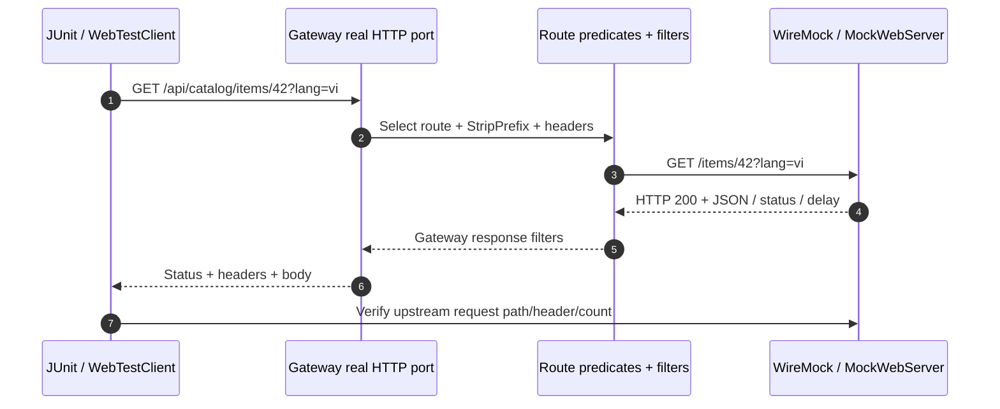
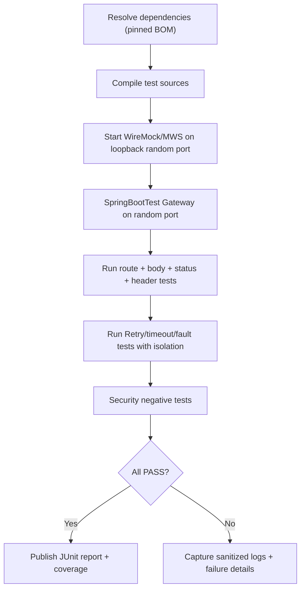

# Mocking Downstream Services with WireMock or MockWebServer

**Chapter:** Testing  
**Module:** `SPRING_CLOUD_GATEWAY` — Spring Cloud Gateway  
**Scope:** Testing an API Gateway with route predicates, filter chains, path/header/body transformations, service discovery, authentication, rate limiting, circuit breakers, retries, TLS, and request observability.

When testing an **API Gateway**, calling a REST controller directly or mocking a `GatewayFilter` with Mockito is not enough. A real Gateway accepts HTTP requests from clients, **selects routes**, runs **predicate/filter chains**, opens HTTP/HTTPS connections to downstream services, and relays statuses/headers/bodies back to clients. If a real backend is flaky, slow, requires shared accounts, or cannot return 503 on demand, proving your Gateway is configured accurately becomes very hard.

**WireMock** and **MockWebServer** solve this by starting a **mock HTTP server listening on a real port inside the test process**. The Gateway has no idea it is talking to a mock; every request travels over real TCP/HTTP to an upstream spun up for the test. You control whether upstream returns 200/401/404/503, JSON, headers, delays, redirects, chunked bodies, or transport faults—while inspecting **exact requests received and how many times the backend was called**.

This lesson builds an integration test harness with **Spring Cloud Gateway Server WebFlux**, JUnit Jupiter, `@SpringBootTest(webEnvironment = RANDOM_PORT)`, and `WebTestClient.bindToServer()`, then demonstrates two alternatives: **WireMock 3** for rich matching/scenarios/verification, and **OkHttp MockWebServer 3 (OkHttp 5)** for lightweight response queues and `RecordedRequest` inspection. It finishes with a test matrix covering routes, headers, request/response bodies, auth, timeouts, `Retry`, `CircuitBreaker`, `LoadBalancer`, TLS, streaming, rate limiting, security, and CI.

> **Version note:** Primary examples target **Spring Cloud Gateway Server WebFlux 5.x** with starter `spring-cloud-starter-gateway-server-webflux` and prefix `spring.cloud.gateway.server.webflux.*`; some Gateway 4.x projects use `spring.cloud.gateway.routes` and an older starter name. For **Gateway Server Web MVC**, use `spring-cloud-starter-gateway-server-webmvc`, prefix `spring.cloud.gateway.server.webmvc.*`, Servlet/`RestClient`, and an MVC-specific test setup. Do not copy `GatewayFilter`, `WebTestClient.bindToApplicationContext`, or Reactive Netty configs verbatim into MVC. Verify artifact paths and dependencies against your project's release train and Boot BOM.

## 1. Learning Outcomes

After this lesson, you will be able to:

1. Explain the difference between **mocking a Java dependency** and **mocking a downstream HTTP server** in Gateway integration tests.
2. Choose between WireMock and MockWebServer based on request matching, sequential responses, fault injection, and verification needs.
3. Start a mock upstream on a **random port**, bind its address into Gateway routes **before Spring `ApplicationContext` initializes**, and never hardcode `8081`.
4. Combine JUnit, `@SpringBootTest(RANDOM_PORT)`, and `WebTestClient.bindToServer()` to exercise real HTTP networking.
5. Verify `Path`, `Method`, `Host`, `Header`, `StripPrefix`, `RewritePath`, `Add/RemoveRequestHeader`, and query strings on the **upstream side**.
6. Simulate statuses/headers/bodies, Unicode JSON, redirects, delays, connection resets, and streaming responses.
7. Write `Retry` tests asserting **actual upstream call counts**, distinguishing retryable statuses, timeouts, fail-fast paths, and exceptions.
8. Test protective controls: authentication/authorization, preventing token relay to unauthorized targets, rate limits, `CircuitBreaker`/fallbacks, and CORS/forwarded-header security.
9. Recognize limitations: a single HTTP mock server cannot fully test real discovery, production TLS trust, WebSocket session semantics, or high-load capacity.
10. Design isolated, deterministic, low-flake tests safe to run concurrently in CI.

## 2. Where Does Downstream HTTP Mocking Fit in the Architecture?



There are **three observation points**:

| Point | What is verified? | Example |
|---|---|---|
| **Client → Gateway** | HTTP status, response body/headers, security, latency | `WebTestClient.expectStatus()` |
| **Gateway route/filter layer** | Route ID, predicates, filter order, timeouts/retries, actuator metrics | Gateway logs/observability |
| **Gateway → mock backend** | Method, path, query, headers, request body, call count | `WireMock.verify(...)` or `RecordedRequest` |

Asserting only "the client got 200" does not prove `StripPrefix` worked; a loose mock might return 200 for any path. Asserting only "the mock received a request" does not prove response filters, security, or status mapping. **You must verify both sides.**

### 2.1. Test Categorization

| Category | Real resources | Goal | Example |
|---|---|---|---|
| Unit test | No HTTP started | Logic of a single predicate/filter/mapper | JUnit + Mockito for Java helpers |
| Gateway slice test | Spring context or mock exchange | Specific route/filter logic | WebFlux test with mocked collaborators |
| **Gateway integration test** | **Gateway HTTP server + mock HTTP backend** | End-to-end routing/filtering, serialization, sockets, errors | **This lesson** |
| Contract test | Gateway + contract-driven mock | Enforce approved status/body/header contracts | JSON stubs + assertions |
| System/E2E | Gateway + real backend + Redis/registry/TLS/ingress | Multi-component production-like topology | Testcontainers/kind/test cluster |
| Performance/chaos | Load generator and realistic infra | Capacity/latency/failure behavior | k6/Gatling + observability |

**Never label a WireMock test as "production E2E"**: it tests neither real DB queries, backend business logic, schema migrations, Kubernetes Ingress propagation, nor live service registries. Conversely, unit tests cannot replace integration tests for route parsing and live HTTP routing.

### 2.2. Choosing WireMock vs. MockWebServer

| Criterion | WireMock 3 | OkHttp MockWebServer 3 |
|---|---|---|
| Core strength | Rich HTTP API mocking with matching/response DSL | Lightweight scripted HTTP test server |
| Request matching | URL/path/query/header/body, JSONPath, priorities, scenarios | Primarily response queue / `Dispatcher` + `RecordedRequest` inspection |
| Sequential responses | Stateful scenarios | `enqueue` `MockResponse`s in order |
| Verifying call counts | `verify(count, requestedFor(...))` and request journal | `takeRequest(timeout, unit)`, `requestCount` |
| Delays/faults | `withFixedDelay`, `withFault`, chunked/dribble | `headersDelay`/`bodyDelay`/`throttleBody`, socket policies |
| Test readability | Strong for many endpoints/complex contracts | Strong for short sequential request assertions |
| JUnit integration | `WireMockExtension` or `WireMockServer` | `MockWebServer`, optional JUnit 5 extension |
| JSON/response fixtures | Supports `__files`/mappings | Build responses/dispatchers in code |
| HTTP admin UI | Exposes admin API; keep private | No separate admin/stubbing API model |
| Footprint | Larger dependency set; align artifact version | Lightweight; OkHttp 5 renamed packages/artifacts |

**Neither tool wins universally.** Pick **WireMock** when you need expressive stubbing, failure scenarios, and strict request verification; pick **MockWebServer** for simple ordered queues or lightweight proxy checks. Keep both in `test` scope, bound to loopback/random ports, and cleanly managed in lifecycle hooks.

### 2.3. What Mocks Do Not Automatically Guarantee

- That Gateway routes match if a test calls the mock backend directly.
- That production LoadBalancer/service-registry topology is healthy.
- That `@MockBean`/`@MockitoBean` on a downstream service replaces **HTTP calls** sent by the Gateway to another URI.
- That retrying side-effecting POST requests is safe.
- That a mock timeout or socket close produces the exact same HTTP status across every Netty/Servlet version.
- That a self-signed test HTTPS cert proves production truststores are right.
- That WebSocket handshakes/frames or gRPC streaming are thoroughly tested by plain HTTP response stubs.

## 3. Preparing the Spring Cloud Gateway Test Environment

### 3.1. Sample WebFlux Gateway Project

Create a Spring Boot Maven project compatible with Spring Cloud Gateway **Server WebFlux**. Use Java 17+ for Spring Boot 3; for Boot 4 or newer, follow the release train's JDK baseline.

`pom.xml` — relevant dependencies only; **include your project's matching Spring Cloud BOM, parent, and plugins**:

```xml
<dependencies>
    <!-- Gateway Server WebFlux: actual API Gateway. -->
    <dependency>
        <groupId>org.springframework.cloud</groupId>
        <artifactId>spring-cloud-starter-gateway-server-webflux</artifactId>
    </dependency>

    <!-- JUnit Jupiter, SpringBootTest, assertions, test tools. -->
    <dependency>
        <groupId>org.springframework.boot</groupId>
        <artifactId>spring-boot-starter-test</artifactId>
        <scope>test</scope>
    </dependency>

    <!-- WebTestClient; if the test starter does not pull in spring-test/webflux,
         add the matching test starter for your Boot version. -->
    <dependency>
        <groupId>org.springframework.boot</groupId>
        <artifactId>spring-boot-starter-webflux</artifactId>
        <scope>test</scope>
    </dependency>

    <!-- Option A: WireMock 3.x. -->
    <dependency>
        <groupId>org.wiremock</groupId>
        <artifactId>wiremock</artifactId>
        <version>3.13.2</version>
        <scope>test</scope>
    </dependency>
</dependencies>
```

`3.13.2` is an **illustrative WireMock 3 version** referenced on the official install page at the time of writing; in real projects, check patch releases, dependency conflicts, and your BOM/lockfile. Never assume a test builds across all Spring Cloud Gateway 4.x/5.x versions just because Maven resolves the artifact. In complex Jakarta/Jetty setups, consider `org.wiremock:wiremock-standalone` of the same version to reduce classpath conflicts; **never declare both artifacts simultaneously** unless you know why.

### 3.2. Application Class

`src/main/java/com/example/gateway/GatewayApplication.java`:

```java
package com.example.gateway;

import org.springframework.boot.SpringApplication;
import org.springframework.boot.autoconfigure.SpringBootApplication;

@SpringBootApplication
public class GatewayApplication {
    public static void main(String[] args) {
        SpringApplication.run(GatewayApplication.class, args);
    }
}
```

### 3.3. Never Put Mock URIs into Production Config

Never commit a route like:

```yaml
spring:
  cloud:
    gateway:
      server:
        webflux:
          routes:
            - id: catalog
              uri: http://localhost:8081
```

into production `application.yml` just to run tests. Use a **test profile** or test-time property overrides. In the lab below:

- `src/test/resources/application-gatewaytest.yml` holds mock routes **for testing only**.
- `@ActiveProfiles("gatewaytest")` activates that profile during JUnit execution.
- `@DynamicPropertySource` supplies the random backend URI before Gateway builds its context.
- `@SpringBootTest(webEnvironment=RANDOM_PORT)` opens a **real Gateway HTTP port**, also random.
- `WebTestClient.bindToServer()` calls the Gateway's HTTP port instead of binding a mock controller.

If your app already defines production routes in `application.yml`, **a test profile may merge with them** rather than replacing the list, depending on Spring property binding. For isolated tests, separate production vs. test route configs or explicitly override the route list and verify the loaded route inventory. Do not assume `application-gatewaytest.yml` automatically wipes out other routes.

### 3.4. Test Topology

```text
JUnit Jupiter (same JVM)
   |
   | WebTestClient -> http://127.0.0.1:<RANDOM_GATEWAY_PORT>
   v
Spring Cloud Gateway Server WebFlux (real server)
   |
   | route uri resolves to http://127.0.0.1:<RANDOM_MOCK_PORT>
   v
WireMockServer / MockWebServer (real loopback HTTP server)
```

**Random ports** prevent collisions during parallel CI runs. **Loopback** keeps stub/admin endpoints off the network. Best of all, tests need neither Internet access nor live backends; everything runs inside the JUnit test machine.

## 4. Test Route Config: Dynamic URI, Never Hardcode Ports

`src/test/resources/application-gatewaytest.yml`:

```yaml
spring:
  cloud:
    gateway:
      server:
        webflux:
          routes:
            - id: catalog-mock
              uri: ${test.backend.base-url}
              predicates:
                - Path=/api/catalog/**
              filters:
                - StripPrefix=2
                - AddRequestHeader=X-Gateway-Test, via-gateway

            - id: retry-mock
              uri: ${test.backend.base-url}
              predicates:
                - Path=/api/retry/**
                - Method=GET
              filters:
                - StripPrefix=2
                - name: Retry
                  args:
                    retries: 1
                    statuses: SERVICE_UNAVAILABLE
                    methods: GET
                    backoff:
                      firstBackoff: 10ms
                      maxBackoff: 30ms
                      factor: 2
```

**Path mapping explained:**

| Client URL | Route | Downstream path |
|---|---|---|
| `GET /api/catalog/items/SKU-42` | `catalog-mock` | `GET /items/SKU-42` |
| `POST /api/catalog/echo` | `catalog-mock` | `POST /echo` |
| `GET /api/catalog/items/SKU-42?lang=vi` | `catalog-mock` | `GET /items/SKU-42?lang=vi` |
| `GET /api/retry/flaky` | `retry-mock` | `GET /flaky` |
| `GET /not-mapped` | No match | Zero downstream calls |

`StripPrefix=2` removes the first two segments (`api`, `catalog` or `api`, `retry`). `AddRequestHeader` lets tests verify **the injected header actually arrives upstream**. Retry is enabled only on `retry-mock` so normal GET tests are not retried unexpectedly.

Key notes:

- `${test.backend.base-url}` is a Spring property placeholder, **not** a default mock host; JUnit supplies the dynamic port.
- Never configure `uri: http://localhost:0`: port 0 works for **servers binding an ephemeral listening port**, not as a target URI for the Gateway to dial.
- Property keys under `spring.cloud.gateway.server.webflux.routes` target Gateway **Server WebFlux 5.x**. If using Gateway 4.x, check the exact Configuration Properties namespace for your version.
- Avoid mixing test filters with production `default-filters`; if global auth or rate limits are enabled, test against that real contract instead of disabling security unconditionally.
- `Retry.retries=1` means **one retry after the initial attempt**, so a `503 → 200` case makes **two** downstream GET calls. Never equate retry count with total HTTP attempt count.

## 5. WireMock 3: Full Integration Test with Gateway WebFlux

WireMock 3 provides `WireMockServer` and the JUnit 5 `WireMockExtension`. When tests rely on `@DynamicPropertySource` before Spring builds its `ApplicationContext`, the clearest approach is **starting a static `WireMockServer` early**, reading `baseUrl()`, and stopping it after the class finishes.

### 5.1. Mock Lifecycle Before Spring Loads Routes

```java
package com.example.gateway;

import com.github.tomakehurst.wiremock.WireMockServer;
import org.junit.jupiter.api.AfterAll;
import org.junit.jupiter.api.BeforeEach;
import org.springframework.test.context.DynamicPropertyRegistry;
import org.springframework.test.context.DynamicPropertySource;

import static com.github.tomakehurst.wiremock.core.WireMockConfiguration
    .wireMockConfig;

class ExampleLifecycle {
    static final WireMockServer backend =
        new WireMockServer(wireMockConfig()
            .dynamicPort()
            .bindAddress("127.0.0.1"));

    static {
        backend.start();
    }

    @DynamicPropertySource
    static void bindBackend(DynamicPropertyRegistry registry) {
        registry.add("test.backend.base-url", backend::baseUrl);
    }

    @BeforeEach
    void resetMock() {
        backend.resetAll();
    }

    @AfterAll
    static void stopMock() {
        backend.stop();
    }
}
```

This snippet **illustrates lifecycle only**; the full test in the next section adds `@SpringBootTest`. The static initializer guarantees the mock port is open before Spring resolves `backend::baseUrl`. `@BeforeEach resetAll()` clears stubs, scenarios, and request journals between tests; avoid running parallel test methods against the **same mock instance** where one test resets another's stubs.

If Spring's TestContext cache reuses an `ApplicationContext` after the mock has stopped, the Gateway retains a URI pointing to a dead port. When multiple test classes/profiles use dynamic URIs, isolate contexts or use `@DirtiesContext(classMode = AFTER_CLASS)` or a container lifecycle manager to prevent stale URIs.

### 5.2. `WireMockGatewayIntegrationTest.java`

The following example runs a **real loopback backend** and the Gateway on a **random HTTP port**. It expects `GatewayApplication` in package `com.example.gateway` and the section 4 YAML profile.

```java
package com.example.gateway;

import com.github.tomakehurst.wiremock.WireMockServer;
import org.junit.jupiter.api.AfterAll;
import org.junit.jupiter.api.BeforeEach;
import org.junit.jupiter.api.Test;
import org.springframework.beans.factory.annotation.Value;
import org.springframework.boot.test.context.SpringBootTest;
import org.springframework.boot.test.web.server.LocalServerPort;
import org.springframework.test.context.ActiveProfiles;
import org.springframework.test.context.DynamicPropertyRegistry;
import org.springframework.test.context.DynamicPropertySource;
import org.springframework.test.annotation.DirtiesContext;
import org.springframework.test.web.reactive.server.WebTestClient;

import static com.github.tomakehurst.wiremock.client.WireMock.*;
import static com.github.tomakehurst.wiremock.core.WireMockConfiguration
    .wireMockConfig;
import static org.springframework.boot.test.context.SpringBootTest
    .WebEnvironment.RANDOM_PORT;

@SpringBootTest(classes = GatewayApplication.class,
                webEnvironment = RANDOM_PORT)
@ActiveProfiles("gatewaytest")
@DirtiesContext(classMode = DirtiesContext.ClassMode.AFTER_CLASS)
class WireMockGatewayIntegrationTest {

    static final WireMockServer backend =
        new WireMockServer(wireMockConfig()
            .dynamicPort()
            .bindAddress("127.0.0.1"));

    static {
        backend.start();
    }

    @DynamicPropertySource
    static void downstreamUri(DynamicPropertyRegistry registry) {
        registry.add("test.backend.base-url", backend::baseUrl);
    }

    @LocalServerPort
    int gatewayPort;

    private WebTestClient client() {
        return WebTestClient.bindToServer()
            .baseUrl("http://127.0.0.1:" + gatewayPort)
            .build();
    }

    @BeforeEach
    void cleanMock() {
        backend.resetAll();
    }

    @AfterAll
    static void stopBackend() {
        backend.stop();
    }

    @Test
    void forwardsPathQueryAndAddedHeader() {
        backend.stubFor(get(urlPathEqualTo("/items/SKU-42"))
            .withQueryParam("lang", equalTo("vi"))
            .withHeader("X-Gateway-Test", equalTo("via-gateway"))
            .willReturn(okJson(
                "{\"sku\":\"SKU-42\",\"source\":\"wiremock\"}")));

        client().get()
            .uri("/api/catalog/items/SKU-42?lang=vi")
            .exchange()
            .expectStatus().isOk()
            .expectHeader()
                .contentTypeCompatibleWith(
                    org.springframework.http.MediaType.APPLICATION_JSON)
            .expectBody()
                .jsonPath("$.sku").isEqualTo("SKU-42")
                .jsonPath("$.source").isEqualTo("wiremock");

        backend.verify(1, getRequestedFor(
                urlPathEqualTo("/items/SKU-42"))
            .withQueryParam("lang", equalTo("vi"))
            .withHeader("X-Gateway-Test", equalTo("via-gateway")));
    }

    @Test
    void forwardsPostJsonWithoutChangingBusinessBody() {
        String json = "{\"message\":\"xin chào\"}";

        backend.stubFor(post(urlEqualTo("/echo"))
            .withHeader("Content-Type",
                containing("application/json"))
            .withRequestBody(equalToJson(json))
            .willReturn(okJson(json)
                .withHeader("X-Backend", "wiremock")));

        client().post()
            .uri("/api/catalog/echo")
            .header("Content-Type", "application/json")
            .bodyValue(json)
            .exchange()
            .expectStatus().isOk()
            .expectHeader().valueEquals("X-Backend", "wiremock")
            .expectBody().jsonPath("$.message")
                .isEqualTo("xin chào");

        backend.verify(1,
            postRequestedFor(urlEqualTo("/echo"))
                .withRequestBody(equalToJson(json))
                .withHeader("X-Gateway-Test",
                    equalTo("via-gateway")));
    }

    @Test
    void preservesDownstreamNotFoundStatus() {
        backend.stubFor(get(urlEqualTo("/items/missing"))
            .willReturn(aResponse()
                .withStatus(404)
                .withHeader("Content-Type", "application/json")
                .withBody("{\"code\":\"ITEM_NOT_FOUND\"}")));

        client().get()
            .uri("/api/catalog/items/missing")
            .exchange()
            .expectStatus().isNotFound()
            .expectBody().jsonPath("$.code")
                .isEqualTo("ITEM_NOT_FOUND");

        backend.verify(1,
            getRequestedFor(urlEqualTo("/items/missing")));
    }

    @Test
    void noMatchingRouteDoesNotCallBackend() {
        client().get()
            .uri("/not-mapped")
            .exchange()
            .expectStatus().isNotFound();

        org.junit.jupiter.api.Assertions.assertEquals(
            0, backend.getAllServeEvents().size());
    }
}
```

**Understanding the behavior:**

- Tests genuinely call the Gateway's random port; client assertions never call `backend.baseUrl()` directly.
- `WireMockServer` receives downstream `/items/SKU-42` after `StripPrefix=2`, letting you verify post-filter path, query, and headers.
- `verify(1, ...)` catches accidental **double upstream calls** from unexpected retries or default filters.
- The `/not-mapped` test verifies route selection. If the real app has a catch-all route or pre-routing security, adjust expected status/call count to match the isolated test profile.
- `@DirtiesContext` prevents cached contexts from pointing at a stopped mock after the class completes. Avoid placing it on every test method, as that slows suites dramatically.
- `@LocalServerPort` imports come from Spring Boot 3.x/4.x web server test packages; verify the exact package for your Boot version.

### 5.3. When to Use `WireMockExtension` Instead of `WireMockServer`?

WireMock JUnit Jupiter offers:

```java
@RegisterExtension
static WireMockExtension wm =
    WireMockExtension.newInstance()
        .options(wireMockConfig().dynamicPort())
        .build();
```

The extension starts the server, resets mappings/journals per test, and stops after the class. It works well for general tests or when querying `WireMockRuntimeInfo` for ports. **However, with `@SpringBootTest` and `@DynamicPropertySource`**, you must guarantee the mock starts **before Spring binds route URIs**; JUnit/Spring extension callback ordering can easily race. The main example starts the server in a static initializer for explicit ordering. If using `@RegisterExtension`, verify lifecycle ordering, context caching, and full-suite CI runs.

### 5.4. Common Setup Mistakes

| Symptom | Cause | Resolution |
|---|---|---|
| `Connection refused localhost:8081` | Route still targets real backend or stale port | Print bound route URI; check `@DynamicPropertySource` |
| Gateway returns 404, WireMock sees 0 calls | Wrong `Path` predicate, prefix, or security | Verify route inventory and `Path` |
| Mock returns 404 "Request was not matched" | URL/header mapping mismatch | Inspect local mock `/__admin/requests/unmatched` |
| Mock not started when Spring resolves URI | JUnit lifecycle ordering | Start earlier or align extension lifecycle |
| Single test passes, full suite fails | Shared context, port, or test journal | Reset, isolate, add `@DirtiesContext` if needed |
| Adding WireMock breaks Jetty/classpath | Dependency version mismatch | Use compatible WireMock or standalone artifact; pin BOM |
| `WebTestClient` fails to connect | Bound to mock app context instead of live port | Use `bindToServer()` and `@LocalServerPort` |
| "retry=1" test observes only 1 call | Retry configured on another route or status/method mismatch | Check route ID, `statuses`, and `methods` |

## 6. MockWebServer 3 (OkHttp 5): A Lightweight Option with Clear Request Ordering

**MockWebServer** is part of OkHttp. In OkHttp 5, the modern API moved to:

- Maven artifact **`com.squareup.okhttp3:mockwebserver3`**;
- Java package **`mockwebserver3.*`**;
- Responses built via **`new MockResponse.Builder().code(...).body(...).build()`**;
- `RecordedRequest` exposing `method`, `target`, `headers`, and `body` (nullable).

This is **not** OkHttp 4's legacy `okhttp3.mockwebserver.MockResponse#setResponseCode/setBody` API. On OkHttp 5, the old `mockwebserver` artifact still exists for legacy JUnit 4 setups; for JUnit Jupiter, prefer `mockwebserver3` or `mockwebserver3-junit5`. Never mix both packages in the same test.

### 6.1. Maven Dependency

When choosing **MockWebServer instead of WireMock**, keep the Gateway/test starters and swap the WireMock dependency for:

```xml
<dependency>
    <groupId>com.squareup.okhttp3</groupId>
    <artifactId>mockwebserver3</artifactId>
    <version>5.5.1</version>
    <scope>test</scope>
</dependency>
```

`5.5.1` is an example OkHttp 5 version on Maven Central at the time of writing, not advice to skip dependency management. Align OkHttp core, Okio, and Kotlin versions via a compatible BOM to avoid `NoSuchMethodError`. If using the JUnit extension, add `mockwebserver3-junit5` at the same version; the example below manages lifecycle directly so **no extension is needed**.

### 6.2. Equivalent Test Class

Uses the **same `application-gatewaytest.yml` from section 4**, run in its **own isolated test class** (never sharing a cached context pointing at an earlier stopped mock port).

```java
package com.example.gateway;

import java.io.IOException;
import java.util.concurrent.TimeUnit;

import mockwebserver3.MockResponse;
import mockwebserver3.MockWebServer;
import mockwebserver3.RecordedRequest;
import org.junit.jupiter.api.AfterAll;
import org.junit.jupiter.api.Test;
import org.springframework.boot.test.context.SpringBootTest;
import org.springframework.boot.test.web.server.LocalServerPort;
import org.springframework.test.annotation.DirtiesContext;
import org.springframework.test.context.ActiveProfiles;
import org.springframework.test.context.DynamicPropertyRegistry;
import org.springframework.test.context.DynamicPropertySource;
import org.springframework.test.web.reactive.server.WebTestClient;

import static org.junit.jupiter.api.Assertions.*;
import static org.springframework.boot.test.context.SpringBootTest
    .WebEnvironment.RANDOM_PORT;

@SpringBootTest(classes = GatewayApplication.class,
                webEnvironment = RANDOM_PORT)
@ActiveProfiles("gatewaytest")
@DirtiesContext(classMode = DirtiesContext.ClassMode.AFTER_CLASS)
class MockWebServerGatewayIntegrationTest {

    static final MockWebServer backend = new MockWebServer();

    static {
        try {
            backend.start(); // Port 0 -> random loopback port.
        } catch (IOException ex) {
            throw new ExceptionInInitializerError(ex);
        }
    }

    @DynamicPropertySource
    static void downstreamUri(DynamicPropertyRegistry registry) {
        registry.add("test.backend.base-url",
            () -> backend.url("/").toString());
    }

    @LocalServerPort
    int gatewayPort;

    @AfterAll
    static void stopBackend() {
        backend.close();
    }

    @Test
    void inspectsRealRequestSeenByMockBackend()
            throws InterruptedException {
        backend.enqueue(new MockResponse.Builder()
            .code(200)
            .addHeader("Content-Type: application/json")
            .addHeader("X-Upstream: mockwebserver")
            .body("{\"sku\":\"SKU-42\",\"source\":\"mws\"}")
            .build());

        WebTestClient client = WebTestClient.bindToServer()
            .baseUrl("http://127.0.0.1:" + gatewayPort)
            .build();

        client.get()
            .uri("/api/catalog/items/SKU-42?lang=vi")
            .exchange()
            .expectStatus().isOk()
            .expectHeader()
                .valueEquals("X-Upstream", "mockwebserver")
            .expectBody()
                .jsonPath("$.sku").isEqualTo("SKU-42");

        // Always pass a timeout: never block indefinitely on route failure.
        RecordedRequest request =
            backend.takeRequest(2, TimeUnit.SECONDS);

        assertNotNull(request, "Gateway did not call mock backend");
        assertEquals("GET", request.getMethod());
        assertEquals("/items/SKU-42?lang=vi",
            request.getTarget());
        assertEquals("via-gateway",
            request.getHeaders().get("X-Gateway-Test"));
        assertEquals(1, backend.getRequestCount());
    }
}
```

**Why is this a Gateway integration test?**

1. `MockWebServer` binds its own port and enqueues an HTTP response.
2. Gateway resolves `test.backend.base-url` at context startup as the route `uri`.
3. `WebTestClient` calls the Gateway's **random port**, triggering route selection, filters, and real outbound HTTP to the mock.
4. `takeRequest(2, TimeUnit.SECONDS)` inspects the exact downstream request, including the URL **after `StripPrefix`** and filter-added headers.
5. `getRequestCount()` distinguishes a single request from accidental retries.

**Watch out:** `enqueue` is strictly **FIFO**. If the Gateway issues health checks or parallel tests hit the same server, queued responses get consumed by the wrong request, causing flakes. To serve multiple endpoints or match by URL, write a MockWebServer **`Dispatcher`** or use explicit WireMock stubs. **Never call `takeRequest()` without a timeout** in CI, or a route miss will hang the build.

### 6.3. Testing POST Bodies with MockWebServer 3

Inside an isolated test method with an enqueued response:

```java
backend.enqueue(new MockResponse.Builder()
    .code(201)
    .addHeader("Content-Type: application/json")
    .body("{\"saved\":true}")
    .build());

client.post()
    .uri("/api/catalog/echo")
    .header("Content-Type", "application/json")
    .bodyValue("{\"message\":\"xin chào\"}")
    .exchange()
    .expectStatus().isCreated();

RecordedRequest req = backend.takeRequest(2, TimeUnit.SECONDS);
assertNotNull(req);
assertEquals("POST", req.getMethod());
assertEquals("/echo", req.getTarget());
assertNotNull(req.getBody());
assertEquals("{\"message\":\"xin chào\"}",
    req.getBody().utf8());
```

This is a **test-method fragment** assuming `client`/`backend` are set up as in section 6.2, not a standalone Java file. In MockWebServer 3, `RecordedRequest.getBody()` returns a nullable `ByteString` when no body was sent. Do not try calling the legacy Buffer `readUtf8()` method on a `ByteString`.

### 6.4. How Response Queues Help Test `Retry`

Suppose a Gateway route defines `Retry.retries=1` for GETs returning 503. In an isolated test:

```java
backend.enqueue(new MockResponse.Builder()
    .code(503)
    .body("temporarily unavailable")
    .build());

backend.enqueue(new MockResponse.Builder()
    .code(200)
    .addHeader("Content-Type: application/json")
    .body("{\"ok\":true}")
    .build());

client.get().uri("/api/retry/flaky")
    .exchange()
    .expectStatus().isOk();

RecordedRequest first =
    backend.takeRequest(2, TimeUnit.SECONDS);
RecordedRequest second =
    backend.takeRequest(2, TimeUnit.SECONDS);

assertNotNull(first);
assertNotNull(second);
assertEquals("/flaky", first.getTarget());
assertEquals("/flaky", second.getTarget());
```

This reads cleanly because the mock returns **503 first, 200 second**. However, FIFO queues can mislead you if retries happen at another HTTP layer or an unrelated probe consumes a response. For multi-endpoint routes or concurrent routing, use **WireMock scenarios** or a custom `Dispatcher` matching method/path instead of relying on global queue ordering.

### 6.5. MockWebServer 4.x vs. 5.x

| OkHttp | Artifact | Import | Response |
|---|---|---|---|
| 4.x | `com.squareup.okhttp3:mockwebserver` | `okhttp3.mockwebserver.*` | `new MockResponse().setResponseCode(200).setBody(...)` |
| **5.x** | **`com.squareup.okhttp3:mockwebserver3`** | **`mockwebserver3.*`** | **`new MockResponse.Builder().code(200).body(...).build()`** |

`RecordedRequest.getPath()` from the older API became `getTarget()` in API 5, and `body` became a nullable `ByteString`. You can still use the legacy artifact on 5.x if you manage JUnit 4 transitives; this lab uses API 5 so you do not learn deprecated code on a modern dependency.

## 7. WireMock Scenarios: Verifying `Retry` via Exact Backend Call Counts

For the WebFlux `retry-mock` route in section 4, verify:

1. Downstream first returns `503 Service Unavailable`;
2. Gateway recognizes the status in `Retry.statuses` and method `GET`;
3. Gateway retries **once**;
4. Downstream returns 200 on the second attempt;
5. Client receives 200 and WireMock records **two** GET requests.

WireMock provides **stateful scenarios** tailored for this test:

```java
import static com.github.tomakehurst.wiremock.client.WireMock.*;
import static com.github.tomakehurst.wiremock.stubbing.Scenario.STARTED;

backend.stubFor(get(urlEqualTo("/flaky"))
    .inScenario("retry-check")
    .whenScenarioStateIs(STARTED)
    .willReturn(aResponse()
        .withStatus(503)
        .withBody("temporary failure"))
    .willSetStateTo("RECOVERED"));

backend.stubFor(get(urlEqualTo("/flaky"))
    .inScenario("retry-check")
    .whenScenarioStateIs("RECOVERED")
    .willReturn(okJson("{\"state\":\"recovered\"}")));

client().get()
    .uri("/api/retry/flaky")
    .exchange()
    .expectStatus().isOk()
    .expectBody().jsonPath("$.state")
        .isEqualTo("recovered");

backend.verify(2,
    getRequestedFor(urlEqualTo("/flaky")));
```

This is a **test-method fragment** using `backend` and `client()` from the WireMock class in section 5, not new route config. Place the stubs and assertions inside a `@Test` method in that class. `backend.resetAll()` in `@BeforeEach` resets the scenario back to `STARTED` so prior tests never interfere.

### 7.1. Why Verify the Call Count?

Seeing 200 alone does not prove a retry occurred. If the mock returned 200 on the first call, or the client hit another route, the test would still see 200. Compare:

| Client status | WireMock call count | Possible interpretation |
|---|---:|---|
| 200 | 1 | Upstream succeeded on first try; does not prove `Retry` |
| **200** | **2** | Matches `503 → 200` with one retry |
| 503 | 1 | Retry disabled or status/method did not match |
| 503 | 2 | Both attempts failed or scenario state did not advance |
| 500/502/504 | 1+ | Transport/timeout/other filter involved; inspect root cause |

Never call `retries=1` "two retries": it means **one additional retry** after the initial attempt, totaling at most two calls in simple cases. When `CircuitBreaker`, `LoadBalancer`, or other filters are present, attempt counts and statuses depend on their combined behavior.

### 7.2. Testing That Out-of-Contract POSTs Are Not Retried

`retry-mock` specifies `Method=GET`, so a POST to `/api/retry/flaky` misses the route and never goes upstream. To **genuinely** test "POST is not retried", define a **separate route** allowing both GET and POST while configuring `Retry` with `methods: GET`; stub POST to return 503 and assert:

```java
backend.verify(1, postRequestedFor(urlEqualTo("/write")));
```

**Never blindly retry payment POSTs.** Requests with bodies may already have executed a side effect before returning an error; WebFlux `Retry` may also buffer the body in `DataBuffer`, increasing memory usage. If business POSTs require retries, enforce idempotency keys, retry budgets, and explicit contracts.

## 8. Simulating Timeouts, HTTP Errors, and Transport Faults

A mock backend returning **HTTP 503** differs from a mock backend **delaying past Gateway timeouts** or **resetting the TCP connection**. They exercise distinct branches in `Retry`, `CircuitBreaker`, and error mapping; testing only a generic "500" is not enough.

### 8.1. An HTTP Error Is a Valid Protocol Response

WireMock:

```java
backend.stubFor(get(urlEqualTo("/unavailable"))
    .willReturn(aResponse()
        .withStatus(503)
        .withHeader("Content-Type", "application/problem+json")
        .withHeader("Retry-After", "3")
        .withBody("""
            {"type":"about:blank",
             "title":"Service Unavailable",
             "status":503}
            """)));
```

Without `Retry`, `CircuitBreaker` fallback, or `SetStatus`:

- **Client:** normally receives 503 with the upstream content type and body per proxy semantics.
- **Mock backend:** records exactly **one** HTTP GET.
- **Gateway:** processed the route/filter chain normally; the client seeing 503 does not mean the Gateway lost connectivity.

`Retry-After: 3` is merely an upstream header; the `Retry` `GatewayFilter` **does not necessarily** compute wait intervals from it automatically. Never assume retry counts or backoffs from headers without configuring and measuring them.

### 8.2. WireMock Fixed Delay

```java
backend.stubFor(get(urlEqualTo("/slow"))
    .willReturn(aResponse()
        .withStatus(200)
        .withFixedDelay(1500)
        .withBody("slow response")));
```

Add a **dedicated lab route** to `application-gatewaytest.yml` (no `Retry` needed here):

```yaml
- id: timeout-mock
  uri: ${test.backend.base-url}
  predicates:
    - Path=/api/timeout/**
    - Method=GET
  filters:
    - StripPrefix=2
  metadata:
    response-timeout: 200
    connect-timeout: 200
```

This is a **route entry fragment** for `server.webflux.routes` in test YAML, not a full config file. Per Gateway WebFlux docs, **per-route `response-timeout` and `connect-timeout` use milliseconds**, whereas **global `response-timeout`** under `httpclient` uses `java.time.Duration` such as `5s`. Confusing `200` ms with `200s` breaks or hangs tests.

Guiding test:

```java
long startNanos = System.nanoTime();

client().get()
    .uri("/api/timeout/slow")
    .exchange()
    .expectStatus().is5xxServerError();

long elapsedMs = java.util.concurrent.TimeUnit
    .NANOSECONDS.toMillis(System.nanoTime() - startNanos);

org.junit.jupiter.api.Assertions.assertTrue(
    elapsedMs < 4000,
    "Gateway should not wait indefinitely for upstream");

backend.verify(1, getRequestedFor(urlEqualTo("/slow")));
```

**Stability warning:** elapsed-time checks are **estimates** that can flake under CI overload or GC pauses. Never assert thresholds within a few milliseconds of `response-timeout`. Verify the **exact HTTP status for your release train and error handler** in your project's integration tests rather than assuming every timeout returns 504 or 502. If a fallback filter turns 5xx into 200, test the fallback contract rather than the raw error status.

### 8.3. Simulate Different Failures Separately

| Downstream scenario | WireMock/MockWebServer simulation | What to observe on Gateway |
|---|---|---|
| HTTP 404 with JSON | `withStatus(404)` | Proxies 404/body without rewriting to 500 |
| HTTP 500/503 | `withStatus(500/503)` | `Retry`/breaker behavior per status config |
| Slow response | `withFixedDelay(1500)` | Response timeout, cancellation, latency |
| Header delay | MockWebServer `headersDelay(...)` | Whether Gateway times out waiting for headers |
| Slow body stream | WireMock dribble / MockWebServer throttle | Buffering, response timeout, stream flushing |
| Connection reset | `withFault(Fault.CONNECTION_RESET_BY_PEER)` | Exception path; not always an HTTP status |
| Malformed HTTP chunk | `withFault(Fault.MALFORMED_RESPONSE_CHUNK)` | Netty decoder/protocol error handling |
| Empty response | `withFault(Fault.EMPTY_RESPONSE)` | Client disconnect or Gateway 5xx |
| Host unreachable | Nothing listening on target port | Connect timeout/refused; distinct from HTTP 503 |
| TLS handshake failure | HTTPS mock cert/trust mismatch | TLS/hostname failure without disabling verify |
| Redirect | `withStatus(302).withHeader("Location", ...)` | Whether redirect is followed; headers preserved |

### 8.4. WireMock Transport Faults

```java
import com.github.tomakehurst.wiremock.http.Fault;

backend.stubFor(get(urlEqualTo("/disconnect"))
    .willReturn(aResponse()
        .withFault(Fault.CONNECTION_RESET_BY_PEER)));
```

**Do not guess a fixed status like 502.** A connection reset may make the Gateway emit 5xx or cause a client-level connection error depending on socket timing, HTTP framing, and exception mapping. WireMock docs note `CONNECTION_RESET_BY_PEER` behaves differently across Windows and Unix; use it to **observe error classification** rather than tying cross-platform CI assertions to a specific exception string.

For failures occurring **after HTTP response headers were already sent to the client**, the Gateway **cannot change the status** because the response is committed. Inspect metrics/logs and client stream signals instead of demanding a new HTTP status in every case.

### 8.5. MockWebServer Can Delay Headers and Throttle Bodies

With MockWebServer 3:

```java
backend.enqueue(new MockResponse.Builder()
    .code(200)
    .headersDelay(500, TimeUnit.MILLISECONDS)
    .body("delayed headers")
    .build());
```

Or simulate a slow-dripping downstream:

```java
backend.enqueue(new MockResponse.Builder()
    .code(200)
    .addHeader("Content-Type: text/plain")
    .body("abcdef")
    .throttleBody(2, 200, TimeUnit.MILLISECONDS)
    .build());
```

These are **test-method fragments** requiring `TimeUnit` and a running mock backend. `throttleBody(2, 200, ...)` drips small chunks, yet TCP/HTTP proxies may buffer or coalesce bytes rather than delivering exact 2-byte network packets. To test SSE, assert **event formatting, arrival timing, and incremental delivery** rather than packet boundaries.

### 8.6. Distinguishing Connect Timeout from Response Timeout

```text
Client --(Gateway)---> target IP:port
                  |
                  |-- TCP connect timeout / connection refused
                  |
                  |-- TLS handshake / certificate validation
                  |
                  |-- HTTP request sent
                  |
                  |-- Wait headers / response-timeout
                  |
                  |-- Stream body (may be long-lived)
```

A listening mock server that merely replies slowly **cannot** simulate a TCP SYN connect timeout. To test connect timeouts, use a **controlled network fault fixture** like Toxiproxy or container network rules in your test environment; a closed port normally raises `Connection refused` immediately rather than dropping packets. Never send test packets to public IPs or cloud metadata endpoints to force timeouts.

## 9. Verifying Response Transformations, Headers, and HTTP Contracts

### 9.1. Headers Must Be Verified on Both Sides

Suppose a Gateway contract specifies:

```yaml
filters:
  - StripPrefix=2
  - RemoveRequestHeader=X-Internal-Admin
  - AddRequestHeader=X-Gateway-Test, via-gateway
  - AddResponseHeader=X-Edge, gateway
```

Test steps:

1. Client sends `X-Internal-Admin: true`.
2. WireMock verifies that header is **absent** when reaching the backend.
3. WireMock verifies `X-Gateway-Test: via-gateway`.
4. Client receives `X-Edge: gateway`, even when upstream returns 404/503 per policy.

WireMock verification:

```java
backend.verify(1, getRequestedFor(urlEqualTo("/items/SKU-42"))
    .withHeader("X-Internal-Admin", absent())
    .withHeader("X-Gateway-Test", equalTo("via-gateway")));
```

**Never treat `X-Gateway-Test` as proof that the caller is authenticated.** Gateway-injected headers help test filters, not authorization; if a backend trusts an internal identity header, enforce a trusted hop, mTLS, and block direct client access.

### 9.2. Path, Query, Method, and Host

Pitfalls visible only downstream:

| Public input | Behavior to test |
|---|---|
| `GET /api/catalog/items/SKU-42` | Strips exactly two segments |
| `POST /api/catalog/echo` | Preserves method and full body |
| `GET /api/catalog/items/SKU-42?a=1&a=2` | Preserves duplicate query keys |
| `GET /api/catalog/items/a%2Fb` | URL encoding/path parsing and security policy |
| `Host: api.example.test` | Host predicate matches; `Host` forwarded per trust policy |
| Client-supplied `X-Forwarded-For` | Never trusted as identity outside trusted proxy chain |
| `Cookie`/`Authorization` | Never logged or relayed to wrong-audience backends |
| `OPTIONS` preflight | Not blocked by Method predicate/SSO when CORS policy permits |

In WireMock, `urlPathEqualTo` matches only the **path**, whereas `urlEqualTo` matches **path + query**. Choose carefully: using `urlPathMatching(".*")` can hide Gateway bugs that drop query params or mangle paths.

### 9.3. JSON Bodies, Binary Payloads, and Charsets

WireMock's `equalToJson`/`matchingJsonPath` compare **JSON semantics**, avoiding failures from whitespace or key order. When verifying HTTP signatures/HMACs or binary uploads, however, compare **raw bytes**, because whitespace, Unicode normalization, and encoding matter directly.

For POST:

```json
{
  "message": "Hello",
  "items": [1, 2, 3],
  "enabled": true
}
```

Test more than `200`:

- Backend receives exact body/`Content-Type` and UTF-8;
- Stale `Content-Length` is not kept if the Gateway alters the body;
- Compression/`Content-Encoding` stays consistent;
- Request body is not consumed before forwarding without replay;
- Raw passwords, tokens, or payment fields are never logged.

If routes use `CacheRequestBody` or `ModifyRequestBody` in WebFlux, verify the full body survives filter execution and test codec/memory bounds. A request body is a single-consumption `Flux<DataBuffer>` from the HTTP source; calling `subscribe()` recklessly in a custom filter can drop the body, leak `DataBuffer`s, or cause races.

### 9.4. Response Headers and HTTP Conditionals

Mock backend returns:

```java
backend.stubFor(get(urlEqualTo("/cacheable"))
    .willReturn(aResponse()
        .withStatus(200)
        .withHeader("Cache-Control", "public, max-age=60")
        .withHeader("ETag", "\"catalog-v1\"")
        .withHeader("Vary", "Accept-Language")
        .withBody("public data")));
```

When the Gateway **has no response cache** and does not rewrite headers, verify pass-through of `Cache-Control`/`ETag`/`Vary`. When `LocalResponseCache` is active, test cache eligibility, TTL, `max-age` rewriting, privacy, key/route isolation, and conditional GETs separately. **Returning an `ETag` from a mock backend does not make the Gateway synthesize 304 on its own** without caching/revalidation logic; either the backend handles preconditions or a caching proxy implements HTTP cache semantics.

### 9.5. Redirects, `Set-Cookie`, and Hop-by-Hop Headers

Mock:

```java
backend.stubFor(get(urlEqualTo("/go"))
    .willReturn(aResponse()
        .withStatus(302)
        .withHeader("Location", "/new-location")
        .withHeader("Set-Cookie",
                    "SESSION=lab; HttpOnly; SameSite=Lax")));
```

Assert the client receives 302 and the right `Location`; never let the test client auto-follow redirects and assert only the final 200 body. For `Set-Cookie`, verify `Secure`/`HttpOnly`/`SameSite`/`Path`/`Domain` attributes per contract without logging real session IDs. `Connection`, `Transfer-Encoding`, and `Upgrade` are hop-by-hop headers; the Gateway/HTTP client handles them per protocol rather than copying them byte-for-byte.

## 10. `CircuitBreaker` and Fallbacks: Testing with a Controlled Faulty Backend

`CircuitBreaker` differs from `Retry`. Retry decides **whether to call again**; `CircuitBreaker` tracks failures to decide **whether calls are allowed at all** and can route to a fallback. Test **breaker state, status mapping, call counts, and fallback bodies**.

### 10.1. Integration Dependency

For **Gateway Server WebFlux** on documented release trains:

```xml
<dependency>
    <groupId>org.springframework.cloud</groupId>
    <artifactId>spring-cloud-starter-circuitbreaker-reactor-resilience4j</artifactId>
</dependency>
```

Add this alongside your Gateway starter; the Spring Cloud BOM selects the compatible version. Configuring `CircuitBreaker` without this dependency prevents the route/filter from building or fails startup for missing beans.

### 10.2. Configuring a Dedicated Route for `CircuitBreaker`

YAML snippet added to `spring.cloud.gateway.server.webflux.routes` in the test profile:

```yaml
- id: breaker-mock
  uri: ${test.backend.base-url}
  predicates:
    - Path=/api/breaker/**
    - Method=GET
  filters:
    - StripPrefix=2
    - name: CircuitBreaker
      args:
        name: catalogTestBreaker
        fallbackUri: forward:/fallback/catalog
        statusCodes:
          - 500
          - 503
```

Add a fallback handler in the **Gateway test application context**:

```java
package com.example.gateway;

import java.util.Map;
import org.springframework.http.ResponseEntity;
import org.springframework.web.bind.annotation.GetMapping;
import org.springframework.web.bind.annotation.RestController;
import reactor.core.publisher.Mono;

@RestController
class TestFallbackController {

    @GetMapping("/fallback/catalog")
    Mono<ResponseEntity<Map<String, String>>> catalog() {
        return Mono.just(
            ResponseEntity.status(503)
                .body(Map.of("source", "gateway-fallback",
                             "status", "DEGRADED")));
    }
}
```

**Define this handler only in test configuration**, or ensure production fallback routes enforce their own auth/privacy policies. It represents a degraded response, not live data; never return 200 with synthetic business data from a fallback and mislead monitoring into thinking the backend is healthy.

WireMock:

```java
backend.stubFor(get(urlEqualTo("/unhealthy"))
    .willReturn(aResponse()
        .withStatus(503)
        .withBody("backend down")));
```

Test client:

```java
client().get()
    .uri("/api/breaker/unhealthy")
    .exchange()
    .expectStatus().isEqualTo(503)
    .expectBody()
        .jsonPath("$.source").isEqualTo("gateway-fallback");
```

This is a **fallback happy-path** when `statusCodes` includes 503, the handler exists, and the filter is wired properly. Production suites also need:

- When downstream returns 200, the fallback is **not** called;
- When downstream returns HTTP 503, the breaker records a failure per `statusCodes` and triggers fallback;
- When the breaker is OPEN, downstream call counts drop to **0** for short-circuited requests;
- `HALF_OPEN`/recovery after wait duration stops falling back once the backend recovers;
- Fallbacks never accept wrong-audience tokens or leak exception details;
- Filter order between `CircuitBreaker` and `Retry` determines whether the breaker sees each attempt or the overall operation.

**Never test an OPEN breaker with a single request** and guess its state: Resilience4j uses sliding windows, minimum call counts, and wait durations. Make tests deterministic by configuring small thresholds/minimum calls in the test profile, isolating tests, and inspecting the registry/metrics rather than calling arbitrary `Thread.sleep`s. If tests share an `ApplicationContext`, leftover breaker state can fail later tests even after `WireMock.resetAll()`.

## 11. Testing `LoadBalancer` and Service Discovery with Two Mock Servers

Simulate a service with **two instances** to verify `lb://catalog-service` selects across multiple upstreams. WireMock does not replace a Eureka/Consul/Kubernetes registry; it simply provides HTTP servers so you see live requests hitting configured LoadBalancer instances.

### 11.1. Test Config with `SimpleDiscoveryClient`

To resolve `lb://catalog-service`, Gateway WebFlux requires:

```xml
<dependency>
    <groupId>org.springframework.cloud</groupId>
    <artifactId>spring-cloud-starter-loadbalancer</artifactId>
</dependency>
```

In the test profile:

```yaml
spring:
  cloud:
    gateway:
      server:
        webflux:
          routes:
            - id: catalog-lb-test
              uri: lb://catalog-service
              predicates:
                - Path=/api/lb/**
              filters:
                - StripPrefix=2
```

This is an **independent example**; if sharing the section 4 test profile, append to the existing list instead of overwriting `spring.cloud.gateway.server.webflux.routes`.

Suppose JUnit starts two static `WireMockServer` instances on random ports:

```java
static final WireMockServer a =
    new WireMockServer(wireMockConfig().dynamicPort());
static final WireMockServer b =
    new WireMockServer(wireMockConfig().dynamicPort());

static {
    a.start();
    b.start();
}

@DynamicPropertySource
static void instances(DynamicPropertyRegistry r) {
    r.add("spring.cloud.discovery.client.simple.instances."
        + "catalog-service[0].uri", a::baseUrl);
    r.add("spring.cloud.discovery.client.simple.instances."
        + "catalog-service[1].uri", b::baseUrl);
}
```

This **belongs in its own test class** (with `@SpringBootTest` and teardown for both A and B), rather than dropping into section 5's single-backend class without adjusting routes/profiles. To restrict both mocks to loopback, use `wireMockConfig().dynamicPort().bindAddress("127.0.0.1")` on **both**.

Each server returns its own marker:

```java
a.stubFor(get(urlEqualTo("/which"))
    .willReturn(okJson("{\"instance\":\"A\"}")));
b.stubFor(get(urlEqualTo("/which"))
    .willReturn(okJson("{\"instance\":\"B\"}")));
```

After sending N `GET /api/lb/which` requests, assert:

```java
int total = a.getAllServeEvents().size()
          + b.getAllServeEvents().size();

assertEquals(N, total);
```

This assumes no `Retry` or health probes hit the mock endpoints; if they do, filter those requests before counting. **Never hardcode an A, B, A, B... sequence** if LoadBalancer policies, caches, health suppliers, connection reuse, or concurrency vary; assert **total calls equal N and every hit went to an approved instance**, sampling distribution over enough requests if needed.

### 11.2. No Instance: 503 or 404?

If a route specifies:

```yaml
uri: lb://missing-service
```

with zero `ServiceInstance`s, Gateway WebFlux typically returns **503 Service Unavailable** by default, or 404 when configured in certain releases. Never assert "WireMock must see a request" because **`LoadBalancer` fails before any upstream socket opens**.

Verify all three:

1. Client gets the status dictated by config/release.
2. WireMock A and B receive **zero** HTTP calls.
3. Gateway logs/metrics show "no service instance found", distinct from a backend-returned 503.

### 11.3. Testing Real Service Discovery Is a Separate Test

`SimpleDiscoveryClient` lacks the lease/health semantics of Eureka, Consul, or Kubernetes. To test deregistration, re-registration, readiness, zone affinity, or route refreshes, run a real registry in Testcontainers/kind or an integration cluster; WireMock simulates only HTTP backends. Empty mock lists do not prove registry health.

## 12. Security: Verify Blocked Requests Never Reach the Backend

A golden rule: **negative security tests must prove the backend was not called**. A client seeing 401/403 could come from the backend after the Gateway accidentally forwarded an access token, so asserting status alone is insufficient.

### 12.1. Authentication at the Gateway

With `SecurityWebFilterChain` and `/api/catalog/**` requiring a JWT/session:

| Client | Expected outcome | WireMock backend |
|---|---|---|
| No token/cookie | `401` or login redirect per contract | **0 calls** |
| Expired token / wrong issuer | `401` | **0 calls** |
| Valid token missing required scope | `403` | **0 calls** |
| Valid token + matching scope | 2xx/4xx from backend | Exactly 1 call |
| Client spoofs `X-User-Role: admin` | No admin access without authentication | Client header ignored |
| Public caller hits Actuator write endpoint | 403/404 or unrouted | No routes created/edited |

**Tests must run real Spring Security config** with an appropriate test token issuer/decoder. Never slap `with(mockUser(...))` on a JUnit test and assume live TCP HTTP requests carry that principal: `SecurityMockServerConfigurers` work with mock server/application-context bindings, not wire requests over `WebTestClient.bindToServer()`. For live-server integration tests, use **lab-signed test JWTs** or session cookies obtained via a valid login flow.

### 12.2. Testing Header Injection / `TokenRelay`

When a route uses `TokenRelay` or custom auth:

- Use a **synthetic** test authorization token with controlled audience/scopes.
- Stub downstream to expect `Authorization: Bearer test-token` **only when** token relay is properly configured and allowed by policy.
- On public routes or routes to other audiences, verify `Authorization` is **absent** or matches policy.
- Never log raw tokens/cookies; log only presence/absence or safe hashes/IDs if needed.
- Never allow a client-sent `X-Authenticated-User` header to replace Gateway authentication.

WireMock assertion:

```java
backend.verify(1,
    getRequestedFor(urlEqualTo("/private-data"))
      .withHeader("Authorization", absent()));
```

This assertion applies to **routes whose contract forbids forwarding tokens**. For routes requiring `TokenRelay`, assert the opposite; never apply `Authorization absent` globally and strip tokens from backend Resource Servers that rely on them.

### 12.3. CORS Preflight

Send:

```http
OPTIONS /api/catalog/items/SKU-42 HTTP/1.1
Origin: https://frontend.example.test
Access-Control-Request-Method: GET
Access-Control-Request-Headers: Authorization
```

If the Gateway configures CORS for that origin, assert status, `Access-Control-Allow-Origin`, `Vary: Origin`, and that preflight **does not call the backend** unless the contract explicitly forwards `OPTIONS`. If your test profile configures no CORS, **do not assume** 200/204 or any ACAO header will appear.

WebSocket Origin checks differ from REST CORS preflights. Returning a mocked 101 does not prove WebSocket frames, subprotocols, ping/pong, or long-lived sessions work; test with a real WebSocket server/handler when covering that streaming protocol.

### 12.4. Header Spoofing and Trusted Proxies

Headers such as `X-Forwarded-For`, `X-Forwarded-Proto`, `Forwarded`, and `Host` must be tested under a **trusted reverse-proxy** topology. WireMock shows what upstream received, yet cannot prove on its own that the Gateway distinguished trusted from untrusted proxies.

Send two test requests:

1. Client directly sets `X-Forwarded-For: 127.0.0.1`; Gateway must grant no internal trust without a trusted proxy.
2. An allowlisted ingress test container injects/normalizes forwarded headers; Gateway honors them per policy.

Never use untrusted IP/client headers as `RequestRateLimiter` keys or tenant authorization keys unless the trust boundary is verified.

## 13. `RateLimiter`: Limiting HTTP Calls, Not Mocking Redis

WireMock can count downstream requests; it **does not replace Redis** for Gateway WebFlux's `RedisRateLimiter` or **Bucket4j stores** for Gateway Server Web MVC. To verify quota distribution and multi-replica consistency, run a real limiter store in your test environment.

### 13.1. Simple Test with a Configured Rate Limiter

Suppose a route policy permits at most 3 requests in a short test window for a **stable test principal/key**. Sending 5 requests:

```text
Client requests:  5
Gateway status:   200, 200, 200, 429, 429   (contract example)
Upstream calls:   3
```

**This illustrates a configured policy**, not a Gateway default. Token bucket refills and clock jitter can shift exact cutoff points; stabilize clocks/limiter configs or bound timing carefully.

Assert **both sides**:

- Rate-limited clients receive 429 and configured rate-limit headers.
- WireMock **never** receives requests rejected by the Gateway.
- Key A's traffic never exhausts Key B unless a shared global bucket is intended.
- Never trust client-supplied `X-User: alice` headers as principals.
- With multiple Gateway replicas, confirm buckets share a real Redis/`AsyncProxyManager`.

### 13.2. Separate `KeyResolver` Unit Tests from Limiter Integration Tests

A reactive `KeyResolver` can be unit tested with `MockServerWebExchange` and a synthetic principal **without WireMock**. However, token bucket math, Redis Lua scripts, latency, and fail-open/fail-closed behavior require integration tests against a real store—mocking `isAllowed` cannot prove them.

Keep quota tests separate from `Retry`/fault tests so quotas never trigger unexpected 429s before requests reach the mock and break call-count assertions.

## 14. HTTPS/TLS: Mock Backends Can Use Test Certificates

Client-to-Gateway HTTPS and Gateway-to-upstream HTTPS are **two distinct TLS hops**. When testing outbound TLS, start an HTTPS mock server with a lab CA/certificate and configure the Gateway to trust that exact CA.

### 14.1. WireMock Dynamic HTTPS Port

WireMock supports dynamic HTTPS ports:

```java
WireMockServer httpsBackend =
    new WireMockServer(wireMockConfig()
        .dynamicPort()
        .dynamicHttpsPort()
        .bindAddress("127.0.0.1"));

httpsBackend.start();
String upstreamUri =
    "https://localhost:" + httpsBackend.httpsPort();
```

**This alone is not enough for HTTPS to pass:** WireMock needs a certificate matching hostname `localhost`, and the Gateway **must** trust the chain via a test truststore/CA. `httpsBackend.baseUrl()` normally points to the HTTP URI; do not pass it instead of the HTTPS URI above. Trust configuration also differs between Gateway Server WebFlux (Reactor Netty) and Server Web MVC (`RestClient`/`spring.http.client.ssl.bundle`).

### 14.2. Minimum TLS Test Cases

| Case | Expectation |
|---|---|
| Valid cert, truststore holds lab CA, matching hostname | HTTPS proxy succeeds with expected status/body |
| Untrusted self-signed cert | TLS handshake rejected |
| Cert with mismatched hostname | Hostname verification fails per policy |
| Expired/invalid cert | Connection rejected; never fails open |
| Backend requires mTLS, Gateway lacks client cert | Handshake fails |
| Valid mTLS client cert | Connection succeeds per policy |
| Slow TLS handshake | Fails within timeout; never hangs suite |

**Never enable trust-all/`useInsecureTrustManager` just to make an "HTTPS test pass".** If a test only needs routing without cert checks, use loopback HTTP; if testing TLS, genuinely validate certificates.

### 14.3. `Forwarded` Headers and Public Schemes

In production, ingress often terminates TLS and forwards HTTP to the Gateway. An upstream mock alone cannot simulate this end-to-end: you need a test ingress/reverse proxy or trusted inbound headers. Use the mock backend to verify what `Host`/`Forwarded`/`X-Forwarded-Proto` headers arrive downstream, and confirm the Gateway **ignores** client-supplied headers outside the trusted-proxy policy.

## 15. Streaming, SSE, and Limits of HTTP Mocks

HTTP streaming differs from WebSockets:

- **SSE (`text/event-stream`):** server streams text-line events over a single HTTP response.
- **Chunked HTTP:** transport splits the body into chunks; chunk boundaries do not equal event/message boundaries.
- **WebSocket:** HTTP upgrade/extended handshake followed by bidirectional frames.
- **gRPC:** HTTP/2 with protobuf, trailers, and streaming semantics; never treat a JSON WireMock stub as a gRPC service.

### 15.1. WireMock Can Drip-Feed Responses

SSE stub example:

```java
backend.stubFor(get(urlEqualTo("/events"))
    .willReturn(aResponse()
        .withStatus(200)
        .withHeader("Content-Type", "text/event-stream")
        .withBody("""
            id: 1
            data: first

            id: 2
            data: second

            """)
        .withChunkedDribbleDelay(2, 600)));
```

When the Gateway routes `/api/catalog/events` → `/events`, test:

1. Client receives `200` and `Content-Type: text/event-stream`.
2. Events arrive in order with intact `id`/`data`.
3. Measure **first-event latency**, not just total body after completion.
4. Client disconnects clean up resources instead of leaking backend/Gateway connections or buffers.
5. Repeat through real ingress/proxies if used in production, since any hop might buffer or cut streams.

### 15.2. `WebTestClient` + Reactor `StepVerifier`

When test dependencies include `reactor-test` and `ServerSentEvent`:

```java
import org.springframework.core.ParameterizedTypeReference;
import org.springframework.http.MediaType;
import org.springframework.http.codec.ServerSentEvent;
import reactor.test.StepVerifier;

var response = client().get()
    .uri("/api/catalog/events")
    .accept(MediaType.TEXT_EVENT_STREAM)
    .exchange()
    .expectStatus().isOk()
    .returnResult(
        new ParameterizedTypeReference<ServerSentEvent<String>>() {});

StepVerifier.create(response.getResponseBody())
    .assertNext(event ->
        org.junit.jupiter.api.Assertions.assertEquals(
            "first", event.data()))
    .assertNext(event ->
        org.junit.jupiter.api.Assertions.assertEquals(
            "second", event.data()))
    .verifyComplete();
```

**This is a test-method fragment** inside the WireMock test class, not a standalone Java file. Add `reactor-test` in `test` scope if Boot's test starter omits it. This proves **events decode in order**, yet **does not prove real-time flushing** unless you capture arrival timestamps. `withChunkedDribbleDelay` delays at the mock, while Gateway/TCP/clients may coalesce chunks; record timestamps in `StepVerifier`/`doOnNext` or a timestamping test client to verify latency requirements.

### 15.3. WebSockets Need a WebSocket-Capable Test Server

It is not enough to stub:

```http
HTTP/1.1 101 Switching Protocols
Upgrade: websocket
```

and assume a bidirectional WebSocket session works. The protocol also requires `Sec-WebSocket-Accept`, framing, masking, ping/pong, close codes, extensions/subprotocols, and long-lived connections. To test `ws://`/`wss://` or `lb:ws://` in Gateway WebFlux, use a framework-supported WebSocket handler or an RFC 6455-compliant test server. The HTTP mocks in this lesson test **HTTP/HTTPS routing**, not full WebSocket protocol integration.

### 15.4. SSE with `Retry` and `CircuitBreaker`

A stream can deliver headers and initial events before failing. HTTP `Retry`/`CircuitBreaker` filters cannot safely rewind a committed response or replay events the client already consumed. Separate **pre-first-byte errors** from **mid-stream errors**:

| Failure timing | Retryable by HTTP filter? | What to verify |
|---|---|---|
| Before connect | Depends on `Retry` exception config | Attempt count, timeouts |
| After connect, before headers | Depends on Gateway/circuit breaker | Error mapping, fallback |
| After headers / first SSE event | Must not assume safe replay | Client stream error/close, resume cursor |
| Backend stops after WebSocket 101 | Cannot swap instances per frame | Client reconnect/resubscribe |

Applications needing zero data loss rely on `Last-Event-ID`, sequence numbers, or idempotent replay. WireMock can trickle bytes to test basic HTTP layers, not full application-level stream recovery.

## 16. Spring Cloud Gateway Server Web MVC: Same HTTP Mocks, Different Test Runtime

WireMock and MockWebServer are **independent HTTP servers**, so both serve as downstreams for Gateway Server WebFlux and Gateway Server Web MVC alike. However, **test clients, property namespaces, filter implementations, and failure mappings** differ:

| Component | Server WebFlux | Server Web MVC |
|---|---|---|
| Starter | `spring-cloud-starter-gateway-server-webflux` | `spring-cloud-starter-gateway-server-webmvc` |
| Route prefix 5.x | `spring.cloud.gateway.server.webflux.routes` | `spring.cloud.gateway.server.webmvc.routes` |
| Runtime | Reactor/WebFlux/Netty | Servlet/WebMvc.fn/`RestClient` |
| Real HTTP tests | `@SpringBootTest(RANDOM_PORT)` + `WebTestClient.bindToServer` | `@SpringBootTest(RANDOM_PORT)` + `RestTestClient` (Boot 4) or matching HTTP client; `WebTestClient.bindToServer` can also hit a live Servlet server if dependencies exist |
| Test slices | `@WebFluxTest` for web components; insufficient for full Gateway routing | `@WebMvcTest`/`MockMvc` for Servlet components; insufficient for full networking |
| `Retry` | Reactive `Retry`; `DataBuffer` body caching | `Retry` with `cacheBody`/`AdaptCachedBody` per MVC docs |
| `RateLimiter` | Reactive `RequestRateLimiter`/`RedisRateLimiter` | `RateLimiter` with Bucket4j in MVC 5.x |
| `CircuitBreaker` | Reactive Spring Cloud CircuitBreaker | Dedicated MVC filter integration/starter per docs |
| TLS | Reactor Netty HTTP client | Boot `RestClient`/`spring.http.client.ssl.bundle` per version |
| WebSocket | WebFlux `WebsocketRoutingFilter` | Servlet WebSocket proxy; distinct ping/size behavior |

### 16.1. MVC Tests Must Open a Real HTTP Port to Test Proxying

In Boot 4:

```java
@SpringBootTest(webEnvironment =
    SpringBootTest.WebEnvironment.RANDOM_PORT)
@AutoConfigureRestTestClient
class GatewayMvcHttpIntegrationTest {
    // @Autowired RestTestClient client;
    // WireMock/MockWebServer still listens on its own loopback port.
}
```

This is a **skeleton** needing version-matched imports/Boot test starters and MVC routes in the test profile. Boot 3 can use `TestRestTemplate`, `MockMvc`, or `WebTestClient.bindToServer()` with reactive client dependencies; **`MockMvc` opens no real inbound Gateway socket** and never replaces SSL, Servlet container, or connection-pool tests.

### 16.2. Do Not Compare Filter Names and Claim Parity

Consider an HTTP POST `Retry` test:

- WebFlux can buffer the request body in `DataBuffer`s when retrying methods with bodies.
- Web MVC docs describe `cacheBody=true` and `AdaptCachedBody` when replaying bodies.

Both Gateways may catch mock 503s and retry, yet differ in **memory usage, connection lifecycles, filter ordering, and timeouts**. Inspect the **raw request body at the mock on every attempt**, not just request counts.

### 16.3. WebMvc.fn Filters Differ from Reactive `GatewayFilter`

If a custom WebFlux `GatewayFilter` injects `X-Tenant`, never copy `Mono<Void> filter(ServerWebExchange, GatewayFilterChain)` into MVC. Write matching `BeforeFilterFunctions`/`AfterFilterFunctions`/`HandlerFilterFunction` implementations instead. Mock backends confirm **equivalent HTTP semantics** without forcing identical Java APIs.

### 16.4. Watch Version-Specific Properties

Many blog posts show `spring.cloud.gateway.routes` or `spring.cloud.gateway.mvc.routes` from older lines. On newer starters, the wrong prefix leaves the Gateway with **zero registered routes**, so the mock backend receives zero calls. When debugging 404s, separate:

1. Gateway never loaded the route;
2. Route predicates did not match;
3. `StripPrefix`/path rewrite failed;
4. Mock backend returned 404 because no stub matched;
5. Spring Security blocked before routing.

Never paper over unbound routes by mocking `DiscoveryClient` or service methods with Mockito.

## 17. Reducing Flaky Tests: Repeatability Beats Test Count

One flaky integration test trains teams to ignore red builds—right when a real regression lands. Common flakiness sources when mocking Gateway downstreams:

| Symptom | Common cause | Mitigation |
|---|---|---|
| Occasional `Connection refused` | Gateway started before mock, or mock stopped in cached context | Start mock before Spring context; scope `@DirtiesContext` cleanly |
| Port already in use | Hardcoded `8080/8081` during parallel CI | Random ports for both Gateway and mock |
| Retry test returns 200 on first try | Unreset WireMock scenario | `backend.resetAll()` before each test |
| MWS response consumed by wrong request | Shared global FIFO queue | One server per test, custom `Dispatcher`, no parallel shared queues |
| `takeRequest()` hangs indefinitely | Request never reached mock | Always use bounded timeout and assert non-null |
| Results depend on test order | Shared WireMock journal, caches, breaker state | Reset all related state; isolate contexts |
| Status flips between 502 and 504 | Fault timing, timeout/error handler/OS differences | Assert contract per release train; avoid brittle exception strings |
| Slow tests fail under CI load | Tight delay thresholds, scheduler/JIT/GC jitter | Generous margins; use Awaitility/bounded polling |
| Quota tests depend on wall-clock time | Token bucket refill, clock jitter | Control limiter clocks/windows or test deterministic policies |
| `LoadBalancer` expects A/B/A/B | Caching, concurrency, or policy differences | Assert calls hit approved instances; avoid rigid sequence checks |
| Two contexts share wrong dynamic URI | Spring TestContext cache reuses stale property | Separate profiles/contexts or `@DirtiesContext` |
| Unexpected cached HTTP responses | Client/browser/CDN/`LocalResponseCache` | Disable out-of-scope caching or test caching contracts separately |

### 17.1. Never Use `Thread.sleep` as Your Sole Wait Condition

Wrong:

```java
// No guarantee breaker state has transitioned.
Thread.sleep(1000);
assertEquals("OPEN", readBreakerState());
```

Better, with bounded waiting and explicit condition:

```java
// Pseudo-example: uses Awaitility or a bounded polling loop.
await()
  .atMost(Duration.ofSeconds(3))
  .untilAsserted(() ->
      assertEquals("OPEN", readBreakerState()));
```

This **snippet** requires Awaitility, a test-provided `readBreakerState()` helper, and valid breaker test config. "Eventually" never means unbounded: set explicit deadlines and emit diagnostic details on failure.

### 17.2. Parallel Tests and Static Servers

If test methods share:

```java
static final WireMockServer backend = ...;

@BeforeEach
void cleanMock() {
    backend.resetAll();
}
```

then **never run methods in parallel against that backend** without isolation: one method can reset stubs while another awaits a response. Better options:

- Keep JUnit's default sequential execution per class;
- One mock server and dynamic URI per **test class**;
- One mock server per method with its own `ApplicationContext` or dynamic routing, trading off startup time;
- Independent WireMock scenario names/requests with managed resets;
- For MockWebServer, one queue per test or a request-matching `Dispatcher`.

Context caching speeds up suites, **yet cached contexts keep startup-bound route URIs**. Stopping a mock and starting another on a new port within the same context without refreshing routes leaves the Gateway calling the dead port.

### 17.3. Keep Fixtures Small, Clear, and Versioned

For complex WireMock suites, store JSON mappings under `src/test/resources/mappings` and body files under `__files`—though here in STEP 4 we **only author Markdown**; those paths are practical conventions, not files created by this task. Each fixture should document:

- HTTP method/path/query/header/body matchers;
- HTTP status/response headers/body;
- Endpoint contract/version;
- Any special delays or faults;
- Confirmation it holds zero real personal data (it **must not**);
- State-reset rules.

Never commit real bearer tokens, production cookies, or passwords into fixtures just to test forwarding. Use synthetic `test-token` strings, test JWT keys, and synthetic data.

### 17.4. Tests Must Never Depend on the Internet

Never point a test route at:

```yaml
uri: https://httpbin.org
```

and treat CI as if it were a deterministic downstream. Public services enforce rate limits, change responses, suffer outages, or handle test data unpredictably. Use loopback mocks for contract cases and save live staging services for authorized E2E suites.

### 17.5. Network Error Handling Varies by OS

WireMock's `Fault.CONNECTION_RESET_BY_PEER` or abrupt TCP socket closes can surface differently across Linux, Windows, and macOS. When verifying that **the Gateway leaks no stack traces/tokens and fails cleanly**, assert contract-level outcomes; assert specific exception classes only on pinned platforms and versions. For network chaos, run Toxiproxy or container network tests on a fixed Linux CI environment.

## 18. Integration Test Matrix by Gateway Capability

| ID | Group | Mock downstream | Client-side assertions | Backend-side assertions |
|---|---|---|---|---|
| G01 | Path + `StripPrefix` | `GET /items/42 → 200` | JSON/200 | `/items/42`, not `/api/catalog/items/42` |
| G02 | Query | `lang=vi` | Expected response | Query preserved; duplicate keys if applicable |
| G03 | Method predicate | Stub GET/POST | 2xx or 404/405 per route | Disallowed methods never forwarded |
| G04 | Host predicate | Valid/invalid Host | Right route selected | Right mock/service receives request |
| G05 | Header filter | Match `X-Gateway-Test` | Status/response headers | Headers added/removed accurately |
| G06 | Request body | Match JSON/Unicode | 200/201 | Raw/semantic JSON intact |
| G07 | Response body | Stub JSON | Body transformed per contract | Mock still sent original body |
| G08 | Backend 404 | `404 + problem JSON` | 404 + body | 1 call |
| G09 | Backend 503 | `503 + Retry-After` | 503/fallback per policy | Call count |
| G10 | HTTP `Retry` | 503 then 200 | 200 | 2 calls when `retries=1` |
| G11 | No POST retry | POST returns 503 | 503 | 1 call, no double-write |
| G12 | Response timeout | Delay > timeout | 5xx per error handler | 1 call without `Retry` |
| G13 | Connection error | Fault/closed port | Controlled failure | 0 or 1 call depending on phase |
| G14 | `CircuitBreaker` | HTTP 503 | Fallback/status/headers | OPEN can mean 0 calls |
| G15 | `LoadBalancer` | A/B mocks | Valid JSON markers | Requests hit right instances |
| G16 | LB no instance | Nonexistent service ID | 503/404 per policy | 0 calls |
| G17 | Missing auth | Protected route mock | 401/redirect | 0 calls |
| G18 | Token missing scope | Protected mock | 403 | 0 calls |
| G19 | `TokenRelay` | Mock matches `Authorization` | Matches security policy | Token matches/omits per audience |
| G20 | CORS preflight | Mock has no OPTIONS | ACAO/Vary per policy | 0 calls if Gateway handles it |
| G21 | Rate limit | Mock returns 200 | 429 past quota | Only accepted requests reach backend |
| G22 | SSL trust | HTTPS mock | Success or TLS failure | Certificate/trust validation |
| G23 | Redirect | HTTP 302 `Location` | 302/`Location` | 1 call; not auto-followed unless desired |
| G24 | Cache headers | `ETag`/`Cache-Control` | Right headers; 304 logic separate | Cache hit/miss + call count |
| G25 | SSE | Streams 2–3 events | Order/flush/close | Valid GET; clean stream lifecycle |
| G26 | WebSocket | Real WebSocket server | 101, frames, close | Handler receives expected messages |
| G27 | No matching route | No stub needed | 404/other policy | 0 calls |
| G28 | Header spoof | Client sends `Forwarded`/Host/Role | No privilege escalation | Backend sees only trusted metadata |

Not every route needs all 28 cases. A bodyless public GET route does not need POST body mutation tests, **but every capability actually enabled on a route** needs matching contract and negative cases.

## 19. CI Design: Prioritize Reproducible Results

A minimal CI job:



### 19.1. Running Maven Outside Documentation Authoring

In an actual test project, learners can run:

```bash
./mvnw test
```

or target one class:

```bash
./mvnw -Dtest=WireMockGatewayIntegrationTest test
```

The second command uses Maven Surefire syntax; **it is not a command executed during STEP 4 authoring**. Here the task is strictly writing Markdown into the assigned file—without running builds, Gradle, Python, Testcontainers, or STEP 6 specialist content QA.

### 19.2. Fail Fast While Capturing Evidence

When a test fails, CI should save:

- Test name, route ID, expected status, actual status;
- Unmatched mock mappings and **sanitized** request journal;
- Gateway startup logs and filter errors (free of bearer tokens/cookies);
- Backend call count and actual method/path/query;
- Gateway/Boot/Cloud BOM versions and active profile;
- Allocated ports (for debugging only, never hardcoded);
- Timeout durations and connection phase if applicable.

Never dump raw request bodies containing user PII, production tokens, or secret URIs into CI artifacts readable by every developer. For auth tests, tokens must be synthetic fixtures with test issuers/audiences.

### 19.3. Tiering Jobs

| Job | Target speed | Purpose |
|---|---|---|
| PR fast checks | Fast | Routes/headers/body/HTTP statuses with in-JVM mocks |
| PR security contract | Medium | Auth/CORS/forwarded headers/fallbacks |
| Nightly integration | Medium/slow | Redis rate limiter, LoadBalancer/registry, TLS/mTLS, dynamic routes |
| Load/chaos | Slow, isolated | 1,000+ connections, retries under load, HTTP/2, SSE/WebSocket failover |

**Never run load tests against WireMock in the same JVM and extrapolate production throughput.** The mock itself becomes a bottleneck, and CI runners do not reflect real Pods, certificates, sidecars, or backends. Separate functional determinism from performance realism.

### 19.4. Prevent Tests from Crossing Environment Boundaries

Tests must ensure they:

- Do not point to the wrong `localhost` network namespace inside Docker.
- Do not hit public endpoints or real users in CI.
- Expose random published ports in Docker/Testcontainers rather than assuming `localhost:6379` when services live in separate containers.
- Bind WireMock admin APIs strictly to localhost or private CI networks, never open ports to the Internet.
- Use isolated namespaces/test data rather than wiping shared Redis/DB instances on cleanup.
- Never allow clients to use test truststores/certs/secrets in production.

## 20. Troubleshooting Table for Testing Gateways with Mock Backends

| Symptom | Likely cause | What to inspect |
|---|---|---|
| Tests compile yet `GET` returns Gateway 404 | Wrong route prefix, `@ActiveProfiles` missing, route mismatch | Version-specific `server.webflux.routes`; loaded route IDs |
| `Connection refused` on old port | URI not supplied via `@DynamicPropertySource` | Property placeholder and Spring context cache |
| Spring context fails startup on URI placeholder | `test.backend.base-url` unset | Start mock first and register property |
| WireMock reports unmatched request | URL/headers/HTTP method differs from stub | Request journal; `urlPathEqualTo` vs. `urlEqualTo` |
| Gateway returns 404 and WireMock logs 404 | Route forwarded, mock mapping missed | Compare Gateway 404 vs. downstream 404 via request count |
| Gateway returns 200 with verify count = 0 | Test client called mock directly or cache hit | Client base URL, route/cache config |
| 200 yet wrong downstream path | Overly broad stub or wrong `StripPrefix` | Verify exact URL/path/query |
| Unicode POST test fails | Charset/content-type/body publisher mismatch | Raw body, JSON semantics, `Content-Type` |
| Expected added header missing | Wrong filter order/route/bean | Inspect `RecordedRequest` and route ID |
| Client sends credentials, upstream sees none | `RemoveRequestHeader`/Security/`TokenRelay` policy | Contract: should token be forwarded? |
| Token leaks on public route | Misconfigured auth/`TokenRelay` filter | Verify `Authorization` absent and route security |
| `Retry` test expects 2 calls, sees 1 | `Retry` filter missed status/method | Check `statuses`, `methods`, `retries` |
| `Retry` test sees 3 calls | Different retry defaults/filters or connection retries | Inspect config and attempt logs |
| MockWebServer returns "wrong" response | FIFO queue consumed by another request | Use `Dispatcher` or isolated server per test |
| `takeRequest()` hangs | Zero requests reached mock | Use bounded timeout and non-null assertion |
| HTTP timeout test flakes | Threshold too close to delay; slow CI scheduler | Widen margin; remove tight sleeps |
| Gateway emits unexpected 5xx | Error handler/framework version or committed response | Check version contract and request journal |
| Mock reset breaks another test | Shared static backend + parallel test methods | Disable class parallelism or use per-test instances |
| Some tests hit old URL | Spring TestContext cache reused stale `@DynamicPropertySource` | Add `@DirtiesContext` / isolate contexts |
| `CircuitBreaker` fallback never runs | Missing starter/handler/`fallbackUri`/`statusCodes` | Bean/route logs; test handler standalone |
| Breaker stays OPEN across tests | Resilience4j registry state leaked from prior test | Isolate test profile/context or reset registry |
| RateLimit returns 429 before mock | Redis/token bucket blocked at Gateway | Distinguish from upstream 503/404; isolate quota tests |
| `lb://` returns 503 while A/B run | Missing LoadBalancer/`DiscoveryClient`/`ServiceInstance` | Service ID, `simple.instances`, host/port |
| Requests hit only instance A | LoadBalancer policy/caching/small sample | Do not force strict alternation; count total requests |
| TLS test passes only with trust-all | Test skips real certificate validation | Enable real trust and negative hostname/CA cases |
| SSE gets full body late | Proxy buffering/flush/client decoder | Measure first-event latency instead of total body |
| WebSocket gets 101 but frames fail | Plain HTTP mock is not a WS handler | Use an RFC 6455 WebSocket server |
| Gateway MVC test binds zero routes | Used `server.webflux.routes` in MVC | Switch to `server.webmvc.routes` and MVC starter |
| JUnit 5 test misses extension | WireMock/MockWebServer version/package mismatch | Check `wiremock:3.x` or `mockwebserver3:5.x` |
| CI throws `NoSuchMethodError` | OkHttp/Okio/Kotlin or Jetty clash | Inspect dependency tree/BOM; never mix 4.x/5.x |
| Test logs expose secrets | Wiretap/full headers/raw body logging | Sanitize, use synthetic credentials, limit artifacts |

### 20.1. 8-Step Debugging Workflow

1. **Pin versions:** Spring Boot, Spring Cloud BOM, Gateway flavor, WireMock/OkHttp, JDK.
2. **Check the mock:** is the server running on a random loopback port with the expected stubs/queue?
3. **Check binding:** did Spring resolve `test.backend.base-url` into the route URI at startup?
4. **Check the Gateway:** random gateway port live and `Path`/`Method`/filters loaded?
5. **Check the client:** did the request actually target the Gateway rather than hitting the mock directly?
6. **Check the mock journal:** what HTTP method/path/query/headers/body arrived, and how many calls?
7. **Check policies:** did `Retry`, `CircuitBreaker`, `RateLimiter`, Security, CORS, or `LocalResponseCache` intervene?
8. **Check lifecycle:** parallel tests, scenario/queue resets, context caching, and teardown?

**Identify the failing layer before changing configuration.** If the mock sees zero requests, do not tweak `withBody(...)`; if the mock sees two calls when the client sent one, check `Retry`/HTTP client settings instead of lengthening response delays.

## 21. Hands-On Exercises

Practice inside a **dedicated Gateway test project**, never sending requests to production backends or embedding real tokens.

### Exercise 1 — Spin Up a Fake Backend

Create a standalone test using only `WireMockServer` or `MockWebServer` 3 bound to a random loopback port, stubbing `GET /ping → 200 {"ok":true}`. Call it directly with a lab HTTP client and inspect the request journal. Record how you retrieve the port/base URL and shut down the server.

### Exercise 2 — Prove Traffic Flows Through the Real Gateway

Create a `/api/catalog/**` → mock route, then call `/api/catalog/items/42` via `WebTestClient.bindToServer()` against the Gateway's random port. Stub JSON on the mock and verify `/items/42`. Why does calling `mock.baseUrl()` directly fail to prove the Gateway filter chain?

### Exercise 3 — Testing `StripPrefix`

Temporarily change `StripPrefix=2` to `StripPrefix=1` in the **test profile**. WireMock will see `/catalog/items/42` and stop matching `/items/42`. Record client status and request journal, then restore the config. Why would an `anyUrl()` stub mask this bug?

### Exercise 4 — Query and Host Predicates

Create a route matching only `Host=api.test.local` and query `lang=vi`. Test matching and non-matching Hosts via explicit request headers and verify backend call counts. Never treat client-sent Host headers as user authentication.

### Exercise 5 — Unicode JSON POST

Send:

```json
{
  "name": "Vietnamese UTF-8 sample — tiếng Việt",
  "items": [1, 2, 3]
}
```

Use WireMock `equalToJson` to verify JSON semantics, and MockWebServer 3 `RecordedRequest.getBody().utf8()` to compare the exact string. Explain when raw-byte comparison is required over semantic JSON matching (e.g., HMAC signatures).

### Exercise 6 — `Retry` with Scenarios

Create a WireMock scenario returning 503 first, then 200. Configure Gateway `retries=1` and `methods=GET`. Assert client 200 and 2 GET calls on the mock. Then disable `Retry`, rerun, and explain the difference.

### Exercise 7 — Never Retry POST

Create a route accepting POST while restricting `Retry` to GET. Stub POST to return 503 and verify **exactly one** downstream POST. Why do payment POSTs require idempotency keys if retries are ever allowed?

### Exercise 8 — Timeouts and Faults

Delay the mock response by 1.5s against a 200ms route timeout, testing with a sensible deadline. Then test `Fault.CONNECTION_RESET_BY_PEER` on a fixed OS environment. Compare failure classification and explain why not every error guarantees HTTP 504.

### Exercise 9 — Security Headers

Client sends `X-Internal-Admin: true`; route `RemoveRequestHeader` strips it; backend verifies absence. Simultaneously add `X-Gateway-Test` and verify presence. Why is a **Gateway-injected header** not by itself proof of authentication?

### Exercise 10 — `CircuitBreaker` Fallback

Stub backend 503; configure `CircuitBreaker` with `statusCodes=503` and fallback `forward:/fallback/catalog`. Assert the fallback body. When the breaker is OPEN, how many times is the backend called? What sliding-window/minimum-call/timeout settings make the test deterministic?

### Exercise 11 — Two Mock Instances + `LoadBalancer`

Start A and B, configure `SimpleDiscoveryClient` and `lb://catalog-service`. Send 20 requests and record call counts per mock. Does this prove production registry health/zone affinity? What extra setup is needed to test a real registry?

### Exercise 12 — Zero Instances

Change the URI to `lb://missing-service`, confirming the mock receives zero calls and the client sees the status expected for your config/release. How do you distinguish **no instance** from a backend returning HTTP 503?

### Exercise 13 — CORS Preflight

Configure a global test CORS policy allowing a frontend origin. Send an `OPTIONS` preflight and verify the Gateway returns proper ACAO/`Vary` headers while the mock receives **zero** requests (when handled at the Gateway). Then test a disallowed Origin.

### Exercise 14 — Authentication Negative Cases

Enable real Spring Security test config and test-key signed tokens. Test anonymous, expired, wrong-scope, and valid tokens. For 401/403, assert zero mock calls. Never use `mockUser()` on a live HTTP client assuming a token went over the wire.

### Exercise 15 — Simulating SSL

Start an HTTPS WireMock server with a lab certificate. Configure the Gateway to trust that CA and verify success; remove the CA from the truststore to verify failure. **Never enable trust-all** to "fix" it.

### Exercise 16 — SSE Event Timing

Have WireMock return two SSE events with dribble delay. Use `WebTestClient`/`StepVerifier` to check ordering/completion and add first-event timestamp measurements. Why does checking the full body fail to prove real-time streaming?

### Exercise 17 — MockWebServer Queue Out of Order

Enqueue 503 then 200; send an unrelated HTTP probe before calling the `Retry` route. Observe the wrong response getting consumed. Propose using a path/method `Dispatcher` or separate servers.

### Exercise 18 — Parallel Test Isolation

Run two JUnit methods sharing a static mock in parallel. Describe how `@BeforeEach resetAll()` causes races. Propose two isolation strategies and compare their startup-time trade-offs.

### Exercise 19 — Comparing WebFlux vs. Web MVC

Point both Gateway WebFlux and Gateway MVC (in **two separate projects**) at the same mock JSON endpoint. Keep method/path/body/security contracts identical, compare status/body/upstream call counts, and document differences in route properties, Java DSL, and `Retry` body caching.

### Exercise 20 — Building a CI Contract Suite

Partition G01–G28 into fast PR checks and nightly integration runs. Define pass/fail gates, safe logging, random ports, lifecycle cleanup, keeping the WireMock admin port private, and how a developer reproduces a CI failure locally.

### Self-Assessment Rubric

| Criterion | Passing bar |
|---|---|
| Test architecture | Explains client → real Gateway HTTP → mock upstream |
| Dynamic ports | Never hardcodes backend port; starts mock before Spring context |
| WireMock | Stubs URL/headers/body/status and verifies call counts |
| MockWebServer3 | Uses `Builder` and `RecordedRequest` 5.x API accurately |
| Routes/filters | Verifies downstream path/query/method/headers |
| `Retry` | Distinguishes retries vs. attempts; runs `503 → 200` scenario |
| Timeouts/faults | Separates HTTP statuses, socket resets, and response timeouts |
| `CircuitBreaker` | Understands fallback, OPEN/HALF_OPEN, and state isolation |
| `LoadBalancer` | Uses two fake instances without pretending to test real registries |
| Security | Pre-backend 401/403 blocks; never relays tokens against policy |
| `RateLimiter` | Does not substitute WireMock for Redis limiters |
| TLS/Streaming | Knows HTTP mock limits and selects proper test servers |
| CI | Isolated tests, clean teardown, deadlines, sanitized logs |

## 22. Review Questions and Guided Answers

**1. Why use WireMock or MockWebServer when testing Spring Cloud Gateway?**  
So the Gateway actually calls a **downstream HTTP server** whose responses, delays, and errors you control, while verifying exact method/path/headers/body and call counts. They isolate the Gateway from real backends for reproducible tests.

**2. How does MockWebServer differ from mocking a `CatalogService` with Mockito?**  
Mockito swaps method calls inside the JVM, whereas MockWebServer opens a **real TCP/HTTP server**. Gateway filters, routing, and HTTP clients traverse the network stack, catching URI, path-rewrite, header, and timeout bugs invisible to unit mocks.

**3. Why use random ports?**  
To avoid port collisions during parallel CI runs and decouple tests from `8080/8081` or local processes. Supply the server-assigned `baseUrl`/port to the Gateway **before** the `ApplicationContext` builds routes.

**4. What problem does `@DynamicPropertySource` solve?**  
It registers dynamic properties (e.g., `test.backend.base-url`) so Spring's config binder picks up the started mock's URI. It neither starts servers nor refreshes routes if ports change after startup.

**5. Why combine `@SpringBootTest(RANDOM_PORT)` with `WebTestClient.bindToServer()`?**  
To send live HTTP requests **to the running Gateway server** and exercise full routing, filters, and HTTP client networking. `bindToController()` or `bindToApplicationContext()` in a slice test may open no inbound socket and thus miss network behavior.

**6. How do WireMock's `urlPathEqualTo` and `urlEqualTo` differ?**  
`urlPathEqualTo` matches only the path; `urlEqualTo` matches path plus query string. When testing query forwarding, pair `withQueryParam` or match the full URL so dropped queries do not go unnoticed.

**7. Why is a 200 status insufficient to prove the Gateway routed properly?**  
An overly broad stub or cached response can return 200 even if the downstream path was wrong or upstream was never called. Inspect the backend's request journal/`RecordedRequest` and route ID.

**8. How do WireMock scenarios help test `Retry`?**  
They let one URL return `503` on the first request and `200` once state transitions to `RECOVERED`, verifying the Gateway retries per policy. Pair with `verify(2, ...)` to prevent false positives.

**9. How many HTTP calls does `retries=1` normally produce at most?**  
In a simple GET test, **1 initial attempt + 1 retry = 2** when the first attempt fails per configured statuses/exceptions. Never equate 1 retry with 1 total call.

**10. Why is retrying POST dangerous?**  
The backend may already have committed side effects before an error returned; retrying creates duplicate transactions or orders. Streaming bodies must also be buffered/replayed in memory, and idempotency keys are required whenever business policy permits retries.

**11. Is a mock upstream returning HTTP 503 the same as a connection reset?**  
No. HTTP 503 is a valid protocol response; a reset happens at the transport layer and can trigger different exception/status mappings. Test both when systems handle both.

**12. Why can't you assume every timeout returns HTTP 504?**  
Timeouts happen across connect, TLS, header wait, or body streaming; error handlers, fallbacks, release versions, and committed-response state determine the outcome. Assert according to your deployment contract.

**13. If MockWebServer enqueues 503 then 200, why might the client sometimes get 200 immediately?**  
Another request consumed the 503, or tests shared a queue; isolate servers or use a matching `Dispatcher`. `enqueue` is strictly FIFO and ignores URLs.

**14. Should you call `takeRequest()` without a timeout in CI?**  
No. If a route misses or the Gateway fails before upstream, `takeRequest()` blocks forever. Always pass a timeout like `takeRequest(2, TimeUnit.SECONDS)` and assert non-null.

**15. How does OkHttp 5 `mockwebserver3` differ from `mockwebserver` 4.x?**  
Artifacts/packages moved to `mockwebserver3.*`, `MockResponse.Builder`/`code`/`body` replaced legacy setters, and `RecordedRequest.getTarget()` with a nullable `ByteString` body replaced older getters.

**16. Does a `LoadBalancer` test with two WireMock servers verify Eureka/Consul?**  
No. It proves the Gateway distributes across two test-supplied `ServiceInstance`s. Leases, health checks, registry watches, and zone affinity require a real registry/cluster or Testcontainers.

**17. Why must no-instance cases verify zero upstream calls?**  
Because `lb://missing-service` should fail **before** the Gateway opens any downstream socket. If WireMock logs a hit, a route is misconfigured or a fallback/proxy intercepted it.

**18. Can WireMock replace `RedisRateLimiter`?**  
No. WireMock simulates HTTP downstreams, whereas `RedisRateLimiter` relies on Redis and token-bucket scripts. Downstream mocks count calls allowed through; quota accuracy requires dedicated limiter/Redis tests.

**19. Why must 401/403 security tests verify call counts?**  
Because 403 could come from the backend after the Gateway mistakenly forwarded sensitive tokens/headers. When Gateway auth denies access, contracts normally require **zero** upstream calls.

**20. Is `Origin` in CORS a form of authentication?**  
No. `Origin` enforces browser cross-origin policies; it does not authenticate callers. Non-browser clients can spoof `Origin`; always enforce JWT/session/mTLS and proper authorization.

**21. Is running WireMock HTTPS with a self-signed certificate enough to test production TLS?**  
No. You must test truststores, certificate chains, hostnames/SNI, mTLS, and network policies. Never turn on trust-all to make tests pass and claim security is verified.

**22. Does receiving all SSE events in a test prove real-time streaming?**  
No. A proxy could buffer everything and flush only when the stream closes. Measure first-event latency, inter-event timing, client cancellation, and memory growth.

**23. Why is an HTTP mock returning 101 not enough to test WebSockets?**  
WebSockets also involve framing, masking, subprotocols, ping/pong, close codes, and long-lived bidirectional sessions. Use a real WebSocket test server/handler.

**24. Can Gateway MVC use WireMock/MockWebServer like Gateway WebFlux?**  
Yes, since downstreams are independent HTTP servers. However, Servlet/`RestClient` runtimes, property prefixes, test clients, `Retry` body caching, `RateLimiter`, and `CircuitBreaker` integrations differ—test specifically for your flavor.

**25. Why can `@BeforeEach backend.resetAll()` flake under parallel execution?**  
Two test methods share one static mock: method A stubs a route, and method B resets it while A calls the Gateway. Run sequentially or isolate mock instances/contexts.

**26. What bug can Spring's TestContext cache cause with random-port mocks?**  
A cached context keeps calling an old route URI after the mock stopped or switched ports. `@DirtiesContext` or proper lifecycle/context isolation prevents stale endpoints.

**27. For Gateway `Retry`, is counting downstream calls enough?**  
No. Also verify method and body integrity on every call, statuses/timeouts, idempotency, filter order, metrics, and exceptions. Retrying twice while dropping the request body is still a bug.

**28. Why not use `httpbin.org` as the primary CI mock backend?**  
It is an external dependency prone to changes, rate limits, outages, and data privacy concerns. Localhost mocks provide deterministic responses with zero Internet dependency.

**29. With `CircuitBreaker` or `RateLimiter`, why might WireMock record 0 calls?**  
An OPEN breaker or rate limiter can reject requests right at the Gateway—which may be the intended behavior. Check client status, filter metrics, and state instead of concluding the route failed.

**30. When should you choose E2E/Testcontainers over WireMock alone?**  
When testing real Redis/registries, ingress TLS/mTLS, Kubernetes load balancing, backend databases, WebSocket/gRPC protocols, or sustained load capacity. HTTP mocks validate Gateway integration contracts, not whole systems.

## 23. Pre-CI Test Suite Checklist

- [ ] Confirmed Gateway **Server WebFlux** vs. **Server Web MVC** and compatible version/starter/BOM.
- [ ] Test class uses `@SpringBootTest(webEnvironment=RANDOM_PORT)` or an equivalent full-server setup.
- [ ] Mock backend starts on a **loopback random port** before Gateway routes resolve URIs.
- [ ] Mock URI injected via `@DynamicPropertySource`/profile, never hardcoding live backend ports.
- [ ] Test route profile **excludes out-of-scope production routes** or isolates them explicitly.
- [ ] Test client calls the **Gateway HTTP port**, never the mock backend directly.
- [ ] `Path/Method/Host/Header/Query` predicates tested alongside **negative unmatched-route** cases.
- [ ] `StripPrefix`/`RewritePath`/headers verified in the **downstream journal**.
- [ ] Unicode JSON, empty/large/chunked bodies, `Content-Type`/`Length`, and raw bytes tested when relevant.
- [ ] HTTP 2xx/3xx/4xx/5xx statuses, response headers, redirects, and conditional cache headers tested.
- [ ] `Retry` tests assert **attempt counts**, status/method/backoff, and zero duplicate side effects.
- [ ] Timeout/fault tests separate HTTP statuses from transport errors using CI-safe deadline margins.
- [ ] `CircuitBreaker` tests include fallback handlers, controlled state/thresholds, and isolation.
- [ ] `LoadBalancer` tests use multiple mock instances for `lb://` without claiming real registry coverage.
- [ ] Authn/authz/CORS negative tests assert **zero backend calls** when the Gateway rejects.
- [ ] Tests never relay bearer tokens or sensitive headers to wrong-audience backends.
- [ ] `RateLimiter` tests use real Redis/Bucket4j when verifying quota correctness, not HTTP mocks alone.
- [ ] TLS tests use real test CAs/truststores/certs without trust-all workarounds.
- [ ] SSE/streaming tests assert event timing, flushing, and disconnect cleanup, not just final body length.
- [ ] WebSocket/gRPC tests use protocol-level servers rather than mocked HTTP 101/JSON.
- [ ] WireMock `resetAll()` and MockWebServer FIFO/`Dispatcher` lifecycles prevent state leaks.
- [ ] JUnit parallelism and shared static mocks are controlled to prevent concurrent resets.
- [ ] Spring TestContext never reuses route URIs from stopped or restarted mocks.
- [ ] `takeRequest` calls use timeouts; never use arbitrary `Thread.sleep` for synchronization.
- [ ] Assertions inspect **both client and backend**, never HTTP status alone.
- [ ] Avoid asserting exact Netty exception strings or tight millisecond timeouts across OSes.
- [ ] Never log tokens, PII, or sensitive payloads in WireMock journals or CI artifacts.
- [ ] Test reports capture Gateway version, route ID, expected/actual values, and sanitized failure details.
- [ ] Fast PR checks remain deterministic; registry/Redis/TLS/chaos/load suites run in dedicated jobs.
- [ ] No tests mutate production backends or hit public external endpoints.

## 24. Summary

**WireMock** and **MockWebServer** are two practical ways to **mock downstream HTTP services behind Spring Cloud Gateway**. Instead of mocking a single Java method, you boot the Gateway with **real route configuration**, send requests to a **live HTTP server port**, forward traffic to a **random-port mock upstream**, and verify **client-side status/headers/body** alongside **backend-side method/path/query/headers/body/call counts**.

WireMock 3 shines when you need **multi-condition matching, scenarios, fault injection, and call-count verification**. OkHttp 5's MockWebServer 3 stays compact for **response queues, call ordering, and `RecordedRequest` inspection**—provided you use the modern artifact and API (`mockwebserver3`, `MockResponse.Builder`, and `getTarget()`). Both require disciplined lifecycle and context-caching management to prevent flaky suites.

When testing Gateways configured with `Retry`, `CircuitBreaker`, `RateLimiter`, `LoadBalancer`, or security, **an HTTP status alone is never sufficient proof**. Confirm whether requests reached upstream, how many times, how paths/headers/bodies were transformed, where limiters or breakers blocked traffic, and whether failovers and timeouts honor the contract. Above all, **never let `Retry` mask unsafe side-effecting POSTs**, never disable TLS verification, never fake authentication with client headers, and never use shared production services as mocks.

Finally, **HTTP mocks never replace** production-like verification for Eureka/Consul/Kubernetes, Redis, WebSocket/gRPC, ingress TLS/mTLS, or sustained capacity. Pair the right test tiers—unit, Gateway integration, contract, system/E2E, and load/chaos—to catch regressions early while keeping CI trustworthy.

## Official References

1. [Spring Cloud Gateway — Server WebFlux: Route Predicate Factories](https://docs.spring.io/spring-cloud-gateway/reference/spring-cloud-gateway-server-webflux/request-predicates-factories.html) — `Path`, `Method`, `Host`, `Header`, `Query`.
2. [Spring Cloud Gateway — Server WebFlux: GatewayFilter Factories](https://docs.spring.io/spring-cloud-gateway/reference/spring-cloud-gateway-server-webflux/gatewayfilter-factories.html) — path/header/body transformations.
3. [Spring Cloud Gateway — Retry GatewayFilter Factory](https://docs.spring.io/spring-cloud-gateway/reference/spring-cloud-gateway-server-webflux/gatewayfilter-factories/retry-factory.html) — retries, statuses/methods/backoff, body caching caveats.
4. [Spring Cloud Gateway — CircuitBreaker GatewayFilter Factory](https://docs.spring.io/spring-cloud-gateway/reference/spring-cloud-gateway-server-webflux/gatewayfilter-factories/circuitbreaker-filter-factory.html) — Resilience4j integration, `statusCodes`/fallback.
5. [Spring Cloud Gateway — HTTP Timeouts Configuration](https://docs.spring.io/spring-cloud-gateway/reference/spring-cloud-gateway-server-webflux/http-timeouts-configuration.html) — global `Duration` vs. per-route milliseconds.
6. [Spring Cloud Gateway — Configuration Properties](https://docs.spring.io/spring-cloud-gateway/reference/configprops.html) — exact `spring.cloud.gateway.server.webflux.*` and `server.webmvc.*` prefixes.
7. [Spring Cloud Gateway — Server Web MVC: Retry Filter](https://docs.spring.io/spring-cloud-gateway/reference/spring-cloud-gateway-server-webmvc/filters/retry.html) — `cacheBody`/`AdaptCachedBody` differences from WebFlux.
8. [Spring Cloud Gateway — Server Web MVC: RateLimiter Filter](https://docs.spring.io/spring-cloud-gateway/reference/spring-cloud-gateway-server-webmvc/filters/ratelimiter.html) — Bucket4j.
9. [Spring Boot — Testing Spring Boot Applications](https://docs.spring.io/spring-boot/reference/testing/spring-boot-applications.html) — `@SpringBootTest(RANDOM_PORT)`, `@LocalServerPort`, `RestTestClient`/`WebTestClient` per version.
10. [Spring Framework — WebTestClient](https://docs.spring.io/spring-framework/reference/testing/webtestclient.html) — `bindToServer` and expectations.
11. [Spring Framework — Dynamic Property Sources](https://docs.spring.io/spring-framework/reference/testing/testcontext-framework/ctx-management/dynamic-property-sources.html) — `@DynamicPropertySource` and `TestContext`.
12. [WireMock — Download and Installation](https://wiremock.org/docs/download-and-installation/) — `org.wiremock:wiremock` 3.x, standalone.
13. [WireMock — JUnit Jupiter](https://wiremock.org/docs/junit-jupiter/) — extension, lifecycle, resetting state.
14. [WireMock — Stubbing](https://wiremock.org/docs/stubbing/) — request matching and response definitions.
15. [WireMock — Verifying](https://wiremock.org/docs/verifying/) — request journals and count verification.
16. [WireMock — Stateful Behavior](https://wiremock.org/docs/stateful-behaviour/) — `STARTED`/`RECOVERED` scenarios.
17. [WireMock — Simulating Faults](https://wiremock.org/docs/simulating-faults/) — fixed delays, chunking, malformed responses/connection faults.
18. [WireMock — Java Configuration](https://wiremock.org/docs/configuration/) — dynamic ports and HTTPS.
19. [OkHttp — MockWebServer Documentation](https://square.github.io/okhttp/features/mocking/) — HTTP mock server; modern API uses `mockwebserver3`.
20. [OkHttp — Changelog](https://square.github.io/okhttp/changelogs/changelog/) — move from `okhttp3.mockwebserver` to `mockwebserver3`, `MockResponse.Builder`, and `RecordedRequest.target`.
21. [OkHttp — MockWebServer 3 API](https://square.github.io/okhttp/5.x/mockwebserver3/mockwebserver3/-mock-web-server/) — `enqueue`, `takeRequest`, start/close, `Dispatcher`.
22. [JUnit Jupiter — User Guide](https://junit.org/junit5/docs/current/user-guide/) — lifecycles, extensions, parallel execution.

> **Scope note:** Java/YAML examples reference versions such as Gateway Server WebFlux 5.x, WireMock 3.13.x, and OkHttp 5.x; always verify dependencies, APIs, and properties against the exact versions pinned in your project. STEP 4 covers authoring only the assigned Markdown files—**not running builds/tests, editing real project files**, or performing STEP 6 specialist QA/refactoring.
