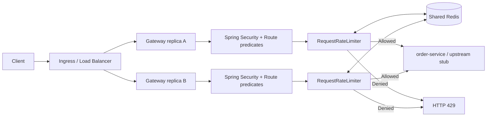
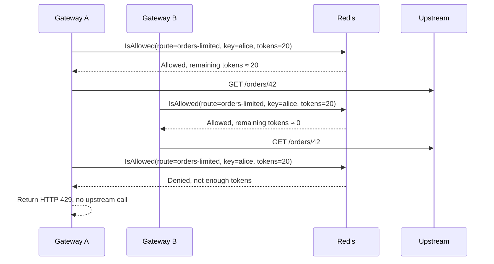
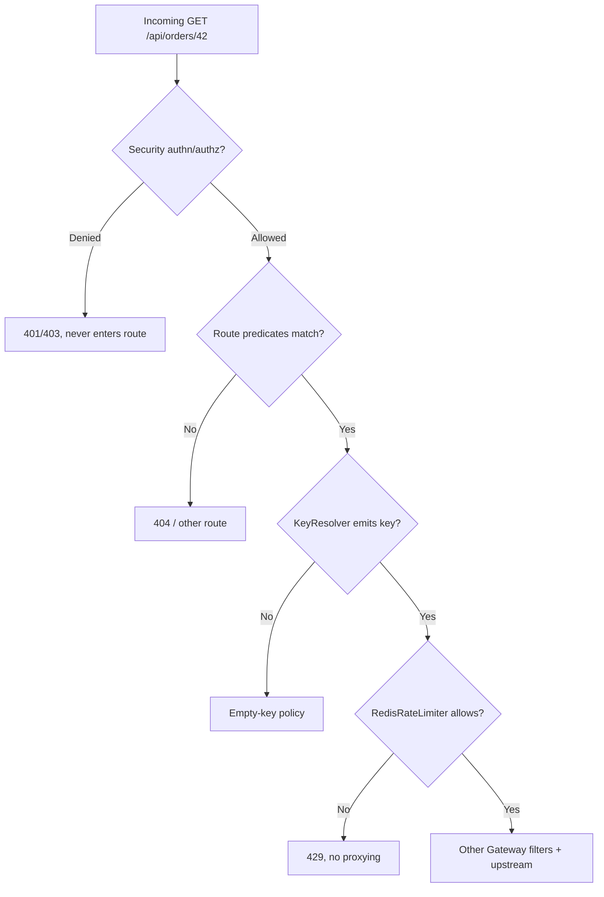

# Testing Redis Rate Limiting and Multiple Replicas When Appropriate

**Spring Cloud Gateway** often serves as the shared entry point for many microservices. When an API receives traffic spikes, **`RequestRateLimiter`** caps how many requests may forward to backends. With **`RedisRateLimiter`**, multiple Gateway replicas coordinate on **a shared quota** rather than each replica granting its own separate token pool. However, a YAML snippet specifying `replenishRate` and `burstCapacity` **does not prove** rate limiting behaves accurately, securely, or consistently upon scaling out.

This lesson belongs to the **Testing** chapter and walks through building a suite from **`KeyResolver` unit tests**, to **integration tests with real Redis and an upstream stub**, to **concurrent testing across multiple Gateway replicas**. Its scope aligns with operating a Spring Cloud Gateway API Gateway: route predicates, filter chains, path/header transformations, service discovery via `lb://`, authentication, rate limiting, circuit breaking, retries, TLS, and observability.

> **Technical scope:** Content centers on **Spring Cloud Gateway Server WebFlux** and the `RequestRateLimiter` filter backed by `RedisRateLimiter`. Gateway Server Web MVC uses different integrations and filters; do not apply WebFlux tests verbatim. Dependency names, config prefixes, response headers, Redis key layouts, and Redis-disconnect behaviors vary across versions. Limit values and request counts below are for lab use only; production requires dedicated capacity testing and security policies.

## 1. Goal: Test the Policy, Not Just HTTP 429

A simplistic test fires multiple requests at one route, sees a `429 Too Many Requests`, and concludes "the rate limiter works". That conclusion leaves major gaps.

A strong suite must prove:

1. **Right route:** Only requests matching the rate-limited route consume that bucket.
2. **Right identity:** `KeyResolver` derives keys from **verified identity**, never a raw header the client can swap freely.
3. **Right algorithm:** Burst allowance, replenishment rate, and token cost per request match policy.
4. **Right response:** Denied requests return the designed status instead of hitting a fallback returning fake success.
5. **Zero upstream calls:** When the limiter denies, the backend never receives the blocked request.
6. **Right scope:** Two independent users do not drain each other's buckets; separate routes keep distinct scopes when intended.
7. **Right behavior on scale-out:** N Gateway replicas enforce one shared quota whenever policy demands it.
8. **Right behavior under concurrency:** Concurrent requests cannot exceed quota through race conditions.
9. **Right behavior when Redis fails:** The system follows an explicit failure policy rather than silently failing open.
10. **Observable:** Metrics, logs, and traces distinguish 429s, missing keys, Redis errors, and upstream 5xxs.

**Core takeaway:** HTTP `429` is only a client-side symptom. System tests must tie **response status**, **Redis-backed decision**, and **upstream request count** together in the same scenario.

## 2. Request Model Through Spring Cloud Gateway



Inside each Gateway replica:

1. The request arrives and clears authentication/authorization per Security policy.
2. Route predicates select the route.
3. `RequestRateLimiter` invokes `KeyResolver` to identify the quota subject.
4. `RedisRateLimiter` decides whether enough tokens remain for that subject/route.
5. If allowed, the Gateway continues the filter chain and proxies upstream.
6. If denied, the Gateway terminates the response per policy without issuing a backend call.

Exact ordering among Security, route filters, `Retry`, `CircuitBreaker`, and body rewriting depends on configuration and stack. **Never assume all requests are metered at the exact same point** without verifying filter ordering.

## 3. `RedisRateLimiter` Uses a Token Bucket

A **token bucket** defines:

- **Capacity** \(B\): maximum tokens the bucket can hold.
- **Replenish rate** \(r\): tokens added per second under the algorithm.
- **Requested tokens** \(q\): tokens consumed by each request.
- **Available tokens** \(T\): tokens remaining at decision time.

Conceptual rule:

\[
T_{\text{new}} = \min(B, T_{\text{old}} + \Delta t \times r)
\]

If \(T_{\text{new}} \geq q\), allow the request and subtract \(q\) tokens; otherwise deny. This formula expresses the **token bucket model**—it does not guarantee exact time rounding, Lua math, or metadata across all versions.

Lab example:

```text
replenishRate = 1 token/second
burstCapacity = 40 tokens
requestedTokens = 20 tokens/request

Initially full bucket: 40 tokens

Request 1: 40 -> 20, allowed
Request 2: 20 ->  0, allowed
Request 3 immediately after: 0 < 20, denied (429)

After ~20 seconds with no requests:
  ~20 tokens replenished -> one request can be allowed
```

**Note:** `RedisRateLimiter` is not a fixed-window counter that "resets at the top of every minute". Quota depends on tokens accumulated over time; second boundaries, timestamps, clocks, and network latency can skew tight boundary counts.

### Relationship Among the Three Parameters

| Parameter | Effect | Common testing mistake |
| --- | --- | --- |
| `replenishRate` | Token refill speed | Assuming 1 token/s always means 1 request/s regardless of `requestedTokens` |
| `burstCapacity` | Maximum stored tokens | Thinking it limits max concurrent requests; it does not |
| `requestedTokens` | Cost per request | Forgetting to set or check default, miscalculating allowed requests |
| Bucket key | Partitions quota by subject | Letting multiple users share one bucket via a bad resolver |
| Route ID | Part of bucket scope in standard `RedisRateLimiter` | Changing ID splits or resets quotas unexpectedly |

When `requestedTokens=1`, `burstCapacity=40` allows an initial burst of ~40 requests from a full bucket, then refills at `replenishRate`. When `requestedTokens=20`, the same capacity of 40 allows only two consecutive requests from a full bucket.

### Why Use Large Token Costs in Short Integration Tests?

With `replenishRate=1`, `burstCapacity=2`, `requestedTokens=1`, firing three sequential requests that cross a one-second boundary may refill an extra token. Expecting "exactly 2 requests succeed" becomes flaky.

With `replenishRate=1`, `burstCapacity=40`, and `requestedTokens=20`, the bucket needs roughly **20 seconds** after draining to allow the next request. A test sending three requests within a few seconds avoids boundary-timing jitter.

**This is strictly a fixture-design technique for stable tests**, not a recommended rate limit for a production API.

## 4. How Does Redis Share Quotas?

In standard `RedisRateLimiter` implementations, bucket state lives in Redis keyed by **route ID and the key from `KeyResolver`**. A Lua script updates token counts atomically inside Redis, preventing Gateway replicas from deducting tokens independently in local RAM.



Things to verify:

- Gateway A and B use the **same Redis backend/namespace**.
- Effective route IDs are **identical** if sharing a per-route bucket.
- `KeyResolver` returns the **same normalized key** for a subject on both Gateways.
- `replenishRate`/`burstCapacity`/`requestedTokens` match across replicas.
- Redis scripts and connection health work in both processes.
- Quota applies to the **sum of requests across A+B**, not doubled per replica.

**Never assume Redis "shares quotas" just because two Gateways connect to the same Redis hostname.** They might point to different Redis DBs, key namespaces, route IDs, or inconsistent key resolvers.

## 5. Redis-Backed Quotas vs. Local Limiters

Some systems store limiter tokens in each Gateway process's local memory. Upon scaling out:

```text
Each replica has capacity 40, requestedTokens 20:

Gateway A: 2 requests allowed
Gateway B: 2 requests allowed
=> Total up to 4 requests allowed

This is a per-replica quota, NOT a global quota.
```

When Redis is wired properly and A/B share the same bucket:

```text
Shared Redis bucket capacity 40, requestedTokens 20:

Gateway A: 1 allowed
Gateway B: 1 allowed
Next request on A or B: denied
=> Total ~2 requests allowed in initial burst
```

Multi-replica tests are required only when **quotas must be enforced globally across replicas**. If a system intentionally limits **per instance** for another engineering reason, test against that scope rather than assuming shared Redis is mandatory.

### Different Quota Policies

| Policy | Expected bucket | What to test |
| --- | --- | --- |
| Per user per route | `routeId + trusted userId` | Users A/B isolated; A shares across two replicas |
| Per tenant per route | `routeId + trusted tenantId` | Multiple users in same tenant draw from one quota |
| Per API key | `routeId + validated API-key identity` | Revoked keys cannot bypass |
| Per route across all clients | `routeId + fixed trusted key` | Total route traffic capped |
| One shared quota across multiple routes | **Explicit custom policy/scope** | Never assume distinct route IDs share tokens |
| Pre-auth per-IP | Trusted client IP at network boundary | Ignore spoofed forwarded headers; NAT fairness |
| Per-replica cap | Local state if designed that way | Never promise global quotas |

**Standard `RedisRateLimiter` normally scopes by route ID and resolved key.** If business rules require "100 requests/user across the entire API" spanning multiple route IDs, reusing the same `KeyResolver` alone will not share buckets—verify key/route scoping or build a centralized policy.

## 6. Configuring a Rate-Limited Route in WebFlux

Lab example with a stub backend listening at `http://localhost:18081`:

```yaml
spring:
  cloud:
    gateway:
      routes:
        - id: orders-limited
          uri: http://localhost:18081
          predicates:
            - Path=/api/orders/**
            - Method=GET
          filters:
            - name: RequestRateLimiter
              args:
                key-resolver: "#{@userRateKeyResolver}"
                redis-rate-limiter.replenishRate: 1
                redis-rate-limiter.burstCapacity: 40
                redis-rate-limiter.requestedTokens: 20
            - StripPrefix=1
```

Intent:

- `GET /api/orders/42` matches route `orders-limited`.
- `KeyResolver` resolves the authenticated subject.
- `RedisRateLimiter` allows or denies.
- If allowed, `StripPrefix=1` turns `/api/orders/42` into `/orders/42`.
- Test upstream stub receives the request and returns `200`.
- When tokens run out, the client receives `429` under default denial policy, and upstream **receives zero blocked requests**.

**Property names and starters:** This uses the familiar `spring.cloud.gateway.routes` namespace of Gateway Server WebFlux. Newer releases use `spring.cloud.gateway.server.webflux.routes` and updated property prefixes. Check your Spring Cloud Gateway BOM, configuration metadata, and live route list before testing—valid YAML syntax alone does not prove routes loaded.

### Reactive Redis Dependencies

A WebFlux Gateway project typically needs compatible dependencies such as:

```xml
<dependency>
    <groupId>org.springframework.cloud</groupId>
    <artifactId>spring-cloud-starter-gateway</artifactId>
</dependency>
<dependency>
    <groupId>org.springframework.boot</groupId>
    <artifactId>spring-boot-starter-data-redis-reactive</artifactId>
</dependency>
<dependency>
    <groupId>org.springframework.boot</groupId>
    <artifactId>spring-boot-starter-test</artifactId>
    <scope>test</scope>
</dependency>
```

This example targets the Gateway line using starter `spring-cloud-starter-gateway`; newer lines use the `server-webflux` starter name. Never pin standalone versions incompatible with your BOM. When using Testcontainers and WireMock, add those test dependencies too; do not treat the XML above as a complete POM.

### Connecting to Redis in Spring Boot

Common Boot 3.x config:

```yaml
spring:
  data:
    redis:
      host: localhost
      port: 6379
      timeout: 2s
```

Older Boot lines use `spring.redis`. Tests must verify actual Redis connectivity, not just property names. Fetch Redis passwords/TLS certs from a secret manager or environment variables; never store plaintext credentials in docs or repositories.

## 7. `KeyResolver` Must Use Trusted Identity

A simple `KeyResolver` using the authenticated principal:

```java
@Configuration
public class RateLimitKeyConfiguration {

    @Bean
    KeyResolver userRateKeyResolver() {
        return exchange -> exchange.getPrincipal()
            .map(Principal::getName);
    }
}
```

Here the Gateway requires an authenticated principal. `Principal::getName` must be **stable and unique within the intended quota scope**. If two tenants both have a user named `alice` and quotas must stay tenant-isolated, build the key from **both verified tenant ID and verified subject**.

### Never Use Client-Supplied Headers as Identity

Anti-pattern:

```java
// ANTI-PATTERN: clients can rotate X-User-Id to evade quotas.
@Bean
KeyResolver unsafeResolver() {
    return exchange -> Mono.justOrEmpty(
        exchange.getRequest().getHeaders().getFirst("X-User-Id"));
}
```

A client can send:

```http
X-User-Id: alice
```

then switch to `bob`, `charlie`, etc. to spin up fresh buckets. Similarly, trusting `X-Forwarded-For` without a verified trusted-proxy chain lets attackers spoof IPs to bypass limits.

**Right design:** Security validates the JWT/session/API key first, and `KeyResolver` extracts identity from the verified `Authentication`/claims after checking signature, issuer, audience, and scopes.

### Verified Tenant + User Bucket Example

```java
@Bean
KeyResolver tenantUserKeyResolver() {
    return exchange -> exchange.getPrincipal()
        .ofType(JwtAuthenticationToken.class)
        .map(auth -> {
            Jwt jwt = auth.getToken();
            String tenant = jwt.getClaimAsString("tenant_id");
            String subject = jwt.getSubject();

            if (tenant == null || tenant.isBlank()
                    || subject == null || subject.isBlank()) {
                throw new AccessDeniedException("Missing validated identity");
            }

            return "tenant:" + tenant + ":subject:" + subject;
        });
}
```

This illustrates **extracting claims from a verified JWT**, not a rule that every IdP names its claim `tenant_id`. If the JWT lacks a trusted tenant claim, the identity/backend service must supply a verified mapping; never pull tenant IDs from user-chosen paths or headers without verifying membership.

**Privacy concern:** Raw tenant/user identifiers can appear in Redis keys and logs. In production, consider an opaque ID or a **stable HMAC** over the `(tenant, subject)` tuple using a managed secret key and clear namespace. Avoid unsalted hashes if your threat model requires hiding user IDs.

### Empty Keys Differ from Exhausted Quotas

If `KeyResolver` returns `Mono.empty()`, the filter can apply **deny-empty-key** and return its own status (commonly `403` by default in several versions). That is **not** Redis running out of tokens.

When a request lacks a token:

- Spring Security may return `401` **ahead of the route/filter**.
- If it clears Security yet `KeyResolver` yields no key, the limiter may reject for **empty key**.
- If a valid key lacks bucket tokens, the limiter normally returns `429`.
- If Redis fails, status/exceptions follow the failure policy and integration layer.

Test **all four branches separately** rather than lumping them together as "rate limited".

## 8. Where Do Security and the Limiter Sit in the Filter Chain?

In WebFlux, Spring Security runs as a `WebFilter`, while `RequestRateLimiter` is a route-level `GatewayFilter`. Requests rejected by Security prior to routing normally consume zero tokens on that route.



This diagram depicts the standard WebFlux stack; exact ordering still depends on custom filters, route order, and Security config.

### Sample Security Configuration

```java
@Bean
SecurityWebFilterChain apiSecurity(ServerHttpSecurity http) {
    return http
        .authorizeExchange(ex -> ex
            .pathMatchers(HttpMethod.GET, "/api/orders/**")
                .hasAuthority("SCOPE_orders.read")
            .anyExchange().authenticated())
        .oauth2ResourceServer(oauth2 ->
            oauth2.jwt(Customizer.withDefaults()))
        .build();
}
```

This merely illustrates Security's role; production also needs issuer/JWT verification config and rules for other APIs, Actuator, and management contexts. Never treat `.anyExchange().authenticated()` as a complete production authorization policy.

**Tests must send tokens actually accepted by your test IdP/JWT setup**, not a dummy `Bearer alice` string assuming the Gateway authenticated it.

## 9. Structuring the Test Suite by Tier

| Test tier | Goal | Needs real Redis? |
| --- | --- | --- |
| **KeyResolver unit test** | Identity/tenant/key normalization right; empty identity rejected | No |
| **Filter unit/contract test** | Denied responses stop filter chain | No, if using a faithful stub `RateLimiter` |
| **Single-instance integration** | YAML/SpEL, Redis script, status/headers, upstream count | **Recommended** |
| **Concurrency integration** | N concurrent requests consume quota accurately on one bucket | **Yes** |
| **Multi-replica integration** | N Gateway processes share one quota | **Yes, same Redis** |
| **Failure injection** | Redis timeouts/partitions/restarts, fallback policy | **Yes, controlled environment** |
| **Load/capacity test** | Limiter latency, Redis CPU/network, 429s under burst | Yes, production-like env |
| **Security test** | No key spoofing/backend bypass; right 401/403/429 | Layer-dependent; include in integration |

**You do not need two Gateway processes for every unit test.** However, if the requirement says "quotas hold when scaling out", at least one integration test must run **two independent Gateway processes** sharing one Redis and identical policy.

## 10. Testcontainers: Real Redis Instead of Mocking Lua

Mocking `ReactiveRedisTemplate` verifies method invocations, yet cannot prove:

- That Redis executes the Lua script atomically as expected.
- Key TTLs and token storage/retrieval formats work.
- Redis serialization/codecs match.
- Two Gateway replicas contend for tokens consistently.
- Real timeout/network-failure behavior.

**Use Testcontainers Redis** for integration tests. Minimal fixture:

```java
@Testcontainers
@SpringBootTest(
    webEnvironment = SpringBootTest.WebEnvironment.RANDOM_PORT)
class RedisRateLimiterIntegrationTest {

    @Container
    static final GenericContainer<?> REDIS =
        new GenericContainer<>(
            DockerImageName.parse("redis:7.4-alpine"))
            .withExposedPorts(6379);

    @DynamicPropertySource
    static void redisProperties(DynamicPropertyRegistry registry) {
        registry.add("spring.data.redis.host", REDIS::getHost);
        registry.add("spring.data.redis.port",
            () -> REDIS.getMappedPort(6379));
    }
}
```

This is a **class skeleton**, not a full file with all imports and test methods. You need Testcontainers/JUnit 5 dependencies, Docker in CI, and a policy-pinned Redis image. On Spring Boot 2, verify the legacy Redis property prefix. The Redis container starts before `@DynamicPropertySource` evaluates and before the test context connects.

### A Testcontainers Trap

If Gateway A and Gateway B spin up **two separate Redis containers**, passing tests prove nothing about distributed shared quotas. In multi-replica tests, both processes must point to the **same Redis container or test cluster**.

### Isolation Between Tests

Token buckets retain state for some time. If test T1 drains a bucket and T2 reuses the same route/key, T2 can immediately get `429`, causing flakiness.

Good practices:

1. Use a **dedicated Redis container per test suite** or isolate supported namespaces/DBs.
2. Use distinct route IDs or subject keys prefixed by a bounded test-run ID.
3. Wait out bucket resets per policy when specifically testing TTLs.
4. Never run tests touching the same key concurrently unless intentionally testing concurrency.
5. Delete only **test keys owned by the suite**—never run `FLUSHALL` on shared Redis.
6. Avoid hardcoding `RedisRateLimiter`'s internal key format in cleanup scripts without checking version compatibility.

When pairing Testcontainers with `@DirtiesContext` or container lifecycles, balance startup cost against context caching so CI stays both accurate and fast.

## 11. Upstream Stub: Verify Denied Requests Never Reach the Backend

Proper tests maintain a **backend request journal**. WireMock, MockWebServer, or an HTTP stub can return:

```http
HTTP/1.1 200 OK
Content-Type: application/json

{"id":"42","state":"READY"}
```

On the lab Gateway route:

```text
GET /api/orders/42
  -> RequestRateLimiter
  -> StripPrefix=1
  -> http://localhost:18081/orders/42
```

Once the bucket is empty:

```text
Denied request:
  client <- 429

Backend:
  NO matching GET /orders/42
```

Asserting only client `429` without checking the backend misses bugs where a filter emits 429 **after** upstream already received the request—failing to protect backend capacity.

### Watch Response Caching and Fallbacks

If a route also enables `LocalResponseCache` or a `CircuitBreaker` fallback, the client might see `200` with zero upstream calls, or receive `429` from another layer. When testing the Redis limiter:

- Start with a plain upstream stub—no cache, fallback, or retry.
- Verify the first two HTTP 200s actually hit the stub.
- Verify the 429 produces zero stub hits.
- Only then add other filters and test interactions.

## 12. Integration Test for an Initial Burst

With fixture `replenishRate=1`, `burstCapacity=40`, `requestedTokens=20` on a fresh bucket:

```text
Alice request 1 -> 200, upstream hit #1
Alice request 2 -> 200, upstream hit #2
Alice request 3 -> 429, upstream NOT called a 3rd time
```

`WebTestClient` sketch:

```java
@Test
void burstThenRejectsWithoutCallingUpstream() {
    // WebTestClient, WireMock, and Redis Testcontainer already configured.
    // jwtFor("alice") is a test helper issuing a VALID JWT for the test issuer.
    String aliceJwt = jwtFor("alice");

    webTestClient.get()
        .uri("/api/orders/42")
        .headers(h -> h.setBearerAuth(aliceJwt))
        .exchange()
        .expectStatus().isOk();

    webTestClient.get()
        .uri("/api/orders/42")
        .headers(h -> h.setBearerAuth(aliceJwt))
        .exchange()
        .expectStatus().isOk();

    webTestClient.get()
        .uri("/api/orders/42")
        .headers(h -> h.setBearerAuth(aliceJwt))
        .exchange()
        .expectStatus().isEqualTo(429);

    wireMockServer.verify(2,
        getRequestedFor(urlEqualTo("/orders/42")));
}
```

**This is a test sketch, not a standalone compilable class.** You need `webTestClient`, `wireMockServer`, `jwtFor`, Redis, and Spring Security wired up. The test holds only when Alice's bucket on this route **starts full**, all three requests run before 20 tokens replenish, and the backend stub returns 200.

Tests like this should never rely on "sleep 100 ms" and count exact boundary tokens; pick a profile with generous margin from the refill interval and control your test key/fixture.

### Checking Response Headers

In supported versions, `RedisRateLimiter` may add `X-RateLimit-*` headers showing replenish rate, burst capacity, and remaining/requested tokens. Keep in mind:

- Header names and toggle flags can be configured or change across versions.
- Remaining tokens reflect decision time, not live Redis state after concurrent requests.
- **`Retry-After` must not be assumed present by default.**
- Headers alone do not prove whether upstream was called.

Assert only headers **explicitly part of your public API contract**; avoid hardcoding implementation-specific headers without version pinning and compatibility tests.

## 13. Testing Refill Without Flaky Timing

Token buckets refill over time. A brittle test looks like:

```java
// Avoid integration tests pinned tightly to 1-second refill boundaries:
Thread.sleep(1000);
assertAllowed();
```

Problems:

- `RedisRateLimiter` may compute timestamps at one-second resolution.
- CI schedulers, GC pauses, and network jitter shift arrival times.
- Testcontainers slow down on busy build machines.
- Multiple replicas can suffer clock drift if timestamps come from app nodes.

### Two Tiers for Testing Refill

**A. Unit-level / deterministic algorithm tests**

For a testable token-bucket implementation or contract wrapper accepting an injected clock, use a fake clock to verify:

```text
t = 0s: bucket 40 tokens
t = 0s: request q=20 allowed -> 20
t = 0s: request q=20 allowed -> 0
t = 0s: request q=20 denied  -> 0
t = 19s: q=20 denied (assuming exact second/token math)
t = 20s: q=20 allowed
```

Note that built-in `RedisRateLimiter` does not necessarily expose a fake clock; **never write a fake unit test and claim you tested the actual Lua script**.

**B. Real Redis integration tests**

Use a profile with faster refill and generous time margins, waiting with bounded polling and a clear deadline. For instance, use a dedicated test key, wait **comfortably past** the expected refill window, and assert the request succeeds—logging actual elapsed time for debugging. Never poll indefinitely.

### Why Avoid `Thread.sleep` on the Gateway Event Loop?

In an independent **test driver**, short waits are acceptable when testing wall-clock behavior, yet **never block the Reactor Netty event loop** inside a Gateway filter or reactive handler. Integration tests should use Awaitility or external schedulers outside the request pipeline.

## 14. Testing `requestedTokens` and Boundary Configs

Do not test only the default `requestedTokens=1`. Verify:

| Case | Config | What to prove |
| --- | --- | --- |
| Q1 | q=1, B=5 | Grants expected burst size |
| Q2 | q=20, B=40 | Two requests from full bucket pass; next denies |
| Q3 | q=B | One request drains entire bucket |
| Q4 | q > B | Does not create nonsense policy or gets blocked by validation |
| Q5 | Very low r, large B | Low sustained rate with bounded burst |
| Q6 | r and B change on route refresh | Old state vs. new policy lifecycle measured |
| Q7 | Invalid negative/zero values | Config validation or startup failure per version |
| Q8 | `requestedTokens` omitted | Implementation/version default verified |

In docs and labs, stick to valid values; never assume the algorithm handles invalid inputs safely. Validate at the control plane / config review rather than waiting for Lua scripts to fail.

## 15. Distinguishing `429`, `403`, `401`, and `503`

| HTTP status / symptom | Typical origin | What to assert |
| --- | --- | --- |
| `401` | Missing/invalid token; Security blocks pre-route | Not proxied; accurate authn logs |
| `403` | Insufficient authority or `KeyResolver` returned empty key per empty-key policy | Distinguish authz vs. empty key |
| `429` | Bucket lacks tokens per limiter | Not proxied; right quota subject |
| `404` | Route miss or upstream resource not found | Route ID and backend request journal |
| `503` | No instance, backend unavailable, or Redis failure per error policy | Separate root layer via logs/metrics |
| `500` | Unhandled Redis command/connection exception or bug | Never treat as valid 429 |
| `200` | Upstream success or fallback/cache | Verify upstream hit if that is the test goal |

Never hardcode "Redis down must return 429": **exhausted tokens** and **inability to query token state** are completely different conditions. When Redis errors out, the status depends on integration, exception handling, and failure policy.

### Is `Retry-After` Mandatory?

HTTP `429` may include `Retry-After` under an application contract, yet do not assume `RedisRateLimiter` emits it across all versions. If your API publishes `Retry-After`, explicitly test its calculation, units (seconds vs. HTTP-date), and relative accuracy rather than trusting `X-RateLimit-Remaining` alone.

## 16. Testing `KeyResolver`: Same User, Different User, Different Tenant

A `KeyResolver` unit suite should prove:

1. Same JWT principal → identical key across requests.
2. Two distinct users → distinct keys.
3. Same username in two distinct tenants → distinct keys when quotas are tenant+user scoped.
4. Token missing required claim → rejected rather than falling back to a hardcoded key.
5. Case normalization is intentional; no collisions after lowercasing/trimming.
6. Token from wrong issuer/audience → Security rejects before resolver runs.
7. Unauthenticated or absent principal → no key per policy.
8. Client mutates raw `X-User-Id`/`X-Tenant-Id` → key still reflects verified identity, never headers.
9. Client varies query/path → key stays constant unless resource-scoped by policy.
10. Keys containing raw PII/secrets are never logged.

### Testing Two Independent Users

With fresh buckets for Alice and Bob:

```text
Alice: allowed, allowed, denied
Bob:   allowed

If Bob is denied because Alice drained her bucket,
KeyResolver or bucket key scoping is wrongly shared.
```

In integration tests, look beyond status: log upstream calls per user when the backend stub tracks verified identity fixtures. **Never switch Alice's JWT for Bob's in backend tests without Security enabled**; each user needs properly signed/verified test credentials.

## 17. Route ID Shapes Bucket Scope

Consider two routes:

```yaml
- id: orders-read-limited
  uri: lb://order-service
  predicates:
    - Path=/api/orders/**
    - Method=GET
  filters:
    - name: RequestRateLimiter
      args:
        key-resolver: "#{@userRateKeyResolver}"
        redis-rate-limiter.replenishRate: 1
        redis-rate-limiter.burstCapacity: 40
        redis-rate-limiter.requestedTokens: 20

- id: catalog-read-limited
  uri: lb://catalog-service
  predicates:
    - Path=/api/catalog/**
    - Method=GET
  filters:
    - name: RequestRateLimiter
      args:
        key-resolver: "#{@userRateKeyResolver}"
        redis-rate-limiter.replenishRate: 1
        redis-rate-limiter.burstCapacity: 40
        redis-rate-limiter.requestedTokens: 20
```

In standard `RedisRateLimiter`, Redis keys partition by **route ID + resolved key**. Thus Alice draining `orders-read-limited` does not automatically drain `catalog-read-limited`.

**If business rules require a single 100 req/min cap across all APIs**, design a global quota scope with a matching policy/service/implementation. Sharing the same `KeyResolver` bean alone does not merge Redis buckets across distinct route IDs.

### Route ID Drift Across Deployments

If Gateway-A names a route `orders-limited` while Gateway-B names the same public endpoint `orders-limited-v2`, `RedisRateLimiter` creates **two separate buckets**—an easy scale-out bug to miss.

Rollout tests should compare:

- Effective route ID on every replica.
- `KeyResolver` bean and normalization logic.
- RateLimiter parameters.
- Redis connection namespace/cluster.
- Route filters and order post-refresh.
- Version/deployment revision.

During a canary rollout that renames a route ID, shared quotas can **temporarily double**. Plan migration/compatibility rules whenever strict global limits apply.

## 18. Testing Two Gateway Replicas: Same Redis, Same Key

This is the centerpiece test.

### Proper Topology

```text
                           +---------------------+
                           | Redis Testcontainer |
                           | fixed host:port     |
                           +----------+----------+
                                      |
                      +---------------+---------------+
                      |                               |
              Gateway A :8081                 Gateway B :8082
              routeId=orders-limited          routeId=orders-limited
              same KeyResolver                same KeyResolver
              r=1, B=40, q=20                 r=1, B=40, q=20
                      |                               |
                      +---------------+---------------+
                                      |
                           WireMock :18081
                           GET /orders/42
```

A and B must be **two independent Spring Boot processes/contexts** pointing at the same live test Redis backend. Start A and B on distinct ports with identical route configs; never send requests to a single Gateway process and label it "multi-replica".

### Simple Interleaved Sequence

With a **fresh bucket for Alice**:

| Step | Target | Expected HTTP | Cumulative upstream calls |
| --- | --- | ---: | ---: |
| 1 | Gateway A | 200 | 1 |
| 2 | Gateway B | 200 | 2 |
| 3 | Gateway A | 429 | 2 |
| 4 | Gateway B | 429 | 2 |

Expected outcome: total granted admissions across **both replicas** never exceed **one bucket's** capacity. Fixture `q=20/B=40/r=1` leaves plenty of refill headroom to finish all four calls quickly.

### Bash Probing Each Replica Directly

```bash
# TOKEN_* values come from the test issuer, NOT production tokens.
# Gateway A/B listen on separate ports and share one Redis.
curl -sS -o /dev/null -w 'A1 status=%{http_code}\n' \
  -H "Authorization: Bearer $TOKEN_ALICE" \
  http://127.0.0.1:8081/api/orders/42

curl -sS -o /dev/null -w 'B1 status=%{http_code}\n' \
  -H "Authorization: Bearer $TOKEN_ALICE" \
  http://127.0.0.1:8082/api/orders/42

curl -sS -o /dev/null -w 'A2 status=%{http_code}\n' \
  -H "Authorization: Bearer $TOKEN_ALICE" \
  http://127.0.0.1:8081/api/orders/42

curl -sS -o /dev/null -w 'B2 status=%{http_code}\n' \
  -H "Authorization: Bearer $TOKEN_ALICE" \
  http://127.0.0.1:8082/api/orders/42
```

Run this only in a secured lab environment, never against production. **Never paste real tokens** into shell history or logs. Since shell scripts lack exact timing control, measure total elapsed duration in CI and pick refill/burst profiles that avoid false failures.

### When a Test Passes Without Proving Global Quotas

If A runs before a Redis reset and B runs after the bucket expired or reset, both replicas allow traffic without proving shared quotas. You must **interleave requests in the same time window, for the same subject, against the same Redis state**.

## 19. Concurrent Testing Across Two Replicas and Lua Atomicity

Concurrency tests matter because two Gateways can attempt token deductions at virtually the same instant.

Given `burstCapacity=40`, `requestedTokens=20`, `replenishRate=1`:

```text
Starting from a newly full bucket:
  20 concurrent requests for Alice
  split 10 to Gateway A and 10 to Gateway B

Expected when completed far faster than refill interval:
  ~2 requests allowed (sum across A+B)
  ~18 requests denied
  backend receives ~2 requests
```

**Because wall-clock time, network scheduling, and replenishment are real**, avoid hardcoding "exactly 2" if a slow test batch could last long enough to refill 20 tokens. Instead:

- Choose burst/token-cost profiles where refill during the batch is negligible.
- Measure total batch duration.
- Control initial bucket state and start time.
- Assert an upper bound justified by the measured elapsed window.
- When strict atomicity checks are required, build deterministic tests with a dedicated Redis script harness or near-zero refill rates.

### What Happens with Local In-Memory State

If each Gateway uses local RAM limiters, A and B can **each** allow 2 requests—4 total. Concurrency tests immediately catch that discrepancy.

### Pseudocode Test Driver

```text
1. Initialize fresh Redis bucket for (orders-limited, alice).
2. Prepare 20 HTTP requests with valid Alice JWT.
3. Use a barrier to release requests concurrently to A/B.
4. Record status and latency of every request.
5. Wait for all requests or a hard deadline.
6. Tally allowed/denied across both replicas.
7. Inspect WireMock request journal.
8. Repeat at 100/1000 concurrent requests in staging.
9. Re-run after restarting one Gateway replica.
```

Do not build a test driver that stalls Redis or starves threads by blocking one thread across futures carelessly; give load generators explicit concurrency and timeout budgets.

## 20. Multi-Replica Tests Must Keep Configuration Consistent

| Property | A | B | Impact if mismatched |
| --- | --- | --- | --- |
| Effective route ID | `orders-limited` | `orders-limited` | Bucket splits in two if keyed by route ID |
| `KeyResolver` | Trusted user | Trusted user | One user maps to two keys |
| Key normalization | Same rules | Same rules | Case/tenant mismatch |
| Redis endpoint/DB | Shared test Redis | Shared test Redis | Two separate states |
| Replenish rate | 1 | 1 | Decisions diverge by replica |
| Burst capacity | 40 | 40 | Decisions diverge by replica |
| Requested tokens | 20 | 20 | Asymmetric token deductions |
| JWT issuer/audience | Same contract | Same contract | A returns 401, B passes |
| Clock/time source | Synced per policy | Synced | Uneven refills if using app timestamps |
| Filter chain/route order | Same behavior | Same behavior | One replica skips limiter |
| Library/BOM version | Verified compatible | Verified compatible | Script/header/key behavior may differ |

Even when A and B hit the same Redis, **config drift** still breaks quotas.

### Clocks and Redis Scripts

Token buckets rely on time to calculate refills. Depending on implementation/version, timestamps may originate at the Gateway app or via another mechanism. If Gateway A's clock runs seconds ahead of B's, token math skews.

- Keep NTP/clocks synchronized across nodes.
- Never alter production system clocks for testing.
- Test controlled clock skew if quotas are strict.
- Inspect your implementation/version rather than assuming Redis always supplies the clock.
- Alert if hosts/pods exhibit large clock offsets.

An atomic Lua script prevents read-modify-write races on state, **not clock or configuration skew**.

## 21. Redis Cluster and Key Locality

`RedisRateLimiter` typically touches more than one Redis key per bucket (e.g., current tokens and last-refresh timestamp). On Redis Cluster, keys accessed within one Lua script must map to the **same hash slot** or follow cluster mechanisms supported by your Redis/script version.

Standard Gateway `RedisRateLimiter` implementations use hash tags compatible with Redis Cluster, yet **never rely on a blog post's key layout** when migrating Redis topologies. Test:

- A subject's bucket keys resolve to the right cluster slot.
- Zero `CROSSSLOT` or Lua key errors appear.
- Script loading / `EVALSHA` / `NOSCRIPT` recovery matches Redis client config.
- Cluster node redirects/failovers do not corrupt quotas or exceed timeouts.
- TTL/eviction behavior holds under high subject counts.
- Partition/failover policies clearly define allow vs. deny behavior.

**A standalone Redis Testcontainer is only the baseline; it never replaces cluster/failover tests** when production runs Redis Cluster or Sentinel.

## 22. Redis Disconnected: Fail-Open or Fail-Closed?

Suppose the Gateway tries to query Redis, but:

- Redis process crashes.
- DNS fails to resolve.
- Network policy drops packets.
- Redis TLS handshake fails.
- Redis CPU/network saturates.
- Commands time out.
- Redis cluster fails over or reshards.
- Lua script errors or key types mismatch.

At that moment, the Gateway **cannot know** whether tokens remain in the bucket.

### Business Failure Policies

| Policy | Intended behavior | Benefit | Risk |
| --- | --- | --- | --- |
| **Fail-closed** | Reject requests whenever quota cannot be verified | Strictly protects backends and quotas | API outage during Redis outage |
| **Controlled fail-open** | Allow requests through when Redis errors | Preserves availability | Attackers/spikes can exceed quota |
| **Degraded fallback limiter** | Tight short-lived local cap if designed | Limits blast radius partially | Quotas no longer global; complex state |
| **Per-policy/per-route fail mode** | Sensitive routes fail-closed; public reads vary | Balances business risk | Needs audits, telemetry, and reviews |

**Never claim `RedisRateLimiter` defaults strictly to "fail-open" or "fail-closed" under these labels.** Actual behavior may be an exception/5xx determined by Gateway filters and error handling. Design your behavior explicitly, test it in integration, and conduct security reviews before changing defaults.

### Safe Failure Injection

In the lab, stop the Redis container or block its network cleanly while sending requests through A and B. Verify:

1. HTTP status/exception matches the documented policy.
2. Requests do not breach backend protection policies.
3. No silent limiter bypass occurs from swallowed exceptions.
4. Gateways do not accumulate unbounded pending Redis commands.
5. Timeout budgets hold.
6. Metrics/logs record `redis_unavailable` error categories without leaking credentials.
7. Once Redis recovers, Gateways reconnect and rate limiting resumes.
8. No sudden post-restart flood occurs due to lost bucket state.

**Never kill production Redis** without an approved maintenance or chaos-engineering plan.

## 23. Redis Restarts and Lost Bucket State

`RedisRateLimiter` relies on Redis state rather than JVM memory alone. If a Redis Testcontainer restarts **without persistence**, bucket keys vanish.

Consequence:

```text
Before restart:
  Alice's bucket empty -> requests get 429.

Redis restarts, state lost:
  Alice's bucket reinitializes as full.

After restart:
  Alice receives a brand-new burst.
```

This is not a single-request "atomicity bug"; it is **state lifecycle behavior**.

Tests must distinguish:

- Brief Redis network blip while state remains intact.
- Redis process restart with AOF/RDB persistence per policy.
- Redis failover to a replica with replication lag.
- Natural bucket TTL expiration after idle time.
- Redis key eviction triggered by `maxmemory` policy.
- Route ID/key namespace changes on deployment.

**If quotas carry financial or regulatory stakes**, never treat a Redis token bucket as a strictly audited ledger across all failovers. Add audit logs, reconciliation, and authoritative data sources.

## 24. TTL, Key Explosion, and Cardinality

Per-user/per-tenant rate limiting creates many Redis keys:

```text
routeId=orders-limited, user=alice
routeId=orders-limited, user=bob
routeId=catalog-limited, user=alice
...
```

`RedisRateLimiter` implementations typically set TTLs on bucket state based on burst/replenish settings, **yet exact TTL formulas and key formats are implementation details**.

What to test:

- Do idle keys expire per policy?
- With 100,000 users or dynamic API keys, how much Redis memory is consumed?
- Can attackers generate unbounded keys using fake identities?
- Do keys leak raw user IDs/PII?
- Could Redis eviction policies evict active bucket state prematurely?
- Do key counts, hits, misses, and evictions behave normally?
- Do frequently changing route IDs leave orphaned buckets?

**Never run `KEYS *` on production Redis** to inspect buckets; full scans stall Redis. Use bounded `SCAN`/metrics per policy or inspect inside a lab environment.

### Never Put Raw Bucket Keys into Metrics

A metric tag like `userId=alice` or `bucketKey=route.alice` both leaks data and explodes cardinality. Keep labels bounded to managed route IDs, finite decision/status tags, and error categories. For per-tenant analytics across many tenants, use protected logs/events rather than per-tenant Prometheus time series.

## 25. IP-Based `KeyResolver`: When and How to Test It

Some systems need flood protection **before login**, when no principal exists yet. Per-IP limits can sit at Ingress/WAF or in a dedicated Gateway policy.

Behind an ingress, however, the remote peer IP seen by the Gateway is often the reverse proxy's IP. When using `X-Forwarded-For`:

- Trust headers only from **verified proxies / trusted networks**.
- Strip or normalize client-supplied values at ingress.
- Resolve the right hop / canonical client address.
- Test IPv4, IPv6, NAT, and shared corporate proxies.
- Never treat IP as strong identity—many users share one NAT.
- Never key on the entire raw `X-Forwarded-For` string, which attackers can vary endlessly.

### Why Principal-Based Limiters Alone Cannot Stop Anonymous Floods

If Spring Security rejects unauthenticated requests ahead of a route's `RequestRateLimiter`, a per-user Redis bucket never shields CPU, TLS, or JWT parsing from massive anonymous floods. Place an earlier defense (Ingress/WAF/pre-auth IP policy/admission control) aligned with your threat model.

Test separately:

- Anonymous floods never reach backends.
- Login/OAuth2 callback routes are not broken by principal limiters demanding nonexistent keys.
- IP reputation/trusted proxy rules block header-spoofing bypasses.
- Authenticated quotas cannot be drained by another user.

## 26. Filter Ordering with `RewritePath`, `Retry`, and `CircuitBreaker`

A route may combine:

```yaml
filters:
  - name: RequestRateLimiter
    args:
      key-resolver: "#{@userRateKeyResolver}"
      redis-rate-limiter.replenishRate: 1
      redis-rate-limiter.burstCapacity: 40
      redis-rate-limiter.requestedTokens: 20
  - StripPrefix=1
  - name: CircuitBreaker
    args:
      name: ordersBreaker
      fallbackUri: forward:/fallback/orders
  - name: Retry
    args:
      retries: 2
      methods:
        - GET
      series:
        - SERVER_ERROR
```

**YAML filter listing order does not guarantee complete execution nesting.** `GlobalFilter`s, factory `Ordered` values, retry/circuit-breaker wrappers, and Spring Security each affect lifecycles. Test actual runtime interactions:

| Question | Test |
| --- | --- |
| Do `429`-blocked requests reach upstream? | WireMock request journal must stay unchanged |
| Does one retried client request consume tokens multiple times? | Count Redis decisions/limit responses for your implementation |
| Does `CircuitBreaker` fallback swallow `429` into `200`? | Assert client status and fallback call counts |
| Are requests rate-limited before rewriting huge bodies? | Memory/latency/ordering tests |
| Do rejected requests carry policy-compliant auth/CORS headers? | HTTP response contract |
| Do cache hits consume tokens? | Test with response caching enabled per policy |
| Do Redis errors trigger improper upstream `Retry` calls? | Failure injection; verify backend calls equal 0 / match policy |

### Never Retry HTTP `429` Unboundedly

`429 Too Many Requests` signals the caller **exceeded quota**. Client or Gateway retry policies must never turn every 429 into immediate bursts of retries. Honor valid `Retry-After` headers with backoff, jitter, and deadlines—never retry 429s blindly until one slips through.

### Are Tokens Charged Per Client Request or Per Upstream Attempt?

Define this **explicitly in the contract**:

- If limits govern **client request rates**, one client request triggering three upstream attempts normally consumes tokens once at admission.
- If limits meter **upstream cost**, use a separate attempt/weight accounting mechanism.

Never assume `RequestRateLimiter` + `Retry` placement produces exactly one Redis call across all versions and configs. Test with a stub returning `503 → 200` and measure client requests, upstream attempts, and remaining quota afterward.

## 27. `LoadBalancer` and Backend Replicas Are Another Dimension

Suppose you deploy:

```text
2 Gateway replicas: gateway-a, gateway-b
3 order-service instances: order-1, order-2, order-3
1 Redis cluster: shared quota state
```

**Gateway replica count** determines whether quotas double if local state is mistakenly used.

**Backend instance count** governs how admitted traffic spreads **after** passing the limiter.

If the Gateway admits two requests total, `LoadBalancer` may route both to one backend or across two different instances. `RedisRateLimiter` does not balance quotas evenly per backend instance unless specifically engineered to.

### Testing Zero Backend Instances

When Redis admits a request yet `lb://order-service` has zero instances, `LoadBalancer` typically returns `503`. That differs completely from a Redis-limiter `429`.

Tests must verify:

- Redis admitted the request before proxying.
- No-instance HTTP status matches config.
- Backend request journal = 0 (no instance existed).
- Metrics/logs distinguish `no_instance` from `rate_denied`.

A 503 does not mean the Redis limiter failed.

## 28. Metrics and Logs for Rate Limiting

Signals to collect:

| Signal | Meaning | Notes |
| --- | --- | --- |
| Allowed decisions | Requests admitted by limiter | Does not necessarily equal upstream successes |
| Denied decisions | Requests rejected for quota | Can match 429s only if all 429s come from limiter |
| Empty-key denials | Missing quota subject | Distinct from empty buckets |
| Redis command latency | Time spent evaluating policy in Redis | Can inflate route p95 |
| Redis timeouts/errors | Limiter unable to decide | Keep separate from 429 |
| Gateway HTTP 429 rate | Client-visible throttling | Track status origin |
| Gateway HTTP 5xx rate | May stem from Redis, backends, or transport | Needs error categories |
| Backend request count | Measures "blocked before upstream" effectiveness | Compare against allowed requests |
| Retry attempts | Detects amplification | Separate from admission decisions |
| Route ID / deployment revision | Catches replica drift | Keep cardinality bounded |
| Redis memory / evictions | Tracks quota state scaling | Never label with raw user keys |

Spring Cloud Gateway does not emit every one of these out of the box across all lines. Use supported Micrometer instrumentation or well-defined decision counters—never label a `429` as a "Redis timeout".

### Preventing Telemetry Data Leaks

- Never log `Authorization`, API keys, or raw JWT claims.
- Never log raw Redis bucket keys containing user/tenant IDs.
- Never use unbounded userId/tenantId/dynamic route IDs as metric labels.
- Avoid logging full request paths/queries carrying PII.
- Include trace/correlation IDs in logs, never as Prometheus metric labels.
- Restrict `/actuator/prometheus` and `/actuator/gateway/routes` via management networks and roles.

## 29. PromQL for Observing 429s by Route

In many Gateway Server WebFlux lines, the `spring.cloud.gateway.requests` timer exports as:

```text
spring_cloud_gateway_requests_seconds_count
```

An **illustrative** PromQL query (only when your exporter provides `routeId` and `httpStatusCode` labels as shown):

```promql
sum by (routeId) (
  rate(
    spring_cloud_gateway_requests_seconds_count{
      httpStatusCode="429"
    }[5m]
  )
)
```

429 ratio across routed Gateway requests:

```promql
sum by (routeId) (
  rate(
    spring_cloud_gateway_requests_seconds_count{
      httpStatusCode="429"
    }[5m]
  )
)
/
clamp_min(
  sum by (routeId) (
    rate(spring_cloud_gateway_requests_seconds_count[5m])
  ),
  0.001
)
```

**Never assume these exact metric and label names exist without checking.** Inspect `/actuator/metrics` and raw `/actuator/prometheus` on your running version. Requests blocked by Security ahead of route instrumentation may never appear in Gateway route metrics; cross-check `http.server.requests` and Security metrics/logs.

### Dashboards Need Redis Health Alongside 429s

A rising 429 graph alone cannot separate abuse from misconfigured quotas. Correlate:

- Requests per second by route.
- 429 rate, empty-key rejections, Redis error counts.
- Redis command latency and connectivity.
- Upstream calls, 5xx rates, and latency.
- Gateway replica counts and deployment revisions.
- Active token-policy versions by route.
- Redis memory, evictions, and cluster health.

If 429s and Redis errors jump together, inspect error handling before blaming "users suddenly exceeding quotas".

## 30. Preventing Flaky Tests in CI

Common flakiness causes:

| Cause | Symptom | Resolution |
| --- | --- | --- |
| Leftover bucket state from prior test | First request immediately gets `429` | Unique test keys / isolated Redis |
| Test spans refill boundary | 3rd request occasionally allowed | Larger token-cost profile; bounded timeframe assertions |
| Gateway app not ready | `Connection refused` / `404` | Bounded readiness/route checks |
| Redis container not ready | `500` / timeouts | Container healthcheck / wait strategy |
| WireMock missing stub path | Unexpected `404` | Verify stub readiness and expected path |
| Invalid test security token | `401` instead of `429` | Valid test IdP/JWT fixtures |
| A/B point to different Redis | Effective quota doubles | Assert shared Redis host/DB/namespace |
| Route IDs differ across replicas | Shared Redis yet split buckets | Read back runtime routes |
| System clock skew | Uneven refills | Sync clocks and add test margin |
| Redis key collisions across suites | Suites steal each other's tokens | Per-suite namespaces/subjects |
| Retry/fallback/cache left active | Client status masks limiter | Isolate rate-limiter tests first |
| Ingress LB masks which replica ran | Unclear whether A or B served request | Hit replica ports/pods directly |
| Overloaded CI runner | Requests stall long enough to refill | Measure elapsed duration; widen margins |
| Random cluster failover noise | Intermittent Lua/timeout errors | Separate functional tests from chaos tests |

Never sprinkle `Thread.sleep(5000)` across every test as a universal crutch. Build clean fixtures, wait for readiness with deadlines, and reserve fake clocks for layers that genuinely support deterministic clocks.

## 31. Inspecting Redis State and Lua Safely

When debugging an integration test in the lab, check:

- Real Redis connections and commands are executing.
- Key TTLs are finite and reasonable.
- Memory and key counts scale cleanly across many subjects.
- Command latencies and timeouts stay within budget.
- Zero Lua script errors occur.
- Allowed/denied outcomes share the expected bucket.

**Never** hardcode internal names like `request_rate_limiter.{id}.tokens` in long-lived assertions unless pinned and reviewed for your version—key formats can change across framework upgrades.

To verify multi-replica atomicity, stronger proof comes from **HTTP statuses and upstream call counts across a concurrent batch** with zero Redis errors—not peeking at a Redis key holding `0` at one instant.

### Lua Script Atomicity Does Not Guarantee End-to-End Exactly-Once

A client may disconnect or cancel **after Redis deducted tokens** yet **before the backend received the request**. Atomic token deduction does not automatically refund tokens on disconnects.

Therefore:

- Never treat token buckets as financial ledgers without compensating logic.
- Never expect allowed token counts to equal backend request counts across every network failure.
- Under normal operation, denied requests **must never** trigger backend calls.
- Under cancellations and post-admission errors, allowed counts can exceed completed backend calls.

Keep this limitation in mind when interpreting metrics and writing assertions.

## 32. Testing Cancellation and Timeouts

Beyond happy paths, test:

1. Client cancels **before** the limiter decides.
2. Redis responds slowly and client times out; does a late request still consume tokens?
3. Client cancels **after** admission yet before upstream connection completes.
4. Upstream responds slowly and client drops mid-stream.
5. Redis times out after running the script while the reply is lost in flight.
6. Retries or client reconnects resend the same HTTP request.

You cannot infer from client status alone whether Redis deducted tokens. **When timeouts strike, Redis command outcomes remain ambiguous to the caller** even if the server executed the script.

Use cases requiring strict accounting need idempotency contracts or transactional reconciliation outside token-bucket rate limiters.

## 33. Managing Timeouts and Redis Connection Pools

`RedisRateLimiter` also depends on network and Redis client connections. If Redis stalls, hundreds of Gateway requests queue up awaiting admission.

Monitor:

- Redis command latency and timeouts.
- Active/pending Redis client connections if instrumented.
- Gateway event-loop pending tasks (WebFlux).
- Request latency for both allowed and denied requests.
- Redis CPU, memory, and network.
- Gateway rate-limiter errors.
- Bulkheads and timeout budgets around Redis queries.

**Never use a blocking Redis client on Reactor Netty event loops.** Standard WebFlux setups use reactive Redis; if writing a custom limiter, never call `.block()` inside a `GatewayFilter`.

### Defining the Timeout Budget

If client deadline = 2s, while Redis command timeout = 5s with retries on top, the limiter holds requests far too long. Budget the entire chain from Ingress → Security → limiter → LoadBalancer → upstream → response, and avoid unbounded retries.

## 34. Testing Dynamic Route and Policy Updates

Spring Cloud Gateway can update routes from config/repositories and refresh at runtime. Whenever a route changes:

- `redis-rate-limiter.replenishRate`.
- `burstCapacity`.
- `requestedTokens`.
- `KeyResolver`.
- Route ID.
- Filter order.
- Backend URI or rate-limiting scope.

verify:

1. New config is saved/bound on every Gateway replica.
2. Runtime routes refreshed and activated the new policy.
3. A and B do not run mismatched policies past acceptable rollout windows.
4. Existing Redis buckets transition cleanly under the updated parameters.
5. New route IDs do not grant unintended fresh burst quotas.
6. On rollback, all replicas and policy revisions converge cleanly.
7. Metrics/audit logs record who changed policy and when.

**Refreshing routes on one Gateway process does not broadcast to other replicas.** Sharing Redis does not synchronize **policy configuration**; Redis only stores bucket state keyed by whatever parameters each Gateway sends.

### Canary Rollouts and Quotas

If A enforces `1/s` while B enforces `5/s` during a canary, both hit the same bucket with conflicting math, producing unpredictable limits. Roll out limiter policy changes quickly and coherently with short convergence windows rather than long-lived split canaries on strict quotas.

## 35. Security Testing: Prevent Bypassing the Limiter via Alternate Paths

Gateway rate limits hold only if callers cannot bypass them.

Verify:

- Backend services expose no public URLs bypassing the Gateway unless explicitly scoped.
- Every public ingress route passes through the intended limiter.
- Alias routes or alternate paths do not accidentally omit `RequestRateLimiter`.
- URL rewrites do not mis-scope keys.
- Header spoofing cannot alter identity.
- Registering multiple accounts or API keys cannot bypass limits if policy intends per-account/tenant caps—pick the right subject scope.
- Multi-tenant callers cannot drain another tenant's bucket.
- GET and POST may need separate policies; never assume one GET limiter covers every HTTP method.
- WebSocket handshake limiters do not replace **per-message rate limits** after `101`.
- CORS is not access control: non-browser clients call APIs directly.

An API enforcing tenant-wide limits must not rely solely on `Principal::getName` if multiple users inside one tenant can multiply quota across accounts. Choose key subjects aligned with **abuse, capacity, and business goals**.

## 36. Functional and Security Test Matrix

| ID | Scenario | What must be proven |
| --- | --- | --- |
| F01 | Single user, fresh bucket | Initial requests allowed up to burst |
| F02 | Rapidly exceed burst | `429` and upstream count stays unchanged |
| F03 | Wait long enough for refill | Subsequent request allowed per token bucket |
| F04 | Not enough tokens yet | Request remains denied |
| F05 | `requestedTokens` != 1 | Token cost enforced accurately |
| F06 | Two distinct users | Buckets isolated under per-user policy |
| F07 | Same username across different tenants | Buckets isolated under tenant+user policy |
| F08 | Multiple users in same tenant | Shared bucket under per-tenant policy |
| F09 | Missing JWT | Security returns 401 before limiter per policy |
| F10 | Bad signature/audience JWT | Access denied |
| F11 | `KeyResolver` returns empty | Empty-key policy runs; distinct from exhausted tokens |
| F12 | Spoofed `X-User-Id` header | Verified quota key remains unchanged |
| F13 | Client alters `X-Forwarded-For` | Cannot spoof IP under trusted-proxy policy |
| F14 | Unmatched route | Does not drain target route's bucket |
| F15 | Different route, same user | Quota isolated per route ID if configured |
| F16 | Route ID changed | Detects shifted bucket scope/state |
| F17 | POST vs. GET | Method predicates and limiter filters match policy |
| F18 | Denied with 429 | Zero backend calls or unexpected circuit-breaker fallbacks |
| F19 | Response headers | Contract honored; never assume `Retry-After` blindly |
| F20 | Cache hit | Consumes or skips quota per policy |
| F21 | Upstream 503 with `Retry` | Token/attempt counts match contract |
| F22 | `CircuitBreaker` OPEN | Denied/allowed/fallback order matches config |
| F23 | Backend has zero instances | No-instance 503 distinguished from 429 |
| F24 | Upstream returns 404 | Never confused with rate-limit rejection |
| F25 | User permissions revoked | Old principal cannot bypass |
| F26 | Backend public URL check | Cannot bypass Gateway limiter directly |
| F27 | WebSocket multi-frame traffic | HTTP limiter not mistaken for message limiter |
| F28 | Tokens/PII in telemetry | Zero raw credentials/subjects leaked |
| F29 | Wrong route config prefix | Catches unbound routes/filters |
| F30 | Invalid limiter args | Config validation prevents bad policies from activating |

Assign unique test keys/route IDs per case so tests never interfere unless interaction is explicitly intended.

## 37. Distributed and Redis Failure Test Matrix

| ID | Scenario | Expectation |
| --- | --- | --- |
| D01 | Gateway A and B, shared Redis, same subject | Single shared bucket |
| D02 | Interleaved A/B calls in one burst | Total allowed does not double |
| D03 | 20 concurrent calls across A+B | Total allowed capped by shared quota |
| D04 | Same Redis, differing route IDs | Test catches split quotas |
| D05 | Same route ID, differing `KeyResolver` | Test catches key mismatch |
| D06 | One replica uses different Redis DB/namespace | Test rejects false-global pass |
| D07 | One replica runs stale limiter params | Detects config drift |
| D08 | Restart Gateway A | Redis quota does not reset on process restart |
| D09 | Restart Redis without persistence | Bucket reset matches expected state lifecycle |
| D10 | Redis with persistence/failover | Behavior aligns with policy |
| D11 | Redis unavailable cluster-wide | HTTP/error outcome matches fail policy |
| D12 | Redis unavailable on Gateway A only | No silent bypass through A |
| D13 | Redis command timeout | Never holds requests indefinitely |
| D14 | Redis Cluster reshard/failover | Zero `CROSSSLOT`/script errors outside error budget |
| D15 | Controlled clock skew | Refill/limits remain within contract |
| D16 | Redis key eviction/TTL | Bucket lifecycle well understood |
| D17 | Concurrent test suites | Zero cross-suite subject quota collisions |
| D18 | 10x traffic burst in staging | Latency and Redis CPU/memory within budget |
| D19 | HPA scales out Gateway replica C | Global quota preserved |
| D20 | Canary policy update | No unintended quota split |
| D21 | Logout/revocation | Subject mapping and authz stay accurate |
| D22 | Mid-flight client cancellation | Never assumes automatic token refund |
| D23 | Redis TLS connection failure | Right error category and secure config |
| D24 | Multi-region Redis latency/partition | Explicit SLO/fail policy; never promise linearizable global state if unsupported |

Select from this matrix **based on your deployment topology**. Small apps need not run full Redis Cluster chaos suites, yet scaled-out production systems with strict quotas should never skip D01–D07 and core Redis failure tests.

## 38. Load Testing: What Metrics Should You Measure?

A load test can progress through five phases:

```text
Phase A — Baseline:
  10 RPS, healthy backend; check normal statuses and latencies.

Phase B — Controlled burst:
  100–1000 clients sharing one quota subject;
  observe allowed vs. denied, Redis latency, upstream calls.

Phase C — Mixed identities:
  N users/tenants distributing traffic;
  observe fairness and Redis key cardinality.

Phase D — Failure injection:
  Slow/down/partitioned Redis;
  verify failure policy and recovery.

Phase E — Scale-out:
  Scale from 1 → 2 → 4 Gateway replicas;
  verify global quota never multiplies by replica count.
```

Measurements to collect:

| Metric | Question |
| --- | --- |
| Client RPS | How much traffic arrives? |
| Client 429 rate | How many requests are throttled? |
| Client 401/403/5xx | Are Security/Redis/backend errors spiking? |
| Backend RPS | Is the limiter actually shielding upstream? |
| Redis commands/s, p95 latency | Is Redis becoming a bottleneck? |
| Gateway p95/p99 | Do limiter checks inflate tail latency? |
| Gateway CPU / event-loop tasks | Are custom resolvers/clients blocking? |
| Redis memory / key count | Is bucket cardinality within budget? |
| Retry attempts | Are retries amplifying traffic? |
| Allowed/denied per route | Is policy shaping traffic properly? |
| Per-Gateway replica counts | Is any replica bypassed or misconfigured? |

**A limiter can enforce exact quotas yet blow up Gateway p99 latency due to Redis RTT.** Performance tests must verify both **accuracy** and **latency/capacity**.

## 39. Runbook: "Scaling Gateway Replicas Doubled the Quota"

Investigate in order:

1. **Confirm quota contract:** Per user, per tenant, per route, cluster-wide, or per replica?
2. **Confirm Gateway variant:** Is Server WebFlux actually running `RequestRateLimiter`/`RedisRateLimiter`?
3. **Inspect effective route IDs** on A and B: do they match identically?
4. **Inspect `KeyResolver`:** Does the same user/tenant yield the exact same key (no case/prefix mismatch)?
5. **Inspect Redis connections:** Do A and B connect to the same Redis logical DB, cluster, and namespace?
6. **Inspect limiter parameters:** Are `replenishRate`, `burstCapacity`, and `requestedTokens` identical?
7. **Inspect filter presence:** Did one replica omit `RequestRateLimiter`, or did another route match?
8. **Inspect Security:** Are callers rotating tokens, API keys, or headers to evade quotas?
9. **Run interleaved A/B probe** on a fresh bucket with ample refill margin.
10. **Run concurrency test**, comparing total 200/429s against backend request counts.
11. **Inspect Redis errors / clock drift:** Is an unintended fail-open fallback or script error firing?
12. **Inspect config rollout:** Does the newer Gateway carry a different route ID or policy revision?
13. **Fix and verify:** Scaling from 1 → N replicas keeps the intended global quota constant.

### An Easy-to-Miss Bug

`routeId` A = `orders-limited`, while `routeId` B = `orders-limited-v2`. Both share Redis, `KeyResolver`, and algorithm settings—yet hit **separate buckets**. Checking only Redis host/port and per-replica 429s misses this completely.

## 40. Runbook: "Gateway Returns 503; I Assumed It Was the Redis Rate Limiter"

1. Capture timestamp, route ID, Gateway pod, trace ID, and status.
2. Check whether the request cleared Security.
3. Check whether the limiter decision ran and returned allowed or denied.
4. If denied, default status is normally 429—check for custom denial status configs.
5. On Redis command errors, inspect connectivity, DNS, TLS, timeouts, and error handling.
6. If the limiter allowed it, inspect `lb://` instances, outbound TLS, circuit breakers, and backend errors.
7. If upstream 503s were retried, count attempts and inspect client-visible status.
8. If a fallback returned 200, never assume the backend is healthy.
9. Use WireMock/traces to verify whether the backend received a real request.
10. After fixing, test slow/down Redis separately from zero-instance discovery to distinguish failure categories.

**Never "fix" every `503` by raising Redis connection timeouts**: that only slows down the Gateway if the root fault lies in the backend or `LoadBalancer`.

## 41. Pre-Production Rate Limiter Checklist

- [ ] Quota scope explicitly defined: user, tenant, API key, route, service-wide, or IP.
- [ ] `KeyResolver` relies on verified identity and blocks header spoofing.
- [ ] `replenishRate`/`burstCapacity`/`requestedTokens` sized against real capacity.
- [ ] Contract for `429`/`Retry-After`/error body documented.
- [ ] Denied requests never reach upstream backends.
- [ ] Security 401/403 and empty-key rejections cleanly separated from bucket exhaustion.
- [ ] Integration tests run against real Redis.
- [ ] Scale-out tests run at least two Gateway processes sharing **one Redis**.
- [ ] Concurrency tests stay within total quota over measured windows.
- [ ] Route IDs, `KeyResolver`, and limiter parameters match across replicas.
- [ ] Redis outage/failover policies approved and tested.
- [ ] Redis credentials managed via secrets/TLS, never hardcoded.
- [ ] Redis key cardinality, memory usage, and TTL/eviction bounded.
- [ ] `Retry`, `CircuitBreaker`, and caches cannot bypass the limiter unintentionally.
- [ ] Backends expose no public path bypassing Gateways when quotas are mandatory.
- [ ] Prometheus/Actuator secured; raw users, keys, and tokens never exposed.
- [ ] Alerts configured for 429 spikes, Redis errors, and p95 limiter latency.
- [ ] CI tests isolate Redis state without running `FLUSHALL` on shared Redis.
- [ ] Route/policy upgrades include compatibility tests and rollback plans.
- [ ] Load tests confirm backends remain protected with Gateway/Redis headroom.

## 42. Practice Lab: Tenant Quotas Across Three Gateway Replicas

A SaaS application has:

- Frontend calling `GET /api/reports/**` through the Gateway.
- Three Gateway replicas: `gateway-a`, `gateway-b`, `gateway-c`.
- Shared Redis managed by the platform team.
- Uniform route ID: `reports-read-limited`.
- JWTs carrying IdP-verified subject and tenant ID.
- Desired quota: **two burst requests per tenant on the reports route**, followed by slow refill.
- `report-service` backend stub logging a request journal.
- A separate route `GET /api/public/catalog/**` that does not share quota with reports.

### Task A — Key Design

Build a `KeyResolver` from the **verified tenant ID**, never raw `X-Tenant-Id`. If combining user+tenant, explain how that differs from per-tenant quotas.

### Task B — Lab Configuration

```yaml
spring:
  cloud:
    gateway:
      routes:
        - id: reports-read-limited
          uri: http://localhost:18081
          predicates:
            - Path=/api/reports/**
            - Method=GET
          filters:
            - name: RequestRateLimiter
              args:
                key-resolver: "#{@tenantRateKeyResolver}"
                redis-rate-limiter.replenishRate: 1
                redis-rate-limiter.burstCapacity: 40
                redis-rate-limiter.requestedTokens: 20
            - StripPrefix=1
```

With this fixture, two requests from the same tenant succeed immediately from a full bucket; a third request within a few seconds gets 429.

### Task C — Testing Across Three Replicas

```text
Tenant Alpha:
  Gateway A -> 200
  Gateway B -> 200
  Gateway C -> 429

Tenant Beta:
  Gateway C -> 200

Backend request count:
  Alpha = 2
  Beta  = 1
```

If Tenant Alpha gets 6 requests total (2 per replica), the system may be using local buckets, separate Redis namespaces, or mismatched route IDs.

### Task D — Concurrency Test

Send 50 concurrent requests for Tenant Alpha evenly across A/B/C. Measure total allowed, denied, and upstream calls, plus total batch duration. Explain why you should not assert a single exact number if batch duration allows token refills.

### Task E — Redis Outage

Stop Redis **in the test environment**. Verify the Gateway emits the status/error category required by the approved failure policy without bypassing to `report-service` or hanging connections indefinitely. Restart Redis and verify bucket state/TTL recovery.

### Task F — Quota Policy Rollout

Suppose one replica bumps `burstCapacity=80` while two replicas stay at `40`. Send requests and explain why sharing Redis with differing parameters produces inconsistent results. Propose a canary/rollout plan and route-policy readback test to prevent drift.

### Self-Check Questions

1. How do `RequestRateLimiter` and `RedisRateLimiter` differ in responsibility?
2. How does a token bucket use `replenishRate`, `burstCapacity`, and `requestedTokens`?
3. Why is `burstCapacity` not the maximum number of concurrent requests?
4. With r=1, B=40, q=20, roughly how many requests does an initial full burst allow?
5. Why are tests sitting right on a one-second refill boundary often flaky?
6. Why must tests check upstream request counts in addition to HTTP status?
7. Why can a `KeyResolver` reading raw `X-User-Id` be bypassed?
8. In multi-tenant SaaS, how does a per-user key differ from a per-tenant key?
9. How does standard `RedisRateLimiter` scope buckets by route ID and resolved key?
10. Do two routes sharing the same `KeyResolver` automatically share one API-wide quota?
11. Why can renaming a route ID create a brand-new bucket?
12. How do Security `401`, empty-key `403`, and exhausted-token `429` differ?
13. Must a Redis timeout return 429 by default?
14. Why must multiple Gateway processes share one Redis test container when verifying global quotas?
15. Why is testing A and then B several minutes later insufficient to prove shared quotas?
16. Does an atomic Lua script guarantee end-to-end HTTP exactly-once execution?
17. Are tokens automatically refunded if a client disconnects right after deduction?
18. Why can A and B point to the same Redis yet still isolate quotas if their `KeyResolver`s differ?
19. How does NTP/clock skew affect implementations using app-side timestamps?
20. What must multi-key Redis Cluster scripts ensure regarding hash slots?
21. How can a Redis restart without persistence affect burst allowances?
22. Why can Redis key cardinality become a problem with per-user buckets?
23. Does a principal-based rate limiter protect against pre-login anonymous floods?
24. Why should callers never retry 429s immediately?
25. Does retrying one client request always deduct exactly one token if filter ordering changes?
26. How do an OPEN `CircuitBreaker` and a denied rate limit compare in upstream call counts?
27. When an `lb://service` route has zero instances, does a 503 prove quota exhaustion?
28. Which metrics separate `429`s from Redis outages?
29. When HPA scales Gateway replicas from 2 to 4, what invariant must a global quota preserve?
30. How should CI isolate tests to prevent leftover Redis state from prior tests?
31. When do you need Redis Cluster/failover tests beyond standalone Testcontainers?
32. Why is a `mockJwt` test inside one context insufficient to prove two Gateway processes work together?
33. Is a token bucket suitable as a strict financial accounting ledger?
34. Why must raw Redis keys, JWT claims, and Actuator metrics be protected from exposure?
35. If a route limiter is accidentally removed on one replica, which test catches it?
36. How do you prove backends have no public bypass around the Gateway?
37. When updating a policy, what must synchronize beyond Redis's shared bucket state?
38. Why should suites categorize tests into functional, security, concurrency, distributed, failover, and performance?

**Takeaway:** Testing Redis rate limiting does not stop at **"we saw HTTP 429"**. Verify **right route → trusted identity key → right token-bucket decision → denied requests never hit upstream**. When multiple Spring Cloud Gateway Server WebFlux replicas serve an API, they must share **the same Redis, same route ID, same `KeyResolver`, and same limiter parameters** so global quotas never multiply per replica. Use **real Redis Testcontainers**, an upstream stub, interleaved and concurrent tests across two or more Gateway processes, guard against timing/flaky state, and test Redis errors, refills, authentication, `Retry`/`CircuitBreaker`, and telemetry separately. In production, a quota is a protective policy requiring **integration, operational, and security evidence**—not just a few lines of YAML.
