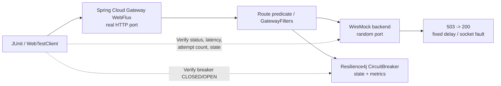
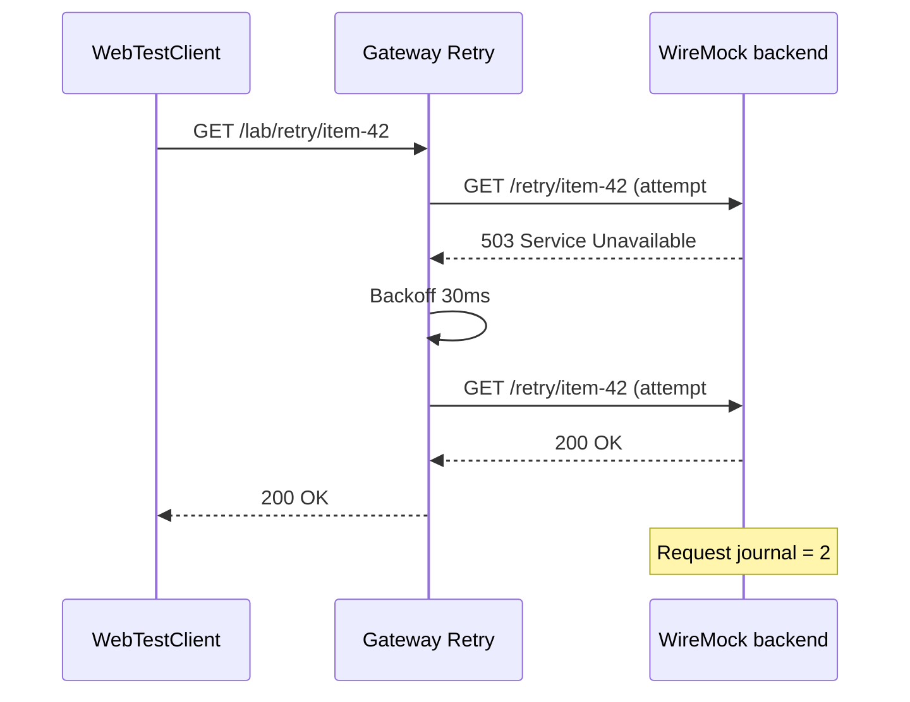
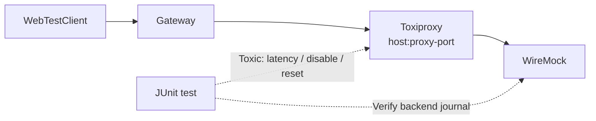
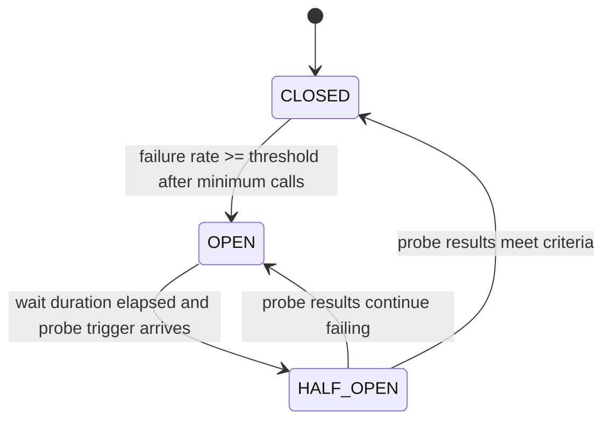

# Simulating Timeouts, Connection Errors, Retries, and Circuit Breakers

An **API Gateway** can be fully configured with route predicates, filter chains, path/header rewrites, service discovery, authentication, rate limiting, Retry, CircuitBreaker, and TLS and still behave incorrectly when an upstream fails. For example: a backend lags by two seconds yet the Gateway waits too long; a connection error causes a GET request to be sent too many times; the CircuitBreaker stays CLOSED because a `503` response was not counted as a failure; or a fallback returns `200`, making the system think a transaction succeeded even though the service is down.

In the **Testing** chapter of the **SPRING_CLOUD_GATEWAY** module, this lesson guides **controlled fault injection** to verify the actual behavior of **Spring Cloud Gateway Server WebFlux**: HTTP response timeouts, connection refusal/reset, bounded retries, backoff, CircuitBreaker CLOSED → OPEN → HALF_OPEN transitions, and fallback handling. The focus is not "seeing a 500 code is enough", but **verifying the backend call count, wait duration, breaker state, and client-visible outcome**.

**Learning objectives:**

1. Distinguish **connect timeout**, **response timeout**, connection refused/reset, slow responses, HTTP `5xx`, and TLS/DNS errors.
2. Build a Gateway WebFlux test suite with **JUnit + Spring Boot test + WebTestClient + WireMock**, using dynamic ports and real route sources.
3. Simulate transient 503 errors, persistent 503 errors, slow responses, and connection resets.
4. Precisely verify `retries` limits, backoff, outbound attempt counts, and idempotency.
5. Test `CircuitBreaker` via Resilience4j: minimum sample size, failure thresholds, the OPEN state, fallbacks, and recovery.
6. Know how to separate tests for **isolated Retry**, **isolated CircuitBreaker**, and **both filters combined**.
7. Avoid flaky tests caused by shared state, wall-clock timing, connection pooling, dynamic ports, and multiple Gateway replicas.
8. Use metrics/logs/traces to diagnose failures and design safe chaos tests in CI/staging.

> **Version note:** Examples target **Spring Cloud Gateway Server WebFlux 5.x** using `spring.cloud.gateway.server.webflux.routes`, the `Retry GatewayFilter`, the `CircuitBreaker GatewayFilter`, and Reactor Netty. For **WebFlux 4.3.x**, prefixes are typically `spring.cloud.gateway.routes` and `spring.cloud.gateway.httpclient.*`. For **Gateway Server Web MVC**, Retry uses Spring Retry/Framework Retry mechanisms and a different HTTP stack; do not reuse WebFlux examples verbatim. Never run fault-injection tests against a real production backend.

## 1. Why Simulate Faults Instead of Only Testing HTTP 200?

An integration test can confirm that `GET /api/catalog/items/42` returns `200` when the backend is healthy. However, it cannot answer these questions:

- If the backend takes **100 ms, 500 ms, or 5 seconds**, when does the request time out?
- When the socket cannot connect, is the error **retried**, and how many times?
- When the backend returns `503` on the first attempt and `200` on the next, does the Gateway **return 200** and does the backend see exactly **two attempts**?
- If 503 persists, does the Gateway **stop retrying**?
- When the CircuitBreaker is OPEN, are new requests blocked **before reaching the backend**?
- When the breaker is HALF_OPEN, how many probe requests are permitted?
- If a filter returns a `200` fallback while the upstream is broken, does the dashboard detect the degraded state?
- Could a `POST /orders` be resent and create duplicate orders?

That is why we need a **fault-injection test suite** capable of directly controlling response codes, delays, socket failures, and response sequences on a mocked backend.



**Three types of assertions must work together:** **client outcome**, **upstream requests**, and **internal resilience state**. Missing any one of them can let a test pass while the system is still broken.

## 2. Fault Taxonomy Table: What to Simulate?

| Scenario | Network/HTTP description | Suitable tool | Expectations to verify |
| --- | --- | --- | --- |
| Backend returns `503` | Valid HTTP response | WireMock `withStatus(503)` | Retry per `statuses`, breaker per `statusCodes` |
| Backend returns `502` | Valid HTTP response | WireMock `withStatus(502)` | Retry or not depending on config |
| Backend responds slowly | Connection succeeded, response not received in time | WireMock `withFixedDelay(...)` | Route `response-timeout`, gateway status/exception |
| TCP connection refused | No listener or proxy rejects connection | Closed port/Toxiproxy | Fast connect error, not confused with response timeout |
| TCP connection reset | Connection closed abnormally | WireMock `Fault.CONNECTION_RESET_BY_PEER` or Toxiproxy | Exception, retry policy, and cleanup |
| Black-holed connection | SYN/packets receive no reply | Toxiproxy/network sandbox | `connect-timeout`, does not hang forever |
| HTTP response cut mid-stream | Headers/body incomplete or already committed | WireMock chunk/fault + proxy | Client error/cancel, no blind retry |
| TLS handshake fails | Certificate/SNI/trust error | Test TLS server with wrong cert | Do not disable TLS verification |
| No `ServiceInstance` | `lb://` finds no backend | Test discovery supplier | `503`/`404` depending on config; not TCP refusal |
| CircuitBreaker OPEN | Filter rejects call before outbound | Resilience4j state | Backend counter **does not increase** |

**Terminology warning:** `503 HTTP` is an application-level response; `Connection refused` is a TCP-layer error; `Connect timeout` is exceeding the time to establish a connection; `Response timeout` is exceeding the wait for a response after a connection is established. They may map to different HTTP statuses at the Gateway depending on version and exception handler.

## 3. Test Pyramid for an API Gateway

| Test layer | Speed | Can verify | Cannot sufficiently prove |
| --- | --- | --- | --- |
| Isolated predicate/filter unit test | Fast | Route/order logic, request mutation | Real HTTP socket/Netty timeouts |
| `StepVerifier` for Reactor publishers | Fast | Retry/cancel/backoff pipeline at reactive level | HTTP codec, TLS, and proxy routing |
| WireMock + Gateway real HTTP port | Medium | Route, HTTP status, retries, delay, fallback | Full network partition/real DNS |
| Toxiproxy + Testcontainers | Medium/slow | Latency, reset, packet loss, connection failure | Complete production topology |
| Staging chaos test | Slow | Ingress, TLS, registry, Redis, multi-pod | Cannot replace unit/integration tests |
| Synthetic production check | Continuous/limited | Safe user journeys | Unsuitable for intentional outages |

**Practical recommendation:** Use **WireMock** for basic 503/200/delay/retry cases; use **Toxiproxy** only when you need precise TCP-level manipulation. Do not turn a simple filter test into a multi-minute chaos test when an HTTP stub suffices.

## 4. Dependencies for the WebFlux Lab

The Maven example lists only **the required dependencies**, with versions managed by compatible Spring Boot/Spring Cloud BOMs:

```xml
<!-- Spring Cloud Gateway Server WebFlux -->
<dependency>
  <groupId>org.springframework.cloud</groupId>
  <artifactId>spring-cloud-starter-gateway-server-webflux</artifactId>
</dependency>

<!-- Reactive circuit breaker + Resilience4j -->
<dependency>
  <groupId>org.springframework.cloud</groupId>
  <artifactId>spring-cloud-starter-circuitbreaker-reactor-resilience4j</artifactId>
</dependency>

<!-- Actuator for health/metrics, not strictly required for Retry alone -->
<dependency>
  <groupId>org.springframework.boot</groupId>
  <artifactId>spring-boot-starter-actuator</artifactId>
</dependency>

<!-- Spring Boot, JUnit, and WebTestClient testing per BOM -->
<dependency>
  <groupId>org.springframework.boot</groupId>
  <artifactId>spring-boot-starter-test</artifactId>
  <scope>test</scope>
</dependency>

<!-- WebFlux/WebTestClient testing if starter-test does not include it -->
<dependency>
  <groupId>org.springframework.boot</groupId>
  <artifactId>spring-boot-starter-webflux-test</artifactId>
  <scope>test</scope>
</dependency>

<!-- WireMock 3.x: pick a version compatible with your Java/JUnit runtime -->
<dependency>
  <groupId>org.wiremock</groupId>
  <artifactId>wiremock</artifactId>
  <scope>test</scope>
</dependency>
```

> **Verify dependency versions:** Spring Boot 4 reorganized test starters; WireMock 3.x and Spring Boot 3.x/4.x artifacts must be resolved against your actual BOM/dependency management. `spring-boot-starter-webflux-test` is an artifact of the Spring Boot 4 line; if using Boot 3.x, rely on `spring-boot-starter-test` and the `spring-test`/WebFlux test dependencies provided by that BOM rather than adding an artifact that does not exist in that release train. In this lesson, the code primarily uses `WebTestClient.bindToServer()`, so it does not rely on auto-injecting a client from a specific test annotation.

**Do not use** the non-reactive `spring-cloud-starter-circuitbreaker-resilience4j` for this Gateway WebFlux lab. The documentation requires `spring-cloud-starter-circuitbreaker-reactor-resilience4j`.

## 5. Defining the Test Contract Before Running

A suite can consist of **four independent routes**, each serving a distinct purpose:

| Route ID | Public path | Purpose | Filter/metadata |
| --- | --- | --- | --- |
| `lab-retry` | `/lab/retry/**` | 503 → 200, persistent 503 | Retry 1 time for GET |
| `lab-timeout` | `/lab/timeout/**` | Fixed delay exceeding response timeout | Metadata `response-timeout: 250` |
| `lab-reset` | `/lab/reset/**` | TCP reset/empty response | No Retry to isolate exception |
| `lab-breaker` | `/lab/breaker/**` | CircuitBreaker OPEN, fallback | CB with statusCodes 503 |

**Why not bundle every filter onto one route right away?** If a test expects 503 and sees a 503 fallback, you cannot tell whether it came from Retry, CircuitBreaker, or the HTTP client. Isolate each behavior first, then test their interaction.

Backend paths are kept consistent using `StripPrefix=1`:

```text
GET /lab/retry/item-42    -> GET /retry/item-42
GET /lab/timeout/slow     -> GET /timeout/slow
GET /lab/reset/socket     -> GET /reset/socket
GET /lab/breaker/item-42  -> GET /breaker/item-42
```

`StripPrefix=1` strips only the `lab` segment, keeping `retry`/`timeout`/`breaker`. Use the WireMock request journal to confirm the exact path delivered to the backend.

## 6. application-test.yml: Four Routes, Dynamic Backend Port

Keep this sample configuration **strictly in the test profile**; do not deploy it verbatim to production:

```yaml
spring:
  cloud:
    gateway:
      server:
        webflux:
          routes:
            - id: lab-retry
              uri: ${test.backend-url}
              predicates:
                - Path=/lab/retry/**
                - Method=GET
              filters:
                - StripPrefix=1
                - name: Retry
                  args:
                    retries: 1
                    methods: GET
                    statuses: SERVICE_UNAVAILABLE
                    backoff:
                      firstBackoff: 30ms
                      maxBackoff: 30ms
                      factor: 1
              metadata:
                connect-timeout: 500
                response-timeout: 1500

            - id: lab-timeout
              uri: ${test.backend-url}
              predicates:
                - Path=/lab/timeout/**
                - Method=GET
              filters:
                - StripPrefix=1
              metadata:
                connect-timeout: 500
                response-timeout: 250

            - id: lab-reset
              uri: ${test.backend-url}
              predicates:
                - Path=/lab/reset/**
                - Method=GET
              filters:
                - StripPrefix=1
              metadata:
                connect-timeout: 500
                response-timeout: 1500

            - id: lab-breaker
              uri: ${test.backend-url}
              predicates:
                - Path=/lab/breaker/**
                - Method=GET
              filters:
                - StripPrefix=1
                - name: CircuitBreaker
                  args:
                    name: labCatalogBreaker
                    fallbackUri: forward:/fallback/lab-catalog
                    statusCodes:
                      - 503
              metadata:
                connect-timeout: 500
                response-timeout: 1500

resilience4j:
  circuitbreaker:
    instances:
      labCatalogBreaker:
        slidingWindowType: COUNT_BASED
        slidingWindowSize: 4
        minimumNumberOfCalls: 4
        failureRateThreshold: 50
        waitDurationInOpenState: 10s
        permittedNumberOfCallsInHalfOpenState: 2
  timelimiter:
    instances:
      labCatalogBreaker:
        timeoutDuration: 3s
```

**Read the units carefully:**

- Metadata `connect-timeout: 500` is **500 milliseconds**.
- Metadata `response-timeout: 250` is **250 milliseconds**.
- `firstBackoff: 30ms` is a Retry duration.
- `waitDurationInOpenState: 10s` is how long the breaker remains open.
- `timeoutDuration: 3s` is the Resilience4j TimeLimiter, distinct from the Gateway Netty response timeout.

**Important:** In Gateway WebFlux 5.x, routes live under `spring.cloud.gateway.server.webflux.routes`. In timeout docs for some versions, global examples still show the older `spring.cloud.gateway.httpclient` prefix; verify the actual property for your version. The **route metadata** example here does not depend on the global prefix.

### Why Set TimeLimiter to 3 Seconds?

The goal of testing `lab-breaker` is to observe **HTTP 503** and the `statusCodes` policy, so TimeLimiter is set **higher** than the 1.5-second response-timeout so it does not preempt handling with a different timeout. In production, choose your entire deadline budget based on latency SLOs rather than copying 3 seconds as a default.

## 7. Reactive Fallback Controller Returning a Clear Error Contract

For WebFlux:

```java
package example.gateway.testing;

import java.util.Map;

import reactor.core.publisher.Mono;
import org.springframework.http.HttpStatus;
import org.springframework.http.ResponseEntity;
import org.springframework.web.bind.annotation.GetMapping;
import org.springframework.web.bind.annotation.RestController;

@RestController
class LabFallbackController {

    @GetMapping("/fallback/lab-catalog")
    Mono<ResponseEntity<Map<String, String>>> catalogUnavailable() {
        return Mono.just(
            ResponseEntity.status(HttpStatus.SERVICE_UNAVAILABLE)
                .header("X-Lab-Fallback", "true")
                .body(Map.of(
                    "code", "CATALOG_UNAVAILABLE",
                    "message", "Backend is unavailable")));
    }
}
```

Meaning:

- `fallbackUri: forward:/fallback/lab-catalog` uses an **internal forward**, not a backend `http://...` URI.
- Header `X-Lab-Fallback: true` is a **test marker**, not a security marker.
- `503` clearly describes an unavailable service; do not return a fake `200` success when there is no replacement data.
- Never forward stack traces, tokens, internal addresses, or sensitive request bodies in a fallback response.
- This controller is **for the lab only**; never let a public fallback endpoint become an authorization bypass path.

**Note:** A direct `503` response from the backend and a `503` generated by the fallback share the same HTTP status. Tests must also check headers/body or the request journal to verify the filter actually triggered the fallback.

## 8. Starting WireMock on a Dynamic Port in JUnit

An integration template uses:

- `@SpringBootTest(webEnvironment = RANDOM_PORT)` to start the Gateway with a **real HTTP listener**.
- `@ActiveProfiles("test")` to load `application-test.yml`.
- `@DynamicPropertySource` to bind the Gateway's upstream URI to WireMock's actual port.
- `WebTestClient.bindToServer()` to send HTTP requests through the Gateway.
- `@BeforeEach` to reset stubs and the request journal.

```java
package example.gateway.testing;

import java.time.Duration;

import com.github.tomakehurst.wiremock.WireMockServer;
import io.github.resilience4j.circuitbreaker.CircuitBreakerRegistry;
import org.junit.jupiter.api.AfterAll;
import org.junit.jupiter.api.BeforeEach;
import org.junit.jupiter.api.Test;
import org.springframework.beans.factory.annotation.Autowired;
import org.springframework.boot.test.context.SpringBootTest;
import org.springframework.boot.test.web.server.LocalServerPort;
import org.springframework.test.context.ActiveProfiles;
import org.springframework.test.context.DynamicPropertyRegistry;
import org.springframework.test.context.DynamicPropertySource;
import org.springframework.test.web.reactive.server.WebTestClient;

import static com.github.tomakehurst.wiremock.core.WireMockConfiguration.wireMockConfig;

@SpringBootTest(webEnvironment = SpringBootTest.WebEnvironment.RANDOM_PORT)
@ActiveProfiles("test")
class GatewayResilienceIT {

    private static final WireMockServer BACKEND =
        new WireMockServer(wireMockConfig().dynamicPort());

    static {
        // Start before the Spring context reads DynamicPropertySource.
        BACKEND.start();
    }

    @DynamicPropertySource
    static void upstreamProperties(DynamicPropertyRegistry registry) {
        registry.add("test.backend-url", BACKEND::baseUrl);
    }

    @LocalServerPort
    int gatewayPort;

    @Autowired
    CircuitBreakerRegistry circuitBreakers;

    WebTestClient client;

    @BeforeEach
    void prepare() {
        BACKEND.resetAll();
        circuitBreakers.circuitBreaker("labCatalogBreaker").reset();
        client = WebTestClient.bindToServer()
            .baseUrl("http://127.0.0.1:" + gatewayPort)
            .responseTimeout(Duration.ofSeconds(6))
            .build();
    }

    @AfterAll
    static void stopBackend() {
        BACKEND.stop();
    }

    // The @Test methods in the following sections belong inside this class.
}
```

> **Compatibility:** Depending on the Spring Boot line, the `@LocalServerPort` package may differ; the Boot 3.x illustration uses `org.springframework.boot.test.web.server.LocalServerPort`, while Boot 4.x updates testing annotation/package structure. Choose imports matching your actual BOM. The **dynamic port → DynamicPropertySource → WebTestClient real HTTP** principle stays the same. Keeping stubs/test methods in one class avoids Spring test context caching pointing at a WireMock port already stopped by another class.

### Why Not Hardcode Port 8081?

- Parallel CI runs easily collide on ports.
- A real dev service might already be listening on that port, causing tests to hit the wrong backend.
- Random ports ensure **test isolation**; which backend received requests is explicitly verified via `BACKEND.verify(...)`.
- If Toxiproxy is needed, tests must also allocate and manage proxy ports per fixture rather than using arbitrary Internet addresses.

### Do Not Use `WebTestClient.bindToController()` to Conclude Netty Timeouts

`bindToController()`/mock WebFlux can suit unit/slice testing, but to measure real socket/HTTP client response timeouts, you must run the Gateway with a **real HTTP server** and a backend with a real listener. Testing a mocked filter alone cannot prove TCP resets or TLS handshakes.

## 9. Baseline: Testing Proper Routing When the Backend Is Healthy

First verify the route/prefix before injecting faults:

```java
import static com.github.tomakehurst.wiremock.client.WireMock.*;

@Test
void healthyBackendIsProxiedOnce() {
    BACKEND.stubFor(get(urlEqualTo("/retry/item-42"))
        .willReturn(aResponse()
            .withStatus(200)
            .withHeader("Content-Type", "application/json")
            .withBody("{\"id\":\"item-42\"}")));

    client.get()
        .uri("/lab/retry/item-42")
        .exchange()
        .expectStatus().isOk()
        .expectBody()
        .jsonPath("$.id").isEqualTo("item-42");

    BACKEND.verify(1,
        getRequestedFor(urlEqualTo("/retry/item-42")));
}
```

If the baseline fails, inspect the `Path` route predicate, `StripPrefix`, dynamic URL, filter configuration, and backend stub. **Do not start debugging CircuitBreaker** while basic HTTP routing is broken.

**One request to upstream** is critical evidence: Retry must **not** issue a second attempt when the first call already succeeded.

## 10. Retry: Simulating 503 on the First Attempt, 200 on the Second

WireMock provides **scenarios** to change responses across sequential calls. Expected flow:



Java test method (add to the `GatewayResilienceIT` fixture):

```java
import static com.github.tomakehurst.wiremock.client.WireMock.*;
import static com.github.tomakehurst.wiremock.stubbing.Scenario.STARTED;

@Test
void retriesOne503AndThenSucceeds() {
    BACKEND.stubFor(get(urlEqualTo("/retry/item-42"))
        .inScenario("one-transient-503")
        .whenScenarioStateIs(STARTED)
        .willReturn(aResponse().withStatus(503))
        .willSetStateTo("healthy"));

    BACKEND.stubFor(get(urlEqualTo("/retry/item-42"))
        .inScenario("one-transient-503")
        .whenScenarioStateIs("healthy")
        .willReturn(aResponse()
            .withStatus(200)
            .withBody("recovered")));

    client.get()
        .uri("/lab/retry/item-42")
        .exchange()
        .expectStatus().isOk()
        .expectBody(String.class).isEqualTo("recovered");

    BACKEND.verify(2,
        getRequestedFor(urlEqualTo("/retry/item-42")));
}
```

**Success requires both pieces of evidence:**

- Client receives `200` and body `recovered`.
- Backend receives **exactly 2 GETs**. If the backend sees only 1, Retry did not run; if it sees 3, the `retries` policy is broader than expected.

Gateway WebFlux documentation states that `retries` is **the number of additional retry attempts**. `retries: 1` → at most **2 outbound attempts** for eligible failures. `503` matches `statuses: SERVICE_UNAVAILABLE`.

### Should You Assert Exact 30 ms Backoff?

Do not assert with `assertEquals(30, elapsedMs)`: schedulers, CPU, GC, and CI introduce jitter. Instead verify **there is no unbounded immediate retry loop**, total elapsed time stays within a reasonable deadline, and use virtual-time tests at the publisher/Retry-logic level for dedicated backoff checks where possible. Integration tests should primarily verify **attempt count and outcome**.

## 11. Retry: Backend Always Returns 503

The goal is ensuring Retry **stops** after its budget rather than looping forever:

```java
@Test
void stopsAfterConfiguredRetryBudget() {
    BACKEND.stubFor(get(urlEqualTo("/retry/item-42"))
        .willReturn(aResponse()
            .withStatus(503)
            .withBody("unavailable")));

    client.get()
        .uri("/lab/retry/item-42")
        .exchange()
        .expectStatus().isEqualTo(503);

    BACKEND.verify(2,
        getRequestedFor(urlEqualTo("/retry/item-42")));
}
```

If a custom error handler alters the final response, do not lock the test solely onto a single HTTP status at the expense of the primary objective: **backend request count = retries + 1**. Still, for standard HTTP 503 with only the Retry filter, returning 503 after exhausting attempts is expected.

**Remember:** Retrying `POST` with a body risks side effects. Never configure `methods: GET,POST` unconditionally. If the backend already committed and the Gateway timed out, retrying can create duplicate orders or charges even though the first HTTP response was lost.

## 12. HTTP Response Timeout: Backend Accepts the Request but Responds Too Slowly

With route `lab-timeout` configured with `metadata.response-timeout: 250` (ms), make the backend delay 1.5 seconds:

```java
@Test
void failsWhenUpstreamResponseExceedsRouteTimeout() {
    BACKEND.stubFor(get(urlEqualTo("/timeout/slow"))
        .willReturn(aResponse()
            .withStatus(200)
            .withFixedDelay(1500)
            .withBody("too late")));

    long started = System.nanoTime();

    client.get()
        .uri("/lab/timeout/slow")
        .exchange()
        .expectStatus().is5xxServerError();

    long elapsedMs =
        Duration.ofNanos(System.nanoTime() - started).toMillis();

    // Generous margin to avoid CI flakiness: proves it did not wait the full 1.5s.
    org.assertj.core.api.Assertions.assertThat(elapsedMs)
        .isLessThan(1200);

    BACKEND.verify(1,
        getRequestedFor(urlEqualTo("/timeout/slow")));
}
```

This is the **expected pattern in a stable CI environment**. Slow CI runners can make timing measurements noisy; in practice sample appropriately or allow suitable tolerance, and never assert an exact 250 ms. Wall-clock SLO tests can be separated into a dedicated performance suite.

### Avoid Misreading the HTTP Status

A Gateway response timeout usually surfaces as a 5xx error, but the **exact code** (`500`, `504`, etc.) depends on exception mapping, version, and the application's error handler. If your system contract requires **504 Gateway Timeout**, configure the corresponding error mapping and assert 504 explicitly. Do not assume Gateway WebFlux **always** returns 504 by default.

### Verify the Backend Side Too

- Did the request **reach** WireMock?
- After the timeout, the backend may still be processing or writing data even though the client canceled.
- Does the Gateway release the connection/cancel the reactive pipeline?
- When Retry is enabled, does the delay cause the request to be **sent twice**?
- If the backend handles a POST with side effects, a timeout **does not prove** the request did not commit.

## 13. Connect Timeout Differs from Response Timeout and Connection Refused

Do not use `withFixedDelay(1500)` to prove **connect timeout**. That adds a **response delay after the TCP connection is already open**, which tests **response timeout**.

| Scenario | TCP handshake | Can backend read HTTP request? | Primary error class |
| --- | --- | --- | --- |
| Slow response | Succeeds | Yes | Response timeout |
| Port with no listener | Rejected immediately (RST) | No | Connection refused |
| Black-holed network path | Handshake never completes | No | Connect timeout |
| TCP reset after connect | Connected then reset | Depends on timing | Connection reset / premature close |
| Invalid TLS certificate | TCP may succeed, TLS handshake fails | Not yet a valid HTTP request | SSL/TLS handshake |

**Reliable ways to simulate each:**

1. **Response timeout:** WireMock `withFixedDelay`.
2. **Connection refused:** point the test route to a fixture-owned port with no listener, or use Toxiproxy to reject/disable; never pick an arbitrary public IP.
3. **Connect timeout:** Toxiproxy/network namespace dropping SYN/traffic per test rules; a closed `localhost` port typically returns refused immediately **without waiting for connect timeout**.
4. **Connection reset:** WireMock Fault (mind OS behavior) or Toxiproxy reset/timeout toxic.

### Global vs. Route Timeout Configuration Units Differ

```yaml
spring:
  cloud:
    gateway:
      server:
        webflux:
          httpclient:
            connect-timeout: 1000  # milliseconds (global)
            response-timeout: 2s    # java.time.Duration (global)
          routes:
            - id: timeout-override
              uri: http://localhost:18081
              predicates:
                - Path=/test/**
              metadata:
                connect-timeout: 250  # milliseconds (route)
                response-timeout: 500 # milliseconds (route)
```

**Common mistake:** `metadata.response-timeout: 5` is not 5 seconds—it is **5 ms**. A **negative** per-route response-timeout value is documented as a way to **disable the global response-timeout** for that route. Do not use `-1` on APIs requiring tight latency bounds.

## 14. Simulating Connection Reset with WireMock

WireMock supports faults that are not valid HTTP responses:

```java
import com.github.tomakehurst.wiremock.http.Fault;

@Test
void surfacesConnectionResetAsTransportFailure() {
    BACKEND.stubFor(get(urlEqualTo("/reset/socket"))
        .willReturn(aResponse()
            .withFault(Fault.CONNECTION_RESET_BY_PEER)));

    client.get()
        .uri("/lab/reset/socket")
        .exchange()
        .expectStatus().is5xxServerError();

    BACKEND.verify(1,
        getRequestedFor(urlEqualTo("/reset/socket")));
}
```

**Important OS limitation:** WireMock docs note that `CONNECTION_RESET_BY_PEER` relies on socket `SO_LINGER=0`, which generally works on Unix/Linux but may **hang on Windows** instead of resetting immediately. If CI tests run on Windows, prefer **Toxiproxy/Testcontainers** in a Linux container, or use `Fault.EMPTY_RESPONSE`/`RANDOM_DATA_THEN_CLOSE` with assertions verified in that environment.

**Do not lock tests to one specific exception class** like `ConnectException` when the code path encounters a post-connect reset; Reactor Netty may surface `PrematureCloseException` or another error depending on timing. What matters is **no fake HTTP 200**, requests stay within the configured retry policy, and connections are cleaned up.

## 15. Simulating Connection Refused Without Relying on Random Ports

An easy but **not completely deterministic** approach is pointing the URI to `http://127.0.0.1:19999` when nothing is listening. That can fail if another process happens to bind that port.

For reliable integration tests:

- Open a TCP listener on an OS-assigned port, hold ownership of it, and intentionally close the listener right before the request; watch out for races in parallel runs.
- Or use **Toxiproxy** with a proxy port inside a container you created and disable the proxy to induce connection refusal/transport failure.
- Or inject an `HttpClient`/`ConnectionProvider` with a fake transport in a Netty-level unit test if your goal is only exception mapping.

### Verifying Refused Differs from Timeout

A **refused** connection normally fails very quickly. **Connect timeout** can only be tested accurately when the connection path **never replies** within the deadline, rather than returning an immediate RST.

Assertions should include:

1. The client does not receive a success response.
2. No backend HTTP request arrived (when TCP never connected).
3. Retry count stays within the configured budget.
4. The HTTP client does not hang past the test deadline.
5. Once the proxy/network is restored, new requests succeed.

Never try to induce failures by flooding internal hosts or real environment metadata endpoints. All fault targets must belong to **test fixtures** you control.

## 16. Using Toxiproxy for More Realistic Network Testing

**Toxiproxy** is an API-controlled TCP proxy that adds latency, bandwidth caps, timeouts, or connection cuts. In Java integration tests, the **Testcontainers Toxiproxy module** is commonly used to run a proxy between the Gateway and a mock backend.



**Conceptual setup** example; adapt to your specific Testcontainers API/version and Docker network:

```java
// Testcontainers orientation pseudocode, not a standalone test class.
// The Docker network must allow WireMock upstream and Toxiproxy
// to reach each other; upstream "wiremock:8080" is the Docker alias.

Network network = Network.newNetwork();

GenericContainer<?> wiremock = new GenericContainer<>(
        DockerImageName.parse("wiremock/wiremock:3.10.0"))
    .withNetwork(network)
    .withNetworkAliases("wiremock")
    .withExposedPorts(8080);

ToxiproxyContainer toxiproxy = new ToxiproxyContainer(
        DockerImageName.parse("ghcr.io/shopify/toxiproxy:2.9.0"))
    .withNetwork(network);

wiremock.start();
toxiproxy.start();

ToxiproxyContainer.ContainerProxy proxy =
    toxiproxy.getProxy(wiremock, 8080);

// Gateway outbound URL must target the host/port exposed by the proxy.
String testBackendUrl =
    "http://" + proxy.getContainerIpAddress()
        + ":" + proxy.getProxyPort();

// Toggle toxics per test:
// proxy.toxics().latency("slow-down", TOXIC_DIRECTION.DOWNSTREAM, 1500);
// proxy.setConnectionCut(true);
// ...
```

**Avoid confusion:** This is *pseudocode* illustrating the components, **not a compiled/executed snippet**. In Testcontainers, a Gateway process running on the **host** cannot always reach container IPs directly (especially on Windows/macOS). Use Toxiproxy's corresponding **mapped host/port**; container-to-container communication can use aliases/networks. Pick the Testcontainers 1.x/2.x API matching your version and test it for real. The key point here is **controlling transport failures** rather than depending on external ports.

### Why Use a Proxy Instead of Sleeping for 5 Seconds?

- Inject failures in a specific **upstream/downstream direction**.
- Test slow-network timeouts without changing backend code.
- Cut and restore connections to verify retry/recovery.
- Reproducible in CI with Docker/Toxiproxy when the environment is isolated.
- Easy to verify the Gateway connects to the **exact proxy address** and the backend receives requests only when the connection permits.

## 17. CircuitBreaker: States You Must Test

Resilience4j CircuitBreaker has three common operational states:



| State | Behavior on new calls | What to assert |
| --- | --- | --- |
| CLOSED | Permits calls, records success/failure | Backend request count increases |
| OPEN | Rejects new calls, usually enters fallback | Backend count **does not increase** |
| HALF_OPEN | Permits up to allowed probe count | Does not exceed `permittedNumberOfCallsInHalfOpenState` |
| Back to CLOSED | Serves normally again | Real requests reach healthy backend |
| FORCED_OPEN/ DISABLED | Special administrative states | Do not misuse to "test fault-triggered OPEN" |

With the lab configuration:

```yaml
resilience4j:
  circuitbreaker:
    instances:
      labCatalogBreaker:
        slidingWindowSize: 4
        minimumNumberOfCalls: 4
        failureRateThreshold: 50
        waitDurationInOpenState: 10s
        permittedNumberOfCallsInHalfOpenState: 2
```

Four consecutive calls recorded as failures → the breaker opens once enough samples are collected (per Resilience4j threshold rules). **A single initial error cannot open the breaker** when `minimumNumberOfCalls=4`.

### Why Is statusCodes Needed?

HTTP `503` from a backend is a **valid HTTP response**, not necessarily an exception. Gateway `CircuitBreaker` provides `statusCodes: [503]` to **explicitly convert response statuses into breaker failures**. Without this configuration and absent an exception, the filter may continue treating the call as successful.

## 18. Testing Breaker OPEN and Confirming the Backend Is Not Called

Using route `lab-breaker` and the fallback controller from Section 7, with the backend always returning 503:

```java
import io.github.resilience4j.circuitbreaker.CircuitBreaker;

@Test
void circuitBreakerOpensAndShortCircuitsNewCalls() {
    BACKEND.stubFor(get(urlEqualTo("/breaker/item-42"))
        .willReturn(aResponse().withStatus(503)));

    CircuitBreaker breaker =
        circuitBreakers.circuitBreaker("labCatalogBreaker");

    for (int i = 0; i < 4; i++) {
        client.get()
            .uri("/lab/breaker/item-42")
            .exchange()
            .expectStatus().isEqualTo(503)
            .expectHeader().valueEquals("X-Lab-Fallback", "true");
    }

    org.assertj.core.api.Assertions.assertThat(breaker.getState())
        .isEqualTo(CircuitBreaker.State.OPEN);

    // The 5th request must fail fast without touching the backend.
    client.get()
        .uri("/lab/breaker/item-42")
        .exchange()
        .expectStatus().isEqualTo(503)
        .expectHeader().valueEquals("X-Lab-Fallback", "true");

    BACKEND.verify(4,
        getRequestedFor(urlEqualTo("/breaker/item-42")));
}
```

**Important caveats:**

- If a `Retry` filter is also attached to the route, the backend may be called multiple times per logical request. This test **intentionally attaches only CircuitBreaker** to keep counting simple.
- `CircuitBreakerRegistry` must be the **actual** registry used by the Spring Cloud CircuitBreaker factory; verify names/registry wiring across version upgrades.
- `breaker.reset()` before tests clears stale state/failure rates; never do this on a production service.
- When OPEN, the 5th request may still return fallback `503`, while the WireMock counter stays at **4**.
- If fallback routes pass through a security chain or another route, ensure `/fallback/lab-catalog` forwards properly.

**Not enough:** asserting only `HTTP 503`. It could be a 503 from the backend, a 503 from an OPEN CircuitBreaker, or a discovery failure. You need **OPEN state + fallback header + unchanged backend count**.

## 19. Testing HALF_OPEN and Controlled Recovery

Goals after OPEN:

1. Wait duration elapses.
2. Breaker transitions to HALF_OPEN (may be **lazy** only upon the next request, depending on config).
3. Allows a small number of probes.
4. If the backend is healthy, the breaker closes; if still failing, it reopens.

**Do not write a naive `Thread.sleep(10000)` and immediately assert state.** It is slow and can fail when `automaticTransitionFromOpenToHalfOpenEnabled=false`: Resilience4j can remain OPEN until a new call arrives eligible to trigger the transition.

### A Faster Way to Test the State Machine

In a **unit-style breaker state test** (not meant to verify wait duration), you can do:

```java
CircuitBreaker breaker =
    circuitBreakers.circuitBreaker("labCatalogBreaker");

breaker.transitionToHalfOpenState();

// Send successful probes through the route (backend stub returns 200).
// Verify permits/concurrency and state after enough probe results.
```

**This is state injection for testing**, not simulating real timing. You should maintain **a separate integration test** with a short `waitDurationInOpenState`, bounded Wait/Awaitility polling, and verify that post-wait requests actually reach the backend.

### Pitfalls to Avoid When Testing HALF_OPEN

- Do not send only one probe and expect CLOSED when configuration permits 2 probes; transitions depend on overall results/settings.
- Do not send 10 concurrent requests expecting 10 backend calls: HALF_OPEN enforces a permit limit.
- Do not let parallel JUnit tests mutate another test's breaker state.
- Do not write polling loops without a deadline.
- Do not call `transitionToClosedState()` in a "natural recovery" test, as that bypasses the real condition under test.

## 20. CircuitBreaker and TimeLimiter: Two Different Timeouts

There are at least three distinct concepts:

| Mechanism | Location | Question answered |
| --- | --- | --- |
| Netty `connect-timeout` | Opening TCP connection | Did TCP connect before the deadline? |
| Netty `response-timeout` | Waiting for upstream HTTP response | Did upstream respond before the deadline? |
| Resilience4j `TimeLimiter` | Wrapping execution managed by the breaker | Did the logical operation exceed total allowed duration? |

Spring Cloud CircuitBreaker Resilience4j **includes a TimeLimiter by default** in documented configurations unless disabled via a supported mechanism. Consequently, if you test a `250ms` Netty response timeout while TimeLimiter is set to `100ms`, the error may come from **TimeLimiter first**, misleading your test conclusions.

### Explicit Precedence Configuration Example

```yaml
resilience4j:
  timelimiter:
    instances:
      labCatalogBreaker:
        timeoutDuration: 3s
```

This is `lab-breaker`'s configuration. Route `lab-timeout` **has no CircuitBreaker**, so it tests response timeout independently.

**Important:** A TimeLimiter timeout/cancellation does not prove the backend stopped executing immediately; if the backend already received the request, it may continue working. For side effects, consider idempotency and post-timeout status queries.

## 21. Combining Retry and CircuitBreaker: Filter Order Changes Results

Two common nesting patterns:

```text
A. CircuitBreaker wraps Retry:

  CircuitBreaker
     └── Retry
           ├── attempt #1: 503
           └── attempt #2: 200
  The breaker can see the logical call as successful.

B. Retry wraps CircuitBreaker:

  Retry
     └── CircuitBreaker
           └── attempt #1: 503
     └── CircuitBreaker
           └── attempt #2: 200
  The breaker may record multiple outcomes for one logical request.
```

**Do not equate** YAML line order with execution behavior across all code paths without testing it. Gateway filters attach to routes with ordering; once `Ordered`, pre/post phases, and custom filters are involved, chain wrapping affects retry/CB/fallback behavior. Gateway Retry documentation notes explicitly that **filters declared after Retry can run again**.

### Minimal Test Matrix

| Upstream response | Configuration | Expectations to count |
| --- | --- | --- |
| 503 → 200 | Retry 1x, CB wraps Retry | 2 attempts, final 200, breaker evaluates policy properly |
| 503 → 503 | Retry 1x, CB wraps Retry | 2 attempts, final fallback 503, breaker records failure |
| 503 → 200 | Retry wraps CB | 2 attempts, breaker may record 2 calls |
| Breaker OPEN | Retry wraps CB | Avoid repeatedly retrying `CallNotPermittedException` |
| Backend unreachable | Retry + CB | Retryable exception types, bounded attempt count |
| 401/403 | Retry + CB | Do not retry/trip breaker unless policy requires |
| 429 | Retry + CB | Do not blindly retry; preserve rate-limit contract |

Do not reuse **one shared breaker name** across test A and test B and compare outcome counts if test A polluted the sliding window. The safe approach is **assigning separate breaker names per route/test sequence** or resetting the registry in an isolated fixture.

### Retry Outside a 503 Fallback

If `Retry` wraps `CircuitBreaker` and the fallback returns `503`, Retry can intercept that status too and trigger additional filter/fallback executions. Therefore verify **how many times the fallback ran**, **backend count**, and **breaker state**, not only the final status.

## 22. Do Not Naively Retry Committed Responses or Streams

For HTTP streaming responses, SSE, or large downloads, the backend may already have sent headers or partial body chunks before dropping the connection.

```text
Client ← Gateway ← Backend

HTTP/1.1 200 OK
Transfer-Encoding: chunked

chunk #1: already sent to client
chunk #2: socket reset
```

In this situation:

- The Gateway cannot simply swap in a fresh `503` status after response headers are committed.
- Retrying the entire GET can **duplicate already-sent data**, violating the stream contract.
- A JSON CircuitBreaker fallback cannot replace the second half of a stream already delivered to the client.
- Tests must verify the client observes a **partial body/connection error** and check outbound connection counts.
- For SSE or WebSockets, test lifecycle/cancellation separately; do not conflate stream duration with a JSON GET response-timeout.

Gateway Retry documentation specifically warns that a `forward:` endpoint must not commit an error response before Retry has a chance to act. Test **response commit semantics**, especially when fallback controllers or custom filters invoke `setComplete()`/`writeWith()`.

## 23. POST Bodies and Idempotency: Testing Duplicate-Send Risk

Gateway WebFlux documentation notes that retrying HTTP methods with a request body can **cache the body** into `DataBuffer`s under request attribute `ServerWebExchangeUtils.CACHED_REQUEST_BODY_ATTR`. This creates **memory pressure** on large uploads or multipart requests.

Risk scenario:

```text
POST /api/orders
Attempt #1:
  backend persists order-123 successfully
  but TCP response drops

Gateway Retry:
Attempt #2:
  backend creates order-124
  client receives 201

=> One user action, two orders.
```

**The default policy should be not retrying write commands** unless:

1. A unique `Idempotency-Key` identifies the logical operation.
2. The backend checks and records the key **atomically** with the transaction/side effect.
3. Retry requests carry the **exact same key**.
4. The prior processing result can be replayed per contract.
5. Token, tenant ID, and audit checks validate consistently.
6. Body size, attempt counts, and deadlines are bounded.

### Sample Test for an Idempotent Backend

```text
Given:
  POST /orders + Idempotency-Key: abc-123
  backend stores key abc-123 outcome in test datastore

When:
  attempt #1 commits, response is lost
  attempt #2 resends with the same key

Then:
  backend receives 2 HTTP requests
  but only 1 order is created
  and both attempts reference the same logical operation
```

This is a **business integration test**; `BACKEND.verify(2, ...)` alone cannot prove it. You need a stateful backend stub or a real application test backed by a transactional datastore. Test GET Retry independently first and enable POST retry only when business requirements explicitly call for it.

## 24. Controlling Test State and Preventing Flaky Tests

Common causes of flaky resilience tests:

| Symptom | Cause | Fix |
| --- | --- | --- |
| Next run sees breaker already OPEN | Shared Resilience4j state | `breaker.reset()` or separate context/route |
| WireMock returns stale response | Unreset scenario/request journal | `BACKEND.resetAll()` before each test |
| Backend count assertion is too high | Parallel tests hitting same stub | Isolate fixtures; disable parallel runs on same route |
| Port collisions | Backend uses hardcoded port | Dynamic port, registered via `DynamicPropertySource` |
| DNS/socket caching bleeds across tests | Reused pooled HTTP client connections | Isolate routes/backends, test network faults separately |
| Exact 250ms elapsed fails | Scheduler/CI jitter | Assert margins and deadlines, avoid exact equality |
| 10-second sleep is slow and wrong state | Lazy HALF_OPEN transition | Manual state unit test + separate timed integration test |
| Unexpected HTTP status | Error handler changes mapping | Test contract/version; avoid hardcoding defaults |
| WireMock reset fails on Windows | `SO_LINGER` differences | Use Toxiproxy/Linux CI |
| Spring context cache keeps old URI | Static backend stopped across classes | Keep shared fixture/class, `@DirtiesContext` when needed |
| Gateway fails to start | Mixed Gateway MVC/WebFlux dependencies | Choose the matching starter and BOM |
| Toxiproxy container IP unreachable | Host is outside Docker network | Use mapped host/port |
| Missing metrics misread as 0 | Metrics not yet exported/scraped | Send a request, inspect meter and registry |

**Rule:** Never use `@TestMethodOrder` to rely on "test 1 opens the breaker, test 2 closes it"; every test must establish an explicit **Given state**. If a test needs to verify a multi-step state transition, run it **within a single test method**.

## 25. Checking Timeouts with Deadlines Instead of Fixed Sleeps

A reliable timeout test does not need to predict that the scheduler fires at millisecond 250. It must ensure **bounded completion** and the right error class.

### Three Checks

1. The backend stub intentionally waits **longer** than the configured timeout.
2. The test client has a response timeout **longer** than the Gateway timeout so the client does not close first.
3. Assertions require the request to complete within a reasonable deadline and **not succeed**.

```java
// Test client waits 6s; Gateway route timeout is 250ms.
// If backend delays 1500ms, the Gateway failure must arrive early.
WebTestClient client = WebTestClient.bindToServer()
    .baseUrl("http://127.0.0.1:" + gatewayPort)
    .responseTimeout(Duration.ofSeconds(6))
    .build();
```

Never set client timeout to **100ms** and conclude a 250ms gateway timeout was tested; in that case **the client aborted first**.

### Layered Deadlines

| Timer | Lab example | Purpose |
| --- | --- | --- |
| TCP connect timeout | 500ms | Bounds connection establishment |
| Route response timeout | 250ms | Bounds waiting for HTTP response |
| Retry backoff | 30ms | Spaces out attempts |
| CircuitBreaker TimeLimiter | 3s | Guards logical breaker execution |
| WebTestClient response timeout | 6s | Prevents test harness from hanging indefinitely |
| CI test timeout | 20–30s/test | Prevents stuck test suites |

These numbers are **for the lab only**; production values must reflect SLOs, hop counts, p95/p99 latency, and backend characteristics. A 250ms timeout can fit a fast cache read but is inappropriate for a report-aggregation workflow.

## 26. Metrics to Watch During Fault Simulation

During testing, use **Micrometer + Actuator** to verify fault effects are observable:

| Signal | Meaning |
| --- | --- |
| `spring.cloud.gateway.requests` by `routeId`/status | Logical requests seen by clients |
| Retry attempts / retry exhausted (if instrumented) | Attempt counts and budget usage |
| Breaker state CLOSED/OPEN/HALF_OPEN | Upstream call eligibility |
| Resilience4j successful/failed/not-permitted calls | What the breaker recorded |
| Reactor Netty HTTP client connections/errors | Connections/timeouts/resets |
| Gateway/ingress 5xx | Client-facing availability impact |
| Backend WireMock request journal | Evidence of outbound attempts |
| Response latency p95/p99 | How timeouts/retries affect SLOs |
| Fallback count/marker | Prevents masking outages behind 200 |
| JVM/Netty pool pending | Saturation when concurrent retries spike |

If using Actuator:

```bash
# Management endpoint only for protected test/admin networks.
curl -fsS \
  http://127.0.0.1:9090/actuator/metrics/spring.cloud.gateway.requests
```

Resilience4j metrics require the corresponding dependencies/integration, such as `resilience4j-micrometer` with Spring Boot Actuator. **Do not assume metric names or tags are identical across versions**. Before writing Prometheus assertions, inspect the actual meters exposed at `/actuator/metrics`/`prometheus`.

### Distinguishing Logical Requests from Attempts

If a GET request hits `503` and retries to `200`:

- The Gateway timer may record **one client-visible 200 request**.
- The WireMock backend sees **two inbound HTTP attempts**.
- Resilience4j CircuitBreaker may observe one or multiple outcomes depending on filter ordering.
- Concluding "the backend is healthy because gateway error rate is 0%" is **wrong** if retry rates are spiking abnormally.

## 27. Testing Auth, Rate Limiting, and Non-Retryable Errors

Not every non-200 response is a transient network failure.

| HTTP status | Typical cause | Default Retry behavior to verify |
| --- | --- | --- |
| `400` | Validation | **Do not retry** |
| `401` | Missing/expired token | **Do not retry** |
| `403` | Insufficient permissions/Origin policy | **Do not retry** |
| `404` | Wrong Path/resource | **Do not retry** |
| `409` | Conflict/business state | Do not retry absent explicit contract |
| `429` | RateLimiter/quotas | Do not blindly retry at the Gateway |
| `500` | Backend failure | Policy-dependent; do not assume all 500s are transient |
| `502` | Proxy/upstream error | Can retry GET within budget |
| `503` | Overload/maintenance/no instances | Conditional; can cause retry storms |
| `504` | Upstream timeout | Conditional; does not prove backend didn't process |

Tests should confirm:

- `401/403` responses are not recorded by CircuitBreaker as backend health failures when that is the intended policy.
- Spring Security WebFilters may reject requests **before Gateway route filters execute**; in that case Retry/CB never run.
- `RequestRateLimiter` 429 is a policy signal and should not be retried to bypass quotas.
- Route filters mutating `Authorization` or paths must be tested alongside; a 401 from an invalid token is **not** a reason to increase retries.
- When CircuitBreaker is OPEN, fallbacks must still never leak data to unauthorized tenants.

**Never use a backend returning 503 to claim Spring Security works.** Those are distinct layers requiring dedicated tests for roles, scopes, and tenants.

## 28. Service Discovery, TLS, and Layered Connection Failures

An `lb://catalog-service` route introduces additional scenarios:

1. Registry has no service instance → Gateway may return `503` or another status depending on config.
2. Registry holds an instance with the wrong IP/port → TCP refused/timeout.
3. Instance DNS resolution fails → UnknownHost/route failure.
4. Upstream HTTPS has bad cert/SNI → TLS handshake failure.
5. Gateway uses an egress proxy → may encounter proxy connect errors.

### Designing Isolated Tests

| Target | Fixture |
| --- | --- |
| HTTP 503 retry | WireMock backend on URI `http://127.0.0.1:{port}` |
| No service instance | Stub `ServiceInstanceListSupplier` returning an empty list |
| Selected unreachable instance | Stub returning an unreachable instance in the test network |
| Bad TLS certificate | Test HTTPS server with self-signed/mismatched cert |
| DNS resolution failure | Test DNS resolver/service inside a sandbox |
| Redis RateLimiter outage | Isolated Redis/Toxiproxy test |

Do not conflate **service discovery outage** with **TCP connection refused** in the same assertion: when no instance exists, no HTTP client connection is attempted, so it is **not** a refused TCP connection.

**Never disable TLS trust validation** just to make HTTPS tests pass. A good test verifies that the Gateway rejects untrusted certificates and succeeds once configured with a valid truststore.

## 29. Staging Chaos Tests: Scope and Guardrails

Some failures only emerge when **multiple Gateway replicas**, ingress, load balancers, service registries, or live Redis work together.

### Safe Staging Approach

1. Provision a **staging namespace/cluster** with test data and dedicated service identities.
2. Pick **a canary/test route** whose availability may intentionally degrade.
3. Place Toxiproxy/a chaos controller only between the canary Gateway and canary backend.
4. Cap QPS/concurrency so retry storms cannot impact shared dependencies.
5. Exercise: delay, reset, disabled proxy, backend 503, and recovery.
6. Measure HTTP error ratio, p95/p99, breaker states, and backend request counts.
7. Verify rollback/recovery within the deadline.
8. Remove toxics and return the system to baseline after testing.
9. Record results, owners, and runbooks; do not leave canary routes public indefinitely.

### Multi-Pod Considerations

- CircuitBreaker state is typically **local to each Gateway instance**, not automatically shared via Redis.
- Pod A can be OPEN while Pod B remains CLOSED; ingress-distributed traffic produces mixed outcomes.
- Retries amplify outbound load per pod; cluster-wide attempts can exceed expectations.
- Connection pool saturation or timeouts can affect only a subset of pods.
- Read Actuator metrics/route status **per pod** or aggregate by labels instead of inferring state from one request through a shared ingress.

**Never run network-cut tests on real production** unless conducted as an explicitly approved chaos engineering exercise with clear scope, abort conditions, and recovery plans.

## 30. Minimal Acceptance Test Matrix

| ID | Given | When | Then |
| --- | --- | --- | --- |
| T01 | Backend 200 | GET via Retry route | 200, backend 1 request |
| T02 | 503 → 200 | GET via Retry route | 200, backend **2 requests** |
| T03 | Persistent 503 | GET via Retry route | 503, backend **2 requests** |
| T04 | Delay 1.5s, route timeout 250ms | GET timeout route | Mapped 5xx, completes before backend |
| T05 | Backend port refused | GET matching route | Transport error; no hang, bounded attempts |
| T06 | Network black-hole | GET connect-timeout route | Aborted by connect timeout, not refused |
| T07 | TCP reset | GET reset route | No success response, mapped client error/5xx |
| T08 | 4 backend 503 responses | GET breaker route | Fallback 503, breaker OPEN |
| T09 | Breaker is OPEN | GET breaker route | Fallback, **0 new outbound calls** |
| T10 | Breaker recovering | HALF_OPEN probes with 200 backend | Transitions to CLOSED after enough results |
| T11 | GET 503 then 200, breaker + retry | Call combined route | Attempts/state match chosen ordering |
| T12 | POST with side effect, lost response | Retry with idempotency key | 2 attempts yet **1 side effect** |
| T13 | 401/403 | GET protected route | No Retry, breaker not tripped wrongly |
| T14 | `lb://` has no instances | GET discovery route | Mapped 503/404, not TCP connect |
| T15 | Untrusted TLS cert | GET HTTPS upstream | Does not disable TLS verification |
| T16 | Two pods, local breakers | Requests per pod | States may differ, outcomes recorded |
| T17 | Backend recovered | GET route after fault | 200, no lingering retry storm |
| T18 | Client cancels | Backend still delaying | Gateway does not leak unbounded connections |
| T19 | Fallback returns 503 | Backend down | Fallback marker + accurate status |
| T20 | Unmatched route predicate | GET unmatched path | 404/no-route, not counted in backend attempts |

## 31. Debugging Failing Resilience Tests

| Symptom | Likely cause | How to verify |
| --- | --- | --- |
| 503→200 test still returns 503 | Retry disabled, wrong `statuses`, wrong route matched | Actuator routes/filter chain, WireMock journal |
| Backend receives 3 instead of 2 attempts | Different `retries`/default filter, duplicate Retry | Check effective config and route order |
| Timeout test returns 200 after 1.5s | Timeout metadata wrong unit or not applied | Inspect route metadata and timers |
| Client times out before Gateway | WebTestClient timeout too short | Set client timeout > Gateway timeout |
| Connection refused test hangs long | Actually a black-hole/DNS issue, not refused | Packet/connection diagnostics |
| WireMock reset test hangs on Windows | `SO_LINGER` behavior | Use Toxiproxy/Linux CI |
| Breaker stays CLOSED after four 503s | Missing `statusCodes`, too few samples, wrong registry name | Inspect breaker metrics/state |
| Breaker OPEN on the very first test | Unreset state from previous test | Reset registry/isolate context |
| HALF_OPEN test stuck in OPEN | Lazy transition awaiting a call, wait duration not elapsed | Trigger probes or use auto-transition config |
| Fallback 503 looks identical to backend 503 | Missing marker/source verification | Verify fallback header and backend count |
| Backend 503 counted as success by breaker | Breaker missing HTTP status policy | Set `statusCodes` and check metrics |
| Backend receives only 1 request despite Retry=1 | First attempt succeeded or non-retryable status | WireMock scenario state, method/status |
| POST retry creates duplicate records | Missing idempotency key or transaction | Stop retrying writes, design deduplication |
| Route returns 404 | Wrong `StripPrefix` or non-matching path predicate | Request journal, Actuator |
| TLS test passes despite invalid cert | Code disables validation/trusts all | Restore proper truststore, audit config |
| Metrics missing | Missing Actuator/exporter/traffic | Inspect meter names and tags |
| Random failures in parallel runs | Shared fixture/registry/stubs | Isolate tests, disable parallel execution on shared state |

### Quick Investigation Order

1. Check **route ID, Path, Method, StripPrefix, and URI** first.
2. Inspect the **backend journal** to see how many times the Gateway actually called upstream.
3. Confirm the response delay/socket failure occurs at the intended layer.
4. Check Retry `retries`, `statuses`, `exceptions`, and backoff.
5. Check `statusCodes` and the Resilience4j breaker instance/state.
6. Distinguish Gateway Netty timeout from Resilience4j TimeLimiter and client timeout.
7. Check fallback handler, error handler, and response-commit behavior.
8. Check shared fixtures/context, dynamic ports, and OS/Docker networking.
9. Check metrics/traces and retry amplification across pods.
10. After fixing, re-run the **healthy baseline** to verify full recovery.

## 32. Reinforcement Exercises

### Exercise 1 — Counting Attempts

The Gateway has `Retry.retries: 2` for GET, and the backend always returns 503.

**Answer:** At most **3 outbound attempts** (initial call + 2 retries), provided status/exceptions match policy and the response is not yet committed.

### Exercise 2 — Distinguishing Timeouts

The WireMock backend opens the connection, holds the request for 1 second, then returns 200. The Gateway has `connect-timeout: 100ms` and `response-timeout: 200ms`.

**Answer:** This is a **response timeout**, not a connect timeout, because the TCP connection already succeeded.

### Exercise 3 — Refused or Timeout?

A route points to a localhost port with no listener. The request fails within a few milliseconds.

**Answer:** Likely **connection refused (RST)**; it does not prove `connect-timeout` was enforced. Testing connect-timeout requires a path that drops SYN packets or an appropriate fault proxy.

### Exercise 4 — Does a 503 Response Open the Breaker?

CircuitBreaker records exceptions only; the backend returns valid 503 responses four times.

**Answer:** The breaker will not open by default. The Gateway needs `statusCodes: [503]` to count 503 responses as breaker failures under the filter policy.

### Exercise 5 — OPEN Yet Backend Counter Keeps Rising

The breaker is OPEN, you send a fifth request, and the WireMock count still increases.

**Answer:** The request may have matched a different route, used a mismatched breaker name, had wrong filter order/Retry placement, or was not actually OPEN. Check the route ID, breaker registry state, and backend journal.

### Exercise 6 — HALF_OPEN Waits Forever

You use `await().until(() -> breaker.getState() == HALF_OPEN)` while automatic transition is disabled and send no probes.

**Answer:** It can hang or hit the deadline because the state transition is **lazy**. Send a probe after the wait duration or enable automatic transition per configuration instead of sleeping indefinitely.

### Exercise 7 — Timeout and Idempotency

The backend already persisted an order, then the response resets; Gateway Retry sends the POST again.

**Answer:** Risk of duplicate orders. Requires an idempotency key, atomic backend deduplication, and testing **business side-effect counts**, not just HTTP attempts.

### Exercise 8 — 200 Fallback

CircuitBreaker is OPEN, yet the fallback returns 200 `{"ok": true}` without real data.

**Answer:** This is a **false success**. Return 503 or clearly labeled stale data per contract, and emit fallback metrics so observability does not mask the outage.

### Exercise 9 — Multi-Pod

Gateway A's breaker is OPEN while B's is CLOSED. Clients see alternating fallback and backend 200 responses.

**Answer:** Breaker state per JVM can differ. Test individual pods rather than inferring behavior from one request through an ingress.

### Exercise 10 — Retry Wrapping Breaker

The Retry filter sits outside the CircuitBreaker filter; the breaker is OPEN and Retry catches `CallNotPermittedException`.

**Answer:** It may pointlessly retry a call already rejected by the breaker. Review exception policies and filter ordering; usually avoid retrying `CallNotPermittedException`.

## 33. Pre-CI/CD Checklist

- [ ] Select the right **Gateway Server WebFlux** and Reactor Resilience4j dependencies.
- [ ] Verify the exact route configuration namespace for your version/starter.
- [ ] Run the Gateway on a real HTTP port when testing Netty timeouts/resets.
- [ ] Use mock backends on dynamic ports; never target production services.
- [ ] Write a healthy 200 baseline test and verify **1 outbound request**.
- [ ] WireMock 503→200 scenarios must verify **2 requests** when `retries=1`.
- [ ] Persistent 503 backend tests must verify an **attempt limit**, with no infinite retries.
- [ ] Separate the Retry route from the CircuitBreaker route in basic behavior tests.
- [ ] Test response timeouts with fixed delays; do not confuse them with connect timeouts.
- [ ] Verify per-route timeout metadata units are **milliseconds**.
- [ ] Keep test client timeout > Gateway timeout so it does not mask errors.
- [ ] Test refused/black-hole/reset using transport fixtures suited to your OS/CI.
- [ ] Configure `statusCodes` on CircuitBreaker when HTTP 5xx counts as failure.
- [ ] Test threshold/minimum calls, OPEN, unchanged backend counts, HALF_OPEN, and CLOSED.
- [ ] Define a clear fallback contract returning no fake successes and exposing no stack traces.
- [ ] Test combined Retry+CB in at least the two primary orderings.
- [ ] Avoid retrying write operations with bodies blindly; enforce idempotency and body-size limits.
- [ ] Reset WireMock journals/scenarios and breaker registries between tests.
- [ ] Do not run tests sharing fixtures/state in parallel without isolation.
- [ ] Never assert wall-clock timeouts down to exact milliseconds.
- [ ] Test cancellation, streaming responses, and committed-response behavior if applicable.
- [ ] Test that 401/403/429 are not retried or tripping breakers outside policy.
- [ ] Test LoadBalancer no-instance, TLS trust errors, and DNS failures separately.
- [ ] Track metrics for logical requests, outbound attempts, breaker states, and fallbacks.
- [ ] Inspect individual pods/regions when staging multiple Gateway replicas.
- [ ] Enforce test deadlines and cleanup hooks for proxies/toxics/containers.
- [ ] Clearly mark test-only configurations so they are never copied verbatim to production.
- [ ] Set Retry/timeout/CB thresholds from real SLOs rather than example numbers.
- [ ] Ensure tests fail on wrong attempt counts/states/outcomes, not only on HTTP 500.
- [ ] Do not treat fixture tests as complete proof of production TLS/ingress/registry behavior; pair with staging validation.

## Conclusion

To test **Spring Cloud Gateway** reliably, **simulate each failure at the right layer**: WireMock returning `503` for Retry, WireMock fixed delays for response timeout, network proxies or closed ports for connection failures, and Resilience4j state assertions for CircuitBreaker. A test passes meaningfully not simply when it observes an expected HTTP status, but when it verifies **how many outbound attempts the Gateway made, how long it waited, what state the breaker recorded, and whether the fallback actually ran**.

When working with Gateway Server WebFlux, keep in mind that `Retry.retries` counts **additional attempts**, `response-timeout` in route metadata is in **milliseconds**, `CircuitBreaker.statusCodes` must be configured if HTTP 503 should count as failure, and **TimeLimiter** enforces a separate deadline from Netty timeouts. When Retry and CircuitBreaker are combined, filter wrapping order matters greatly; verify with responses, request journals, and states/metrics instead of guessing from filter names.

Finally, **isolate test state**, guard against duplicate requests with side effects, protect TLS/auth/rate limits, never inject faults against production backends, and pair tests with runbooks and observability to interpret results accurately. That forms the testing foundation required before operating a microservices API Gateway with route predicates, filter chains, service discovery, TLS, and resilience policies in production.

## References

- [Spring Cloud Gateway Server WebFlux — Retry GatewayFilter Factory](https://docs.spring.io/spring-cloud-gateway/reference/spring-cloud-gateway-server-webflux/gatewayfilter-factories/retry-factory.html)
- [Spring Cloud Gateway Server WebFlux — CircuitBreaker GatewayFilter Factory](https://docs.spring.io/spring-cloud-gateway/reference/spring-cloud-gateway-server-webflux/gatewayfilter-factories/circuitbreaker-filter-factory.html)
- [Spring Cloud Gateway Server WebFlux — HTTP Timeouts](https://docs.spring.io/spring-cloud-gateway/reference/spring-cloud-gateway-server-webflux/http-timeouts-configuration.html)
- [Spring Cloud Gateway — Configuration Properties](https://docs.spring.io/spring-cloud-gateway/reference/configprops.html)
- [Spring Cloud CircuitBreaker — Resilience4j Starters](https://docs.spring.io/spring-cloud-circuitbreaker/reference/spring-cloud-circuitbreaker-resilience4j/starters.html)
- [Spring Cloud CircuitBreaker — Resilience4j Properties and TimeLimiter](https://docs.spring.io/spring-cloud-circuitbreaker/reference/spring-cloud-circuitbreaker-resilience4j/circuit-breaker-properties-configuration.html)
- [Spring Boot — Testing Spring Boot Applications](https://docs.spring.io/spring-boot/reference/testing/spring-boot-applications.html)
- [WireMock — Simulating Faults (Fixed Delay, Reset Connection)](https://wiremock.org/docs/simulating-faults/)
- [WireMock — Scenarios and Stateful Behaviour](https://wiremock.org/docs/stateful-behaviour/)
- [WireMock — JUnit Jupiter Extension](https://wiremock.org/docs/junit-jupiter/)
- [Testcontainers — Toxiproxy Module](https://java.testcontainers.org/modules/toxiproxy/)
- [Resilience4j — CircuitBreaker State Machine](https://resilience4j.readme.io/docs/circuitbreaker)
- [Resilience4j — Examples: Reset and State Transitions](https://resilience4j.readme.io/docs/examples)
