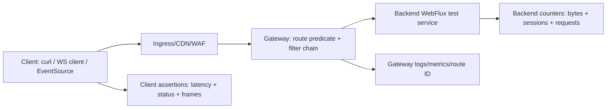
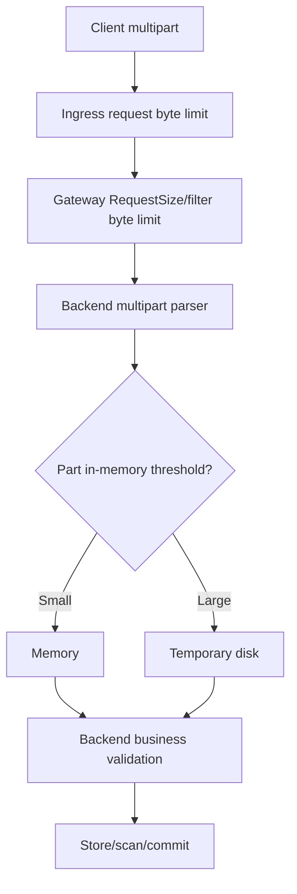

# Testing WebSocket, SSE, Multipart, and Content Limits in Spring Cloud Gateway

## 1. Why Must These Four Test Groups Go Together?

**Spring Cloud Gateway** is the entry point for microservices: using **route predicates**, the **GatewayFilter/GlobalFilter chain**, path/header rewrites, service discovery, authentication, rate limiting, circuit breakers, retries, TLS, and request observability. In real systems, not every request is a small `GET` returning JSON. The Gateway also receives **WebSocket upgrades**, proxies long-lived **Server-Sent Events (SSE)**, handles **multipart/form-data** file uploads, and enforces **content limits** to protect memory, disk, sockets, threads/event loops, and backends.

An easily missed mistake: testing that `GET /health` succeeds and concluding the Gateway is safe for every protocol. In reality:

- A WebSocket handshake returns `101 Switching Protocols`, yet text/binary frames, `ping/pong`, closure, or authorization can still fail.
- SSE returns `200`, yet events sit buffered for 30 seconds before reaching the browser; or a stream disconnects and the client has no idea which events were lost.
- Multipart `curl -F` returns `200`, yet the file is truncated, a part has the wrong name, or an earlier filter consumes the body so the backend receives zero bytes.
- `RequestSize` returns `413` for requests with `Content-Length`, yet `Transfer-Encoding: chunked` or HTTP/2 streams without an upfront byte total may behave differently; having only one test leaves a blind spot.

**Goal:** design a repeatable test suite covering **happy paths, boundaries, malformed inputs, over-limit payloads, infrastructure faults, and security** across all three traffic types through the Gateway, while clearly distinguishing Gateway outcomes from backend outcomes.

> **Scope:** main examples target **Spring Cloud Gateway Server WebFlux 4.3+/5.x**, a Spring WebFlux backend, Reactor Netty, and Spring Boot/Micrometer; YAML uses `spring.cloud.gateway.server.webflux.*`. Older WebFlux versions typically use `spring.cloud.gateway.routes`. Gateway Server Web MVC runs on Servlet/WebMvc.fn with different configuration, timeouts, and body processing; do not copy WebFlux tests verbatim to MVC.

### 1.1. Learning Outcomes

After this lesson, you will be able to:

1. Create three dedicated routes for `ws://`, `text/event-stream`, and `multipart/form-data`.
2. Build a demo backend with WebSocket echo, an SSE stream, and byte-counting upload verification to prove real end-to-end transport.
3. Test WebSocket handshakes, frames, close semantics, Origin checks, authentication, and max frame length.
4. Test SSE `Content-Type`, `id/event/data/retry` events, flush timing, heartbeats, reconnects, and `Last-Event-ID`.
5. Test multipart boundaries, form fields, file bytes, uploads exceeding `RequestSize`, and per-part multipart limits.
6. Distinguish `413 Payload Too Large`, `400 Bad Request`, `401/403`, `404`, `5xx`, `1009` WebSocket close, and timeouts/cancellations.
7. Test valid `Content-Length`, missing/mismatched `Content-Length`, HTTP chunked, and HTTP/2 by measuring **whether the backend actually received the body**.
8. Combine automated testing with `WebTestClient`/`StepVerifier`, `ReactorNettyWebSocketClient`, and live-network scenarios.
9. Keep test environments safe, avoiding huge payloads, real tokens, or DoS tests against production.

## 2. Test Matrix: Regular Request/Response vs. Long-Lived Connections

| Traffic type | Success points to verify | Unique risk areas |
|---|---|---|
| **WebSocket** | Handshake, frame echo, subprotocol if used, clean close | `ws/wss` routing, Origin, session auth, ping/pong, fragmentation/frame cap |
| **SSE** | HTTP 200, `text/event-stream`, timely delivery per event | Proxy buffering, idle timeout, reconnect/replay, canceled streams |
| **Multipart** | Proxied HTTP POST, exact field/filename/content bytes | Boundary handling, single-read request body, buffer/temp disk, malformed parts |
| **Content limits** | Over-limit rejection policy, backend never receives forbidden body | Missing or mismatched `Content-Length`, HTTP/2, chunked, codec max, aggregate memory |

Asserting only the **status code** is usually insufficient:

```text
WebSocket 101   +  wrong frame received      = FAIL
SSE 200         +  10 events dumped at end   = FAIL
Upload 200      +  backend receives 0 bytes  = FAIL
Upload > limit  +  backend still writes file = FAIL, even if client gets a late error
```

### 2.1. Layers Where Measurements Must Be Placed



**Why are backend counters required?** If the Gateway returns 413 after the backend has already received/written 1 MB, that is vastly different from rejecting the request **before proxying**. If the client receives a WebSocket close while the backend retains an active session, that is a cleanup bug. A test matrix must identify **who emitted the error** and **whether backend side effects occurred**, rather than looking solely at the client response.

### 2.2. Testing Levels

| Level | Execution method | Best at catching | Does not replace |
|---|---|---|---|
| Unit | Mock route/policy/filter, `StepVerifier` | Size policy logic, permissions, event mapping | Does not verify Netty handshakes or multipart framing |
| Gateway integration | Real Gateway app + test backend over HTTP port | Headers/paths, statuses, upgrades, bodies, timeouts | Does not include production proxies/CDN/mesh |
| End-to-end sandbox | Client → ingress → Gateway → backend | TLS, HTTP/2, buffering, idle timeouts, sticky load balancing | Does not prove production capacity |
| Controlled load/fault test | Concurrent sessions, slow clients, backend restarts | Backpressure, queues, file descriptors, cleanup | Never run on live production without explicit approval |

**Cross-cutting rule:** every test run should record **route ID, HTTP version, Gateway/backend versions, pod, normalized trace/correlation ID, and timestamps**. Never emit raw JWTs, cookies, user IDs, or full upload bodies into logs or metrics.

## 3. Setting Up an Isolated Test Environment

### 3.1. Two Applications and Ports

The examples assume:

| Application | Port | Responsibility |
|---|---:|---|
| Gateway Server WebFlux | `8080` | `/api/ws/echo`, `/api/events/stream`, `/api/upload` |
| Backend WebFlux test | `8081` | `/ws/echo`, `/events/stream`, `/upload` |
| Management Gateway (optional) | `9090` | Actuator/metrics on an administrative network |

Start the backend first, then the Gateway. `localhost` addresses are only valid when both processes share the same host/network namespace. In Docker/Kubernetes, the Gateway's `localhost` does not reach another backend container; substitute the environment-appropriate internal DNS name.

### 3.2. Maven/Gradle Dependencies

**Gateway application**:

```xml
<!-- versions managed by compatible Spring Boot parent and Spring Cloud BOM -->
<dependency>
    <groupId>org.springframework.cloud</groupId>
    <artifactId>spring-cloud-starter-gateway-server-webflux</artifactId>
</dependency>
<dependency>
    <groupId>org.springframework.boot</groupId>
    <artifactId>spring-boot-starter-actuator</artifactId>
</dependency>
```

```groovy
dependencies {
    implementation 'org.springframework.cloud:spring-cloud-starter-gateway-server-webflux'
    implementation 'org.springframework.boot:spring-boot-starter-actuator'
}
```

**Backend test application**:

```xml
<dependency>
    <groupId>org.springframework.boot</groupId>
    <artifactId>spring-boot-starter-webflux</artifactId>
</dependency>
```

For the **test** module, use JUnit 5, `spring-boot-starter-test`, and `reactor-test` aligned with your BOM:

```xml
<dependency>
    <groupId>org.springframework.boot</groupId>
    <artifactId>spring-boot-starter-test</artifactId>
    <scope>test</scope>
</dependency>
<dependency>
    <groupId>io.projectreactor</groupId>
    <artifactId>reactor-test</artifactId>
    <scope>test</scope>
</dependency>
```

In Boot 4, test starters may be split by module/stack; use the test dependencies recommended for your actual release train and ensure `WebTestClient`, JUnit, and `StepVerifier` are on the test classpath. **You do not need Redis, Eureka, or Resilience4j just to test these three basic routes**.

### 3.3. Configuring the Three Gateway Routes

```yaml
# application.yml — Gateway Server WebFlux 4.3+/5.x, sandbox only
server:
  port: 8080

spring:
  cloud:
    gateway:
      server:
        webflux:
          streaming-media-types:
            - text/event-stream
          httpclient:
            connect-timeout: 2000
            websocket:
              max-frame-payload-length: 65536
              proxy-ping: true
          routes:
            - id: echo-websocket
              uri: ws://localhost:8081
              predicates:
                - Path=/api/ws/echo
              filters:
                - StripPrefix=1

            - id: notifications-sse
              uri: http://localhost:8081
              predicates:
                - Path=/api/events/stream
                - Method=GET
              filters:
                - StripPrefix=1
              metadata:
                connect-timeout: 2000
                response-timeout: -1

            - id: upload-multipart
              uri: http://localhost:8081
              predicates:
                - Path=/api/upload
                - Method=POST
              filters:
                - StripPrefix=1
                - name: RequestSize
                  args:
                    maxSize: 1MB
```

**Explaining the boundaries:**

- `ws://` → `WebsocketRoutingFilter`. If service discovery is needed, Gateway WebFlux supports `lb:ws://service-id` with LoadBalancer; use `wss://` when TLS is properly configured. Never use an HTTP SSE route for WebSocket.
- `http://` → HTTP `NettyRoutingFilter`. SSE does not perform a WebSocket upgrade; instead it holds a long-lived `text/event-stream` response open.
- `StripPrefix=1` maps `/api/ws/echo` → `/ws/echo`, `/api/events/stream` → `/events/stream`, and `/api/upload` → `/upload`. A wrong prefix easily causes 404 errors.
- `max-frame-payload-length: 65536` limits the Gateway's **WebSocket HTTP client configuration**; it does not guarantee every direction or infrastructure layer shares the exact same frame cap. Test inbound and outbound separately.
- `response-timeout: -1` is the **Gateway HTTP client response timeout override** for the SSE route per WebFlux documentation; it does not disable idle timeouts on ingress, CDNs, firewalls, or browsers.
- `RequestSize.maxSize` accepts a `DataSize`. According to documentation, requests over the limit may receive `413 Payload Too Large` and an `errorMessage` header. **Do not treat an HTTP-header-based check as an unbypassable byte-counting policy when clients omit `Content-Length`**; Section 10 tests that case separately.

### 3.4. Keep Sandbox Safe and Separate from Production

Examples use `http://`/`ws://` **strictly in a local sandbox**. In production, use `https://`/`wss://`, authentication/authorization, origin policies, active-connection quotas, upload limits, and protect backends directly via TLS/mTLS/network policies. Never set `server.ssl.enabled=false` or `InsecureTrustManagerFactory` to "fix" TLS certificate test failures.

## 4. WebSocket Echo Backend to Verify Individual Frames

### 4.1. Spring WebFlux `WebSocketHandler`

In the **backend test app**:

```java
package com.example.gatewaytest.backend;

import java.util.Map;

import org.springframework.context.annotation.Bean;
import org.springframework.context.annotation.Configuration;
import org.springframework.web.reactive.HandlerMapping;
import org.springframework.web.reactive.handler.SimpleUrlHandlerMapping;
import org.springframework.web.reactive.socket.WebSocketHandler;
import org.springframework.web.reactive.socket.WebSocketMessage;
import org.springframework.web.reactive.socket.server.support.WebSocketHandlerAdapter;

@Configuration(proxyBeanMethods = false)
public class EchoWebSocketConfig {

    @Bean
    HandlerMapping websocketMapping() {
        WebSocketHandler echo = session ->
            session.send(session.receive()
                .filter(message ->
                    message.getType() == WebSocketMessage.Type.TEXT)
                .map(message -> session.textMessage(
                    "echo:" + message.getPayloadAsText())));

        SimpleUrlHandlerMapping mapping = new SimpleUrlHandlerMapping();
        mapping.setOrder(-1);
        mapping.setUrlMap(Map.of("/ws/echo", echo));
        return mapping;
    }

    @Bean
    WebSocketHandlerAdapter webSocketHandlerAdapter() {
        return new WebSocketHandlerAdapter();
    }
}
```

This is a **text-only echo**; it does not arbitrarily convert binary frames into text. `session.receive()` is a `Flux<WebSocketMessage>`, and `session.send(...)` returns a `Mono<Void>` bound to the inbound/outbound lifecycle. In production, add authentication, per-session authorization, max frame/message sizes, origin checks, and explicit subprotocol rules.

**Key takeaway:** A WebSocket handler inherently communicates in **frames**, not HTTP POST JSON request bodies. Testing HTTP 101 only verifies **the upgrade was accepted**, not that frames arrive in the right order or payload.

### 4.2. Test Failure When the Backend Lacks a Registered Handler

If the backend returns 404 for `/ws/echo` even though the Gateway correctly targets `ws://localhost:8081`, the handshake will fail. Test the backend directly before blaming the Gateway. Spring WebFlux `WebSocketHandlerAdapter`, URL mappings, and transport runtime must all be present; do not register duplicate mappings on the same path as a regular HTTP controller.

## 5. SSE Backend for Chunk and Heartbeat Testing

SSE is an **HTTP GET** returning `text/event-stream` blocks over time, not a WebSocket. In the same backend test app:

```java
package com.example.gatewaytest.backend;

import java.time.Duration;
import org.springframework.http.MediaType;
import org.springframework.http.codec.ServerSentEvent;
import org.springframework.web.bind.annotation.GetMapping;
import org.springframework.web.bind.annotation.RestController;
import reactor.core.publisher.Flux;

@RestController
public class DemoSseController {

    @GetMapping(value = "/events/stream",
                produces = MediaType.TEXT_EVENT_STREAM_VALUE)
    public Flux<ServerSentEvent<String>> stream() {
        Flux<ServerSentEvent<String>> events =
            Flux.interval(Duration.ZERO, Duration.ofMillis(500))
                .map(i -> ServerSentEvent.<String>builder()
                    .id(Long.toString(i + 1))
                    .event("tick")
                    .retry(Duration.ofSeconds(2))
                    .data("tick-" + (i + 1))
                    .build());

        Flux<ServerSentEvent<String>> heartbeats =
            Flux.interval(Duration.ofSeconds(2))
                .map(ignored ->
                    ServerSentEvent.<String>builder()
                        .comment("heartbeat")
                        .build());

        return Flux.merge(events, heartbeats);
    }
}
```

Typical SSE frames:

```text
id: 1
event: tick
retry: 2000
data: tick-1

id: 2
event: tick
retry: 2000
data: tick-2

: heartbeat

```

Every event requires a **trailing blank line to terminate the block**, and the heartbeat comment `: heartbeat` is **not a `tick` event**. Output order of `id/event/retry/data` may vary by encoder; tests should avoid asserting a rigid byte string when semantic event verification suffices.

**Demo limitation:** `i+1` is generated **per subscription** with no durable event log, so `Last-Event-ID` is ignored. Reconnecting browsers may receive `id:1` again. Resumability tests in Section 8 must use a **backend backed by a durable event store**; never treat this demo as supporting replay.

## 6. Multipart Backend: Verifying Byte Counts Without Buffering the Entire File

A WebFlux backend can accept `@RequestPart FilePart`. To prevent the demo from accidentally creating a large heap copy, the example below only **counts bytes** and releases each `DataBuffer`:

```java
package com.example.gatewaytest.backend;

import java.util.Map;

import org.springframework.http.MediaType;
import org.springframework.http.codec.multipart.FilePart;
import org.springframework.core.io.buffer.DataBufferUtils;
import org.springframework.web.bind.annotation.PostMapping;
import org.springframework.web.bind.annotation.RequestPart;
import org.springframework.web.bind.annotation.RestController;
import reactor.core.publisher.Mono;

@RestController
public class DemoUploadController {

    @PostMapping(path = "/upload",
                 consumes = MediaType.MULTIPART_FORM_DATA_VALUE)
    public Mono<Map<String, Object>> upload(
            @RequestPart("file") FilePart file,
            @RequestPart("description") String description) {

        return file.content()
            .map(buffer -> {
                try {
                    return (long) buffer.readableByteCount();
                } finally {
                    DataBufferUtils.release(buffer);
                }
            })
            .reduce(0L, Long::sum)
            .map(bytes -> Map.of(
                "filename", file.filename(),
                "description", description,
                "receivedBytes", bytes));
    }
}
```

**What this test proves:** the JSON response shows the backend received **part `file`**, the filename, and the content byte count. It does **not** prove the file is safe, matches a checksum, or was persisted, and it is **not** a production upload handler; `FilePart` parsing can still buffer to memory or temporary disk before the controller runs. In production, stream directly to object storage with byte/part quotas, checksums, malware scanning, ownership checks, cleanup, and never trust `filename()` when building filesystem paths.

Client-supplied metadata such as `description` and `filename` are **untrusted input**. Never pass them verbatim into filesystem paths, SQL, metric labels, or unredacted logs.

## 7. Testing WebSocket from Handshake to Close

### 7.1. PASS Requires More Than HTTP 101

Standard WebSocket over HTTP/1.1 starts with an upgrade handshake returning `101 Switching Protocols`. Over HTTP/2, extended CONNECT works differently, so **101 is not always expected** across all transports. More importantly, an end-to-end test must send **real frames** and verify replies.

Minimum checklist:

1. Connect to `ws://localhost:8080/api/ws/echo` using a real WebSocket client.
2. Send text `ping-1`, receive back exactly `echo:ping-1`.
3. Send multiple frames `A`, `B`; verify content and ordering per backend contract.
4. Normal close: verify client/server close handshake and session release.
5. Use an unmatched path such as `/api/ws/unknown`: the handshake **must not succeed** on the echo route.
6. Test a disallowed `Origin` → handshake rejected per origin policy.
7. Test oversized payloads, binary frames, invalid UTF-8, idle/ping-pong, and backend disconnects.

### 7.2. Testing with `websocat` or an Equivalent WebSocket CLI

On machines with `websocat` installed:

```bash
# Terminal 1: direct to backend.
websocat -t ws://localhost:8081/ws/echo
# Type "hello" and press Enter; expect "echo:hello".

# Terminal 2: through the Gateway.
websocat -t ws://localhost:8080/api/ws/echo
# Type "gateway" and press Enter; expect "echo:gateway".
```

These are **local test commands**. `websocat` is an external tool that may not be installed; you can use `wscat` or Spring's `ReactorNettyWebSocketClient` from Section 12 instead. With WebSocket, **plain `curl -i` HTTP GET cannot test text or binary frames**; never declare PASS merely because you saw an HTTP status or response headers.

### 7.3. WebSocket Test Cases and Expected Outcomes

| Case | How to trigger | What to assert |
|---|---|---|
| Valid handshake | `ws://.../api/ws/echo` | WebSocket connects successfully, backend opens a session |
| Text frame | Send `hello` | Receive `echo:hello` **through Gateway**, not a new HTTP response |
| Multiple frames | Send `a`, `b`, `c` | Exact sequence and payload per contract |
| Unmatched route | `/api/ws/missing` | Does not upgrade on echo route, no backend session opened |
| Disallowed Origin | `Origin: https://attacker.example.test` | Handshake rejected per config, typically HTTP 403 |
| Binary frame | Send binary to text-only echo | Must not silently turn into a text message with bogus data |
| Oversized frame | Send a frame exceeding configured max | Connection/close/error per WebSocket implementation; no OOM |
| Normal client close | Close status `1000` | Server/proxy cleanup, active session count returns to baseline |
| Backend crashes mid-session | Kill/restart **demo backend** | Client receives controlled close/error, no leaked Gateway session |
| Network drop/proxy cut | Simulate disconnect in sandbox | Proper timeout/cleanup, sessions not held forever |
| Ping/pong | Client actively sends ping | Expected forward/respond behavior, ping not mistaken for app text |
| Same user opens multiple sessions | 2–5 concurrent test connections | Per-principal quota/concurrency limit if configured |

**Do not hardcode every status/close code:** oversized frames often involve **WebSocket close code `1009 Message Too Big`**, yet exact behavior varies with Netty/Spring handlers, transfer direction, fragmentation, and abrupt socket closes. Tests should assert **policy-violating payloads are rejected without resource leaks** while logging the actual close reason.

### 7.4. Origin Is Not HTTP CORS

Browser WebSockets send `Origin` during the handshake, but **browsers do not run CORS preflight checks like `fetch()`**. Spring Cloud Gateway WebFlux 5.x exposes:

```yaml
# Fragment placed under spring.cloud.gateway.server.webflux.
websocket:
  allowed-origins:
    - https://dashboard.example.test
```

Gateway docs describe allowing **same-origin handshakes** and requests **with no Origin** (such as CLIs) by default, rejecting disallowed cross-origin requests with 403. Configure explicit origin allowlists; never use `*` in sensitive environments.

**Origin does not replace authentication:** a CLI can spoof or omit this header. For private WebSockets, still verify sessions/JWTs, scopes, and stream authorization. Behind a reverse proxy, configure forwarded host/scheme handling **trusting only trusted proxies** so same-origin checks work reliably; never trust arbitrary `X-Forwarded-Host` headers from the Internet.

### 7.5. Testing `wss://` and TLS

In a sandbox using test certificates issued by a trusted CA:

```text
Client --wss://api.test.example.test/api/ws/echo--> Gateway
Gateway --wss://internal-ws.test.example.test/ws/echo--> Backend
```

Verify SAN/hostname matching, CA trust, TLS version, mTLS if required, and forwarded headers across ingress. **A `wss://` client hop does not automatically guarantee the Gateway→backend hop uses TLS**; that depends separately on route URI and HTTP client config. Never disable certificate verification with a trust-all client in CI to "fix" DNS/certificate errors.

## 8. Testing SSE: HTTP Succeeds, Yet Streams Must Arrive on Time

### 8.1. `curl -N` Direct to Backend, Then Through Gateway

```bash
# Backend WebFlux: must emit each event as it happens.
curl --http1.1 -N -i --max-time 5 \
  -H 'Accept: text/event-stream' \
  http://localhost:8081/events/stream

# Gateway WebFlux: compare timing and event content.
curl --http1.1 -N -i --max-time 5 \
  -H 'Accept: text/event-stream' \
  http://localhost:8080/api/events/stream
```

Expected observations:

| Property | Check |
|---|---|
| Initial HTTP status | `200` (when route, auth, and backend are valid) |
| Header | `Content-Type: text/event-stream` |
| Event 1 | `id: 1`, `event: tick`, `data: tick-1` |
| Event 2 | `id: 2`, `event: tick`, `data: tick-2` |
| Reconnect hint | `retry: 2000` (milliseconds) |
| Heartbeat | Comment line like `: heartbeat`, not dispatched as `tick` |
| Timing | `tick` events arrive **incrementally ~every 500 ms**, not batched after 5 seconds |
| Test exit | `--max-time 5` aborts the stream; curl exit code `28` is expected for endless streams |

Measure arrival times at the **client**, not only from timestamps embedded in the backend payload. If the backend emits on time while the Gateway/ingress buffers it, payload timestamps look fresh even though users experience delayed updates.

### 8.2. Printing Per-Line Timestamps

In Bash with GNU `date`:

```bash
curl -N -sS --max-time 6 \
  http://localhost:8080/api/events/stream |
while IFS= read -r line; do
  printf '%s  %s\n' "$(date +%H:%M:%S.%3N)" "$line"
done
```

`curl -N` disables curl's stdout buffering; it does **not disable** buffering in the backend, Gateway, Nginx, or CDN. Across multiple hops, run the same command along **direct backend → Gateway → ingress** and compare inter-event intervals.

### 8.3. Browser EventSource: Reconnect and Cleanup

In a same-origin browser sandbox:

```javascript
const source = new EventSource("/api/events/stream");
const received = [];

source.addEventListener("tick", event => {
  received.push({ id: event.lastEventId, data: event.data });
  console.log("tick", event.lastEventId, event.data);
});

source.addEventListener("error", () => {
  console.warn("SSE connection state:", source.readyState);
});

// When leaving the page/component:
function cleanup() {
  source.close();
}
```

Native browser `EventSource` **has no API to attach custom Bearer `Authorization` headers**. For private APIs, use a same-origin BFF/session cookie with CSRF/Cookie/SameSite protections, or a streaming `fetch()` client with proper SSE parsing and reconnect logic instead of putting JWTs in query strings.

### 8.4. `Last-Event-ID` Does Not Automatically Mean Backend Replay

```bash
curl -i -N --max-time 3 \
  -H 'Accept: text/event-stream' \
  -H 'Last-Event-ID: 42' \
  http://localhost:8080/api/events/stream
```

That command **only proves the client sent the cursor**. The `Flux.interval` demo in Section 5 never reads the cursor and has no event store, so it **cannot** resume from event 43 onward. Real replay tests require a backend with **durable event storage** and stream/tenant-authorized `read after cursor` logic.

Production replay scenario:

1. Client receives `id: 102`, then loses connectivity; producer emits events 103, 104, 105.
2. Client reconnects with `Last-Event-ID: 102`, possibly hitting a different Gateway/backend replica.
3. Backend validates identity, stream, and cursor, replays 103–105 in order, then seamlessly joins live events without gaps.
4. Consumer handles duplicates idempotently; if the cursor fell past retention, the server signals resync per contract.
5. Test overly long, invalid, or cross-tenant cursors: they must be **rejected** without leaking history.

**Never treat the browser's `Last-Event-ID` header as a credential.** It is untrusted client input; authentication and authorization must remain independent.

### 8.5. Testing Idle Timeouts, Heartbeats, and Response Commit

| Scenario | Outcome to verify |
|---|---|
| 60s with no domain events | Do heartbeats actually flush to the client? |
| 30s ingress idle timeout | Does the stream survive past the limit or drop? Who closed it? |
| Backend restarts mid-stream | Client closes/reconnects cleanly with no zombie subscriptions |
| JWT expires mid-stream | App enforces session lifetime/reauth policy instead of staying open forever |
| Backend errors after sending 3 events | Does not try to rewrite an already-committed HTTP 200 into 503 on the **old response** |
| Multiple `EventSource` instances in one SPA | `close()` cleans up; active stream counts do not climb across renders |
| Slow reading client | No unbounded buffering; drop/disconnect/resync policy works |

With SSE, **the Gateway's Retry filter cannot splice a new response onto an already-committed stream**. Prefer **client reconnect + backend replay/idempotency**. Keep SSE routes away from response-body caching, POST retries, and overly short TimeLimiters.

## 9. Testing Multipart: Data Must Arrive Intact, Not Just HTTP 200

### 9.1. Generating a Small Test File and Uploading

In a Linux/macOS shell or Git Bash **on a test machine only**:

```bash
# Create a 100 KiB test file containing no real data.
head -c 102400 /dev/zero > /tmp/demo-100k.bin

# Send directly to the backend.
curl -i \
  -F 'description=small-test' \
  -F 'file=@/tmp/demo-100k.bin;filename=demo.bin;type=application/octet-stream' \
  http://localhost:8081/upload

# Send the same multipart payload through the Gateway.
curl -i \
  -F 'description=small-test' \
  -F 'file=@/tmp/demo-100k.bin;filename=demo.bin;type=application/octet-stream' \
  http://localhost:8080/api/upload
```

Expected response from the demo backend:

```json
{
  "description": "small-test",
  "filename": "demo.bin",
  "receivedBytes": 102400
}
```

**Do not manually set `Content-Type: multipart/form-data` when using `curl -F`**; curl needs to generate the **boundary** and append `boundary=...` to `Content-Type`. Manually omitting the boundary causes 400/415 errors even when routing works. Compare the byte count **of the file part**, not total request `Content-Length`, because multipart framing adds headers, boundaries, and form fields.

### 9.2. Key Multipart Cases to Test

| Case | Input | What to assert |
|---|---|---|
| Small valid upload | 100 KiB + `description` | Backend receives the right part, bytes, and sanitized filename |
| Empty file | `file` with 0 bytes | 200 or 4xx per contract, no crash |
| Missing `file` | Only `description` | 400 or defined validation error; backend stores nothing |
| Wrong part name | `attachment` instead of `file` | Never silently accept a contract mismatch |
| Multiple files | Two `file` parts when one is expected | Reject or handle per contract; never silently save both |
| Oversized text field | `description` > limit | Rejected cleanly by decoder/validation, no OOM |
| Unusual filename | `../../etc/passwd`, Unicode/emoji | Never use raw filename as a filesystem path; test sanitization |
| Unusual Content-Type | `application/x-msdownload` or spoofed MIME | Never trust client MIME alone; validate/sniff/scan per policy |
| Missing multipart boundary | Malformed header | Reject 400/415, do not pass payload to backend as valid file |
| Excess parts/long headers | Exceeds `max-parts`/`max-headers-size` | Reject and clean up per parser configuration |
| File over total request size | 1.1–2 MB on `maxSize: 1MB` route | Expect 413 **when filter sees length**, backend does not process |
| Chunked / no Content-Length | Streams bytes without upfront total | **Test separately**; never assume RequestSize covers it |
| Client aborts mid-file | Socket closed partway through upload | Cancellation/cleanup, no partial file committed |
| Concurrent uploads | Small bounded concurrency | Memory, temp disk, and connection limits hold |

### 9.3. Byte Integrity: Filename and Size Are Not Enough

`receivedBytes=102400` proves the **length** of the file part, not its **content integrity**. In deeper integration tests, compute **SHA-256** over the raw file bytes on both client and backend and compare:

```bash
sha256sum /tmp/demo-100k.bin
```

The backend can return the checksum **in sandbox tests only** or store verification metadata separately. In production, do not expose hashes of sensitive payloads unless permitted by contract; compute checksums while streaming and release buffers cleanly.

When HTTP returns 200 yet checksums diverge, look for: custom filters altering the body, multipart parsers, character encoding issues, double-reading the request, `Content-Length`/transfer-encoding mismatches, or buggy backend reads/writes. Do not just raise upload timeouts.

## 10. Content Limits: Test Every Transfer Mode Instead of Assuming `RequestSize`

### 10.1. Four Independent Limit Layers

| Layer | Policy example | What does it constrain? |
|---|---|---|
| Ingress/WAF | `client_max_body_size`, max request bytes, streaming cap | Total bytes from client **before Gateway**, proxy-dependent |
| Gateway `RequestSize` | Per-route `maxSize: 1MB` | Total request size checked by filter; test both `Content-Length` and no-length |
| WebFlux multipart parser | `max-in-memory-size`, `max-disk-usage-per-part`, `max-parts` | Memory/disk/content **per part** when a parser actually runs |
| Backend business policy | 800 KiB/file, 2 attachments/user, file-type allowlist | Business rules and resource authorization |

**Do not infer from `spring.codec.max-in-memory-size` or multipart parser settings that the Gateway rejects the whole HTTP body at that exact threshold.** The Gateway may **proxy the raw body stream** without parsing multipart at all, while the backend parser enforces per-part caps. These knobs protect **different processing stages**.

### 10.2. RequestSize with Declared Content-Length

```bash
# 1.2 MB test file for sandbox use only.
head -c 1200000 /dev/zero > /tmp/demo-1200k.bin

curl -i \
  -F 'description=large-test' \
  -F 'file=@/tmp/demo-1200k.bin;filename=large.bin' \
  http://localhost:8080/api/upload
```

With `RequestSize.maxSize=1MB`, when curl sends a valid declared `Content-Length` above 1 MB, **413 is expected** (and some Gateway versions add an `errorMessage` header). **Verify the backend did not process the upload** via test counters/logs rather than asserting 413 alone.

`1MB` in `DataSize` follows the framework's unit rules; for exact boundary tests, specify **explicit byte values** such as `maxSize: 1048576`, and count the total multipart body **including headers and boundaries**. A 1,048,576-byte file alone makes the overall request **larger than the limit** due to multipart framing.

### 10.3. Missing `Content-Length` / `Transfer-Encoding: chunked`

While RequestSize docs describe 413 behavior, public reports note that some filter versions **only inspect `Content-Length`**; when requests use chunked encoding or HTTP/2 without declaring total length upfront, oversized bodies may still reach downstream. Therefore, treat this as an **independent test case** rather than assuming safety by default.

Example testing **chunked multipart** over HTTP/1.1 in a sandbox:

```bash
# Stream 1.2 MB of dummy data via stdin, forcing chunked encoding in curl.
head -c 1200000 /dev/zero |
curl --http1.1 -v -i \
  -H 'Transfer-Encoding: chunked' \
  -F 'description=chunked-test' \
  -F 'file=@-;filename=stream.bin;type=application/octet-stream' \
  http://localhost:8080/api/upload
```

With `-v`, **verify that the wire request actually sent `Transfer-Encoding: chunked` with no `Content-Length`**; curl, shell, and HTTP proxy behavior can vary. Measure whether the backend received the full 1.2 MB.

If the Gateway **does not** return 413 and the backend receives the policy-violating file, that is a **byte-control architecture FAIL**. Do not mask it by accepting backend parser 200/400 responses. Enforce a **true streaming byte-counting limit** at the appropriate ingress/Netty/GlobalFilter layer alongside backend limits, and upgrade/retest fixed Gateway versions when available.

> **Important safety limit:** send only small, authorized payloads in a sandbox; never generate unbounded files, perform request smuggling, push data into out-of-scope APIs, or run DoS traffic to "test thresholds".

### 10.4. HTTP/2 Without Content-Length

Over HTTP/2 with proper TLS configured, DATA frames do not require a `Content-Length` header. Test a multipart upload via `curl --http2` or a capable HTTP/2 client, confirm the negotiated protocol in ALPN/nginx logs, and compare Gateway/ingress/backend behavior:

```bash
# Run only when https://api.test.example.test points to a real sandbox.
curl --http2 -v -i \
  -F 'description=http2-test' \
  -F 'file=@/tmp/demo-1200k.bin;filename=h2.bin' \
  https://api.test.example.test/api/upload
```

`--http2` **does not guarantee** the final connection uses HTTP/2 if your client build or server lacks support; inspect the negotiated protocol output. Additionally, curl may calculate and add `Content-Length` when reading a local file—to test missing-length HTTP/2 uploads, use a streaming client or proxy emitting HTTP/2 frames without that header.

### 10.5. Incorrect or Conflicting `Content-Length`

Cases worth including in an **integration suite using a dedicated HTTP client**:

1. Valid `Content-Length` below the limit.
2. Valid `Content-Length` above the limit.
3. Missing `Content-Length` with a large chunked body.
4. `Content-Length` smaller than bytes actually transmitted.
5. `Content-Length` larger than bytes sent, followed by client disconnect.
6. Duplicate or conflicting `Content-Length`/`Transfer-Encoding` headers.
7. Malformed multipart boundaries or unterminated parts.

Cases 4–7 may be rejected early by **the Netty or ingress HTTP parser** before reaching Gateway routes; early rejection without hitting the backend or enabling request smuggling is a valid pass. **Never send malformed raw requests to out-of-scope systems or production**; use an isolated test server with tight payload caps.

### 10.6. Multipart Codec Limits Differ from RequestSize

On a **Spring WebFlux backend**, common properties include:

```yaml
# BACKEND application.yml (does not automatically apply to raw Gateway proxying).
spring:
  webflux:
    multipart:
      max-in-memory-size: 256KB
      max-disk-usage-per-part: 2MB
      max-headers-size: 8KB
      max-parts: 4
```

`max-in-memory-size` governs non-file parts and the threshold for spilling **file parts** to disk; it does **not** cap total uploads at 256 KiB. `max-disk-usage-per-part` limits disk storage per part when the corresponding parser is used; `max-parts` limits part count. If the app uses the streaming `PartEvent` parser, disk/buffer management differs; do not assume temp-file settings behave identically.

Boot 3.x and 4.x defaults can differ; **never rely on defaults quoted in older tutorials** to claim safety. Configure explicit limits **on the backend that actually parses multipart**, verify exact 413/400/decoder errors for your version, and monitor temp directory and disk quotas.

## 11. Combining Contract Tests and Live-System Tests

A test case should clarify **what the contract requires** rather than brittle-hardcoding one status across every failure path:

| Failure category | Possible status/output | Contract PASS criteria |
|---|---|---|
| No matching route | Usually `404`, or blocked earlier by Security | No unintended backend call |
| Missing JWT/permissions | `401`/`403` | No WebSocket/SSE opened, no file persisted |
| Disallowed WebSocket Origin | Usually `403` before upgrade | Connection rejected, no session created |
| Oversized WebSocket frame | Close `1009`/error/transport close per runtime | Quota respected, no session leak |
| Invalid multipart boundary | `400`/`415`/decoder error per version | No file saved or forwarded as valid |
| Oversized body with `Content-Length` | `413` from RequestSize/ingress | Backend receives nothing / transaction never commits |
| Oversized body without `Content-Length` | Must be measured; may bypass RequestSize in some versions | Test detects bypass; streaming byte-counter blocks it |
| SSE backend errors **before headers** | `5xx` or designed fallback | Never returns a fake `200` |
| SSE/backend errors **after body started** | Disconnect, control event/close | Never attempts to mutate committed HTTP status |
| HTTP connect timeout | `5xx`/specific timeout mapping | Matches SLA with no leaked connections |
| Client cancels mid-upload | Disconnect/cancellation | Temp files/buffers cleaned up; partial file uncommitted |

**Automated status assertions are only step one.** For side-effect verification, add test-scoped backend counters (never put raw test IDs into production metrics) or a mock server recording received requests and body hashes. A test FAILING because the Gateway returned 413 while the backend still committed data is a **valuable finding**—never "fix" it by changing the expected status to 200.

### 11.1. Independent Test Fixtures per Case

Prevent tests from interfering with one another:

- Use isolated backend stubs or reset counters between tests.
- Create a fresh session per WebSocket test and close it in `finally`/reactive completion.
- Give each SSE test a deterministic event source and cancel the subscription after asserting expected events.
- Keep upload temp files small and clean them up inside a sandbox test directory.
- Never share a single global event ID or counter for replay assertions across parallel tests.
- When testing backend failover, pin target pods and route IDs to prevent proxy load balancing from introducing nondeterminism.

### 11.2. Do Not Replace Proxy Tests with Mocked Controllers

`WebTestClient.bindToController(...)`/`bindToRouterFunction(...)` works well for **backend handler** tests, but it never starts the **Reactor Netty Gateway HTTP client, WebSocket routing, TLS/ingress, or real network sockets**. To prove the Gateway proxies over the network, tests must hit a Gateway running on a real HTTP port connected to a test backend.

Layers:

```text
Unit:          WebTestClient.bindToController(DemoSseController)
Integration:   WebTestClient.bindToServer() -> Gateway :8080 -> Backend :8081
WebSocket E2E: ReactorNettyWebSocketClient -> Gateway :8080 -> Backend :8081
Infra:         Client -> TLS ingress -> Gateway replicas -> backend replicas
```

## 12. Automated Testing with JUnit 5, WebTestClient, and ReactorNettyWebSocketClient

The following Java examples assume **backend :8081 and Gateway :8080 are running** per Section 3, or started via an equivalent test harness/container. These are **network integration tests**; you do not need `@SpringBootTest` to bind a second application context onto the same port. To automate starting both apps, use a test harness/containers and pass base URLs via properties instead of hardcoding ports in CI.

### 12.1. Testing Bounded SSE Streams with `WebTestClient` and `StepVerifier`

```java
package com.example.gatewaytest.it;

import static org.springframework.http.MediaType.TEXT_EVENT_STREAM;

import java.time.Duration;
import org.junit.jupiter.api.Test;
import org.springframework.test.web.reactive.server.FluxExchangeResult;
import org.springframework.test.web.reactive.server.WebTestClient;
import reactor.test.StepVerifier;

class GatewaySseIT {

    private final WebTestClient client = WebTestClient.bindToServer()
        .baseUrl("http://localhost:8080")
        .responseTimeout(Duration.ofSeconds(8))
        .build();

    @Test
    void streamsThreeEventsAndCancels() {
        FluxExchangeResult<String> result = client.get()
            .uri("/api/events/stream")
            .accept(TEXT_EVENT_STREAM)
            .exchange()
            .expectStatus().isOk()
            .expectHeader()
                .contentTypeCompatibleWith(TEXT_EVENT_STREAM)
            .returnResult(String.class);

        StepVerifier.create(result.getResponseBody())
            .expectNext("tick-1", "tick-2", "tick-3")
            .thenCancel()
            .verify(Duration.ofSeconds(8));
    }
}
```

**Notes:**

- `returnResult(String.class)` uses the SSE decoder to read **data payloads**. This snippet does not assert `id/event/retry` metadata; use a `ServerSentEvent<String>`/`ParameterizedTypeReference` decoder, browser, or `curl` to verify metadata separately.
- `thenCancel()` is essential for an **unbounded** `Flux.interval`. Calling `expectComplete()` would make the test wait indefinitely.
- `responseTimeout`/`verify(Duration)` enforces a test deadline so CI never hangs if proxy buffering or an unresponsive backend occurs.
- Receiving three values **does not prove 500 ms flush intervals**. To verify timing, record client arrival timestamps—`StepVerifier` virtual time applies only to pure reactive sources and **does not simulate network/ingress buffering**.
- To verify cancel cleanup, instrument subscriber counts on the backend and assert they drop after `thenCancel()`.

### 12.2. WebSocket Echo Through the Gateway with a Real Client

```java
package com.example.gatewaytest.it;

import static org.junit.jupiter.api.Assertions.assertEquals;

import java.net.URI;
import java.time.Duration;
import org.junit.jupiter.api.Test;
import org.springframework.web.reactive.socket.client.ReactorNettyWebSocketClient;
import reactor.core.publisher.Mono;
import reactor.test.StepVerifier;

class GatewayWebSocketIT {

    @Test
    void echoesTextFrameThroughGateway() {
        ReactorNettyWebSocketClient client =
            new ReactorNettyWebSocketClient();

        Mono<Void> conversation = client.execute(
            URI.create("ws://localhost:8080/api/ws/echo"),
            session -> {
                Mono<Void> send = session.send(
                    Mono.just(session.textMessage("hello")));

                Mono<Void> receive = session.receive()
                    .next()
                    .doOnNext(message ->
                        assertEquals("echo:hello",
                                     message.getPayloadAsText()))
                    .then();

                // Subscribe to both send and receive; complete to close session.
                return Mono.when(send, receive);
            });

        StepVerifier.create(conversation)
            .expectComplete()
            .verify(Duration.ofSeconds(8));
    }
}
```

**This test only verifies echoing one text frame.** When two sockets/clients share an event loop or the echo server processes asynchronously, `Mono.when(send, receive)` ensures both send and receive subscribe within the session scope. Additional tests are still needed for binary frames, multi-frame ordering, frame size limits, ping/pong, Origin, closure, and reconnect.

**Never call `block()` inside a `WebSocketHandler` or `GatewayFilter` handling requests.** Having JUnit's test runner wait on a `Mono` with a deadline is completely different from blocking a Netty event loop.

### 12.3. Testing Rejected Origin with a Real Handshake

```java
package com.example.gatewaytest.it;

import java.net.URI;
import java.time.Duration;
import org.junit.jupiter.api.Test;
import org.springframework.http.HttpHeaders;
import org.springframework.web.reactive.socket.client.ReactorNettyWebSocketClient;
import reactor.core.publisher.Mono;
import reactor.test.StepVerifier;

class GatewayOriginIT {

    @Test
    void rejectsCrossOriginHandshake() {
        HttpHeaders headers = new HttpHeaders();
        headers.setOrigin("https://not-allowed.example.test");

        Mono<Void> handshake = new ReactorNettyWebSocketClient()
            .execute(
                URI.create("ws://localhost:8080/api/ws/echo"),
                headers,
                session -> Mono.empty()
            );

        StepVerifier.create(handshake)
            .expectError()
            .verify(Duration.ofSeconds(8));
    }
}
```

This test relies on **Gateway configuration actually rejecting that origin** with no security/ingress exception for the host. If `*` is allowlisted or a different Origin policy is active, the test fails intentionally. `expectError()` alone does not assert HTTP 403 specifically in this snippet; if the contract requires 403, inspect the handshake exception's status details or capture the HTTP handshake response in your test harness.

### 12.4. Small Multipart: Asserting JSON Byte Counts Reached the Backend

```java
package com.example.gatewaytest.it;

import java.time.Duration;
import org.junit.jupiter.api.Test;
import org.springframework.core.io.ByteArrayResource;
import org.springframework.http.MediaType;
import org.springframework.http.client.MultipartBodyBuilder;
import org.springframework.test.web.reactive.server.WebTestClient;
import org.springframework.web.reactive.function.BodyInserters;

class GatewayMultipartIT {

    private final WebTestClient client = WebTestClient.bindToServer()
        .baseUrl("http://localhost:8080")
        .responseTimeout(Duration.ofSeconds(8))
        .build();

    @Test
    void preservesFilePartBytes() {
        byte[] payload = new byte[64_000];

        ByteArrayResource resource = new ByteArrayResource(payload) {
            @Override public String getFilename() {
                return "fixture.bin";
            }
        };

        MultipartBodyBuilder parts = new MultipartBodyBuilder();
        parts.part("description", "integration-test");
        parts.part("file", resource)
            .contentType(MediaType.APPLICATION_OCTET_STREAM);

        client.post()
            .uri("/api/upload")
            .contentType(MediaType.MULTIPART_FORM_DATA)
            .body(BodyInserters.fromMultipartData(parts.build()))
            .exchange()
            .expectStatus().isOk()
            .expectBody()
            .jsonPath("$.filename").isEqualTo("fixture.bin")
            .jsonPath("$.receivedBytes").isEqualTo(64000);
    }
}
```

Why is `payload` only 64 KiB? Because this is a **correctness test** for multipart framing, not a stress test. `RequestSize=1MB` accounts for **the full HTTP multipart body**, including boundaries, headers, and form fields. Large-payload tests belong in separate cases with dedicated memory and time budgets.

### 12.5. Testing 413 Rejection with Controlled `Content-Length`

```java
package com.example.gatewaytest.it;

import java.time.Duration;
import org.junit.jupiter.api.Test;
import org.springframework.http.HttpHeaders;
import org.springframework.http.HttpStatus;
import org.springframework.http.MediaType;
import org.springframework.test.web.reactive.server.WebTestClient;

class GatewaySizeLimitIT {

    @Test
    void rejectsDeclaredLengthAboveLimit() {
        byte[] payload = new byte[1_200_000];
        WebTestClient client = WebTestClient.bindToServer()
            .baseUrl("http://localhost:8080")
            .responseTimeout(Duration.ofSeconds(10))
            .build();

        client.post()
            .uri("/api/upload")
            .contentType(MediaType.APPLICATION_OCTET_STREAM)
            .header(HttpHeaders.CONTENT_LENGTH,
                Integer.toString(payload.length))
            .bodyValue(payload)
            .exchange()
            .expectStatus().isEqualTo(HttpStatus.PAYLOAD_TOO_LARGE);
    }
}
```

Route `/api/upload` in Section 3 only specifies `Path`/`Method` predicates and RequestSize—**no `Content-Type` predicate**—so sending octet-stream isolates length-based rejection before reaching the backend multipart parser. Confirm via wire logs or a test server that the client **actually transmitted `Content-Length`** rather than switching to chunked or emitting conflicting headers. If the Gateway ignores RequestSize, the backend may return `415`, and the test **must fail** to expose the gap.

**Maintain a separate test without `Content-Length`:** `WebTestClient.bodyValue(byte[])` can infer length automatically, so it does not prove the `chunked` case. Use a client streaming `Flux<DataBuffer>` or a suitable HTTP/2 tool and verify actual wire headers as described in Section 10.

### 12.6. Negative Tests Must Inspect Backend State

When using a mock backend tracking upload counts:

```text
Given: route RequestSize maxSize=1048576 bytes
When:  client sends Content-Length=1200000 bytes
Then:  Gateway status=413
And:   backend uploadReceivedCount does not increase
And:   no leftover temp files remain

When:  client sends chunked multipart >1048576 bytes
Then:  System must enforce a byte-level limit at a designed layer
And:   if the test observes the backend receiving/writing the file -> FAIL
```

This is a **contract test**, not an assertion that the RequestSize filter alone handles chunked streams. Document clearly in the architecture which layers enforce streaming size limits at ingress and backend.

## 13. Testing Security Across All Three Traffic Types

### 13.1. Authentication Happens Before Protocol/Body Handling, Not as an Afterthought

For private endpoints, unauthenticated users must be blocked **before opening a WebSocket**, **before committing an SSE response**, and **before the backend receives multipart data**.

| Endpoint | Missing credentials | Valid credentials, missing role/scope | Authorized |
|---|---|---|---|
| `/api/ws/echo` | Upgrade denied, typically 401 | Upgrade denied, typically 403 | Authorized WebSocket session opened |
| `/api/events/stream` | No SSE 200, typically 401 | No SSE 200, typically 403 | SSE emits events only for permitted streams |
| `/api/upload` | Upload not forwarded, typically 401 | Upload not forwarded, typically 403 | Backend verifies ownership/type/size and processes |

When using Spring Security WebFlux OAuth2 Resource Server, test token **issuer, signature, audience, scopes, expiration, and tenant/resource ownership**. Gateway authentication does not replace backend authorization—clients might reach the backend directly if the network is exposed, or permissions might change while a stream stays open.

**Note for browser WebSockets and browser SSE:** Browser `WebSocket` constructors do not let scripts attach arbitrary `Authorization` headers either. Prefer **same-origin sessions/cookies**, a BFF, a dedicated access-control subprotocol, or token flows safely designed with your backend/IdP. **Never place bearer tokens in query strings** because URLs end up in access logs, traces, and analytics. Apply CSRF/Origin/SameSite policies when relying on cookies.

### 13.2. Distinguishing WebSocket Origin from SSE CORS

| Mechanism | Control |
|---|---|
| Browser WebSocket handshake | WebSocket **Origin allowlist** checked at handshake; no fetch-style CORS preflight |
| Browser cross-origin SSE | CORS `Access-Control-Allow-Origin`/`Allow-Credentials` and browser cookie policies |
| `websocat`/`curl` CLI | May omit Origin entirely; CORS is not authentication |
| Direct backend access | Network policy, TLS/mTLS, token/session/backend authorization |

Passing a 403 Origin test **does not prove a WebSocket enforces authentication**: a CLI omitting `Origin` can still connect if the route is public under Gateway rules. Conversely, passing CORS only proves the browser may read the HTTP response, not that the user is authorized to see those events.

### 13.3. Testing Spoofed Headers

Client-supplied `X-User-Id`, `X-Tenant-Id`, or `X-Role` headers are **untrusted**. If the Gateway forwards identity headers to backends, it must **strip and overwrite them from the verified principal/JWT**, and backends need a proper trust boundary (mTLS, network ACLs, signed assertions, audience checks).

Test:

1. Send user A's JWT alongside `X-Tenant-Id: tenant-B`.
2. Issue an SSE subscribe or file upload targeting tenant B's resource.
3. Expect rejection, or processing strictly scoped to authenticated tenant A.
4. Verify responses leak no tenant B events and the backend stores no files under tenant B's namespace.

**Never treat `Last-Event-ID` as proof of identity.** A client-supplied cursor only marks a replay offset; the backend must validate that the cursor and stream belong to the authorized tenant.

### 13.4. Error Scenarios After Response Commit

Suppose SSE already sent HTTP 200 and 10 events, and then the user's authorization is revoked. The Gateway **cannot mutate the committed status code to 401 or 403**. The proper policy is closing the stream on token/session expiry, emitting a safe control event if defined by contract, and requiring reconnect/reauthentication. Test both **connection open** and **mid-stream revocation**.

WebSockets are likewise stateful and long-lived. A successful handshake does not grant permission for every command frame over the next hour; backends must authorize **individual messages/operations** in context rather than trusting only the initial upgrade.

### 13.5. Privacy and Observability Criteria

Inspect logs, traces, and metrics after running the test suite:

- No raw `Authorization`, `Cookie`, SSE `data:` containing PII, private multipart contents/filenames, or tokens in URIs.
- Metric labels use **low-cardinality stable route IDs** and status/outcome, never raw upload filenames, user IDs, trace IDs, or SSE cursors.
- If Reactor Netty `wiretap` is enabled in a sandbox, keep it strictly temporary and disable afterward to avoid logging payloads.
- Backend test counters use dummy data, reset cleanly, and never expose internal-inspection endpoints publicly.
- Expose Actuator/Prometheus only on management networks, never via wildcard public ingress routes.

## 14. Testing Large Files, Buffers, and Resource Lifecycle

### 14.1. Total Request Size vs. Per-Part Size vs. Codec Limits



`max-in-memory-size` is **not** a total request cap; oversized parts spill to disk past this threshold. `max-disk-usage-per-part` and `max-parts` guard different resources. With a streaming `Flux<PartEvent>` parser, `DataBuffer` consumption/release and application byte/disk caps still require explicit design.

### 14.2. Mandatory Boundary Cases

| Test case | Size/condition | Expectation |
|---|---|---|
| Below limit | Total multipart < maxSize | 200 when contract and auth are valid |
| Exactly at limit | Total HTTP body = maxSize | Accepted or rejected consistently with verified `>`/`>=` semantics |
| One byte over limit | Total body = maxSize + 1 | Controlled rejection |
| File near limit pushed over by boundaries | File bytes < limit yet multipart bytes > limit | Total request policy decides, not file length alone |
| 100 tiny parts | Small total bytes yet > `max-parts` | Multipart parser rejects and cleans up |
| Very long part headers | Exceeds `max-headers-size` | No unbounded allocation |
| Unicode/special filenames | Non-ASCII/URL-encoded filename | Sanitized/validated, no path traversal |
| Slow upload | Chunks trickle slowly | Enforces idle/deadline/quota limits without holding sockets indefinitely |
| Abrupt client disconnect | Drops mid-part | Partial file uncommitted, temp files cleaned up |
| 10 moderately large requests | Bounded concurrency test | Heap and temp disk remain within budget |

**When testing a 1-byte boundary**, craft a **raw multipart body** or use an HTTP client exposing the exact encoded byte length. A 1 MB file does not yield a 1 MB multipart request because `Content-Disposition`, boundaries, and field names add bytes.

### 14.3. Do Not Cache Whole Uploads for Blind Retries

On HTTP methods with bodies, the Spring Cloud Gateway `Retry` filter can cache the request body in `DataBuffer`s for replay, scaling memory usage by **payload size × concurrent requests**. At 1 MB × 500 concurrent uploads, body copies alone can hit **500 MB** before accounting for Reactor/Netty/socket buffers.

Do not attach `Retry` indiscriminately to multipart uploads or POST mutations. Retry only when the backend enforces an **idempotency key**/deduplication with bounded attempts/deadlines alongside proper streaming or upload-resume design. For large files, prefer direct/presigned object storage uploads or dedicated chunked-upload protocols.

### 14.4. `DataBuffer` Lifecycle Is Part of Testing

With Netty pooled buffers, failing to release a consumed `DataBuffer` leaks **direct memory**. Conversely, releasing too early corrupts data still read downstream.

Tests should:

- Monitor direct-memory/JVM metrics and leak-detection logs during load runs.
- Never call `collectList()`/`blockFirst()` on large files or endless SSE streams inside Gateway filters.
- Call `DataBufferUtils.release` whenever a filter consumes a buffer without forwarding ownership.
- Avoid manual `subscribe()` calls detached from the request lifecycle; propagate cancellations on client disconnect.
- Test errors and cancellations, not just 200 completion paths.
- Stream large files to backends/storage with incremental checksums instead of loading whole payloads onto the heap.

**Never cite one passing 30-second load run as proof of zero leaks:** inspect heap/direct buffers and active subscriptions **across multiple open/close cycles** and after GC.

### 14.5. Slow Consumers on WebSocket and SSE

| Channel | Slow-consumer risk | Behavior to design and test |
|---|---|---|
| WebSocket | Client stops reading frames; pending outbound grows | Bounded outbound queue, close on quota breach, ping/pong, cleanup |
| SSE | Slow event reader; buffered events accumulate | Backpressure/drop/coalesce/disconnect+replay policy |
| Multipart upload | Client dribbles data slowly, pinning sockets | Read idle timeout, total upload deadline, connection quota |
| Large download | Fast backend, slow client reader | Bounded output buffers, cancel propagation, bandwidth/conn quota |

Per-second `RequestRateLimiter` rules only gate **opening** an HTTP request or stream; they do not count individual WebSocket frames, SSE events, or **active connections**. In load tests, track active sessions and queue depths, not just total request counts.

## 15. Controlled Fault Injection and Load Testing

### 15.1. Set Test Caps Before Starting

Inside an authorized test environment:

| Component | Illustrative cap |
|---|---|
| Concurrent WebSocket sessions | 10, then 20 to observe trends |
| Concurrent SSE streams | 10, then 20 |
| Concurrent multipart uploads | 5–10 files of 100 KiB |
| Max test upload size | No more than 2 MB in this lesson |
| WebSocket test frames | 1 KiB, 63 KiB, 65 KiB (against an assumed 64 KiB cap) |
| Test duration | 20–60 seconds per scenario |
| Cleanup | Close sessions, stop publishers, delete sandbox temp files |

These are **sandbox-only illustrative loads**, not capacity benchmarks, SLOs, or recommendations for production testing. Resource-exhaustion tests require explicit approval, strict time/concurrency caps, and abort procedures.

### 15.2. Backend Restart Scenario

1. Open one WebSocket and one SSE stream through the Gateway.
2. Send WebSocket `hello` and observe echo; read several SSE events.
3. **Restart the demo backend** in the sandbox.
4. Observe the WebSocket close/error, SSE disconnect/error, detection latency, and remaining active sessions.
5. Start the backend again and reconnect. WebSocket apps must implement reconnect explicitly; native EventSource reconnects per spec.
6. Verify zero zombie sessions and no unbounded retry loops. Remember the demo SSE **lacks durable replay**; do not treat continuous IDs across reconnects as guaranteed.

### 15.3. Gateway Restart / Rolling Deploy Scenario

1. Open 5 WebSockets and 5 SSE streams through **one Gateway replica**.
2. Restart that specific replica inside the test cluster.
3. Clients should observe explainable close/disconnect errors rather than hanging forever.
4. When reconnecting through another replica, the backend receives fresh handshake/GET requests with full identity/routing and re-runs stream authorization.
5. Count old and new active connections; verify totals do not climb across restarts.
6. Compare route IDs, filter configs, and timeouts across replicas; never conclude "cluster-wide health" from a single pod.

**The Gateway cannot transparently migrate live WebSocket frames across backend replicas** once connected. Load balancing happens at **connection setup**, while reconnects may land on another replica. SSE `Last-Event-ID` must rely on shared durable/cluster-wide state to support failover replay.

### 15.4. Nginx/Ingress Buffering Scenario

Compare:

```bash
# Direct to backend
curl -N -sS --max-time 6 http://localhost:8081/events/stream

# Direct to Gateway
curl -N -sS --max-time 6 http://localhost:8080/api/events/stream

# Through sandbox TLS ingress (if configured)
curl -N -sS --max-time 6 \
  https://api.test.example.test/api/events/stream
```

If backend and Gateway emit every 500ms while ingress flushes in batches, check `proxy_buffering`, compression, idle timeouts, HTTP/2 framing, and CDN transformations. **Do not "fix" ingress buffering by enlarging Gateway buffers to megabytes**.

### 15.5. Slow Upload / Client Disconnect Scenario

A test client can throttle upload speed:

```bash
# Uses /tmp/demo-100k.bin from Section 9, sandbox only.
curl -i --limit-rate 16k --max-time 12 \
  -F 'description=slow' \
  -F 'file=@/tmp/demo-100k.bin' \
  http://localhost:8080/api/upload
```

Depending on curl version/build, `--limit-rate` applies to upload/download rates; verify the actual wire rate before drawing conclusions. With a 100 KiB file, this checks **connection lifecycle and cancellation**, not 2 GB scaling. When a client cancels, the backend must never commit incomplete files and must clean up temporary storage per policy.

### 15.6. Misbehaving Clients Must Not Starve Unrelated Routes

Keep several slow SSE/WebSocket test streams open while concurrently calling a fast HTTP health/echo route **independent of the slow backend**. Watch p95/p99 latency, Netty event loop CPU, active sockets, heap/direct buffers, and errors. If 10 slow clients spike latency across all routes, inspect for blocking filters, unbounded buffers, GC pressure, or pool starvation.

Never put `Thread.sleep()` inside a custom `GatewayFilter` on the Reactor Netty event loop to simulate slowness; use an asynchronously delayed test backend or an external slow source instead.

## 16. Observability and Fault Triage: Do Not Blame the Gateway Blindly

### 16.1. Unified Telemetry for Tests

| Signal | Example | What it verifies |
|---|---|---|
| Gateway route ID | `echo-websocket`, `notifications-sse`, `upload-multipart` | Did the request match the intended route? |
| HTTP handshake/response status | `101`/`200`/`400`/`413`/`5xx` | Did failure happen before or after response commit? |
| WebSocket active sessions | Gauge per route/instance | Cleanup, connection quotas, zombie sessions |
| WebSocket close code/reason | `1000`, `1009`, or transport failure | Normal close, frame cap, policy, backend crash |
| SSE active subscriptions | Backend open/cancel counters | Did `thenCancel()` propagate to the producer? |
| SSE event delay | Producer timestamp vs. client receipt time | Are Gateway or ingress layers buffering? |
| Upload total bytes/hash | Backend counter/checksum | Was the body truncated, lost, or altered? |
| Upload reject counters | Ingress 413, Gateway 413, backend parser errors | Which layer enforced the limit? |
| Temp files/disk/direct memory | JVM, OS, parser storage metrics | Any leaks after cancel/reject? |
| Netty event loop/CPU/GC | Authorized Micrometer/JFR metrics | Blocking callbacks or memory exhaustion |

Keep metric tags **low-cardinality**: routeId/status/outcome/instance/environment. Never attach raw WebSocket session IDs, upload filenames, SSE cursors, user IDs, or trace IDs as metric labels. Traces and logs handle fine-grained correlation alongside proper redaction, sampling, and retention.

### 16.2. Inspecting Gateway Actuator When Routes Misbehave

In a sandbox with **read-only** Actuator and proper authentication:

```yaml
management:
  server:
    port: 9090
    address: 127.0.0.1
  endpoint:
    gateway:
      access: read-only
  endpoints:
    web:
      exposure:
        include: health,info,gateway,metrics
```

```bash
# Access only via management network with valid credentials.
curl -sS http://127.0.0.1:9090/actuator/gateway/routes
curl -sS http://127.0.0.1:9090/actuator/gateway/routes/echo-websocket
curl -sS http://127.0.0.1:9090/actuator/gateway/routes/notifications-sse
curl -sS http://127.0.0.1:9090/actuator/gateway/routes/upload-multipart
```

Actuator route views confirm **predicates, URIs, route filters, and route order**, yet **they do not prove WebSocket frames, SSE events, or upload bytes reached the backend**. Combine `/globalfilters`, correlation-ID logs, and end-to-end checks to confirm filter execution order.

**Read-only does not mean permit-all.** Route/URI/filter metadata reveals internal topology; never expose Actuator publicly and never enable route-mutation endpoints merely for convenience during testing.

## 17. Troubleshooting Matrix and Fast Triage Guide

| Symptom | Likely causes | Check first |
|---|---|---|
| `ws://...` returns 404 | Wrong route predicate/path, wrong StripPrefix, backend lacks `/ws/echo` | Actuator routes, direct backend WS client, Gateway filters |
| WebSocket returns plain HTTP 400 | Client sent plain GET without WebSocket upgrade headers | Use a real WebSocket client instead of plain curl GET |
| WebSocket 403 on browser Origin | Origin allowlist mismatch or Spring Security | Compare same-origin, forwarded scheme/host, auth policy |
| WebSocket connects but never echoes | Backend didn't subscribe `receive()`/`send()`, filter dropped frame, wrong protocol | Client frame trace, backend handler, Netty routing |
| Large WebSocket frame disconnects abruptly | Max frame payload, server limits, fragmentation, or network | Bidirectional size limits, close code, heap/direct memory |
| Binary WebSocket frames ignored | Demo backend filters text-only | Test per contract; do not send binary and expect text echo |
| WebSocket drops when LB idle | Proxy idle/lifetime timeout, missing ping/pong | Compare direct Gateway vs. ingress, heartbeat policy |
| SSE returns `application/json` | Wrong backend `produces`/codec or filter overwrote Content-Type | `text/event-stream` and controller output |
| SSE status 200 with no data | Proxy buffering, missing blank line per event, silent producer | `curl -N` across backend/Gateway/ingress, interval timing |
| SSE emits `event: tick` yet browser `onmessage` stays silent | Client listens only for default `message` event | Use `addEventListener("tick", ...)` |
| SSE drops right at 5s | Global response timeout, missing route override, ingress timeout | `response-timeout: -1` on right route, proxy idle, heartbeat |
| SSE reconnect receives `id:1` again | Demo backend has no replay; IDs start per subscription | Durable cursor/event log; don't expect demo replay |
| SSE gets 401 in browser while curl Bearer succeeds | `EventSource` cannot set arbitrary `Authorization` headers | Session/BFF/cookie/CORS or fetch streaming parser |
| Multipart 400/415 | Wrong part name, missing boundary, wrong Content-Type | `curl -F`, backend `@RequestPart` contract |
| Multipart returns 200 with `receivedBytes=0` | Input stream consumed by earlier filter, broken body rewrite/cache | Compare direct backend vs. Gateway, checksum, filter chain |
| Oversized multipart still hits backend | Missing `Content-Length`/chunked; RequestSize header-only in some versions | Wire headers, backend counter, multi-layer streaming byte caps |
| File < 1MB triggers 413 | Full multipart payload including boundary/headers > 1MB | Measure full HTTP body size, not file length alone |
| Multipart parser fills disk | Temp files exceed quota or leaked on cancel | `max-disk-usage-per-part`, temp dir, parser version |
| Multipart exceeds `max-parts` yet still runs | Backend uses different parser/config than assumed | Spring Boot config binding, WebFlux/MVC stack, PartEvent |
| Memory climbs during SSE/uploads | `collectList()`, `Retry` body caching, unbounded buffers | Heap/direct memory, filters/body handling |
| Gateway 502/503 when backend stops | Connect failure, LB has no instances | Route URI/discovery, network, connect timeout |
| Client sees 200 then stream breaks | Response already committed; late error | Logs/close, never attempt rewriting 200 to 500 |
| One pod passes while another fails | Different config/route cache/version during rollout | Test individual replicas, verify config revision |
| Active sessions climb in load tests | Missing cancel/release, WebSocket/SSE lifecycle bug | Backend counters, `doFinally`, session cleanup |

### 17.1. Six-Step Triage Workflow When a Test Fails

1. **Preserve evidence:** record redacted URL, HTTP version, non-sensitive headers, test case, status/close reason, and timestamps.
2. **Test the backend directly** with the same protocol and a small payload. If direct backend calls fail, do not blame the Gateway yet.
3. **Test the Gateway directly**, bypassing ingress where permitted. Measure response chunks, frames, or file checksums.
4. **Test through ingress** with the identical test, checking TLS/ALPN, Origin/CORS, proxy buffers, and timeouts.
5. **Inspect the exact instance's route/filter config**: `Path`/`Method`, `ws/http` URI, `StripPrefix`, `RequestSize`, auth, and custom body filters.
6. **Check side effects and resources**: backend received bytes, active subscriptions, temp disk, metrics, and traces before tweaking timeouts or limits.

## 18. Integrating Tests into CI/CD with Clear Acceptance Criteria

### 18.1. Grouping Test Suites

```text
gateway-contract:
  - ws route identity/path/method/Origin policy
  - sse content-type and event serialization
  - multipart part name/file sizes/validation
  - request limits from declared length

gateway-integration:
  - ws echo via actual Gateway port
  - sse 3 events + cancellation + timing
  - multipart content length + checksum
  - oversize 413 + backend untouched
  - chunked/no-Content-Length oversize regression

gateway-preprod:
  - TLS WSS / HTTPS SSE / HTTPS upload
  - ingress buffering and HTTP/2 transfer
  - backend restart and rolling Gateway replica
  - slow client, session/stream cleanup
  - resource load under an approved budget
```

**Not every PR needs** multi-minute TLS/ingress runs. A practical pipeline runs deterministic unit/integration suites on every PR, and runs fault/performance suites in controlled preprod environments. However, cases treated as **security regressions**—especially missing `Content-Length` size limits—should run automatically wherever the target transport can be exercised.

### 18.2. Defining Acceptance Criteria

A PR-ready table:

| Category | Acceptance criteria |
|---|---|
| Routing | Three routes match expected IDs and URI schemes/paths with no unintended route overlap |
| WebSocket | Text echo passes; invalid Origin fails upgrade; oversized frames rejected; sessions clean up |
| SSE | 200 + proper media type, ≥3 events arrive incrementally, stream cancellation leaks nothing |
| SSE reconnect | Replay/resync policy exists if required by business; interval demos are never marked replay PASS |
| Multipart | Valid payloads deliver full bytes/checksum; malformed parts fail; raw filenames never become paths |
| Upload limits | Over-limit declared length returns 413 before backend; **no-length/chunked** blocked by at least one real counting layer |
| Security | Unauthenticated/unauthorized calls get 401/403 before proxying; no cross-tenant data leaks |
| Resilience | Backend/nginx/Gateway disconnects enforce timeouts/cleanup without hanging CI |
| Observability | Low-cardinality route ID/status/close/error metrics present; credentials/bodies excluded from logs |
| Resource bounds | Worker/Netty/heap/direct/disk/connections stay within budget under light concurrency |

Never substitute `status=200` for behavioral assertions. A corrupted WebSocket echo, missing SSE events, or truncated multipart upload must **FAIL** the test even if the HTTP status indicates success.

### 18.3. Preventing Flaky Tests

- Never assert exact wall-clock intervals per `Flux.interval` tick; use generous timeouts with small event counts.
- Never use `Thread.sleep(500)` in test runners to measure timing; use `StepVerifier`, observable events, or virtual clocks only on pure reactive sources.
- For live-network tests, ensure backend fixtures pass liveness/health checks before opening Gateway clients.
- When using dynamic ports, inject backend URLs into Gateway properties before startup; avoid colliding on `:8081`.
- Use deterministic test inputs and reset backend counters, event offsets, and temp files between runs.
- Never mutate shared backend counters across parallel tests expecting exact counts.
- Always enforce `verify(Duration)` and client connect/read timeouts so failures surface quickly rather than hanging pipelines.
- Distinguish **expected absence of messages** (Origin denial) from **environment offline errors** (backend down).
- Capture redacted logs and counters on failure; keep Netty raw wiretap disabled on routine CI pipelines.

## 19. Self-Check Questions and Answers

**Q1 — 101 Is Not Enough.** WebSocket returns `101 Switching Protocols` yet never echoes `hello`. Does the test PASS?

**Answer:** No. Send real text frames, assert `echo:hello`, verify closure/session lifecycle, and test policy enforcement.

**Q2 — URI Scheme.** An SSE route uses `ws://backend` because it streams. Correct?

**Answer:** Incorrect. SSE is **HTTP GET** `text/event-stream` over `http://`/`https://`; `ws/wss` is for WebSocket upgrades.

**Q3 — StripPrefix.** The Gateway receives `/api/ws/echo`, and the backend maps `/ws/echo`. Which filter did the example use?

**Answer:** `StripPrefix=1`, removing the `api` segment. Wrong values produce 404/400 handshake failures.

**Q4 — WebSocket Origin.** `Origin: https://attacker.example.test` gets 403. Does that prove users are authenticated?

**Answer:** No. Origin validation does not replace authentication or authorization. A CLI sending no Origin can still connect under default policy unless the route enforces auth.

**Q5 — Oversized Frame.** Sending a 65 KiB frame under a 64 KiB cap—will the client definitely see HTTP 413?

**Answer:** No. Post-upgrade limits operate at the WebSocket frame/session level, typically triggering close code `1009` or a transport error rather than HTTP 413.

**Q6 — SSE Flushing.** `curl -N` receives all 10 events at once after 5 seconds even though the backend emits every 500ms. Is it a PASS because all 10 arrived?

**Answer:** No. That is a streaming/timeliness bug caused by buffering/flushing issues at the backend, Gateway, ingress, or client.

**Q7 — Named SSE Events.** Backend emits `event: tick`, yet the browser only registers `source.onmessage`. What must change?

**Answer:** Use `source.addEventListener("tick", handler)`; `onmessage` listens only for the default `message` event type.

**Q8 — Replay.** A browser reconnects with `Last-Event-ID: 102` against a backend using only `Flux.interval()`. Are missed events guaranteed?

**Answer:** No. That header is only a cursor; zero-gap catch-up requires durable backend event logs and replay logic.

**Q9 — Multipart File vs. Total Request.** Will a file of exactly 1 MiB surely pass `RequestSize.maxSize=1MB`?

**Answer:** No. Total multipart payload includes boundaries, `Content-Disposition`, form fields, and headers, which can push it over the cap.

**Q10 — Explicit Content-Type.** Passing `-F` in `curl` while forcing `Content-Type: multipart/form-data` without a boundary—why might the backend return 400?

**Answer:** Multipart parsers require the boundary to split parts. Let curl generate `Content-Type` with its boundary automatically.

**Q11 — Content-Length.** Rejecting a 1.2 MB upload with 413 when `Content-Length` is present proves the size limit cannot be bypassed?

**Answer:** No. You must also test chunked and HTTP/2 uploads **without `Content-Length`** and confirm the backend never receives oversized data.

**Q12 — Multipart Parser.** Does `max-in-memory-size=256KB` mean every 1 MB file triggers 413?

**Answer:** No. It sets the in-memory buffering threshold before file parts spill to disk; disk quotas, max parts, and total request limits are separate controls.

**Q13 — File Content.** The backend reports `receivedBytes=102400` matching the 102,400-byte source file. Does that prove content arrived uncorrupted?

**Answer:** Not yet. Compare checksums/hashes over raw bytes or validate structured content; matching byte counts do not catch content corruption.

**Q14 — DataBuffer.** A custom filter calls `subscribe()` manually, reads the whole body, and forgets to release buffers. What are the risks?

**Answer:** Breaking reactive lifecycle, losing cancellation/backpressure propagation, and leaking direct memory. Compose publishers properly and track buffer ownership/release.

**Q15 — Retry.** Should `Retry` be attached to every POST upload route?

**Answer:** No. Bodies may buffer in RAM, and retrying a mutation whose response dropped after committing creates duplicates. Require clear idempotency and explicit policies.

**Q16 — 413 Yet Backend Mutated State.** The Gateway ultimately returned 413, yet the backend already persisted the file. Should the test PASS?

**Answer:** No. If the contract demands rejection **before backend processing**, that is a FAIL. Inspect backend state and cleanup, not just HTTP status.

**Q17 — Endless SSE Tests.** Is `StepVerifier.expectComplete()` valid on an endless `Flux.interval`?

**Answer:** No. Use `expectNext(...)` followed by `thenCancel()` with a `verify(Duration)` timeout.

**Q18 — Auth After Commit.** SSE already emitted HTTP 200 and then the JWT expired. Can you rewrite the committed response status to 401?

**Answer:** No. Once committed, headers/status cannot change; handle expiration via stream termination, reauthentication, and lifecycle authorization.

**Q19 — RateLimiter.** Does a token bucket capped at 10 requests/second stop one user from accumulating 10,000 WebSocket sessions over time?

**Answer:** Not reliably. Request-per-second limits differ from **active-connection quotas**. Enforce per-principal/tenant session limits and resource caps too.

**Q20 — Passing on One Pod.** WebSocket/SSE/uploads pass against one Gateway replica. Can you sign off the whole cluster rollout?

**Answer:** Not yet. Verify identical versions, route configs, filters, and limits across replicas, and test reconnect/failover across pods.

## 20. Official References and Compatibility Notes

- [Spring Cloud Gateway – Global Filters / Websocket Routing Filter](https://docs.spring.io/spring-cloud-gateway/reference/spring-cloud-gateway-server-webflux/global-filters.html): `ws://`, `wss://`, `lb:ws://`, WebSocket routing, and Origin allowlist.
- [Spring Cloud Gateway – RequestSize GatewayFilter Factory](https://docs.spring.io/spring-cloud-gateway/reference/spring-cloud-gateway-server-webflux/gatewayfilter-factories/requestsize-factory.html): `DataSize`, `maxSize`, 413, and `errorMessage`.
- [Spring Cloud Gateway – Configuration Properties](https://docs.spring.io/spring-cloud-gateway/reference/configprops.html): `server.webflux.routes`, WebSocket max frame length, `streaming-media-types`, client timeouts.
- [Spring Cloud Gateway – HTTP Timeouts Configuration](https://docs.spring.io/spring-cloud-gateway/reference/spring-cloud-gateway-server-webflux/http-timeouts-configuration.html): connect/response timeouts and route metadata.
- [Spring Cloud Gateway – Retry GatewayFilter Factory](https://docs.spring.io/spring-cloud-gateway/reference/spring-cloud-gateway-server-webflux/gatewayfilter-factories/retry-factory.html): request body caching and downstream filter re-execution.
- [Spring Framework – WebFlux WebSocket](https://docs.spring.io/spring-framework/reference/web/webflux-websocket.html): `WebSocketHandler`, `WebSocketSession`, `ReactorNettyWebSocketClient`, frame lifecycle.
- [Spring Framework – WebFlux Multipart Content](https://docs.spring.io/spring-framework/reference/web/webflux/controller/ann-methods/multipart-forms.html): `FilePart`, `@RequestPart`, `PartEvent`, and buffer ownership.
- [Spring Framework – WebTestClient](https://docs.spring.io/spring-framework/reference/testing/webtestclient.html): reactive HTTP/streaming testing, `FluxExchangeResult`, and `StepVerifier`.
- [Spring Framework – WebFlux Reactive Core / Codecs Limits](https://docs.spring.io/spring-framework/reference/web/webflux/reactive-spring.html): max buffers, multipart memory/disk/part limits, and `DataBuffer`.
- [Spring Boot – Common Application Properties](https://docs.spring.io/spring-boot/appendix/application-properties/): `spring.webflux.multipart.*` and version-specific properties.
- [Reactor – Testing](https://projectreactor.io/docs/core/release/reference/testing.html): `StepVerifier`, cancellation, and deterministic tests.
- [WHATWG – Server-sent Events](https://html.spec.whatwg.org/multipage/server-sent-events.html): `text/event-stream`, `id`, `retry`, `Last-Event-ID`, reconnect.
- [MDN – WebSocket API](https://developer.mozilla.org/en-US/docs/Web/API/WebSocket): browser lifecycle, messages, close, and readyState.
- [MDN – Using Server-Sent Events](https://developer.mozilla.org/en-US/docs/Web/API/Server-sent_events/Using_server-sent_events): EventSource, SSE fields, and streaming behavior.
- [Spring Cloud Gateway issue #3843 – RequestSize without Content-Length](https://github.com/spring-cloud/spring-cloud-gateway/issues/3843): **issue report**, not a claim that all current versions share the defect; add no-length/HTTP chunked regression tests accordingly.

**Remember:** Gateway testing never stops at HTTP status. For **WebSockets**, verify the upgrade **and frames/close**; for **SSE**, verify `text/event-stream`, **timely event flushing**, reconnects, and cancellation; for **multipart**, verify **parts, byte counts, checksums, and cleanup**. For **content limits**, separate total `RequestSize` from multipart parser/codec caps, and always test **both with and without `Content-Length`**. Always check whether the backend received or committed policy-violating data, keep load tests within authorized sandboxes, and protect your microservices edge with TLS, authentication, quotas, and privacy-safe observability.
