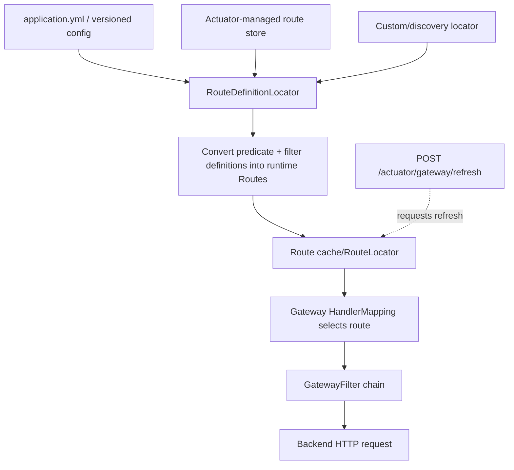
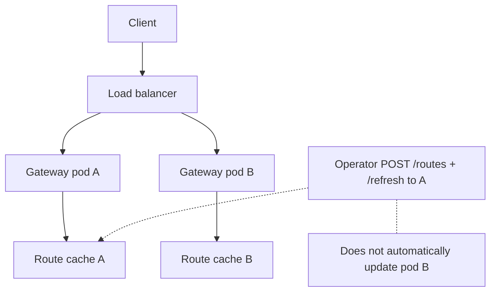

# Testing Route Refresh, Route Order, and Configuration Rollback

## 1. Why Can a Created Route Still Fail to Handle Requests Properly?

In a microservices architecture, **Spring Cloud Gateway** serves as the entry point to select routes via route predicates, run filter chains, rewrite paths/headers, discover services, enforce authentication, rate limiting, circuit breakers, retries, and observe requests. A seemingly simple route change—such as shifting traffic from an old catalog to a new catalog—can fail on all three dimensions:

1. **Refresh:** the route definition was saved, yet the **active runtime route cache** was not refreshed or refresh failed.
2. **Order:** two routes match the same `Path`/`Method`, yet the route taking precedence is not the intended one.
3. **Rollback:** when a change introduces faults, you must revert to the verified route **without losing the prior configuration source**.

For example, consider two routes both accepting `GET /api/catalog/items/42`:

```text
Route catalog-baseline       order=100 → backend BLUE  :8081
Route catalog-candidate-v2   order=10  → backend GREEN :8082

Client GET /api/catalog/items/42
   → when both routes are active: GREEN wins (order 10)
   → after rollback deletes candidate and refreshes: returns to BLUE
```

If an operator only checks HTTP 200 from `POST /actuator/gateway/refresh` and declares deployment successful, they may overlook asynchronous errors, wrong route selection, unavailable backends, or out-of-sync Gateway instances.

### Lesson Objectives

After completing this lesson in the **Testing** chapter, you will be able to:

- Distinguish **saved route definitions**, **refreshed runtime route caches**, and **requests actually routed and served**.
- Design tests proving that **lower order values take precedence** when multiple routes match simultaneously.
- Create a candidate route via Actuator, refresh, verify outcomes, and **roll back** to the baseline route.
- Recognize that **route order** differs from **filter chain order**; never rely on JSON array ordering to determine priority.
- Test errors involving **duplicate route IDs**, invalid predicates/filters, insufficient management endpoint permissions, unreachable backends, and metadata-scoped refreshes.
- Combine `curl`, `WebTestClient`/JUnit, Actuator GET endpoints, backend echoes, and logs/metrics for reliable verification.
- Design versioned configuration rollback workflows consistent across multi-instance Gateway deployments.

> **Technical scope:** Spring Cloud Gateway **Server WebFlux 5.0.x**, namespace `spring.cloud.gateway.server.webflux`, Spring Boot 4.x, and a compatible Spring Cloud BOM. The lesson uses the Actuator management API in an **isolated internal lab**; never perform live route-mutation steps against a production Gateway. Example responses represent **expected outcomes for you to verify yourself**, not captured output executed while authoring this guide.

## 2. Understanding Three Layers Before Writing Tests

### 2.1. RouteDefinition: The Source of Configuration

A route definition typically includes:

```yaml
id: catalog-baseline
uri: http://127.0.0.1:8081
predicates:
  - Path=/api/catalog/**
  - Method=GET
filters:
  - StripPrefix=2
order: 100
```

Route sources may include:

- `application.yml` in Git/IaC, loaded at startup by `PropertiesRouteDefinitionLocator`.
- Routes created via `POST /actuator/gateway/routes/{id}` in the Gateway Actuator-managed store.
- Custom `RouteDefinitionLocator`/repositories or service discovery sources.
- `RouteLocator` Java beans; not every runtime route has a definition editable through Actuator.

**Do not conflate these sources.** A route existing at runtime does not mean Actuator can delete it or that it will survive a restart.

### 2.2. Runtime Routes and Caching



This diagram illustrates the **conceptual flow**. Gateway WebFlux uses `RouteDefinitionRouteLocator` and `CachingRouteLocator`; exact hooks/sources depend on your app. After POSTing a new definition, you must trigger a **route cache refresh** so the runtime picks up the updated set.

### 2.3. Three Kinds of Test Evidence

| Evidence | Measurement | What it proves | What it does NOT yet prove |
|---|---|---|---|
| Saved definition | `GET /actuator/gateway/routedefinitions` or source of truth | Config exists in the locator/store | Runtime route built and chosen |
| Loaded runtime route | `GET /actuator/gateway/routes/{id}` or `/routes` | Route exists with `route_id`, predicates, filters, URI, `order` | Backend is healthy; real requests pick this route |
| Correct live traffic | `GET /api/catalog/items/42` + backend identity | Real request proxied to the intended backend | All pods updated; every failure path works |

**A sound test suite covers all three layers**, especially after risky changes. Avoid checking only HTTP 200 from the management API.

### 2.4. Refresh Does Not Reload Everything

`POST /actuator/gateway/refresh` asks the Gateway to clear/refresh its route cache and typically returns **200 with an empty body**. It does **not**:

- Rewrite `application.yml` in Git or alter files packaged inside a JAR.
- Deploy new Java classes for custom `GatewayFilterFactory` implementations.
- Fix broken upstream hosts/DNS, TLS trust, or policy bugs inside a route.
- Automatically replicate changes from one Gateway pod to all other pods.
- Guarantee that in-flight requests abort or mid-stream switch to the new route.

Gateway documentation notes that if an asynchronous refresh error occurs, **the existing active route set remains unchanged** within the documented refresh mechanism. Still, that **never replaces rollback testing**: a definition that is **syntactically valid yet semantically wrong** will still become an active runtime route.

## 3. Route Order Differs from Filter Order, and Why Tests Need Real Traffic

### 3.1. Route Ordering Rules

When multiple routes match a request's predicates, the Gateway uses **route order** to decide which route is evaluated first: **lower numeric values take precedence** (e.g., `order: 10` beats `order: 100`).

```yaml
routes:
  - id: catalog-candidate-v2
    uri: http://127.0.0.1:8082
    predicates:
      - Path=/api/catalog/**
      - Method=GET
    order: 10

  - id: catalog-baseline
    uri: http://127.0.0.1:8081
    predicates:
      - Path=/api/catalog/**
      - Method=GET
    order: 100
```

**This snippet only illustrates two routes.** In the main lab, the baseline route lives in YAML while the candidate is created via Actuator; **do not define the candidate a second time in YAML**.

### 3.2. All Predicates of a Route Must Match Together

`Path=/api/catalog/**` and `Method=GET` on the same route are **ANDed**. A candidate with `order: -100` but `Method=POST` will **not beat** a GET request merely because its order is lower. Tests must therefore separate:

- **Identical match conditions:** verify route order decides the winner.
- **Different match conditions:** verify non-matching routes are ineligible regardless of order.
- **No matching route:** verify fallback or 404 behavior per contract.

### 3.3. Filter Order Is a Separate Mechanism

| Order type | Governs only | Example |
|---|---|---|
| `RouteDefinition.order` | Which **route is chosen** when multiple routes match | `order: 10` vs. `order: 100` |
| `Ordered GatewayFilter`/`GlobalFilter` | **Pre/post** filter execution order after route selection | Netty routing, header rewrites, metrics |
| Position in YAML `routes` list | Should not be relied upon as explicit priority policy | Declare `order` explicitly |
| Element position in `GET /routes` | Not sole proof of live traffic priority | Verify via backend identity |

If two routes share the **exact same order and predicates**, **never write tests expecting a deterministic winner** simply because one appears earlier in YAML or JSON. Assign distinct `order` values or make predicates non-overlapping.

### 3.4. Writing Effective Assertions

```text
Given:
  baseline route order=100, upstream BLUE
  candidate route order=10, upstream GREEN
  Path and Method both match GET /api/catalog/items/42
When:
  Gateway refresh completes and client sends GET
Then:
  response backend="green", header variant="candidate"
  BLUE receives zero test requests (verified via access counter if needed)
After rollback:
  response backend="blue", header variant="baseline"
```

This tests **end-to-end behavior**, which is far stronger than simply asserting two `order` integers.

## 4. Setting Up a Lab Environment That Proves Which Backend Served the Request

### 4.1. Architecture

```text
                        HTTP client / curl
                              |
                              v
                    Gateway Server WebFlux
                       :8080 (traffic)
                       :9090 (private Actuator)
                              |
             +----------------+----------------+
             |                                 |
   baseline, order=100                 candidate, order=10
             |                                 |
             v                                 v
       Backend BLUE :8081                 Backend GREEN :8082
             |                                 |
          JSON blue                        JSON green
```

We run **one echo backend application as two separate processes** on distinct ports and names so we can observe unmistakably which route served each request. Never test with two backends returning identical JSON, as that provides no proof of which route won.

### 4.2. Spring Boot Web MVC Backend

Create a standalone `catalog-echo-backend` app with Spring Boot 4.x `spring-boot-starter-webmvc` managed by the Boot BOM. `CatalogEchoApplication.java`:

```java
package com.example.echo;

import java.util.Map;
import java.util.concurrent.atomic.AtomicInteger;
import org.springframework.beans.factory.annotation.Value;
import org.springframework.boot.SpringApplication;
import org.springframework.boot.autoconfigure.SpringBootApplication;
import org.springframework.http.ResponseEntity;
import org.springframework.web.bind.annotation.GetMapping;
import org.springframework.web.bind.annotation.PathVariable;
import org.springframework.web.bind.annotation.RequestHeader;
import org.springframework.web.bind.annotation.RestController;

@SpringBootApplication
@RestController
public class CatalogEchoApplication {

    private final AtomicInteger totalCalls = new AtomicInteger();

    @Value("${demo.backend-name}")
    private String backendName;

    public static void main(String[] args) {
        SpringApplication.run(CatalogEchoApplication.class, args);
    }

    @GetMapping("/items/{id}")
    public ResponseEntity<Map<String, Object>> item(
            @PathVariable long id,
            @RequestHeader(name = "X-Gateway-Variant",
                           defaultValue = "none")
            String routeVariant) {

        int callNo = totalCalls.incrementAndGet();
        return ResponseEntity.ok(Map.of(
            "backend", backendName,
            "id", id,
            "variant", routeVariant,
            "backendCall", callNo
        ));
    }

    @GetMapping("/stats")
    public Map<String, Object> stats() {
        return Map.of(
            "backend", backendName,
            "totalCalls", totalCalls.get()
        );
    }
}
```

**Explanation:** The backend handles `/items/{id}`, returns `backend` and `variant`, and increments a counter per handler invocation. `/stats` is a **lab-only** endpoint; never expose internal counters or infrastructure details in production.

Start **two separate processes** with command-line properties; shared `application.yml` needs nothing beyond defaults:

```bash
# Terminal A: BLUE
java -jar target/catalog-echo-backend.jar \
  --server.port=8081 --demo.backend-name=blue

# Terminal B: GREEN
java -jar target/catalog-echo-backend.jar \
  --server.port=8082 --demo.backend-name=green
```

Verify both directly:

```bash
curl --noproxy '*' -sS 'http://127.0.0.1:8081/items/42'
curl --noproxy '*' -sS 'http://127.0.0.1:8082/items/42'
```

Expect `backend=blue` on port 8081 and `backend=green` on port 8082. **Start both backends before testing route order**; if GREEN is down, a 5xx error on the candidate route is not proof that the Gateway selected BLUE.

### 4.3. Gateway Dependencies

The `gateway-testing-demo` app runs WebFlux using compatible Spring Boot/Cloud BOMs. Core dependencies:

```xml
<dependencies>
  <dependency>
    <groupId>org.springframework.cloud</groupId>
    <artifactId>spring-cloud-starter-gateway-server-webflux</artifactId>
  </dependency>
  <dependency>
    <groupId>org.springframework.boot</groupId>
    <artifactId>spring-boot-starter-actuator</artifactId>
  </dependency>
</dependencies>
```

**Do not** mix Spring Web MVC starters into this Gateway WebFlux demo; Gateway Server Web MVC is a separate variant with different runtime and filter APIs.

### 4.4. Baseline Route in application.yml

**Gateway** `application.yml`, initially containing **only the baseline**:

```yaml
server:
  port: 8080

spring:
  application:
    name: gateway-testing-demo
  cloud:
    gateway:
      server:
        webflux:
          routes:
            - id: catalog-baseline
              uri: http://127.0.0.1:8081
              predicates:
                - Path=/api/catalog/**
                - Method=GET
              filters:
                - StripPrefix=2
                - AddRequestHeader=X-Gateway-Variant,baseline
              order: 100

management:
  server:
    port: 9090
    address: 127.0.0.1
  endpoint:
    gateway:
      access: unrestricted
  endpoints:
    web:
      exposure:
        include: health,info,gateway
```

`StripPrefix=2` removes `api` and `catalog` so the backend receives `/items/42`. The baseline route has a stable ID `catalog-baseline`, lives in **versioned YAML source**, and acts as the rollback anchor.

**Warning:** `access: unrestricted` is strictly for **isolated localhost labs**. In production, prefer `management.endpoint.gateway.access: read-only`, restrict management networks, enforce Spring Security/RBAC, mTLS or VPNs, and audit changes. Because Actuator can define routes targeting internal hosts, leaving it exposed creates SSRF and traffic-hijacking risks.

### 4.5. Two Ports with Distinct Responsibilities

| Port | Request category | Example |
|---|---|---|
| `8080` | Business traffic | `GET /api/catalog/items/42` |
| `9090` | Private Actuator management | `GET /actuator/gateway/routes` and `POST /actuator/gateway/refresh` |
| `8081` | Backend BLUE | `GET /items/42` |
| `8082` | Backend GREEN | `GET /items/42` |

If backends and the Gateway run in **separate Docker/Kubernetes containers**, `127.0.0.1` will not reach another container. Replace route `uri` values with DNS/service addresses reachable **from the Gateway**, and isolate the management interface separately.

## 5. Preflight: Inspecting State Before Making Changes

### 5.1. Confirm Baseline Routes to BLUE

```bash
curl --noproxy '*' -i \
  'http://127.0.0.1:8080/api/catalog/items/42'
```

**Expected** body:

```json
{
  "backend": "blue",
  "id": 42,
  "variant": "baseline",
  "backendCall": 1
}
```

`backendCall` is **non-fixed**, depending on earlier test requests. Key assertions are `backend=blue`, `variant=baseline`, and status 200—**not** expecting `backendCall == 1` on every run.

### 5.2. Read Active Runtime Routes

```bash
curl --noproxy '*' -sS \
  'http://127.0.0.1:9090/actuator/gateway/routes'
```

In Gateway 5.0.x, the verbose runtime representation looks similar to:

```json
[
  {
    "route_id": "catalog-baseline",
    "predicate": "(Paths: [/api/catalog/**], match trailing slash: true && Methods: [GET])",
    "filters": [
      "[[StripPrefix parts = 2], order = 1]",
      "[[AddRequestHeader X-Gateway-Variant = 'baseline'], order = 2]"
    ],
    "uri": "http://127.0.0.1:8081",
    "order": 100
  }
]
```

This illustrates the **runtime display shape**, not a guaranteed byte-exact snapshot of predicate/filter string formatting across every patch release. `route_id`, `predicate` strings, and descriptive `filters` strings **are not a JSON POST payload**. Inspect stable fields—ID, URI, route order, and predicate/filter intent—then verify with **live traffic**.

### 5.3. Confirm Candidate ID Does Not Already Exist

```bash
curl --noproxy '*' -i \
  'http://127.0.0.1:9090/actuator/gateway/routes/catalog-candidate-v2'
```

In a clean lab, `GET` for a nonexistent candidate ID returns 404. **Never POST using `catalog-baseline`**, which already belongs to YAML. Some setups aggregate routes from multiple locators: preflight must inspect both runtime state and the deployment's source of truth before picking an ID.

### 5.4. Record Baseline State in Your Test Log

Before mutating routes, capture at least:

```text
revision/config version:     baseline-git-commit-or-image-digest
gateway instance:            gateway-testing-demo :8080
expected route IDs:          catalog-baseline
expected order:              100
expected upstream:           blue :8081
expected path/method:        GET /api/catalog/**
expected response:           HTTP 200, backend=blue, variant=baseline
candidate route ID:          catalog-candidate-v2
rollback action:             DELETE candidate + POST refresh
```

Never log raw access tokens or cookies. In production, also record owner, change ticket, approver, rollout group, and a recoverable versioned route definition snapshot.

## 6. Creating a Properly Formatted Candidate Route and Testing Refresh

### 6.1. POST Expects RouteDefinition, Not GET Runtime Output

Gateway 5.0.x docs specify `POST /actuator/gateway/routes/{id}` expecting **shortcut DSL strings** inside `predicates` and `filters`. The `route_id` field and `predicate` string returned by `GET /routes/{id}` are **runtime display representations**, not the schema accepted by POST.

Create **catalog-candidate-v2.json** in your lab workspace (outside lesson files):

```json
{
  "predicates": [
    "Path=/api/catalog/**",
    "Method=GET"
  ],
  "filters": [
    "StripPrefix=2",
    "AddRequestHeader=X-Gateway-Variant,candidate"
  ],
  "uri": "http://127.0.0.1:8082",
  "order": 10,
  "metadata": {
    "group": "catalog-lab",
    "release": "v2"
  }
}
```

**Explanation:**

- Route ID `catalog-candidate-v2` goes in the create **endpoint URL**.
- Both predicates **match the same** GET `/api/catalog/**` requests as baseline.
- `order: 10` takes precedence over baseline's `order: 100`.
- URI points to **GREEN**, returning `backend=green` for verification.
- `StripPrefix=2` produces `/items/42` upstream, matching baseline.
- Header `X-Gateway-Variant` lets the backend echo which route handled the request.
- Metadata `group` illustrates selective refresh and tagging; it does not provide security or canary routing by itself.

Send the route creation request:

```bash
curl --noproxy '*' -i -X POST \
  'http://127.0.0.1:9090/actuator/gateway/routes/catalog-candidate-v2' \
  -H 'Content-Type: application/json' \
  --data-binary @catalog-candidate-v2.json
```

According to Gateway Actuator docs, successful creation returns **`201 Created`**. **Do not assume traffic has switched yet** based solely on this status: you still need refresh and live verification.

### 6.2. POST Cache Refresh

```bash
curl --noproxy '*' -i -X POST \
  'http://127.0.0.1:9090/actuator/gateway/refresh'
```

Success is documented as **`200 OK`, typically with no response body**. Route cache refresh runs asynchronously; if route building fails, docs state the existing cache remains unaltered. Consequently, reliable tests **re-read runtime state and send live traffic**, rather than checking HTTP 200 alone.

### 6.3. Inspect the Runtime Route After Refresh

```bash
curl --noproxy '*' -sS \
  'http://127.0.0.1:9090/actuator/gateway/routes/catalog-candidate-v2'
```

**Illustrative** runtime output:

```json
{
  "route_id": "catalog-candidate-v2",
  "predicate": "(Paths: [/api/catalog/**], match trailing slash: true && Methods: [GET])",
  "filters": [
    "[[StripPrefix parts = 2], order = 1]",
    "[[AddRequestHeader X-Gateway-Variant = 'candidate'], order = 2]"
  ],
  "uri": "http://127.0.0.1:8082",
  "order": 10
}
```

**Do not compare the POST payload byte-for-byte against the GET JSON.** Both APIs have **distinct schemas**: `GET` exposes `route_id`, a descriptive `predicate` string, and runtime `filters` strings, whereas POST takes shortcut DSL strings in `predicates`/`filters`.

Verify **semantic equivalence**: route ID, URI, route order, Path/Method, filters, and metadata if exposed. `toString()` formatting and filter string layout may vary by version.

### 6.4. Behavioral Test: Candidate GREEN Beats Baseline BLUE

```bash
curl --noproxy '*' -i \
  'http://127.0.0.1:8080/api/catalog/items/42'
```

**Expected** body:

```json
{
  "backend": "green",
  "id": 42,
  "variant": "candidate",
  "backendCall": 1
}
```

`backendCall` may differ from 1 depending on prior requests. Key assertions:

```text
response.status == 200
response.json.backend == "green"
response.json.variant == "candidate"
```

If you see `backend=blue`, the candidate route may **not have refreshed yet**, failed to match, been created on **a different Gateway instance**, or lost to a higher-priority route. If you see 5xx, check whether GREEN `:8082` is running and reachable from the Gateway. **Never conclude route order failed simply because a backend isn't running.**

### 6.5. Verify Backend Request Counts via Counters

Before sending a request through the Gateway, record counters:

```bash
curl --noproxy '*' -sS 'http://127.0.0.1:8081/stats'
curl --noproxy '*' -sS 'http://127.0.0.1:8082/stats'
```

Send **one** request through the Gateway, then re-read `/stats`. In an isolated lab with no background traffic, expect:

| Backend | Before request | After request | Delta |
|---|---:|---:|---:|
| BLUE | B | B | 0 |
| GREEN | G | G+1 | +1 |

Do not assert absolute counter totals when counters already hold prior calls. If retries, circuit breakers, or concurrent users hit the backend, deltas may differ; **isolate the test** or pass a safe test-request ID to count accurately.

### 6.6. Management API Success Does Not Guarantee Healthy Traffic

Even when `GET /routes/catalog-candidate-v2` shows the new route, live traffic can fail if:

- Backend GREEN is down or DNS/TLS/certificates fail.
- `StripPrefix`/`RewritePath` produces a nonexistent backend path.
- CORS, Spring Security, or RateLimiter rejects the request upstream.
- Another route with lower `order` matches instead.
- The client sends `POST` when the candidate requires `Method=GET`.

**Full three-layer testing** checks: definition stored → runtime route active → backend **actually** receives the intended request.

## 7. Testing Route Order with Two Controlled Scenarios

### 7.1. Scenario O1: Candidate order=10, Baseline order=100

Both routes match the same GET path. After refresh:

```text
Given  both routes exist and match
And    candidate.order=10
And    baseline.order=100
When   GET /api/catalog/items/42
Then   selected backend=green
And    variant=candidate
```

If this fails, inspect predicates, runtime order, route IDs, and backend connectivity. **Never inspect `/routes` JSON array positions alone to infer execution priority.**

### 7.2. Scenario O2: Candidate order=200, Baseline order=100

To change the order of an **Actuator-managed** route in the lab, never overwrite by POSTing the same ID directly. Gateway 5.0.x docs warn that POSTing a duplicate ID can create **duplicate route definitions** and cause subsequent route list GET requests to fail with **500**.

Perform **DELETE followed by CREATE**, solely on the candidate:

```bash
# 1. Delete the Actuator-managed route.
curl --noproxy '*' -i -X DELETE \
  'http://127.0.0.1:9090/actuator/gateway/routes/catalog-candidate-v2'

# 2. POST a NEW candidate definition with order = 200
#    (keep everything else identical; only order changes from 10 to 200).
curl --noproxy '*' -i -X POST \
  'http://127.0.0.1:9090/actuator/gateway/routes/catalog-candidate-v2' \
  -H 'Content-Type: application/json' \
  --data-binary @catalog-candidate-order200.json

# 3. Refresh.
curl --noproxy '*' -i -X POST \
  'http://127.0.0.1:9090/actuator/gateway/refresh'
```

**catalog-candidate-order200.json** matches Section 6.1 except `order`:

```json
{
  "predicates": ["Path=/api/catalog/**", "Method=GET"],
  "filters": [
    "StripPrefix=2",
    "AddRequestHeader=X-Gateway-Variant,candidate"
  ],
  "uri": "http://127.0.0.1:8082",
  "order": 200,
  "metadata": {"group": "catalog-lab", "release": "v2"}
}
```

Inspect runtime `/routes/catalog-candidate-v2` to confirm `order=200`, then test:

```bash
curl --noproxy '*' -sS \
  'http://127.0.0.1:8080/api/catalog/items/42'
```

Expect **`backend=blue`, `variant=baseline`**, because baseline `order=100` outranks candidate `order=200`. **Seeing the candidate in `GET /routes` does not mean traffic goes to it.**

### 7.3. Scenario O3: Non-Matching Predicates Render Order Irrelevant

In an isolated lab test, adjust a candidate so it matches only `Method=POST` while baseline matches GET. On GET requests, the candidate—even with `order=-100`—is **not selected**. This cleanly separates two rules:

1. Predicate **match** (mandatory gate).
2. Route `order` picks the winner among **matching** routes.

For Scenario O3, never mutate routes relied on by others; use a separate `/lab/order/**` path or test Gateway instance. When POST reaches a backend without a POST handler, the backend may return 405; the goal here is verifying **route selection**, not forcing HTTP 200.

### 7.4. Scenario O4: What If Two Routes Have Equal Order?

If two overlapping routes both have `order=100`, **never rely on YAML order, route ID names, or GET list order as a tie-breaker contract**. Locator sorting or internal ordering behavior can change across configs or releases.

Instead:

- Assign distinct `order` values to overlapping routes; or
- Disambiguate predicates via explicit `Host`/`Header`/`Method`/`Path` rules.

For percentage-based canary rollouts, use the **Weight Route Predicate** and test statistical distribution separately—**never** assign equal `order` expecting "random" percentage splits.

### 7.5. Testing Route Order Is Not Testing Filter Order

Suppose runtime GET returns:

```text
route_id: catalog-candidate-v2
order: 10
filters:
  - [[StripPrefix parts = 2], order = 1]
  - [[AddRequestHeader ...], order = 2]
```

`order: 10` sets **route selection** priority. `order = 1/2` inside `filters` governs execution order of **GatewayFilters within the already-selected route**. Those numbers say nothing about whether GREEN or BLUE wins.

## 8. Rolling Back Configuration After Testing a Candidate

### 8.1. Minimal Rollback: Delete Candidate, Keep Baseline Intact

In our lab, `catalog-baseline` comes from `application.yml`, while `catalog-candidate-v2` was created **via Actuator**. To revert to baseline, **do not delete baseline**—delete only the candidate:

```bash
curl --noproxy '*' -i -X DELETE \
  'http://127.0.0.1:9090/actuator/gateway/routes/catalog-candidate-v2'

curl --noproxy '*' -i -X POST \
  'http://127.0.0.1:9090/actuator/gateway/refresh'
```

Gateway 5.0.x docs indicate deleting an Actuator-managed route returns **200** and successful refresh returns **200 with no body**. Those statuses confirm **the command ran**, not yet that runtime traffic has recovered.

### 8.2. Post-Rollback Assertions

**Step A — Inspect runtime state:**

```bash
# Baseline must still be present.
curl --noproxy '*' -i \
  'http://127.0.0.1:9090/actuator/gateway/routes/catalog-baseline'

# Candidate must be absent from runtime.
curl --noproxy '*' -i \
  'http://127.0.0.1:9090/actuator/gateway/routes/catalog-candidate-v2'
```

**Step B — Send business traffic:**

```bash
curl --noproxy '*' -i \
  'http://127.0.0.1:8080/api/catalog/items/42'
```

**Expected outcome:** HTTP 200, `backend=blue`, and `variant=baseline`. If the candidate is gone from `/routes` yet requests still reach GREEN, check **which actual Gateway pod/port you hit**, stale caches, overlapping routes, or load balancer/ingress targets.

**Step C — Check negative paths:**

```bash
curl --noproxy '*' -i \
  'http://127.0.0.1:8080/api/unknown/items/42'
```

Ensure no overly broad `Path=/**` route was left behind after rollback. With no matching route, the Gateway normally returns 404.

### 8.3. Why Deleting the Candidate Is Safer Than "Re-POSTing Baseline"

In this lab setup:

- Baseline is owned by **YAML/Git**.
- Actuator does not manage deleting or modifying YAML baseline routes as dynamic store entries.
- POSTing another route named `catalog-baseline` risks creating **duplicate IDs**, causing errors and obscuring route provenance.
- Once the candidate is deleted, the intact baseline naturally takes over again.

Always roll back via the **owning source**: revert Git/IaC revisions for Git/IaC routes; delete/recreate via the Actuator store (using versioned checkpoints) for Actuator routes, then refresh and verify. Never lump all routes into one blind "global reset POST" ignoring provenance.

### 8.4. When the Baseline Itself Changed in Git

When rolling back changes **declared in YAML**, you must:

1. Identify the **verified commit or image/config release** containing the prior baseline.
2. Revert/redeploy or reload via the managed config mechanism supported by your application.
3. **Never assume** `POST /refresh` re-reads a YAML file inside a packaged JAR without an active property/route-definition reload mechanism.
4. Re-read `GET /routes` and verify live traffic on each Gateway instance.
5. Confirm unrelated routes remain untouched.

`POST /refresh` **does not replace deployment** when updated configuration has not been loaded by the app, nor does it revert broken Java code or custom filters.

### 8.5. Expected State Table Across the Full Lifecycle

| Stage | Baseline (order=100) | Candidate | Traffic `GET /api/catalog/items/42` |
|---|---|---|---|
| S0: clean startup | Present | Absent | BLUE |
| S1: POST candidate=10, **before refresh** | Present | Definition saved | Do not assume; test explicitly |
| S2: refresh + verify | Present | Present, order=10 | GREEN |
| S3: DELETE + POST candidate=200 + refresh | Present | Present, order=200 | BLUE |
| S4: DELETE candidate + refresh | Present | Absent | BLUE |
| S5: Gateway restart loading YAML baseline | Present | Depends on store type | BLUE if no valid candidate persists |

**Note on S5:** Actuator-managed routes may live in an **in-memory store** (wiped on restart) or a persistent repository depending on deployment. Never generalize one lab restart behavior across all environments.

## 9. Testing Refresh Failures: Invalid Syntax vs. Broken Behavior

### 9.1. Failure A: Definition Fails to Compile into a Runtime Route

Consider a route referencing a nonexistent filter factory:

```json
{
  "predicates": ["Path=/lab/invalid/**"],
  "filters": ["NonexistentFilterXYZ=1"],
  "uri": "http://127.0.0.1:8082",
  "order": -100
}
```

This is an **intentionally broken payload** illustrating compilation failure. When the engine translates definitions into `GatewayFilter` instances, the missing factory causes refresh to fail. Actuator docs state that if an **asynchronous error occurs during refresh**, existing runtime routes remain unchanged.

**Never inject broken definitions into a Gateway serving live traffic.** The malformed definition may stay in the repository and break future refreshes too. In an isolated lab:

1. Capture a **snapshot** of baseline routes before testing.
2. POST only a fresh candidate ID scoped to `/lab/invalid/**`.
3. Trigger refresh and inspect logs/Actuator.
4. Confirm existing baseline routes **still exist and serve traffic normally**.
5. **DELETE the broken definition** from the Actuator-managed repository.
6. Refresh again and verify route list and traffic are clean.

Avoid asserting one rigid HTTP status for *every* route-compile failure: errors may surface at POST time, refresh time, or route retrieval depending on implementation/version. Key assertions are **baseline routes remain unaffected**, cleanup finishes, and logs explain the root cause.

### 9.2. Failure B: Valid Route Pointing to an Unavailable Upstream

Consider a **syntactically valid** payload with an unreachable URI:

```json
{
  "predicates": ["Path=/lab/offline/**", "Method=GET"],
  "filters": ["StripPrefix=2"],
  "uri": "http://127.0.0.1:59999",
  "order": 1
}
```

Even with nothing listening on `59999`, the Gateway can **build a valid runtime route**. `GET /routes/{id}` succeeds; only when HTTP requests hit that path do you observe **connection refused / timeout / 5xx**.

This proves a fundamental rule:

> **A successful refresh only proves the route compiled and loaded; it does not prove the backend is healthy or business behavior is right.**

To protect the baseline during negative testing, use a **dedicated path** `/lab/offline/**` that never overlaps `/api/catalog/**`, then DELETE and refresh afterward. Never create a `Path=/**` `order=-100` route to test offline backends, or it will hijack all real traffic.

### 9.3. Failure C: Valid Syntax, Wrong Business Contract

A candidate can still return HTTP 200 from the intended backend while violating path or header semantics:

- `StripPrefix=1` sends `/catalog/items/42` instead of `/items/42`.
- Misconfigured `SetRequestHeader` strips tenant or authorization context.
- `Retry` on POST duplicates a write mutation.
- Misconfigured `RequestRateLimiter` key resolvers throttle the wrong users.
- `CircuitBreaker` returning fallback 200 masks backend outages if clients cannot tell responses apart.

Post-refresh tests must therefore verify **path, method, headers, status, response body, selected backend, and side-effect counts**, not merely whether the route exists.

### 9.4. Failure D: POSTing an Existing Route ID

Gateway 5.0.x docs warn: **never POST to an existing route ID** without deleting first. Creating duplicates can cause `GET /actuator/gateway/routes` to return 500. Before any change, always:

1. Verify the ID does not exist in **runtime** or any relevant source/repository.
2. When updating an Actuator-managed route, save the prior version, then execute **DELETE → POST → refresh**.
3. For YAML/Java routes, edit the source of truth and deploy/reload through proper pipelines rather than "overwriting" via POST.
4. When multiple writers exist, enforce locks, versions, or compare-and-set in the management layer; **GET-then-POST is not race-safe**.

### 9.5. Failure E: Same ID Emitted by Two Locators

A route like `catalog-baseline` could be emitted simultaneously by a properties locator and a custom repository if duplicate checks are missing, creating inconsistent runtime routes and confusing diagnostics. In tests, **assert each route ID has one unique owner/source**, not just that `GET` by ID succeeded.

### 9.6. Tracking Endpoint Codes During Fault Tests

| API | Documented success | On error, inspect |
|---|---|---|
| `POST /routes/{id}` | **201 Created** | Syntax/binding/factory/ID conflicts, exception handler |
| `POST /refresh` | **200 OK**, empty body | Async errors, runtime cache, live traffic |
| `GET /routes/{id}` | Runtime route JSON | ID/URI/order/filters; do not reuse as POST body |
| `DELETE /routes/{id}` | **200 OK** if actuator-managed | 404 on YAML/Java routes, wrong instance/store |
| `GET /routedefinitions` | List of definitions | Locator source may differ from runtime routes |

Never assume every malformed JSON request returns `400` or every refresh failure returns HTTP 500. Observe actual responses, logs, and behavior on your target version.

## 10. Metadata-Scoped Selective Refresh: Testing Blast Radius

### 10.1. Global Refresh vs. Metadata-Filtered Refresh

Gateway WebFlux Actuator 5.0.x supports both:

```http
POST /actuator/gateway/refresh
```

and filtering by a metadata key/value pair:

```http
POST /actuator/gateway/refresh?metadata=group:catalog-lab
```

In our lab, the candidate declares metadata:

```json
{
  "metadata": {
    "group": "catalog-lab",
    "release": "v2"
  }
}
```

So you can test:

```bash
curl --noproxy '*' -i -X POST \
  'http://127.0.0.1:9090/actuator/gateway/refresh?metadata=group:catalog-lab'
```

**Important:** a metadata-filtered refresh **does not** refresh all routes. Routes lacking `group=catalog-lab` are excluded from that selective refresh scope. When a test requires a **consistent snapshot across all routes**, run a global refresh and verify every route ID.

### 10.2. Metadata Test Matrix

| Route | Metadata | When refreshing `group:catalog-lab` |
|---|---|---|
| `catalog-candidate-v2` | `group=catalog-lab` | Within refresh scope |
| `catalog-baseline` | No `group` in lab YAML | Excluded by this metadata filter |
| `billing-demo` (another route) | `group=billing` | Excluded |

**Never run selective refreshes in a multi-tenant runtime without clear metadata ownership.** If a route has the wrong `group`, refresh skips what operators assumed changed. Gateway docs describe metadata matching rules and note async errors; verify both runtime routes and live traffic after refreshing.

### 10.3. When Should You Use Selective Refresh?

It helps when one Gateway hosts distinct route groups and teams want to limit update scope. However, it:

- Does not replace definition repository versioning.
- Does not make changes atomic across multiple instances.
- Does not lock between concurrent writers.
- Does not shield other routes from shared dependencies or `GlobalFilter` changes deployed together.
- Does not validate metadata tags automatically.

In an initial lab, **global refresh** is simpler, easier to verify, and relies on fewer assumptions.

## 11. Testing Multiple Gateway Instances: One Healthy Pod Does Not Mean Cluster Convergence

### 11.1. In-Memory Stores and Caches Create Consistency Gaps



If route definitions live in **A's in-memory repository**, POST and refresh on A do not replicate definitions or caches to B. Afterward:

```text
Request #1 → Gateway A → GREEN
Request #2 → Gateway B → BLUE
Request #3 → Gateway A → GREEN
```

Clients see apparently "random" backend choices, yet the cause is **diverged route state across pods**, not nondeterministic route ordering.

### 11.2. Proving State Per Instance

In staging, hit **each pod's dedicated management endpoint** (e.g., per-pod port-forward or private management port), then verify:

1. `GET /actuator/gateway/routes` on both **A** and **B**.
2. Compare `route_id`, `uri`, `order`, predicate/filter intent, and route metadata.
3. Send test traffic directly to each pod via authorized test paths, not solely through the load balancer.
4. Check backend identity `blue/green` and upstream counters.
5. Only after all pods converge, run multi-request verification through the load balancer.

**Never mutate routes directly on production pods without approval.** In multi-pod environments, hitting a load-balanced `management` service can land on different pods across calls (POST hitting A, refresh hitting B)—a dangerous failure mode.

### 11.3. Use Shared Route Sources for Dynamic Cluster Config

Cluster-wide dynamic route rollouts require:

- A **shared/persistent `RouteDefinition` source** or config distribution system with clear ownership.
- **Notification/refresh propagation** to every Gateway instance.
- **Config revisions/versions** so you can verify which revision A and B loaded.
- Pre-activation validation, optional canary pods, and phased rollouts.
- Cluster-wide rollback/reload procedures checking route counts and live behavior.

Even when all pods share **the same repository**, refreshes do not flip every pod **simultaneously down to the millisecond**. During the rollout window, in-flight requests may observe the older snapshot while new requests see the updated one. Design for transitional states and idempotency.

### 11.4. Do Not Test Route Order Through a Load Balancer When Pods Diverge

If an LB splits traffic across A and B, repeated `curl` calls may flip unpredictably between BLUE and GREEN even though **each pod's route order** is completely deterministic. Always **pin route-priority tests to one verified Gateway instance** first, then test cluster-wide convergence separately.

## 12. Testing Asynchrony: Avoid Arbitrary Sleeps and Stale Observations

### 12.1. Refresh HTTP 200 Is Not an End-to-End Barrier

`POST /refresh` returning 200 satisfies the API contract, yet traffic routing depends on:

- Reading route definitions from locators/repositories.
- Compiling predicates and filters.
- Refreshing the route cache on the target instance.
- Middleware/proxies and incoming requests hitting the Gateway.
- Upstream connectivity, DNS, TLS, and backend health.

Therefore test patterns like:

```java
// ANTI-PATTERN: fixed sleep hoping the route converged.
postRefresh();
Thread.sleep(200);
assertBackendIsGreen();
```

may pass locally and fail in CI, or falsely pass if targeting the wrong pod. **Replace fixed sleeps with bounded polling, explicit predicates, and clear failure diagnostics.**

### 12.2. Two Convergence Steps

Once a candidate is POSTed cleanly:

1. **Await runtime state:** `GET /actuator/gateway/routes/catalog-candidate-v2` exposes URI 8082 and order 10.
2. **Await traffic behavior:** a lab GET returns `backend=green` and `variant=candidate`.

Never let Step 1 substitute for Step 2. Likewise, after rollback, await the candidate's **disappearance** from runtime, then verify real requests return BLUE.

### 12.3. Bounded Shell Polling in the Lab

With `jq` installed, poll runtime convergence:

```bash
# At most 20 attempts spaced 0.25s apart; lab use only.
matched=0
for i in $(seq 1 20); do
  if curl --noproxy '*' -fsS \
      'http://127.0.0.1:9090/actuator/gateway/routes/catalog-candidate-v2' \
      | jq -e '.route_id == "catalog-candidate-v2"
               and .uri == "http://127.0.0.1:8082"
               and .order == 10' > /dev/null; then
    matched=1
    break
  fi
  sleep 0.25
done

if [ "$matched" -ne 1 ]; then
  echo "FAILED: candidate route did not converge" >&2
  exit 1
fi
```

This is a **command for Unix labs with `curl` and `jq`**, not a script executed during lesson authoring. It enforces a **bounded** wait with an explicit success check. Base actual timeouts on SLAs/CI limits; never wait indefinitely or swallow refresh errors.

**Important:** poll the right management instance. When traffic goes through an LB to pod B, polling runtime on pod A proves nothing about B.

### 12.4. Verify Backend Identity After Polling

```bash
curl --noproxy '*' -fsS \
  'http://127.0.0.1:8080/api/catalog/items/42' \
  | jq -e '.backend == "green"
           and .variant == "candidate"' \
  > /dev/null
```

On failure, print diagnostic details without leaking raw credentials or PII. Never blindly retry **non-idempotent** requests: this lab uses read-only GETs, whereas payment POST workflows require idempotency keys and strict safety conditions before retrying.

### 12.5. Tests Must Clean Up Even When Assertions Fail

After dynamic route tests, wrap cleanup in `try/finally` (JUnit) or `trap` hooks (shell) to DELETE candidates and refresh, unless keeping state intentionally. If cleanup fails, **never report a green build**—report the environment as "dirty", list leftover route IDs, and require cleanup before subsequent suites run.

## 13. Automating with JUnit 5 + WebTestClient + Awaitility

### 13.1. Pick the Right Test Layer

| Test type | How it runs | Strengths | Limitations |
|---|---|---|---|
| Route predicate unit test | Tests predicates built from mock config | Fast, clear match/non-match coverage | Doesn't prove route cache/Actuator |
| Custom `GatewayFilter` unit test | `StepVerifier` with mock exchange/chain | Checks signals, errors, cancel, filter logic | Doesn't prove Netty routing to backends |
| WebFlux HTTP test | `WebTestClient.bindToApplicationContext` | Tests web handlers within Spring context | May miss external HttpClient/network behavior |
| Full integration test | `WebTestClient.bindToServer` + live Gateway/echo apps | Proves real POST/refresh/HTTP routing | Resource-heavy, requires state isolation |
| Contract/security test | Checks source of truth, route ownership, allowed URIs | Catches config drift/SSRF | Doesn't replace E2E runtime checks |

**This topic needs at least one true integration test** because route refresh, route ordering, and rollback span route repositories/caches, Gateway handler mapping, and real HTTP proxying.

### 13.2. Test Dependencies

In a dedicated integration test project or Gateway test module, add BOM-managed test dependencies:

```xml
<dependencies>
  <dependency>
    <groupId>org.springframework.boot</groupId>
    <artifactId>spring-boot-starter-webflux-test</artifactId>
    <scope>test</scope>
  </dependency>
  <dependency>
    <groupId>org.awaitility</groupId>
    <artifactId>awaitility</artifactId>
    <scope>test</scope>
  </dependency>
</dependencies>
```

These **supplement** the Gateway Server/Actuator dependencies from Section 4 rather than replacing them. Match the test starter to your Spring Boot BOM (Boot 3.x uses different starter names) and ensure JUnit Jupiter is on the test classpath.

### 13.3. A Sequential Test with Rollback in `finally`

This illustrates a **black-box integration test** against running lab processes on `8080/9090/8081/8082`. Place it in a test client/integration project; the test **does not start servers automatically**:

```java
package com.example.gatewaytests;

import java.time.Duration;
import org.junit.jupiter.api.Test;
import org.springframework.http.MediaType;
import org.springframework.test.web.reactive.server.WebTestClient;

import static org.awaitility.Awaitility.await;

class GatewayRouteRefreshIntegrationTest {

    private static final String ROUTE =
        "/actuator/gateway/routes/catalog-candidate-v2";

    private static final String CANDIDATE_JSON = """
        {
          "predicates": ["Path=/api/catalog/**", "Method=GET"],
          "filters": [
            "StripPrefix=2",
            "AddRequestHeader=X-Gateway-Variant,candidate"
          ],
          "uri": "http://127.0.0.1:8082",
          "order": 10
        }
        """;

    private final WebTestClient admin = WebTestClient.bindToServer()
        .baseUrl("http://127.0.0.1:9090")
        .build();

    private final WebTestClient traffic = WebTestClient.bindToServer()
        .baseUrl("http://127.0.0.1:8080")
        .build();

    @Test
    void candidateWinsThenRollbackRestoresBlue() {
        // Precondition: no candidate route; baseline is active.
        admin.get().uri(ROUTE).exchange()
            .expectStatus().isNotFound();
        assertBackend("blue", "baseline");

        boolean created = false;
        try {
            admin.post().uri(ROUTE)
                .contentType(MediaType.APPLICATION_JSON)
                .bodyValue(CANDIDATE_JSON)
                .exchange().expectStatus().isCreated();
            created = true;

            admin.post().uri("/actuator/gateway/refresh")
                .exchange().expectStatus().isOk();

            await()
                .atMost(Duration.ofSeconds(10))
                .pollInterval(Duration.ofMillis(200))
                .untilAsserted(() -> {
                    admin.get().uri(ROUTE).exchange()
                        .expectStatus().isOk()
                        .expectBody()
                        .jsonPath("$.route_id")
                        .isEqualTo("catalog-candidate-v2")
                        .jsonPath("$.order")
                        .isEqualTo(10);

                    assertBackend("green", "candidate");
                });
        } finally {
            if (created) {
                admin.delete().uri(ROUTE).exchange()
                    .expectStatus().isOk();

                admin.post().uri("/actuator/gateway/refresh")
                    .exchange().expectStatus().isOk();

                await()
                    .atMost(Duration.ofSeconds(10))
                    .pollInterval(Duration.ofMillis(200))
                    .untilAsserted(() -> {
                        admin.get().uri(ROUTE).exchange()
                            .expectStatus().isNotFound();
                        assertBackend("blue", "baseline");
                    });
            }
        }
    }

    private void assertBackend(String backend, String variant) {
        traffic.get().uri("/api/catalog/items/42")
            .exchange()
            .expectStatus().isOk()
            .expectBody()
            .jsonPath("$.backend").isEqualTo(backend)
            .jsonPath("$.variant").isEqualTo(variant)
            .jsonPath("$.id").isEqualTo(42);
    }
}
```

**Key takeaways:**

1. The test begins with a **verifiable precondition**: candidate absent, baseline serving BLUE.
2. The route is POSTed **once with a fresh ID**.
3. POST create, POST refresh, GET runtime, and GET live traffic are **each verified independently**.
4. `Awaitility` runs **bounded** polling instead of guessing with `Thread.sleep`.
5. `try/finally` deletes the candidate and refreshes even if GREEN assertions fail.
6. Assertions verify `backend` and `variant`, not just HTTP 200.
7. `WebTestClient` acts as the **external HTTP test client**, never a Gateway filter manually calling `subscribe()` on publishers.

**Limitations of this example:** It assumes live lab processes, loopback management access, and an unused candidate ID. If POST fails after **writing** the definition yet before `created` flips to `true`, automatic cleanup could miss it. In production-like CI, use isolated fixture/teardown hooks from a clean repository, snapshot full state, and add fallback cleanup on partial failures. If `finally` rollback fails, fail the test and flag dirty state—never swallow teardown errors.

### 13.4. Why Not Run These Tests in Parallel Against One Instance?

Two parallel tests both touching `catalog-candidate-v2` risk:

- Races between `GET absent` and `POST`.
- Duplicate ID collisions when both POST simultaneously.
- Test A deleting a route while Test B still relies on it.
- Test B changing `order` while Test A asserts outcomes.
- Cross-talk from one test's cache refreshes.

In CI, give each suite an **isolated Gateway instance/repository**, or distinct versioned paths/IDs. When multiple writers exist, use distributed locks or concurrency controls in the management layer; a `GET` preflight **is not atomic compare-and-set**.

### 13.5. Testing `order=200` in JUnit

Alongside the `order=10` test, a separate integration test can:

1. Create a candidate with a unique ID such as `catalog-lowpriority-test` and `order: 200`.
2. Refresh and verify runtime GET shows `order=200`.
3. Send `GET /api/catalog/items/42` and assert `backend=blue`.
4. Delete the candidate, refresh, and confirm baseline behavior.

**Never** reuse another test's route ID when concurrent execution is possible, and never chain tests via `@TestMethodOrder` without explicit fixture management.

### 13.6. Unit Tests Alone Cannot Prove Real Rollback

A unit test mocking `CachingRouteLocator` validates cache/event wiring, yet cannot prove:

- Actuator permissions and `RouteDefinition` serialization.
- Actual HTTP backend routing.
- Refresh behavior in the exact Gateway/locator version.
- Spring Security filter interactions.
- Multi-instance or ingress/network state.

Use unit tests to isolate small branches, then back them with integration tests proving the **end-to-end contract**.

## 14. Safe Rollout Workflow with Versioned Configuration

### 14.1. Capturing a Recoverable Baseline

Before every production route change, record:

```text
configRevision:      git SHA / config server revision
applicationVersion:  image digest or release tag
routeIds:            list of IDs affected by the change
oldState:            predicates, filters, URI, order, metadata
newState:            reviewed target definition
owner:               team/ticket/approver
rolloutScope:        environment, pod group, window
healthChecks:        backend readiness + route E2E tests
rollbackPlan:        config source, APIs, exact execution order
```

Never rely solely on `GET /actuator/gateway/routes/{id}` to reconstruct **definitions**: GET outputs runtime predicate/filter strings, **not** payloads you can POST verbatim. Maintain your recovery source in **YAML/Git/IaC or a versioned `RouteDefinition` repository** matching your target schema.

### 14.2. Pre-Deployment Validation

**Pre-deploy checks:**

- Confirm unique route IDs and clear ownership.
- Check whether `Path`/`Host`/`Method` predicates overlap other routes.
- Verify intentional route `order` and watch for overly broad `/**` catch-alls at high priority.
- Validate upstream URIs against an **allowlist** blocking metadata and admin ports.
- Verify every `GatewayFilterFactory` and argument matches installed dependencies.
- Confirm security, CORS, TLS, mTLS, retry, and rate-limit behavior did not regress unintentionally.
- Require positive and negative tests per path plus a tested rollback artifact.

**Never treat a single HTTP 200 in staging as sufficient** when a route modifies access control, token relay, or retry semantics.

### 14.3. Canary First, Then Expand

For complex rollouts:

1. Deploy the new configuration onto an **isolated staging/canary group of Gateway instances**.
2. Verify route definitions, runtime caches, HTTP traffic, and business outcomes.
3. Monitor error rates, p95/p99 latencies, backend attempts, rate-limit rejects, and circuit-breaker metrics.
4. Expand traffic/instances gradually within approved bounds.
5. Halt or roll back immediately if safety thresholds breach.

Use the **Weight Route Predicate** for percentage-based traffic splitting—never assign identical predicates and `order` expecting stable 90/10 distribution.

### 14.4. Rollback Is Not Retry

| Concept | Meaning | Do not confuse with |
|---|---|---|
| **Request retry** | Re-sending one failed HTTP call per policy | Route config rollback |
| **Route refresh** | Loading/rebuilding the runtime route cache | Reverting to an older version |
| **Route rollback** | Restoring verified route definitions and runtime state | HTTP retries or fallbacks |
| **Fallback** | Returning a substitute response when upstream fails | Fixing broken topology/URIs |
| **Canary** | Shifting a planned traffic slice to a new version | Uncoordinated routes with tied order |

A circuit-breaker fallback may return a degraded response while upstream fails, yet it neither fixes the route nor completes a rollback.

### 14.5. During a Broken Rollout, Protect Data First

If a route change accidentally points to an untrusted upstream or leaks tokens:

- **Halt rollout/activation** immediately within management boundaries.
- Block impacted ingress/egress paths per security incident procedures.
- Restore the prior route version, refresh target instances, and verify traffic.
- Review redacted traces/logs and side effects; rotate credentials if exposed per incident policy.
- Never publish raw route definitions containing secrets, internal hostnames, or bearer tokens.

An "HTTP 200" rollback is incomplete if requests hit the wrong backend during the fault window; audit downstream data effects too.

## 15. Security When Testing Refresh and Rollback via Actuator

### 15.1. Never Expose Unrestricted Route Management to the Internet

Actuator route management allows creating, deleting, and refreshing routes. If unauthorized actors gain access, they can:

- Redirect APIs to attacker-controlled hosts to steal credentials or sensitive payloads.
- Route traffic to **internal services**, cloud metadata APIs, or admin endpoints (**SSRF**).
- Register `Path=/**` with a tiny `order` to hijack traffic across routes.
- Inject filters mutating `Authorization`, `Host`, `X-Forwarded-*`, or stripping security headers.
- Trigger denial of service via malformed/duplicate IDs or refresh floods.
- Obscure rollback state and audit trails.

**Recommended configuration for observation-only environments:**

```yaml
management:
  endpoint:
    gateway:
      access: read-only
  endpoints:
    web:
      exposure:
        include: health,info,gateway
```

`read-only` allows inspecting Gateway Actuator routes per policy while **blocking POST refresh/create/delete**. Enable `unrestricted` only in isolated labs or private management planes guarded by network ACLs, strong auth/RBAC/mTLS, auditing, and change approvals.

### 15.2. Access-Control Test Suite

| Security test | Input | Expectation |
|---|---|---|
| Read-only user | `GET /actuator/gateway/routes` | Allowed if authorized |
| Read-only user | `POST /actuator/gateway/refresh` | Rejected |
| Read-only user | `POST /actuator/gateway/routes/new` | Rejected; no route created |
| Read-only user | `DELETE /actuator/gateway/routes/id` | Rejected; nothing deleted |
| Unauthenticated user | Any sensitive management endpoint | Blocked by auth policy |
| Authorized admin | Allowlisted routes/URIs only | Succeeds within approved scope |
| Client targets metadata/internal admin host | POST route definition | Blocked by **validation/egress policy** |
| Management exposure on public ingress | External network probe | Zero unapproved public access |

Do not hardcode one HTTP status (401/403/404) across all security stacks: disabled, unexposed, RBAC-denied, or unrouted endpoints surface differently. Tests must prove **zero route state side effects** on unauthorized attempts.

### 15.3. Validate Route Inputs Independently

The Actuator API manages routes—it **does not enforce your organization's change controls**. Before POSTing:

- **Route ID:** valid charset/length/namespace, no collisions with other teams.
- **Path/Host predicates:** cannot claim another team's paths without approval.
- **Order:** bounded ranges or precedence rules preventing `-999999` catch-all hijacks.
- **URI:** strict scheme/host/port allowlists, DNS/rebinding/redirect policies, TLS server identity verification.
- **Filters:** approved factories only, no accidental token/cookie leakage.
- **Metadata:** owner/group validated, zero secrets.
- **Test backends:** staging/mock hosts only—never point lab routes at production payment or customer backends.

Never accept arbitrary client-supplied `uri` strings into a Gateway that holds broad internal network access.

### 15.4. Audit Logging Without Leaking Secrets

Logs should capture enough context for incident response:

```text
changeId=chg-...
actor=route-admin-role-or-id
environment=staging
routeId=catalog-candidate-v2
oldRevision=...
newRevision=...
action=CREATE/REFRESH/DELETE/ROLLBACK
result=SUCCESS/FAILED
time=...
```

Never log raw `Authorization`/`Cookie` headers, full JWTs, credentials, private keys, PII-bearing queries, or secret payloads. HTTP access logs do not replace an **authenticated actor audit trail**; multi-writer setups require versioned changes and approval records.

### 15.5. Never Expose the Management Port Behind the Public Load Balancer

The lab binds `management.server.port: 9090` on `127.0.0.1`. On Kubernetes, loopback binding means operators use secure port-forwarding or sidecars rather than creating public Services/Ingresses just for convenient `curl` access. Management APIs also require per-pod reachability so refresh tests target **exact instances**.

## 16. Troubleshooting: Route Appears Active Yet Traffic Behaves Wrongly

### 16.1. Common Failure Matrix

| Symptom | Possible causes | Where to check |
|---|---|---|
| `GET /actuator/gateway/routes` returns 404 | Endpoint unexposed, access disabled, wrong port/base path | Actuator starter, `management.endpoint.gateway.access`, exposure config |
| `GET` routes works, `POST refresh` gives 403/405 | `read-only` access or Spring Security denial | Grant write access only on authorized management planes |
| `POST route` returns 201, traffic still BLUE | Refresh not called, refresh failed, higher `order` than baseline, predicate mismatch | Runtime `order`, logs, live GET request |
| `GET` candidate looks fine, traffic hits BLUE | Candidate `order=200 > baseline 100`, or different method/path | Inspect runtime order/predicates, ignore JSON array position |
| Runtime `order=10` yet traffic hits BLUE | Hit wrong pod, higher-priority route exists, candidate didn't match | Pin target pod, inspect all routes and match rules |
| Candidate wins, returns 5xx | GREEN offline, DNS/TLS/socket error, wrong backend path | Test backend directly from Gateway environment, check outbound logs |
| Candidate wins yet body still says "blue" | Wrong URI or misconfigured backend identity | Check `uri` and direct backend `/items/42` |
| `GET` finds route yet `DELETE` gives 404 | YAML/Java-owned route, not in Actuator store | Edit owning config source; never POST over it |
| Duplicate ID POST triggers 500 on `GET routes` | Duplicate route definitions per docs warning | Avoid duplicates; safely clean store and refresh |
| Refresh returns 200, new route missing | Async error, wrong instance/repo, not converged yet | Logs, runtime GET, bounded polling |
| One malformed route breaks all refreshes | Bad definition remains in store | DELETE broken definition, refresh, verify baseline |
| `GET /routedefinitions` shows it, `GET /routes` lacks it | Route conversion/cache error or different locator | Check filter factories/args, refresh, and logs |
| Edited YAML, refresh shows no change | App didn't reload config / immutable JAR | Deploy/reload config properly, don't rely only on refresh |
| Candidate DELETEd, traffic still GREEN | Refresh missing, wrong pod, another matching dynamic route remains | List routes per pod, probe backend identity |
| Rollback serves BLUE without baseline header | Baseline filters changed or another route matched | Inspect `X-Gateway-Variant` and full filter list |
| LB alternates between BLUE and GREEN | Gateway pods hold diverged route state | Inspect per-instance state, shared store/refresh fan-out |
| Metadata refresh skips intended route | Wrong `group` or unmatched metadata | Check metadata/filter query; use global refresh in lab |
| Traffic 200 hides wrong route order | Asserting status 200 only when both backends return 200 | Assert `backend`/`variant` and counters |
| `GET` order matches expectations, hits wrong backend | Misconfigured URI or upstream proxy rewrite | Verify route URI, backend identity, and ingress rules |
| Flaky tests after `POST refresh` | Arbitrary `Thread.sleep`, wrong pod, no convergence poll | Bounded Awaitility + runtime and traffic checks |
| Green test leaves candidate route behind | Teardown skipped or DELETE/refresh failed | `try/finally`, explicit cleanup/dirty-state check |
| Order looks right yet 401/429 returns early | Spring Security or RateLimiter blocked before routing | Test auth/quotas separately; don't blame route order |
| Dynamic route vanishes after restart | Non-persistent in-memory repository | Use persistent storage/versioning or declarative source |
| Duplicate backend requests after refresh | Retries, circuit breakers, or concurrent clients | Inspect attempt counters, route ID, logs/traces |
| Backend never receives `/items/42` | Wrong `StripPrefix` or rewrite filter | Echo incoming path, inspect filter config |

### 16.2. Fast Diagnostics for Wrong Route Order

1. Send a **canonical GET path/method/headers** to one specific Gateway instance.
2. Query `GET /actuator/gateway/routes` on **that exact instance**.
3. List all potentially matching routes (`Path`, `Host`, `Method`, `Header`, `RemoteAddr`, `Weight`, etc.).
4. Compare **route-level `order`**, not internal filter-chain orders.
5. Identify the actual winner via **backend identity**, not just HTTP status.
6. If unexpected, inspect global/default filters, Spring Security, and rewritten paths.
7. Verify pod/ingress targeting to ensure traffic isn't hitting a different environment.
8. Add positive and negative regression tests after fixing.

### 16.3. Fast Diagnostics for Failed Rollback

1. **Never POST another quick route** to "patch" a duplicated route ID.
2. Identify the route source: YAML/Java, Actuator store, custom repo, or discovery.
3. Verify where and at which revision the change under rollback was applied.
4. Confirm the actual effect of `DELETE`/redeploy, not just HTTP response codes.
5. Refresh target instance(s) and check logs for route-conversion errors.
6. Read runtime routes and verify IDs, URIs, orders, and filter intent.
7. Send end-to-end requests asserting backend identity, headers, auth, and body.
8. Across multi-pod clusters, verify every instance before declaring recovery complete.
9. If data or security was affected during the fault window, audit side effects.
10. Record root cause, audit trail, and regression tests.

### 16.4. Helpful Diagnostic Questions

Before blaming "the Gateway cache", ask:

- **Where was the change saved?** YAML, Actuator memory, or shared repo?
- **Did we refresh the right instance?**
- **Does the candidate actually match real request predicates?**
- **What is the runtime route `order`?**
- **Which backend actually received the request?**
- **Did overlapping routes remain after rollback?**
- **Did discovery or custom Java beans emit competing routes?**
- **Was traffic hitting an older snapshot in flight or being retried?**

These questions isolate **config**, **cache**, **routing**, **backend**, and **rollout state**.

## 17. Pre- and Post-Change Testing Checklists

### 17.1. Before Creating or Updating a Route

- [ ] Clearly identify the route's **owner**: YAML/Git, Actuator store, Java `@Bean`, or custom repository.
- [ ] Save the **config revision** and a schema-valid rollback artifact.
- [ ] Verify no route ID duplicates exist across sources; never POST over an existing ID.
- [ ] List potentially overlapping routes by `Path`/`Method`/`Host`/`Header`.
- [ ] Set `order` intentionally; avoid arbitrary tied `order` values on overlapping predicates.
- [ ] Confirm upstream URIs pass allowlists and valid TLS/DNS/service identity checks.
- [ ] Confirm `GatewayFilterFactory`/predicate names and args match the running BOM.
- [ ] Check authn/authz, rate limits, retries, circuit breakers, and header forwarding.
- [ ] Secure management endpoints; restrict write access to authorized operators/tests.
- [ ] Never use production route IDs or URIs for destructive lab experiments.
- [ ] Have echo/mock backends or test fixtures proving **which backend handled the request**.
- [ ] Ensure test suites do not collide with concurrent writers in shared environments.

### 17.2. Immediately After Create/Update

- [ ] `POST /routes/{id}` returns the expected status (201 for create).
- [ ] `POST /refresh` targets the intended Gateway instance(s), not blindly through an LB.
- [ ] Inspect logs/runtime for async refresh errors rather than relying on status 200 alone.
- [ ] `GET /routes/{id}` confirms runtime `route_id`, `uri`, and `order`.
- [ ] Verify predicate/filter semantics rather than comparing GET and POST JSON directly.
- [ ] Live GET traffic returns the expected `blue/green` backend identity.
- [ ] Backend verifies rewritten path after `StripPrefix`, HTTP method, headers, and status.
- [ ] Negative tests for unmatched paths, other methods, and auth/quota denials still hold.
- [ ] Verify consistency across every pod behind a multi-instance load balancer.
- [ ] Measure error ratio, latency, and backend attempt counts to catch unintended retries/fallbacks.

### 17.3. After Rollback

- [ ] Broken/candidate route deleted from its owning repository or config revision reverted.
- [ ] Refresh/deploy/reload applied across all target instances.
- [ ] Runtime lists no lingering unintended candidate while baseline remains present.
- [ ] Canonical requests return the baseline backend with expected headers, body, and status.
- [ ] No catch-all or duplicate-ID routes hijack traffic.
- [ ] No malformed definition remains stuck in the store to break future refreshes.
- [ ] Logs/metrics/tracing confirm steady traffic with no hidden degradation.
- [ ] Audit log records actor, action, old/new revisions, result, and rollback timestamp.
- [ ] Test artifacts and elevated management permissions cleaned up; zero lab routes in production.

## 18. Extended Test Matrix

A thorough test matrix covers **positive cases, negative cases, concurrency, security, and failure recovery**, rather than just "POST, refresh, and one GET".

| Test | Setup / Action | Outcome to verify |
|---|---|---|
| T01 | YAML baseline only | GET → BLUE, variant=baseline |
| T02 | `GET /actuator/gateway/routes` | Runtime contains `catalog-baseline` with `order=100` |
| T03 | Candidate ID unused | Preflight finds no ID collision |
| T04 | POST candidate `order=10` | Creation succeeds (`201`) |
| T05 | POST candidate without refresh | Do **not assume** live traffic switched |
| T06 | POST global refresh | Returns 200; proceed to runtime checks |
| T07 | GET candidate after refresh | Runtime shows GREEN URI and `order=10` |
| T08 | Live GET with `candidate=10` | GREEN beats BLUE |
| T09 | Check backend counters | GREEN +1, BLUE +0 in isolated lab |
| T10 | DELETE candidate, re-POST `order=200`, refresh | Runtime shows candidate `order=200` |
| T11 | Live GET with `candidate=200` | BLUE beats GREEN |
| T12 | Candidate `order=-100` not matching GET | Not chosen despite lower order |
| T13 | Two overlapping routes with tied order | Flag ambiguous policy; never assert winner via YAML position |
| T14 | DELETE candidate and refresh | Candidate disappears, baseline remains |
| T15 | Live GET after rollback | BLUE, variant=baseline |
| T16 | DELETE YAML-declared `catalog-baseline` | Cannot delete via Actuator like a dynamic route |
| T17 | POST an already-existing ID | **Blocked by preflight**, preventing duplicates |
| T18 | POST invalid factory on a lab route | Refresh/compile failure caught and cleaned up |
| T19 | After invalid refresh, GET baseline | Baseline still serves BLUE |
| T20 | Valid route targeting offline upstream | Runtime GET shows route yet traffic errors, proving live tests matter |
| T21 | Metadata refresh `group:catalog-lab` | Only matching metadata group refreshes |
| T22 | Refresh encounters async error | Cache/runtime stay intact and failure is surfaced |
| T23 | POST candidate on pod A, send traffic to pod B | Detects state divergence without shared store |
| T24 | Shared repository, pod B not yet refreshed | Never equate shared storage with converged pod caches |
| T25 | Traffic through LB after rollout | Passes only when every instance returns expected behavior |
| T26 | `read-only` admin access | GET works; POST/DELETE/refresh denied |
| T27 | Unauthorized caller POSTs | No route created, regardless of 401/403/404 status |
| T28 | URI host missing from allowlist | Rejected before activation; zero SSRF |
| T29 | GREEN backend crashes mid-test | Policy-defined 5xx/fallback; does not silently fail over to BLUE unless configured |
| T30 | Client retries GET multiple times | Higher backend counts; distinguish route choice from retry counts |
| T31 | Gateway restart | Dynamic route persistence matches actual repository behavior |
| T32 | Concurrent writers on same ID | Version/locking prevents races; clean state afterward |
| T33 | Rollback during in-flight request | Do not assume in-flight calls switch mid-stream |
| T34 | Canary prior to promotion | Route contract, p95/p99, and error rates within thresholds |
| T35 | Post-rollback log/metrics review | Zero broken routes or leaked secrets; complete audit trail |

### 18.1. Separating Traffic Errors from Config Errors

Maintain a **time-aligned observation table**:

```text
Time   Route definitions     Runtime routes       Client→Gateway→Backend
T0     baseline              baseline             blue
T1     baseline+candidate    baseline (untested)  inconclusive
T2     baseline+candidate    both, order=10       green
T3     baseline+candidate    both, order=200      blue
T4     baseline              baseline             blue
```

In real runs, replace `T1/T2/...` with actual timestamps, deployment revisions, and Gateway instance IDs. Never rely on relative line positions inside one log file as a global clock across hosts with clock skew.

### 18.2. Distinguishing Assertion Categories

- **Structural:** accurate route ID/URI/order/predicates/filters/metadata; zero duplicates.
- **Behavioral:** live requests reach the intended backend with accurate path/method/headers/status.
- **Temporal:** updates converge within a bounded deadline without arbitrary sleeps.
- **Security:** create/delete/refresh permissions enforced; URIs and filters allowlisted.
- **Recovery:** baseline resumes after rollback, candidates are removed, no invalid definitions remain.
- **Cluster-wide:** every Gateway pod converges on the same route revision or follows explicit transitional rollout rules.

Integration tests making only structural assertions cannot prove route priority or rollback behavior; tests making only behavioral assertions cannot prove persistent route sources survived rollback across restarts.

## 19. Exercises and Self-Check Questions

**Exercise 1 — Distinguishing Three States.** Operators POST a `RouteDefinition` successfully; `GET` shows it in the source, yet requests still hit the old backend. What does this prove, and what remains unproven?

**Exercise 2 — Route Order.** Two routes match `Path=/api/catalog/**` and `Method=GET`. Route A has `order=25` and Route B has `order=90`. Which route wins for GET requests on that path?

**Exercise 3 — Predicates Before Order.** Route A has `order=-100` with `Method=POST`, while Route B has `order=20` with `Method=GET`. Which route handles a client GET request when all else matches?

**Exercise 4 — Filter Order.** Why can't a route's `order=10` be compared directly with `order=1` inside Actuator GET's `StripPrefix` description?

**Exercise 5 — True Refresh.** Why is HTTP 200 from `POST /actuator/gateway/refresh` insufficient to declare the new route active?

**Exercise 6 — Creating a Candidate.** Write the POST JSON to create `catalog-candidate-v2` routing GET `/api/catalog/**` to GREEN `:8082` with `StripPrefix=2` and `order=10`.

**Exercise 7 — Round-Tripping GET Output.** `GET /actuator/gateway/routes/{id}` returns `route_id`, a `predicate` string, and descriptive `filters` strings. Can you POST that response directly to create a route?

**Exercise 8 — Proving the Winner.** Both BLUE and GREEN return HTTP 200. How do you prove candidate `order=10` actually won?

**Exercise 9 — Testing Two Order Values.** After testing candidate `order=10`, you want to test `order=200`. Why shouldn't you POST directly to the same ID again?

**Exercise 10 — Tied Route Order.** Two overlapping routes share the same `order`. Why shouldn't you assume the earlier YAML route always wins?

**Exercise 11 — Rollback.** An Actuator-managed candidate exists alongside a YAML baseline. Outline the exact steps to revert to baseline and three mandatory assertions.

**Exercise 12 — Source of Truth.** After deleting the candidate, you want to revert the YAML baseline to an older version. Is calling refresh alone without deploying/reloading the source enough?

**Exercise 13 — Bad Factory.** A candidate uses `NonexistentFilterXYZ`, causing refresh to fail. Why must you delete the broken definition from the store afterward?

**Exercise 14 — Offline URI.** Runtime GET shows a valid route yet traffic returns 5xx. Is this contradictory?

**Exercise 15 — Metadata.** Does `POST /refresh?metadata=group:catalog-lab` guarantee a `group=billing` route refreshes?

**Exercise 16 — Multiple Pods.** Management POST goes to Gateway A, while refresh accidentally lands on Gateway B through a load balancer. What happens and how do you avoid it?

**Exercise 17 — Polling.** A test calls `Thread.sleep(200)` before asserting the route. Replace it with a bounded convergence strategy using explicit timeouts and conditions.

**Exercise 18 — Rollback vs. In-Flight Requests.** A request is already mid-execution against GREEN when an operator deletes the candidate and refreshes. Will that request necessarily switch to BLUE mid-flight?

**Exercise 19 — Security.** Why does unrestricted Actuator route management require authentication/RBAC, network isolation, and URI allowlists?

**Exercise 20 — Test Fixtures.** Two JUnit tests simultaneously create/delete `catalog-candidate-v2` on one Gateway instance. What races occur and how do you isolate them?

**Exercise 21 — Debugging a Partial Failure.** The candidate reaches GREEN yet `variant=candidate` is missing. What parts of `RouteDefinition` and the filter chain should you check?

**Exercise 22 — Canary.** A team wants 10% traffic on GREEN and 90% on BLUE. Should they use two routes with identical `order` and `Path` to achieve 10/90? Suggest the right alternative.

**Exercise 23 — Retry.** The Gateway routes to GREEN and the backend counter jumps by 3 after one GET. Did the Gateway necessarily choose routes three separate times?

**Exercise 24 — Cluster-Wide Recovery.** Rollback succeeded on pod A while pod B still serves the candidate. When can you declare "configuration recovered"?

### Suggested Answers

1. It proves **the definition was written**; it does not prove the cache refreshed or live traffic selects it. Read runtime state and send E2E traffic.
2. **Route A (`order=25`)** wins, assuming both match and no lower-order route exists.
3. **Route B (`Method=GET`)**; Route A fails predicate matching so its lower order never applies.
4. Route order selects **which route handles the request**; filter order orders **filters inside the chosen route**—two separate phases.
5. Refresh can fail asynchronously, other caches/pods may lag, and backends may be offline; verify runtime GET and E2E traffic.
6. `{"predicates":["Path=/api/catalog/**","Method=GET"],"filters":["StripPrefix=2"],"uri":"http://127.0.0.1:8082","order":10}` to `/actuator/gateway/routes/catalog-candidate-v2`; then refresh and verify.
7. **No.** GET returns runtime display format, while POST requires shortcut DSL strings for `predicates`/`filters` and the ID in the endpoint path.
8. Expose backend identity and a marker header like the lab, assert `backend=green` and `variant=candidate`, and inspect backend counters.
9. Gateway docs warn that POSTing a duplicate route ID can create duplicates and trigger 500s on route reads. Use DELETE → POST new definition → refresh for Actuator-managed routes.
10. Locator and cache ordering mechanics can change; distinguish routes via explicit `order` or non-overlapping predicates instead of YAML/JSON array position.
11. DELETE candidate → POST refresh → verify GET candidate returns 404 → verify GET baseline exists → verify live request returns BLUE. Assert at least candidate absence, baseline presence, and BLUE response.
12. **Not enough** if the running properties/JAR haven't updated. Revert/deploy/reload the owning config source via a supported mechanism, then refresh and verify.
13. Broken definitions lingering in the repository keep breaking future refreshes; DELETE from the owning store, refresh, and confirm baseline health.
14. **Not contradictory.** A schema-valid route can fail at upstream DNS, port, TLS, or handlers; only E2E traffic validates service health.
15. **No.** Metadata filters refresh only matching groups; `billing` lies outside that scope.
16. A holds the definition while B refreshes a different store → pod states diverge; pin management calls per pod, use shared sources/notifications, and verify every instance.
17. Use Awaitility or bounded shell polling awaiting both route ID/URI/order **and** backend identity convergence, failing with diagnostics on timeout.
18. **No.** In-flight requests may finish on the already-chosen route; rollback guarantees new requests route to the restored state per policy/window.
19. Route management allows SSRF, traffic hijacking, header/token tampering, and outages; require least privilege, network ACLs, signed/audited changes, and URI/filter allowlists.
20. Duplicate ID races, Test A deleting Test B's route, cross-test refreshes, and dirty fixtures; isolate Gateways/repos, use unique IDs, run sequentially, or enforce distributed locks.
21. Verify `AddRequestHeader=X-Gateway-Variant,candidate`, confirm filters ran, check backend header echoing, look for filters overwriting headers, and verify route selection.
22. **No.** Use the Weight Route Predicate / canary routing with explicit split policies and statistical verification rather than relying on tied orders.
23. Not necessarily; a single route with Retry may send multiple backend attempts. Check route-selection logs and attempt metrics to distinguish them.
24. Only when **all affected Gateway instances** run the expected config/runtime state, live traffic reaches baseline, caches/side effects are checked, and auditing is complete.

## Official References

- [Spring Cloud Gateway Server WebFlux 5.0 — Actuator API](https://docs.spring.io/spring-cloud-gateway/reference/5.0/spring-cloud-gateway-server-webflux/actuator-api.html) — GET runtime format, POST RouteDefinition, DELETE, refresh, async errors, metadata filtering, and duplicate ID warnings.
- [Spring Cloud Gateway Server WebFlux 5.0 — Configuration](https://docs.spring.io/spring-cloud-gateway/reference/5.0/spring-cloud-gateway-server-webflux/configuration.html) — `RouteDefinitionLocator`, `PropertiesRouteDefinitionLocator`, route definitions, and locator mechanics.
- [Spring Cloud Gateway Server WebFlux 5.0 — How It Works](https://docs.spring.io/spring-cloud-gateway/reference/5.0/spring-cloud-gateway-server-webflux/how-it-works.html) — route predicate matching and routing/filter chains.
- [Spring Cloud Gateway Server WebFlux 5.0 — Route Predicate Factories](https://docs.spring.io/spring-cloud-gateway/reference/5.0/spring-cloud-gateway-server-webflux/request-predicates-factories.html) — `Path`, `Method`, `Host`, `Header`, `Weight`.
- [Spring Cloud Gateway Server WebFlux 5.0 — GatewayFilter Factories](https://docs.spring.io/spring-cloud-gateway/reference/5.0/spring-cloud-gateway-server-webflux/gatewayfilter-factories.html) — `StripPrefix`, `AddRequestHeader`, `Retry`, `CircuitBreaker`.
- [Spring Cloud Gateway Server WebFlux 5.0 — Global Filters](https://docs.spring.io/spring-cloud-gateway/reference/5.0/spring-cloud-gateway-server-webflux/global-filters.html) — filter chain ordering vs. route order.
- [Spring Cloud Gateway Server WebFlux 5.0 — Sharing Routes](https://docs.spring.io/spring-cloud-gateway/reference/5.0/spring-cloud-gateway-server-webflux/sharing-routes.html) — route repositories and multi-instance route distribution.
- [Spring Boot 4.0 — Actuator Endpoints](https://docs.spring.io/spring-boot/4.0/reference/actuator/endpoints.html) — `read-only`/`unrestricted` access and securing management endpoints.
- [Spring Framework — WebTestClient](https://docs.spring.io/spring-framework/reference/testing/webtestclient.html) — end-to-end HTTP testing and assertions.
- [Awaitility — Official Documentation](https://github.com/awaitility/awaitility/wiki/Usage) — bounded asynchronous polling and diagnostics.
