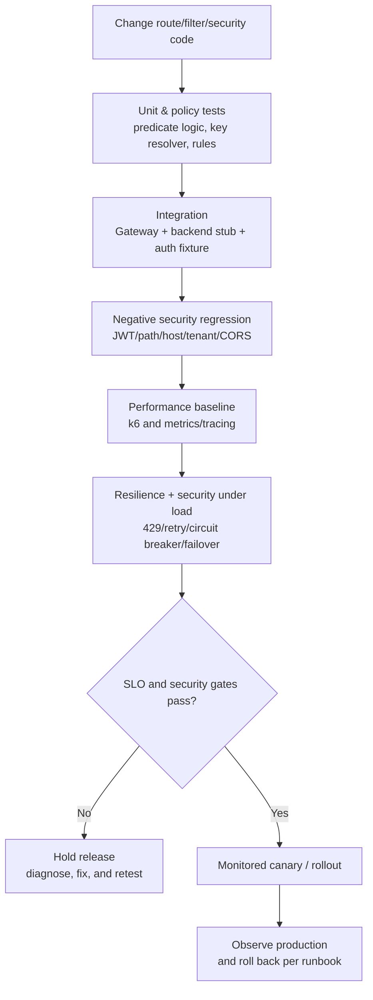
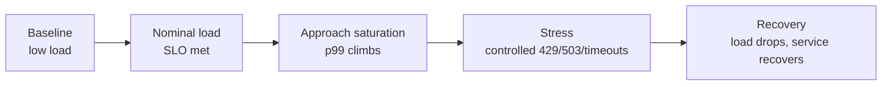
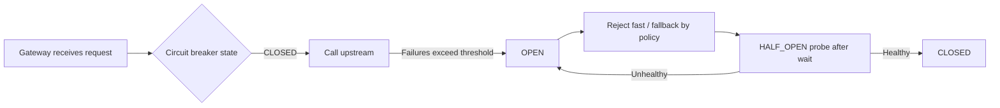
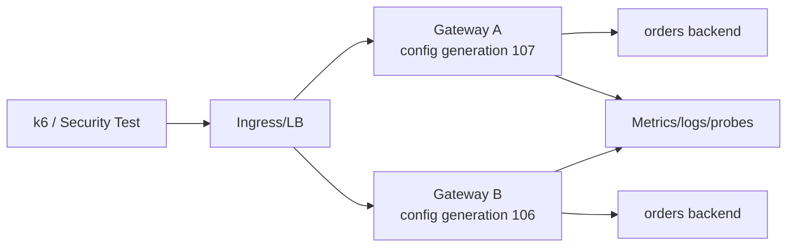
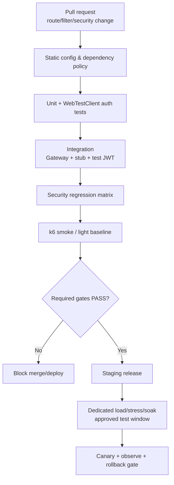

# Gateway Load Testing and Security Regression

An API Gateway can pass hundreds of unit tests and still fail in operation: 3,000 concurrent clients exhaust the connection pool; a retry filter multiplies backend call volume; a newly added route accidentally exposes an admin API; or a rate limiter blocks legitimate users while failing to stop a single client sending hundreds of requests. **Load testing** and **security regression testing** should be organized together to catch bugs that only appear when *traffic, routing, and protection policies* interact.

This lesson belongs to the **Testing** chapter of the **SPRING_CLOUD_GATEWAY** module. We will verify a Gateway using route predicates, filter chains, path/header rewrites, service discovery, and load balancing; then extend testing to **JWT authentication/authorization, rate limiting, circuit breakers, retries, TLS, and observability**. The goal is not merely generating high request volume, but measuring **correct Gateway behavior under load** and preventing new configurations from reintroducing previously fixed vulnerabilities.

**After this lesson, you will be able to:**

1. Define workloads and test SLOs/SLAs per route, distinguishing the **closed model** from the **open model**.
2. Write a **k6** script with arrival rates, latency percentiles, error checks, thresholds, and safe test data.
3. Distinguish Gateway errors, backend errors, load-generator bottlenecks, and **expected 401/403/404/429** responses.
4. Measure the impact of retries, rate limiters, circuit breakers, service discovery, body buffering, TLS, and connection pools.
5. Build a **security regression matrix** verifying tokens, scope/tenant/object ownership, path/host/method predicates, headers, CORS, CSRF, Actuator management, and target URIs.
6. Implement CI/CD verification gates, inspect metrics/traces/logs, and make rollout/rollback decisions backed by evidence.

> **Version scope:** Primary examples target **Spring Cloud Gateway Server WebFlux** on versions using the `spring.cloud.gateway.server.webflux.*` namespace. Legacy Gateway 4.x releases use a different namespace; **Server Web MVC** uses Servlet/WebMvc.fn, filters, and a different threading model. Spring Security examples use reactive `SecurityWebFilterChain`, whereas MVC applications require `SecurityFilterChain`. Numeric thresholds and test results in this lesson are **illustrative only** and must be calibrated from real traffic and system SLOs.

## 1. Why Test Load *Alongside* Security Regression?

The two activities answer distinct questions:

| Category | Core question | Risk examples |
| --- | --- | --- |
| **Load/performance testing** | How many requests/s can the Gateway handle while meeting latency and error budgets? | P99 spikes, pool exhaustion, full queues, rising GC pauses. |
| **Security regression** | Do previously verified permissions and policies still hold after changes? | A new route bypasses auth; tenant A views tenant B's data. |
| **Security under load** | Do protection policies still hold under resource contention? | Wrong rate-limit key, slow Redis, unauthenticated flood starves pools. |
| **Resilience testing** | Are backend failures and spikes amplified or properly isolated? | Retry storms, fallbacks leaking sensitive data. |
| **Operational observability** | Is there reliable evidence explaining the outcome? | k6 reports 5xx without identifying the failing route, pod, or dependency. |

A fast Gateway that lets unauthorized requests reach backends **fails**. A Gateway rejecting every request with `403` can look very fast yet **also fails** if valid API calls break. Every test therefore needs a **functional oracle** (*expected behavior*): which requests must succeed, which must be rejected, and which backend may receive them.

### 1.1. Testing Progression from Early Checks to Near-Production



**Never run destructive stress tests against production by default.** A sound workflow runs smoke and security regression checks in isolated CI, runs representative load tests in staging within safety caps, then conducts monitored canaries in production once approved.

## 2. Defining Scope: Which Gateway Layers Must Be Tested?

A typical request traverses:

```text
Client / load generator
  -> DNS / TLS / WAF / Ingress
  -> Spring Security / WebFilter
  -> Spring Cloud Gateway RoutePredicateHandlerMapping
  -> Gateway filter chain
       - headers/path rewrite
       - RequestRateLimiter / Retry / CircuitBreaker
       - Service discovery + LoadBalancer
  -> outbound HTTP client / connection pool
  -> backend service
  -> database/cache/other dependencies
  <- response via Gateway
```

Measuring timing only at the Gateway URL yields **end-to-end latency**, not Gateway overhead alone. Pair it with a **direct backend baseline** in an equivalent environment plus per-hop metrics to pinpoint bottlenecks.

| Layer | What to measure/check | Common misconceptions |
| --- | --- | --- |
| Client/load generator | Scheduled RPS, achieved RPS, latency, failed requests, dropped iterations | A slow load generator gets blamed on the Gateway. |
| Ingress/TLS | TLS handshakes, connection reuse, timeouts, proxy limits | Watching only JVM metrics misses ingress throttling. |
| Gateway route/security | Route ID, HTTP status, deny reasons, route order, authz rules | Expected 401/403 responses get counted as functional failures. |
| Gateway HTTP client | Pending connections, connect/read timeouts, active pools | Adding pod CPU will not fix exhausted connection pools. |
| Rate limiter/Redis | 429s, allowed/denied counts, key distribution, Redis latency | Per-IP quotas can group many users behind NAT. |
| Backend | Actual RPS received, p95/p99, 5xx, concurrency | Blaming Gateway for 5xx errors returned by the backend. |
| Security control plane | Actuator exposure, TLS/mTLS, config drift, forwarded-header trust | App security tests overlook the management port. |

### 2.1. Test Environments Must Match on Critical Dimensions

For meaningful results:

- Run the **exact major/minor versions** of Boot/Cloud/Gateway with matching filter ordering and route configs.
- Explicitly document replica counts, CPU/memory requests/limits, Netty/Servlet threads, and HTTP client pools.
- Match TLS termination, ingress, DNS/service discovery, and network topology within scope.
- Use a backend stub when isolating Gateway overhead; use real staging backends when evaluating end-to-end behavior.
- Use equivalent test Redis/registry infrastructure when rate limiting or load balancing depends on them.
- Keep test data free of real customer accounts or payment details; configure isolated test roles and tenants.
- Handle cache warming intentionally so cold-start metrics never mix with steady-state measurements.

**Do not claim "the Gateway handles 10,000 RPS" if tests only hit cached ingress responses** or tiny backend stubs while production sends large payloads through JWT checks, rewrites, and TLS.

## 3. Modeling Workload Before Choosing Tools

A valid load test starts with a **request mix model**, not `vus: 1000`.

### 3.1. Classifying APIs by Cost and Risk

| API group | Expected load (illustrative) | What to verify |
| --- | --- | --- |
| GET catalog | 60% RPS | Caching, route match, p95, headers, TLS, and upstream pools. |
| GET orders/{id} | 25% RPS | JWT/tenant scope, route priority, ownership, no object leakage. |
| POST orders | 10% RPS | Body size, idempotency, quotas, no duplicate write retries. |
| POST payments | 3% RPS | Strict authz, zero unintended retries, TLS/mTLS. |
| OPTIONS preflight/health | 2% RPS | CORS/security ordering, protection of management endpoints. |

This is an **illustrative example**. Derive your actual traffic mix from sanitized Gateway access metrics/logs. Categorize at minimum by method, route, response status/size, auth mode, cache behavior, and peak bursts.

**Never collapse all routes into one aggregate p95 number:** 90% fast GETs can hide severely slow 10% POSTs. Define per-route SLO checks for critical paths.

### 3.2. Open Model vs. Closed Model

**Closed model:** A fixed pool of virtual users (VUs) repeats actions, typically starting the next iteration only after the previous finishes. When the backend slows down, request rate **drops automatically**, masking impending overload.

**Open model:** The test drives a target **arrival rate** independent of prior response times. This fits questions like "Can the Gateway sustain 500 requests/s?".

| Model | Sample k6 executor | When to use | Measurement traps |
| --- | --- | --- | --- |
| Closed | `constant-vus`, `ramping-vus` | Think-time user journeys, concurrency-driven tests | *Coordinated omission* if measuring only sent requests while SUT stalls. |
| Open | `constant-arrival-rate` | Fixed target RPS, capacity/SLO verification | Too few VUs causes `dropped_iterations` and lower actual RPS. |
| Open ramp | `ramping-arrival-rate` | Finding saturation knee, gradual stress | Must track when workload exceeds capacity. |
| Burst/spike | Step jumps in arrival rate | Autoscaling, `burstCapacity`, queue saturation | Easy to generate unexpected load; enforce caps and sandboxes. |

### 3.3. Do Not Confuse Throughput with Concurrency

- **RPS:** HTTP requests started or completed per second (state which one clearly).
- **Concurrent in-flight requests:** How many requests are actively executing at once.
- **VUs:** Virtual users/actors in the load generator, not equivalent to concurrent requests in every setup.
- **Latency:** End-to-end duration measured from the client or per route/operation.

A rule of thumb from **Little's Law** at steady state:

\[
L \approx \lambda W
\]

Where `L` is average concurrent requests in the system, `λ` is average arrival/completion rate, and `W` is average processing time in seconds. For example, 500 requests/s averaging 200 ms corresponds to roughly 100 in-flight requests at steady state.

**Use this only for estimation**, never substituting averages for p99 or assuming steady state holds during spikes/overload. Queueing, retries, and client timeouts complicate real behavior.

## 4. Choosing Test Profiles: Never Force One Test to Do Everything

| Test type | Objective | Illustrative duration/pacing | Pass/fail criteria |
| --- | --- | --- | --- |
| **Smoke** | Verify routes, TLS, and auth work | A few requests per route | Accurate status/body/headers/backend hits. |
| **Baseline** | Measure latency under low load | 2–5 minutes, low RPS | Capture p50/p95/p99, error rate, CPU/memory. |
| **Load** | Measure under operational traffic | Warm-up/ramp + steady state | Meets SLO at target RPS. |
| **Stress** | Find saturation knee and degradation behavior | Controlled RPS ramp | Identify breaking point; safe failure and clean recovery. |
| **Spike** | Evaluate sudden traffic surges | Short staging bursts | No auth/quota bypass; avoids prolonged collapse. |
| **Soak/endurance** | Detect memory and connection leaks | Hours at steady load | No unbounded heap/off-heap or pending-connection growth. |
| **Resilience under load** | Backend/Redis/TLS faults, timeouts | Staging fault injection | Retry budgets, circuit breakers, and 429s behave properly. |
| **Security regression** | Prevent known flaws from returning | Every PR/config change | Both positive and negative assertions PASS. |

When running high-load tests, keep an **emergency abort switch** and clear owner on standby. Stress tests can strain shared dependencies (IdP, Redis, discovery, DNS, network) even when the Gateway runs in staging.

### 4.1. Writing Measurable Empirical SLO Targets

An illustrative staging contract for **GET /api/catalog/**:

- Sustain **150 HTTP requests/s** steady across 2 Gateway replicas, each with 1 vCPU / 512 MiB (illustrative figures).
- Client-side `p95 < 300 ms`, `p99 < 800 ms`.
- **Unintended** error ratio below 1%.
- Zero `dropped_iterations` during steady state.
- Zero policy violations (unexpected 401/403/429/200).
- Backends receive exact rewritten URIs/paths; zero exposed admin endpoints.

**Never apply one arbitrary number to all environments.** Proxying to a backend taking 2 seconds per call cannot meet a 300 ms p95 solely by tuning the Gateway. Set SLOs from product requirements and measured baselines.

## 5. Setting Up a Safe Test Gateway

Sample routes on **Server WebFlux**:

```yaml
spring:
  application:
    name: test-edge-gateway
  cloud:
    gateway:
      server:
        webflux:
          routes:
            - id: catalog-read
              uri: http://127.0.0.1:9090
              predicates:
                - Path=/api/catalog/**
                - Method=GET
              filters:
                - StripPrefix=1

            - id: orders-read
              uri: http://127.0.0.1:9091
              predicates:
                - Path=/api/orders/**
                - Method=GET
              filters:
                - StripPrefix=1

server:
  port: 8080

management:
  endpoints:
    web:
      exposure:
        include: health,info,metrics
```

Assumptions:

- `GET /api/catalog/items/42` rewrites to `GET /catalog/items/42` on stub 9090.
- `GET /api/orders/42` rewrites to `GET /orders/42` on stub 9091.
- A `Method=GET` route does **not** allow POST: the backend must never receive POST calls via this route.
- If Spring Security is configured, it enforces `401/403` **before forwarding**.

**This is an isolated lab setup**, never production-ready configuration: it omits TLS/public authz, quotas, timeouts/retries, discovery, and egress security. For other Boot/Gateway versions, adjust property namespaces per official docs.

### 5.1. Adding Minimum Observability

Spring Cloud Gateway Server WebFlux exposes the **`spring.cloud.gateway.requests`** timer metric when Actuator/Micrometer and the Gateway metrics filter are enabled. Docs list tags such as route ID, route URI, status, outcome, and method; exact enable properties depend on version. **Never assume all metrics appear automatically** merely because `management.endpoints.web.exposure.include=metrics` is present.

Add:

```xml
<dependency>
    <groupId>org.springframework.boot</groupId>
    <artifactId>spring-boot-starter-actuator</artifactId>
</dependency>
<dependency>
    <groupId>io.micrometer</groupId>
    <artifactId>micrometer-registry-prometheus</artifactId>
</dependency>
```

and for Prometheus scraping:

```yaml
management:
  endpoints:
    web:
      exposure:
        include: health,info,metrics,prometheus

spring:
  cloud:
    gateway:
      server:
        webflux:
          metrics:
            path-tags:
              enabled: false
```

**Access Actuator strictly over a protected management network.** Never expose route diagnostics, environment details, metrics containing sensitive URIs, or route-write endpoints publicly just for convenience during tests. In Gateway 5.x, verify the `spring.cloud.gateway.server.webflux.metrics.enabled` property/namespace; older docs still reference `spring.cloud.gateway.metrics.enabled`.

### 5.2. Measure Causes, Not Only Symptoms

Collect at minimum:

- Gateway server request rate/status and p95/p99 latency histograms.
- Gateway route ID plus outbound client connect/read timeouts and active/pending connections.
- JVM heap/off-heap memory, GC, CPU throttling, and container RSS.
- Netty event-loop lag (or equivalent proxy concurrency) and scheduler blocking.
- Backend RPS, latency, failed requests; plus Redis/IdP latency when used.
- Correlation IDs/traces linking requests end-to-end from Gateway → backend.

**Never put raw URLs containing IDs or tokens into metric labels** to avoid high cardinality. Use route IDs and status codes instead; if path tags are required, normalize to route templates and review privacy/cost.

## 6. k6 Script: Constant Arrival-Rate Load

**k6** is widely used to drive HTTP traffic and enforce scripted **thresholds**. This example drives a light load in an authorized local/staging lab; rates, durations, and thresholds are **illustrative only**.

### 6.1. Complete k6 Script

Create a practice file `load-gateway.js` in your **own lab project**:

```javascript
import http from 'k6/http';
import { check } from 'k6';
import { Rate } from 'k6/metrics';

const BASE_URL = __ENV.BASE_URL || 'http://127.0.0.1:8080';
const ORDERS_READ_TEST_TOKEN = __ENV.ORDERS_READ_TEST_TOKEN;
const contractFailures = new Rate('gateway_contract_failures');

export const options = {
  scenarios: {
    catalog_read: {
      executor: 'constant-arrival-rate',
      exec: 'catalogRead',
      rate: 30,
      timeUnit: '1s',
      duration: '2m',
      preAllocatedVUs: 30,
      tags: { route_group: 'catalog' },
    },
    orders_read: {
      executor: 'constant-arrival-rate',
      exec: 'ordersRead',
      rate: 10,
      timeUnit: '1s',
      duration: '2m',
      preAllocatedVUs: 20,
      tags: { route_group: 'orders' },
    },
  },
  thresholds: {
    'http_req_duration{scenario:catalog_read}': [
      'p(95)<300',
      'p(99)<800',
    ],
    'http_req_duration{scenario:orders_read}': [
      'p(95)<500',
      'p(99)<1000',
    ],
    'http_req_failed': ['rate<0.01'],
    'gateway_contract_failures': ['rate<0.01'],
    'dropped_iterations': ['count<1'],
  },
};

export function catalogRead() {
  const response = http.get(
    BASE_URL + '/api/catalog/items/42',
    { tags: { operation: 'catalog-read' } },
  );

  const passed = check(response, {
    'catalog status is 200': (res) => res.status === 200,
    'catalog body contains item id': (res) =>
      res.body !== null && res.body.includes('"id":"42"'),
  });
  contractFailures.add(!passed, { route_group: 'catalog' });
}

export function ordersRead() {
  if (!ORDERS_READ_TEST_TOKEN) {
    throw new Error('Missing ORDERS_READ_TEST_TOKEN from test environment');
  }
  const response = http.get(
    BASE_URL + '/api/orders/42',
    {
      headers: {
        Authorization: 'Bearer ' + ORDERS_READ_TEST_TOKEN,
      },
      tags: { operation: 'orders-read' },
    },
  );

  const passed = check(response, {
    'orders status is 200': (res) => res.status === 200,
    'orders content type is JSON': (res) =>
      (res.headers['Content-Type'] || '').includes('application/json'),
  });
  contractFailures.add(!passed, { route_group: 'orders' });
}
```

**Prerequisites:** Catalog GET is public under the lab's policy; orders GET requires a valid test token carrying `SCOPE_orders.read` and authorization for order 42. The script reads `__ENV.ORDERS_READ_TEST_TOKEN` rather than hardcoding secrets. If missing, the test must fail fast due to missing fixtures—never disable auth to turn thresholds green. Inject tokens strictly via an authorized secret store/test runner and never print tokens to consoles, Git, or reports.

In practice, matching body text via `'"id":"42"'` is brittle to JSON formatting/spacing; use `response.json('id') == '42'` when JSON responses and ID types are known. For large payloads, inspect stable fields while keeping parsing overhead in mind.

### 6.2. Running the Test

```bash
# Inside an authorized load-testing environment:
# Assume ORDERS_READ_TEST_TOKEN is injected via environment variable
# from a test runner/secret store, never typed directly on the command line.
k6 run --env BASE_URL=http://127.0.0.1:8080 load-gateway.js
```

Total scheduled arrival rate: **30 + 10 = 40 iterations/s**; since each iteration makes **one HTTP request**, target throughput is ~40 requests/s assuming no client-side HTTP redirects/retries and sufficient VUs. If an iteration invokes multiple endpoints or follows redirects, **requests/s no longer equals iterations/s**.

**There is no `sleep()`** at the end of `catalogRead`/`ordersRead` because `constant-arrival-rate` paces arrivals automatically. Adding sleeps or slow steps requires sizing `preAllocatedVUs` (and `maxVUs` if configured) appropriately; otherwise k6 reports `dropped_iterations`.

### 6.3. Thresholds Determine CI Pass/Fail

In k6:

- **`check(...)`** evaluates assertions and tracks check pass rates, yet **failed checks alone do not exit k6 with a non-zero status by default**.
- **`thresholds`** define pass/fail gates; breaching any threshold fails the run and returns a non-zero exit code.
- **`http_req_failed`** depends on k6's expected-response configuration. By default, most 4xx/5xx statuses count as failures; design negative auth tests separately so expected 401s are not miscounted as load failures.
- **`http_req_duration`** measures sending the request + waiting + receiving the response; **it excludes** initial DNS/TCP/TLS handshakes, which are tracked separately in `http_req_blocked`, `http_req_connecting`, and `http_req_tls_handshaking`.
- **`dropped_iterations`** means k6 **could not start all scheduled iterations**, due to insufficient VUs, generator saturation, or system stalls. Never report SLOs as passing when achieved rate fell below target.

Valid reporting template:

```text
Planned: 40 iterations/s for 120 seconds
Target iterations: ~4,800
Actual HTTP requests: [fill in only after running]
p95 catalog: [fill in only after running]
p99 orders: [fill in only after running]
http_req_failed rate: [fill in only after running]
dropped_iterations: [fill in only after running]
Gateway/backend CPU & memory: [fill in only after measuring]
```

These fields are a **reporting template**, not measured output.

### 6.4. Why Verify Achieved Load?

Suppose a script targets 500 iterations/s yet the generator launches only 150/s due to VU starvation while the Gateway handles 150/s smoothly. The honest conclusion is **the test did not prove 500/s capacity**, not "Gateway passed 500 RPS".

Beyond `dropped_iterations`, inspect:

1. Actual `http_reqs` / achieved duration.
2. Generator CPU/memory, file descriptors, and network limits.
3. DNS/TLS/connection reuse and generator-side bottlenecks.
4. VU allocation; increase `preAllocatedVUs` carefully when needed.
5. Ensure test parameters do not accidentally hit a single cached route repeatedly.

### 6.5. Authenticated Load Tests Should Not Reuse One Token for Every Case

When rate limits are keyed **per principal**, 200 VUs sharing one JWT appear as **one user** rather than 200 distinct accounts. Conversely, generating unsigned random tokens per request yields 401s and merely benchmarks token rejection.

Prepare a **pool of valid test identities and tokens** matching clear scenarios: single-user (per-key quota), multi-user concurrency, distinct tenants, and anonymous callers. Never write JWTs into k6 stdout, access logs, or CI artifacts. Issue test tokens via an authorized test IdP or fixture—never production secrets.

## 7. Baselines, Saturation Points, and p95/p99

### 7.1. Establishing a Repeatable Baseline

Before changes:

1. Record Git commit, Docker image digest, config hash, Gateway route definitions, and policy versions.
2. Lock identical replica counts, node sizes, ingress, backend stub or staging backends, TLS, and cache policies.
3. Run warm-up traffic so JIT and cold connections do not skew steady-state metrics.
4. Measure sufficiently long windows at controlled RPS.
5. Capture p50/p95/p99 latency histograms, RPS, errors, CPU, memory, and pending connections.
6. Repeat runs to gauge natural infrastructure variance.

After changes, re-run the exact same workload. If p99 rises, inspect caches, proxy route matching, TLS sessions, backend latency, and queueing. **Never declare a regression from one percentile over a handful of requests.**

### 7.2. Distinguishing Averages from Tail Latency

Illustrative comparison:

| Build | Achieved RPS | p50 | p95 | p99 | 5xx |
| --- | ---: | ---: | ---: | ---: | ---: |
| A — baseline | 300 | 58 ms | 160 ms | 410 ms | 0.1% |
| B — added custom filter | 300 | 60 ms | 170 ms | 920 ms | 0.4% |

Median latency barely moved, yet **p99 more than doubled**. The custom filter may block on some requests, hit outbound pool limits, or induce GC pauses. Inspect traces, logs, and event-loop metrics instead of averages alone.

**Never compare percentiles from workloads with different distributions:** if build B includes more large POSTs than A, p99 shifts may come from payload mix rather than the filter.

### 7.3. Stepping Up Load Gradually

Expected trajectory:



Under overload, dangerous failure modes include **unbounded latency growth, retry storms, connection leaks, blocked event loops**, or liveness collapse. A Gateway with proper circuit breakers and rate limiters intentionally returns **429/503** to shed load and protect backends; stress tests verify **controlled degradation**, not 0% 429s under unlimited traffic.

### 7.4. Classify Responses Before Aggregating Metrics

| Status / outcome | When is it valid? | Do not misinterpret |
| --- | --- | --- |
| **200/201/204** | Valid request succeeding per contract | 200 does not prove backend committed the intended side effect. |
| **401** | Missing or invalid credentials per policy | 401 on a valid request is a regression. |
| **403** | Valid identity lacking role/scope or ownership | Never arbitrarily swap 403 for 404/200 outside contract. |
| **404** | Missing route or nonexistent/hidden resource | Distinguish Gateway 404 from backend 404. |
| **405** | Disallowed HTTP method at route/backend | Verify method predicates. |
| **429** | Rate limit exceeded per policy | Unacceptable in under-limit baseline benchmarks. |
| **502/503/504** | Backend unavailable, network/timeout, fallback policy… | Identify the originating layer; don't automatically blame Gateway code. |
| **No HTTP response** | Socket timeout/TLS/DNS/connect error | Cannot log HTTP 503 when no response arrived. |

For **negative security tests**, write **custom pass/fail checks** covering statuses, headers, and backend hit counts with matching thresholds rather than letting default `http_req_failed` misclassify expected 401/403 responses.

## 8. Finding Gateway Bottlenecks Instead of Throwing Resources at Them

Every good load test begins with a **hypothesis** backed by measurements:

| Observation | Likely cause | What to inspect |
| --- | --- | --- |
| p99 climbs, Gateway CPU low | Outbound pool, Redis/IdP/backend stalls, or pending connections | HTTP client pool, Redis latency, backend spans. |
| Gateway CPU 100%, backend idle | JWT signature verification, JSON/body rewrites, blocking custom filter | CPU profile, event loop, request mix. |
| Memory grows with POST bodies | Body caching/retries or custom decorators retaining buffers | Heap/off-heap usage, `DataBuffer` releases, max in-memory size. |
| 429 spikes after route change | `KeyResolver`, quota scope, or Redis config | Key distribution, burst, replenishRate, per-principal rate. |
| Retries triple backend calls | Retry filter compounding with client retries | Backend request counters by attempt and correlation ID. |
| 503 during pod scaling | Discovery/readiness lag or stale load-balancer state | Registry snapshots, readiness probes, connection draining. |
| 401 spikes after route edit | Security matchers, JWT validation, clock skew, issuer/audience | Auth decision logs (no raw tokens), route/path mapping. |
| Load client drops iterations | Too few VUs or saturated generator | k6 metrics and generator CPU/network. |

### 8.1. Event Loops and Custom Filters

On Gateway Server WebFlux, `Thread.sleep(...)`, direct JDBC calls, blocking network I/O, or heavy file I/O on a Netty event loop can **stall many concurrent requests**.

Anti-pattern:

```java
// Anti-pattern inside a GatewayFilter/WebFlux reactive chain:
Thread.sleep(100);     // blocks the event loop if running on a Netty thread
return chain.filter(exchange);
```

A custom filter calling an external policy service should use a non-blocking HTTP client and appropriate caching, enforcing tight timeouts and clear fallback behavior when dependencies fail. If blocking work is unavoidable, offload onto a bounded worker scheduler pool with explicit capacity limits; **never wrap arbitrary blocking calls in `subscribeOn` without resource budgeting**.

### 8.2. Comparing Servlet Gateway MVC

Server Web MVC runs on Servlet/Tomcat/Jetty with a different thread and HTTP client model than WebFlux. When testing MVC, measure:

- Servlet worker thread pools and active/queued requests.
- Outbound HTTP connections, timeouts, and backend latency.
- Spring Security Servlet `FilterChain`, CSRF/session handling.
- JVM/GC behavior and virtual threads if enabled and supported.

**Never use Reactor Netty event-loop metrics to judge Tomcat saturation.** The two Gateway stacks expose different runtime telemetry even when driven by the same k6 HTTP script.

## 9. Security Regression: Verify Policies, Not Only Status Codes

A **security regression test** is an automated suite re-run after any change to routes, filters, security policies, dependencies, or TLS settings to ensure **existing protections still hold**.

Example for `GET /api/orders/{id}`:

- User A with a valid token and `orders.read` scope views their own order.
- User B with the same scope **cannot** view User A's order.
- Expired or invalid-signature tokens are rejected.
- Anonymous callers cannot access protected orders APIs.
- Client-supplied `X-User-Role: ADMIN` grants zero privilege escalation.
- Changing `StripPrefix`/`RewritePath` preserves backend object-ownership enforcement.

Asserting 401/403 everywhere is not enough. Include **positive controls**, **negative tests**, and **backend call/side-effect verification**. A Gateway denying every request passes negative checks while completely breaking functionality.

### 9.1. Alignment with OWASP API Security Top 10

| OWASP API Security 2023 risk | Gateway exposure | Regression test |
| --- | --- | --- |
| **API1 Broken Object Level Authorization** | Valid token scope, yet object ID belongs to another user | Cross-user/cross-tenant ownership checks at backend. |
| **API2 Broken Authentication** | Bad signature, issuer, audience, or expired token accepted | Real JWT validation against test JWKS. |
| **API3 Broken Object Property Level Authorization** | Response JSON exposes internal fields after body rewrite | Assert responses exclude restricted attributes. |
| **API4 Unrestricted Resource Consumption** | Missing quotas/body caps, retry storms | 429s, max payloads, concurrency caps, clean recovery. |
| **API5 Broken Function Level Authorization** | New route accidentally opens admin/delete functions | Path + method + role checks. |
| **API6 Sensitive Business Flows** | Bots repeat checkout/signup operations | Quotas, idempotency, and business-layer safeguards. |
| **API7 SSRF** | Dynamic URIs proxy into internal hosts | URI allowlists and network egress tests. |
| **API8 Security Misconfiguration** | Public Actuator, wildcard CORS, insecure TLS | Management access, CORS/CSRF/TLS tests. |
| **API9 Improper Inventory Management** | Legacy or staging routes left publicly exposed | Diff live route inventory against approved manifest. |
| **API10 Unsafe Consumption of APIs** | Blindly trusting redirects, headers, or bodies from upstream | Response schema, size, and redirect safeguards. |

**The Gateway does not replace backend business authorization:** holding `orders.read` scope never proves `orderId=42` belongs to the current caller.

### 9.2. Policy as Test Input

| API | Caller | Token | Expected | Reaches backend? |
| --- | --- | --- | --- | --- |
| `GET /api/catalog/items/42` | Anonymous | None | 200 if public | Yes |
| `GET /api/orders/42` | User A owns order 42 | Valid + orders.read | 200 | Yes |
| `GET /api/orders/42` | Anonymous | None | 401 | **No** |
| `GET /api/orders/42` | User A missing scope | Valid | 403 | **No** |
| `GET /api/orders/42` | User B does not own 42 | Valid + scope | 403/404 per contract | Backend may receive request to verify ownership |
| `POST /api/admin/routes` | Regular user | Valid | 403/404 | Must not reach admin backend |
| `DELETE /api/orders/42` | User A with read-only scope | Valid | 403/405 per policy | Must not reach delete handler |
| `OPTIONS /api/orders/42` | Allowed browser preflight | Often no JWT | Proper CORS response | Business handler must not run |

An ownership check may **require forwarding to the backend** so the backend returns 403. Conversely, requests missing valid tokens or Gateway-enforced scopes **must never reach the backend**. Tests should explicitly reflect that boundary.

### 9.3. Every Route Diff Should Trigger Security Tests

High-risk edits include:

- Widening `Path=/api/orders/**` to `Path=/api/**`.
- Changing `order=-10` to `order=-1000`, shadowing specialized routes.
- Removing `Method` predicates or altering `Host` matching.
- Changing `StripPrefix=1` to `StripPrefix=2`, shifting target paths into another endpoint.
- Adding `RemoveRequestHeader=Authorization` or `AddRequestHeader=X-Role,ADMIN`.
- Dropping `RequestRateLimiter` or switching `KeyResolver` to a client-supplied header.
- Replacing `lb://orders` with an arbitrary internal URI.
- Trusting `Forwarded`/`X-Forwarded-*` headers from untrusted callers.
- Exposing writable Actuator endpoints on public ports.

Security regression tests must evaluate **the complete route table and filter order**, never just an isolated Spring Security bean.

## 10. Spring Security WebFlux: Policy Baseline for Testing

Sample WebFlux **JWT Resource Server** configuration illustrating a Bearer-only stateless API policy:

```java
package com.example.gateway.security;

import org.springframework.context.annotation.Bean;
import org.springframework.context.annotation.Configuration;
import org.springframework.http.HttpMethod;
import org.springframework.security.config.Customizer;
import org.springframework.security.config.annotation.web.reactive.EnableWebFluxSecurity;
import org.springframework.security.config.web.server.ServerHttpSecurity;
import org.springframework.security.web.server.SecurityWebFilterChain;

@Configuration
@EnableWebFluxSecurity
public class GatewaySecurityPolicy {

    @Bean
    SecurityWebFilterChain security(ServerHttpSecurity http) {
        return http
            // Strictly for stateless Bearer APIs, not cookie sessions.
            .csrf(ServerHttpSecurity.CsrfSpec::disable)
            .authorizeExchange(exchanges -> exchanges
                .pathMatchers(HttpMethod.GET, "/api/catalog/**")
                    .permitAll()
                .pathMatchers(HttpMethod.GET, "/api/orders/**")
                    .hasAuthority("SCOPE_orders.read")
                .pathMatchers(HttpMethod.POST, "/api/orders/**")
                    .hasAuthority("SCOPE_orders.write")
                .anyExchange().denyAll())
            .oauth2ResourceServer(oauth2 ->
                oauth2.jwt(Customizer.withDefaults()))
            .build();
    }
}
```

Paired with a JWT decoder/issuer configuration:

```yaml
spring:
  security:
    oauth2:
      resourceserver:
        jwt:
          issuer-uri: https://idp.test.example/issuer
```

**Checklist for this config:**

1. `issuer-uri` is a placeholder, not a live IdP in this lab; supply a test JWKS or test IdP.
2. JWT validation must check signature, `exp`, `nbf`, and issuer. If the API requires an audience, add an **audience validator** and test wrong/missing `aud` claims; do not assume audience checks happen automatically.
3. JWT scopes commonly map to `SCOPE_` authorities, though claim names and converters vary by config.
4. Security enforces route-level permissions only; backends still enforce object ownership.
5. `csrf().disable()` is **unsafe for cookie-based browser sessions**; test CSRF tokens, `SameSite` cookies, and CORS when using sessions.
6. This configures a **WebFlux `SecurityWebFilterChain`**. Gateway Server Web MVC uses `SecurityFilterChain`/`HttpSecurity` and Servlet filters.

### 10.1. Security Matchers vs. Gateway Route Predicates

Permitting `POST /api/orders/**` in Spring Security does not automatically create a Gateway POST route. If the Gateway route only declares `Method=GET`, POSTs still fail with 404/405 due to missing routes even after passing security. Conversely, adding a new Gateway GET/POST route does not automatically open the corresponding security matcher. **Test both route selection and authorization together.**

### 10.2. Interpreting Auth/Routing Status Codes

- **401:** unauthenticated caller or invalid credentials.
- **403:** authenticated principal lacking permissions, or CSRF/policy violation.
- **404:** missing route or resource; some systems intentionally return 404 to hide unauthorized objects.
- **405:** HTTP method unsupported by the target route or handler.

Do not impose rigid status expectations without checking the API/security contract. Deciding between 403 and 404 on failed object ownership must be explicitly defined and tested consistently.

## 11. `WebTestClient` and `mockJwt`: Testing Scope-Based Authorization

Spring Security Reactive Test provides **`mockJwt()`** to inject a mocked JWT authentication without signing real tokens for every test. It works well for **testing authorization rules and route wiring**, yet **never tests real cryptographic signatures, JWKs, or issuers**.

### 11.1. Binding `WebTestClient` with Spring Security

In a reactive Spring Boot test context containing Gateway routes and test backend stubs, bind the client to `ApplicationContext`:

```java
import org.springframework.context.ApplicationContext;
import org.springframework.test.web.reactive.server.WebTestClient;
import static org.springframework.security.test.web.reactive.server
    .SecurityMockServerConfigurers.springSecurity;

WebTestClient client = WebTestClient
    .bindToApplicationContext(applicationContext)
    .apply(springSecurity())
    .configureClient()
    .build();
```

This is a **setup snippet**, not a standalone Java file: you need a Spring test context, WebFlux/Spring Security test dependencies, route configs, and backend stubs. Static import line breaks follow valid Java syntax and can be collapsed in an IDE. Auto-configuration and test annotation packages vary across Spring Boot versions; consult Spring Security Reactive Test docs for your target version.

### 11.2. Asserting Anonymous and Wrong-Scope Access

```java
import org.springframework.security.core.authority.SimpleGrantedAuthority;
import static org.springframework.security.test.web.reactive.server
    .SecurityMockServerConfigurers.mockJwt;

// Unauthenticated request to protected orders API.
client.get().uri("/api/orders/42")
    .exchange()
    .expectStatus().isUnauthorized();

// Authenticated, yet missing orders.read scope.
client.mutateWith(mockJwt().authorities(
        new SimpleGrantedAuthority("SCOPE_catalog.read")))
    .get().uri("/api/orders/42")
    .exchange()
    .expectStatus().isForbidden();

// Valid orders.read scope: Gateway forwards to test backend.
client.mutateWith(mockJwt().authorities(
        new SimpleGrantedAuthority("SCOPE_orders.read")))
    .get().uri("/api/orders/42")
    .exchange()
    .expectStatus().isOk();
```

For the positive case to return 200, the backend stub must handle `GET /orders/42`. `mockJwt()` **does not spin up a downstream stub**; if the backend is missing, tests hit network/5xx errors that must be resolved before judging security behavior.

### 11.3. Verify the Backend Was Not Called When Blocked by Gateway

Tests checking only 401/403 miss bugs where a filter forwards upstream **before `SecurityWebFilterChain` rejects the call**. Using WireMock, MockWebServer, or an HTTP stub:

1. Reset stub hit counters.
2. Send an anonymous GET to `/api/orders/42`.
3. Assert 401.
4. Assert **orders backend hit count is 0**.
5. Send a valid token lacking `SCOPE_orders.read`.
6. Assert 403 and confirm backend hits remain 0.
7. Send a token with `SCOPE_orders.read` and assert the backend receives exactly 1 call with the expected path and headers.

**Caveat:** Backend-enforced object ownership may require forwarding the call so the backend returns 403. Never assert "0 backend calls" for checks intentionally delegated to backends.

### 11.4. `mockJwt()` Does Not Test Real Authentication

`mockJwt()` bypasses JWT decoding/signature checks and injects a prebuilt authentication context. Supplement it with **end-to-end tests over real HTTP ports** against a test IdP/JWKS covering:

- Valid and invalid signatures.
- Valid and invalid issuers.
- Valid, wrong, and missing `aud` claims.
- Expired tokens, future `nbf`, and clock-skew edges.
- Wrong scopes/roles or misconfigured authority converters.
- Non-JWT strings and malformed `Authorization` headers.
- JWK key rotation (`kid` changes).
- Valid token belonging to a different tenant.

Use **test keys and test accounts only**; never hardcode real private keys or tokens in Git, logs, or CI artifacts. Keep mock JWKS completely isolated from production IdPs.

### 11.5. Negative Tests Need a Positive Control

Suppose invalid tokens must return 401. If the Gateway accidentally returns 401 for **every request**, all negative tests pass while the app is completely broken. After each negative suite, run at least one positive control with valid credentials reaching the backend. This catches "deny-all" misconfigurations or missing stubs masquerading as security passes.

## 12. Using k6 for Security Semantics Without Miscounting 401/403 as Load Failures

`401`/`403` responses are often the **expected result** in security regression tests. Track violations via a **custom `Rate` metric** instead of letting `http_req_failed` mark intentional negative responses as errors.

### 12.1. Small Security Verification Script

```javascript
import http from 'k6/http';
import { check } from 'k6';
import { Rate } from 'k6/metrics';

const BASE = __ENV.BASE_URL || 'http://127.0.0.1:8080';
const NO_SCOPE_TOKEN = __ENV.NO_SCOPE_TEST_TOKEN;
const VALID_TOKEN = __ENV.ORDERS_READ_TEST_TOKEN;
const violations = new Rate('gateway_security_violations');

export const options = {
  vus: 1,
  iterations: 1,
  thresholds: {
    gateway_security_violations: ['rate<0.001'],
    checks: ['rate==1'],
  },
};

export default function () {
  if (!NO_SCOPE_TOKEN || !VALID_TOKEN) {
    throw new Error('Missing test JWT fixtures in environment');
  }

  const anonymous = http.get(BASE + '/api/orders/42');
  const noScope = http.get(BASE + '/api/orders/42', {
    headers: { Authorization: 'Bearer ' + NO_SCOPE_TOKEN },
  });
  const authorized = http.get(BASE + '/api/orders/42', {
    headers: { Authorization: 'Bearer ' + VALID_TOKEN },
  });

  const passed = check(null, {
    'anonymous denied': () => anonymous.status === 401,
    'no-scope user denied': () => noScope.status === 403,
    'authorized test user allowed': () => authorized.status === 200,
    'no backend error leaked': () =>
      !String(anonymous.body || '').includes('java.lang.')
      && !String(noScope.body || '').includes('java.lang.'),
  });
  violations.add(!passed);
}
```

**This sample requires valid tokens issued by a test IdP**—do not pass bogus tokens expecting the 200 positive check to pass. Using `String(body || '')` guards against null response bodies. Production-grade suites should also verify Content-Type/error schemas, load tokens from secret stores without logging JWTs, and confirm backend hit counts via integration tests.

We omit `http_req_failed: rate<0.01` here because 401/403 are intentional responses; `gateway_security_violations` captures contract adherence. While k6 scenarios/tags with custom `expectedStatuses` let you mix load and security runs, separating the two suites keeps failure attribution clearer.

### 12.2. k6 Error Rates Do Not Replace Backend Evidence

Even when k6 sees a 403, it cannot prove the backend wasn't called or mutated beforehand. Pair k6 HTTP boundary checks with Spring integration/WireMock tests verifying non-forwarding.

### 12.3. Do Not Measure Business Capacity Using Rejected Requests

A run sending 100% invalid tokens benchmarks Spring Security rejection paths (and potentially JWK lookup pressure), **not** real routing, filter chains, and backend proxying. Split into two workloads:

- **Authorized performance workload:** Valid tokens, proper scopes, succeeding backend responses.
- **Unauthorized abuse regression workload:** Invalid tokens/quota breaches asserting fast rejection without excessive resource burn.

Otherwise, a "20,000 RPS Gateway at 3 ms p95" could simply be 20,000 `401` rejections that never touched a microservice.

## 13. Rate Limiting Under Load: Right Key, Right 429, Right Scope

`RequestRateLimiter` in Gateway Server WebFlux typically uses **`RedisRateLimiter`** with a token bucket. Over-quota requests normally receive **HTTP 429 Too Many Requests**, subject to your policy version and error handling.

### 13.1. Illustrative Token-Bucket Configuration

```yaml
spring:
  cloud:
    gateway:
      server:
        webflux:
          routes:
            - id: catalog-protected
              uri: lb://catalog-service
              predicates:
                - Path=/api/catalog/private/**
              filters:
                - name: RequestRateLimiter
                  args:
                    redis-rate-limiter.replenishRate: 10
                    redis-rate-limiter.burstCapacity: 20
                    redis-rate-limiter.requestedTokens: 1
```

This sample sets filter parameters; **per-user quotas** also require a trustworthy `KeyResolver` and properly configured reactive Redis. **Never extract user IDs from `?user=alice` query parameters as quota keys in production**, since clients can spoof them to bypass limits.

### 13.2. Mandatory Test Cases

| Test | Input generation | Expectation |
| --- | --- | --- |
| Under quota | Single user pacing steadily below `replenishRate` | Zero unintended 429s. |
| Small burst | Burst below `burstCapacity` after full bucket | Permitted within bucket rules. |
| Over burst | Single user exceeding `burstCapacity` | Subset of requests receive 429. |
| Multiple distinct users | Two trusted test principals | Independent buckets under per-principal policy. |
| Same user across two Gateway replicas | Split traffic across A and B | Redis enforces shared quota rather than doubling per pod. |
| Anonymous callers | No principal | Explicit fallback key/deny policy, not one unguarded shared bucket. |
| Redis unavailable | Inject network error in staging | Verified fail-open/fail-closed behavior with alerting. |
| Spoofed IP header | Client sends forged `X-Forwarded-For` | Quota keys never accept untrusted headers. |

**Never assert "every 21st request returns 429" blindly:** continuous token replenishment, Redis scheduling, key hashing, and concurrency affect exact ordering. Assert quota behavior over appropriate measurement windows rather than hardcoding sequence indices under concurrent bursts.

### 13.3. Testing Fail-Open vs. Fail-Closed

When Redis goes down, a system can:

- **Fail closed:** reject requests to shield backends; impacts availability.
- **Fail open:** allow requests through; lowers abuse protection.
- **Degraded quota:** apply temporary local limits if architected.

This is a **security and operational trade-off**, not an automatic default. Tests should verify the approved mode, confirm alerts fire, and confirm smooth recovery once Redis returns.

### 13.4. Do Not Let 429 Mask 401

If rate limiting runs before auth, anonymous floods can drain shared Redis budgets and block legitimate users; if rate limiting runs after auth, invalid tokens can burn CPU verifying signatures. Test filter/`WebFilter` ordering alongside multi-layer defenses (coarse ingress throttling plus per-principal quotas). **Never assume one `RequestRateLimiter` stops all forms of DoS.**

## 14. Retries, Circuit Breakers, and Backend Failures Under Load

Untested resilience settings can trigger a **feedback loop**: backend slows down → requests time out → Gateway retries → backend load multiplies → timeouts worsen. Measure **client RPS**, **Gateway outbound attempts**, and **backend RPS** separately.

### 14.1. Retry Amplification

Suppose clients send 100 requests/s and each allows up to 2 retries after the initial attempt:

```text
Client -> Gateway:             100 requests/s
Gateway -> Backend attempt 1:  100 attempts/s
Gateway -> Backend attempt 2:  up to 100 attempts/s
Gateway -> Backend attempt 3:  up to 100 attempts/s

Backend: up to ~300 attempts/s if all fail
```

This is a **simplified upper bound** before accounting for backoff, circuit breakers, timeouts, cancellation, and rate limits. Not every call retries, yet it shows why **client request rates alone** hide retry storms.

### 14.2. Retry Only Safe Operations

Idempotent read-only GETs can allow bounded retries on well-defined network/status errors. On **payment/order creation POSTs**, retries risk **duplicate side effects** if the first attempt succeeded on the backend while the response dropped.

Tests must cover:

1. Stub returning 503/timeout first, then 200.
2. Backend receives the **exact configured max attempts**.
3. Backoff and deadlines prevent unbounded request hangs.
4. Correlation IDs/traces link retries together.
5. POST operations either enforce idempotency keys or **disable retries**.
6. 400/401/403 and non-retryable statuses are never retried.

**Never assume retrying HTTP 500 or 503 is universally safe.** Know HTTP method semantics, body replayability, idempotency, and backend side effects.

### 14.3. Body Caching Changes Memory Profiles

Retrying requests with bodies requires buffering payloads for replay. Implementations differ between WebFlux and Servlets, yet both risk **retaining large request bodies in memory**.

At 500 concurrent 1 MiB requests cached in full, payloads alone take ~500 MiB **before** buffers, copies, JVM heap/off-heap overhead, and codecs. Test across:

- 1 KiB, 64 KiB, 1 MiB, and maximum allowed payload caps.
- Valid JSON, invalid schemas, and wrong Content-Types.
- Multipart uploads if supported.
- Client cancellation mid-upload.
- Retries/fallbacks when backends fail after consuming the body.

Monitor heap/GC, WebFlux `DataBuffer` lifecycles, in-memory/body size caps, and response commit state. **Never extrapolate from tiny GET tests to claim POST uploads are safe.**

### 14.4. Circuit Breaker Opening and Recovery



Verify:

- Which failures count toward breaker metrics.
- Minimum call threshold before evaluating failure rates.
- When OPEN, **backend call rates drop** rather than staying flooded.
- Fallbacks honor contract and **never bypass authorization**.
- HALF_OPEN limits probe concurrency to avoid recovery spikes.
- Once healthy again, the breaker closes per policy and latency returns to baseline.

In Gateway Server WebFlux, the `CircuitBreaker` filter integrates Spring Cloud CircuitBreaker/Resilience4j via its reactive starter; `forward:` fallbacks follow WebFlux forwarding lifecycles. Test with your **exact Gateway flavor** rather than copying MVC filter snippets into WebFlux.

### 14.5. Scoped Fault Injection

Run controlled stub/proxy fault injection **only in staging**, never disrupting shared infrastructure. Cases:

| Scenario | Safe simulation | Criteria |
| --- | --- | --- |
| HTTP 503 | Stub returns 503 at fixed rate | Retry/breaker/fallback behave properly. |
| High latency | Stub adds bounded delay | Timeout budget holds without leaking pools. |
| Connection refused | Temporarily stop sandbox stub listener | Gateway recovers without hanging/leaking. |
| Empty discovery registry | Test service absent from isolated registry | Clean failure; no misrouting. |
| Single unhealthy backend pod | Mixed healthy/unhealthy stub instances | Load balancer/readiness routing reacts cleanly. |
| Redis rate-limiter outage | Test Redis temporarily unreachable | Matches fail-open/closed policy, raises alert. |
| IdP/JWKS unavailable | Test IdP temporarily stopped | Never silently accepts invalid tokens. |
| Expired/wrong-host TLS cert | Test server with intentionally bad cert | Gateway safely rejects handshake. |

**Never run destructive overload tests or probe real infrastructure** without permission and safety controls. Keep fault injection defensive using synthetic test data.

## 15. CORS, CSRF, and Trust Boundaries

### 15.1. CORS Preflight Differs from Live API Requests

A browser may send:

```http
OPTIONS /api/orders/42 HTTP/1.1
Origin: https://frontend.example.test
Access-Control-Request-Method: GET
Access-Control-Request-Headers: authorization
```

For allowlisted origins/methods/headers, the Gateway must emit matching CORS headers. Because preflight requests normally **omit cookies and Bearer tokens**, Spring Security recommends processing CORS **before authorization decisions**.

| Test | Objective |
| --- | --- |
| Allowlisted origin | Exact `Access-Control-Allow-Origin`, never overly broad. |
| Unlisted origin | Denies unauthorized cross-origin access. |
| Disallowed method/header | Never advertises broader permissions than configured. |
| Preflight without Bearer token | Succeeds when permitted by CORS policy. |
| Credentialed CORS | Never pairs wildcard `*` origin with `Allow-Credentials`. |
| Subsequent actual GET | Still enforces full JWT/authorization checks. |

**CORS is a browser enforcement mechanism, not authentication;** non-browser HTTP clients ignore CORS completely, requiring strict server-side security.

### 15.2. CSRF Depends on Authentication Mode

**Stateless Bearer APIs** and **cookie-session / OIDC browser apps** face very different CSRF risks. For cookie-backed sessions, test:

- State-changing requests without CSRF tokens are rejected.
- Requests carrying valid sessions and CSRF tokens succeed per role.
- Cookies set proper `Secure`, `HttpOnly`, and `SameSite` flags.
- Origin, CSRF, and CORS work coherently with the frontend.

**Never copy `csrf.disable()` from a Bearer-only API setup into a cookie-session Gateway.**

### 15.3. Trust Forwarded Headers Only from Authorized Proxies

In the topology:

```text
Internet -> Trusted Ingress -> Gateway -> Backend
```

Clients can inject `X-Forwarded-For`, `X-Forwarded-Proto`, and `X-Forwarded-Host`. Verify ingress strips/overwrites untrusted values, the Gateway trusts headers exclusively from authorized proxies, and backends never grant privileges from arbitrary headers.

Bugs to catch:

- Per-IP rate limiters bypassed by client-spoofed `X-Forwarded-For`.
- Redirects reflecting client-injected hostnames.
- Backends trusting `X-Forwarded-Proto` to bypass TLS requirements.
- Security audit logs recording spoofed IPs instead of real peer/trusted proxy addresses.

Test through **staging fixtures** asserting rate-limit keys, redirects, and security decisions—never assume any IP header represents the true client peer.

### 15.4. Header and Path-Rewrite Regressions

Verify:

- Malformed headers are rejected or normalized.
- `Authorization` never leaks to untrusted backends.
- `RemoveRequestHeader`/`SetRequestHeader` cannot forge principal or role headers.
- Response `Location` headers never expose internal backend hostnames.
- Rewritten `Set-Cookie` domain/path/`SameSite` attributes remain valid.
- `Content-Length` and body framing remain consistent after body transformations.
- `Connection` and hop-by-hop headers follow HTTP intermediary semantics.

**Every change to Gateway filter ordering warrants re-running security regressions**, as reordering header/URI mutation and response commits can shift trust boundaries.

## 16. TLS, mTLS, Actuator, and SSRF in Regression Testing

### 16.1. Verify TLS on Both Sides

| Hop | What to verify |
| --- | --- |
| Client → Ingress/Gateway | Certificate chain, hostname/SAN, approved TLS versions and ciphers. |
| Ingress → Gateway | Internal hop protected as designed; trusted proxies declared. |
| Gateway → Backend | Outbound HTTP client verifies upstream cert, hostname, and SNI. |
| Backend mTLS | Client certs and service identities enforced; missing/bad certs rejected. |
| Certificate rotation | Renewals cause no prolonged outage; truststores reload cleanly. |
| Invalid test certs | Expired, self-signed, untrusted, or mismatched certs are safely rejected. |

**Never use `curl -k`, `--insecure`, or trust-all managers to force TLS tests green.** Spring Cloud Gateway exposes SSL/trust-manager properties by version; settings like `use-insecure-trust-manager=true` are dangerous in production and should be blocked by static policy tests.

When TLS terminates at ingress, hitting HTTP on `localhost:8080` **never verifies external TLS posture**. Include integration tests against the environment's real HTTPS endpoint.

### 16.2. Pre-Deployment Config Scanning

An **anti-pattern** to reject automatically:

```yaml
# NEVER use in production.
spring:
  cloud:
    gateway:
      server:
        webflux:
          httpclient:
            ssl:
              use-insecure-trust-manager: true
```

Policy-as-code checks can scan YAML/rendered Helm manifests, container images, and runtime properties for unsafe settings. However, **static scans cannot replace runtime TLS handshake tests**, because truststores can still hold wrong files or unexpected CAs.

### 16.3. Maintain a Dedicated Test Matrix for Actuator

Management endpoints carry a large blast radius:

- `/actuator/health` may be exposed cautiously per policy.
- `/actuator/gateway/routes` can disclose internal route IDs and URIs.
- Writable route/refresh endpoints can hijack traffic.
- `env`, `configprops`, `heapdump`, `loggers`, thread dumps, and diagnostics can leak secrets or degrade resources.

| Origin | Caller | Test | Expected |
| --- | --- | --- | --- |
| Public network | Anonymous | GET management routes | Zero internal data exposed. |
| Public network | Anonymous | POST/DELETE routes | Zero mutations allowed. |
| Internal management net | Viewer | Read-only diagnostics | Read access strictly within scope. |
| Internal management net | Viewer | Route write/refresh | Rejected. |
| Internal management net | Approved publisher | Permitted route change | Audited and matches target revision. |
| Public network | Anonymous | Heap/env/secrets endpoints | Blocked completely. |

**Never expose writable Actuator endpoints on public ports just so tests can call them.** Use dedicated management listeners/test networks and least-privilege test accounts.

### 16.4. Dynamic Routes and SSRF

A management API accepting arbitrary `uri` values can turn the Gateway into an internal network proxy. Safe tests:

1. Valid allowlisted test URI succeeds.
2. Unlisted URIs or disallowed schemes are rejected **before route activation**.
3. Network egress controls block disallowed destinations even if validation has bugs.
4. Redirects from allowed hosts never follow blindly to forbidden internal hosts.
5. Audit logs record actor, route ID, before/after diff, and policy outcome.

Use **only mock hostnames and isolated test HTTP stubs** to test SSRF controls—never scan real internal networks or hit live cloud metadata endpoints.

## 17. Regression Testing Across Multiple Gateway Replicas and Dynamic Rollouts

Gateways commonly run multiple replicas behind an ingress or load balancer. Updating one pod does not guarantee cluster-wide consistency.



Scenario:

1. Route `orders-read` revision 42 has proper auth matchers.
2. Control plane publishes revision 43, broadening predicates and adding a header filter.
3. Gateway A refreshes; Gateway B retains its stale cache.
4. k6 drives traffic through the LB, observing intermittent unexpected 401/403/404 responses.

Aggregate error counts alone cannot distinguish **broken revision 43** from **lagging Gateway B**. Tag telemetry by Gateway instance and, where supported, **observed route-set revision/hash**. Distinguish four states:

| State | Meaning |
| --- | --- |
| Desired 43, A & B observed 43 | Likely converged; still confirm live behavior. |
| Desired 43, A observed 43, B observed 42 | Mixed cluster state; never mark cluster VERIFIED. |
| Published store=43, A & B observed 42 | Refresh/distribution failure or stale caches. |
| A & B metadata=43 yet route hashes differ | Metadata alone is insufficient; diff effective definitions. |

### 17.1. Consistency and Anti-Bypass Testing During Canaries

- Run the **full negative security suite** directly against each Gateway replica in the test network if topology permits, or via verified instance-pinned ingress probes.
- Diff active route inventories and security rules across nodes.
- During canaries, ensure older nodes **do not remain an unpatched bypass** around a security fix.
- For critical security fixes requiring unanimous rollout, drain lagging pods before routing traffic.
- Test refresh/rollback from known-good snapshots and re-run HTTP probes post-rollback.

Never declare safety from a single HTTP 200 on `/refresh`: inspect actual runtime routes and live behavior on every pod.

### 17.2. Service Discovery and Load Balancing Under Load

For `lb://service-id` routes:

1. Register one healthy backend and one unhealthy backend in the **test registry**.
2. Observe instance selection, readiness/health checks, and backend call counts.
3. Scale instances dynamically during a k6 run while watching RPS/p99/5xx.
4. Simulate network partitions or stale registrations in staging.
5. Verify session stickiness or cookies if any API carries state.
6. Ensure metadata/registry updates never route traffic to policy-forbidden hosts.

**Never assume Spring Cloud LoadBalancer enforces identical algorithms, health checks, or sync timing across all versions.** Test your actual configuration and version.

### 17.3. Rollback Must Be Tested as an Executable Behavior

If revision 43 introduces a faulty rate limiter or key resolver:

- Halt rollout of revision 43.
- Publish new revision 44 carrying revision 42's known-good state (preserving audit history).
- Refresh/reconcile required instances.
- Re-run negative/positive security suites and baseline HTTP benchmarks.
- Record actual RTO, observed revisions, and post-rollback metrics.

**Rollback does not undo committed side effects**, fix duplicated backend writes, or automatically restore deleted certificates or services.

## 18. Running Tests in CI/CD: Balancing Speed and Confidence

An effective pipeline tiers suites by cost:



### 18.1. Sample CI Pipeline Structure (Pseudo YAML)

```yaml
# PSEUDO-CI: conceptual layout, not runnable verbatim for any single CI vendor.
pipeline:
  - name: static-security
    checks:
      - gateway-dependency-compatibility
      - allowed-route-uri-and-filters
      - tls-trust-policy
      - actuator-exposure-policy
  - name: reactive-security-tests
    checks:
      - authenticated-and-anonymous-cases
      - jwt-issuer-audience-expiry
      - route-overlap-and-methods
      - cors-and-csrf-as-applicable
  - name: integration
    checks:
      - backend-call-count
      - retry-and-circuit-breaker
      - rate-limiter-and-redis
  - name: k6-smoke-load
    env: isolated-test-cluster
    checks:
      - target-rps-achieved
      - p95-and-p99-thresholds
      - expected-http-status
      - zero-security-critical-violations
  - name: staging-performance
    trigger: approved-schedule-or-release-candidate
    checks:
      - nominal-load
      - spike-and-stress-with-safety-limit
      - resource-recovery
```

**Do not run heavy soak or stress suites on every commit** if they slow feedback, contend on shared infrastructure, or introduce flakiness. Gate PRs on unit + integration + smoke/light-load suites, and run heavy stress/soak runs on dedicated staging environments on schedule or per release candidate.

### 18.2. Every Gate Threshold Must Trace to Requirements

| Gate | Example | Purpose |
| --- | --- | --- |
| Unit/security | 100% critical authz assertions pass | Prevent known bypasses from regressing. |
| Integration | 0 unexpected backend hits for blocked calls | Prove pre-route enforcement. |
| Load latency | Per-route p95/p99 below SLO | Protect end-user experience. |
| Error rate | Under error budget at nominal load | Never trade away availability for speed. |
| Achieved load | Target arrival rate met with near-zero dropped iterations | Confirm test actually stressed target load. |
| Resource saturation | CPU, memory, pending queues within headroom | Avoid passing right on the brink of collapse. |
| Canary security | Zero pods running pre-fix weak policies | Ensure fixes cover all live traffic. |

Specific numbers like `p95<300ms` and `error<1%` are **examples**, not universal standards—tie gates to approved system SLOs.

### 18.3. Minimum Evidence Archived per Run

- Code commit / immutable image digest, Spring Boot/Cloud/Gateway versions.
- Route snapshot/hash, security policy version, and tenant/data fixtures.
- k6 script revision/options, target vs. achieved RPS, thresholds, and exit code.
- Ingress/TLS config, Gateway replica count/CPU/memory, backend topology.
- Latencies (`p50`/`p95`/`p99`), errors, and `dropped_iterations`.
- Sample correlation IDs linking errors, traces, and metrics dashboards.
- Backend hit counts for negative security checks.
- Per-node observed config revisions when using dynamic routes.
- Explicit PASS/FAIL/INCONCLUSIVE verdict with rationale, never just a green screenshot.

**Never store raw JWTs, passwords, client keys, cookies, or real customer data in test artifacts.**

### 18.4. Distinguishing FAIL from INCONCLUSIVE

If k6 lacks VUs to reach target RPS or a backend stub dies unexpectedly, mark the performance test **INCONCLUSIVE**. However, if a cross-tenant call leaks unauthorized data during that run, it remains an immediate **SECURITY FAIL** regardless of generator trouble—never excuse security violations behind infrastructure noise.

When runs fail, assign clear ownership: test harness, authz policy, route config, Gateway sizing, backend, registry, Redis, or CI runner. Never relax SLO thresholds just to turn a red build green without formal review.

## 19. Combined Load and Security Regression Matrix

The matrix below provides a **framework to translate into concrete tests**—each needing fixtures, requests, expected outputs, backend verification, and environment scope. PRs don't need every row every time, yet impacted checks plus known security-critical regressions must always run.

### 19.1. Performance and Load Resilience

| ID | Scenario | What to verify |
| --- | --- | --- |
| L01 | GET catalog against stable backend stub | Measurable baseline Gateway overhead. |
| L02 | GET orders with valid JWT | p95/p99, authz, backend hits. |
| L03 | POST body 1 KiB and 1 MiB | Size-proportional memory/latency; no buffer leaks. |
| L04 | Steady 30–50 RPS | Achieved RPS matches target, zero `dropped_iterations`. |
| L05 | Ramp to nominal RPS | SLO met at operational target. |
| L06 | Controlled overload past nominal | Policy-compliant backpressure/429/503, clean recovery. |
| L07 | Brief spike | No persistent queue backup or security bypass. |
| L08 | Extended soak | Heap/direct memory, threads, and connections stay bounded. |
| L09 | TLS with session/connection reuse | Separate handshake/DNS/connect time from `http_req_duration`. |
| L10 | Connection reuse disabled in sub-test | Quantify TCP/TLS setup cost without skewing steady baselines. |
| L11 | Production-shaped request mix | Per-route SLOs verified without aggregate masking. |
| L12 | High load-generator CPU | Detect generator bottleneck and flag INCONCLUSIVE. |
| L13 | Under-provisioned VUs | Alert on k6 `dropped_iterations`. |
| L14 | 2 Gateway replicas behind LB | Balanced RPS/latency; spot single slow pods. |
| L15 | Autoscaling / rolling restart | Request draining and bounded latency/errors during transitions. |
| L16 | Logging/tracing enabled vs. disabled in staging | Quantify observability overhead. |

### 19.2. Authentication, Authorization, and Route Security

| ID | Scenario | What to verify |
| --- | --- | --- |
| S01 | Protected API without token | 401; zero backend hits when enforced at Gateway. |
| S02 | Forged/invalid-signature JWT | Rejected; never forwarded upstream. |
| S03 | Expired JWT (`exp` in past) | Rejected properly. |
| S04 | Future-dated JWT (`nbf` in future) | Rejected properly. |
| S05 | Untrusted JWT issuer | Rejected properly. |
| S06 | Wrong JWT audience | Rejected if audience policy requires validation. |
| S07 | Valid JWT with read scope | GET succeeds via intended route. |
| S08 | Valid JWT lacking read scope | 403; never touches protected backend. |
| S09 | Read-only token attempting POST write | 403 / denied per policy. |
| S10 | User A accesses User B's object | Zero data leak; backend ownership enforced. |
| S11 | Tenant A targets Tenant B's object | Zero cross-tenant leakage or side effects. |
| S12 | Client sends forged role/principal headers | Zero privilege escalation. |
| S13 | Catch-all `/api/**` route with low `order` | Never shadows admin/security routes. |
| S14 | Trailing slashes and encoded segments | Consistent normalization across routing, security, and backends. |
| S15 | Request targeting unlisted `Host` | Does not route to unintended virtual hosts. |
| S16 | `OPTIONS`/`POST`/`DELETE` methods | Never bypass method predicates or security policies. |
| S17 | `StripPrefix`/`RewritePath` edits | Public paths never map onto privileged internal endpoints. |
| S18 | Token Relay across trust zones | Never leaks client tokens/cookies to untrusted backends. |
| S19 | Unknown routes and 404 responses | No leaked route inventory or stack traces. |
| S20 | JSON responses with sensitive fields | Filters/backends redact restricted fields per role. |
| S21 | Dynamic route ID/predicate edits | Approved revision matches effective security posture. |
| S22 | Diverged policy on Gateway A vs. B in canary | Drift caught immediately before premature rollout sign-off. |

### 19.3. Rate Limiting, Resilience, Transport, and Operations

| ID | Scenario | What to verify |
| --- | --- | --- |
| R01 | Single principal below quota | Permitted with zero unexpected 429s. |
| R02 | Single principal exceeds burst/quota | 429 per token bucket; backend shielded from blocked calls. |
| R03 | Two distinct principals | Separate buckets under per-principal policy. |
| R04 | One principal across 2 pods | Quota not doubled across pods when backed by shared Redis. |
| R05 | Client spoofs `X-Forwarded-For` | Cannot bypass quota or key resolution. |
| R06 | Redis rate limiter unavailable | Explicit fail-open/fail-closed behavior and alert triggered. |
| R07 | Backend returns 503 | Bounded retries; expected outbound attempt count. |
| R08 | Payment POST times out | Zero duplicate side effects beyond idempotency contract. |
| R09 | Circuit breaker OPEN | Backend load drops; fallbacks enforce authorization. |
| R10 | HALF_OPEN and recovery | Controlled probes with no spike; closes after healthy samples. |
| R11 | Large body buffering + retries | Bounded memory/GC, zero buffer leaks. |
| R12 | Bad upstream TLS cert | Connection safely rejected. |
| R13 | Missing/invalid mTLS client cert | Refused per policy. |
| R14 | Public call to writable Actuator routes | Denied with zero state change. |
| R15 | Dynamic route URI outside allowlist | Rejected; zero SSRF. |
| R16 | Backend redirect toward untrusted host | Not blindly followed or leaking credentials. |
| R17 | Untrusted CORS origin | Never grants wildcards or credentials improperly. |
| R18 | Cookie-session POST missing CSRF | Rejected cleanly. |
| R19 | Valid browser preflight | Handled properly before auth per policy. |
| R20 | Correlation ID logging across retries | Stable request ID alongside per-attempt visibility. |
| R21 | Logs containing `Authorization`/`Cookie` | Automated checks fail on any raw secret leakage. |
| R22 | Intentional 401/403 in k6 | Custom security oracle passes without `http_req_failed` confusion. |
| R23 | Config rollback | Security and latency return to known-good within RTO. |
| R24 | Redis/registry/network partition in test cluster | Safe degradation with zero false successes. |

### 19.4. Adding Metadata for Change-Based Test Selection

Example:

```yaml
# TEAM-DEFINED test metadata schema, not k6 or Spring syntax.
testId: S17
name: Path rewrite must not bypass backend authorization
scope:
  routes:
    - orders-read
  changes:
    - RewritePath
    - StripPrefix
severity: critical
automation: integration
expected:
  status: forbidden-or-hidden-by-contract
  backendSideEffects: 0
dataFixture: cross-tenant-orders
```

When a PR changes `StripPrefix`, test selection should trigger S13/S14/S17, related JWT/ownership checks, and a baseline load check on that route. Global tests like Actuator exposure and TLS trust should still run periodically and at release gates because dependency upgrades can affect the entire app.

## 20. Interpreting Results and Debugging Common Pitfalls

### 20.1. "k6 Reports Great p95, Yet Production Is Slow"

Possible causes:

- Test backend stubs return tiny, instant responses.
- Tests bypassed TLS, JWT checks, Redis rate limits, or ingress.
- Actual achieved RPS was only 10% of target due to low VUs.
- Measured only steady state, missing spikes and soak degradation.
- Traffic mix lacked large request/response bodies.
- Dashboards show aggregate p95, hiding p99 spikes on critical routes.

Fix: **increase test fidelity**, verify per-route baselines, confirm achieved load and dependencies, and never assume one VU yields a fixed RPS.

### 20.2. "Negative Security Tests Pass, Yet Real Users Get 403"

Possible causes:

- Suite tests missing/invalid tokens only, lacking positive controls.
- Scope/authority converter mismatches IdP claim formats.
- Rewritten route paths no longer align with security matchers.
- New method rules broke `GET`/`POST` routes.
- Stale tenant/role test fixtures.

Fix: add **positive controls** per real user/role/tenant in the test IdP, verifying both security decisions and backend calls.

### 20.3. "Load Tests Trigger More 429s Than Expected"

Before blaming Gateway performance, check:

- Is the script sending all load under **one principal/token**?
- Do `replenishRate` and `burstCapacity` match test pacing?
- Is unrelated traffic sharing the same staging Redis keyspace?
- Are hidden retries or redirects multiplying attempt rates?
- Is Redis latency, clock skew, or `KeyResolver` misbehavior occurring?
- Was the test intentionally exceeding quota as a stress check or meant to stay under quota?

Report **expected 429s** separately from **unintended 429s** per workload rather than lumping them with network errors.

### 20.4. "Backend Sees 300 RPS While k6 Sent Only 100 RPS"

Either the Gateway `Retry` filter or downstream HTTP clients are retrying. Check:

1. Correlation IDs, attempt IDs, and outbound call counts.
2. Retry configurations on both Gateway **and** backend clients.
3. Whether another caller is hitting the backend concurrently.
4. Client RPS, Gateway request count, and backend access counts over the identical window.

**Never blindly raise rate limits**: retry amplification is likely the real cause.

### 20.5. "HTTP 200 Returned, Yet Expected Backend Received Zero Requests"

Possible causes:

- An overlapping route with lower `order` matched first.
- A cache or fallback returned 200.
- The Gateway routed to a different backend.
- Mock tests answered locally instead of hitting the proxy.

Fix: assert route ID, downstream URI/path, backend hit counters, and stub markers. For BOLA tests, assert returned data and side effects rather than status codes alone.

### 20.6. "TLS Tests Passed Because the Client Used `--insecure`"

That result proves zero certificate validation. Remove `--insecure`, supply a valid test truststore, and include negative certificate tests. Verify both ingress→Gateway and Gateway→backend hops when internal TLS/mTLS is required.

### 20.7. "Gateway Replica A Passed, Replica B Failed"

Inspect observed route revisions, security policies, environment configs, Redis/registry links, clock skew, cache refreshes, and image digests. Canaries or rolling deploys commonly leave mixed versions running briefly. **Never mark a cluster VERIFIED based on one pod behind an ingress.**

### 20.8. "p99 Swings Widely Between Runs"

Check:

- Sample size adequacy, especially on short runs.
- JVM JIT/warm-up, connection pool warm-up, and cold caches.
- Competing workloads on shared staging hardware.
- GC pauses, CPU throttling, and noisy neighbors.
- Backend/IdP/Redis/network variance.

Repeat runs in stabilized environments and report variance/confidence intervals; **never claim statistically significant regressions from minor swings in a single run**.

### 20.9. "Spring `mockJwt` Passes, Production-Like Tokens Return 401"

`mockJwt()` skips real signature, issuer, and audience verification. Run end-to-end HTTP tests with real test-IdP/JWKS JWTs verifying decoders, claims, authority converters, clock skew, and active security filters. Never disable `JwtDecoder` checks in production.

### 20.10. "Security Tests Fail Only When Retries Trigger"

Inspect filter ordering and request replay mechanics:

- Do auth or header filters re-execute wrongly on retries?
- Are bodies cached and released cleanly?
- Did the backend apply side effects before a retry ran?
- Did a fallback bypass an authorization layer?
- Does a custom filter or `RequestDecorator` hold shared mutable state?

Security regressions can surface strictly along **fault paths**, making fault-injection testing essential on sensitive APIs.

## 21. Integrated Lab: Validating Authorized Load and Anti-Bypass Controls

### 21.1. Lab Objectives

Set up an **isolated test environment** containing:

- Gateway Server WebFlux on `localhost:8080`.
- Catalog stub on `localhost:9090` (public GET).
- Orders stub on `localhost:9091` (protected GET/POST).
- A test IdP or test JWKS with simulated users and tenants.
- Test Redis for `RequestRateLimiter` when enabled.
- k6 running on adequately sized client capacity; Spring `WebTestClient`/security tests running in the test suite.
- JSON access logs, route metrics, and correlation IDs to diagnose faults.

Use **synthetic test data only**, sending traffic strictly inside authorized environments. Never aim stress tests at production endpoints or shared IdP/Redis instances.

### 21.2. Define Expectations Before Running

Select two routes:

```text
catalog-read
  GET /api/catalog/items/{id}
  public
  Path=/api/catalog/**
  StripPrefix=1
  backend: catalog-stub

orders-read
  GET /api/orders/{id}
  requires: SCOPE_orders.read
  Path=/api/orders/**
  StripPrefix=1
  backend: orders-stub
  object ownership checked in backend
```

Illustrative SLOs:

- Catalog route: `p95 < 300ms`, `p99 < 800ms` at 30 requests/s.
- Orders route: `p95 < 500ms`, `p99 < 1000ms` at 10 requests/s.
- Unexpected HTTP error rate within threshold at nominal load.
- Zero requests missing valid tokens/scopes reach orders backend.
- User A never views User B's orders despite identical scopes.
- Under backend 503s, outbound attempts stay within retry budgets.
- Zero secrets in logs and zero public writable Actuator route endpoints.

### 21.3. Execution Steps

1. **Record versions and config:** log Boot/Cloud/Gateway versions, route definitions, policies, and test image digests.
2. **Start backend stubs:** emit identifying JSON markers and log received methods, paths, and call counts.
3. **Prepare test IdP/JWT fixtures:** User A, User B, scoped tokens, unscoped tokens, and expired tokens.
4. **Smoke test:** call catalog/orders with valid tokens; verify status, body, and rewritten paths.
5. **Security checks:** test anonymous, missing-scope, and cross-tenant calls; assert status, body, and backend call counts.
6. **Warm-up:** drive light traffic for a brief window excluded from steady-state measurements.
7. **k6 nominal load:** execute Section 6's script with valid protected tokens; log achieved RPS and thresholds.
8. **Gather telemetry:** Gateway/Redis/backend CPU, memory, p95/p99, HTTP client pools, retry/fallback counters, and logs.
9. **Fault injection:** inject 503/timeouts on backend stubs, confirm retry and circuit-breaker behavior, then recover stubs.
10. **Abuse regression:** test multi-principal and single-principal quotas, confirming policy-accurate 429s.
11. **TLS/management:** run negative TLS and Actuator access checks on the isolated network.
12. **Rollback drill:** publish a controlled regressive route/policy change in the test control plane, verify failure detection, roll back to known-good, and re-run security gates.
13. **Report:** record PASS/FAIL/INCONCLUSIVE with evidence—never merely "testing complete".

### 21.4. Sample Result Report Template

```yaml
# Team-defined template; NOT real measured test output.
runId: gateway-test-2026-11-24-001
environment: isolated-staging
gateway:
  version: "<record actual Gateway version>"
  imageDigest: "<record actual immutable image digest>"
  routeConfigHash: "<record approved route snapshot hash>"
  replicas: 2
workload:
  tool: k6
  scriptRevision: "<git commit>"
  targetRate: 40
  rateUnit: "requests/s"
  achievedRate: "<measured>"
  droppedIterations: "<measured>"
results:
  catalogP95Ms: "<measured>"
  catalogP99Ms: "<measured>"
  ordersP95Ms: "<measured>"
  ordersP99Ms: "<measured>"
  unexpectedErrorRate: "<measured>"
  criticalSecurityViolations: "<measured>"
  backendCallsForDeniedRequests: "<measured>"
  retryAmplification: "<measured>"
  observedConfigRevisions: "<A, B from diagnostics>"
decision: "PASS | FAIL | INCONCLUSIVE"
notes: "Replace placeholders with real evidence after test"
```

**Never include raw JWTs, passwords, client certificates/private keys, or real user data in test reports.** Enforce access controls and retention policies on internal dashboard/tracing links.

## 22. Scenario Questions and Answers

### Scenario A — Ultra-Low p95 Yet 80% of Responses Are 401

A team claims the Gateway is blazing fast because k6 shows a 5 ms p95.

**Answer:** The test mostly measured Spring Security rejection paths rather than proxying to backends. Run a **valid-token workload** alongside backend hit counts. Negative auth tests are judged by a **security oracle**, never used to claim business-traffic capacity.

### Scenario B — Target 500 RPS, Achieved Only 110 RPS

k6 shows high `dropped_iterations`, while p99 of completed requests looks healthy.

**Answer:** The test did not prove 500 RPS capacity. Inspect VU allocation, generator CPU, networking, and iteration duration. Mark the run **INCONCLUSIVE**, not PASS.

### Scenario C — One User Gets 429 While Another Succeeds

Two clients drive equal rates using separate JWTs.

**Answer:** That can be expected behavior when per-principal buckets or burst states differ. Inspect the `KeyResolver`, bucket timestamps/Redis state, and policy rather than expecting simultaneous 429s across different users.

### Scenario D — User B Reads User A's Order

The Gateway checked that both carry `orders.read` and forwarded the request.

**Answer:** This is BOLA. Gateway scopes never replace backend object-level authorization. Add backend tenant/ownership tests, fix the policy, and regress across related IDs/roles.

### Scenario E — `mockJwt` Passes Yet Production-Like Tokens Get 401

The token carries the right scope but the wrong issuer or audience.

**Answer:** `mockJwt()` does not validate signatures, issuers, or audiences. Add HTTP integration tests using real test-IdP/JWKS JWTs and check validators and claims.

### Scenario F — One GET Hits the Backend Three Times

The client sent one GET, yet backend logs show three calls sharing one correlation ID.

**Answer:** Likely caused by the `Retry` filter or HTTP client retries. Measure attempt counts against retry budgets and circuit breakers—never mistake three backend calls for three client requests.

### Scenario G — After Changing `RewritePath`, Requests Hit the Admin Backend

Responses still return 404, so status-only tests report PASS.

**Answer:** Faulty test oracle. Assert **intended backend target/path**, call counts, and zero side effects. Path rewrites can shift security boundaries even when HTTP status looks harmless.

### Scenario H — Tests Fail When Redis Disconnects

The rate limiter either returns 5xx or lets every request through.

**Answer:** Compare against your approved fail-open vs. fail-closed policy. No single status suits all systems; test alerting, recovery, and quota abuse safeguards.

### Scenario I — `OPTIONS` Preflight Returns 401

The browser requests GET with `Authorization`, yet preflight sends no token.

**Answer:** Inspect CORS ordering and allowlists; Spring Security recommends evaluating CORS before auth, while still requiring JWTs on the real GET request.

### Scenario J — One Gateway Pod Runs Old Routes After Deploy

k6 behind the LB sees alternating 200 and 403 outcomes.

**Answer:** Likely config drift or partial rollout; check per-node observed route revisions, security matchers, registries, and cache refreshes. Never report rollout complete until every node converges.

### Scenario K — Invalid JWT Flood Drives Gateway CPU to 100%

High volumes of malformed/bad tokens spike CPU utilization.

**Answer:** Inspect JWT verification cost, parser limits, coarse ingress throttling, JWKS caching, rate-limiter ordering, and security logging. Never fix this by disabling JWT checks or blindly adding pools.

### Scenario L — Backend Committed Data Even Though Gateway Returned 503

The client retried POST and the backend processed two requests.

**Answer:** A timeout/503 never proves the initial attempt had no side effects. Require idempotency keys or disable retries on unsafe writes, enforce backend transactional uniqueness, and add regressions.

### Scenario M — p99 Climbs After Enabling JSON Logs

Routes and backends stayed identical; only logging changed.

**Answer:** Inspect synchronous/blocking appenders, disk/collector backpressure, event-loop lag, log volume, and GC. Log only curated structured fields with bounded async appenders and never log heavy bodies/headers under load.

### Scenario N — Certificate Tests Pass with Trust-All Enabled

The team concludes outbound TLS works properly.

**Answer:** False. Trust-all disables certificate validation. Re-test with real truststores, certificate chain and hostname/SAN negative cases, and ban trust-all configurations from production.

### Scenario O — Security Scan Passes Against One Gateway Pod

Meanwhile another replica still runs stale routes and exposes the vulnerable API.

**Answer:** Verify every live replica or drain un-converged pods; test canary security, config revisions, and cluster-wide end-to-end behavior before closing the security fix.

## 23. Pre-Release Gateway Checklist

1. **Workload defined:** request mix broken down by route, method, auth mode, body size, and peak bursts.
2. **Explicit SLOs:** target RPS, p95/p99, error budget, and overload degradation policy.
3. **Controlled test environment:** synthetic data, no shared production secrets/IdP/Redis, authorized stress window.
4. **Single route source of truth:** known route IDs, predicates, order, URIs, filters, and config revisions.
5. **Client + backend telemetry:** achieved RPS, `http_req_failed`, `dropped_iterations`, backend hits, and connection pools.
6. **Split positive/negative security tests:** allow authorized callers, block unauthorized callers, prove non-forwarding/zero side effects.
7. **Both real JWTs and `mockJwt` used appropriately:** fast authz unit checks plus full crypto/issuer/audience E2E tests.
8. **Backend BOLA tested:** Gateway scopes never replace object-ownership validation.
9. **Keyed rate limiting:** tested under quota, burst, multi-user, multi-pod, and Redis failure.
10. **Safe bounded retries:** amplification measured; POST writes enforce idempotency or disable retries.
11. **Circuit breaker/fallback fault paths:** OPEN/HALF_OPEN/recovery tested with zero auth bypass.
12. **Bounded payloads/buffering:** memory, `DataBuffer`/body limits, uploads, and mid-stream cancellations tested.
13. **CORS/CSRF/forwarded-header boundaries:** preflights, cookie sessions, and spoofed headers verified.
14. **Real TLS/mTLS verification:** zero trust-all flags; rotation and hostname mismatches tested.
15. **Writable Actuator locked down:** network access and least-privilege auth verified.
16. **Dynamic routes hardened against SSRF:** allowlists, egress policies, versioning, and audit logs verified.
17. **Multi-replica convergence:** observed route revisions/hashes and security posture matched across every node.
18. **Diagnostic observability:** routeId, status, p99, and correlationId present with zero secret/PII leakage.
19. **Evidence-backed CI gates:** builds fail on critical security regressions and measured load regressions.
20. **FAIL vs. INCONCLUSIVE clarity:** generator/stub failures never mask capacity passes or excuse security bugs.
21. **Tested rollback runbook:** known-good snapshot, backend compatibility, and measured RTO.
22. **Reproducible test archive:** versions/config hashes, workloads, thresholds, metrics, verdict, and owner saved.

## 24. Key Takeaways

1. **Load testing** measures how much traffic the Gateway sustains within latency/error budgets; **security regression** verifies authn/authz/routing rules hold across changes.
2. **Both positive and negative cases are mandatory.** A Gateway returning 403 to everyone is neither secure nor functional.
3. **Target RPS differs from achieved RPS.** On k6 arrival-rate tests, always monitor `dropped_iterations` and generator health.
4. **Checks do not fail CI** without thresholds; meanwhile never let default `http_req_failed` misjudge tests intentionally asserting 401/403.
5. **Mock JWTs test authorization rules only**, never replacing end-to-end signature, issuer, audience, and expiry checks.
6. **Gateway scopes never replace backend BOLA checks**; explicitly verify per-user and per-tenant object ownership.
7. **Test rate limits, retries, and circuit breakers under faults**: quotas, amplification, idempotency, OPEN/recovery, and safe fallbacks.
8. **TLS, CORS/CSRF, forwarded headers, Actuator, and route URIs** are active security regression surfaces, not minor ops details.
9. **One matching HTTP status never proves routing correctness**: verify downstream paths, backend hit counts, and side effects.
10. **Base canary, rollout, and rollback calls on reproducible load and security evidence.**

**Practical takeaway:** To run **SPRING_CLOUD_GATEWAY** safely, make testing continuous: *model workload and policy → unit/integration/security regression → threshold-gated load tests → fault injection → per-hop observability → verified canary and rollback*. A Gateway must not just be fast—it must **pick the right route, block unauthorized callers, avoid amplifying backend failures, and leak zero data** under peak traffic or infrastructure degradation. Repeatable telemetry and CI security assertions give teams confidence to evolve the Gateway safely.

### Official References

- [Spring Cloud Gateway Server WebFlux — Global Filters and Gateway Metrics](https://docs.spring.io/spring-cloud-gateway/reference/spring-cloud-gateway-server-webflux/global-filters.html): `spring.cloud.gateway.requests`, route/status tags, Gateway filter order.
- [Spring Cloud Gateway Server WebFlux — RequestRateLimiter](https://docs.spring.io/spring-cloud-gateway/reference/spring-cloud-gateway-server-webflux/gatewayfilter-factories/requestratelimiter-factory.html): Redis token bucket, `replenishRate`, `burstCapacity`, 429, and KeyResolver.
- [Spring Cloud Gateway Server WebFlux — CircuitBreaker](https://docs.spring.io/spring-cloud-gateway/reference/spring-cloud-gateway-server-webflux/gatewayfilter-factories/circuitbreaker-filter-factory.html): Spring Cloud CircuitBreaker/Resilience4j and fallbacks.
- [Spring Cloud Gateway — Configuration Properties](https://docs.spring.io/spring-cloud-gateway/reference/configprops.html): verify Gateway HTTP client, SSL, and metrics property names by version.
- [Spring Cloud Gateway — Retry Filter for Server WebFlux](https://docs.spring.io/spring-cloud-gateway/reference/spring-cloud-gateway-server-webflux/gatewayfilter-factories/retry-factory.html): retry conditions, backoff, and body caching.
- [Grafana k6 — Constant Arrival Rate](https://grafana.com/docs/k6/latest/using-k6/scenarios/executors/constant-arrival-rate/): open model and `preAllocatedVUs`.
- [Grafana k6 — Thresholds](https://grafana.com/docs/k6/latest/using-k6/thresholds/): syntax, pass/fail exit codes, combining `check` and `thresholds`.
- [Grafana k6 — Built-in Metrics](https://grafana.com/docs/k6/latest/using-k6/metrics/reference/): `http_req_duration`, `http_req_failed`, connect/TLS metrics.
- [Spring Security — Reactive Testing OAuth2/JWT](https://docs.spring.io/spring-security/reference/reactive/test/web/oauth2.html): `mockJwt()` and testing authorization context.
- [Spring Security — Reactive OAuth2 Resource Server JWT](https://docs.spring.io/spring-security/reference/reactive/oauth2/resource-server/jwt.html): issuer, JWT validation, and scopes.
- [Spring Security — Reactive CORS](https://docs.spring.io/spring-security/reference/reactive/integrations/cors.html): handling preflight before `SecurityWebFilterChain`.
- [Spring Security — Reactive CSRF](https://docs.spring.io/spring-security/reference/reactive/exploits/csrf.html): CSRF protection per login/session architecture.
- [OWASP — API Security Top 10 (2023)](https://owasp.org/API-Security/editions/2023/en/0x11-t10/): BOLA, broken authentication, resource consumption, SSRF, misconfiguration.
- [OWASP — Web Security Testing Guide](https://owasp.org/www-project-web-security-testing-guide/): designing test cases for authentication, authorization, configuration, and API security.
