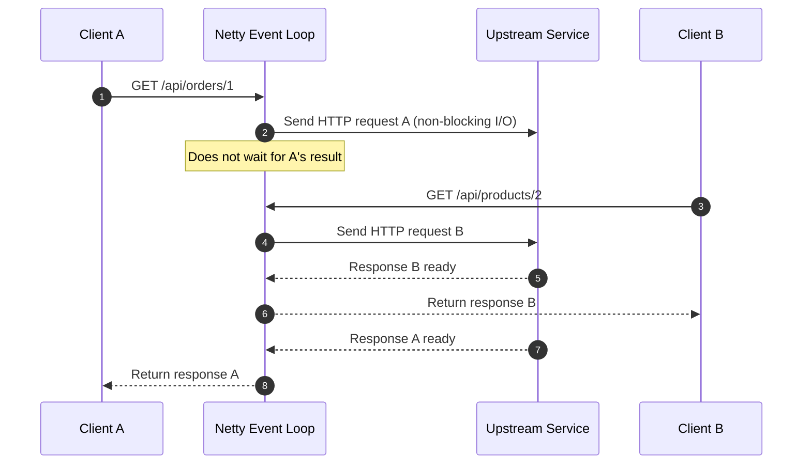
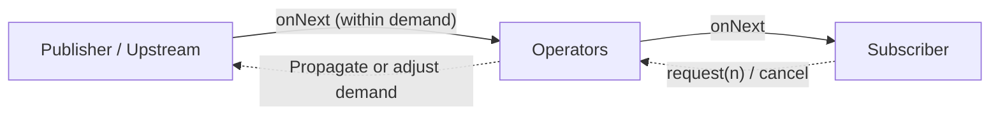
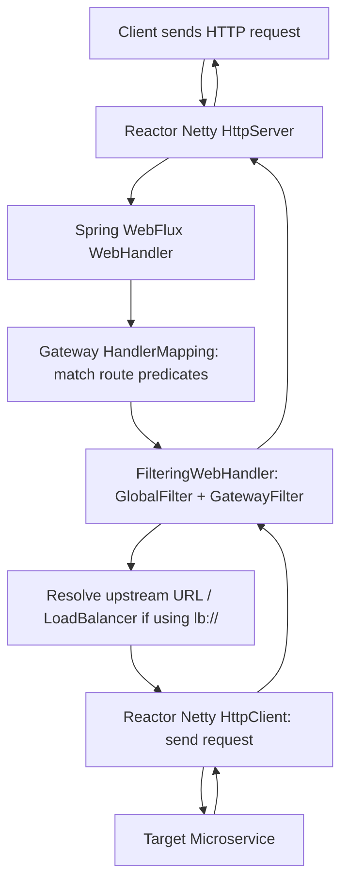

# Non-blocking Processing Model of Spring WebFlux and Reactor Netty

## 1. Background: Why Does an API Gateway Need Non-blocking Processing?

In a microservices system, **Spring Cloud Gateway** receives many HTTP requests from clients, resolves routes, executes filters, and forwards requests to target services. A request typically spends most of its time **waiting for I/O**: waiting for a connection, waiting for upstream processing, waiting to receive data, or waiting to send the response over the network.

If each request holds its own dedicated thread throughout the entire waiting period, the number of threads and context-switching overhead can grow sharply when many requests coexist. **Spring WebFlux** provides a reactive processing model, while **Reactor Netty** provides an HTTP server/client and a non-blocking I/O mechanism based on event loops. This combination allows a finite number of threads to serve many connections waiting on I/O.

Objectives of this lesson:

- Distinguish between **asynchronous** and **non-blocking**.
- Understand **event loop**, **Reactor Netty**, `Mono`, `Flux`, and **Reactive Streams**.
- Trace a request's journey through Spring WebFlux and Spring Cloud Gateway.
- Identify event-loop blocking operations and how to handle them when forced to call synchronous libraries.
- Understand the limits of backpressure, timeouts, memory, and observability in gateway operations.

> **Scope:** this lesson focuses on the WebFlux foundation used for the **Spring Cloud Gateway Server WebFlux** variant. Spring Cloud Gateway also has a Server MVC variant with a different deployment model. Configuration examples should be cross-referenced against the documentation corresponding to your actual Spring Cloud/Spring Boot version.

## 2. Blocking, Non-blocking, and Asynchronous: Not the Same Concept

A **blocking** call holds the thread at the call site until the operation completes (or times out). A **non-blocking** call does not hold the thread just to wait for I/O; when the resource becomes ready, the system receives an event and continues processing.

**Synchronous/asynchronous** refers to how results are coordinated: either calling and waiting for the result along the current control flow, or registering work to be done and receiving the result at another time. Asynchronous does not automatically mean non-blocking: you can offload a blocking JDBC call to another thread, but that new thread is still blocked while waiting on JDBC.

| Model | What happens when upstream has not responded yet? | Typical trade-off |
| --- | --- | --- |
| Blocking, each request has a processing thread | The thread stays in a waiting state for I/O results | Easy to write sequentially; many waiting requests can consume many threads |
| Async that offloads blocking work to a thread pool | The request-receiving thread can become free; the pool thread still waits on I/O | Avoids blocking the accepting thread, but still requires managing pool size |
| Non-blocking I/O with event loop | The thread performs other work and resumes processing when I/O events arrive | Reduces thread overhead under heavy I/O load; requires the entire processing chain to avoid blocking |

**Non-blocking does not mean zero latency.** An upstream call that takes 700 ms still has at least the latency corresponding to that waiting time. The benefit is that the thread can serve other work during the wait, enabling more efficient resource usage when concurrency is high and most time is spent on I/O.

### Illustration of Two Concurrent Requests



The diagram illustrates the **operating principle**; it does not claim the entire system has only one event-loop thread. Reactor Netty uses multiple event loops; other operations may use other schedulers/threads depending on configuration. Response order also depends on when the upstream completes.

## 3. Reactor Netty: The Event-Loop-Based HTTP and Network Layer

**Netty** is an asynchronous network processing framework based on channels, event loops, and handler pipelines. **Reactor Netty** builds HTTP/TCP APIs composable with Project Reactor on top of Netty. Spring WebFlux can use Reactor Netty as its HTTP server runtime; WebClient can also use Reactor Netty as its HTTP client connector.

Some components to distinguish:

| Component | Responsibility |
| --- | --- |
| `Channel` | Represents a connection or I/O channel |
| `EventLoop` | Monitors I/O events of channels and executes tasks bound to them |
| `ChannelPipeline` / handler | Processes inbound/outbound data such as HTTP decoding and response writing |
| Reactor Netty `HttpServer` | Receives HTTP requests from clients |
| Reactor Netty `HttpClient` | Sends HTTP requests to upstream without blocking threads while waiting on the network |
| Spring WebFlux | Adapts requests/responses into HTTP abstractions and coordinates reactive handlers/filters |

A channel is typically bound to an event loop to handle its I/O, but **there is no one-thread-per-request rule**. One event-loop thread can take turns handling events for many channels. This model relies on a critical condition: work executed on the event loop must be fast and, above all, must not wait on blocking operations.

### Conceptual I/O Lifecycle

1. The HTTP server receives new connections and data via Netty.
2. Netty decodes bytes into HTTP messages; WebFlux represents them as requests/responses for application-layer processing.
3. Handlers/Filters build a reactive processing chain and, when subscribed, perform the required work.
4. When needing to call another service, the HTTP client initiates I/O without holding the event-loop thread to wait for the result.
5. When new data or connection state arrives, the event loop continues processing signals; the pipeline completes writing the response.

Within an application, the HTTP server and HTTP client can share Reactor Netty's event-loop resources under default configuration or use separate resources when configured differently. You should not fix thread counts to the number of requests; resource configuration must be based on actual load and deployment characteristics.

**Memory is also a resource that must be managed.** Netty can use pooled `ByteBuf` buffers; Spring WebFlux provides `DataBuffer` at the application layer. If you write a custom filter that reads, caches, or modifies bodies, pay attention to buffer consumption and release rules to avoid memory leaks. Do not buffer entire large requests/responses into RAM if streaming is possible.

## 4. Project Reactor: Describing Work That Will Happen When Data Arrives

Spring WebFlux uses **Project Reactor** as its primary reactive library. The two central types are:

| Type | Maximum elements emitted | Common use cases |
| --- | --- | --- |
| `Mono<T>` | 0 or 1 | A JSON response, an authentication result, operation completion |
| `Flux<T>` | 0 to many | Event streams, streamed response data, multiple records |

Both `Mono` and `Flux` implement Reactive Streams publisher contracts. A reactive chain can emit the following signals:

- **`onSubscribe`**: the subscriber receives the subscription.
- **`onNext`**: a new data element is available (never used with a `null` value).
- **`onComplete`**: the stream completes normally.
- **`onError`**: the stream terminates due to an error.
- **`cancel`**: the subscriber no longer needs further data, for example when the client disconnects; how resources are cancelled depends on each component in the chain.

`onComplete` and `onError` are mutually exclusive terminal signals. A `Mono` can complete without emitting an element, such as `Mono.empty()`.

### Assembly and Subscription

Writing:

```java
Mono<String> message = Mono.just("gateway")
    .map(String::toUpperCase);
```

only **describes** the transformation chain. For **cold** publishers, the source work typically begins upon subscription. In Spring WebFlux, the framework subscribes to the `Mono`/`Flux` returned by a handler; developers generally **do not call `.subscribe()` manually** in a controller or filter to drive the response.

This distinction is critical when combining I/O:

```java
Mono<Product> product = webClient.get()
    .uri("/products/{id}", id)
    .retrieve()
    .bodyToMono(Product.class);
```

This describes an asynchronous HTTP call. Calling `product.block()` forces the current thread to wait for the result, losing the non-blocking benefit if invoked on the event loop.

Not every publisher is cold: Reactor also has **hot** sources that can emit data independently of individual subscribers. You need to understand the emission source and how subscriptions are shared when caching/multicasting data.

### Common Operators

| Operator | Usage | Notes |
| --- | --- | --- |
| `map` | Fast, synchronous data transformation | The function inside `map` can still block the thread if it invokes blocking I/O |
| `flatMap` | Composes another task returning `Mono`/`Flux` | Suitable for WebClient calls or asynchronous workflows |
| `filter` | Keeps only elements matching a condition | Different from a Gateway Filter that processes HTTP requests |
| `timeout` | Emits an error if the publisher does not meet the deadline | Timeout does not automatically roll back business work already executed upstream |
| `onErrorResume` | Handles errors with a fallback stream | Only use a fallback when business semantics allow it |
| `doOnNext`, `doOnError` | Observes signals for logging/metrics | Should not place blocking I/O inside callbacks |
| `subscribeOn`, `publishOn` | Schedules execution location via a scheduler | A scheduler does not turn a blocking operation into a non-blocking one |

## 5. Backpressure: Regulating Data Consumption Rate

**Backpressure** in Reactive Streams is the mechanism by which a subscriber can signal demand via `Subscription.request(n)`. A compliant publisher only emits `onNext` up to the permitted demand. As a result, the data pipeline can avoid producing faster than downstream can process.



For example, a slow-processing subscriber can request more data only after finishing the previous batch. Operators such as `buffer`, `flatMap`, and `limitRate` can alter how demand propagates upstream; concurrency/buffer settings must match memory and upstream capacity.

Avoid over-generalizing:

- **Backpressure in Reactor does not mean every external upstream supports Reactive Streams.** An HTTP server, messaging system, or database has its own throttling mechanisms. Reactor Netty coordinates reading/writing at the network layer, but demand does not automatically become a business quota for a backend API.
- **HTTP does not automatically protect the system under heavy load.** The gateway still needs connection limits, body size limits, rate limiting, timeouts, and resource management.
- When there is one `Mono` per request, the issue is usually **concurrent request count** rather than the number of elements in a `Flux`. Backpressure does not replace concurrency controls on the HTTP client and gateway.

## 6. How Does a Request Flow Through Spring Cloud Gateway Server WebFlux?

In the WebFlux flow, Reactor Netty handles HTTP I/O; Spring WebFlux provides request, response, and handler abstractions; Spring Cloud Gateway selects a route and runs the **Gateway Filter Chain**.



For HTTP(S) routes forwarded through Netty, the gateway's routing filter uses Reactor Netty's HTTP client to communicate with the upstream; the response is sent back to the client via the HTTP server layer. Filter details and execution order depend on configuration and Gateway version.

Distinguish three layers of responsibility:

1. **Route predicate:** decides whether a request matches a route, for example `Path=/api/orders/**`.
2. **Gateway filter:** transforms paths/headers, applies rate limiting, or enforces other configured policies.
3. **HTTP transport:** opens, reuses, and coordinates network connections; receives/sends bytes without blocking the event loop while waiting on I/O.

Spring WebFlux's `WebFilter` and Spring Cloud Gateway's `GatewayFilter`/`GlobalFilter` are **different abstractions**. Do not assume all filters execute at the same point in the request chain. Some tasks, such as authentication via Spring Security, may run in the WebFlux WebFilter chain before reaching gateway filters.

### Gateway Route Example

This is an **illustrative** example following the configuration style used in many **Spring Cloud Gateway Server WebFlux 4.x** projects. Configuration properties may differ in newer versions:

```yaml
spring:
  cloud:
    gateway:
      routes:
        - id: product-route
          uri: http://localhost:8081
          predicates:
            - Path=/api/products/**
          filters:
            - StripPrefix=1
```

When `GET /api/products/42` arrives at the gateway, the predicate matches the path; the filter strips the `/api` prefix; the HTTP client calls `GET http://localhost:8081/products/42`.

This configuration demonstrates **non-blocking routing at the I/O layer**. It does not yet add authentication, rate limiting, retries, circuit breaking, TLS, or service discovery. If using `lb://PRODUCT-SERVICE`, the corresponding dependencies/configurations for instance discovery and load balancing must be present. WebFlux does not enable those features automatically.

## 7. WebFlux Example: Calling Upstream via WebClient Without Blocking the Event Loop

The example below is a **standalone WebFlux controller to observe the reactive mechanism**; in pure routing with Spring Cloud Gateway, you normally use Gateway routes/filters instead of writing a controller for every API. Assume the application includes Spring WebFlux, Spring Boot provides `WebClient.Builder`, and an upstream is running at `http://localhost:8081`.

```java
import java.time.Duration;
import org.springframework.web.bind.annotation.GetMapping;
import org.springframework.web.bind.annotation.PathVariable;
import org.springframework.web.bind.annotation.RequestMapping;
import org.springframework.web.bind.annotation.RestController;
import org.springframework.web.reactive.function.client.WebClient;
import reactor.core.publisher.Mono;

@RestController
@RequestMapping("/demo")
class ProductController {
    private final WebClient webClient;

    ProductController(WebClient.Builder builder) {
        this.webClient = builder
                .baseUrl("http://localhost:8081")
                .build();
    }

    @GetMapping("/products/{id}")
    Mono<ProductView> getProduct(@PathVariable long id) {
        return webClient.get()
                .uri("/products/{id}", id)
                .retrieve()
                .bodyToMono(ProductView.class)
                .timeout(Duration.ofSeconds(2));
    }
}

record ProductView(long id, String name) {}
```

What happens?

1. `getProduct` returns `Mono<ProductView>`, without waiting for `WebClient` to complete inside the Java method.
2. Spring WebFlux subscribes to the publisher to send the response; Reactor Netty HTTP client performs asynchronous I/O.
3. When the response arrives, `bodyToMono` decodes JSON into `ProductView`, and the framework writes the HTTP response to the client.
4. `timeout` emits an error if the chain does not complete within the deadline; the final HTTP status code also depends on the application's error-mapping mechanism.

Do not call `.block()` or manually call `.subscribe()` inside a handler. `Mono` only enables non-blocking I/O when **the entire chain genuinely performs no blocking operations**.

Another example illustrates waiting with a timer without holding a thread:

```java
@GetMapping("/ready-later")
Mono<String> readyLater() {
    return Mono.delay(Duration.ofMillis(300))
            .map(tick -> "ready");
}
```

`Mono.delay` is not equivalent to `Thread.sleep(300)`: it schedules emitting a signal after a duration rather than putting the current thread to sleep for that duration.

## 8. Common Mistakes That Break Non-blocking Behavior

### 8.1. Blocking the Event Loop

The following operations can cause bottlenecks if executed directly on Netty/WebFlux processing threads:

```java
// Incorrect example when running on the event loop:
Thread.sleep(500);
String result = webClient.get()
        .uri("/status")
        .retrieve()
        .bodyToMono(String.class)
        .block();
```

Similarly, directly calling blocking JDBC, synchronous file I/O, synchronous HTTP clients, or heavy CPU computation inside a filter will slow down other connections served by that event loop. In many Reactor execution contexts that disallow blocking, `.block()` may also throw an exception to prevent this behavior.

**`Mono.just(blockingCall())` does not solve the problem** because `blockingCall()` is evaluated immediately as a method argument before the `Mono` is even created.

### 8.2. Isolating Unavoidable Blocking Operations

If a legacy library cannot yet be replaced with a reactive API, you can offload the blocking portion to an appropriate scheduler:

```java
import reactor.core.publisher.Mono;
import reactor.core.scheduler.Schedulers;

// legacyClient.loadProduct(id) is a synchronous, blocking call.
Mono<ProductView> product = Mono.fromCallable(
        () -> legacyClient.loadProduct(id)
    )
    .subscribeOn(Schedulers.boundedElastic());
```

`fromCallable` defers the call until subscription; `subscribeOn(Schedulers.boundedElastic())` shifts execution of the blocking source onto a scheduler designed for this kind of work. It **does not turn the legacy API into a non-blocking one**: `boundedElastic` threads remain occupied while the legacy library waits on I/O. Queues, thread limits, and pending task counts still need to be measured and controlled.

On high-traffic gateway paths, prefer end-to-end non-blocking APIs: Reactor Netty HTTP client, reactive database drivers where appropriate, and short data transformations. Do not overuse `boundedElastic` to mask a poor architectural choice.

### 8.3. Assuming Every Operator Has Its Own Thread

`map` and `flatMap` do not create new threads by default. Operators normally execute on whatever thread emits the signal at that point, unless a scheduler boundary or asynchronous logic switches the execution context. Two common scheduling operators are:

- `subscribeOn`: affects where the source is subscribed/executed.
- `publishOn`: switches the execution thread for downstream operators in the chain.

Therefore, a CPU-heavy `map` can still monopolize an event-loop thread. For heavy CPU tasks, consider offloading to an appropriate worker pool, bounding concurrency, and measuring scheduling overhead; do not create a new scheduler per request by default.

### 8.4. Relying on ThreadLocal for Request Data

Because processing can cross different threads, `ThreadLocal` is not the default choice for passing context across a reactive chain. Reactor provides **`Context`** attached to the subscriber to carry appropriate metadata; reactive Spring Security also structures its security context reactively. When writing filters, logging, or tracing, use context propagation mechanisms compatible with your libraries and versions.

## 9. Timeouts, Cancellation, and Model Limits

### Timeouts and Retries

In a gateway, end-to-end latency consists of many parts: client connection, filter processing, DNS/discovery, upstream connection, upstream response time, and writing data back to the client. A publisher-level `timeout` can stop waiting and emit an error, but it does not guarantee cancelling work or business state changes that already occurred on the remote system.

Especially with `POST /payments` or order-creation operations, **retries can cause duplicate side effects** if the upstream processed the request successfully but the response was lost. You need to design idempotency and limit retries; not every `5xx` error is safe to retry.

### Client Disconnection and Cancellation

When a client closes the connection or stops consuming data, parts of the pipeline may receive a cancellation signal. Cancellation helps release associated resources when supported by publishers and transport; it **does not guarantee** immediately stopping work already handed off to an independent upstream. Do not rely on cancellation to implement business rollback.

### Streaming and Memory

For large responses or long-lived streams (such as Server-Sent Events), `Flux` enables streaming processing instead of buffering all elements before writing. Still, streaming requires bounding buffers, connections, and handling client consumption rates. An improperly implemented custom body-caching filter can exhaust RAM or leak buffers even when the entire pipeline uses reactive APIs.

## 10. Observing and Diagnosing a WebFlux Gateway

The event-loop model requires different operational indicators than applications where you only look at thread counts. Key signals to monitor include:

| Symptom | Hypothesis to check | Investigation direction |
| --- | --- | --- |
| p95/p99 latency spikes under high concurrency | Event loop is blocked, upstream is slow, or connection pool is exhausted | Distributed traces, thread dumps, per-route latency, upstream wait times |
| High CPU despite low network activity | Heavy JSON transformation/crypto/computation running on the event loop | CPU profiling, task duration, CPU-intensive operators/filters |
| Requests hang or time out frequently | Upstream overloaded, missing timeouts, no available connections | Per-hop timeouts, connection pool metrics, upstream health |
| RAM/direct memory grows | Excessive body buffering, unbounded cache, or `DataBuffer`/`ByteBuf` leak | Heap/direct-memory metrics, leak warning logs, payload sizes |
| Many `boundedElastic` threads busy | Blocking calls inside the reactive chain | Thread dumps, task queues, synchronous library call sites |
| High `429`/`503` rate | Rate limiting or discovery/upstream not ready | Filter metrics, instance health, per-route dashboards |

During development, you can use blocking-detection tools such as **BlockHound** when compatible with your project environment; results should be interpreted according to actual libraries, versions, and configurations. In production, combine **Micrometer metrics**, distributed tracing, and logs with correlation IDs; never log tokens or sensitive information.

A common misconception: if the gateway starts processing quickly but the upstream takes 800 ms, client latency will still be around 800 ms or more. Non-blocking prevents the gateway from holding a thread while waiting; **it does not make the upstream compute faster**.

## 11. Checklist for Applying to Spring Cloud Gateway

1. Verify you are using **Spring Cloud Gateway Server WebFlux** and its corresponding runtime; do not mix in Spring MVC assumptions.
2. Use non-blocking filters; audit for `.block()`, `Thread.sleep`, synchronous JDBC/HTTP clients, and heavy CPU processing on the request path.
3. Use `Mono`/`Flux` to **return publishers to the framework**; avoid manual `.subscribe()` in controllers/filters for the response flow.
4. If you must use a blocking library, isolate it on an appropriate scheduler and set load limits; plan to replace it with a non-blocking API when needed.
5. Manage connection pools, timeouts, request/body sizes, and concurrency; do not treat backpressure as a replacement for rate limiting.
6. Configure retries only when idempotency is understood; distinguish transport errors from business errors.
7. For filters that read/cache the body, verify proper `DataBuffer` consumption and release; avoid unbounded buffering.
8. Attach metrics and traces to routes/requests to detect slow upstreams, event-loop stalls, memory leaks, and HTTP errors.

### Self-Check Scenario

The gateway receives 2,000 concurrent requests; each upstream responds after about 600 ms. If the gateway only uses Reactor Netty to send, receive, and forward HTTP, the event-loop threads can handle many requests while waiting for I/O. If a custom filter calls `Thread.sleep(600)` on the event loop for **each** request, the gateway can stall even while the upstream remains healthy.

Ask yourself when debugging: **Which thread is waiting?** If a thread is only notified when I/O is ready, the design is leveraging non-blocking behavior. If a thread is held in `sleep`, `block`, or a synchronous API, remove or isolate the blocking point before considering increasing the event-loop thread count.

## 12. Key Takeaways

**Spring WebFlux** provides the reactive HTTP programming model; **Project Reactor** provides `Mono`, `Flux`, signals, and backpressure; **Reactor Netty** provides HTTP transport based on non-blocking I/O and event loops. **Spring Cloud Gateway Server WebFlux** combines these layers with route predicates and a filter chain to forward requests to microservices.

The most important factor is not whether a method returns `Mono` or `Flux`, but whether **the entire request processing path avoids blocking and properly controls resources**. Understanding this gives you the foundation to design routes/filters, authentication, rate limiting, circuit breakers, retries, TLS, and observability for a gateway that remains safe and stable as load grows.
