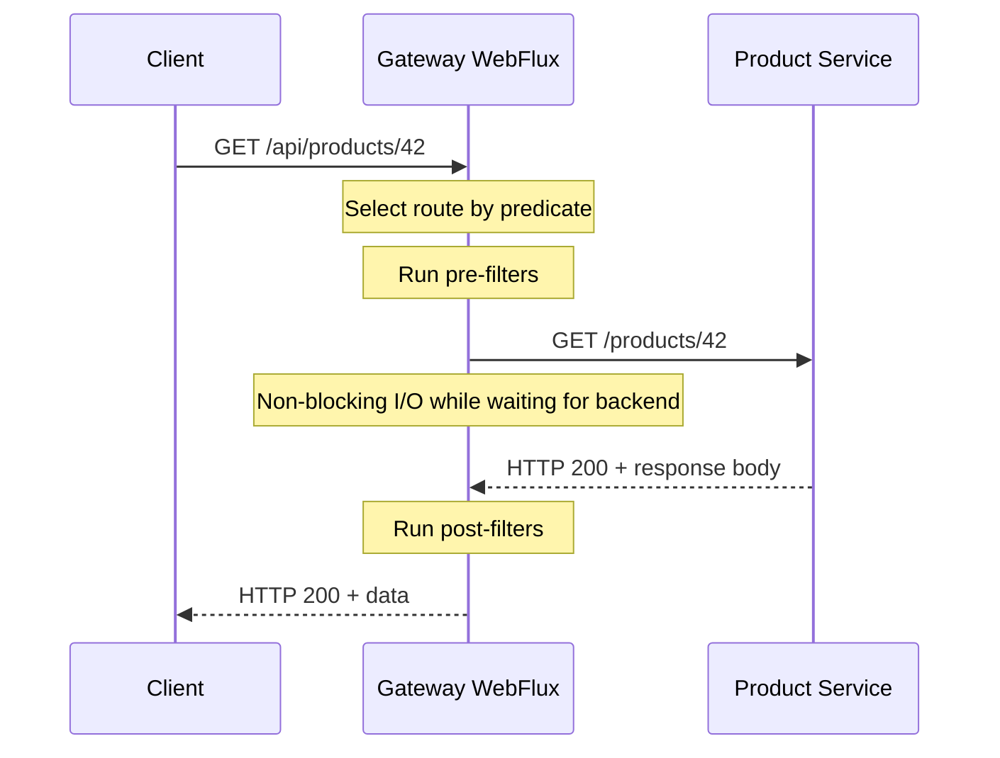
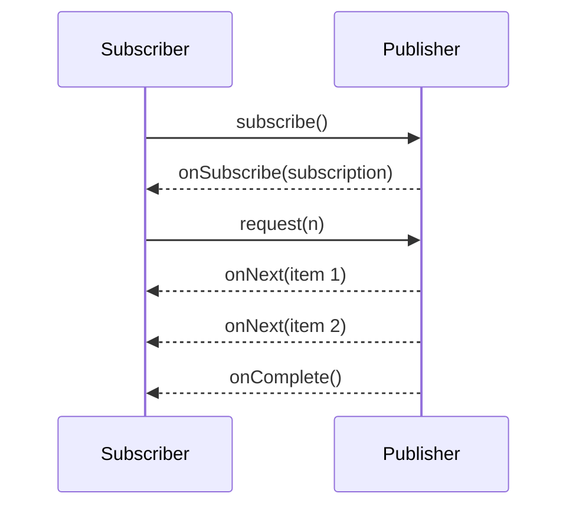
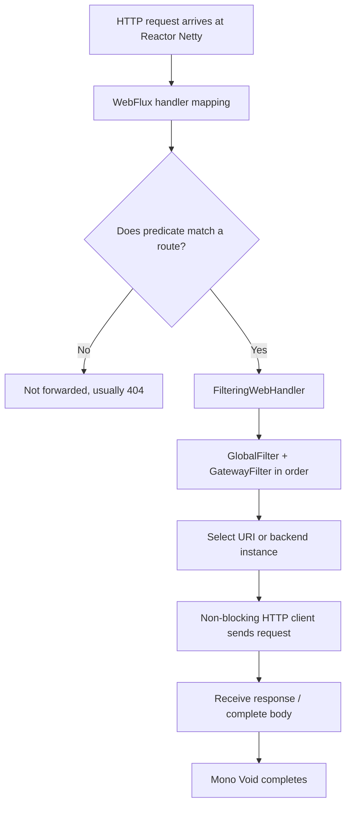

# Mono, Flux, and How Asynchronous HTTP Requests Are Represented in Spring Cloud Gateway

**Spring Cloud Gateway Server WebFlux** builds its HTTP ingress and forwarding pipeline on Spring WebFlux, Project Reactor, and a network foundation that supports non-blocking I/O such as Reactor Netty. Therefore, when reading or writing filters for an API Gateway, you need to understand why methods typically return `Mono` or `Flux`, when processing actually executes, and why you should avoid calling thread-blocking operations.

In the `SPRING_CLOUD_GATEWAY` module, this knowledge is the foundation for combining **route predicates**, the **filter chain**, path/header transformations, and forwarding to downstream services, including services discovered via `lb://`. The same reactive mindset also helps build authentication, rate limiting, circuit breaking, retries, TLS, and request observability without stalling the entry point to microservices.

## 1. How Does an HTTP Request Flow Through the Gateway?

Suppose a client calls `GET /api/products/42`. The gateway needs to select a route by predicate, strip the `/api` prefix, and forward to the Product Service at `/products/42`. While waiting for the connection and data from the backend, the process does not need to dedicate a thread solely to stand idle waiting.



With this model, a request may have to wait tens or hundreds of milliseconds for the backend. Non-blocking I/O allows thread resources to handle events from other connections during that waiting interval. This is a major advantage when the gateway must handle many concurrent connections, but **it does not mean every piece of code running in WebFlux automatically becomes asynchronous or non-blocking**.

Distinguish the following concepts:

| Concept | Meaning | Example |
| --- | --- | --- |
| **Asynchronous** | Work can complete and report its result later, without forcing the caller to receive the result immediately. | Sending an HTTP request to the backend and handling the response when data arrives. |
| **Non-blocking** | A thread does not have to sit idle waiting for an I/O operation to finish. | Reactor Netty handling network events instead of using `Thread.sleep()` to wait. |
| **Reactive** | Representing streams of signals and composing processing steps via publishers/operators/subscribers. | The `Mono<Void>` returned by a `GlobalFilter`. |
| **Parallel** | Multiple tasks genuinely execute simultaneously on different execution resources. | CPU processing across multiple workers when an explicit scheduler is designed. |

A reactive pipeline can execute **sequentially on the same thread**. It does not automatically spawn extra threads, nor does it fix a library that performs blocking I/O internally.

## 2. Reactive Streams: Signals Instead of Immediately Available Values

Project Reactor implements the **Reactive Streams** model, in which:

- **Publisher** is the source that emits data or termination events; in Reactor you commonly encounter `Mono<T>` and `Flux<T>`.
- **Subscriber** receives data and status signals from the publisher.
- **Subscription** links both sides; the subscriber can request how many elements it wants to receive (`request(n)`) or cancel (`cancel()`).
- The core signals include `onSubscribe`, `onNext`, `onComplete`, and `onError`. After `onComplete` or `onError`, the stream terminates.

In terms of sequence:



If an error occurs, `onError` replaces `onComplete`. If the subscriber cancels, the publisher can stop work in progress to the extent supported by the underlying data source; cancellation does not guarantee that all side effects at the backend are rolled back.

**Core point:** building a `Mono` or `Flux` chain primarily **describes the work**. Most publishers used in HTTP processing only start the data source when subscribed to. In Spring WebFlux, the framework is responsible for subscribing to the publisher returned by a handler or filter. **Do not call `subscribe()` yourself inside a gateway filter just to "trigger" a backend call**, because that creates a processing branch outside the HTTP lifecycle, making it hard to coordinate errors, completion, and request cancellation.

> `Mono.just(value)` captures the provided value immediately when constructing the publisher; `Mono.defer(...)` defers invoking the factory until subscription time. Distinguish "constructing a publisher" from "executing the data source" when working with operations that have side effects.

## 3. Where Do Mono and Flux Differ?

`Mono<T>` represents a stream with **at most one element**; `Flux<T>` represents a stream with **zero to many elements**. Both can complete successfully, terminate with an error, or be cancelled.

| Criterion | `Mono<T>` | `Flux<T>` |
| --- | --- | --- |
| Number of `onNext` signals | 0 or 1 | 0, 1, or many |
| Successful completion | `onComplete`, possibly with no data | `onComplete` after 0 or more elements |
| Error termination | `onError` | `onError` |
| Common scenarios | Fetching one product, validating one token, response-write completion signal | Event streams, multiple records, request/response data chunks |
| Type examples | `Mono<ProductDto>`, `Mono<Void>` | `Flux<ProductDto>`, `Flux<DataBuffer>` |

### 3.1. Mono: None, One, or Error

```java
Mono<String> one = Mono.just("product-42");
Mono<String> none = Mono.empty();
Mono<String> failed = Mono.error(new IllegalStateException("Backend unavailable"));
```

- `one` emits one string and then completes.
- `none` completes **without emitting any element**; this is not automatically an error.
- `failed` emits an error signal; turning the error into a response or fallback requires an appropriate handling policy.

A very important type in the Gateway is **`Mono<Void>`**. It holds no business payload to extract with `map`; it represents **that processing has completed or failed**. This does not mean the HTTP response is empty: filters can write headers/bodies to `ServerHttpResponse`, and the publisher completes when response processing finishes.

### 3.2. Flux: Multiple Elements Over Time

```java
Flux<String> statuses = Flux.just("accepted", "routed", "completed")
    .map(String::toUpperCase);
```

`Flux` can emit elements one by one as the source produces them. For example, a backend returning **Server-Sent Events (SSE)**, or a request/response body transferred across multiple data chunks. Conversely, returning `Flux<ProductDto>` from a controller **does not mean** the client will receive multiple HTTP responses; normally there is still **one HTTP response**, serialized as a JSON array or streamed depending on the media type and how the body is written.

A `Flux` does not inherently emit data continuously; it can complete very quickly. Likewise, `Flux` does not inherently run on another thread.

### 3.3. HTTP Example in a WebFlux Backend

Suppose the Product Service has `ProductService.findById(id)` returning `Mono<ProductDto>`. A handler can express three outcomes clearly:

```java
@GetMapping("/products/{id}")
public Mono<ResponseEntity<ProductDto>> findOne(@PathVariable String id) {
    return productService.findById(id)
        .map(product -> ResponseEntity.ok(product))
        .defaultIfEmpty(ResponseEntity.notFound().build());
}
```

Here:

1. Product exists: emits a `ResponseEntity<ProductDto>` with status 200.
2. Product does not exist: `Mono.empty()` from the service is converted to status 404 via `defaultIfEmpty`.
3. Error occurs: the publisher emits `onError`; the application's global error handler determines the HTTP response if the error is not caught in the chain.

This example shows the return style of a **WebFlux backend**. Spring Cloud Gateway normally routes and forwards via built-in filters rather than manually writing a controller that calls each backend with `WebClient` for every route.

## 4. Composing Operations with Operators

Reactor's strength lies in describing a chain of work while preserving subscription, error, and cancellation lifecycles. Essential operators include:

| Operator | When to use | Notes |
| --- | --- | --- |
| `map` | Synchronously transform one element into another value. | The inner function must be fast and non-blocking. |
| `flatMap` | Transformation returns another `Publisher`, such as a reactive I/O call. | Avoid nesting `Mono<Mono<T>>` and avoid calling `block()` to unwrap results. |
| `filter` | Keep an element when a condition is true. | For `Mono`, a false condition can yield `Mono.empty()`. |
| `then` | Wait for the preceding publisher to complete, then continue with another publisher; discards the previous value. | Very common in flows returning `Mono<Void>`. |
| `defaultIfEmpty` / `switchIfEmpty` | Define the outcome if the publisher completes without emitting an element. | "No data" is different from "error". |
| `onErrorResume` | Choose an alternative publisher when an error occurs. | Do not silently swallow system errors arbitrarily. |
| `doOnNext` / `doOnError` / `doFinally` | Observe signals for logging/metrics. | Avoid placing blocking side effects or logging sensitive data. |
| `timeout` | Emit a timeout error if the source does not emit expected signals in time. | Consider real HTTP timeouts/conditions and whether the response is already committed. |

For example, a WebFlux backend uses non-blocking `WebClient` to query another service:

```java
public Mono<ProductDto> findById(String id) {
    return webClient.get()
        .uri("/products/{id}", id)
        .retrieve()
        .bodyToMono(ProductDto.class)
        .timeout(Duration.ofSeconds(2));
}
```

`retrieve()` by default turns HTTP 4xx/5xx statuses into a `WebClientResponseException` error unless configured otherwise. `bodyToMono` only describes reading and decoding the response; the actual network request starts upon subscription to the chain. When composing into a handler, **return** the publisher for WebFlux to manage.

Compare two styles:

```java
// Reactive approach: chain tasks into a single pipeline.
return productService.findById(id)
    .flatMap(product -> inventoryService.check(product));

// Wrong in a reactive handler/filter: blocks the thread waiting for a value.
ProductDto product = productService.findById(id).block();
return inventoryService.check(product);
```

`block()` waits synchronously until a result arrives, forfeiting non-blocking I/O benefits; on Reactor threads marked as non-blocking, it can also throw an exception.

## 5. Integrating Mono with the Lifecycle of an HTTP Request at the Gateway

An HTTP request normally corresponds to a `ServerWebExchange` object holding the processing context:

- `exchange.getRequest()`: `ServerHttpRequest` with method, URI, path, headers, and body.
- `exchange.getResponse()`: `ServerHttpResponse` with status, headers, and body-writing capabilities.
- `exchange.getAttributes()`: internal request attributes, including selected route information once the Gateway has routed the request.

For **Spring Cloud Gateway Server WebFlux**, a simplified view:



In code, both `GlobalFilter` and `GatewayFilter` share the method:

```java
Mono<Void> filter(ServerWebExchange exchange, GatewayFilterChain chain);
```

Calling `chain.filter(exchange)` returns a publisher representing **the remainder of the processing chain**. A filter can perform work before calling `chain.filter`, then attach operators to observe completion/error/cancellation signals from the chain.

- **Pre-phase:** evaluate conditions, authentication/context already handled at the appropriate layer, modify request path/headers before sending to the backend.
- **Post-phase:** observe timing, add response logic timed properly before the response commits, record metrics, and handle errors appropriately.

The terms "pre/post" describe positions in the filter chain, **not two separate HTTP requests**. Alongside gateway filters, there is also Spring WebFlux/Spring Security's `WebFilter`, which can process requests at the WebFlux layer outside route selection.

### 5.1. Example GlobalFilter Measuring Non-blocking Latency

```java
import java.util.concurrent.TimeUnit;
import org.slf4j.Logger;
import org.slf4j.LoggerFactory;
import org.springframework.cloud.gateway.filter.GatewayFilterChain;
import org.springframework.cloud.gateway.filter.GlobalFilter;
import org.springframework.cloud.gateway.route.Route;
import org.springframework.cloud.gateway.support.ServerWebExchangeUtils;
import org.springframework.core.Ordered;
import org.springframework.stereotype.Component;
import org.springframework.web.server.ServerWebExchange;
import reactor.core.publisher.Mono;

@Component
public class GatewayLatencyFilter implements GlobalFilter, Ordered {
    private static final Logger log =
        LoggerFactory.getLogger(GatewayLatencyFilter.class);

    @Override
    public int getOrder() {
        return -10;
    }

    @Override
    public Mono<Void> filter(ServerWebExchange exchange, GatewayFilterChain chain) {
        long startedAt = System.nanoTime();
        Route route = exchange.getAttribute(ServerWebExchangeUtils.GATEWAY_ROUTE_ATTR);
        String routeId = route == null ? "unknown" : route.getId();

        return chain.filter(exchange)
            .doFinally(signal -> {
                long elapsedMs = TimeUnit.NANOSECONDS.toMillis(
                    System.nanoTime() - startedAt
                );
                log.info("route={} elapsedMs={} signal={}",
                    routeId, elapsedMs, signal);
            });
    }
}
```

Explanation:

1. `routeId` is retrieved from the selected route; logging the route name is usually more useful than logging the full URI containing sensitive parameters.
2. `chain.filter(exchange)` is not detached from the current request. Gateway/WebFlux manages subscription and response handling.
3. `doFinally` runs when the chain finishes with success, error, or cancellation (for example, when the client disconnects). `signal` helps distinguish those cases.
4. `getOrder()` is part of filter ordering rules; in the ordered chain, a filter with higher priority runs earlier in the pre-phase and later in the post-phase.

This is an example of **timing the chain lifecycle**, not a complete latency measurement system. In production, prefer built-in Micrometer/Actuator/tracing, limit metric tag cardinality, use an async logger if logging could block, and never log tokens or personal data.

### 5.2. Do Not Mistake Mono<Void> for a Missing Response

```java
return chain.filter(exchange)
    .doOnError(error -> log.warn("Gateway filter failed", error));
```

The method still returns `Mono<Void>`, while the response is handled by subsequent filters and the HTTP response writer. `doOnError` only **observes** the error; it does not automatically convert the error into JSON or a status code. If you want to handle errors, you must consider the status, response body, and whether the response may already have been partially sent; never attempt to write a response a second time once it is committed.

## 6. Flux<DataBuffer>: The HTTP Body Can Also Be a Stream

In Spring WebFlux, the request body can be provided as:

```java
Flux<DataBuffer> body = exchange.getRequest().getBody();
```

`DataBuffer` represents a region of byte data; a body can consist of multiple buffers arriving at different times. The gateway can forward them without always loading the entire body into a single large `String` or `byte[]`.

Points to remember:

- **Headers and bodies have different lifecycles.** Headers are usually known upfront; the body may not have fully arrived when a filter starts running.
- **The body may be readable only once.** A filter that consumes `getBody()` itself before calling `chain.filter(exchange)` can leave downstream with no data to read, unless caching/decorating is performed properly.
- **Large payloads have memory costs.** A filter that transforms the body, decodes JSON, or caches payloads may need to aggregate data and increase RAM usage. Control payload sizes and use built-in filters where appropriate.
- **Buffers must follow lifecycle management rules.** With pooled buffers, custom code must adhere to retain/release rules when keeping, reading, or recreating buffers. Do not hold onto a `DataBuffer` across asynchronous steps unless you understand its ownership contract.
- **Transferring multiple chunks does not create multiple requests.** One HTTP request can have a `Flux<DataBuffer>` body while the Gateway still creates a single request/response processing chain for that exchange.

When you need to rewrite payloads, prefer Spring Cloud Gateway's built-in mechanisms such as `ModifyRequestBody` or `ModifyResponseBody`, while understanding codec limits, sizes, and header handling such as `Content-Length`. Write custom decorators only when you need specific control over consuming and re-emitting the body.

### 6.1. Backpressure Is Not Rate Limiting

Reactive Streams defines **backpressure**: a subscriber signals element demand via `request(n)`, helping a supporting publisher pace emission rates. For HTTP streams, actual behavior is also influenced by codecs, buffers, forwarding components, and network protocol flow control.

| Backpressure | API rate limiting |
| --- | --- |
| Regulates the **number of elements in a stream** being consumed. | Limits the **number of requests** or usage per client/key within a time window. |
| Involves subscription/demand signals and data sources. | Typically implemented via filters such as `RequestRateLimiter` before calling the backend. |
| Does not identify users or enforce quotas on its own. | Requires defining keys, thresholds, state-sharing strategies, and responses when limits are exceeded. |

Having backpressure does not mean gateway requests are automatically limited by IP/API key. Conversely, enabling rate limiting does not replace memory-safe body stream handling.

## 7. Errors, Timeouts, Cancellation, and Retries in a Reactive Pipeline

A Reactor pipeline can end with `onComplete`, `onError`, or be `cancel`ed. However, **HTTP 4xx/5xx status codes do not always trigger an `onError` signal** at every layer: a gateway can forward a 503 response from the backend as-is, and the reactive pipeline still completes normally after writing the response. Distinguish HTTP wire statuses from publisher errors.

| Scenario | Observable behavior | Handling approach |
| --- | --- | --- |
| Backend returns a valid `503` | The gateway may receive and forward the response; the pipeline still completes. | Use Gateway status/circuit-breaker/retry policies; do not assume `doOnError` will catch it. |
| Backend connection refused | The I/O component emits an error signal. | Configure appropriate timeouts, error handling, and circuit breakers. |
| Client cancels request mid-flight | The chain may receive a cancellation signal. | Release resources and avoid writing a response after the client has disconnected. |
| Backend is slow past deadline | A timeout error may be emitted by an operator or network timeout. | Define connection/response timeouts and latency budgets per route. |

`Retry` can cause the publisher **to be re-subscribed**. For an HTTP call, this can result in resending the request. Therefore, distinguish:

- **Idempotent:** calling the same operation multiple times has the same intended effect, such as many `GET` read operations.
- **Has side effects:** creating orders, charging money, or writing data can execute multiple times if retries lack idempotency design.
- **Body already sent:** retrying requests with a body requires considering body replayability and caching overhead; a body stream cannot necessarily be read twice.

The gateway provides built-in filters and mechanisms for retries/circuit breaking. Do not arbitrarily wrap `chain.filter(exchange)` with `retry()` assuming all cases are safe, especially once the response has started sending or the backend has already processed the business logic.

A standalone Reactor example illustrates the difference between empty data and an error:

```java
Mono<String> lookup = Mono.<String>error(
        new IllegalStateException("Temporary lookup failure"))
    .onErrorResume(error -> Mono.just("fallback"));

// lookup emits "fallback", then onComplete.
```

`onErrorResume` is a deliberate business choice; overusing it in the Gateway can mask real failures, hinder observability, and return misleading responses to clients.

## 8. Schedulers, Blocking Code, and Request Context

### 8.1. Do Not Block the Event Loop

Spring Cloud Gateway Server WebFlux typically runs on network event-processing threads. If a filter performs any of the following, many connections can be impacted:

```java
Thread.sleep(1000);              // Blocks the current thread.
String value = jdbcCall();       // Assumes this is a synchronous JDBC call.
String result = mono.block();    // Synchronously waits on a publisher.
```

Prefer non-blocking clients (`WebClient`, appropriate reactive drivers), asynchronous APIs, and built-in Gateway filters. Returning a `Mono` does not magically turn a blocking call inside it into a non-blocking one.

When forced to integrate a legacy blocking library, you can isolate **the blocking call** onto an appropriate scheduler:

```java
Mono<LegacyResult> result =
    Mono.fromCallable(() -> legacyClient.fetch())
        .subscribeOn(Schedulers.boundedElastic());
```

This offloads the work onto dedicated resources, but the library still blocks and still needs concurrency limits, timeouts, and load monitoring. This is a **transitional workaround**, not an excuse to wrap every filter in `boundedElastic`. Heavy CPU work requires dedicated design; `publishOn`/`subscribeOn` should not be sprinkled arbitrarily.

### 8.2. Per-Request Data and Context

Reactive execution can hop across threads. Therefore, you should not rely solely on custom `ThreadLocal` variables to carry user IDs, trace IDs, or request metadata across operators. Depending on the goal, you can use:

- `ServerWebExchange` and exchange attributes for per-request data within the Gateway.
- **Reactor Context** to propagate context alongside the subscription through supporting operators.
- **Micrometer Tracing** integration and corresponding context propagation mechanisms for cross-service observability.

Regardless of the mechanism, a correlation ID sent by a client must be evaluated for validity and trust boundaries. A self-declared header does not prove identity or authorization. Authentication, authorization, and token protection must be handled at the proper security layer, typically involving Spring Security and backends.

### 8.3. TLS and Reactive I/O

Reactive governs how the application consumes HTTP events; it **does not configure TLS automatically**. When the Gateway terminates HTTPS or connects to an upstream over HTTPS, you still must configure certificates, trust stores, hostname verification policies, and mTLS if required by the system. Transport encryption and non-blocking pipeline design are complementary responsibilities.

## 9. Observing and Testing the HTTP Flow

A classic failure is a slow gateway where logs only show that a route matched. To diagnose effectively, observe all of the following together:

1. **Incoming request:** method, route ID, arrival timestamp, and valid correlation/trace ID.
2. **Route/predicate:** which route matched, and whether the gateway actually forwarded the request.
3. **Filter chain:** which filters modified paths or headers, and whether any blocking operations or oversized body caches occurred.
4. **Upstream:** whether connection succeeded, whether an instance came from discovery, backend wait time, and configured timeouts.
5. **Outcome:** actual HTTP status, Reactor completion/error/cancellation signal, response size, and latency.

**Never log sensitive bodies, access tokens, or credentials** just for debugging. For tracing/metrics, prefer integrated, standardized tooling instead of creating custom counters with overly high-cardinality tags (such as full paths containing IDs).

### 9.1. Testing Operators with StepVerifier

When a Reactor transformation is independent of HTTP, you can verify exact signals:

```java
StepVerifier.create(
        Mono.just("gateway").map(String::toUpperCase)
    )
    .expectNext("GATEWAY")
    .verifyComplete();
```

`StepVerifier` comes from the `reactor-test` library; it tests both emitted values and how the stream terminates. For Gateway routes and filters, combine HTTP testing with `WebTestClient` or integration tests backed by a mock upstream to check statuses, forwarded paths/headers, timeouts, and mid-flight client cancellations. Do not merely test that a `Mono` can be constructed.

### 9.2. Common Mistakes

| Symptom | Cause to check |
| --- | --- |
| Response returns immediately while background work continues | A filter called `subscribe()` separately and returned `Mono.empty()`, detaching the task from the request lifecycle. |
| Gateway slows down sharply as connection count rises | `block()`, synchronous JDBC, thread sleeping, or blocking logging on the event loop. |
| Backend receives an empty body after a filter | The filter consumed `Flux<DataBuffer>` without properly re-emitting the body. |
| `doOnError` is not triggered even though client receives 5xx | 5xx is a forwarded HTTP status; the pipeline does not necessarily emit `onError`. |
| Retries create duplicate records | A request with side effects was re-executed after the backend already processed the previous attempt. |
| Missing trace/context after thread switching | Relied on `ThreadLocal` without corresponding context propagation. |

## 10. Practice Exercises

**Exercise 1 — Choose Mono or Flux.** Pick the appropriate publisher type for each case:

- (a) Find one product by identifier.
- (b) Stream a continuous sequence of SSE events.
- (c) Return a signal when the entire filter chain finishes.
- (d) Read byte chunks of a request body.

**Suggested answers:** (a) `Mono<ProductDto>`, (b) `Flux<ServerSentEvent<?>>` or `Flux<EventDto>` depending on the API, (c) `Mono<Void>`, (d) `Flux<DataBuffer>`.

**Exercise 2 — What happens when a filter calls subscribe itself?** Consider this snippet:

```java
public Mono<Void> filter(ServerWebExchange exchange, GatewayFilterChain chain) {
    auditService.saveEvent(exchange).subscribe();
    return chain.filter(exchange);
}
```

**Analysis:** `saveEvent` runs under a separate subscription. Errors or request cancellation no longer fully govern the audit task; completion order is not guaranteed either. If the audit event is a required part of the request, **compose that publisher into the returned chain**, such as `return auditService.saveEvent(exchange).then(chain.filter(exchange));`, assuming `saveEvent` returns `Mono<Void>` and running before the backend call is the right requirement. If auditing must run independently, use a dedicated queuing and delivery-guarantee mechanism rather than calling `subscribe()` arbitrarily inside a filter.

**Exercise 3 — Distinguish HTTP errors from error signals.** The backend successfully sends a `503 Service Unavailable` response at the protocol level. Does `onError` on the gateway's publisher necessarily fire?

**Answer:** No. The gateway can forward the 503 response and the processing chain completes normally. You must inspect HTTP statuses and Gateway policies in addition to reactive signals.

**Exercise 4 — Identify processing stages.** Given route `Path=/api/products/**`, filter `StripPrefix=1`, and URI `lb://product-service`, how is `GET /api/products/42` handled?

**Answer:** The predicate selects the route, the filter rewrites the path to `/products/42`, the load balancer selects a registered `product-service` instance, and the Gateway forwards via its non-blocking HTTP client when those supporting components are enabled. The filter chain's `Mono<Void>` signals when processing completes, not an object containing the product. Authentication, rate limiting, retries, and observability can participate at appropriate layers/filters but must be configured separately.

## 11. Key Takeaways for Building a Safe Gateway

`Mono` represents **0–1 elements**, `Flux` represents **0–N elements**; both provide completion, error, and cancellation signals. In Spring Cloud Gateway Server WebFlux, an HTTP request is managed via `ServerWebExchange`, and `GatewayFilterChain.filter(...)` returns `Mono<Void>` to bind the entire processing lifecycle into a single pipeline.

To use this model properly, **return publishers to the framework**, compose tasks with operators, avoid blocking on the event loop, handle the body as a stream with clear lifecycle and resource ownership, and distinguish HTTP status codes from Reactive Streams errors. From that foundation, you can configure routes, secure TLS connections, apply authentication/rate-limiting policies, integrate retries/circuit breakers, and observe requests across microservices in a controlled way.
