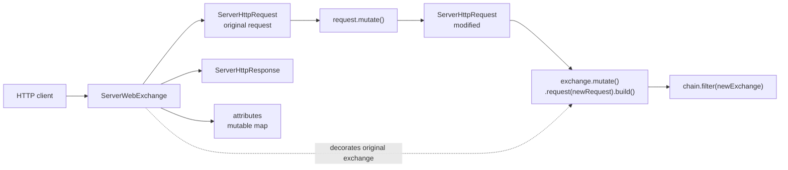
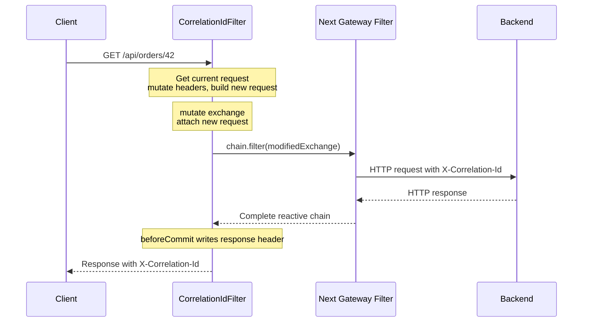

# Immutability and the Mechanism for Mutating a Request or Exchange

In Spring WebFlux, requests are processed by a chain of reactive components: filters, handlers, and asynchronous operations that can continue executing at different times. When using **Spring Cloud Gateway** as the entry point to microservices, you often need to add identifying headers, normalize paths, propagate observability metadata, or adjust a request before forwarding it to a backend. The right approach is to **create a modified version of the request/exchange and pass that version down the filter chain**.

This forms the basis for tasks across **SPRING_CLOUD_GATEWAY**: route predicates decide which route matches, the gateway filter chain enforces policies and can transform paths/headers, service discovery combined with load balancing chooses a backend, and authentication, rate limiting, circuit breakers, retries, TLS, and observability all need to operate cleanly on the request/exchange to avoid inconsistent state.

## 1. Why Does WebFlux Prefer an Immutability-Oriented Approach?

In traditional servlet processing, developers often picture a request tied to a single thread of execution. WebFlux uses a reactive, non-blocking model: a single request can traverse multiple `Mono`/`Flux` operators and callbacks, and continue executing on different threads depending on schedulers and asynchronous operations.

If filters arbitrarily mutated the same request object in place as shared mutable state, tracking who modified data, when it changed, and which version was sent downstream would be very difficult. Spring WebFlux therefore models **`ServerHttpRequest`** as **read-only from the caller's perspective**, and provides a **builder via `mutate()`** when you need to construct a request with updated values.

For example: a client sends `GET /api/orders/42`, and the gateway needs to add `X-Correlation-Id` before calling `order-service`. Rather than modifying the existing request in place, the gateway builds a new request with the additional header, then wraps that request into a corresponding exchange.

**Terminology note:** "Immutability" here primarily describes **the request exposed through the processing API** and how a request is replaced in the flow. `ServerWebExchange` **is not a completely immutable structure**: it still holds mutable areas such as `attributes`, and the response also changes state as it is written/committed. `mutate()` creates a *decorator* sharing many underlying parts rather than deep-copying the entire request and exchange.

## 2. Distinguishing the Objects Before Mutating

| Object | Responsibility | What is typically read or modified? |
| --- | --- | --- |
| `ServerHttpRequest` | Represents the incoming HTTP request entering WebFlux. | Method, URI, path, query, headers, cookies, body publisher; use `request.mutate()` to create a request with new path/headers/URI. |
| `ServerHttpResponse` | Represents the HTTP response to be sent back to the client. | Status, headers, cookies, body; some metadata can only be modified before the response commits. |
| `ServerWebExchange` | Context for a single HTTP exchange, connecting request, response, and processing attributes. | `getRequest()`, `getResponse()`, `getAttributes()`; use `exchange.mutate()` to replace request/response or decorate the exchange. |
| `GatewayFilterChain` | The next processing chain in Spring Cloud Gateway. | Receives the `ServerWebExchange` passed to `chain.filter(exchange)` and returns `Mono<Void>`. |
| `WebFilterChain` | The general WebFlux `WebFilter` chain. | Also receives `ServerWebExchange`, but belongs to the general WebFlux filter layer; distinct from Gateway-specific filters. |

Relationship diagram:



Two distinct actions to remember:

1. **`request.mutate()`** creates a new `ServerHttpRequest` with the desired changes.
2. **`exchange.mutate()`** builds a `ServerWebExchange` using that new request; that exchange is what must be passed downstream.

Calling only `request.mutate().build()` does **not** make subsequent filters see the new request.

## 3. Mutating `ServerHttpRequest`: Modifying Headers and Path

### 3.1. Example of Modifying HTTP Headers

In a gateway filter, suppose you need to generate a correlation ID to trace requests across multiple services:

```java
String correlationId = UUID.randomUUID().toString();

ServerHttpRequest newRequest = exchange.getRequest()
    .mutate()
    .headers(headers -> {
        headers.set("X-Correlation-Id", correlationId);
        headers.remove("X-Internal-Role");
    })
    .build();
```

Step-by-step explanation:

- `exchange.getRequest()` retrieves the filter's current request.
- `mutate()` returns a `ServerHttpRequest.Builder` initialized from the current request.
- `headers(...)` provides a mutable headers view during building. `set` sets the header value, while `remove` strips a specific header from the new request.
- `build()` constructs the decorated request with the declared changes.

In this example, `X-Internal-Role` is removed from the forwarded request because it could have been spoofed by the client. Adding/removing headers **does not replace** authentication and authorization; only trusted components may issue and propagate internal identity information.

**Distinguish `set` from `add`:** `set` is appropriate when you want a single value such as a correlation ID, whereas `add` appends to the value list and can produce multiple values for the same header name. Exercise extra care with sensitive headers such as `Authorization`, `Host`, `Forwarded`, and `X-Forwarded-*`; never blindly trust or copy client-supplied values.

### 3.2. Example of Modifying the Path

```java
ServerHttpRequest newRequest = exchange.getRequest()
    .mutate()
    .path("/orders/42")
    .build();
```

This snippet illustrates how the builder creates a request carrying a different path. However, **in Spring Cloud Gateway, path rewriting must align with gateway filter ordering and when the downstream URL is resolved**. If the target URI has already been computed beforehand, changing the path on the request too late may not change the actual URI used to call the backend.

For standard needs, prefer **built-in gateway filters** such as `StripPrefix`, `SetPath`, or `RewritePath`. For example, a route accepting `/api/orders/42` where the backend should receive `/orders/42`:

```yaml
spring:
  cloud:
    gateway:
      routes:
        - id: orders
          uri: lb://order-service
          predicates:
            - Path=/api/orders/**
          filters:
            - StripPrefix=1
```

This is an example following the route configuration style of **Spring Cloud Gateway Server WebFlux**; property prefixes and starters should be checked against your active version. `Path` is a **route predicate**, `StripPrefix` is a **gateway filter**, and `lb://order-service` requires appropriate instance resolution and load balancing components. Rewriting the path does not cause route predicates to be re-evaluated.

### 3.3. After Mutating, Does the Old Request Change?

Consider this snippet:

```java
ServerHttpRequest original = exchange.getRequest();

ServerHttpRequest modified = original.mutate()
    .headers(h -> h.set("X-Correlation-Id", "req-123"))
    .build();

String oldValue = original.getHeaders().getFirst("X-Correlation-Id");
String newValue = modified.getHeaders().getFirst("X-Correlation-Id");
```

If `X-Correlation-Id` was not originally present, `oldValue` is `null`, while `newValue` is `"req-123"`. The original request is **not automatically replaced** merely by calling `build()`. This mechanism keeps it clear which version of the request is being used at each stage.

## 4. Mutating `ServerWebExchange`: Injecting the New Request into the Flow

This is the step most often missed when first writing filters:

```java
ServerHttpRequest modifiedRequest = exchange.getRequest().mutate()
    .headers(h -> h.set("X-Correlation-Id", "req-123"))
    .build();

ServerWebExchange modifiedExchange = exchange.mutate()
    .request(modifiedRequest)
    .build();

return chain.filter(modifiedExchange);
```

`modifiedExchange` is **the actual input to the next filter**. If you write `return chain.filter(exchange);`, the next filter continues receiving the old exchange, rendering `modifiedRequest` useless for that forwarding flow.

In Spring WebFlux/Gateway there are two functionally equivalent patterns:

```java
// Pattern 1: mutate the request separately, then attach it to the exchange.
ServerHttpRequest request = exchange.getRequest()
    .mutate()
    .headers(h -> h.set("X-Source", "gateway"))
    .build();
return chain.filter(exchange.mutate().request(request).build());
```

```java
// Pattern 2: use the overload accepting a request-builder customizer
// if supported by the Spring WebFlux version in use.
ServerWebExchange updated = exchange.mutate()
    .request(builder -> builder.headers(h -> h.set("X-Source", "gateway")))
    .build();
return chain.filter(updated);
```

The first pattern separates the two steps clearly and is easy to set breakpoints on while learning. The second pattern is more concise, though it depends on the `ServerWebExchange.Builder` signature in your specific framework version.

### 4.1. Is the New Exchange a Complete Deep Copy?

No. `exchange.mutate().build()` typically returns a **decorator** delegating to the original exchange for parts that were not replaced. For instance, the same response and attributes are usually still shared through the decorator. Therefore:

- **Request** is replaced with the new version when calling `.request(modifiedRequest)`.
- **Response** is usually still the same response instance; its commit state is not "reset".
- **Attributes** on the exchange form a mutable map shared across components; do not treat it as an isolated copy per decorator.
- Mutating **does not create a new network HTTP request by itself**. The actual request is only forwarded when the chain/handler processes it and routing/network components execute.

Understanding this scope of mutation prevents the misconception that "cloning the exchange makes all state independent."

## 5. Complete Example in Spring Cloud Gateway

The following example defines a `GlobalFilter` for a **reactive/WebFlux** gateway. The filter generates a new ID for log correlation, strips an internal header that a client might spoof, attaches the ID to the forwarded request, and echoes the ID back to the client.

```java
package com.example.gateway.filter;

import java.util.UUID;
import org.springframework.cloud.gateway.filter.GatewayFilterChain;
import org.springframework.cloud.gateway.filter.GlobalFilter;
import org.springframework.core.Ordered;
import org.springframework.http.server.reactive.ServerHttpRequest;
import org.springframework.stereotype.Component;
import org.springframework.web.server.ServerWebExchange;
import reactor.core.publisher.Mono;

@Component
public class CorrelationIdFilter implements GlobalFilter, Ordered {

    @Override
    public Mono<Void> filter(
            ServerWebExchange exchange,
            GatewayFilterChain chain) {

        String correlationId = UUID.randomUUID().toString();

        ServerHttpRequest modifiedRequest = exchange.getRequest()
            .mutate()
            .headers(headers -> {
                headers.set("X-Correlation-Id", correlationId);
                headers.remove("X-Internal-Role");
            })
            .build();

        ServerWebExchange modifiedExchange = exchange.mutate()
            .request(modifiedRequest)
            .build();

        modifiedExchange.getResponse().beforeCommit(() -> {
            modifiedExchange.getResponse().getHeaders()
                .set("X-Correlation-Id", correlationId);
            return Mono.empty();
        });

        return chain.filter(modifiedExchange);
    }

    @Override
    public int getOrder() {
        return -10;
    }
}
```

Key points to understand:

1. **`GlobalFilter`** applies in the gateway filter chain for routes handled by Spring Cloud Gateway; it differs from WebFlux's general `WebFilter`.
2. **`Ordered`** defines the relative order of the filter. `-10` is only illustrative; determine ordering based on other filters and your application's requirements rather than assuming this value fits every project.
3. **`ServerHttpRequest.mutate()`** prepares the request with modified headers. You must attach the request to the exchange and call `chain.filter(modifiedExchange)`.
4. **`beforeCommit(...)`** registers a callback to set the response header right before the response commits. The callback must be registered before calling downstream; headers cannot be modified after the response has committed.
5. **`Mono<Void>`** represents asynchronous completion. The filter returns the publisher from the chain, **does not call `subscribe()` manually**, and does not block the thread with `block()`.

The example generates a new ID to illustrate not trusting client-supplied values. In a distributed tracing system, you may need to **propagate a valid trace context** from upstream using a standard such as W3C Trace Context rather than starting a fresh trace at every hop. Keep custom correlation IDs distinct from standard trace IDs; avoid breaking existing trace chains.

### 5.1. Data Flow Before and After the Filter



The diagram shows logical ordering, not a guarantee that every step executes on the same thread. Response commit/writing can occur as part of downstream processing; the `beforeCommit` callback runs at commit time, not simply "after all Java lines finish executing."

## 6. When to Mutate Request, When to Mutate Exchange, and When to Use Attributes

| Goal | Approach | Explanation |
| --- | --- | --- |
| Add or remove headers before backend | `request.mutate().headers(...)` then `exchange.mutate().request(...)` | Backend and subsequent filters see the updated request. |
| Modify path, method, or URI | `request.mutate()` or a built-in gateway filter | In Gateway, consider position in the filter chain and URL routing resolution. |
| Replace the request seen by the chain | `exchange.mutate().request(request).build()` | Creating a new request alone does not replace the input seen downstream. |
| Store internal data for filters on the same request | `exchange.getAttributes().put(key, value)` | This is **internal processing state**, not an HTTP header sent over the wire. |
| Add a response header | `exchange.getResponse().beforeCommit(...)` or set header before commit | Modifies the response; no need to mutate the request. |
| Transform the response body | Response decorator or dedicated filter such as `ModifyResponseBody` | Standard request/exchange mutation does not rewrite the body. |

Example of storing processing metadata **solely inside the gateway**:

```java
exchange.getAttributes().put("app.gateway.auditCategory", "orders");
```

This attribute can be read by subsequent filters via `getAttributes()`, without automatically becoming an HTTP header or data sent to the backend. Unlike the request, which is used immutably, the attributes map **is mutable**, so use clear namespaced keys, avoid colliding with framework keys, and control which components write/read them.

## 7. Immutability Together with Filter Chain Ordering

In Spring Cloud Gateway, a route is normally **selected by predicates before the Gateway filter chain for that route runs**. `GlobalFilter` instances and route-configured filters are combined, ordered, and executed around the request. With pre/post processing, ordering also determines when response callbacks execute on the return path.

Picture two filters:

```text
Incoming request
  -> Filter A: mutates request, adds X-Correlation-Id
      -> Filter B: reads exchange.getRequest().getHeaders()
          -> Backend
      <- Filter B: processes response
  <- Filter A: processes response
```

If A calls `chain.filter(modifiedExchange)`, B reads the new header. If A calls `chain.filter(exchange)`, B receives the old request. Flipping the order so B runs before A means B reads headers before A changes them, so B cannot see that modification during its own request-handling phase.

A gateway may include internal filters that compute the **target URL** and store it in exchange attributes for routing/load-balancing components. Therefore:

- Changing the path via request builder **after the target URL has been resolved** does not guarantee the request is actually sent to the new path.
- Changing a header in a filter that runs **after the proxy component has already begun sending the request** has no effect on the already-sent request.
- Route matching via predicates already happened before the Gateway filter chain; editing the path inside a `GlobalFilter` **does not re-select the route**.
- Standard filters `StripPrefix`, `RewritePath`, `SetPath`, `AddRequestHeader`, `SetRequestHeader`, and `RemoveRequestHeader` are usually sufficient for common transformations. Use custom filters when specific business or integration logic is required.

### 7.1. Mutating a Request Multiple Times

Each filter can take the exchange produced by the previous filter and continue mutating the current request:

```java
ServerHttpRequest current = exchange.getRequest();
ServerHttpRequest next = current.mutate()
    .headers(h -> h.set("X-Stage", "validated"))
    .build();

return chain.filter(exchange.mutate().request(next).build());
```

The key rule is to **always start from `exchange.getRequest()` on the exchange you received**. Never reuse or pass an old request reference cached from another filter, as that could wipe out newer modifications.

### 7.2. Do Not Mutate to Bypass the Security Chain

Manually adding `X-User-Id` or `X-User-Role` to a request does not prove the caller is authenticated. If the gateway needs to forward identity to a backend, obtain that identity from the **authenticated security context**, enforce trust rules between the gateway and backend, strip spoofed headers from clients, and still enforce authorization in the downstream service. Likewise, changing the path does not re-run route predicates or security policies.

## 8. The Request Body Is a Special Case

Path, URI, and headers are metadata, so a builder can change them relatively directly. The **body** in WebFlux is represented as a `Flux<DataBuffer>` stream: data may only arrive once subscribed, is read in chunks, and is subject to backpressure.

Consequently, `request.mutate().build()` cannot be treated as "copying the body" so it can be read infinitely many times. Some real body sources can only be consumed once. If a filter subscribes to or reads the body without providing a valid publisher again, the backend may receive an empty body, fail, or hang.

To modify a JSON body, such as normalizing an input field:

1. Identify what needs to be decoded and which `Content-Type` values can be handled.
2. Use a body read/write mechanism that manages codecs and lifecycles, preferring the **`ModifyRequestBody` GatewayFilterFactory** when appropriate for your Spring Cloud Gateway type.
3. Produce the new output body according to the reactive contract; handle empty bodies, malformed data, size limits, and backpressure.
4. Let the framework/dedicated mechanism update related headers such as `Content-Length` and `Content-Type`, or handle them properly if implementing manually.

When handling `DataBuffer` directly, understand reference counting and proper buffer release to prevent memory leaks, while ensuring the body is not unintentionally read multiple times. Caching bodies also consumes memory; avoid caching large or sensitive payloads unnecessarily.

Similarly, modifying the **response body** requires a decorator or dedicated filter such as `ModifyResponseBody`. Adding a request header via `mutate()` does not alter the response body.

## 9. Common Mistakes and How to Fix Them

### Mistake 1: Building a new request but passing the old exchange

```java
// Wrong: the new request does not continue down the chain.
ServerHttpRequest request = exchange.getRequest().mutate()
    .headers(h -> h.set("X-Test", "yes"))
    .build();
return chain.filter(exchange);
```

```java
// Right: attach the request to the exchange and forward it.
return chain.filter(exchange.mutate().request(request).build());
```

### Mistake 2: Trying to mutate the original request directly

```java
// Do not treat request.getHeaders() as a direct mutation target.
// Mutate the request via the builder and pass the new exchange.
ServerHttpRequest changed = exchange.getRequest().mutate()
    .headers(h -> h.set("X-Test", "yes"))
    .build();
```

Relying on an implementation that happens to allow direct header mutation can behave differently across decorator layers or leave state inconsistent. The builder API explicitly expresses the intent to replace the request.

### Mistake 3: Confusing request headers with response headers

```java
// Header the backend will receive if the request is forwarded:
ServerHttpRequest req = exchange.getRequest().mutate()
    .headers(h -> h.set("X-From-Gateway", "true"))
    .build();

// Header the client will receive (must be set before response commit):
exchange.getResponse().getHeaders().set("X-Gateway", "edge");
```

The two header groups travel in **two opposite directions**. For asynchronously written responses, register `beforeCommit` to ensure headers are applied at the right moment.

### Mistake 4: Modifying the response after commit

Once headers/status have already been sent, editing `response.getHeaders()` or calling `setStatusCode(...)` can fail or have no effect. Apply changes before writing the response, or register a `beforeCommit` callback early. Never use `exchange.mutate()` to "re-open" a committed response.

### Mistake 5: Reading the body multiple times or calling `block()`

Manually calling `subscribe()` on the request body and then calling `chain.filter(exchange)` can prevent downstream from reading data. Calling `block()` in WebFlux/Gateway can block the event loop and degrade throughput or throw errors on non-blocking threads. Compose asynchronous work with `Mono`/`Flux` and use dedicated filters when modifying bodies.

### Mistake 6: Assuming mutate re-evaluates routes or all metadata

Mutating a request does not re-trigger predicate evaluation, perform instance discovery, update already-computed routing attributes, or re-apply auth policies. Design filters for the right processing phase; use the proper filter type and ordering.

### Mistake 7: Logging personal or sensitive data

Correlation IDs aid request observability, but never log raw `Authorization` tokens, session cookies, passwords, or sensitive bodies. When generating or propagating trace headers, align on source-trust policies and redact sensitive data.

## 10. Verifying Behavior with Small Scenarios

Assume an incoming request `GET /api/orders/42` without `X-Correlation-Id`:

| Operation | Expected outcome |
| --- | --- |
| `original.mutate().headers(...).build()` | The `original` request retains its initial values; the newly built request contains the desired header. |
| `chain.filter(exchange)` after building a new request | Subsequent filters still see the old exchange and do not automatically receive the newly built request. |
| `chain.filter(exchange.mutate().request(newRequest).build())` | Subsequent filters see `newRequest` via `getRequest()`. |
| `exchange.getAttributes().put("key", value)` | Filters in the same context can read the attribute; the backend does not automatically see an HTTP header named `key`. |
| `beforeCommit(...)` registered before downstream writes the response | Can add response headers before commit occurs. |
| Route `Path=/api/orders/**` and `StripPrefix=1` | Once the filter applies, the backend receives path `/orders/42` if routing is configured correctly. |

When writing tests, you can construct mock requests/exchanges with **`MockServerHttpRequest`** and **`MockServerWebExchange`** from Spring Test, then use a mock filter chain to capture the `exchange.getRequest()` passed downstream. Assert against both the **original request** and the **downstream request**, especially for headers set/removed and rewritten paths. Filter tests should also cover response headers before/after commit and empty-body cases.

### Self-Review Questions

1. Why is `ServerHttpRequest.mutate().build()` insufficient for subsequent filters to receive the new request?
2. Is `ServerWebExchange` completely immutable? How do `attributes` and `response` differ from `request`?
3. When should you use `StripPrefix` or `RewritePath` instead of calling `request.mutate().path(...)` manually?
4. Can you authenticate a user simply by adding `X-User-Id` to the request? Why or why not?
5. Why is modifying the body harder than modifying headers in a reactive pipeline?
6. Why must commit timing be considered when modifying response headers?

**Key takeaway:** In WebFlux, `mutate()` is **the mechanism for building a new request/exchange with specified changes**. The single most important pattern when writing a Spring Cloud Gateway filter is:

```java
ServerHttpRequest request = exchange.getRequest().mutate()
    .headers(h -> h.set("X-Example", "value"))
    .build();

ServerWebExchange updated = exchange.mutate()
    .request(request)
    .build();

return chain.filter(updated);
```

Always know whether you are modifying **the request, exchange attributes, or the response**, and ensure **the right object is passed down the filter chain at the right time**. This is the prerequisite for safely implementing path/header transformation filters, authentication, rate limiting, resilience, and observability in Spring Cloud Gateway.
