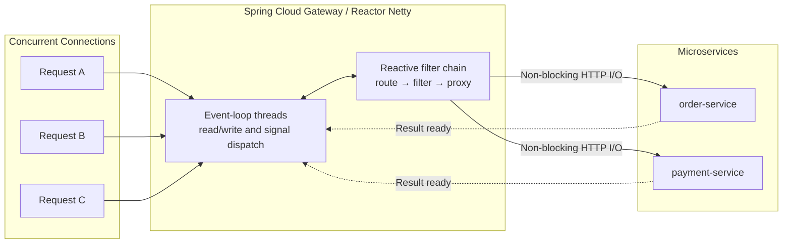
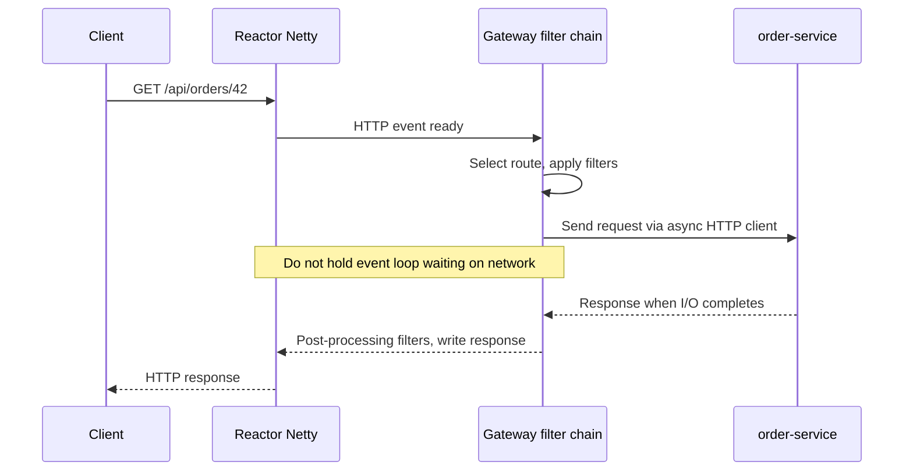

# Event Loop and the Impact of Thread-Blocking Calls

In **Spring Cloud Gateway Server WebFlux**, an HTTP request flows through route predicates, the filter chain, and connections to backend microservices under a **reactive, non-blocking I/O** processing model. The typical stack consists of Spring WebFlux, Project Reactor, and Reactor Netty. Because the gateway sits in front of many services, a seemingly minor thread-blocking operation inside a filter can impact a large number of unrelated requests.

This lesson belongs to the **WebFlux Foundation** chapter of the **SPRING_CLOUD_GATEWAY** module. The goal is to understand how the event loop operates, recognize blocking calls, see their consequences on gateway latency and throughput, and know how to structure processing appropriately when building an API Gateway with routing, header/path transformations, authentication, rate limiting, circuit breaking, retries, TLS, and request observability.

After this lesson, you should be able to answer three questions:

1. Why can a small number of threads serve many HTTP connections when I/O operations are non-blocking?
2. Why is calling JDBC, synchronous HTTP clients, `Thread.sleep()`, or `.block()` on the gateway processing path dangerous?
3. When forced to integrate a synchronous API, how should it be isolated and how should its limits be monitored?

## 1. What Is an Event Loop?

An **event loop** is an event-processing loop: a thread continuously detects which connections are ready to read/write, executes short handlers for that work, registers the next I/O operation, and yields to serve other connections. In Reactor Netty, a small pool of event-loop threads can coordinate many connections using asynchronous I/O.

This model differs from the mental picture of "each request holds one thread for the entire duration waiting for the backend to respond":

| Criterion | Traditional thread-per-request (conceptual model) | Event loop with non-blocking I/O |
| --- | --- | --- |
| While waiting on socket/network | Thread can be held inside a blocking call | Thread registers the I/O work and continues handling other events |
| Threads serving concurrent connections | Usually scales with worker pool size | Usually a small group of event loops, not 1:1 with connections |
| When a synchronous piece of code runs long | Occupies one worker in the pool | Occupies the event-loop thread and delays many connections served by that thread |
| What needs to be managed | Worker pool size, context-switch overhead, connection limits | Never block the event loop; control callback duration, CPU pressure, and queues |
| Scalability | Constrained by thread limits, memory, and wait durations | Efficient when most work is asynchronous I/O and callbacks are short |

Not every Java application "running WebFlux" executes every line of code on the same thread. Reactor has multiple schedulers; operators like `publishOn` or `subscribeOn`, framework integrations, and external libraries can switch execution threads. The core principle is **never holding an event-loop thread to wait for work that could proceed via asynchronous signals**.

### Diagram: Multiple Requests Sharing an Event Loop



When the gateway sends a request to `order-service`, the network call takes time to wait. With non-blocking I/O, the event loop **does not stall at the call waiting for the entire response to arrive**. The thread can serve other requests; when a socket signal arrives, the processing chain resumes.

Conversely, if a filter calls `Thread.sleep(200)`, that thread genuinely cannot do other work for 200 ms. The impact spreads to every other request waiting to be served by that same event-loop thread.

## 2. How Does a Request Flow Through the Gateway?

Consider the request:

```http
GET /api/orders/42 HTTP/1.1
Host: api.example.com
Authorization: Bearer <access-token>
```

In Spring Cloud Gateway Server WebFlux, the conceptual flow is as follows:



Components play distinct roles:

- **Route predicates** such as `Path`, `Method`, and `Host` decide whether a request matches a route. A custom predicate containing slow synchronous logic can also bottleneck the processing path.
- **`GatewayFilter` and `GlobalFilter`** participate in the request/response processing chain. A filter that only edits metadata completes quickly; a filter calling a synchronous API or querying a database synchronously can hold a thread for a long time.
- **Spring Security WebFlux** uses its own `WebFilter` instances for edge authentication/authorization. Use proper reactive security configuration; do not turn an authentication filter into a synchronous service call on every request.
- **Reactive HTTP client / Reactor Netty** performs asynchronous network I/O to the backend. An `lb://order-service` route typically combines discovery and a load balancer to pick an instance, and discovery itself must also be properly configured and operated.
- **Observability** can attach route IDs, trace IDs, status codes, and latency for behavioral analysis. Logging or exporting telemetry with blocking calls directly inside a filter can still harm the event loop.

Exact filter ordering depends on filter types and `Ordered` properties. More importantly, identify **which code executes directly on the request path and which returns an asynchronous stream**.

## 3. A Reactive Publisher Does Not Mean Every Operation Is Non-blocking

In Reactor, `Mono<T>` represents a stream of at most one value; `Flux<T>` can represent multiple values. Publishers are usually *lazy*: many operations are only triggered upon subscription. However, **wrapping a blocking operation in a `Mono` does not automatically make that operation non-blocking**.

Example of non-blocking waiting over time:

```java
Mono<String> delayed =
    Mono.delay(Duration.ofMillis(200))
        .thenReturn("ready");
```

`Mono.delay` schedules emitting a signal after a duration; no thread needs to sit inside `Thread.sleep` for 200 ms.

The following example is still blocking:

```java
Mono<String> misleading =
    Mono.fromCallable(() -> {
        Thread.sleep(200); // Still blocks the thread executing the Callable
        return "ready";
    });
```

`fromCallable` **defers** the call until subscription, but without switching schedulers, the `Callable` runs on whatever thread performs the subscription. When subscription starts on the gateway's event loop, that call can block the event loop.

### Calls to Watch Out For

| Code / Library | Why does it risk blocking? | Preferred handling |
| --- | --- | --- |
| `Thread.sleep(...)` | Holds the thread for the entire sleep duration | Use `Mono.delay(...)` when needing an asynchronous delayed signal |
| `mono.block()`, `flux.blockFirst()` | Waits for a result by locking the calling thread | Compose publishers with `flatMap`, `then`, `zip` and return `Mono`/`Flux` |
| `Future.get()`, `CompletableFuture.join()` | Blocks waiting for a background task to finish | Use async completion APIs and bridge to an appropriate publisher |
| `RestTemplate` or blocking HTTP clients | Thread waits for connection/response | Prefer `WebClient` with a non-blocking connector |
| JDBC/JPA/`JdbcTemplate` | Queries and waits on DB synchronously | Prefer R2DBC/reactive drivers if architecture permits; otherwise isolate JDBC calls |
| Synchronous file I/O or blocking legacy SDKs | Reads files/receives data on the current thread | Use async APIs if available; otherwise use an appropriate scheduler and bound load |
| Encryption/decryption, JSON, or heavy CPU work | Not strictly blocking I/O, but monopolizes CPU | Reduce cost, route CPU tasks appropriately; do not abuse `boundedElastic` |

Note: `Mono.just(legacyClient.load())` is even more dangerous in many cases because `legacyClient.load()` **is invoked immediately when the `Mono.just(...)` expression is evaluated**, even before the publisher is subscribed to. Replacing `just` with `fromCallable` is one step to defer execution, while also evaluating **which scheduler executes it**.

## 4. What Cascading Effects Does Blocking the Event Loop Cause?

Suppose a gateway filter calls a synchronous API to query route status:

```java
@Override
public Mono<Void> filter(ServerWebExchange exchange, GatewayFilterChain chain) {
    boolean enabled = legacyRouteClient.isEnabled("orders"); // Blocking I/O
    if (!enabled) {
        exchange.getResponse().setStatusCode(HttpStatus.SERVICE_UNAVAILABLE);
        return exchange.getResponse().setComplete();
    }
    return chain.filter(exchange);
}
```

The code above shows an **anti-pattern in a reactive gateway**: the synchronous `legacyRouteClient.isEnabled(...)` call completes before the filter returns `Mono<Void>`. Even though the rest of the gateway uses Reactor, the event-loop thread still has to wait for the synchronous client's result.

### Illustrative Timeline

```mermaid
gantt
    title An event loop held by a blocking call
    dateFormat X
    axisFormat %L ms
    section Event loop
    Request A - blocking       :a, 0, 200
    Request B - waiting turn   :b, 200, 210
    Request C - waiting turn   :c, 210, 220
```



This is a simplified diagram: in reality, requests can be distributed across different event-loop threads and scheduling varies under load. Still, it shows that **one request holding a thread for a long time increases wait times for all requests sharing that thread**.

Common consequences include:

1. **Higher tail latency** (`p95`, `p99`): some requests become disproportionately slow even though their backends are healthy.
2. **Reduced throughput:** event loops spend time blocked waiting and cannot dispatch enough socket work.
3. **Queue buildup:** new connections, read/write signals, and callbacks are delayed; client applications experience long waits or timeouts.
4. **Blast-radius propagation:** a blocking integration in a shared filter slows down routes to completely unrelated services.
5. **Resilience mechanisms behave unexpectedly:** upstream timeouts, retries, and circuit breakers cannot fix an event loop that is itself blocked; retries may even amplify the load.
6. **Distorted observability:** timeout/503 statuses appear across many routes while the real bottleneck sits inside gateway code.

Thought experiment: if there are only **4** event-loop threads and each request genuinely occupies a thread for **200 ms** in a blocking wait, the theoretical ceiling for that segment alone is roughly `4 / 0.2 = 20` requests/second before accounting for any other overhead. This calculation illustrates thread-occupation physics, **not a real-world throughput forecast** for any Reactor Netty setup.

### Does Calling `.block()` Always Hang Silently?

No. Reactor can detect and reject certain `.block()` calls on threads marked non-blocking, throwing an error like:

```text
IllegalStateException: block()/blockFirst()/blockLast()
are blocking, which is not supported in thread reactor-http-nio-...
```

However, **not every blocking call is detected by Reactor**. `Thread.sleep()`, SDKs using synchronous sockets, JDBC, locks, synchronous logging, or heavy CPU computation can hold threads without triggering the `.block()` exception above. Thus, seeing no exception does not guarantee the pipeline is safe.

## 5. Preferred Approach: Use Asynchronous APIs End to End

The best solution whenever possible is to **avoid introducing blocking calls at all**. For example, if a policy service exposes route status over HTTP, the gateway can call it with `WebClient`:

```java
@Component
public class ReactiveRoutePolicyClient {
    private final WebClient webClient;

    public ReactiveRoutePolicyClient(WebClient.Builder builder) {
        this.webClient = builder
            .baseUrl("http://route-policy-service")
            .build();
    }

    public Mono<Boolean> isEnabled(String routeId) {
        return webClient.get()
            .uri("/routes/{routeId}/enabled", routeId)
            .retrieve()
            .bodyToMono(Boolean.class)
            .timeout(Duration.ofMillis(250));
    }
}
```

This snippet is an **illustrative API sample**: `/routes/{routeId}/enabled` must be implemented on a real service. `WebClient` connections need configuration aligned with your system's DNS, load balancer/discovery, TLS, and timeout model. `retrieve()` treats most HTTP 4xx/5xx statuses as errors by default, so production requires error-handling policies and defined behavior when the policy service is unavailable.

The advantage lies in how it is composed:

```java
return policyClient.isEnabled(routeId)
    .flatMap(enabled -> {
        if (enabled) {
            return chain.filter(exchange);
        }
        exchange.getResponse().setStatusCode(HttpStatus.SERVICE_UNAVAILABLE);
        return exchange.getResponse().setComplete();
    });
```

`flatMap` **chains two asynchronous steps**. The gateway never calls `.block()` to unwrap `enabled`. When the result arrives, the processing chain continues via the publisher.

Keep in mind: calling a policy service over the network **on every request** still adds latency, introduces a new dependency, and can overload the policy service. For cacheable data, consider TTL caches, event-driven updates, or local policy evaluation. Non-blocking I/O solves thread-holding, **not I/O cost**.

## 6. When a Blocking Library Cannot Be Removed: Isolate with boundedElastic

Some integrations lack reactive drivers: legacy JDBC, synchronous third-party SDKs, or legacy code that cannot be replaced immediately. In those cases, Project Reactor provides `Schedulers.boundedElastic()` to **move potentially thread-blocking work onto a separate, bounded worker pool**, avoiding directly blocking the event loop.

Basic pattern:

```java
Mono<RouteFlag> routeFlag =
    Mono.fromCallable(() -> legacyRepository.readRouteFlag("orders"))
        .subscribeOn(Schedulers.boundedElastic())
        .timeout(Duration.ofMillis(300));
```

Three points to understand:

- `Mono.fromCallable(...)` defers invoking the synchronous API until the publisher is subscribed to.
- `subscribeOn(Schedulers.boundedElastic())` schedules the `Callable` source onto a scheduler intended for bounded blocking work.
- `timeout(...)` bounds how long the **subscriber** waits for a result; it **does not guarantee immediately cancelling** the underlying synchronous operation. The synchronous driver or HTTP client still needs its own timeouts and appropriate cancellation support.

### Complete Filter Example with a Synchronous Repository

This is a structurally compilable example for Spring Cloud Gateway Server WebFlux, assuming the application provides a `LegacyRouteFlagRepository` bean with a blocking method. Its purpose is to illustrate how to place a blocking boundary; querying route status via a database on every request is not recommended in production.

```java
import java.time.Duration;
import java.util.concurrent.TimeoutException;

import org.springframework.cloud.gateway.filter.GatewayFilterChain;
import org.springframework.cloud.gateway.filter.GlobalFilter;
import org.springframework.cloud.gateway.route.Route;
import org.springframework.cloud.gateway.support.ServerWebExchangeUtils;
import org.springframework.core.Ordered;
import org.springframework.http.HttpStatus;
import org.springframework.stereotype.Component;
import org.springframework.web.server.ServerWebExchange;

import reactor.core.publisher.Mono;
import reactor.core.scheduler.Schedulers;

@Component
public class LegacyRouteFlagFilter implements GlobalFilter, Ordered {

    private final LegacyRouteFlagRepository repository;

    public LegacyRouteFlagFilter(LegacyRouteFlagRepository repository) {
        this.repository = repository;
    }

    @Override
    public Mono<Void> filter(
            ServerWebExchange exchange,
            GatewayFilterChain chain) {

        Route route = exchange.getAttribute(
            ServerWebExchangeUtils.GATEWAY_ROUTE_ATTR);

        if (route == null) {
            return chain.filter(exchange);
        }

        Mono<Boolean> enabled = Mono
            .fromCallable(() -> repository.isEnabled(route.getId()))
            .subscribeOn(Schedulers.boundedElastic())
            .timeout(Duration.ofMillis(300))
            .onErrorResume(TimeoutException.class, ex -> Mono.just(false));

        return enabled.flatMap(isEnabled -> {
            if (isEnabled) {
                return chain.filter(exchange);
            }

            exchange.getResponse()
                .setStatusCode(HttpStatus.SERVICE_UNAVAILABLE);
            return exchange.getResponse().setComplete();
        });
    }

    @Override
    public int getOrder() {
        return 0;
    }
}

interface LegacyRouteFlagRepository {
    // Synchronous call must have driver-level timeouts / connection limits.
    boolean isEnabled(String routeId);
}
```

**Why is this better than blocking directly?** A `boundedElastic` worker executes `repository.isEnabled(...)`; the event loop can return to dispatching other requests. When the result emits, `flatMap` decides whether to continue the chain or return `503`.

**Limitations of the example:** `onErrorResume(TimeoutException.class, ...)` chooses a *fail-closed* policy for timeouts (treating the route as unavailable). Other repository errors still flow down the error signal path and must be mapped according to your system's response and telemetry standards; never catch all errors and return `200`. In practice, avoid hitting a synchronous repository per request: cache flags, configure concurrency caps, and secure access to the policy source.

### boundedElastic Is Not a Silver Bullet

- The scheduler has **limits on worker count and queue capacity**; if too many requests run long blocking calls simultaneously, queues grow and `p99` can still degrade.
- Moving to another worker **does not make the synchronous operation run faster**. Each request still waits for the result or timeout.
- `boundedElastic` cannot fix a database/HTTP connection that lacks a timeout or an SDK that hangs indefinitely.
- Wrap `subscribeOn` around the specific blocking source that requires it; do not arbitrarily "move the whole gateway onto boundedElastic."
- If work is **purely CPU-heavy**, reduce its cost, limit concurrency, and consider a CPU-oriented scheduler; spawning many blocking workers to mask CPU saturation can overwhelm the machine.
- Define policies for when the scheduler saturates, times out, or when upstream is unavailable. Do not use unbounded retries to "wait until it succeeds."

## 7. How Do subscribeOn and publishOn Differ?

Both affect where signals are processed, but they are not interchangeable:

| Operator | General meaning | Typical use case |
| --- | --- | --- |
| `subscribeOn(scheduler)` | Schedules the subscription phase and source signal emission on the chosen scheduler | Isolating `Mono.fromCallable` wrapping a blocking call |
| `publishOn(scheduler)` | Switches processing of **subsequent signals after the operator** onto the chosen scheduler | Offloading a heavy downstream segment to an appropriate execution context |

Example:

```java
Mono<String> result = Mono.fromCallable(() -> legacyClient.load())
    .subscribeOn(Schedulers.boundedElastic())
    .map(value -> normalize(value));
```

`legacyClient.load()` runs on `boundedElastic`. In this composition, `normalize` usually continues running on the thread emitting the signal unless another operator or component switches schedulers. **Do not rely on specific thread names as an API contract**; rely on semantics and avoid inserting blocking code anywhere that might run on the event loop.

As for `publishOn`:

```java
Mono<String> result = getReactiveValue()
    .publishOn(Schedulers.parallel())
    .map(this::cpuBoundTransform);
```

`publishOn` schedules the downstream `map` operator onto a scheduler meant for short, independent CPU tasks. However, `Schedulers.parallel()` has a finite worker count; massive CPU work can still saturate that scheduler. Never put blocking JDBC/HTTP calls onto `parallel()`.

`subscribeOn` also does not make `.block()` acceptable inside a filter: if the filter itself waits on a publisher using `.block()`, the thread calling `.block()` is still held (and may be rejected by Reactor). Always **return the publisher** so the framework subscribes and manages its lifecycle.

## 8. Can Backpressure Solve Blocking?

**Backpressure** is the mechanism for regulating data emission rate according to downstream demand in Reactive Streams. It helps when a `Flux` pipeline has a faster producer than consumer and all components honor demand signals.

However:

- Backpressure **does not turn** `Thread.sleep()` or synchronous JDBC into non-blocking calls.
- Not every data source, HTTP client, or external API supports demand-based throttling uniformly.
- Rate limiting at the gateway controls accepted request volume; backpressure inside the pipeline controls data consumption demand. **The two tools solve different layers of pressure**.
- Retrying failed upstream calls can multiply call volume and fill connection pools or `boundedElastic`; use sensible retry caps, timeouts, and circuit breakers.

In Spring Cloud Gateway, configuring `RequestRateLimiter`, timeouts, circuit breakers, and retries helps protect resources, but **does not replace non-blocking discipline in custom filters**. Even a low-traffic route can cause widespread disruption if each callback holds the event loop too long.

## 9. Places Where Blocking Easily Creeps into the Gateway Unnoticed

### 9.1. Authentication and Authorization

- **Do:** Use reactive Spring Security to validate tokens and enforce edge rules; delegate fine-grained resource authorization to the service owning the data.
- **Review carefully:** Custom authentication filters calling JDBC or a synchronous user-info API to check permissions on every request.
- **Watch out:** Validating a token does not mean all accompanying actions (fetching keys, calling extra endpoints, writing audit logs) are asynchronous. Inspect actual drivers and integration code.

### 9.2. Request/Response Transformation Filters

- **Do:** Use built-in filters such as `StripPrefix`, `RewritePath`, `AddRequestHeader`, and `RemoveRequestHeader` for simple HTTP transformations.
- **Avoid:** Reading the entire body inside a `GlobalFilter`, converting it to a `String`, querying a database, making a synchronous HTTP call, and only then returning `Mono<Void>`.
- **Watch out:** Buffering large bodies puts pressure on memory even when code is non-blocking; `DataBuffer` instances require proper lifecycle handling and size limits.

### 9.3. Logging and Observability

- **Do:** Record non-blocking metrics/traces with appropriate route/status tags, use asynchronous logging with queue-full policies, and avoid logging sensitive data.
- **Avoid:** Calling synchronous HTTP exporters, expensive file writes, or synchronous socket logging on every request.
- **Watch out:** "Measure duration and log it" looks innocent, yet the appender/transport can block when disk or the collector is slow.

### 9.4. Resilience, TLS, and Service Discovery

- Gateway timeouts, circuit breakers, and retries should govern **asynchronous publishers** with clear bounds.
- DNS, TLS handshakes, instance selection, and upstream calls all affect latency; properly configure connection pools, discovery, truststores/certificates, and timeouts.
- Never "fix" a timeout by calling a synchronous SDK on the event loop or retrying indefinitely. If discovery, policy, or backend sources are already slow, retries usually worsen load.

## 10. Detecting and Diagnosing Blocking in Operations

Because symptoms often emerge under load, inspect both latency and threads.

### Symptoms to Watch

| Signal | What might it indicate? | Distinguish from |
| --- | --- | --- |
| `p95/p99` rises across multiple routes simultaneously | Bottleneck at the gateway/event loop or shared resources | Individual backend slowness, network, CPU/GC |
| Throughput drops as concurrency rises | Event loop held, or queues, connection pools, or schedulers saturated | Intentional rate limiting rejecting requests |
| Thread dump shows `reactor-http-nio-*` in `Thread.sleep`, JDBC, or synchronous socket read | Blocking is occurring directly on the event loop | Exact thread names and stacks vary by runtime/connector |
| Many tasks queued on `boundedElastic` | Blocking source overloaded, insufficient workers/timeouts | Another executor or queue experiencing contention |
| Timeouts/503s spill into unrelated routes | Shared filter logic, CPU, or shared resource pool issue | All backends degrading simultaneously |
| CPU spikes and long callbacks without synchronous I/O | Heavy CPU/serialization work | GC pauses, TLS config, or logging overhead |

### Systematic Investigation Workflow

1. **Determine scope:** Is the entire gateway slow or only one route? Compare route ID, status, request rate, and `p50/p95/p99` over the same time window.
2. **Correlate traces:** Separate time spent in the gateway layer from the upstream call; inspect spans and request start/completion timestamps.
3. **Inspect resource health:** CPU, GC, event-loop pending work if exposed by runtime, thread dumps, scheduler queues, connection pools, and pending connections.
4. **Audit relevant filter code:** Look for `.block()`, `Thread.sleep()`, `Future.get()`, `join()`, `RestTemplate`, `JdbcTemplate`, synchronous SDKs, and logging/metrics exporters.
5. **Isolate with a controlled load test:** Keep the backend route unchanged while disabling or swapping the blocking call for a non-blocking one; re-measure `p95/p99` and throughput.
6. **Verify limits after the fix:** If offloaded, monitor `boundedElastic` limits, source timeouts, connection pools, and behavior when upstream fails.

Specific metric names vary by Spring Cloud Gateway, Reactor Netty, Micrometer versions, and instrumentation setup. For example, you may see `spring.cloud.gateway.requests` for per-route traffic or Reactor Netty metrics for HTTP client, connection pool, and event loops when enabled. Do not rely on assumed metric names without verifying your actual actuator/registry endpoints.

### Diagnostic Tools

- **Thread dumps / Java Flight Recorder (JFR):** Inspect stacks and thread hold times, distinguishing CPU-bound work from blocking I/O.
- **BlockHound in test/dev environments:** Can detect certain blocking calls executing on threads marked non-blocking. Compatibility and agent attachment depend on JVM/Reactor/BlockHound versions; verify compatibility before enabling.
- **Targeted load testing:** Send parallel requests across multiple routes and observe whether fast routes slow down alongside slow routes.
- **Metrics/traces:** Use timestamps, route IDs, trace IDs, throughput, and latency to pinpoint bottlenecks; never log tokens, raw bodies, or URLs containing sensitive data.

## 11. Hands-on Exercise: How Does a Slow Filter Affect Other Routes?

**Scenario:** A gateway exposes `/api/catalog/**` and `/api/orders/**`. The catalog route responds steadily, but a shared custom filter invokes a synchronous SDK before forwarding every request.

**Steps** (run in a test environment):

1. Create an illustrative custom `GlobalFilter` containing `Thread.sleep(200)` directly inside `filter(...)`; test under low and concurrent load, and never deploy this code to production.
2. Send concurrent requests to **both** routes, record throughput and `p50/p95/p99` latency, and capture thread dumps if available.
3. Remove `Thread.sleep` and use `Mono.delay(Duration.ofMillis(200)).then(chain.filter(exchange))` only when the goal is an **asynchronous timer**, not as a stand-in for a synchronous I/O API.
4. If the delay comes from a real synchronous SDK, replace it with `Mono.fromCallable(...).subscribeOn(Schedulers.boundedElastic())`, keeping source timeouts, concurrency caps, and sensible retry counts.
5. Re-measure. Expect other routes to stop being stalled by event-loop blocking, while the route still waiting on the SDK continues to experience the SDK's latency.
6. Test prolonged SDK slowness/unresponsiveness: are timeouts sufficient? Do worker queues grow? When the backend recovers, does the service stabilize?

Alternative example **valid for introducing a timed delay**:

```java
@Override
public Mono<Void> filter(ServerWebExchange exchange, GatewayFilterChain chain) {
    return Mono.delay(Duration.ofMillis(200))
        .then(chain.filter(exchange));
}
```

`Mono.delay` does not occupy a thread while waiting on the clock. However, if the real task is querying a DB or calling a synchronous SDK, you cannot simply add `Mono.delay` to "convert" that API into a non-blocking one.

### Self-Check Questions

**Question 1.** Why is `Mono.just(restTemplate.getForObject(...))` still blocking?

> Because `getForObject(...)` must finish to produce the argument passed into `Mono.just`; Reactor gets no opportunity to make that part asynchronous over the network.

**Question 2.** Can `Mono.fromCallable(...)` be used without `subscribeOn`?

> Syntactically yes, but the `Callable` runs on whatever thread performs the subscription; if that is the event loop, it still blocks. Synchronous sources must be isolated with an appropriate scheduler or replaced with a non-blocking API.

**Question 3.** Once using `boundedElastic`, are JDBC/HTTP timeouts still necessary?

> Yes. `boundedElastic` frees the event loop, but each call still occupies a worker and external resources. Reactor-level timeouts do not guarantee immediately aborting blocking operations inside the driver.

**Question 4.** Do circuit breakers or rate limiters automatically fix a `Thread.sleep` bug inside a filter?

> No. They address resilience and traffic control at a different layer. To avoid holding the event loop, blocking must be removed from the request path or unavoidable blocking sections must be isolated.

**Question 5.** Why is a blocking `GlobalFilter` more dangerous than a slow call inside a single specific service?

> Because a shared filter can execute for requests across many routes. When an event-loop thread is held, all connections sharing that thread risk slowing down regardless of whether their own backends are slow.

## 12. Checklist When Writing Filters for Spring Cloud Gateway WebFlux

- [ ] Inside `filter(...)`, avoid `.block()`, `Thread.sleep()`, `Future.get()`, `join()`, or synchronous JDBC/HTTP clients running directly on the event loop.
- [ ] Prefer `WebClient`, reactive database/Redis drivers, or asynchronous publishers whenever I/O is needed.
- [ ] When forced to integrate a synchronous SDK, use `fromCallable` + `boundedElastic`, cap concurrency, and configure timeouts on the SDK/driver itself.
- [ ] Use `flatMap`/`then` to compose publishers and **return the publisher to the framework**; do not call `subscribe()` arbitrarily inside filters to spawn unmanaged background work.
- [ ] Distinguish retries/timeouts/circuit breakers from blocking prevention; never infinitely retry calls with side effects.
- [ ] Avoid large payload buffering, heavy CPU work, and synchronous logging/telemetry exports directly on the event loop.
- [ ] When adding a global filter, measure latency and throughput across **multiple routes**, not just one route.
- [ ] Monitor event-loop activity, connection pools, `boundedElastic`, and `p95/p99` latency using tools appropriate for your environment.
- [ ] Define behavior when dependencies are slow, time out, or fail; never return fake success results for critical operations.

## Conclusion

The strength of Spring WebFlux and Reactor Netty is **not holding a thread solely to wait for I/O**. A handful of event-loop threads can coordinate many connections, allowing Spring Cloud Gateway to handle traffic for numerous microservices efficiently when routes, predicates, and filters all respect the asynchronous model.

A single blocking call in a `GlobalFilter`, `GatewayFilter`, authentication layer, or logging setup can hold the event loop and drag down latency for unrelated requests. Prefer **non-blocking APIs end to end**; when a synchronous library cannot yet be replaced, use `Mono.fromCallable(...).subscribeOn(Schedulers.boundedElastic())` as a bounded isolation measure combined with timeouts and load monitoring. This foundation is essential before implementing higher-level Spring Cloud Gateway capabilities such as rate limiting, retries, circuit breaking, TLS, and observability in a microservices environment.
