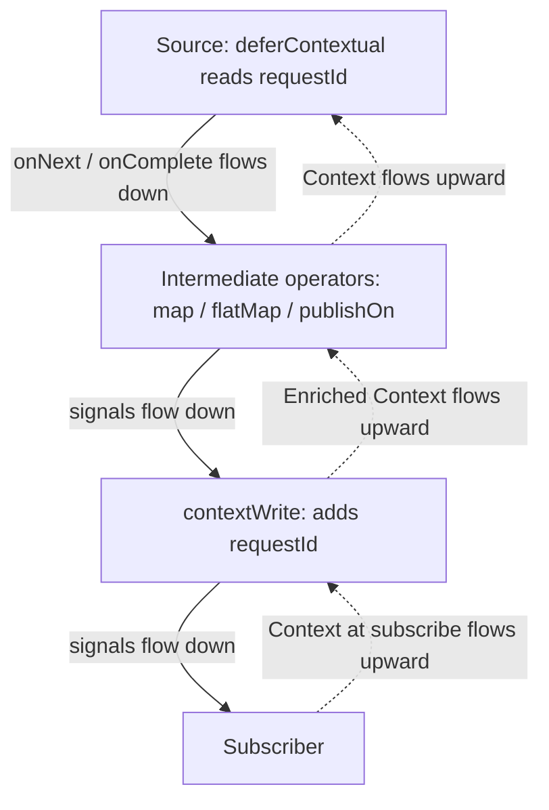
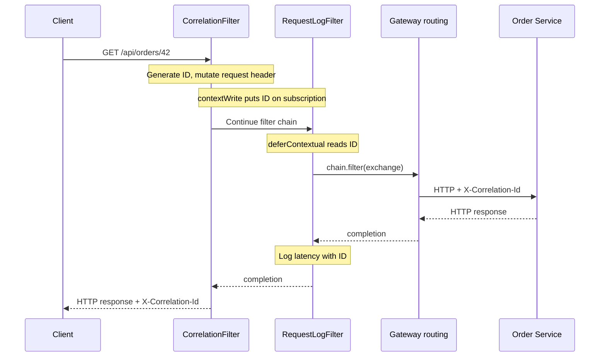

# Reactor Context and Passing Data Across Processing Chains

## Learning Objectives

In the **WebFlux Foundation** chapter, this lesson explains how to carry request-scoped metadata through an asynchronous processing chain in **Spring Cloud Gateway** without relying on the active thread. After this lesson, you will be able to:

- Explain why `ThreadLocal` is unsuitable for propagating data across a Reactor chain that may switch threads.
- Distinguish `Context`, `ContextView`, `contextWrite`, and `deferContextual`; accurately explain the propagation direction of Reactor Context.
- Apply Reactor Context in `Mono`/`Flux`, across `flatMap` and `publishOn`, and inside a Spring Cloud Gateway `GlobalFilter`.
- Choose the right storage mechanism: Reactor Context, `ServerWebExchange` attributes, or HTTP headers.
- Understand Context boundaries with `WebClient`, tracing, Spring Security, retries, and service boundaries.
- Test and debug scenarios where Context data is missing or overwritten.

## 1. The Problem: A Request Does Not Necessarily Run on One Thread

Picture a request passing through an API Gateway:

1. A client sends `GET /api/orders/42` with a correlation header `X-Correlation-Id`.
2. The gateway evaluates route predicates to select the Order Service.
3. One filter authenticates access credentials; another filter measures timing and logs the request.
4. The asynchronous pipeline calls an external system or forwards the request to the target service.
5. The response returns to the client; operations need to correlate logs across steps for the same request.

In traditional synchronous servlet applications, code often assumes a request is bound to a single thread and stores data in `ThreadLocal`, such as MDC (`Mapped Diagnostic Context`) used to attach `requestId` to log lines.

In **Spring WebFlux/Reactor**, operators can reschedule work or resume execution on another thread. A single thread can also process multiple requests at different points in time. Therefore, values attached to a thread **do not automatically** stay attached to a request:

```text
Request A
  │  event-loop-1: receives request
  ├─ map(...)
  ├─ publishOn(...) ───────► parallel-2: continues processing
  └─ calls upstream ───────► async callback

Request B may use event-loop-1 while Request A is waiting on I/O.
```

If a filter calls `MDC.put("requestId", ...)` and assumes every downstream operator runs on that same thread, logs may miss the ID, carry another request's ID, or require fragile cleanup logic. `MDC` can still be used when the framework sets up proper context propagation bridges, but **you should never assume `ThreadLocal` automatically propagates through a reactive pipeline**.

**Reactor Context** solves the problem of carrying metadata per *subscription*, independent of execution threads. It is well suited for correlation IDs, verified tenant IDs, observability data, or technical request-scoped metadata.

## 2. What Is Reactor Context?

In Project Reactor:

- `Context` is an API-level immutable **key → value** map: operations like `put` return a new Context rather than mutating the original in place.
- `ContextView` is a **read-only** interface used to access data already present in the Context.
- Context is **attached to the Subscriber**, not to a `Thread` or global state.
- Each subscription can carry its own Context; two concurrent requests do not share Context values by default.
- Data enters the Context via `contextWrite(...)` and is typically read via `Mono.deferContextual(...)`, `Flux.deferContextual(...)`, or Reactor APIs accepting a `ContextView`.

The easiest point to misunderstand is that **Context flows in the opposite direction of normal data signals**:



In a top-to-bottom declaration chain, `contextWrite` **affects operators upstream (toward the source) of it**. This differs from the intuition that "writing context on one line lets lines below it read it." To reason accurately, look at **subscription** flow and publisher nesting, not just code line order.

### 2.1. Minimal Example: Write Then Read

```java
import reactor.core.publisher.Mono;

Mono<String> result =
    Mono.deferContextual(contextView -> {
        String requestId = contextView.get("requestId");
        return Mono.just("Request = " + requestId);
    })
    .contextWrite(context -> context.put("requestId", "req-123"));

// When subscribed, result emits one value:
// "Request = req-123"
```

Explanation:

1. `Mono.deferContextual(...)` does not read data during **assembly** (when constructing the pipeline); its callback runs when **subscription** happens.
2. `contextWrite(...)` creates a Context containing `requestId`.
3. When the subscriber subscribes, the Context propagates upward toward the source so `deferContextual` sees it.
4. `ContextView.get("requestId")` returns the stored value. If the key does not exist, `get` throws an error; use `getOrDefault` when the value is optional.

Along an active request stream, Reactor Context lets multiple operators participating in the same subscription read metadata without adding a `requestId` parameter to every method.

### 2.2. Switching Schedulers Does Not Lose Reactor Context

```java
import reactor.core.publisher.Mono;
import reactor.core.scheduler.Schedulers;

Mono<String> pipeline =
    Mono.just("order-42")
        .publishOn(Schedulers.parallel())
        .flatMap(orderId ->
            Mono.deferContextual(view ->
                Mono.just(view.get("requestId") + ":" + orderId)
            )
        )
        .contextWrite(ctx -> ctx.put("requestId", "req-123"));

// Result: "req-123:order-42"
```

`publishOn` shifts subsequent processing onto another scheduler, yet Reactor operators linked in the same chain preserve Context along the subscription. By contrast, a `ThreadLocal` set manually before `publishOn` is not guaranteed to appear on the new thread.

**Note:** This rule applies to properly connected Reactor flows. Manually spawning threads, unintegrated external callbacks, or standalone `subscribe()` calls create new boundaries and will not receive the Context as expected.

### 2.3. Two `contextWrite` Calls and Overwrite Rules

```java
Mono<String> result =
    Mono.deferContextual(view ->
        Mono.just(view.get("level"))
    )
    .contextWrite(ctx -> ctx.put("level", "Closer to source"))
    .contextWrite(ctx -> ctx.put("level", "Closer to subscriber"));

// Result on subscribe: "Closer to source"
```

At subscription time, the `contextWrite` closer to the subscriber runs first, and then the one closer to the source overwrites the same key. Therefore, **for the same key, a value written by a `contextWrite` closer to the source shadows a value from downstream**.

This yields an architectural rule: avoid letting multiple filters arbitrarily write the same key with different meanings. Assign a clear owner for critical metadata; keys can be centralized in a shared constants class to reduce typos and collisions.

### 2.4. ContextView Is Read-Only; Context Is Not a Shared Mutable Map

```java
Mono<String> source = Mono.deferContextual(view -> {
    String tenantId = view.getOrDefault("tenantId", "public");
    return Mono.just(tenantId);
});

Mono<String> tenantA =
    source.contextWrite(ctx -> ctx.put("tenantId", "tenant-A"));

Mono<String> tenantB =
    source.contextWrite(ctx -> ctx.put("tenantId", "tenant-B"));
```

Two pipelines can reuse the same `source` yet carry two distinct `tenantId` values upon subscription. Reusing a publisher does not mix the two Contexts.

Even though Context itself is immutable, **objects placed as values can be mutable**. Never store a shared `HashMap` or a mutable request object across subscriptions without managing lifecycle and concurrency safety.

## 3. Reading Context in Transformations

### 3.1. `deferContextual`: The Standard Choice

When a processing step needs to read Context to build a new publisher, use `deferContextual`:

```java
Mono<String> buildAuditMessage(String operation) {
    return Mono.deferContextual(view -> {
        String requestId = view.getOrDefault("requestId", "unknown");
        return Mono.just("requestId=" + requestId + ", operation=" + operation);
    });
}

Mono<String> audit =
    buildAuditMessage("read-order")
        .contextWrite(ctx -> ctx.put("requestId", "req-abc"));
```

You can nest `deferContextual` inside `flatMap` to read Context at execution time:

```java
Mono<String> output =
    lookupOrder("42")
        .flatMap(order ->
            Mono.deferContextual(view ->
                buildResponse(order, view.get("requestId"))
            )
        )
        .contextWrite(ctx -> ctx.put("requestId", "req-abc"));
```

Here `lookupOrder(...)` and `buildResponse(...)` represent existing business methods where `buildResponse` returns `Mono<String>`. The key is **returning the publisher inside `flatMap`**, not opening a detached subscription via `subscribe()` just to read Context.

### 3.2. `transformDeferredContextual`: Using Context Across Multiple Elements

With `Flux`, rather than querying Context separately for each element in multiple places, you can use `transformDeferredContextual`:

```java
import reactor.core.publisher.Flux;

Flux<String> tagged =
    Flux.just("created", "validated", "routed")
        .transformDeferredContextual((flux, view) -> {
            String requestId = view.getOrDefault("requestId", "unknown");
            return flux.map(event -> requestId + ":" + event);
        })
        .contextWrite(ctx -> ctx.put("requestId", "req-123"));

// tagged emits:
// req-123:created
// req-123:validated
// req-123:routed
```

The transformer receives the `ContextView` for that subscription. This fits well when the same metadata applies to multiple consecutive elements. For signal-level inspection including errors, `doOnEach` also exposes `Signal.getContextView()`; check the signal type because a normally completing `Mono<Void>` **does not emit `onNext`**.

### 3.3. Never Call `block()` or `subscribe()` Mid-Pipeline in the Gateway

An **anti-pattern** inside a gateway filter:

```java
// Wrong approach: detaches execution and loses control over completion/errors.
return Mono.deferContextual(view -> {
    auditService.log(view.get("requestId")).subscribe();
    return chain.filter(exchange);
});
```

Calling `subscribe()` starts a separate subscription with an independent error and lifecycle path; it can even outlive the HTTP request. If an async operation must run before continuing the chain, compose the publishers:

```java
return Mono.deferContextual(view ->
    auditService.log(view.get("requestId")) // Mono<Void>
        .then(chain.filter(exchange))
);
```

Then the main chain manages ordering, completion, cancellation, and errors. On the WebFlux request path, `block()` can also block the event loop and degrade concurrency.

## 4. Applying in Spring Cloud Gateway: Passing a Correlation ID Between GlobalFilters

### 4.1. Illustrative Flow

Suppose the Gateway requirements are:

- Each request has a `correlationId` to link logs across filters.
- One filter generates the ID, places it in Reactor Context, and adds an HTTP header so the backend receives it.
- A downstream filter reads Reactor Context to log processing duration.
- Routes such as `/api/orders/**` continue to be matched by Spring Cloud Gateway predicates and forwarded to the target service.



**Reactor Context only lives inside the Gateway's pipeline**. It does not travel across HTTP to Order Service automatically. The `X-Correlation-Id` HTTP header in the example is what the target service actually receives.

### 4.2. Filter Generating the Correlation ID and Writing Context

Example for **Spring Cloud Gateway Server WebFlux**:

```java
import java.util.UUID;

import org.springframework.cloud.gateway.filter.GatewayFilterChain;
import org.springframework.cloud.gateway.filter.GlobalFilter;
import org.springframework.core.Ordered;
import org.springframework.http.server.reactive.ServerHttpRequest;
import org.springframework.stereotype.Component;
import org.springframework.web.server.ServerWebExchange;
import reactor.core.publisher.Mono;

@Component
public class CorrelationFilter implements GlobalFilter, Ordered {

    public static final String CONTEXT_KEY = "app.correlationId";
    public static final String HEADER = "X-Correlation-Id";

    @Override
    public Mono<Void> filter(ServerWebExchange exchange,
                             GatewayFilterChain chain) {
        // Generate a fresh ID for this example instead of trusting client headers directly.
        String correlationId = UUID.randomUUID().toString();

        ServerHttpRequest updatedRequest = exchange.getRequest()
            .mutate()
            .headers(headers -> headers.set(HEADER, correlationId))
            .build();

        ServerWebExchange updatedExchange = exchange.mutate()
            .request(updatedRequest)
            .build();

        updatedExchange.getResponse()
            .getHeaders()
            .set(HEADER, correlationId);

        return chain.filter(updatedExchange)
            .contextWrite(context -> context.put(CONTEXT_KEY, correlationId));
    }

    @Override
    public int getOrder() {
        return -100;
    }
}
```

Distinguish three actions in this code:

1. `contextWrite(...)` attaches the value to the subscriber context of `chain.filter(...)`. Because the filter chain nests publishers, upstream publishers inside `chain.filter(...)` can read the value upon subscription.
2. `updatedRequest` adds the header to the **forwarded HTTP request**; `contextWrite` alone neither adds HTTP headers nor transmits Context over the network.
3. `getResponse().getHeaders().set(...)` exposes the ID on the client response if the response has not committed yet and nothing else overwrites it; in real systems, standardize header policies across the entire chain.

In this example, we **issue a fresh ID** at the gateway edge. If your system needs to preserve an ID from a client or upstream proxy, validate the trusted source, length, and allowed character set before accepting it. Use `headers.set(...)` to avoid accumulating multiple header values from untrusted input.

### 4.3. Downstream Filter Reading Context

```java
import org.slf4j.Logger;
import org.slf4j.LoggerFactory;
import org.springframework.cloud.gateway.filter.GatewayFilterChain;
import org.springframework.cloud.gateway.filter.GlobalFilter;
import org.springframework.core.Ordered;
import org.springframework.stereotype.Component;
import org.springframework.web.server.ServerWebExchange;
import reactor.core.publisher.Mono;

@Component
public class RequestLogFilter implements GlobalFilter, Ordered {
    private static final Logger log =
        LoggerFactory.getLogger(RequestLogFilter.class);

    @Override
    public Mono<Void> filter(ServerWebExchange exchange,
                             GatewayFilterChain chain) {
        return Mono.deferContextual(view -> {
            String id = view.getOrDefault(
                CorrelationFilter.CONTEXT_KEY, "missing"
            );

            long started = System.nanoTime();

            return chain.filter(exchange)
                .doFinally(signal -> {
                    long tookMs =
                        (System.nanoTime() - started) / 1_000_000;
                    log.info(
                        "correlationId={} path={} outcome={} durationMs={}",
                        id,
                        exchange.getRequest().getPath(),
                        signal,
                        tookMs
                    );
                });
        });
    }

    @Override
    public int getOrder() {
        return -90;
    }
}
```

Between these two illustrative filters, `-100` runs before `-90` in the *pre* phase of the gateway filter chain. `RequestLogFilter` is invoked inside `CorrelationFilter`'s `chain.filter(...)`, so `deferContextual` sees the Context added by the outer filter. The `id` value is read once and captured in a local variable for `doFinally`, even if execution resumes on another thread.

`doFinally` runs on completion, error, or cancellation. The `signal` parameter is the terminal signal type (`ON_COMPLETE`, `ON_ERROR`, `CANCEL`, etc.), **not an HTTP status code**. To classify HTTP statuses, read the status from the response at the proper time and account for responses that have no status yet or are already committed.

**Note on filter order:** `Ordered` configuration determines the order among `GlobalFilter`/`GatewayFilter` instances; an unexpectedly ordered filter might read before Context is added to the pipeline. Never assume every filter across the gateway automatically sees a key simply because some filter wrote it.

### 4.4. Context Does Not Mean Mutating the HTTP Request

A crucial distinction in a gateway:

| Storage location | Lifecycle and scope | Purpose | Automatically sent to backend over HTTP? |
| --- | --- | --- | --- |
| **Reactor Context** | Per subscription of the Reactor pipeline | Passes metadata to reactive operators/filters that read Context | **No** |
| **`ServerWebExchange.getAttributes()`** | Map bound to the exchange handling the server request | Shares technical state among components accessing the same `ServerWebExchange` | **No** |
| **HTTP request headers** | Request data on the HTTP protocol | Passes correlation IDs or protocol metadata downstream | **Yes**, if proxy/routing preserves that header |
| **MDC/`ThreadLocal`** | Per thread unless a bridge mechanism is configured | Attaches metadata to logs or integrates legacy libraries | **No**, and does not automatically follow reactive pipelines |

`ServerWebExchange` attributes are a sensible choice when multiple gateway filters share the `exchange` object and need local state. There is **no need** to duplicate every value into Reactor Context. Conversely, when a service/library method accepts only `Mono`/`Flux` without `exchange`, Reactor Context lets you propagate metadata along the subscription without adding extra parameters.

For business authorization data such as permission to access an order, the backend must still verify permissions; the mere presence of a header or Context key **does not replace authentication and authorization**.

## 5. Propagating Context Through Reactive Service Layers

Not every layer in an application receives `ServerWebExchange`. Reactor Context is useful when multiple components return `Mono`/`Flux`:

```java
Mono<Order> loadOrder(String orderId) {
    return Mono.deferContextual(view -> {
        String correlationId =
            view.getOrDefault("app.correlationId", "missing");

        return orderRepository.findById(orderId)
            .doOnNext(order ->
                log.debug("requestId={} loadedOrder={}",
                    correlationId, order.getId())
            );
    });
}
```

Here `orderRepository.findById` represents a *reactive* repository method returning `Mono<Order>`; `log` is the logger declared on the class. The code uses `deferContextual` to retrieve the active subscription's metadata. For blocking repositories, design an appropriate integration boundary rather than performing blocking I/O on the event loop.

Suppose one service method calls another:

```java
Mono<OrderDto> getOrder(String id) {
    return loadOrder(id)
        .flatMap(order -> enrichOrder(order))
        .map(this::toDto);
}
```

When `getOrder` is invoked within the same Reactor chain carrying the Context, properly connected publishers can access this metadata. **You do not need to pass `correlationId` as a parameter through every layer**, though for essential data that drives business logic, explicit parameters usually make method contracts clearer and easier to test. Context is best suited for cross-cutting metadata outside the core business signature.

### 5.1. From the Gateway to Another HTTP Service

Reactor Context cannot cross process boundaries on its own. If your application calls a downstream service using `WebClient`, explicitly copy metadata into HTTP headers:

```java
Mono<String> callRemote(WebClient webClient, String id) {
    return Mono.deferContextual(view -> {
        String correlationId =
            view.getOrDefault("app.correlationId", "");

        return webClient.get()
            .uri("/orders/{id}", id)
            .headers(headers -> {
                if (!correlationId.isBlank()) {
                    headers.set("X-Correlation-Id", correlationId);
                }
            })
            .retrieve()
            .bodyToMono(String.class);
    });
}
```

Here `WebClient` is `org.springframework.web.reactive.function.client.WebClient`. This is an example of **an application-initiated HTTP client call**, not a claim that Spring Cloud Gateway routes upstream traffic using `WebClient` by default. Gateway Server WebFlux has its own routing filters; in Section 4's example, the header was added to the request so the routing mechanism forwards it.

When the backend receives `X-Correlation-Id`, it can place the validated value into the Context of the **backend's own new pipeline**. The same Context object is never shared directly between two JVMs or two services.

### 5.2. Metadata for Tracing

An application-generated correlation ID helps search logs, whereas distributed tracing also involves **trace IDs, span IDs**, and standard propagation headers such as `traceparent`. In the Spring ecosystem, Micrometer Observation/Tracing and instrumentation libraries can manage trace-context propagation when configured and integrated properly.

Do not overwrite standard tracing headers just to force them to match a custom correlation ID. If your organization uses both, define a clear relationship: for example, logs include `correlationId` for business lookups alongside `traceId` for opening distributed span traces.

## 6. Reactor Context with Spring Security and Authentication

In WebFlux, Spring Security provides its own mechanism for storing security details in the reactive context. Code should use its dedicated API, such as `ReactiveSecurityContextHolder`, instead of guessing internal Reactor Context keys:

```java
import org.springframework.security.core.context.ReactiveSecurityContextHolder;
import reactor.core.publisher.Mono;

Mono<String> currentPrincipalName() {
    return ReactiveSecurityContextHolder.getContext()
        .map(securityContext ->
            securityContext.getAuthentication().getName()
        );
}
```

This shows how to read the principal name once the security context has been populated in the reactive security chain. When no authenticated context exists, the publisher may emit empty; the application must define appropriate handling for anonymous or unauthorized requests.

In Spring Cloud Gateway, authenticated details can inform ingress policies. However:

- **Authentication**: verifies who the caller is and whether the token/credential is valid.
- **Authorization at the gateway**: controls access to routes or broad API scopes.
- **Authorization at the backend**: checks resource-level and business rules, such as whether the caller owns the order.

Never forward raw `Authentication` objects, raw tokens blindly, or serialized security contexts via headers to backends unless designed deliberately. If identity must be propagated, establish proper token/assertion formats and trust boundaries; headers supplied directly by clients must never be treated as verified identity.

## 7. Frequently Misunderstood Context Boundaries

### 7.1. Assembly and Subscription Are Different

```java
Mono<String> handler = Mono.deferContextual(view ->
    Mono.just(view.getOrDefault("role", "guest"))
);

Mono<String> a = handler.contextWrite(ctx -> ctx.put("role", "reader"));
Mono<String> b = handler.contextWrite(ctx -> ctx.put("role", "admin"));
```

When *assembling* the two publishers, no subscription exists yet, so there is no reason to read Context. When each publisher is subscribed to, `deferContextual` receives that subscription's Context. That is why you should never try to "fetch the current Context" inside a constructor or Bean setup method to reuse across requests.

### 7.2. `contextWrite` Does Not Propagate in Every Direction

```java
Mono<String> result =
    Mono.deferContextual(view ->
        Mono.just("source=" + view.getOrDefault("tag", "none"))
    )
    .contextWrite(ctx -> ctx.put("tag", "local"))
    .flatMap(sourceValue ->
        Mono.deferContextual(view ->
            Mono.just(
                sourceValue + ", after=" +
                view.getOrDefault("tag", "none")
            )
        )
    );

// Result: "source=local, after=none"
```

The `contextWrite` before `flatMap` only affects its own upstream source. It does not turn `tag` into a global value automatically visible to operators **downstream** after `contextWrite`.

When multiple parts of the same request must see a key, place `contextWrite` where it wraps **all publishers that need to read it**, and verify how filters/service calls compose publishers together.

### 7.3. Creating a New Subscription Can Detach from the Original Flow

```java
// Avoid:
Mono.deferContextual(view -> {
    sendAuditMessage(view.get("app.correlationId")).subscribe();
    return chain.filter(exchange);
});
```

An internal `subscribe()` opens a separate subscription. It can finish outside the request lifecycle or miss the expected Context. Composing with `then`, `flatMap`, `concatMap`, or appropriate publisher combinators lets Reactor manage execution consistently.

For work that truly must run in the background independently of the HTTP request, design a dedicated queue/background worker, pass metadata explicitly, and include error handling; never rely on the Context of a request subscription that has already ended.

### 7.4. Bridging ThreadLocal/MDC Requires Additional Configuration

Certain Reactor/Spring versions and the Micrometer Context Propagation library support synchronizing specific `ThreadLocal` values with Reactor Context through accessors and instrumentation. This capability depends on **versions, dependencies, and configuration modes** and should not be assumed enabled by default in every project.

Even when automatic context propagation is enabled, verify MDC lifecycle and cleanup, avoid putting tokens or sensitive data in logs, and ensure logging/tracing are instrumented consistently. For reactive business logic, reading via `deferContextual` is usually clearer than accessing MDC directly.

### 7.5. Context Is Not a Cache or Long-Term Data Store

Reactor Context has no TTL, cross-request shared storage, or distributed query capability. It does not replace Redis, databases, session stores, or event metadata. Avoid stuffing large payloads, mutable objects, or closeable resources into Context: Context is immutably copied when adding/removing keys, and values hold object references for the lifetime of the subscription.

## 8. Placing Context Properly in the Filter Chain

A simplified view of two filters:

```text
CorrelationFilter (order -100)
  return chain.filter(exchange)
             .contextWrite(ctx -> ctx.put(KEY, id))
                 │
                 ▼ (subscription to chain's publisher)
    RequestLogFilter (order -90)
      return Mono.deferContextual(ctx -> ...)
                 │
                 ▼
      Subsequent filters/route
```

`CorrelationFilter` wraps the publisher returned by `chain.filter`. When the pipeline is subscribed, `contextWrite` adds Context for upstream publishers within that chain. When `RequestLogFilter` reads via `deferContextual` at subscription time, it sees `KEY`.

If the order is reversed, or `contextWrite` is placed on a branch that the reading filter's publisher does not pass through, the result may be `missing`. You cannot fix this by adding `Thread.sleep(...)` or guessing execution timing: you must fix the **publisher structure and subscription scope**.

Practical guidelines:

1. Attach metadata once at an appropriate request boundary (such as a filter with deterministic ordering).
2. Prefer `contextWrite(ctx -> ctx.put(KEY, value))` to preserve existing keys.
3. Read via `deferContextual` inside a subscribed publisher, not from a static variable.
4. Propagate metadata across the network via headers/trusted protocols; never assume Context travels to other services automatically.
5. Maintain clear contracts if multiple filters write the same key; avoid silent overwrites.

## 9. Testing and Diagnosing Context Issues

### 9.1. Testing Example with StepVerifier

When a project has the `reactor-test` dependency, you can verify emitted values:

```java
import org.junit.jupiter.api.Test;
import reactor.core.publisher.Mono;
import reactor.test.StepVerifier;

class ReactorContextExampleTest {

    @Test
    void canReadValueFromSubscriberContext() {
        Mono<String> result =
            Mono.deferContextual(view ->
                Mono.just(view.get("requestId") + ":order-42")
            )
            .contextWrite(ctx -> ctx.put("requestId", "req-7"));

        StepVerifier.create(result)
            .expectNext("req-7:order-42")
            .verifyComplete();
    }
}
```

This illustrates the concept; in a real application, also test the filter chain, response headers, and cases where Context lacks the key. Do not write tests that merely count `contextWrite` calls; assert the behavior observed by the subscriber or HTTP client.

### 9.2. Checklist When Data Cannot Be Read

| Symptom | Common cause | Resolution |
| --- | --- | --- |
| `get("requestId")` reports missing key | No `contextWrite` on the subscription branch containing the reader | Inspect the publisher graph and use `getOrDefault` if the key is optional |
| Filter B sees `missing` | Filter ordering or `contextWrite` scope does not cover B's publisher | Check `Ordered` and the placement of `.contextWrite(...)` |
| Logs after `publishOn` lose MDC | MDC/ThreadLocal bridge is not configured | Read Reactor Context directly or configure context propagation for your stack |
| Backend does not see correlation ID | Only wrote Reactor Context without adding an HTTP header | Mutate the forwarded request/headers or configure the HTTP client |
| Value changes into a different ID | Multiple `contextWrite` calls overwrite the key or a filter regenerates the ID | Establish a single authoritative ID generator and avoid overwrites |
| Errors lost or audit log runs outside request | Called `subscribe()` inside an operator/filter | Compose publishers and let the chain manage terminal signals |
| Context works in tests but goes missing at runtime | Real path diverges from test branch, external library spawns its own subscription or callback | Trace each reactive boundary and audit library integrations |

### 9.3. Safe Instrumentation

In production, prefer metrics/traces tagged by route, status, and latency rather than dumping the entire Context. Log only fields classified as safe, bounded in length, and consistent with your organization's observability standards.

When debugging, a valid `requestId` alongside `traceId` helps determine which predicate a request matched, which filter raised an error, and whether the request reached the backend. Reactor Context helps attach metadata to the processing chain; end-to-end tracing still requires instrumentation and cross-network propagators.

## 10. Suggested Practice Exercise

You can practice on a minimal Spring Cloud Gateway Server WebFlux application:

1. Define two routes forwarding to two mock HTTP backends; add a `GlobalFilter` generating a correlation ID as in Section 4.2.
2. Add `RequestLogFilter` as in Section 4.3 and verify logs contain the same ID returned in the client response header.
3. In a reactive service you write, add `publishOn` or `flatMap` and read the ID with `deferContextual`. Observe that Reactor Context retains its value across scheduler switches.
4. Temporarily remove `.contextWrite(...)`: `getOrDefault` in the reading filter returns `missing`. Restore it and verify the result.
5. Swap the order of the two filters or attach Context on a branch that does not wrap the reading filter; observe the effect on Context visibility.
6. Send a request to the backend and verify the backend receives the `X-Correlation-Id` header; compare against writing only to Reactor Context without mutating the request.
7. Trigger a backend error and cancel a request to observe `doFinally`; distinguish terminal signals from HTTP status codes.

**Completion criteria:** You can explain where the key is written, what subscribes to the publisher, which filters can read the Context, when an HTTP header is required, and how to avoid losing context when restructuring pipelines.

## Summary

Reactor Context is a tool for carrying **subscription-scoped metadata** across operators in a Spring WebFlux chain. It lets Spring Cloud Gateway requests preserve correlation IDs, observability metadata, and technical state in an asynchronous environment without tying them to a fixed thread. The standard pair is **`contextWrite` to populate** and **`deferContextual` to read at subscription time**.

Three boundaries to remember: Context flows **backward from subscriber to source**; Context does not automatically cross **HTTP/network** boundaries to microservices; and Context is not synonymous with **ThreadLocal/MDC**. Understanding these three points enables writing gateway filters that are safe, testable, and easy to trace when operating microservices.
