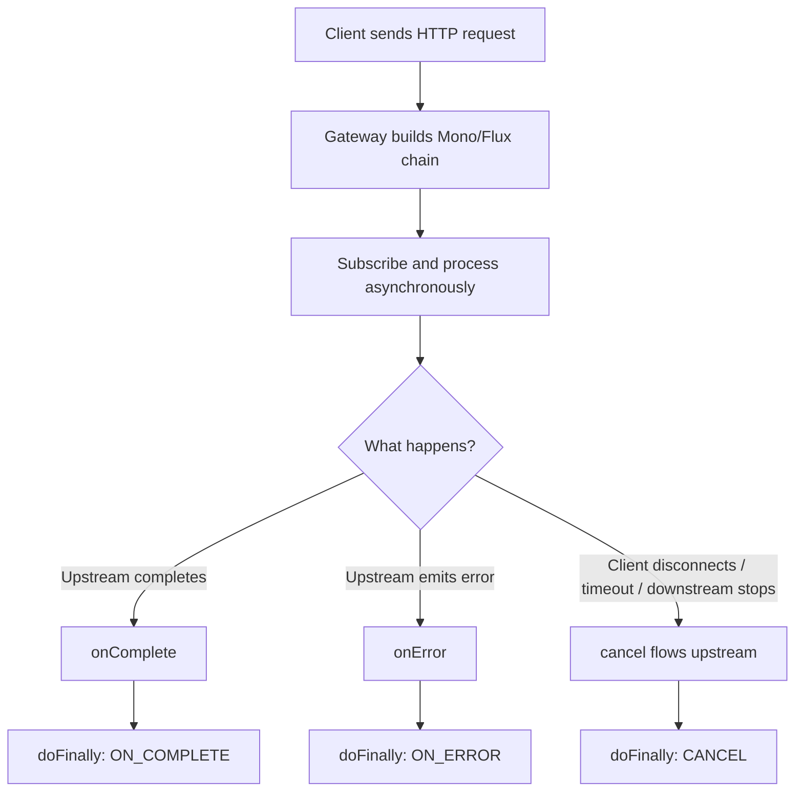
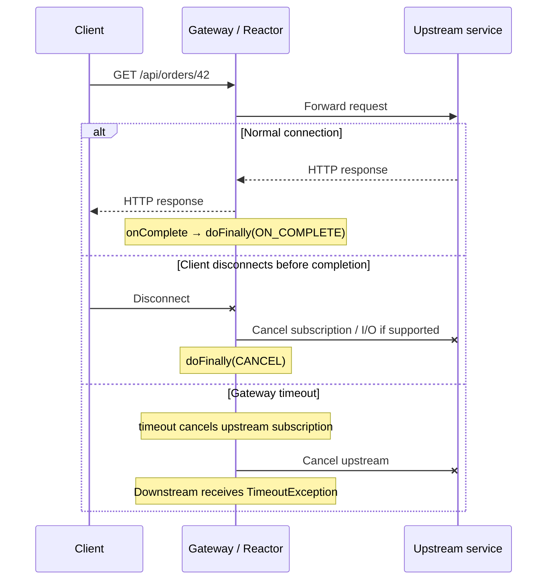

# Error Propagation, Cancellation, and Resource Lifecycle Management

In Spring WebFlux, a request is processed as an asynchronous stream of signals. Spring Cloud Gateway builds on this foundation: the Gateway receives a request, runs the predicate/filter chain, calls the downstream service, and streams the response back to the client. Therefore, **errors**, **cancellation**, and **resource cleanup** must be designed around the lifecycle of `Mono`/`Flux`, rather than assuming every request runs continuously on a single thread and finishes via `return` or `throw`.

This lesson focuses on how Reactor propagates signals, how error-handling and cancellation operators behave, how to protect resources (especially `DataBuffer`), and how to apply those principles to the Spring Cloud Gateway filter chain. This also forms the foundation for configuring timeouts, retries, circuit breakers, and request observability in Gateway operations.

## 1. The Signal Model: Completion, Error, and Cancellation

A Reactive Streams–compliant `Publisher` can emit data via `onNext`, then terminate with **one of two terminal signals**: `onComplete` or `onError`. A `Subscriber` also has the right to send `cancel()` back to the `Subscription` to indicate it no longer needs data. Cancellation is **not** an `onError` or `onComplete` signal sent to the subscriber.

| Concept | Who initiates it? | Meaning and consequence |
| --- | --- | --- |
| `onNext(value)` | Publisher → Subscriber | Emits a value while demand (`request(n)`) remains; a `Mono` emits at most one value. |
| `onComplete()` | Publisher → Subscriber | Successful termination, possibly without emitting any values. |
| `onError(error)` | Publisher → Subscriber | Failure termination; no further `onNext`/`onComplete` will arrive from that subscription. |
| `cancel()` | Subscriber → Subscription | Asks upstream to stop producing data and clean up when possible; does not guarantee external side effects are rolled back. |



**A crucial distinction in an API Gateway:** HTTP `404`, `429`, or `503` are **response status codes**, not automatically Reactor `onError` signals. For example, the Gateway can forward a `503` response from the target service verbatim and the response-writing stream still completes with `onComplete` normally. Conversely, connection failures, exceptions in filters, or timeouts can emit `onError`. When using `WebClient.retrieve()`, HTTP error statuses are typically converted into exceptions by `WebClient` rules; that is behavior of that HTTP client API, not a rule across all Gateway flows.

Practical consequences:

- `Mono`/`Flux` are usually **lazy**: assembling a pipeline does not mean network calls or resource allocations have started; work begins upon subscription.
- A `throw` inside a callback or an error from a publisher is turned by Reactor into an `onError` signal in the operator context. A `try/catch` wrapping pipeline *declaration* will not catch asynchronous errors occurring after subscription.
- Once a source has emitted `onError`, it has terminated. `onErrorResume` switches to an alternative stream; `retry` creates a new subscription. Neither resumes emitting from the old failed source.
- Cancellation generally propagates from downstream to upstream, but stopping an in-flight HTTP call, I/O operation, or already-started side effect depends on the library and cancellation timing.

## 2. How Do Errors Propagate Through a Pipeline?

Consider a pipeline querying a product service inside a WebFlux component:

```java
Mono<Product> product = webClient.get()
    .uri("/products/{id}", productId)
    .retrieve()
    .bodyToMono(Product.class)
    .map(this::normalizeProduct)
    .doOnError(error -> log.warn("product lookup failed", error));
```

If the connection fails, upstream returns an error status translated to an exception by `retrieve()`, or `normalizeProduct` throws an exception, downstream operators receive `onError`. `doOnError` only **observes** and does not recover from the error; the final subscriber still receives `onError` unless the pipeline includes a recovery operator.

### Operators to Distinguish

| Operator | Purpose | Key reminder |
| --- | --- | --- |
| `doOnError(...)` | Logging, metrics, side-effect observation | Does not swallow errors and does not automatically alter HTTP status. |
| `onErrorMap(...)` | Converts an exception into a business/infrastructure type | Preserve `cause` for diagnostics. |
| `onErrorResume(...)` | Switches to a fallback `Publisher` | Use only when a semantically valid fallback exists. |
| `onErrorReturn(...)` | Returns a fixed default value | Easily masks outages if used indiscriminately. |
| `onErrorComplete(...)` | Turns an error into empty completion | Can hide failure signals; use only when intentionally ignoring errors. |
| `retryWhen(...)` | Re-subscribes to the source after an error per policy | Can re-call upstream and repeat side effects; unsuitable as a blanket default for every request. |
| `doFinally(...)` | Runs observation/cleanup on complete, error, or cancel | Receives `SignalType`; unsuitable for producing a new HTTP response. |

Example classifying timeouts and recovering only for permitted errors:

```java
Mono<Product> fetchProduct(String productId) {
    return webClient.get()
        .uri("/products/{id}", productId)
        .retrieve()
        .bodyToMono(Product.class)
        .timeout(Duration.ofSeconds(2))
        .onErrorMap(
            TimeoutException.class,
            ex -> new ProductServiceTimeoutException("Product service timed out", ex)
        )
        .onErrorResume(
            ProductNotFoundException.class,
            ex -> Mono.empty()
        );
}
```

This snippet illustrates handling on **a WebFlux client**: `ProductServiceTimeoutException` and `ProductNotFoundException` are application-defined exception types. The `onErrorResume` branch only runs when the pipeline actually emits `ProductNotFoundException`; an HTTP `404` from `retrieve()` would need to be mapped to that exception type first to use that branch. Turning `Mono.empty()` into an HTTP `404` or another response is the responsibility of the outer calling layer.

In the Gateway, separate responsibilities cleanly: timeouts/circuit breakers handle infrastructure failures; centralized error handlers decide safe responses; observation filters record signals without silently swallowing exceptions. Avoid using `onErrorContinue` across whole requests: its semantics depend on supporting operators and can silently drop failing items in hard-to-reason-about ways.

### When Are Errors Converted into HTTP Responses?

An error at the reactive layer must be handled before the response is committed. Depending on how the application is built, `WebExceptionHandler`, `ErrorWebExceptionHandler`, or a Gateway filter can handle exceptions and set the HTTP status/body. Once headers or body bytes have been flushed onto the wire, the status cannot be reliably changed to `500`/`504`. The typical result is a truncated response, client read errors, or a closed connection.

Therefore, whenever writing an error response inside a filter, always check `exchange.getResponse().isCommitted()` and write only if uncommitted; if already committed, propagate the error so appropriate error handling/logging resolves it. Never call `setComplete()` unconditionally to mask arbitrary exceptions.

## 3. Cancellation: Who Cancels, and How Far Does It Propagate?

Common scenarios in Spring Cloud Gateway:

1. The client closes the browser tab, aborts the HTTP request, or disconnects before the Gateway returns a response.
2. A `timeout` operator expires, cancels the upstream subscription, and emits `TimeoutException` downstream.
3. `take`, `next`, `switchMap`, or another coordinating operator no longer needs the active source.
4. One failing branch in a multi-publisher composition causes sibling branches to be cancelled per operator semantics, such as `flatMap` without error-delay mode.



A subtle point: when `timeout` triggers, **upstream sees cancellation**, whereas **downstream sees a timeout error** (unless a fallback catches it). Hence metrics counting `CANCEL` at one operator and `ON_ERROR` at another for the same request are not necessarily contradictory.

Cancellation is a request to stop doing further work, **not a transaction rollback**. A target service may already have persisted data before the Gateway/client disconnected. Never rely on cancellation to guarantee a `POST /payments` operation did not execute; preventing duplicate execution requires idempotency keys and proper business mechanisms.

### Observing Termination with `doFinally`

```java
@Component
public final class ExchangeLifecycleFilter implements GlobalFilter, Ordered {
    private static final Logger log =
        LoggerFactory.getLogger(ExchangeLifecycleFilter.class);

    @Override
    public Mono<Void> filter(ServerWebExchange exchange, GatewayFilterChain chain) {
        String requestId = exchange.getRequest().getId();
        long start = System.nanoTime();

        return chain.filter(exchange)
            .doOnError(error ->
                log.warn("gateway request failed: requestId={}", requestId, error))
            .doFinally(signal -> {
                long elapsedMs = TimeUnit.NANOSECONDS.toMillis(
                    System.nanoTime() - start);
                log.info("gateway requestId={} signal={} status={} elapsedMs={}",
                    requestId,
                    signal,
                    exchange.getResponse().getStatusCode(),
                    elapsedMs);
            });
    }

    @Override
    public int getOrder() {
        return -1;
    }
}
```

Types used in this example: `GlobalFilter`, `GatewayFilterChain`, `Ordered`, `ServerWebExchange`, `Mono`, SLF4J `Logger`/`LoggerFactory`, and `TimeUnit`. This is an observation filter that does not modify the response. `doFinally` executes when the subscription observed by this filter terminates; operator placement determines whether it sees `CANCEL`, `ON_ERROR`, or `ON_COMPLETE`. When an HTTP `503` response is proxied successfully, the signal may still be `ON_COMPLETE`, so metrics should record **both the signal and the HTTP status**.

`doOnCancel` triggers only on cancellation; `doOnError` triggers only on errors. `doFinally` covers all three terminal outcomes and suits timing measurements, decrementing active request gauges, or running fast synchronous cleanup. Never perform blocking I/O inside that callback; if asynchronous cleanup is mandatory, use `usingWhen` or dedicated lifecycle management.

## 4. Subscription-Scoped Resource Management

In synchronous applications, resources typically live inside `try/finally` or `try-with-resources`. In Reactor, the following snippet has a lifecycle bug:

```java
// WRONG: closes the connection immediately when building the Mono, before subscription.
Connection connection = openConnection();
try {
    return asyncRead(connection); // Only builds the publisher; I/O has not run yet.
} finally {
    connection.close();
}
```

Resources should be acquired during subscription and closed along every termination path. Reactor provides two families of helpers:

- `using(...)`: manages resources with synchronous cleanup (such as `AutoCloseable`).
- `usingWhen(...)`: manages resources whose cleanup returns a `Publisher`, suitable for closing connections/transactions asynchronously across all three branches: **complete**, **error**, and **cancel**.

Illustrative example of an application-defined asynchronous resource:

```java
interface AsyncLease {
    Mono<byte[]> read();
    Mono<Void> close();
}

Mono<byte[]> readSafely(Mono<AsyncLease> acquireLease) {
    return Mono.usingWhen(
        acquireLease,
        AsyncLease::read,                   // Use the resource.
        AsyncLease::close,                  // Cleanup on complete.
        (lease, error) -> lease.close(),    // Cleanup on error.
        AsyncLease::close                   // Cleanup on cancel.
    );
}
```

`usingWhen` brings cleanup into the reactive lifecycle: it subscribes to the cleanup publisher rather than firing a method and forgetting it. If asynchronous cleanup fails, the cleanup error can affect the observed error/outcome; log it, design cleanup timeouts, and define error precedence per business requirements. No reactive mechanism can guarantee cleanup if the OS process is killed abruptly or the server loses power.

Beyond manually allocated resources, the Gateway also manages connections, sockets, HTTP bodies, and buffers via Spring WebFlux/Reactor Netty. Avoid calling `subscribe()` inside a Gateway filter just to run side work: doing so spawns an independent subscription detached from request cancellation/errors and risks leaking resources. Instead, return a `Mono` composed into `chain.filter(exchange)` using appropriate operators.

## 5. `DataBuffer`: The Most Common Source of Memory Leaks

`DataBuffer` represents chunks of request/response body data. When running on Reactor Netty, it can use off-heap memory and reference counting. With pooled buffers, retaining or dropping a buffer without balanced `retain`/`release` calls can leak memory; releasing too early causes downstream readers to encounter invalidated memory.

Practical rules:

1. **Do not read the body just to log it and forget to forward it.** Request bodies are usually single-use streams; filters modifying the body must provide an appropriate request decorator/body publisher. Prefer built-in Gateway filters such as `ModifyRequestBody`, `ModifyResponseBody`, and `CacheRequestBody` when they satisfy your needs.
2. **If you consume a buffer yourself and do not pass it onward, release it once finished.** Never release a buffer that downstream still owns and expects to read.
3. **With operators that drop elements**, attach `doOnDiscard(DataBuffer.class, DataBufferUtils::release)` where supported by the operator. Do not assume every operator invokes discard hooks in every scenario.
4. **Bound the body size read into RAM.** Aggregating whole bodies increases memory pressure and creates bottlenecks under concurrent load.

Example strictly for cases where **you truly must read the entire body and own the extracted data afterward**:

```java
Mono<byte[]> readBody(Flux<DataBuffer> body) {
    int maxBytes = 1024 * 1024;

    return DataBufferUtils.join(body, maxBytes)
        .map(buffer -> {
            try {
                byte[] copy = new byte[buffer.readableByteCount()];
                buffer.read(copy);
                return copy;
            } finally {
                DataBufferUtils.release(buffer);
            }
        });
}
```

`DataBufferUtils.join(..., maxBytes)` enforces a size ceiling; exceeding it can emit `DataBufferLimitException`. It handles releasing accumulated buffers if an error/cancellation occurs during `join`; the `finally` block ensures the joined buffer is released after the application extracts its bytes. The example returns a copied `byte[]`, so no `DataBuffer` needs to be retained past `map`.

Note: if you call the method above directly inside a Gateway filter, the body has been consumed and **will no longer be forwarded automatically**. To ensure the backend still receives the body, re-attach the prepared content onto a decorated request properly and manage ownership of the new buffer; you cannot simply call `readBody()` before `chain.filter(exchange)` and expect the original request to stay intact.

## 6. Timeouts, Retries, Circuit Breakers, and Request Lifecycle

Gateway protection mechanisms tie directly into errors and cancellation:

| Mechanism | Common Reactor signal | Risk to control |
| --- | --- | --- |
| Connection/response timeout | Connection error or timeout; upstream may be cancelled | Must set reasonable time bounds at both the HTTP client layer and overall request level. |
| `timeout(Duration)` | Cancels upstream, emits `TimeoutException` downstream | Placing the operator before vs. after a fallback changes the observed signal. |
| `Retry` / `retryWhen` | Re-subscribes after selected errors | Can repeat `POST` calls and side effects; request body must be validly replayable. |
| `CircuitBreaker` | Rejects or routes to fallback based on circuit state | Fallbacks must distinguish real failures, emit metrics, and never turn outages into fake successes. |
| `RequestRateLimiter` | Rejects over-limit requests, usually with HTTP `429` | A legitimately returned HTTP `429` does not necessarily emit `onError`. |

An example putting a timeout directly on the filter chain to illustrate signal propagation (for learning only; in production, coordinate with HTTP client timeouts and global error policies):

```java
return chain.filter(exchange)
    .timeout(Duration.ofSeconds(3))
    .onErrorResume(TimeoutException.class, error -> {
        ServerHttpResponse response = exchange.getResponse();
        if (response.isCommitted()) {
            return Mono.error(error);
        }
        response.setStatusCode(HttpStatus.GATEWAY_TIMEOUT);
        return response.setComplete();
    });
```

Here, `timeout` cancels upstream and produces an error; `onErrorResume` can return `504 Gateway Timeout` when the response **has not yet committed**. This snippet does not replace Reactor Netty connection/response-read timeouts and does not guarantee the target system stopped processing. If a request has already written part of its response body, the Gateway cannot rewind and send a `504` response.

For retries, only retry well-understood transient failures and safe or idempotent operations. Account for the total time budget: multiple retries plus backoff can exceed the client's deadline, leaving upstream running after the client has already cancelled. Never blindly retry HTTP `400`, authentication failures `401`/`403`, or deterministic payload errors. When retrying requests with a body, inspect how the Gateway caches/replays bodies and enforce memory bounds.

## 7. Observing Errors and Cleanup in Production

To operate a Gateway safely, record three distinct groups of telemetry:

| Group | Useful data | Why is it needed? |
| --- | --- | --- |
| HTTP | Route ID, method, status code, response duration | Shows true failure rates from the client's perspective, including successfully proxied error responses. |
| Reactive | `ON_COMPLETE`, `ON_ERROR`, `CANCEL`; exception class; timeouts/retries | Separates pipeline failures from client disconnects or proactive timeouts. |
| Resources | In-flight requests, connection pools, memory/buffers, cleanup timeouts | Detects connection/buffer leaks and stuck requests. |

A consistent `requestId`/trace ID spanning client → Gateway → upstream links events together. Reactor can switch execution across threads, so never assume `ThreadLocal` or MDC values carry over automatically; use Reactor `Context` and configured context propagation/tracing mechanisms. `doOnError` can log the same exception at multiple layers; designate a primary logging layer to avoid double-counting or log storms.

Never log raw `Authorization` headers, cookies, tokens, PII, or full bodies. For cancelled requests, examine both `CANCEL` metrics and network-layer disconnect events; not every socket error maps 1-to-1 to a single Reactor signal.

### Testing Cancellation and Timeouts

`reactor-test` provides `StepVerifier` to assert signals without booting the entire Gateway. Example verifying that timeout cancels upstream:

```java
@Test
void timeoutCancelsUpstream() {
    AtomicReference<SignalType> upstreamSignal = new AtomicReference<>();

    Mono<String> upstream = Mono.<String>never()
        .doFinally(upstreamSignal::set);

    StepVerifier.create(upstream.timeout(Duration.ofMillis(50)))
        .expectError(TimeoutException.class)
        .verify();

    assertEquals(SignalType.CANCEL, upstreamSignal.get());
}
```

In this test, `Mono.never()` emits no data, and `timeout` cancels the upstream subscription before emitting an error downstream. For end-to-end Gateway tests, combine `WebTestClient` with a mock upstream to test: responses before and after commit; client cancellation; timeouts; retries with/without bodies; target-service failures; and buffer leaks or unclosed connections. When verifying exact timing, consider `StepVerifier.withVirtualTime` for pipelines compatible with virtual schedulers.

## 8. Scenarios Requiring Explicit Decisions

**Scenario A — Upstream returns a valid `503`.** The Gateway can complete forwarding the response, so `doFinally(ON_COMPLETE)` still holds. HTTP status metrics report `503`; do not rely solely on `doOnError` to measure service errors.

**Scenario B — Client cancels while upstream is processing a `POST`.** The Gateway can cancel I/O, yet the backend may already have committed data. Use idempotency keys and track business state rather than inferring rollback from cancellation.

**Scenario C — A filter reads the body to verify a signature.** If it consumes `DataBuffer` without restoring the body for the chain, the backend receives an empty body; if it mishandles pooled buffers, the Gateway can leak memory. Prefer built-in body rewrite/cache mechanisms or manage ownership deliberately.

**Scenario D — Backend times out after the response has started streaming.** There is no longer an opportunity to change the HTTP status; record metrics/logs, release resources, and let the connection terminate at the network layer. This is critical for SSE, streaming downloads, and large responses.

**Scenario E — A fallback swallows all errors.** Clients may see `200` while the backend is down, skewing dashboards, violating API contracts, and hindering incident investigation. Only fall back when acceptable substitute data exists; instrument fallbacks with metrics and preserve root-cause visibility.

## 9. Checklist When Designing a Gateway Filter

Before putting a filter into production, verify:

1. Does the filter return a `Mono<Void>` chained to `chain.filter(exchange)`, or did it spawn an out-of-band subscription?
2. Which errors should propagate, which should be mapped, and which have a valid fallback?
3. Could the response already be committed before error handling runs?
4. When a client cancels or times out, which work is aborted and which resources are cleaned up?
5. If the filter reads/modifies the body, who owns and releases each `DataBuffer`? Is the body re-emitted cleanly once for downstream?
6. Are retries safe with respect to HTTP methods, side effects, request bodies, and total deadlines?
7. Do metrics distinguish HTTP status codes, reactive terminal signals, cancellations, and fallbacks?

**Key takeaway:** `onError` represents stream failure, `cancel` represents downstream no longer needing data, and HTTP status represents communication outcome at the HTTP layer. Understanding all three layers properly enables Spring Cloud Gateway to return consistent errors, avoid unsafe retries, prevent `DataBuffer`/connection leaks, and observe requests reliably when clients disconnect or upstreams become unstable.
