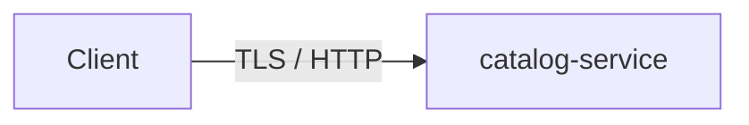
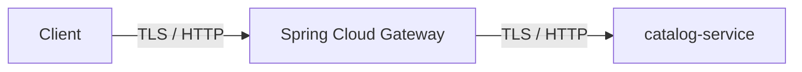
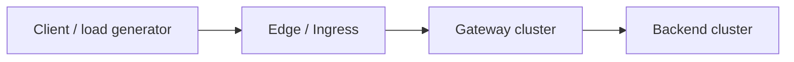
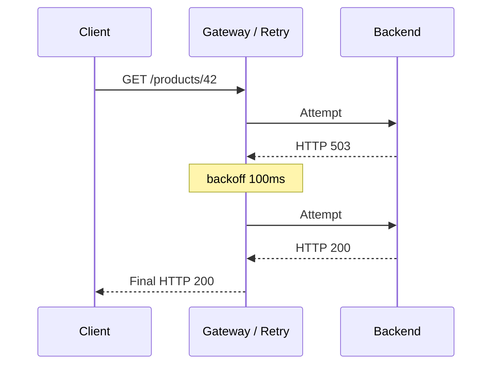
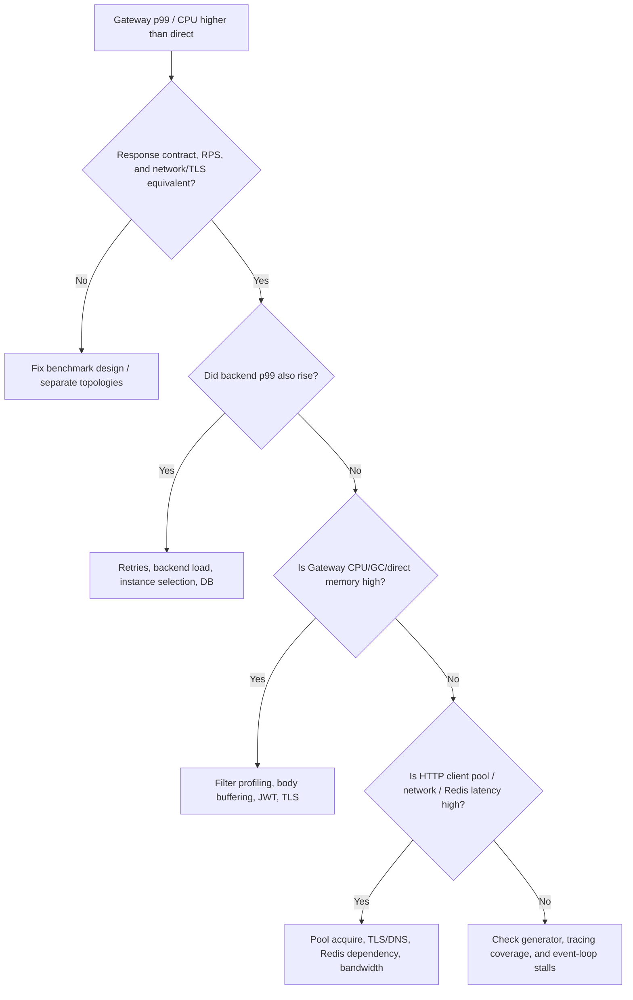

# Evaluating Gateway Overhead vs. Calling Services Directly

When deploying **Spring Cloud Gateway** as the entry point for microservices, teams frequently ask: *"How much slower is going through the gateway compared to calling the backend directly? How much extra CPU, memory, connections, bandwidth, and operational cost does the gateway add? If we layer on rate limiting, retries, caching, circuit breakers, TLS, and token validation, do the benefits justify the cost?"* These questions can only be answered reliably with a **clear cost model and controlled measurements**. A single `curl` run or one HTTP latency chart is not enough to draw conclusions.

This lesson belongs to the **Performance** chapter in the **SPRING_CLOUD_GATEWAY** module. The context is building an API Gateway with route predicates, filter chains, path/header modifications, service discovery/LoadBalancer, authentication, rate limiting, circuit breakers, retries, TLS, and request observability. The goal is not to prove that a gateway is always fast or always slow, but to help you measure **attributable incremental cost** and **operational/business value** of the gateway compared to clients calling services directly.

> **Technical scope:** Examples focus on **Spring Cloud Gateway Server WebFlux (Reactor Netty)**. Gateway Server Web MVC and Proxy Exchange have different runtimes, filter chains, HTTP clients, and constraints. The configuration namespace may be `spring.cloud.gateway.server.webflux.*` in newer releases or `spring.cloud.gateway.*` in older ones; cross-check against your running Spring Boot/Spring Cloud release train. Numbers in illustrative tables are **intentionally simulated**, not benchmark results published by Spring or the curriculum team.

## 1. Why Does a Gateway Add Cost Yet Still Pay Off?

### Direct Backend Calls



Clients discover the service address and call it directly. This model can reduce application-layer proxy hops, but introduces several challenges:

- Clients must know endpoints and service-discovery mechanisms.
- Each backend must implement appropriate authentication, TLS, CORS, rate limiting, and logging/metrics policies.
- Public backend exposure can increase the attack surface.
- Changing backend hosts, API versions, or migrating regions can impact clients.
- Cross-cutting responsibilities can end up duplicated across many services.

### Routing Through a Gateway



The gateway adds steps to accept the request, match a route, run filters, and issue an outbound request. In return, you can:

- Expose a single public entry point and manage route versions.
- Centralize shared policies such as CORS, rate limiting, TLS termination, access logging, and request tracing.
- Support `lb://` routes via service discovery and Spring Cloud LoadBalancer.
- Block invalid traffic before it reaches backends.
- Apply policy-driven retries, circuit breakers, and response caching.
- Reduce public routing complexity in clients and across backends.

**A fair evaluation counts both sides:** a gateway adds cost to *an individual request passing through*, yet can reduce backend work, cut duplication costs, limit incidents, and simplify operations. Never compare only **direct p50** against **gateway p50** and decide the entire architecture from that.

## 2. Classifying Costs Before Measuring

| Category | Cost components | Appropriate units |
| --- | --- | --- |
| **Latency** | Extra time in the Gateway, network, and backend. | ms/request, p50/p95/p99. |
| **Throughput** | Sustainable requests/second before breaching SLOs. | RPS at fixed concurrency and error budget. |
| **Compute** | CPU from route matching, filters, TLS, serialization, metrics. | CPU core-seconds/million requests; CPU utilization at fixed RPS. |
| **Memory** | Heap, direct memory, request buffering, cache, connection pools. | MiB/pod, MiB/1,000 concurrent requests. |
| **Network** | Two HTTP/TLS hops, headers, retries, ingress/egress. | Bytes/request, GB/million requests. |
| **Connections** | Sockets, TLS handshakes, HTTP/2 streams, keep-alive. | Active connections, pending pool acquires. |
| **Resilience cost** | Retries adding upstream attempts, circuit breakers/fallbacks. | Attempts/inbound request, failure recovery. |
| **Policy cost** | Redis limiter, JWT signature validation, custom filters. | Additional ms, CPU, dependency RPS. |
| **Caching benefit/cost** | Cache hits cut backend calls at the cost of RAM and staleness risk. | Hit ratio, saved calls, MiB/TTL, freshness. |
| **Infrastructure** | Gateway pods, ingress, LB, observability, Redis, data transfer. | Cost/hour, cost/million requests, operational budget. |
| **Engineering/operations** | Configuration, security, monitoring, incident response, rollouts. | Engineering hours/cycle, MTTR, policy points maintained. |

**Do not label all of the above as "gateway latency overhead."** A faster backend due to caching is an end-to-end system effect; it does not prove a gateway filter has negative CPU cost.

## 3. Defining Two Fair Measurement Paths

### Path A — Direct

```text
Load generator
   -> HTTPS/TLS to catalog-service
   -> backend handler
   -> response
```

### Path B — Through Gateway

```text
Load generator
   -> HTTPS/TLS to Spring Cloud Gateway
   -> route match + filters
   -> HTTPS/TLS / HTTP connection to catalog-service
   -> same backend handler
   -> response through Gateway
```

**Key point:** both paths must invoke the **same backend contract**. If the direct path calls `GET /products/42` while the gateway calls a different endpoint via `RewritePath`, the benchmark is comparing two different workloads.

### Four Comparison Modes to Separate

| Code | Purpose | What must stay identical |
| --- | --- | --- |
| **A: Direct baseline** | Cost of the path without a Gateway. | Same client, backend, request/response, network zone, equivalent TLS policy. |
| **B: Minimal Gateway** | Added cost mainly from proxying/routing. | Only `Path`/`Method` and basic route, no cache/retry/custom logic. |
| **C: Policy Gateway** | Cost of each filter/policy. | Add only **one change** over B per trial. |
| **D: Optimized/realistic Gateway** | Real impact under a production-like workload. | Full policies, realistic traffic mix, multiple replicas, SLOs, and resource budgets. |

Test B after A, then incrementally enable JWT validation, rate limiter, path rewrite, retry, caching, and tracing. Turning everything on at once makes it hard to isolate which mechanism changed p99 or backend RPS.

## 4. Decomposing Latency by Hop

Simplified conceptual model:

\[
T_{\text{direct}}
= T_{\text{client}\to\text{backend}}
+ T_{\text{backend}}
+ T_{\text{backend}\to\text{client}}
\]

\[
T_{\text{gateway}}
= T_{\text{client}\to\text{gateway}}
+ T_{\text{gateway-process}}
+ T_{\text{gateway}\to\text{backend}}
+ T_{\text{backend}}
+ T_{\text{backend}\to\text{gateway}}
+ T_{\text{gateway}\to\text{client}}
\]

This is a **conceptual decomposition**, not a clean sum of independent steps in a streaming/pipelined system: CPU, I/O, and response transfer can overlap, and requests can wait on threads, event loops, connection pools, or backends.

### Common Additional Costs

- **TCP/TLS**: The Gateway terminates an inbound server connection and opens/reuses an outbound HTTP client connection. When keep-alive/pooling works, many requests **reuse connections**; do not mechanically charge a full TCP/TLS handshake to every request.
- **Route matching**: evaluating predicates, selecting a `Route`, route cache lookup, and metadata.
- **Filter chain**: `GlobalFilter`/`GatewayFilter`, Netty routing, header transformations, body filters.
- **Context propagation**: trace/span, MDC/observation, metrics, security principal.
- **Outbound scheduling**: Reactor Netty connection pool, acquire queue, event-loop scheduling, TLS and network send.
- **Buffering/copying**: request/response body buffering for filters, compression/decompression, or aggregation.
- **Extra network hop**: requests travel through the Gateway and then to the backend rather than along the direct path.

### Do Not Subtract Two p99s as "Per-Request p99 Overhead"

Let:

\[
\Delta_{p95} = p95(T_{\text{gateway}}) - p95(T_{\text{direct}})
\]

This value is the **difference between quantiles of two distributions** under equivalent test conditions. It is **not** the 95th percentile of per-request latency differences, nor does it prove every request slows down by `\Delta_{p95}`.

To study **per-request overhead**, you need paired-request experiments, normalized backend workloads, and synchronized timestamps; even on the same URL, backend/cache/network noise can cause measurements to fluctuate.

## 5. Network Latency, TLS, and Placement Can Exceed Filter CPU

In a real topology:



Network links between components can sit on the same host, same Kubernetes node, different nodes, different zones, or different regions. **Hop cost is not a constant.**

| Topology | Benchmark bias risk |
| --- | --- |
| Gateway and backend on the same host | Ultra-low loopback latency, unrepresentative of production networks. |
| Gateway and backend on the same K8s node | Less cross-node traffic; results look rosier than when scaled across nodes. |
| Gateway and backend in different zones | Different RTT and egress fees; p99 becomes sensitive to network variance. |
| Direct through a public load balancer, Gateway via private service | Non-equivalent paths with different hops and TLS policies. |
| Direct over plain HTTP, Gateway with two-hop HTTPS | Difference includes TLS/security, not just Gateway overhead. |
| Client close to Gateway but far from direct backend | Gateway may look "faster" due to topology, not negative proxy CPU cost. |

### TLS: Warm Connections vs. Cold Handshakes

Report at least two modes:

1. **Warm steady-state**: keep-alive/pooled connections are reused; representative of long-lived HTTP clients.
2. **Cold connections**: frequent TCP/TLS handshakes, such as short-lived client connections; higher CPU/latency cost.

With HTTP/2, multiple logical streams share a connection; with HTTP/1.1, concurrency depends on connection count and pool limits. **Never compare H2 direct against H1 gateway and blame the entire difference on the Gateway.**

### Balancing Security Conditions

If production requires JWT signature validation, TLS/mTLS, and rate limiting, a direct baseline **without** those controls merely measures *a path with fewer features*. To understand architectural cost:

- **Proxy microbenchmark**: disable policies on both paths to measure pure proxy overhead.
- **Functionally equivalent benchmark**: direct backend enforces equivalent auth/quota itself, while the gateway enforces them on the proxy path.
- **Production benefit benchmark**: enable caching/limiting/retries/fallbacks and measure backend load, availability, and SLOs together.

Do not use a microbenchmark result like "gateway is X ms slower" to judge total operational value if the direct baseline omits mandatory security controls.

## 6. Throughput, Queueing, and Tail Latency

**Throughput** is completed requests per second under a load condition; **latency** is the duration per request. They are related, but **not interchangeable**.

### Little's Law

In steady state, using consistent system boundaries and in-flight request counts:

\[
L = \lambda W
\]

Where:

- `L`: average number of requests currently in the system.
- `\lambda`: average completed throughput (requests/s).
- `W`: average residence time (seconds/request).

For example, hypothetically if throughput is `2,000 RPS` and average latency is `0.050 s`, average concurrency is about `100` requests within the measurement boundary. That does **not** mean the Gateway handles at most 100 concurrent requests; it is simply the average relationship under steady-state assumptions and consistent measurement targets.

### Why Can p99 Spike Before Throughput Stops Growing?

- Event loop or CPU approaching saturation.
- Reactor Netty HTTP client pool pending acquires rising.
- Backend threads, DB pool, or connection queues filling up.
- Slow `RedisRateLimiter` or tracing exporter.
- JVM GC or direct memory pressure.
- Retries generating extra attempts when the backend is already overloaded.
- A subset of large-body requests consuming memory/bandwidth.

**A small p50 increase does not guarantee a small p99.** For latency-sensitive APIs, measure p95/p99 or error-budget latency distributions across load levels.

### Open-Loop vs. Closed-Loop Testing

| Load generation style | Characteristics | Limitations |
| --- | --- | --- |
| **Closed-loop** (e.g., N virtual users calling and waiting) | Models users with think time, easy to configure. | When the server slows down, request generation slows down too; can mask overload. |
| **Open-loop** (fixed arrival rate/RPS) | Sends requests at a predetermined rate; good for testing responsiveness when traffic does not back off. | Must size the load generator and watch dropped iterations and saturation. |

To find sustainable throughput within an SLO, use open-loop or a tool supporting *constant-arrival-rate*, stepping load upward; **never run 100 VUs once and call the observed request rate maximum capacity**.

## 7. Choosing SLOs Before Running Benchmarks

A report must state **success criteria** before measuring:

| Metric | Example POC target, not a universal standard |
| --- | --- |
| Client-facing HTTP error rate | Under 0.5% for valid requests at target traffic. |
| End-to-end latency p95 | Under 120 ms for GET mock workload. |
| End-to-end latency p99 | Under 250 ms at a specified RPS. |
| Gateway CPU | Within allocated CPU budget, no sustained throttling. |
| Gateway Memory | No unbounded growth, no OOM/GC storm. |
| Backend RPS | No amplification beyond the retry budget. |
| Security/correctness | No token/PII leaks, no cross-tenant cache pollution, accurate auth. |

These are **illustrative targets for demonstrating the process**, not official Spring Cloud Gateway benchmark numbers and not suitable for every system. For architectural decisions, derive SLOs from product requirements and real traffic.

### Compare at Equal RPS or Equal CPU?

Two different perspectives:

1. **Equal offered load/RPS**: compare client latency, errors, CPU/memory, and backend cost at the same request volume.
2. **Equal resource budget**: compare the maximum throughput each topology sustains before violating SLOs.

Do not claim "Gateway hits 20,000 RPS" if one path was given multiples more CPU or bypassed the backend; report resource configurations and actual completed RPS.

## 8. Preparing a Reproducible POC

We use a small Spring Boot backend returning fixed JSON, a Gateway Server WebFlux instance, and an external load generator outside both applications.

| Component | Lab address | Role |
| --- | --- | --- |
| **Load generator** | Separate test host or container | Generates load and measures caller-observed latency. |
| **catalog-service** | `localhost:8081` | Same endpoint called by both paths. |
| **Spring Cloud Gateway** | `localhost:8080` | Matches routes and proxies to catalog-service. |
| **Prometheus/Actuator** | Dedicated management endpoint per config | Monitors Gateway, backend, and JVM. |
| **Redis** (later phase) | Redis test instance | Measures `RequestRateLimiter` when adding quotas. |

### Two Equivalent URLs

```text
Direct:
  http://localhost:8081/products/42

Via Gateway:
  http://localhost:8080/api/catalog/products/42
    -- StripPrefix=2 -->
  http://localhost:8081/products/42
```

**Only use cleartext HTTP in an isolated loopback POC for minimal proxy overhead.** In production-like tests, **you must also measure** both paths with TLS/hostnames/CAs/trust-stores and equivalent topology; never extrapolate security conclusions from a plain-HTTP POC.

### Keep Requests and Responses Identical

- Method: GET.
- Backend handler: the same `/products/42`.
- Response body: identical byte sequence.
- Content-Type and key headers: identical contract.
- No caching in the browser, CDN, Gateway, or mock backend during the pure-overhead phase.
- Do not enable Retry, CircuitBreaker, rate limiter, token validation, or body rewriting when measuring minimal path B.
- Do not leave dev hot reload, debuggers, or wiretap payload logging enabled on one path and not the other.

If the Gateway route uses `StripPrefix=2` to match the backend URL, that is a small part of the baseline cost. You can also compare a route without path stripping by exposing a matching backend endpoint, while keeping business logic identical across paths.

## 9. Fixed Mock Backend: Don't Let the Database Mask Gateway Cost

Example Spring Boot MVC backend:

```java
package com.example.catalog;

import org.springframework.http.CacheControl;
import org.springframework.http.MediaType;
import org.springframework.http.ResponseEntity;
import org.springframework.web.bind.annotation.GetMapping;
import org.springframework.web.bind.annotation.RestController;

@RestController
public class CatalogBenchmarkController {

    private static final String PAYLOAD =
        "{\"id\":42,\"name\":\"Keyboard\",\"inStock\":true}";

    @GetMapping(value = "/products/42",
        produces = MediaType.APPLICATION_JSON_VALUE)
    public ResponseEntity<String> getProduct() {
        return ResponseEntity.ok()
            .cacheControl(CacheControl.noStore())
            .contentType(MediaType.APPLICATION_JSON)
            .body(PAYLOAD);
    }
}
```

The backend runs on `server.port=8081`. The response uses no database, file I/O, remote RPC, or random sleeps; the body can be verified by hash or exact string match. Measure backend `CPU`/`memory` separately. Do not use the Actuator `/health` endpoint as a workload because health contributors can differ across deployments and do not represent the application contract.

### Verify the Response Before Generating Load

```bash
curl -i "http://localhost:8081/products/42"
```

Expected:

```json
{"id":42,"name":"Keyboard","inStock":true}
```

This is the response produced by the lab controller, **not a default Gateway output**. If either path returns an HTML error page or different JSON, do not start comparing latencies.

### A No-Op Backend Does Not Represent Real APIs

A backend doing no DB work **amplifies the relative share of gateway overhead** in total latency, which is useful for finding an upper bound on relative basic proxy overhead. However, to make production decisions, also run a backend workload with realistic DB/RPC calls, payload sizes, and response distributions. A 100 ms backend delay shrinks Gateway overhead in percentage terms, **which does not mean the Gateway's absolute cost disappeared**.

## 10. Gateway WebFlux Minimal Route

In the lab Gateway running on port `8080`:

```yaml
server:
  port: 8080

spring:
  cloud:
    gateway:
      server:
        webflux:
          routes:
            - id: catalog-minimal
              uri: http://localhost:8081
              predicates:
                - Path=/api/catalog/**
                - Method=GET
              filters:
                - StripPrefix=2
```

This is the syntax for **Gateway Server WebFlux in newer releases**. Older releases typically use:

```yaml
spring:
  cloud:
    gateway:
      routes:
        - id: catalog-minimal
          uri: http://localhost:8081
          predicates:
            - Path=/api/catalog/**
            - Method=GET
          filters:
            - StripPrefix=2
```

**Use only the single namespace matching your actual version**—do not declare both simultaneously. Your WebFlux/Boot/Cloud BOM starters must be compatible. You cannot swap in Gateway Server MVC and expect identical properties/APIs.

### Confirm the Routing Path

```bash
curl -i "http://localhost:8080/api/catalog/products/42"
```

Both paths must return identical JSON content. If the Gateway returns HTTP 404 before reaching the backend, check route matching, namespace, filters, and path; if the backend receives `/api/catalog/products/42` instead of `/products/42`, `StripPrefix` did not apply as intended.

### Measure the Right Route

To measure **minimal Gateway** overhead, avoid accidentally leaving custom `GlobalFilter`s enabled in the app. Global filters can be registered by starters, auto-configuration, or company libraries. Inspect the runtime filter chain and Actuator routes in a protected lab environment; do not assume a short YAML route means the filter chain is actually empty.

## 11. k6 Script: Same Request Rate for Both URLs

`k6` is a popular choice for HTTP load generation. This example uses **`constant-arrival-rate`** to test latency/errors at a nearly fixed offered load, rather than just a closed loop of virtual users.

### File `compare-gateway.js` (illustrative)

```javascript
import http from 'k6/http';
import { check } from 'k6';

const target = __ENV.TARGET_URL ||
  'http://localhost:8081/products/42';

export const options = {
  discardResponseBodies: false,
  scenarios: {
    fixed_arrivals: {
      executor: 'constant-arrival-rate',
      rate: 200,
      timeUnit: '1s',
      duration: '2m',
      preAllocatedVUs: 120,
      maxVUs: 240,
    },
  },
  thresholds: {
    http_req_failed: ['rate<0.005'],
    http_req_duration: ['p(95)<120', 'p(99)<250'],
    dropped_iterations: ['count==0'],
  },
};

export default function () {
  const res = http.get(target, {
    headers: { Accept: 'application/json' },
    tags: { scenario_kind: 'catalog_minimal' },
  });

  check(res, {
    'HTTP 200': r => r.status === 200,
    'expected product': r => r.body.includes('"id":42'),
  });
}
```

**Note:** This code is a script for learners to save and run in an authorized environment. For max-throughput benchmarks, checking every response body with `discardResponseBodies=false` creates client overhead; keep the same check level on both paths, or validate sampled responses and use `discardResponseBodies=true` in a separate capacity run. Never change one path without changing the other.

k6's `http_req_duration` mainly covers sending the request, waiting for the response, and receiving it; **it does not include all connection/TLS handshake waiting time** as a catch-all end-to-end UX metric. To assess cold connects, also inspect `http_req_blocked`, `http_req_connecting`, `http_req_tls_handshaking`, and VU/connection-reuse lifecycles. `iteration_duration` can also include script logic outside the HTTP request. State clearly which metric is used.

### Run Both Groups for the Same Duration

In a shell with k6 installed:

```bash
k6 run \
  -e TARGET_URL=http://localhost:8081/products/42 \
  compare-gateway.js

k6 run \
  -e TARGET_URL=http://localhost:8080/api/catalog/products/42 \
  compare-gateway.js
```

**Do not run both commands in parallel on a small host** where shared CPU/network/load-generator resources will skew results, unless you are running a simultaneous canary test with isolated resources. To reduce ordering bias, you can run an **A → B → B → A** sequence with equivalent state resets and warm-up, then analyze multiple repetitions.

### Don't Look Only at Sent Requests

k6 can report **`dropped_iterations`** when it lacks VUs or resources to sustain the arrival rate. When that happens:

- Actual offered load no longer matches the target.
- The load generator may be the bottleneck, not the Gateway.
- Latency metrics on the subset of sent requests can look overly optimistic.

**Never claim the Gateway handles 5,000 RPS** if k6 only managed to emit 2,000 RPS because the generator saturated.

### Multiple Load Levels

Run steps like `100, 200, 500, 1,000, 2,000 RPS` **only in an authorized test environment with sufficient resources**, stopping if error/latency/resource budgets are breached. These levels are examples, not defaults for every laptop. Record at each step:

- Target arrivals and completed RPS.
- p50/p95/p99, maximum, and confidence/variability across runs.
- HTTP statuses/errors/timeouts; dropped iterations.
- Gateway/backend CPU/memory/network.
- Active connections, pending pool acquires.
- Load-generator CPU/memory/network.

## 12. Experimenting Across Payload Sizes

An API Gateway may add **very little CPU** when merely forwarding headers for small responses, but body filters, decompression, or large payloads can completely alter the cost profile.

| Payload | Example | Bottlenecks to watch |
| --- | --- | --- |
| **0–1 KiB** | Status/metadata endpoints. | Route matching, headers, TLS, per-request overhead. |
| **10–50 KiB** | Catalog/product JSON. | HTTP client pool, network, content encoding. |
| **100 KiB–1 MiB** | Large search results. | Serialization, direct memory, buffering, GC. |
| **5–20 MiB** | Exports/reports/downloads. | Bandwidth, backpressure, response buffering, connection lifetime. |
| **Streaming** | SSE, WebSocket/gRPC workloads. | Long-lived connections, idle timeouts, flow control. |

**Never arbitrarily benchmark a 20 MiB file at 2,000 RPS in a shared environment**; that volume is massive and can disrupt co-located systems on the same network. Choose load levels based on capacity and sandbox boundaries.

### Body Filters Change the Equation

Filters such as `ModifyRequestBody`, `ModifyResponseBody`, `CacheRequestBody`, body-based validation, and compression/decompression can:

- Read/decode the payload.
- Allocate/retain `DataBuffer`s or objects on the heap/direct memory.
- Wait for the entire body before forwarding (losing streaming behavior in those use cases).
- Transform JSON and drive up CPU/GC.

Separate **minimal proxy** and **body-transform proxy** into two experiments; do not estimate the cost of `RewritePath` using the cost of `ModifyResponseBody`.

## 13. Comparing Across Multiple Backend Latencies

To evaluate how meaningful gateway overhead is when the backend performs heavier business work, build a mock with a **configured delay in the test server**:

| Backend latency profile | Effect |
| --- | --- |
| ~0–2 ms | Highlights proxy/filter/network overhead. |
| ~20 ms | Close to a fast data-reading service. |
| ~100 ms | Simulates a slower DB/RPC service. |
| Tail with 1% of requests at 500 ms | Tests p99, timeouts, pooling, and queueing. |

**The values above are simulated scenarios only.** In a Spring WebFlux test backend, do not use `Thread.sleep()` on the event loop to simulate latency because it is **blocking** and distorts behavior in ways unrepresentative of real backend I/O. If you simulate delay using blocking threads in Spring MVC, document it as an auxiliary model and do not use it to draw conclusions about non-blocking throughput.

### Evaluating Percentage Overhead

Suppose in an error-free scenario (hypothetical):

```text
Direct p50  = 20 ms
Gateway p50 = 23 ms
Δp50        =  3 ms
relative Δ  = 15%
```

With the same `3 ms` absolute cost, if the backend only takes `2 ms`, the relative percentage looks huge; if the backend takes `200 ms`, the percentage looks tiny. For an absolute latency SLO, **3 ms is still 3 ms**—do not look only at percentages.

**Do not use percentage overhead when the direct baseline is near zero** as proof that the Gateway is "many times slower" while ignoring absolute delta, measurement resolution, and network topology.

## 14. Micrometer and Actuator: Measuring at Gateway and Backend

For Spring Boot, add the dependencies to the relevant applications:

```xml
<dependency>
    <groupId>org.springframework.boot</groupId>
    <artifactId>spring-boot-starter-actuator</artifactId>
</dependency>
<dependency>
    <groupId>io.micrometer</groupId>
    <artifactId>micrometer-registry-prometheus</artifactId>
</dependency>
```

### Per-Route Gateway Metrics

Spring Cloud Gateway WebFlux includes the **Gateway Metrics Filter**, recording the `spring.cloud.gateway.requests` timer with tags typically including `routeId`, `routeUri`, `outcome`, `status`/`httpStatusCode`, and `httpMethod`; raw `path` may be enabled via config, but should not be enabled on APIs with IDs/PII.

In newer releases, example configuration:

```yaml
spring:
  cloud:
    gateway:
      server:
        webflux:
          metrics:
            enabled: true
            path-tags:
              enabled: false
          httpclient:
            pool:
              metrics: true

management:
  endpoints:
    web:
      exposure:
        include: health,info,metrics,prometheus
  metrics:
    distribution:
      percentiles-histogram:
        spring.cloud.gateway.requests: true
```

**Check your running version**: older releases commonly use `spring.cloud.gateway.metrics.enabled`, `spring.cloud.gateway.metrics.tags.path.enabled`, and a different HTTP client namespace. `httpclient.pool.metrics` enables **pool metrics** if supported by your runtime; it does not create a **per-retry-attempt** metric on its own. Do not put both old and new prefixes together assuming the system will ignore the wrong one.

### Two Endpoints to Inspect

```http
GET /actuator/metrics/spring.cloud.gateway.requests
GET /actuator/prometheus
```

In Prometheus, this timer is typically exported as series such as:

```text
spring_cloud_gateway_requests_seconds_count
spring_cloud_gateway_requests_seconds_sum
spring_cloud_gateway_requests_seconds_bucket
```

The `_bucket` series appears only if the appropriate histogram is enabled; metric names and labels can vary across exporters and releases. **Never guess:** inspect the actual scrape output. In production, place Actuator/Prometheus on a management network with authentication/authorization and allow only trusted scrapers; never expose writable Gateway management endpoints to the Internet.

### Backend Metrics and HTTP Server Requests

The backend should also record `http.server.requests`, connection pools, CPU, memory, and DB calls if applicable. Compare:

- Client `k6.http_req_duration`: what the caller observes.
- Gateway `spring.cloud.gateway.requests`: route request duration per the Gateway metrics filter and context.
- Backend `http.server.requests`: backend processing duration per server observation.

**Never treat any one of the three as a perfect substitute for the other two.** Timing boundaries, sampling, connection setup, buffering, and clocks differ.

### What About Security and Policies?

HTTP requests blocked by Spring Security **before Gateway route matching** may show up in server metrics without a `routeId` in the Gateway timer. If you compute Gateway success RPS or ratios from the route timer, state clearly that the denominator is **route-matched requests**, not all inbound traffic.

## 15. PromQL: Client/Route Latency, Errors, and Capacity

The PromQL snippets below are **reference templates** based on common Prometheus exporter names and the `routeId` label. Verify the exported data before charting:

### Gateway RPS

```promql
sum by (routeId) (
  rate(spring_cloud_gateway_requests_seconds_count[5m])
)
```

### Gateway p95 per Route

```promql
histogram_quantile(
  0.95,
  sum by (le, routeId) (
    rate(spring_cloud_gateway_requests_seconds_bucket[5m])
  )
)
```

Do not average per-pod p95s to obtain cluster p95. **Aggregate histogram buckets (`sum by (le, routeId)`) before computing the quantile.** If histogram buckets are absent, you must use another statistical approach; `_sum/_count` gives only the mean, not p95.

### Gateway Final 5xx Ratio

```promql
sum by (routeId) (
  rate(spring_cloud_gateway_requests_seconds_count{
    status=~"5.."
  }[5m])
)
/
clamp_min(
  sum by (routeId) (
    rate(spring_cloud_gateway_requests_seconds_count[5m])
  ),
  0.000001
)
```

If your version uses `httpStatusCode` instead of `status` in the expected format, update the selector. An HTTP 200 response could have been salvaged by retries, caching, or fallback; a low 5xx ratio alone does not prove the backend is healthy.

### Backend Request Rate

With the backend meter `http_server_requests_seconds_count` tagged with `uri`/`method`/`status` depending on the app:

```promql
sum (
  rate(http_server_requests_seconds_count{
    uri="/products/42",
    method="GET"
  }[5m])
)
```

**Important:** in a Prometheus setup scraping both the Gateway and backend, queries must filter by the appropriate **job/instance/namespace/service**. Without filtering, you can accidentally count the Gateway's own HTTP server requests or another service's traffic. In the lab, for example:

```promql
sum (
  rate(http_server_requests_seconds_count{
    job="catalog-backend",
    uri="/products/42",
    method="GET"
  }[5m])
)
```

Only use `job="catalog-backend"` if your scraper actually sets that label; it is not emitted by Spring Boot by default.

### Gateway JVM CPU Utilization

Micrometer commonly exposes `process_cpu_usage` or `system_cpu_usage` as **gauges**. These are ratios per the process/system semantics measured by the runtime; **they do not directly equal CPU cores consumed**. Across multiple replicas, combine CPU requests/limits with actual usage from cAdvisor/Kubernetes or process CPU time for core-seconds.

### Gateway vs. Direct on Dashboards

To avoid mixing metrics, assign a distinguishing `path_kind=direct/gateway` label on the **load generator/test output** or separate k6 output groups. Do not arbitrarily inject that label into backend metrics when the backend is unaware of the caller path; use traces/correlation or separate test deployment/job contexts.

## 16. CPU Cost: Measure Core-Seconds Instead of Only Looking at CPU %

At equal offered/completed RPS, CPU utilization is a useful signal, but it does not fully capture **cost per request** when core counts or instance sizes differ. One approach:

\[
\text{coreSecondsPerRequest}
= \frac{\text{CPU core-seconds actually consumed in the window}}
{\text{valid completed requests}}
\]

\[
\text{coreSecondsPerMillion}
= \text{coreSecondsPerRequest} \times 10^6
\]

### Hypothetical Example

The Gateway consumes an average of **1.2 CPU cores** over **600 seconds** while successfully proxying **600,000 requests**:

\[
\text{gatewayCoreSeconds}
= 1{.}2 \times 600
= 720
\]

\[
\text{gatewayCoreSecondsPerMillion}
= \frac{720}{600000} \times 1000000
= 1{,}200
\]

That is roughly **1,200 core-seconds/million requests**, or **0.333 core-hours/million requests** (assuming steady CPU consumption).

**This is not the CPU cost of a real production Gateway.** To separate workload cost from idle baseline overhead, you can measure idle CPU before the test:

\[
\text{incrementalCoreSeconds}
= \text{totalCoreSecondsDuringRun}
- \text{idleCoreSecondsExpectedForSameWindow}
\]

However, **idle CPU subtraction** is not always exact because JVM GC/JIT/network/background tasks are non-linear. Report both **total resource used** and **incremental estimates** across repeated runs.

### Compare Total Compute Cost, Not Only Gateway CPU

Direct topology:

\[
C_{\text{compute,direct}}
= C_{\text{backend,direct}}
+ C_{\text{edge,direct}}
\]

Gateway topology:

\[
C_{\text{compute,gateway}}
= C_{\text{gateway}}
+ C_{\text{backend,viaGateway}}
+ C_{\text{edge,viaGateway}}
\]

A Gateway can lower backend CPU via caching/rate limiting or increase it via retries. If a benchmark counts only `C_gateway` and ignores backend deltas and edge cost, it misses **total architectural cost**.

### CPU Throttling and Limits

Kubernetes CPU limits can throttle a Gateway during traffic bursts; p99 spikes even though *node* CPU usage is well below 100%. Compare:

- CPU requests/limits per pod.
- Actual used cores and throttled time/periods.
- Event-loop thread saturation and GC.
- Completed throughput and latency histograms by offered load.

**Do not "optimize" by adding replicas without accounting for the added cost**; that buys capacity rather than proving filter CPU dropped.

## 17. Memory Cost: Heap, Direct Memory, Cache, and In-Flight Requests

Spring Cloud Gateway WebFlux runs on Reactor Netty and typically uses all of the following:

- **Java heap**: objects, route definitions, security contexts, JSON conversion, and implementation-dependent caches.
- **Direct/off-heap buffers**: Netty `ByteBuf`/`DataBuffer`, network I/O.
- **Thread stacks and native memory**: event loops, connection/native resources.
- **Connection pools**: sockets/TLS state and pending acquire queues.
- **Response cache**: e.g., Caffeine `LocalResponseCache` local to each Gateway instance.

### Don't Rely Solely on `jvm_memory_used_bytes`

`jvm_memory_used_bytes` usually reports heap/non-heap via JVM memory pools, but **does not necessarily cover all Netty direct memory or container RSS**. Cross-check JVM direct buffer pools, container working set/RSS, OOMKills, GC pauses, and allocator metrics (when available).

### In-Flight Requests and Memory

At high load, in-flight request count rises with latency (Little's Law). If a filter **buffers a 1 MiB request body** across 500 concurrent requests, body data alone can need around **500 MiB** before overhead or copies; exact usage depends on code, codecs, memory pools, and buffering behavior. This is a **simple worst-case estimate**, not an exact formula for every `DataBuffer`.

### Measuring Memory by Scenario

| Scenario | What to observe |
| --- | --- |
| Path-rewrite-only route | Baseline heap/direct memory, GC, and connection pools. |
| Request body transformation | Allocations/request, body size cap, max in-flight buffers. |
| Retry with POST | Whether body replay buffers are released, peak heap/direct. |
| LocalResponseCache | Cache maxSize, evictions, hit/miss, memory per pod, and stale responses. |
| Long-lived streaming | Active buffers, flow control, idle timeout, cancellation. |
| Growing TLS/connections | Socket count, native/TLS memory, open file descriptors. |

Do not set `-Xmx` excessively high or remove memory limits just so a benchmark avoids OOM. A configuration that only runs with an unacceptable memory footprint must be reflected in capacity and cost.

## 18. Network Cost and the Two-Hop Path

A Gateway topology traverses two hops:

```text
client <--> gateway <--> backend
```

A response payload of size `S` is typically transmitted **from backend to Gateway and then from Gateway to client**. Compared to direct client→backend, this can generate extra internal network traffic. However, **cloud costs do not necessarily double**:

- Intra-zone/intra-VPC traffic may be priced differently from internet egress.
- A direct backend path might already traverse a public load balancer.
- TLS termination, header compression, HTTP/2, gzip, and connection reuse change actual byte counts.
- Cache hits eliminate the Gateway→backend hop for those requests.
- Retries increase upstream bytes/requests.
- Placing a gateway closer to clients can alter the internet path compared to direct calls.

### Conceptual Formulas

\[
B_{\text{direct}} = B_{\text{client}\leftrightarrow\text{backend}}
\]

\[
B_{\text{gateway}} =
B_{\text{client}\leftrightarrow\text{gateway}}
+ B_{\text{gateway}\leftrightarrow\text{backend}}
\]

Measure bytes at a **network layer with well-defined units and scope** (TCP/IP, HTTP payload, pod egress, cross-zone transfer). Do not double-count the same bytes by summing raw interface counters with cloud billed transfers.

### Note on Egress Fees

Cloud/provider tariffs vary by region, inter-zone, inter-region, internet, ingress/LB, and traffic class. **Do not hardcode a "standard" USD/GB rate** without checking your actual pricing schedule. Multiply measured bytes by the **actual rates for your deployment topology and billing date**.

## 19. Monetary and Operational Cost per Million Requests

General model over a consistent period:

\[
\text{costPerMillion}
= \frac{
C_{\text{compute}} +
C_{\text{network}} +
C_{\text{load-balancer}} +
C_{\text{observability}} +
C_{\text{managed-dependencies}}
}{
N_{\text{completed requests}}
} \times 10^6
\]

Clearly specify that `C_observability` includes metrics retention, trace sampling, and log volume; `C_managed_dependencies` can include Redis for rate limiting and secret/certificate operations if actually incurred.

### Provisioned vs. Utilized Cost

Suppose a gateway cluster always keeps **3 pods** for high availability even at 10 RPS overnight. **Provisioned cost per million requests** during low traffic is high because resources sit idle; as traffic grows within existing capacity, that unit cost drops as fixed costs amortize across more requests.

Therefore, report all of:

- **Marginal cost** of an extra million requests while headroom exists.
- **Amortized cost** including all pods/Redis/monitoring across the month.
- **Peak capacity cost** required to meet p99 during peak hours.
- **Reliability headroom** to survive a pod or zone failure, not just running at 100% CPU in healthy conditions.

### Don't Calculate Cost Using Only 2xx Responses

If 100,000 out of one million incoming requests are rate-limited, the Gateway still accepted, parsed, and returned responses for them. For cost accounting, explicitly state whether the denominator is:

- **Incoming requests**, including 4xx/429/5xx.
- **Successful requests** per product SLO.
- **Completed business operations**.

These three numbers differ. "Cost per successful business operation" can rise even as "cost per incoming request" falls if a limiter or fallback causes degradation.

### Organizational Cost

A direct topology requires each backend to own part of CORS, OAuth2/JWT, access policies, TLS, routing/versioning, and observability configuration. A Gateway consolidates the **shareable** responsibilities, while adding a system to deploy, monitor, scale, and respond to during incidents.

That effort cannot be converted accurately from `RPS` alone. When evaluating architecture, document **duplicate policy count**, audit burden, onboarding time, incident classes, and the ability to evolve backends without updating clients.

## 20. Isolating Each GatewayFilter's Cost via an Experiment Ladder

Avoid turning on every filter and measuring once. A strong strategy is **enabling features step by step** in controlled test conditions.

| Level | Feature added | Impact to measure |
| --- | --- | --- |
| `P0` | Direct backend. | Baseline HTTP/CPU/network. |
| `P1` | Minimal Gateway: `Path`, `Method`, `StripPrefix`. | Proxy/routing overhead. |
| `P2` | Simple Add/Remove/SetRequestHeader. | Header mutation CPU/allocations; must not alter backend contract. |
| `P3` | Spring Security JWT validation. | Signature verification, JWKS/cache behavior, auth rejections. |
| `P4` | `RequestRateLimiter` with RedisRateLimiter. | Redis latency/RPS, 429s, avoided backend calls. |
| `P5` | `Retry` with backend failure injection. | Extra attempts, backoff, memory, p99, and recovery rate. |
| `P6` | `CircuitBreaker`/fallback. | Breaker overhead, prevented attempts, degraded success. |
| `P7` | `LocalResponseCache` on eligible public GETs. | Hit/miss, memory, backend RPS, and freshness. |
| `P8` | Request/response body transform. | Buffering, allocations, codecs, size-dependent cost. |
| `P9` | Full observability/tracing sampling. | Metric/trace/log overhead and diagnostic power. |

**Note:** This ladder is a research methodology. In production, **never disable authentication or rate limiting on APIs serving real data** to get a baseline; use an isolated lab or protected internal backend. Stages may not add linearly: cache short-circuits skip later filters; retries invoke downstream filters multiple times; HTTP client pool warming shifts costs depending on run order.

### Don't Treat the Difference Between Two Runs as Exact Filter CPU Time

Suppose:

```text
P1 gateway p95 = 22 ms
P2 gateway p95 = 23 ms
```

Do not assert "AddRequestHeader costs exactly 1 ms of CPU." That p95 difference can come from network noise, GC, thermal/CPU frequency scaling, cold connections, or backend variance. To draw conclusions about a filter:

- Repeat multiple runs in interleaved order.
- Control RPS, payload, and runtime/environment.
- Use CPU/allocation profiling to pinpoint sources.
- Compare confidence intervals and distributions, not just one quantile.
- Include functional correctness tests, because a broken filter that skips work can also make a benchmark "faster."

## 21. Rate-Limiting Policy: Redis Cost vs. Avoided Backend Load

`RequestRateLimiter` typically relies on a `KeyResolver` and a `RateLimiter`. `RedisRateLimiter` uses a Redis token bucket, which can add **network round-trip/dependency latency** before requests reach the backend. Yet when policy blocks excess traffic, backend load can drop.

### Simple Decision Model

During a test window:

```text
N = 10,000 incoming requests
A =  9,000 allowed by limiter
D =  1,000 denied by limiter
```

Without caching, retries, or other short-circuits, if every allowed request triggers one backend call, the backend sees roughly 9,000 calls instead of 10,000. The Gateway and Redis still process **10,000 policy decisions**, and the 1,000 HTTP 429 responses still carry CPU/network cost.

### Variables to Measure

| Metric | Impact |
| --- | --- |
| Redis decision p50/p95/p99 | Added latency on every accepted request; can become a tail bottleneck. |
| Redis connection pool/timeouts | Contention in the Gateway/Redis stack. |
| Allowed/denied decisions | Policy blocks, distinct from backend HTTP 429s. |
| Backend RPS/CPU | Actual savings when requests are legitimately blocked. |
| 429s on valid customers | Non-negligible UX and revenue cost. |
| Fail-open/fail-closed behavior | Impact of a Redis outage on availability and backend safety. |

### `KeyResolver` Caveat

If a `KeyResolver` hits an external DB/service or performs blocking I/O on the Reactor event loop, that cost can dwarf `RedisRateLimiter`. Use an authenticated principal or locally available non-blocking data; avoid user-ID-style keys as **high-cardinality metric labels**.

During a Redis outage, **do not assume** the Gateway always lets traffic through or always blocks it: behavior depends on implementation, configuration, and exception handling. Test fail-open/fail-closed behavior per policy on your exact version.

### When Is a Rate Limiter "Cost-Positive"?

It can cut backend compute/DB cost, prevent overload, and curb abuse. Whether it pays off depends on:

- Are denied requests actually over-quota/invalid traffic?
- How much overhead do Redis + Gateway add?
- Are valid requests being falsely blocked?
- Would the backend actually overload without limiting?
- Could quotas be enforced more cheaply at an existing edge or upstream layer?

**Saving CPU while breaching customer contracts is not a win.**

## 22. Retry: Improved Availability at the Cost of Traffic and Latency

`Retry` can turn one client request into multiple outbound attempts. With `retries: 2` and eligible failures, a single request can make **one initial attempt + up to two retries**, depending on timeouts, cancellation, and filter flow.

### Metrics to Record

\[
\text{attemptAmplification}
= \frac{\text{upstream total attempts}}
{\text{upstream initial attempts}}
\]

Illustrative example:

```text
1,000 initial attempts
  150 extra retries
1,150 total attempts
amplification = 1.15
```

The backend receives **15% more attempts** than a single-try path for the same initial calls, not counting retries that failed before reaching the backend due to connect errors.

### Retries Improve Final Success but Increase Tail Latency



If the backend is overloaded, retries can deepen queues and trigger a **retry storm**. When comparing direct vs. gateway:

- Direct without retry: may see more final 503s but fewer backend calls.
- Gateway Retry: fewer final 503s, but higher p99, CPU, and network usage.
- Direct clients may also have SDK retries: if not disabled or accounted for, **two retry layers can multiply**.

**Fairness:** compare both *no-retry conditions* to measure proxy overhead and *equivalent retry policies* to evaluate functionality. A Gateway with retries cannot fairly be compared only against a no-retry direct client and have all differences blamed on the Gateway.

### POST and Request Bodies

Retrying non-idempotent write operations can multiply business side effects. Large request bodies may need to be retained in memory for replay depending on the implementation, raising heap/direct memory usage. To measure cost, track **actual created orders/events** and body memory alongside HTTP status, not only completion latency.

## 23. CircuitBreaker and Fallback: Shedding Load While Accounting for Degraded Quality

A circuit breaker can stop calls to a failing backend and route to a fallback. When the breaker is `OPEN`:

- The backend may receive **fewer attempts**.
- The Gateway still incurs request + fallback processing cost.
- Final status may be HTTP 503 or degraded HTTP 200.
- Users may receive incomplete or stale data.

### Three Metrics That Must Not Be Mixed

| Metric | Meaning |
| --- | --- |
| `circuit.not_permitted_calls` (name varies by Resilience4j instrumentation) | Calls blocked because the breaker refused them. |
| `fallback_invocations` | Times the fallback handler actually executed. |
| `full_service_success` | Responses satisfying the complete **business contract**. |

If the fallback returns HTTP 200, HTTP 2xx rates look healthier while `full_service_success` drops. A fair performance report must show **degraded response rate/freshness** and whether responses came from the backend or fallback.

### When Is a Fallback Beneficial?

For instance, a public product catalog might tolerate a 30-second-old snapshot during a backend outage. Fallback can reduce user errors, relieve backend load, and preserve UX. For account balances, payments, or authorization, however, a stale snapshot can be dangerous; returning HTTP 200 from a fallback should never be favored merely to make dashboards look green.

### Measure in the Right Order

When combining `Retry` + `CircuitBreaker`, **filter ordering determines** whether the breaker sees one Retry chain or each individual attempt. Do not infer this from YAML line order; verify runtime filter order and run integration tests on your exact release train. Count Gateway incoming requests, upstream attempts, breaker failures, fallback invocations, and client outcomes separately.

## 24. Caching: A Gateway Can Reduce **End-to-End Cost** Despite an Extra Hop

Gateway WebFlux's `LocalResponseCache` uses a local cache (Caffeine) for eligible responses—typically bodyless GETs whose status and `Cache-Control` headers permit caching per version. On a cache hit, the backend does no repeated work.

### Simple Model

Let:

- `N`: number of incoming cache-eligible GET requests.
- `h`: cache hit ratio, from 0 to 1.
- `C_b`: backend cost to process one miss.
- `C_g`: Gateway cost to process one request (split hit/miss if needed).

In a simplified model without retries or other filtering:

\[
N_{\text{backend,viaCache}} = N (1 - h)
\]

\[
C_{\text{total,withCache}}
\approx N C_g + N(1-h)C_b + C_{\text{cache-memory}}
\]

Without caching, when clients call the backend directly:

\[
C_{\text{direct}} \approx N C_b
\]

Under these simplified assumptions, caching yields a **compute benefit** when saved backend cost exceeds Gateway + cache cost. Production also involves network/LB/TLS/Redis/replicas, and cache correctness is mandatory.

### Illustrative Example

```text
N = 100,000 GET requests
h = 70% cache hit

Direct backend calls     = 100,000
Gateway cache miss calls =  30,000
Potential saved calls    =  70,000
```

This represents **backend calls avoided in a retry-free model with equivalent traffic**, not a 70% cut in total system CPU/cost; the Gateway and cache still consume resources, and the backend may still have background work.

### When Can Caching Skew Benchmarks?

If minimal-Gateway test B accidentally leaves caching enabled, the Gateway can respond faster than direct calls, misleading readers into thinking proxy processing itself is faster than the backend. Conversely, when assessing production value, **do not disable caching** if it is a core part of the architecture without reporting both scenarios.

### Business Correctness Before Performance

- Never cache user- or tenant-private data just to boost hit ratios.
- Respect `Cache-Control: private/no-store` and `Vary` according to actual capability/policy.
- Verify stale TTLs, invalidation, and query/language/origin variants.
- Caffeine cache is **per Gateway replica**, not automatically shared via `RedisRateLimiter`.
- During rolling deployments, cold caches on new pods cause temporary backend RPS spikes.

**A single cross-tenant cache leak is a security incident, never an acceptable trade-off for lower p99.**

## 25. Service Discovery and LoadBalancer: Measuring `lb://` Cost Accurately

When the Gateway routes to `lb://catalog-service`, Spring Cloud LoadBalancer and `DiscoveryClient`/`ReactiveDiscoveryClient` supply the `ServiceInstance` list used to pick a backend.

### Do Not Assume Every Request Calls the Registry

A common misconception is: *"Every request through the Gateway calls Eureka/Consul, so latency always includes an extra HTTP call to the registry."* **That is not true in all deployments**: discovery clients, instance list caches, refresh/TTL intervals, and load balancers can keep data locally. The real cost may be picking an instance from cache, periodic registry syncs, or fetching on cache miss, depending on version and config.

### Variables to Measure

| Situation | Metrics and signals |
| --- | --- |
| Cached instance list | Route latency, selection CPU, heap/allocations. |
| Cache miss/refresh | Discovery latency, extra registry traffic, p99 spikes. |
| Unhealthy or removed instance | 503s, re-selection, connection/TLS errors. |
| Multiple instances | Backend distribution, per-pod RPS/latency. |
| Zone affinity | Cross-zone network latency/cost, failover behavior. |
| Registry outage | Whether stale instance cache is used, failure/timeout semantics. |

### Separating Load Balancing from Gateway Proxy Overhead

First benchmark a static URI `http://backend:port` to establish minimal proxy overhead. Then switch **only** to `lb://catalog-service` with the same backend instance and response, and measure the delta. Do not change backend replica counts or autoscaling at the same time.

For gRPC or streaming HTTP/2, one connection can carry many streams; do not use simple HTTP request counts to infer active streams or connection distribution. Use a dedicated streaming workload if the Gateway serves streams.

## 26. Security: Compare Equivalent Functionality—Don't Disable Protections to "Win a Benchmark"

### JWT Verification

Spring Security Resource Server can verify JWT signatures and claims on the Gateway. Typical costs include:

- Token parsing, verifying signature/issuer/audience/expiry/scopes.
- Security context and authorization decisions.
- Refreshing JWKS/public keys per cache/TTL, **not necessarily calling the identity provider on every request**.
- Tracing/security logging and exception handling for invalid tokens.

A direct backend with the same security requirements must perform equivalent checks or rely on an explicitly designed delegated-trust mechanism. If the Gateway validates JWTs while the direct backend skips validation, **the difference is feature cost**, not merely proxy cost.

### Target Routes and SSRF

If a system uses dynamic routes or builds target URIs from request headers, queries, or paths, letting clients dictate the upstream host or scheme can introduce **SSRF** and leak data or credentials. Comparing a fixed `https://trusted-service` route against arbitrary URI proxying differs in more than cost: **their security models are not equivalent**. Enforce allowlists of service IDs/hosts, egress network policies, DNS trust, and TLS verification; never expose routes to metadata or internal admin endpoints just to boost success rates.

### TokenRelay and Downstream Trust

`TokenRelay` can forward access tokens to backends when an authorized client is present. Relayed tokens must match appropriate audiences/scopes and backend trust boundaries. **Never strip out TokenRelay, TLS verification, or authorization to get prettier numbers and apply those conclusions to production.**

### CORS and Preflight

Browsers may send `OPTIONS` preflight requests before `GET`/`POST` on cross-origin calls. If the direct backend has a different CORS policy from the Gateway, total HTTP request counts differ and RPS/latency results become skewed.

In tests:

1. Measure the *actual API request* separately from preflight.
2. Measure the browser end-to-end flow (including CORS/preflight) when that represents real UX.
3. Ensure both topologies enforce equivalent CORS policies without wildcard credentials.

### Rate Limiting and Edge WAFs

If the direct topology still sits behind a CDN/WAF/ingress rate limiter while the Gateway topology uses `RedisRateLimiter`, the two systems are enforced at **different layers**. Document which policies are active on each path. Do not attribute pre-existing WAF costs solely to Spring Cloud Gateway.

### TLS/mTLS

If the Gateway terminates client TLS and **re-encrypts** TLS to the backend, internal hops incur TLS handshake/crypto work; in direct topology, the backend terminates only one connection. However, with keep-alive, connection pooling, and HTTP/2 multiplexing, do not charge two full TLS handshakes per request when connections are reused.

**A system that is faster because it disables certificate verification or sends plaintext over untrusted networks is not a valid optimization.**

## 27. Investigating When the Gateway Is Much Slower Than Direct

| Observation | Hypothesis | Checks to differentiate |
| --- | --- | --- |
| Gateway p50 uniformly higher by a few ms | Proxy hop/TLS/filter overhead. | Minimal Gateway, same-node topology, connection reuse, and CPU profiling. |
| High Gateway p99, normal p50 | Event-loop stalls, GC, pool contention, slow Redis/metrics exporter. | JFR/thread dumps, Netty pending acquires, GC pauses, downstream spans. |
| High Gateway CPU at low RPS | Blocking/custom filter loop, regex/serialization, logging, crypto. | CPU profiler, filter-level timing, event-loop utilization. |
| Gateway heap/direct memory growing steadily | Body caching/Retry, Caffeine TTL/size, leaked buffers, long-lived requests. | Heap/direct allocator metrics, `DataBuffer` lifecycle, cache size, and leak checks. |
| Backend CPU rises when routed via Gateway | Retry amplification, duplicated requests, cache misses, or routing to different instances. | Count outbound attempts vs. backend hits, check filter order. |
| Low backend RPS yet high final 2xx | Cache hits or 200 fallbacks; valid or masking errors. | Cache hit/miss, fallback events, business correctness. |
| Final 429s rising | Misconfigured limiter/KeyResolver or quota working as intended. | Redis decision metrics, customer tiers, backend 429s, SLOs. |
| Gateway 503 while direct succeeds | `lb://` finds no instances, TLS/DNS/timeout, open circuit. | Discovery cache, backend health, TLS trust, and CB state. |
| Throughput plateaus while CPU is modest | Max connection pool, pending acquires, slow backend/Redis, generator bottleneck. | Pool metrics, queue wait, generator dropped iterations, backend saturation. |
| Slow only right after deploy | Cold JVM/JIT/connection pool/cache, route refresh config drift. | Warm-up curves, replica revisions, cold cache metrics. |
| Slow only on large request bodies | Body transformation/buffering, network bandwidth, GC/direct memory. | Payload sweep, Netty buffers, heap/direct memory, per-filter profiling. |
| Slow only with TLS enabled | TLS handshakes not reused, CA/hostname issues, crypto CPU. | Compare cold/warm connects, ALPN, TLS reuse, and CPU. |
| k6 reports errors or dropped iterations | Generator lacks VUs/CPU/ports or network capacity. | Load-generator metrics, compare another generator, lower target rate. |
| One Gateway pod slower than others | CPU throttling, noisy neighbor, route config drift, JIT warm-up. | Per-pod p95/p99, CPU limits/throttling, cluster placement. |
| Same HTTP status but different body | Different path rewrite/headers/token/cache/CORS policy. | Byte-level contract checks, backend access logs, traces. |

### Quick Investigation Tree



### Never Fix Issues by Turning Off Guardrails

Actions you **must not** take to "improve a benchmark":

- Disabling TLS certificate validation.
- Turning off JWT/authorization on production routes.
- Removing rate limiting to avoid Redis latency without alternative backend protection.
- Enabling unbounded retries to force higher 2xx rates.
- Storing private/customer-specific responses in a shared cache.
- Turning off metrics/traces/logs completely in production without minimal observability.

The goal is reducing overhead *within mandatory policy budgets*, not sacrificing correctness and safety.

## 28. Benchmark Report Template

A benchmark report should include both a **run conditions table** and a **results table**. Without conditions, others cannot reproduce the test or assess what the numbers mean.

### Run Conditions to Record

| Field | What to record |
| --- | --- |
| Gateway version/variant | Spring Cloud Gateway Server WebFlux, Spring Boot/Cloud BOM, Reactor Netty. |
| Backend version | Spring Boot/runtime, handler, DB/RPC/payload profile. |
| Infrastructure | CPU/memory limits, pod count, nodes/zones, container vs. bare metal. |
| Network | Direct/Gateway paths, ingress/LB, H1/H2, TLS/mTLS, DNS. |
| Gateway configuration | Route predicates, filter IDs/order, `lb://` vs. fixed URI, HTTP client pool. |
| Security equivalence | Auth/CORS/WAF/quota/token validation across both paths. |
| Test traffic | URL/path, methods, payload bytes, request mix, arrival rate, concurrency. |
| Test duration | Warm-up, steady-state window, repeated runs, and CI/variance. |
| Generator | Tool/version, VUs/workers, CPU/network, dropped iterations. |
| Metrics | Prometheus scrape interval, histogram buckets, error semantics, clock. |
| Failure profile | Backend 503/timeout injection, cache cold/warm, Redis state. |
| Change ID/revision | Commit/config revisions for A, B, C, D if applicable. |

### **Hypothetical** Results Table (Not a Real Benchmark)

| Metric | Direct A | Minimal Gateway B | Gateway + Policy C |
| --- | ---: | ---: | ---: |
| Target arrival rate | 1,000 RPS | 1,000 RPS | 1,000 RPS |
| Completed RPS | 999 | 997 | 995 |
| HTTP p50 | 20 ms | 23 ms | 25 ms |
| HTTP p95 | 45 ms | 53 ms | 57 ms |
| HTTP p99 | 80 ms | 96 ms | 110 ms |
| Error rate | 0.1% | 0.2% | 0.3% |
| Gateway CPU cores used | N/A | 0.8 | 1.2 |
| Backend CPU cores used | 2.0 | 2.0 | 1.8 |
| Gateway memory RSS | N/A | 400 MiB | 600 MiB |
| Backend RPS | 999 | 997 | ~930 |
| Retry amplification | 1.00 | 1.00 | 1.10 |
| Local cache hit ratio | N/A | N/A | 15% |

**This table only illustrates presentation format**: the numbers are unmeasured, rounded, and must not be cited as real test results. For instance, in column C, if all ~995 completed requests hit the cache branch, 15% hits yield roughly 846 initial backend calls; with 1.10 retry amplification, total backend attempts are about 930. When limiter denials or fallback short-circuits also occur, adjust the formula to actual decisions/hits; pull real numbers from backend counters and instrumentation rather than mechanically applying assumptions.

### Proper Sample Conclusion

A sound conclusion looks like:

> On a lab HTTP no-op endpoint across 5 steady-state 1,000 RPS runs on the same host with keep-alive, Minimal Gateway increased p95 from X to Y ms and consumed Z extra core-seconds/million requests. Enabling JWT/limiter/cache/retry per the documented policies shifted p95 and backend RPS by..., with blocked traffic, cache hits, and fallbacks itemized separately. Conclusions apply to the tested topology and release train; they are not extrapolated to multi-zone cloud networks or streaming workloads.

Never conclude:

> Spring Cloud Gateway always adds exactly 3 ms, consumes 1 CPU per 1,000 RPS, or caching always cuts cost by 70%.

Those claims cannot be generalized beyond the tested environment, workload, and configuration.

## 29. Instrumenting Filter Chain Timing to Support Analysis

The built-in Micrometer Gateway timer is usually sufficient for per-route request latency. For dedicated experiments, you can add a **lab-only `GlobalFilter`** to record downstream chain duration for a specific route.

```java
package com.example.gateway.performance;

import io.micrometer.core.instrument.MeterRegistry;
import io.micrometer.core.instrument.Timer;
import org.springframework.cloud.gateway.filter.GatewayFilterChain;
import org.springframework.cloud.gateway.filter.GlobalFilter;
import org.springframework.cloud.gateway.route.Route;
import org.springframework.cloud.gateway.support.ServerWebExchangeUtils;
import org.springframework.core.Ordered;
import org.springframework.stereotype.Component;
import org.springframework.web.server.ServerWebExchange;
import reactor.core.publisher.Mono;

@Component
public class LabChainTimerFilter implements GlobalFilter, Ordered {

    private final MeterRegistry registry;
    private final Timer chainTimer;

    public LabChainTimerFilter(MeterRegistry registry) {
        this.registry = registry;
        this.chainTimer = Timer.builder("lab.gateway.chain.duration")
            .description("Time observed by benchmark GlobalFilter")
            .tag("route", "catalog-minimal")
            .register(registry);
    }

    @Override
    public int getOrder() {
        return -100;
    }

    @Override
    public Mono<Void> filter(
            ServerWebExchange exchange,
            GatewayFilterChain chain) {

        Route route = exchange.getAttribute(
            ServerWebExchangeUtils.GATEWAY_ROUTE_ATTR);

        if (route == null ||
                !"catalog-minimal".equals(route.getId())) {
            return chain.filter(exchange);
        }

        Timer.Sample sample = Timer.start(registry);
        return chain.filter(exchange)
            .doFinally(signalType -> sample.stop(chainTimer));
    }
}
```

### Understand What This Meter Measures

- The timer starts **after the route has been selected** and this filter is invoked; it does not measure the entire inbound HTTP stack.
- It covers the downstream `chain.filter(exchange)` portion from `getOrder()=-100`, which can include network/backend waits and post-filters; **it is not Gateway-only CPU time**.
- `doFinally` records complete/error/cancel alike; to distinguish outcomes, add bounded tags/counters for `SignalType` after verifying the design.
- This filter's timer overlaps the Gateway Metrics Filter timer; **do not add the two timers together**.
- Never create new timers keyed by raw URL, customer ID, or request ID.
- This measurement code itself adds slight overhead; toggle it as an independent variable in experiments if measuring microseconds.

To measure how much **CPU** a specific filter (e.g., a custom JWT mapper) consumes, use a profiler/JFR/allocations and time **inside the target logic itself**, rather than wrapping the entire request chain and subtracting the rest.

### Example Diagnosis Using Time Breakdown

```text
Client k6 http_req_duration p95          = 50 ms
Gateway route timer p95                  = 47 ms
Backend http.server.requests p95         = 39 ms
Custom GlobalFilter chain timer p95      = 46 ms
```

Do not compute `50 - 39 = 11 ms` and call it "Gateway processing CPU p95." Those percentiles belong to different distributions and boundaries; network, queues, connection waits, and concurrency sit in between. These numbers help **narrow the scope**; to pinpoint root causes, examine per-attempt traces, network metrics, event-loop/pool waits, and profiling.

## 30. Acceptance Matrix for Direct vs. Gateway Benchmarks

The tests below define **desired evidence**. They are not pre-run results; all must be executed in an appropriate lab or production-like environment without disrupting production.

| ID | Scenario | Evidence to verify |
| --- | --- | --- |
| B01 | Direct GET small JSON payload | Backend matches contract; record p50/p95/p99/CPU/RPS. |
| B02 | Equivalent Minimal Gateway GET | Body/status/headers match direct; backend receives the same path. |
| B03 | Unmatched Gateway route | Do not count unmatched 404s as backend workload; distinguish server vs. route timers. |
| B04 | Direct TLS vs. TLS via Gateway | Compare identical security policies and cold/warm connection behavior. |
| B05 | HTTP/1.1 and HTTP/2 (if supported) | Record protocol and reuse; do not mix results. |
| B06 | Gateway/backend on different K8s nodes | Record topology; do not extrapolate from localhost baselines. |
| B07 | 1 KiB vs. 100 KiB/1 MiB payload | Measure bandwidth, direct memory, p99, CPU per byte. |
| B08 | Compression intentionally on/off | Compare payload bytes and CPU; avoid leaving it off on one path by mistake. |
| B09 | `StripPrefix`/`RewritePath` | Correct backend path; CPU delta if analyzing. |
| B10 | Custom filter with regex | No blocking/regex DoS; stable throughput/allocations. |
| B11 | Valid/invalid JWT | Equivalent security policy; separate auth rejections from compute cost. |
| B12 | JWKS warm/cold cache | Verify no per-request IdP network call by default; inspect refresh behavior. |
| B13 | `lb://` vs. static URI | Compare instance selection/cache/TLS without altering backend topology. |
| B14 | Constrained Gateway HTTP client pool | Observe pending acquires, tail latency, and throughput plateau. |
| B15 | Open-loop offered RPS beyond capacity | Measure dropped iterations/errors and p99 before throughput collapse. |
| B16 | Rate limiter on same request mix | Measure Redis latency, 429 decisions, backend RPS, and customer impact. |
| B17 | Redis unavailable/slow | Clear failure policy; no silent outage. |
| B18 | Retry with 503→200 | Count initial/extra attempts, backoff latency, recovered outcomes. |
| B19 | Retry with backend always returning 503 | No retry storm, obeys budget, measures backend overload. |
| B20 | Retry with POST/large body in lab | Test idempotency/memory without multiplying production side effects. |
| B21 | CircuitBreaker OPEN | Count not-permitted/fallbacks, spared backend calls, degraded responses. |
| B22 | Fallback returning HTTP 200 | Track degraded metric; do not hide outages in SLO evaluation. |
| B23 | Cache cold/warm | Separate MISS/HIT, backend call reduction, and memory per pod. |
| B24 | Cache `private/no-store` | Private/non-cacheable data is never cached or leaked across users. |
| B25 | Cache with `Vary`/language/query | Correct variants; no inflated hit ratio from broken cache keys. |
| B26 | Multi-replica cache | Per-pod cold caches; compute weighted cluster hit ratio. |
| B27 | Gateway pod restart/rolling deploy | Measure warm-up, cache invalidation, route revisions. |
| B28 | Saturated load-generator CPU/ports | Distinguish generator bottleneck from Gateway limit. |
| B29 | Metrics histograms and scraping | No missing pods; global p95/p99 aggregated properly. |
| B30 | Security/CORS preflight traffic | Separate inbound server counts from route-matched counts. |
| B31 | Canary vs. stable release | Same request mix/budgets with clear rollback thresholds. |
| B32 | Zone/region failover | Check network RTT/egress cost and tail latency. |
| B33 | Direct backend with matching auth policies | Functionally equivalent comparison, not secure vs. insecure. |
| B34 | Tracing/log retention | Account for observability cost and ensure no token/PII leaks. |

### One Test Needs Multiple Forms of Evidence

Example `B18 — Retry 503→200`:

```text
client incoming count:              1
client final HTTP status:           200
Gateway route timer count:         1
backend request received count:    2
retry extra attempts:              1
response body:                     valid JSON
backend side effects:              none (GET)
```

With only final HTTP 200, you cannot evaluate **retry cost**. With only backend count=2, you still need to confirm **both calls actually came from one inbound request** rather than another client or concurrent test traffic.

## 31. Checklist Before Making an Architectural Decision

### A. Fairness of Measurement Paths

- [ ] Defined two URLs targeting **the same backend handler and response contract**.
- [ ] Have both a direct baseline **and** a minimal Gateway baseline; never compare direct plaintext against Gateway TLS and call it proxy cost.
- [ ] Recorded CPU, memory, replica counts, nodes/zones, ingress/LB, protocol, TLS/mTLS, and client placement.
- [ ] Included warm-up, multiple runs, and interleaved A/B ordering to reduce time drift.
- [ ] Used controlled offered load/arrival rates while tracking completed RPS, errors, and dropped iterations.
- [ ] Verified the load generator is not the bottleneck via isolated resources or monitoring.
- [ ] Tested multiple payload sizes, backend latencies, concurrency levels, and keep-alive/TLS modes.
- [ ] Changed **only one variable per step** when measuring individual policy/filter costs.
- [ ] Did not claim per-request p99 overhead equals the difference between two independent p99 runs.

### B. Measuring Every Cost Layer Correctly

- [ ] Captured client-facing p50/p95/p99/errors and HTTP/TLS timings.
- [ ] Captured Gateway route-matched timers and backend request timers with clear boundary definitions.
- [ ] Enabled proper Prometheus histogram buckets; did not average per-pod p95s.
- [ ] Recorded total/incremental CPU core-seconds, CPU throttling, and throughput per core.
- [ ] Recorded heap, direct/native memory, GC, connection pools, and body/cache memory.
- [ ] Recorded network traffic per hop and actual topology egress rates.
- [ ] Computed `costPerMillion` for both incoming and successful requests where applicable, without omitting 429/5xx from cost accounting.
- [ ] Accounted for gateway pods, LB, Redis, tracing/logging/monitoring, storage, and operations.

### C. Measuring Gateway Features Correctly

- [ ] Verified route predicates, `StripPrefix`/`RewritePath`, and header mutations produce the right backend request.
- [ ] Confirmed security/authorization/CORS/TokenRelay are equivalent or isolated as explicit feature costs.
- [ ] Measured `RateLimiter` allow/deny/Redis errors and customer impact, not just HTTP 429s.
- [ ] Measured `Retry` extra attempts, backoff, time budgets, and side effects.
- [ ] Tracked `CircuitBreaker` state, fallback invocations, and degraded 200s.
- [ ] Measured cache HIT/MISS/TTL/memory/freshness and confirmed private responses are never cached.
- [ ] Verified `lb://`/DiscoveryClient/LoadBalancer behavior is not mistaken for a registry call on every request.
- [ ] Verified outbound TLS trust/hostname/SNI without disabling verification for speed.
- [ ] Kept blocking I/O off the Reactor Netty event loop in route/custom filters.

### D. Turning Results Into Decisions

- [ ] Defined clear SLO/p99 and error budgets by API class, not just peak throughput.
- [ ] Valued the gateway's benefits in reduced backend exposure, policy consistency, and operations.
- [ ] Identified when the Gateway needs autoscaling and headroom for a pod/zone loss.
- [ ] Established canary rollouts, per-revision dashboards, rollback/scale thresholds, and load-shedding plans.
- [ ] Enforced security/correctness gates: never trade token/tenant data leaks for latency.
- [ ] Reported results **scoped to release train and topology**; never generalized localhost benchmarks to all environments.

## 32. Self-Check Questions

1. Why can a Gateway increase per-request latency while lowering total backend compute cost?
2. Do direct service calls truly eliminate the need for TLS, auth, CORS, or rate limiting?
3. Distinguish a **minimal proxy benchmark** from a **functionally equivalent benchmark**.
4. What mechanisms behind an HTTP 200 through a Gateway can avoid calling the backend or call it multiple times?
5. Why must backend path, body, and response contract remain identical between Direct A and Gateway B?
6. When comparing plain-HTTP direct against HTTPS Gateway, what costs get mixed together?
7. Does a TCP/TLS handshake repeat on every request when connection pooling is active?
8. How does HTTP/2 multiplexing affect connections and throughput?
9. Explain `Little's Law: L = λW` and why it does not by itself tell you maximum throughput.
10. Why can p99 latency spike before CPU reaches 100%?
11. How does open-loop arrival rate differ from closed-loop virtual users?
12. Why do `dropped_iterations` in k6 make capacity conclusions unreliable?
13. Does `http_req_duration` include full TLS handshake time for every request?
14. Why should you inspect client timers, Gateway timers, and backend server timers together?
15. Does `p95(gateway) - p95(direct)` equal the p95 of per-request overhead?
16. Compute core-seconds/million requests for 1.2 CPU cores over 600 seconds serving 600,000 requests.
17. Why must container RSS and Netty direct memory be measured alongside JVM heap?
18. With 500 concurrent requests each buffering a 1 MiB body, how much memory is needed for payload data alone?
19. Why isn't cloud network egress cost simply double the total bytes?
20. Distinguish marginal cost from amortized cost for an HA Gateway cluster.
21. Which metrics help detect that `RedisRateLimiter` is causing a p99 spike?
22. If Retry recovers a 503→200 request at the cost of two extra attempts, what trade-offs must be reported?
23. Should a `CircuitBreaker` fallback returning 200 always count as full service success?
24. Does a high cache hit ratio prove responses are tenant-accurate and fresh?
25. Why isn't `LocalResponseCache` across three Gateway pods automatically a shared cache?
26. When using `lb://catalog-service`, does every request have to call the registry over the network?
27. How can differences between K8s same-node, cross-node, and cross-zone placement affect benchmarks?
28. How do you prove a custom filter has a blocking operation instead of guessing from p95?
29. Which Prometheus metric types can be aggregated across pods, and which must not be averaged directly?
30. If Gateway CPU rises while backend CPU drops sharply after enabling caching, how should total cost be evaluated?
31. Why is enabling TLS verification, JWT, or CORS on one path while disabling it on the other an unfair comparison?
32. What minimum workload, version, topology, and statistical details must a credible benchmark report contain?

## 33. Version-Specific References

The following official sources help verify APIs, configuration, and measurement methods. For your exact version, **check the release train, configprops, and runtime meters** instead of assuming all Spring Cloud Gateway versions behave identically:

- [Spring Cloud Gateway Server WebFlux — How It Works](https://docs.spring.io/spring-cloud-gateway/reference/spring-cloud-gateway-server-webflux/how-it-works.html) — route matching, `FilteringWebHandler`, and filter chains.
- [Spring Cloud Gateway Server WebFlux — Global Filters](https://docs.spring.io/spring-cloud-gateway/reference/spring-cloud-gateway-server-webflux/global-filters.html) — `NettyRoutingFilter`, `NettyWriteResponseFilter`, Gateway Metrics Filter, and filter ordering.
- [Spring Cloud Gateway Server WebFlux — GatewayFilter Factories](https://docs.spring.io/spring-cloud-gateway/reference/spring-cloud-gateway-server-webflux/gatewayfilter-factories.html) — `StripPrefix`, `RewritePath`, and filters.
- [Spring Cloud Gateway — Configuration Properties](https://docs.spring.io/spring-cloud-gateway/reference/configprops.html) — metrics, HTTP client/pool, timeouts, load balancing, and caching.
- [Spring Cloud Gateway Server WebFlux — RequestRateLimiter](https://docs.spring.io/spring-cloud-gateway/reference/spring-cloud-gateway-server-webflux/gatewayfilter-factories/requestratelimiter-factory.html) — Redis token bucket, `KeyResolver`, and quotas.
- [Spring Cloud Gateway Server WebFlux — Retry GatewayFilter](https://docs.spring.io/spring-cloud-gateway/reference/spring-cloud-gateway-server-webflux/gatewayfilter-factories/retry-factory.html) — retries, statuses, backoff, body memory.
- [Spring Cloud Gateway Server WebFlux — CircuitBreaker GatewayFilter](https://docs.spring.io/spring-cloud-gateway/reference/spring-cloud-gateway-server-webflux/gatewayfilter-factories/circuitbreaker-filter-factory.html) — Resilience4j, fallback URI, and error handling.
- [Spring Cloud Gateway Server WebFlux — LocalResponseCache](https://docs.spring.io/spring-cloud-gateway/reference/spring-cloud-gateway-server-webflux/gatewayfilter-factories/local-cache-response-filter.html) — Caffeine, eligible responses, TTL, and size.
- [Spring Boot — Metrics](https://docs.spring.io/spring-boot/reference/actuator/metrics.html) — Micrometer timers, Prometheus, and distribution histograms.
- [Spring Boot — Observability](https://docs.spring.io/spring-boot/reference/actuator/observability.html) — Observation/tracing for HTTP client/server.
- [Reactor Netty — Reference Guide](https://projectreactor.io/docs/netty/release/reference/index.html) — connection pools, metrics, HTTP/2, and resource management.
- [Micrometer — Timers and Distribution Summaries](https://docs.micrometer.io/micrometer/reference/concepts/timers.html) — timing, percentiles/histograms, and tags.
- [Prometheus — Query Functions](https://prometheus.io/docs/prometheus/latest/querying/functions/) — `rate`, `increase`, `histogram_quantile`.
- [Grafana k6 — Constant Arrival Rate](https://grafana.com/docs/k6/latest/using-k6/scenarios/executors/constant-arrival-rate/) — open-loop load testing.
- [Grafana k6 — Built-in Metrics](https://grafana.com/docs/k6/latest/using-k6/metrics/reference/) — `http_req_duration`, connection/TLS timings, and dropped iterations.
- [OpenTelemetry — Semantic Conventions](https://opentelemetry.io/docs/specs/semconv/) — request/client spans and observability boundaries.

**Remember:** *"How much does a Gateway cost compared to calling services directly?"* has no single millisecond or RPS answer valid for all systems. Measure **both paths with the same backend contract and conditions**, separate the **pure proxy hop** from **TLS, authentication, rate limiting, retries, fallbacks, caching, and tracing**, and compare at **equal offered load, resource budgets, and SLOs**. Never judge from HTTP 200 or p50 alone: measure **p95/p99, backend attempts, CPU core-seconds, heap/direct memory, network/egress cost, policy decisions, cache hit/miss, degraded responses, and correctness/security**. A Spring Cloud Gateway can add per-request latency while still paying off through unified microservice controls, lower backend load, and safer operations—or become a bottleneck if misconfigured in filters or networking. **Controlled, reproducible measurements decide**, not a flashy benchmark stripped of context.


