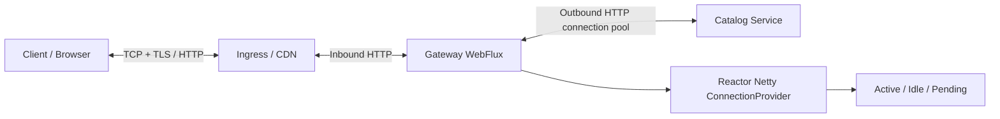
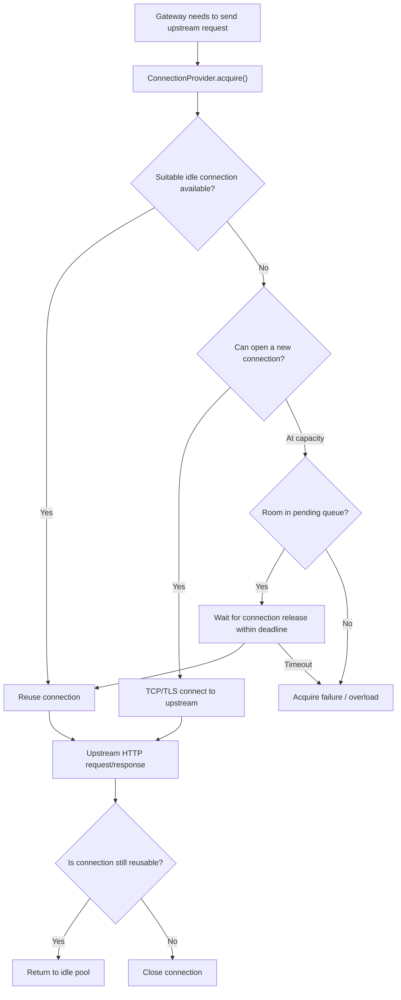
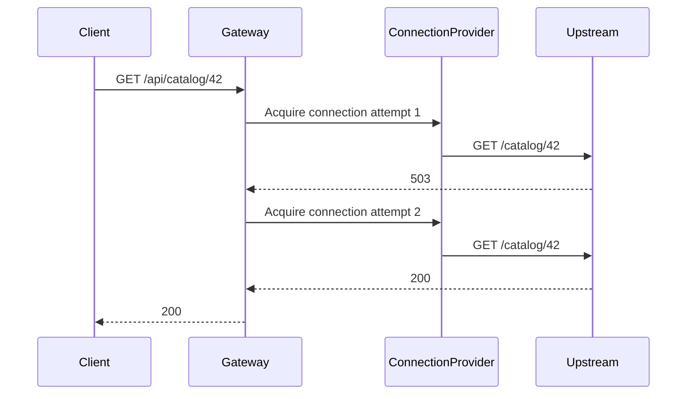
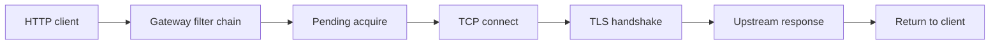

# Optimizing Connection Pools and Concurrency Limits in Spring Cloud Gateway

An API Gateway routinely handles many simultaneous connections: browsers calling the catalog, mobile apps placing orders, a payment backend occasionally slowing down, and clients holding WebSocket/SSE streams open for minutes. If the **connection pool** is configured too small, requests queue waiting for upstream connections and time out; if set too large, both the Gateway and backends can exhaust file descriptors, memory, sockets, or CPU. Simply raising socket limits without **backpressure or admission control** still allows traffic spikes to degrade the entire system.

In **Spring Cloud Gateway Server WebFlux**, performance optimization is more than picking a single `max-connections` number. You must understand **Reactor Netty HttpClient `ConnectionProvider`**, the distinction between **inbound connections** and **outbound pooled connections**, the **pending acquire** queue, connection timeouts, **in-flight request** limits, Reactor Netty event-loop resources, and how LoadBalancer, Retry, CircuitBreaker, TLS, and WebSocket/streaming behave.

This lesson belongs to the **Performance** chapter of the `SPRING_CLOUD_GATEWAY` module. The content ties directly to the Gateway's role of routing requests with predicates, filter chains, path/header transformations, service discovery, and protecting microservices with authentication, rate limiting, circuit breakers, retries, TLS, and observability.

**Objectives after this lesson:**

1. Distinguish TCP connections, in-flight HTTP requests, pooled connections, pending acquires, and backend queues.
2. Understand connection pool configuration options in Gateway WebFlux and Reactor Netty across versions.
3. Estimate concurrency requirements using **Little's law**, accounting for tail latency, per-instance distribution, and retries.
4. Choose `max-connections`, `acquire-timeout`, idle/life eviction, and timeouts aligned with request budgets.
5. Understand why a connection pool is **not** a cluster-wide concurrency limit; apply a separate bulkhead/admission control when needed.
6. Interpret active/idle/pending connections, HTTP latency, 429/503 responses, and socket errors.
7. Design controlled load tests instead of optimizing by guesswork.

> **Scope:** Code and configuration focus on **Spring Cloud Gateway Server WebFlux** with Reactor Netty. Gateway Server Web MVC uses Servlet-based infrastructure and a different HTTP client/pool integration; do not apply WebFlux properties blindly to MVC. Property names `spring.cloud.gateway.server.webflux...` apply to newer branches, while older branches use `spring.cloud.gateway...`. Limits shown in this lesson are **starting examples for measurement only**, not defaults or universal production standards. Never run load tests against production without authorization.

## 1. What Types of Connections Does a Request Traverse?

Consider a request:

```text
GET https://api.example.com/api/catalog/products/42
```

Its path typically involves distinct connections:



- **Inbound connection:** the socket the Gateway **accepts** from the ingress/client. Reactor Netty `HttpServer` manages this hop.
- **Outbound connection:** the socket the Gateway **opens** to an upstream when Netty HTTP client routing runs.
- **Connection pool:** the collection of outbound connections being used or kept ready for reuse to avoid a fresh TCP/TLS handshake per request.
- **Pending acquire:** a request that needs an upstream connection, could not obtain one from the pool yet, and is waiting per the provider's limits/contract.
- **In-flight request:** a request not yet completed within a measurement scope (e.g., a client request at the Gateway); in-flight count can differ from active TCP connections.
- **Backend concurrency:** the number of operations actively processed by the upstream; this can differ from both counts above.

**Growing the outbound pool does not shrink inbound connections, add backend CPU, or limit client traffic by itself.**

### 1.1. Example of Non-Equivalent Counts

```text
Client/Ingress holds 2,000 inbound keep-alive sockets.
Gateway receives roughly 500 client requests/second.
Gateway has 80 active outbound connections.
Backend is processing 120 operations due to retries/async processing.
```

There is no contradiction here: one inbound socket can send multiple sequential requests; outbound keep-alive reuses sockets; HTTP/2 multiplexing and backend async work break any 1:1 correspondence.

### 1.2. Do Not Conflate "Connections" and "Requests" in One Metric

| Quantity | Unit | Meaning |
| --- | --- | --- |
| Incoming open sockets | Connections | Number of connections into the Gateway. |
| Active outbound pool connections | Connections | Number of outbound connections currently leased/in use per the provider. |
| Idle outbound connections | Connections | Connections kept open for reuse. |
| Pending pool acquisitions | Requests/waiters | Requests waiting for permission to use a connection. |
| HTTP RPS | Requests/second | Request throughput. |
| In-flight HTTP requests | Requests | Requests not yet finished within the measurement scope. |
| Event-loop pending tasks | Tasks | Work queued for the event loop to process. |
| Backend operations | Operations | In-progress business work; may continue after HTTP 202. |

A dashboard showing only "current connections" is not enough to tell which limit the Gateway is hitting.

## 2. How Does the Reactor Netty Connection Pool Work?

Spring Cloud Gateway Server WebFlux uses **Reactor Netty `HttpClient`** for most outbound HTTP routes. Reactor Netty provides the **`ConnectionProvider`** abstraction to supply and reuse connections.



This logical diagram does not cover every detail of HTTP/2 multiplexing, eviction races, or per-address pools, yet it shows the essentials:

1. If a valid idle socket exists, it can be **reused**.
2. If none is idle and capacity remains, a **new connection** can be opened.
3. If connection capacity is exhausted, the request may wait as a **pending acquire**.
4. If the wait queue is full or the wait expires, **acquire fails**.
5. Once the response finishes, the connection returns to the pool; if broken or expired, it is closed.

### 2.1. Why Does Pooling Improve Performance?

Opening fresh TCP + TLS connections repeatedly is expensive:

- TCP connect requires network round trips, DNS resolution, and socket setup.
- TLS handshakes consume CPU and latency.
- Certificate and hostname verification must also run.
- The kernel tracks many sockets across connection states.
- During traffic bursts, connection churn increases error/timeout risk.

**Keep-alive + pooling** cuts that cost. Yet you should not "keep every connection forever": long-idle sockets can be closed silently by load balancers, NATs, or backends, and they still consume resources.

### 2.2. The Pool Is Not One Global Singleton

A `ConnectionProvider` can maintain separate pools/partitions by **target address, protocol, identity, or connection attributes**, depending on implementation. Thus `maxConnections=200` is typically a limit **per pool/remote-address scope**, not a guarantee that "one Gateway process opens at most 200 outbound sockets across all services."

Inspect `name`/`remote.address` tags and the actual number of hosts/instances before estimating file descriptors.

### 2.3. LoadBalancer Distributes Connections Across Multiple Instances

A route such as:

```yaml
uri: lb://catalog-service
```

can select among multiple instances. If each remote address has its own pool, total outbound connections to `catalog-service` depend on the number of active selected instances, not just the route ID.

**Do not treat one route's pool as a single bucket** when service discovery, DNS/multiple addresses, or varying route URIs are involved.

## 3. Fixed, Elastic, and Disabled Pools: Choices Must Have Bounds

Gateway WebFlux versions allow choosing pool types such as **`fixed`**, **`elastic`**, or **`disabled`** via `httpclient.pool.type`, depending on version.

| Type | Concept | When appropriate | Risks |
| --- | --- | --- | --- |
| **Fixed/bounded** | Caps connection count with an acquisition queue and timeouts per implementation. | Production systems needing controlled pressure on upstreams. | Too low causes queueing/acquire timeouts; too high risks socket overload. |
| **Elastic** | Dynamically opens/closes connections with load; exact bounding varies by version. | Certain workloads/dev once provider semantics are understood. | Sudden socket spikes can overwhelm backends or kernel limits. |
| **Disabled/no reuse** | Does not reuse pooled connections per supported mode. | Special debugging/connection testing, not default production. | High TCP/TLS churn, latency, and CPU cost. |

**Do not treat `elastic` as "infinitely self-optimizing and safe."** Under heavy traffic or backends with connection caps, use bounded resources and measure directly.

### 3.1. When Is a Bounded Pool a Good Starting Point?

When backends have clear connection limits, multiple Gateway replicas exist, and routes have differing latencies, a bounded pool establishes a per-destination budget. Even then, you still need **admission control** on request concurrency, because requests can pile up waiting to acquire without holding an active connection.

### 3.2. `disabled` Is Not a Long-Term Fix for "Stale Connections"

If reuse hits errors from mismatched idle timeouts between Gateway and proxy, disabling pooling may make the error disappear in tests at a steep performance penalty. The proper fix is tuning idle/lifetime limits, eviction, keep-alive, and measuring reuse—not turning pooling off unconditionally.

## 4. Pool Parameters to Understand Before Configuring

| Parameter | Core meaning | Common misconception |
| --- | --- | --- |
| `type` | Selects pool mode if supported by the Gateway version. | Assuming `elastic` always has a safe hard upper bound. |
| `max-connections` | Connection cap within the provider/pool scope. | Treating it as a global HTTP RPS or in-flight cap. |
| `acquire-timeout` | Time to wait for a connection from the pool. | Confusing it with TCP connect timeout. |
| `pendingAcquireMaxCount` | Allowed waiters when configuring Reactor Netty directly. | Treating the queue as free; ignoring memory/latency impact. |
| `max-idle-time` | Duration a connection may stay idle before expiring. | Setting it far longer than upstream/ingress idle timeouts. |
| `max-life-time` | Maximum lifetime of a connection. | Confusing it with request timeout. |
| `eviction-interval` | Background eviction interval per property/version. | Believing stale sockets are closed to the exact millisecond. |
| `metrics` | Whether to record connection pool metrics. | Enabling it without checking actual tags/namespaces. |
| `leasing-strategy` | Idle connection selection policy like FIFO/LIFO if supported. | Switching strategies without measuring reuse/stale connections. |

Names like `max-connections`, `acquire-timeout`, `max-idle-time`, `max-life-time`, `eviction-interval`, and `metrics` appear in the Gateway WebFlux configuration family in supporting releases. **The Reactor Netty builder API and Spring Cloud Gateway properties do not map one-to-one identically across all versions.**

### 4.1. Pending Acquire Is a Real Queue

If there are **100 active connections** and 500 new requests arrive, they may:

- Be served quickly if existing connections return to idle promptly.
- Wait in the pending queue.
- Be rejected because the queue is full.
- Hit `acquire-timeout`.
- Be canceled by the client before obtaining a connection.

**A deep queue does not create extra backend throughput.** It mainly shifts time into queueing delay, increases memory pressure, and causes responses to time out.

### 4.2. `max-idle-time` vs. `max-life-time`

- `maxIdleTime=30s`: connections sitting idle too long can be evicted.
- `maxLifeTime=5m`: connections that have existed beyond this duration—even if actively used—may need to be retired per lifecycle rules.
- `evictInBackground` or `eviction-interval`: periodically sweeps and removes expired connections depending on mechanism/version.

Max life time must not be understood as **"an in-flight HTTP request will be killed at exactly 5 minutes."** Eviction vs. active-request handling must be verified for your implementation.

### 4.3. FIFO or LIFO?

In some Reactor Netty versions, `leasingStrategy` supports **FIFO** (least recently used first, queue-like) or **LIFO** (most recently used first). LIFO can concentrate reuse on "warm" sockets while letting older sockets go idle and be evicted, though neither strategy wins in every topology. Measure reuse, stale closes, and distribution before changing it.

## 5. Illustrative Configuration in Spring Cloud Gateway Server WebFlux

For **newer Gateway Server WebFlux branches** using the `spring.cloud.gateway.server.webflux` prefix, a configuration to **test and measure** might look like:

```yaml
spring:
  cloud:
    gateway:
      server:
        webflux:
          httpclient:
            connect-timeout: 3000
            response-timeout: 10s
            pool:
              type: fixed
              max-connections: 200
              acquire-timeout: 2000
              max-idle-time: 30s
              max-life-time: 5m
              eviction-interval: 15s
              metrics: true
```

**Meaning and caveats:**

- `connect-timeout: 3000`: several Gateway versions interpret TCP connect timeout in **milliseconds**; verify your version's metadata.
- `response-timeout: 10s`: outbound HTTP response timeout per contract; **does not automatically bound total time across all retries or WebSocket sessions**.
- `type: fixed` and `max-connections: 200`: limits the connection pool within its scope, not 200 requests/second.
- `acquire-timeout: 2000`: typically **milliseconds** on this Gateway property, not 2,000 seconds. Verify your exact version.
- `max-idle-time`/`max-life-time`/`eviction-interval` govern connection lifecycle, not direct throughput.
- `metrics: true` enables pool telemetry if supported by your version and Micrometer instrumentation.

**Do not treat this as Spring Cloud Gateway's default configuration.** It is a **measurement starting point** on branches supporting those properties; error-free startup does not by itself prove every property bound and took effect.

### 5.1. Using Older Gateway WebFlux Versions

Earlier versions use the prefix:

```yaml
spring:
  cloud:
    gateway:
      httpclient:
        pool:
          type: fixed
          max-connections: 200
          acquire-timeout: 2000
```

**Do not declare both the old and new prefixes** hoping the system picks the right one automatically. Confirm your Spring Cloud Release Train, Gateway Server variant, configuration metadata, and live metrics before deploying.

On older branches, the full property path looks like `spring.cloud.gateway.httpclient.pool.max-connections`; do not mix it with `spring.cloud.gateway.server.webflux.httpclient.pool.max-connections` when upgrading across branches.

### 5.2. Is `max-connections: 200` Always 200 App-Wide?

No. Depending on Reactor Netty's `ConnectionProvider`, connection pools may be partitioned by **remote address/connection configuration**. For example, if the Gateway talks to 4 upstream instances, a limit of 200 per destination can allow well over 200 total outbound sockets.

With 3 Gateway replicas as well, potential connections toward the backend can be much larger. Always **budget capacity from the backend perspective** and monitor cluster-wide.

### 5.3. Don't Apply One Timeout Unconditionally to All Traffic

JSON query routes typically fit a few-second response timeout. SSE, long polling, large file downloads, and WebSockets have different semantics. Blindly forcing one default timeout can cut off valid streams; profile per route and test each traffic class.

## 6. Reactor Netty `ConnectionProvider` Builder: Library-Level Knobs

When building a custom Reactor Netty HTTP client or using an **extension point supported by your Gateway version**, you can configure `ConnectionProvider` directly:

```java
import java.time.Duration;

import io.netty.channel.ChannelOption;
import reactor.netty.http.client.HttpClient;
import reactor.netty.resources.ConnectionProvider;

public final class PoolExample {

    public static HttpClient createClient() {
        ConnectionProvider provider =
            ConnectionProvider.builder("upstream-demo")
                .maxConnections(100)
                .pendingAcquireMaxCount(200)
                .pendingAcquireTimeout(Duration.ofSeconds(2))
                .maxIdleTime(Duration.ofSeconds(30))
                .maxLifeTime(Duration.ofMinutes(5))
                .evictInBackground(Duration.ofSeconds(15))
                .metrics(true)
                .build();

        return HttpClient.create(provider)
            .option(ChannelOption.CONNECT_TIMEOUT_MILLIS, 3000)
            .responseTimeout(Duration.ofSeconds(8));
    }
}
```

Key takeaways:

- `maxConnections(100)` sets connection capacity within the provider's scope.
- `pendingAcquireMaxCount(200)` caps **waiting acquires**, preventing an unbounded queue.
- `pendingAcquireTimeout(2s)` stops requests from waiting indefinitely on the pool.
- `maxIdleTime`, `maxLifeTime`, and `evictInBackground` manage socket lifecycles.
- `metrics(true)` records pool metrics where Reactor Netty/Micrometer support it.
- `CONNECT_TIMEOUT_MILLIS` is distinct from `responseTimeout`.

**Warning:** Instantiating a custom `HttpClient` like this **does not automatically make the Gateway's `NettyRoutingFilter` use it**. The Gateway has its own auto-configuration and version-specific extension points. To customize the routing client/pool for real traffic, use the customization mechanism **supported by your Gateway version** rather than defining arbitrary beans and assuming all outbound routing switched over. Never copy this example class as a bean overriding auto-configuration without integration tests.

### 6.1. Why Must `pendingAcquireMaxCount` Be Bounded?

An application can hold 10,000 in-flight client requests while the pool only has 100 outbound sockets. If 9,900 requests sit in an unbounded wait queue, memory climbs, tail latency stretches, clients time out and retry, and the Gateway keeps accepting load until it crashes or stalls.

**A queue is a pressure buffer, not processing capacity.** Bounding waiters and failing fast in a controlled way limits error amplification.

### 6.2. Do Not Confuse Pool Limits with `RateLimiter`

- **Rate limiter:** controls request rate over time per key (e.g., 30 requests/second/user).
- In Gateway Server WebFlux, `RequestRateLimiter` is a filter enforcing request quotas per policy; it does not directly cap concurrent in-flight HTTP operations.
- **Connection pool:** controls outbound sockets and the acquisition queue.
- **Concurrency limiter / bulkhead:** caps in-flight operations/requests within a chosen scope.
- **Circuit breaker:** temporarily short-circuits when downstreams fail or slow down per policy.
- **Timeouts:** cap wait durations.

An API can stay within its rate limit while slow requests accumulate until connections run out. Conversely, a client sending bursts of very fast requests may keep in-flight count low while still exceeding its rate quota.

## 7. Estimating Concurrency Needs with Little's Law

**Little's law** in a relatively steady state:

\[
L \approx \lambda W
\]

Where:

- \(L\): average number of requests/operations **inside the system**.
- \(\lambda\): average throughput (requests/second).
- \(W\): average time a request spends in the scope under consideration (seconds).

Example:

```text
A Gateway sends 800 requests/second upstream.
Average outbound connection hold time is 0.15 seconds.

Approximate number of operations holding connections:
  L = 800 × 0.15 = 120
```

**120 is an estimated average**, not a mandatory `max-connections=120` setting or peak ceiling. Peak RPS, p95/p99 latency, retries, slow consumers, and instance skew can push concurrency much higher.

### 7.1. Sizing per Upstream Instance

Suppose those 800 RPS are split evenly across 4 backend instances, each HTTP/1.1 connection handling one request at a time:

```text
RPS per backend instance:    800 / 4 = 200 RPS
Average service time:        0.15 seconds
Average concurrency:         200 × 0.15 = 30
```

That implies roughly 30 active connections **per destination** on average, not 120 per destination. However, LoadBalancer does not guarantee perfect uniformity; if 1 instance goes down, the remaining 3 may take all 800 RPS, raising per-instance demand.

### 7.2. Adding Controlled Headroom

With 30 average active connections, a benchmark might test pool capacities of 48, 64, and 96 for that destination to compare—**without claiming 64 is universally right**. The sweet spot is where:

- Pending queues rarely persist.
- p95/p99 latency stays within SLO.
- The backend does not overload.
- Sockets/memory/file descriptors retain headroom.
- Acquire/connect timeouts do not spike under bursts.
- Excessive idle connections are not wasting resources.

### 7.3. Should You Multiply RPS by p99 Instead of the Average?

Multiplying RPS by p99 latency can be **overly conservative** if it assumes every request runs as slowly as p99, whereas using only the average underestimates bursts and queue tails. Better yet, simulate loads with realistic latency distributions, inspect peaks/pending/timeouts, and size budgets against SLOs and cost.

### 7.4. Little's Law Does Not Apply Naively to WebSockets

WebSockets hold connections open long term and can exchange thousands of messages per session. Here \(W\) becomes **session duration**, not HTTP request latency, and an upgraded WebSocket connection is not returned to an HTTP/1.1 pool for other requests. Size active session capacity separately.

## 8. Understanding HTTP/1.1 vs. HTTP/2 Before Setting Connection Caps

### 8.1. Standard HTTP/1.1

In common HTTP/1.1 proxy client implementations, one connection typically handles one in-flight request at a time before being reused. Under that model, active outbound connections serve as a **rough proxy** for concurrent upstream HTTP requests.

### 8.2. HTTP/2 Multiplexing

HTTP/2 supports **multiple concurrent streams over a single TCP/TLS connection** (bounded by `SETTINGS`/`MAX_CONCURRENT_STREAMS` and resources).

When upstreams use HTTP/2:

- 50 active streams can run over far fewer than 50 TCP connections.
- `maxConnections` is **not** a hard cap on concurrent HTTP requests.
- Flow control, stream limits, TCP head-of-line blocking, and upstream support matter greatly.
- Client/server TLS ALPN negotiation and Gateway/Netty versions must be verified.

Therefore, **never build a bulkhead solely by setting `max-connections`**, especially on HTTP/2 routes.

### 8.3. HTTP/3 and Gateway Variants

HTTP/3 uses QUIC, which differs from Reactor Netty's HTTP/1.1 TCP connection pooling. Do not generalize this lesson's socket rules to HTTP/3 unless your Gateway/path explicitly supports and has been tested with it.

## 9. Connection Limits vs. In-Flight Request Limits

Suppose a Gateway shows:

```text
Inbound sockets:                  3,000
Client requests in-flight:          700
Active outbound connections:        180
Pending connection acquisitions:    240
Backend CPU utilization:            95%
```

An operator sees 180 active connections and bumps `max-connections` from 200 to 1,000. That may shrink the pending queue **briefly**, but with backend CPU at 95%, each request slows down further; in-flight count climbs, the Gateway opens even more sockets, and errors cascade.

This scenario calls for **admission control** or a bulkhead at the request/concurrent-operation level, not a bigger pool.

### 9.1. Four "Limits" Commonly Confused

| Mechanism | What does it limit? | Common scope |
| --- | --- | --- |
| `max-connections` | Outbound TCP connections within pool scope. | Remote destination/provider/instance. |
| Pending acquire queue cap | Requests waiting for a connection. | Specific pool/scope. |
| Semaphore/Bulkhead | In-flight operations/requests. | Gateway instance, route, tenant, or service. |
| RateLimiter/Token bucket | Requests over a time interval. | User/tenant/IP/route key. |

**RateLimiter cannot replace a bulkhead** when requests run slowly. **A bulkhead cannot replace a rate limiter** when requests are fast yet arrive at extreme RPS.

## 10. Example: Non-Blocking In-Flight Limit via `GlobalFilter`

A simple **local admission control** mechanism can use non-blocking `Semaphore.tryAcquire()` on the Netty event loop. When slots run out, reject immediately rather than queueing indefinitely.

Illustrative example for Gateway **Server WebFlux**:

```java
package com.example.gateway;

import java.util.concurrent.Semaphore;
import java.util.concurrent.atomic.AtomicInteger;

import org.springframework.cloud.gateway.filter.GatewayFilterChain;
import org.springframework.cloud.gateway.filter.GlobalFilter;
import org.springframework.core.Ordered;
import org.springframework.http.HttpStatus;
import org.springframework.stereotype.Component;
import org.springframework.web.server.ServerWebExchange;

import reactor.core.publisher.Mono;

@Component
public final class InFlightGlobalFilter
        implements GlobalFilter, Ordered {

    private final Semaphore permits = new Semaphore(150);
    private final AtomicInteger inFlight = new AtomicInteger();

    @Override
    public Mono<Void> filter(ServerWebExchange exchange,
                             GatewayFilterChain chain) {

        return Mono.defer(() -> {
            if (!permits.tryAcquire()) {
                exchange.getResponse().setStatusCode(
                    HttpStatus.SERVICE_UNAVAILABLE);
                return exchange.getResponse().setComplete();
            }

            inFlight.incrementAndGet();

            // Mono.defer also guards synchronous errors inside chain.filter().
            return Mono.defer(() -> chain.filter(exchange))
                .doFinally(signal -> {
                    inFlight.decrementAndGet();
                    permits.release();
                });
        });
    }

    @Override
    public int getOrder() {
        return -100;
    }

    public int currentInFlight() {
        return inFlight.get();
    }
}
```

**How to read this:**

1. `Semaphore(150)` allows at most **150 active gateway chain executions** through this filter on **one application instance**.
2. `tryAcquire()` returns immediately without blocking event-loop threads.
3. When permits run out, the filter returns **503 Service Unavailable** as an illustrative policy (change status per your API contract).
4. `Mono.defer(...)` defers acquiring until subscription time rather than at publisher assembly time.
5. `doFinally(...)` runs on completion, error, or cancellation, releasing the permit cleanly across lifecycles.
6. `AtomicInteger` only exposes in-flight count locally; wire a Micrometer gauge/counter if you want it on dashboards.

### 10.1. Important Limitations of This Illustrative Filter

- A Gateway `GlobalFilter` runs for requests that **matched a Gateway route**; it does not count HTTP requests rejected earlier by Security or handler mapping.
- `150` is **per JVM/instance**, not 150 globally across the cluster. With 5 Gateway replicas, roughly 750 concurrent operations can run under balanced load.
- Long-lived SSE/streaming requests hold a permit until the stream ends or cancels; classify routes and apply separate policies.
- `getOrder() = -100` is illustrative; check ordering relative to other filters (`Retry`, `CircuitBreaker`, custom filters) to define precisely what is being counted.
- There is no per-user fairness, queueing, weighted cost, or global coordination; this is a foundational limiter for learning.
- Returning HTTP `503` for local overload is a contract choice; `429` usually fits per-client quotas. Never return 429 implying a user exceeded their quota when the Gateway/backend is simply overloaded.
- If a request triggers multiple upstream attempts inside a Retry filter, counting one client request does not by itself limit **concurrent upstream attempts**.

### 10.2. Why Not Use `semaphore.acquire()`?

`Semaphore.acquire()` can **block the calling thread**. Calling it on a Reactor Netty event loop can stall a thread serving thousands of connections, locking up the entire node.

Use `tryAcquire()`, a reactive-friendly bulkhead, or a bounded queue/scheduler designed with backpressure; never block the event loop waiting for tokens or connections.

### 10.3. Per-Route or Per-Downstream Bulkheads

In production, budgets can be separated:

```text
catalog-api:     max 180 in-flight / Gateway instance
orders-api:      max  40 in-flight / Gateway instance
payments-api:    max  20 in-flight / Gateway instance
reports-api:     max   8 in-flight / Gateway instance
```

These numbers are educational examples. If building a per-route filter:

- Read the route ID from metadata/`GATEWAY_ROUTE_ATTR` **already resolved by the Gateway**.
- Keep a bounded map of permits per route/service; avoid allocating a new semaphore per request.
- Handle dynamic route refreshes and permit-state cleanup.
- Factor in backend capacity and Gateway replica count.
- Do not treat a "payment" route with 5 upstream instances as 5x the shared quota unless intentional.

## 11. Bulkhead Libraries and Resilience4j

When using Spring Cloud CircuitBreaker with Resilience4j, a **bulkhead** can act as a separate primitive limiting concurrent calls or threads depending on configuration and integration.

Distinguish these mechanisms:

| Mechanism | When it triggers | Useful state/metrics |
| --- | --- | --- |
| **Semaphore bulkhead** | In-flight tasks exceed the limit. | Available permits, rejected calls. |
| **Thread-pool bulkhead** | Isolating a workload group on dedicated threads, depending on execution model. | Queue size, active tasks, rejected calls. |
| **Circuit breaker** | Failure or slow-call rate exceeds policy. | CLOSED/OPEN/HALF_OPEN, not-permitted calls. |
| **Rate limiter** | Traffic exceeds tokens per period. | Allowed/denied requests, wait time. |
| **Pool limit** | Outbound connections exhausted. | Active/idle/pending, acquire failures. |

**Do not drop a blocking thread-pool bulkhead into a reactive Gateway event loop** without understanding its scheduling model. Library integration and auto-configuration vary by version; verify where it sits in the Gateway filter chain.

### 11.1. Reject Early Rather Than Growing Queues

For latency-sensitive APIs, controlled rejection with `503`/overload messaging beats holding requests in a queue for 30 seconds only to return `504`. For asynchronous work, return `202` and enqueue onto a **durable job queue** rather than holding HTTP requests and pool slots open.

Choose behavior based on API contracts, client retry capabilities, and traffic criticality.

## 12. Why Retry Puts Heavier Load on the Connection Pool

One client request can generate **multiple upstream attempts**:



If a route receives 500 client requests/second and averages 1.4 upstream attempts/request, the **outbound attempt rate can be around 700/second**. Depending on retry ordering, backoff, and durations, this increases pool demand, CPU/TLS/network usage, and backend load.

### 12.1. Retry Amplification During Incidents

Suppose backend latency jumps from 100 ms to 2 seconds:
- Average in-flight count increases ~20x at constant throughput per Little's law.
- The acquire queue fills if the pool is bounded.
- Clients time out and issue their own retries.
- Gateway Retry may also add extra attempts.
- The backend becomes even more overloaded → vicious feedback loop.

**Never "fix" this by increasing `max-connections` 20x.** Use proper timeouts, retry budgets, circuit breakers, bulkheads, and backoff with jitter.

### 12.2. Never Retry Non-Idempotent POSTs

A POST creating an order or payment may have committed on the backend even when the Gateway timed out waiting for the response. Retrying without an idempotency key can create duplicate transactions. Pool tuning cannot fix business-logic correctness.

### 12.3. Metrics Must Separate Client Requests from Upstream Attempts

| Metric | Unit | Purpose |
| --- | --- | --- |
| Gateway client requests | Requests | Measures client load/SLOs. |
| Upstream attempts | Attempts | Exposes retry amplification. |
| Connection acquire attempts | Acquisitions | Shows pressure on the pool. |
| Retry exhausted | Events | Isolates failures retries could not recover. |
| Circuit breaker rejected | Events | Shows requests blocked before reaching the backend. |
| Bulkhead rejected | Events | Shows early admission-control rejections. |

A final HTTP 200 can mask upstream 503s on earlier attempts. Track outbound attempts with dedicated tracing/metrics.

## 13. Timeout Budgets: Pending Acquire, Connect, TLS, and Response

A request through the Gateway can wait across multiple stages:



An illustrative budget for discussion:

```text
Client end-to-end deadline:      10 s
Pool pending-acquire timeout:     2 s
TCP connect timeout:              3 s
TLS handshake timeout:           per profile/version
Upstream response timeout:        6 s
Retry count / backoff:           accounted separately
```

**Do not sum those numbers and conclude the Gateway enforces an exact 11-second total.** Timeouts can overlap, reset on reads, run per retry attempt, or behave differently across versions. A request with multiple attempts can exceed the client deadline even if each attempt stays within its limit.

### 13.1. How to Choose Acquire Timeout

For a client API with a 300 ms SLO, a 2-second pending-acquire timeout is far larger than the SLO; even if the upstream responds instantly afterward, queue wait already blew the latency budget. Conversely, a background batch job tolerating 30 seconds can use a different policy.

`acquire-timeout` should be **explicit and small relative to the total budget** when low latency matters.

### 13.2. Per-Route Timeouts

Gateway WebFlux supports route metadata for certain HTTP connection/response timeouts depending on version, conceptually:

```yaml
spring:
  cloud:
    gateway:
      server:
        webflux:
          routes:
            - id: reporting-api
              uri: lb://report-service
              predicates:
                - Path=/api/reports/**
              metadata:
                connect-timeout: 3000
                response-timeout: 20000
```

In WebFlux branches using numeric route timeout metadata, `connect-timeout: 3000` and `response-timeout: 20000` represent **milliseconds**. Always **verify route metadata schema/version**; this does not replace Gateway-wide connection pool configuration. Do not assume streams/WebSockets obey the same `response-timeout` semantics as short HTTP JSON calls.

### 13.3. What Happens When Pending Acquire Times Out?

If the pending queue exceeds the deadline, the request can fail **before even opening a new socket** to the backend. The HTTP status returned to the client depends on Gateway/WebFlux/filter-chain exception mapping—there is **no single universal status code** for all acquire timeouts.

A 503/5xx response could stem from pool exhaustion, or from service discovery having no instances. Use Reactor Netty pool metrics and exception types/stack traces to tell them apart.

## 14. Idle Connections, Stale Sockets, and Server-Side Keep-Alive

An idle connection may be closed by a backend, NAT, or load balancer before the Gateway reuses it. If the Gateway has not noticed the remote close yet, the next request can hit connection reset or premature close errors.

Combine these mitigations and evaluate them together:

- Set pool `max-idle-time` slightly lower than the measured **upstream idle timeout**, rather than relying on unknown defaults.
- Set a bounded `max-life-time` so sockets do not stay open indefinitely.
- Enable background eviction if supported by your module.
- Use TCP keepalive where appropriate, though it **does not replace application-level liveness** for WebSocket/streaming.
- Configure graceful shutdown/draining on both backend and ingress.
- Allow **controlled** retries on idempotent GETs after stale connection errors; never retry arbitrary POSTs.
- Monitor connection resets, premature closes, TLS handshakes, and pool reuse.

### 14.1. TCP Keepalive Does Not Mean Every HTTP Request Is Healthy

TCP keepalive only detects certain dead-socket states on kernel intervals and does not verify backend application health. An active TCP socket can still belong to a backend whose threads or event loop are wedged.

### 14.2. LIFO/FIFO and Idle Eviction

If a workload leaves many idle sockets and the backend closes connections after a short timeout, choosing the right strategy and eviction cadence can cut stale-socket reuse. Still, test under connection churn, rollouts, and long idle gaps, because no pooling strategy eliminates every race with remote close.

## 15. Inbound HTTP Keep-Alive and Connection Limits

Netty `HttpClient`'s `ConnectionProvider` governs **outbound** pooling. The inbound side has separate limits:

- Ingress/CDN imposes max connections/IP, idle timeouts, and max concurrent requests.
- Reactor Netty `HttpServer` manages accepted sockets and handler/event-loop resources.
- Spring Security/RateLimiter can reject requests **after** the socket has been accepted.
- HTTP/2 client connections multiplex multiple concurrent streams.
- WebSockets and SSE hold long-lived sessions.
- The OS enforces file descriptor limits, per-socket memory, and network queue limits.

**Do not expect `httpclient.pool.max-connections` to cap inbound connections.** To limit ingress connections, configure your edge/load balancer or HTTP server/transport layer separately and verify on the target runtime.

### 15.1. File Descriptors and Ephemeral Ports

A Gateway process holds:
- Inbound sockets.
- Outbound sockets.
- File descriptors for logs, JARs, and other sockets.
- DNS and telemetry client connections.

When enlarging pools, check **`ulimit -n` / `nofile`**, container limits, kernel socket states, ephemeral port ranges, and NAT/SNAT limits.

Do not apply a blanket rule like "every request = two file descriptors"; keep-alive reuse, HTTP/2 multiplexing, ingress termination, and service meshes all change the math.

### 15.2. SNAT and Multiple Pods

In Kubernetes or cloud environments, outbound traffic may traverse SNAT/NAT gateways. Many Gateway pods opening connections to the same destination can hit **SNAT port exhaustion** long before the JVM runs out of heap. Symptoms often look like connect timeouts or resets rather than pool acquire timeouts. Monitor network infrastructure as well.

## 16. How TLS, HTTP Proxies, and Service Meshes Affect Pooling

An outbound `https://` connection requires TLS; pooling amortizes handshake overhead. However, if the Gateway routes through a service mesh sidecar or HTTP proxy:

```text
Gateway HttpClient → Sidecar → Mesh/Network → Backend
```

there can be **two layers of connection pools** with separate idle timeouts. Active socket counts inside the Gateway do not reflect all sockets maintained by the sidecar.

Check:
- Where does TLS terminate—Gateway, ingress, or sidecar?
- Are certificate validation, SNI, and hostnames configured properly?
- Is HTTP/1.1 or HTTP/2 used on each hop?
- Does the sidecar enforce its own connection pool, concurrency limit, or circuit breaker?
- Does the upstream enforce rate or concurrency caps?
- Do connection failures occur before or after the mesh proxy?

**Never disable TLS validation to "improve performance."** If TLS handshakes become a bottleneck, inspect session reuse, CPU, and transport configuration rather than sacrificing security.

## 17. WebSockets and SSE: Connection Pooling Differs from Short HTTP Calls

### 17.1. WebSockets

After the handshake, a WebSocket session uses a persistent connection. The Gateway typically keeps a matching outbound WebSocket connection open, which cannot be reused for other HTTP requests while the session lives.

With 10,000 active WebSocket clients:
- Inbound and outbound socket counts can be very large.
- Buffers, heartbeats, timers, fan-out, and file descriptors dominate capacity.
- Short-HTTP pool reuse logic does not manage session lifetimes.
- Dedicated connection/session quotas, heartbeat timeouts, and graceful draining are required.

Do not set a 10s HTTP JSON response timeout expecting it to govern WebSocket frames the same way.

### 17.2. SSE and Streaming Responses

An SSE HTTP response can remain open for minutes. One outbound HTTP connection/stream stays occupied the whole time, shrinking slots available to short requests if they share the same pool/scope.

Separate routes, profiles, or capacity tiers for:
- Short JSON APIs.
- SSE/long-poll streaming.
- Large file uploads/downloads.
- WebSockets.
- Async `202` job responses.

If streams risk starving pools for critical APIs, consider isolating Gateway instances, destinations, route-specific limits, or upstream endpoints rather than just bumping global `maxConnections`.

### 17.3. Slow Consumers Cannot Be Fixed by Adding Sockets

When a browser reads SSE slowly, the Gateway can accumulate outbound buffers or push backpressure upstream. Adding connections will not make the browser read faster. Use bounded buffers, session quotas, cancellation handling, and queue-pressure metrics.

## 18. Reactor Netty Event Loop: The Bottleneck Isn't Always Connection Count

Gateway Server WebFlux uses a reactive/non-blocking model, yet custom filters can accidentally block the event loop:

```java
// DO NOT run blocking JDBC calls or Thread.sleep on the event loop:
String tenant = blockingTenantRepository.findTenant(userId);
Thread.sleep(200);
```

When the event loop is blocked:
- TCP sockets stay open while requests stop making progress.
- Acquire/release callbacks are delayed.
- p95/p99 latency climbs.
- Pending connections grow even when the backend is nowhere near capacity.
- Client timeouts/retries pile on extra load.

Mitigations:
- Prefer reactive clients for I/O.
- Offload unavoidable legacy blocking calls onto a dedicated bounded scheduler; never spawn unbounded blocking threads.
- Never call `.block()` inside a `GatewayFilter`/`GlobalFilter` reactive chain.
- Monitor event-loop pending tasks, blocked-thread diagnostics, and GC.
- Cap request body buffering and avoid unnecessary `DataBuffer` copies or retention.

**Pool tuning cannot fix a custom filter that blocks the Netty event loop.**

## 19. Metrics to Decide Whether to Raise `max-connections`

Reactor Netty provides meter families for `ConnectionProvider`, typically appearing with dotted names such as:

- `reactor.netty.connection.provider.active.connections`
- `reactor.netty.connection.provider.idle.connections`
- `reactor.netty.connection.provider.pending.connections`
- `reactor.netty.connection.provider.max.connections`
- `reactor.netty.connection.provider.pending.connections.time`

Exact names, labels, support level, and export behavior depend on **Reactor Netty and Micrometer versions**. Enable pool metrics and inspect **`/actuator/prometheus`** or `/actuator/metrics` to confirm actual meter names.

### 19.1. Signals That Must Be Read Together

| Signal | Sustained high values may indicate |
| --- | --- |
| Active connections near configured capacity | Pool is heavily utilized / high traffic. |
| Sustained pending connections > 0 | Connection acquisition is queueing, or the backend is slow. |
| Rising acquire latency p95/p99 | Pool contention or idle reuse/connection churn. |
| Rising connection creation rate | Max idle too short, churn, backend closes, or pool disabled. |
| Connect/TLS handshake errors | Network, certificate, DNS, SNAT, or backend readiness issues. |
| Rising Gateway request p95/p99 | Total client latency rising; break down by stage. |
| Rising upstream service time | Backend bottleneck, not just pool size. |
| Rising CPU/GC/event-loop pending tasks | JVM/scheduler bottleneck. |
| Rising retry attempts per request | Amplification during upstream failures. |
| Rising in-flight requests/pending queue | Need for admission control or backend protection. |

### 19.2. Do Not Alert Solely on `active == max`

A pool staying near capacity for a few seconds during a load spike can be completely normal. What warrants action is **sustained pending queue growth, acquire failures, p95 breaching SLO, and rising backend error rates**.

Conversely, low active connections paired with high Gateway p99 points to event-loop blocking, DNS/TLS delays, upstream latency, or a client-side bottleneck.

### 19.3. Business-Level HTTP Route Metrics

Gateway WebFlux's Metrics Filter can record the `spring.cloud.gateway.requests` Timer with tags like `routeId`, `routeUri`, `outcome`, `httpStatusCode`, and `httpMethod` when enabled on supported versions.

Combine:
- Request RPS per route.
- p50/p95/p99 latency.
- HTTP 429/503/504 rates.
- Reactor Netty pool active/idle/pending.
- Backend instance health/latency.
- Retry/CircuitBreaker/Bulkhead decisions.

Requests blocked by Spring Security **before route matching** may not appear in the route timer, even though they opened an inbound socket. When sizing capacity, know each meter's exact scope.

## 20. PromQL: From Connection Pool to Latency

The PromQL queries below assume standard normalized exporter names. **Use them only after verifying actual metrics in `/actuator/prometheus`**; names and tags can differ.

### 20.1. Active Outbound Connections

```promql
sum(reactor_netty_connection_provider_active_connections)
```

This sums across exported series. To inspect Gateway replicas or remote addresses, group by actual exported labels (such as `instance`, `name`, or `remote_address`)—do not assume `routeId` exists on pool meters.

### 20.2. Pending Acquisitions

```promql
sum(reactor_netty_connection_provider_pending_connections)
```

If pending rises during peak traffic, correlate with active connections, upstream service time, pool capacity, and arrival rate.

### 20.3. RPS per Route

```promql
sum by (routeId) (
  rate(spring_cloud_gateway_requests_seconds_count[5m])
)
```

Verify counter/timer names and `routeId` in your exporter. This query counts **client requests recorded by the Gateway route meter**, which does not automatically equal outbound attempts after Retry.

### 20.4. HTTP 5xx Ratio per Route

```promql
sum by (routeId) (
  rate(spring_cloud_gateway_requests_seconds_count{
    httpStatusCode=~"5.."
  }[5m])
)
/
clamp_min(
  sum by (routeId) (
    rate(spring_cloud_gateway_requests_seconds_count[5m])
  ),
  0.001
)
```

This query pattern needs a traffic volume threshold to avoid false alarms on low-RPS routes. Never assume every 5xx is an acquire timeout; it could also be LoadBalancer no-instance, backend 503, TLS/connect errors, or filter exceptions.

### 20.5. p95 Gateway HTTP Latency

If histograms are enabled for the Gateway Timer:

```promql
histogram_quantile(
  0.95,
  sum by (le, routeId) (
    rate(spring_cloud_gateway_requests_seconds_bucket[5m])
  )
)
```

**Without `_bucket`, this query returns nothing**; enable histogram/SLI buckets for that metric in Micrometer or use available telemetry. Never average per-pod p95s to obtain cluster-wide p95.

### 20.6. High Pool Utilization Is Not Automatically Bad

A good dashboard displays `active`, `idle`, `pending`, `acquire duration`, client RPS, upstream latency, and errors side by side. Alerting purely on "active > 80% capacity" invites false alarms or hides the real cause.

## 21. Before-and-After Tuning Benchmark Plan

Never raise `max-connections` on gut feeling. A controlled experiment requires:

1. Pick a specific route and a sufficiently sized mock/lab backend.
2. Measure a baseline on the current config.
3. Run ramp-up, steady-state, and burst load profiles.
4. Exercise normal, slow, and timeout upstream latency profiles.
5. Change **only one pool or admission-control parameter at a time**.
6. Compare throughput, p95/p99, errors, active/idle/pending, CPU/GC, and backend throughput.
7. Repeat enough runs to avoid acting on a single spike.
8. Test backend instance loss and retry amplification.
9. Save config, version, and workload definitions for reproducibility and rollback.
10. Pick the final configuration using **SLOs and backend limits**, not "highest raw RPS."

### 21.1. Closed-Loop or Open-Loop Load?

- **Closed-loop**: VUs send a request, wait for the response, then send the next; when the system slows down, the generator slows its arrival rate.
- **Open-loop / arrival rate**: attempts to sustain the target request/s rate; ideal for revealing queue/pending overload when the backend slows down.

Both have value, yet relying solely on closed-loop tests risks **coordinated omission**: a slow system throttles new requests, hiding wait time real users would endure.

### 21.2. k6 Arrival-Rate Example

Illustrative JavaScript for k6 in **authorized staging**:

```javascript
import http from "k6/http";
import { check } from "k6";

export const options = {
  scenarios: {
    catalog: {
      executor: "constant-arrival-rate",
      rate: 200,
      timeUnit: "1s",
      duration: "2m",
      preAllocatedVUs: 300,
      maxVUs: 600
    }
  },
  thresholds: {
    http_req_duration: ["p(95)<500"],
    http_req_failed: ["rate<0.02"]
  }
};

export default function () {
  const response = http.get(
    "http://127.0.0.1:8080/api/catalog/products/42"
  );
  check(response, {
    "gateway responded 2xx": (r) =>
      r.status >= 200 && r.status < 300
  });
}
```

**Important:** Thresholds, RPS/VUs, and URLs are illustrative only—**never run directly against production**. k6's `http_req_duration` measures client-observed duration per k6 semantics, which does not match the Gateway timer exactly. If the load generator runs short on VUs or CPU, `dropped_iterations` rises and the **actual arrival rate falls below target**.

### 21.3. Parameter Experiment Matrix

| Run | Pool max connections | Acquire timeout | In-flight cap | What to observe |
| --- | ---: | ---: | ---: | --- |
| Baseline | Current config | Current config | Unchanged | RPS, p95, pending, errors. |
| A | 64 | 1 s | Unchanged | Fewer sockets and earlier rejections? |
| B | 128 | 1 s | Unchanged | Does pending drop, or does backend slow down? |
| C | 256 | 1 s | Unchanged | Is the p95 difference meaningful? |
| D | 128 | 1 s | 160 per Gateway | Does a bulkhead curb tail latency/timeouts under bursts? |
| E | 128 | 200 ms | 160 per Gateway | Does failing fast improve SLO for served requests? |

All values above are **benchmark candidates**, not experimental findings or general recommendations. This table does not replace checking per-remote pool scope.

## 22. Testing Pools and Bulkheads with `WebTestClient`

An effective integration test can:

- Boot Gateway WebFlux with `@SpringBootTest(RANDOM_PORT)`.
- Use a Reactor Netty/WireMock upstream returning responses after controlled delays.
- Send multiple concurrent `WebTestClient` requests or use a concurrency-capable load client.
- Record upstream hit counts and response times.
- Use a small pool capacity in a test profile to trigger pending acquires.
- Test a route with a fixed-slot local bulkhead and assert concurrent upstream operations never exceed slots.
- Test cancellation, timeouts, and permit cleanup.
- Give the test client a timeout comfortably larger than the Gateway timeout; avoid infinite waits.

### 22.1. One Test Does Not Prove a Cluster-Wide Quota

Testing one Gateway instance with `Semaphore(10)` and verifying at most 10 in-flight requests **does not prove** a 5-instance cluster stays under 10. If a global cap is required, design external coordination/quotas or divide the budget across replicas and test failover.

### 22.2. Do Not Assert "Connection Count == Request Count"

An HTTP keep-alive test can send 1,000 requests over 10 sockets. With HTTP/2, one socket carries many streams. Assert **limiter decisions, upstream hits/concurrency, response latency, and pool metrics** instead of expecting socket counts to match request counts.

### 22.3. Queue Overflow Test

A useful scenario:

```text
Given:
  1 Gateway instance
  1 upstream instance always taking 500ms/request
  Pool max-connections = 2
  Pending-acquire max count = 3 (if configuring Reactor Netty directly)
  Burst of 20 concurrent HTTP/1.1 requests

Expect:
  Some requests succeed.
  Some requests wait in pending.
  Requests exceeding capacity/timeout are rejected or error per mapping.
  No indefinite hang; threads/event-loop and memory stay bounded.
```

Do not hardcode exact error counts when start timing, retries, and connection reuse are non-deterministic; assert bounds and telemetry, using barriers to synchronize concurrency when needed.

## 23. Distinguishing 429, 503, 504, and Acquire Failures

| Signal | Layer that may produce it | What to verify |
| --- | --- | --- |
| **429 Too Many Requests** | Gateway/CDN/backend RateLimiter per quota. | Key, replenish/burst, where quota is enforced. |
| **503 Service Unavailable** | LoadBalancer with no instances; bulkhead overload; or upstream returning 503. | Route, discovery, upstream hits, bulkhead counters. |
| **504 Gateway Timeout** | Proxy/upstream timeout per mapping. | Connect/response deadlines and request timeline. |
| **Other 5xx after acquire failure** | Reactor Netty/Gateway exception handler. | Exception type, pending queue, stack trace. |
| **Connection refused/reset** | TCP/OS/backend/mesh. | Socket/network logs; do not confuse with pending acquire. |
| **PrematureCloseException** | Early close, stale pooled socket, or upstream reset. | Idle timeouts, shutdowns, and reuse timeline. |
| **Client canceled** | Client disconnected, request aborted. | Permit cleanup, active/pending signals, downstream cancellation. |

**There is no single mandatory HTTP status for every kind of pool overflow.** If your custom bulkhead returns 503, that is a policy you chose, not a universal Reactor Netty default.

### 23.1. Case: High Pending While Backend Is Not Overloaded?

Possible causes:
- Pool max is too small for legitimate traffic.
- Uneven pool partitions due to LoadBalancer hot spots.
- Connection churn from overly short idle/life timeouts.
- Slow TLS handshakes or TCP connects.
- Only one upstream instance is slow while others are healthy.
- Blocked event loop delaying connection release.
- Leak or bad cancellation handling preventing connections from returning.

Investigate **per remote address and instance**, not only Gateway-wide aggregates.

### 23.2. Case: Raising `max-connections` Increased Errors

As concurrent backend calls grow, the backend can exhaust its DB pool or thread pool. Latency and 5xxs climb, and retries open even more outbound connections. The fix is usually **reducing concurrency, improving caching/backend efficiency, or scaling the real bottleneck**, not opening connections endlessly.

## 24. Cluster-Wide Capacity Planning

Suppose:

```text
Gateway replicas:                   4
Catalog upstream instances:         6
Max outbound connections/pool:    100 (assumed per destination)
```

If every Gateway replica can reach every catalog instance, a **very rough theoretical upper bound** across those pools could be:

\[
4 \times 6 \times 100 = 2400 \text{ outbound connections}
\]

That number is **not a guarantee of how many sockets will exist**. Actual counts depend on routing, pool partitioning, HTTP/2, traffic, idle eviction, available instances, DNS/LoadBalancer, other traffic, and infrastructure limits.

### 24.1. How Many Connections Can the Backend Handle?

Backends must reserve capacity for:
- Gateway connections.
- Health checks and metrics.
- Internal service-to-service traffic.
- Database pools and remote dependencies.
- Rolling updates and failover.
- Remaining capacity when one replica dies.

Never set 100 connections per Gateway if a backend only handles 100 concurrent operations total and you run 4 Gateway replicas—unless protocol multiplexing, configuration, and load tests prove otherwise.

### 24.2. Failure Scenarios Matter More Than the Happy Path

If 6 catalog instances drop to 3, LoadBalancer shifts traffic onto the remaining ones. Test:
- One instance dies.
- Half of instances are draining.
- Slow TLS handshakes on new connections.
- A Gateway pod restarts causing a reconnect burst.
- Redis rate-limiter storage outage.
- 5x downstream latency spike.
- SNAT port saturation.
- Promotional traffic surge.

Choose budgets that **degrade gracefully**, not configurations that only look good in steady state.

## 25. Runbook When Gateway Performance Degrades

### 25.1. Step 1 — Confirm Symptoms per Route

- Is RPS per `routeId` rising or falling?
- Which routes show rising p95/p99?
- Where are 429, 503, 504, or 502 errors spiking?
- Were there recent deploys, route refreshes, or pool config changes?

### 25.2. Step 2 — Identify Which Layer Is Queueing

| Layer | Symptoms |
| --- | --- |
| Ingress | Connection queues/5xx/idle timeouts before the Gateway. |
| Gateway event loop | High pending tasks/CPU/GC, slow responses across many routes. |
| Outbound pool | Active near cap, high pending acquires, rising acquire latency/timeouts. |
| LoadBalancer | No available instances or skewed distribution. |
| Upstream backend | Rising service time/CPU/DB pool/queues. |
| RateLimiter/Bulkhead | Rising 429/503 rejections and policy denials. |
| Client | Surge in timeouts/retries/cancellations/reconnects. |

### 25.3. Step 3 — Isolate Root Cause Instead of "Raising Connection Count"

1. High pending acquire, healthy backend → check pool capacity, idle reuse, and skew.
2. High pending, slow backend → protect the backend first; trim retries/concurrency.
3. Low active, high p99 → check event-loop blocking, connect/TLS, DNS, and downstream.
4. 503 no-instance → fix discovery/readiness/service ID, **do not** raise pool size.
5. Rising 429s → check rate-limit quota/keys; do not confuse with pool limits.
6. Rising `PrematureClose` → check idle/lifetime, upstream draining, and TLS.
7. SNAT exhaustion → fix network capacity/churn; do not open more connections.

### 25.4. Step 4 — Make Reversible Changes

- Change one config setting at a time and record before/after metrics.
- Canary on a subset of Gateway replicas or traffic if infrastructure allows.
- Monitor at least p95/p99, 5xx, pending, CPU/GC, and backend throughput.
- Avoid changing all routes at once if traffic and latency profiles differ.
- Prepare a rollback config and refresh/restart cleanly per your version's lifecycle.

## 26. Correctness and Performance Test Matrix

| Test case | Input/setup | Acceptance criteria |
| --- | --- | --- |
| HTTP/1.1 reuse | Send sequential GETs with keep-alive. | Connection creations are lower than requests; statuses/bodies match. |
| Pool cap | Bounded pool + slow upstream + burst. | Active stays bounded per scope; pending/errors are observable. |
| Acquire timeout | Pool slots exhausted, wait exceeds deadline. | Does not hang indefinitely; error maps per contract. |
| Pending queue full | Small waiter limit. | No unbounded queue or memory growth. |
| Idle eviction | Idle period longer than `max-idle-time`. | Stale connections are evicted per lifecycle without leaks. |
| Max life | Long-running/reused connections. | Connections rotate/retire per policy. |
| Backend closes idle | Upstream closes before Gateway. | No retry storm; resets/premature closes are measured. |
| HTTP/2 multiplexing | Real HTTP/2 configured. | Stream concurrency tested separately; socket cap is not treated as request cap. |
| LoadBalancer 2 instances | Two backends with response markers. | Traffic distribution and per-remote pools observed. |
| No-instance | Discovery supplier returns empty list. | Proper discovery error; not mistaken for pool exhaustion. |
| Backend 503 | Upstream returns 503. | Upstream hit recorded and final status matches filter contract. |
| Connection refused | Instance registered but port closed. | Socket error diagnosed; not mistaken for no-instance. |
| Retry | First 503, second 200. | Upstream attempts and total request latency measured. |
| CircuitBreaker OPEN | Upstream calls short-circuited. | No outbound connections opened against policy. |
| Bulkhead cap | Small in-flight slots. | Active operations capped at limit; permits released on cancel/error. |
| RateLimiter | Burst with same key. | 429 enforced per quota; not confused with connection cap. |
| JWT/auth reject | Security rejects with 401/403. | No unnecessary outbound calls created. |
| SSE slow stream | Long-lived response, slow clients. | Short APIs are not starved; buffers stay bounded. |
| Many WebSocket sessions | Many long-lived WS clients. | Session/socket caps and cleanup work properly. |
| TLS handshake failure | Intentional bad CA/hostname. | Untrusted connections rejected; clear failure metrics. |
| Sidecar/proxy | Mesh pool separate from Gateway pool. | Per-hop telemetry available; no invalid double-counting. |
| 1 Gateway pod down | Traffic shifts to remaining pods. | Backend stays within SLO or degrades gracefully. |
| Config canary/rollback | Pool change on a subset. | Evidence of improved p95/pending/5xx before full rollout. |

## 27. Practice Exercises with Answers

### Exercise 1 — Recognizing Pool Scope

Does `httpclient.pool.max-connections=100` mean the Gateway accepts at most 100 inbound client connections?

**Answer:** No. It controls the HTTP client's outbound pool scope per implementation; inbound `HttpServer` connections require their own policies.

### Exercise 2 — Little's Law

An upstream receives 400 requests/second with a mean service time of 0.2 seconds. Roughly what is the average in-flight count?

**Answer:** \(L \approx 400 \times 0{,}2 = 80\) operations, assuming steady state and matching measurement scope.

### Exercise 3 — Per Destination

The Gateway handles 600 RPS split evenly across 3 backend instances, with mean outbound duration 0.1 seconds. What is the average concurrency per instance?

**Answer:** \(600/3 \times 0{,}1 = 20\). This is an average, before bursts or retries.

### Exercise 4 — Pending Queue

Active connections have hit max and pending acquisitions keep climbing. Will increasing the queue from 500 to 5,000 reliably improve throughput?

**Answer:** No. A larger queue just holds requests waiting longer; if the backend is already overloaded, tail latency and memory can worsen.

### Exercise 5 — Acquire Timeout vs. Connect Timeout

An acquire timeout fires before an outbound socket is obtained. Can you conclude the backend refused the TCP connection?

**Answer:** No. The request may never have attempted to connect because it was still waiting for a pool slot. Check pool pending/acquire metrics and connection events.

### Exercise 6 — HTTP/2

One HTTP/2 connection can carry many concurrent streams. Does `maxConnections=10` mean at most 10 in-flight HTTP requests?

**Answer:** No. With multiplexing, one connection can carry many requests; limit streams/operations separately.

### Exercise 7 — Local Bulkhead

Three Gateway replicas each use a `Semaphore` cap of 50. Is the cluster-wide total guaranteed to stay at 50?

**Answer:** No. Assuming balanced load and no shared coordination, the total can approach 150. If a global cap is needed, split the budget or use shared coordination.

### Exercise 8 — Choosing Response Codes

A `GlobalFilter` rejects requests when in-flight slots run out and returns 503. A client asks whether their account quota was exhausted. What is the answer?

**Answer:** No. Under the illustrative policy, 503 signals overload/service unavailable; 429 is appropriate when a rate-limit quota is exceeded. Keep contracts and status codes clear.

### Exercise 9 — Retry Amplification

With 1,000 client requests averaging 1.5 upstream attempts/request, estimate outbound attempts.

**Answer:** Around **1,500 attempts**, not 1,000. Pools and backends experience higher load than client RPS alone suggests.

### Exercise 10 — Backend 5x Slower

RPS stays constant while mean backend duration climbs from 100 ms to 500 ms. What does Little's law suggest?

**Answer:** Average in-flight count rises roughly **5x** if throughput holds steady, quickly exhausting pools and queues.

### Exercise 11 — Rate Limit vs. Bulkhead

100 users each send 1 request/second, and every request takes 20 seconds. Is a per-user rate limit of 1 RPS enough to protect backend concurrency?

**Answer:** No. Total concurrency can reach roughly 2,000 in-flight operations; concurrency/admission control and backend capacity planning are still needed.

### Exercise 12 — Stale Sockets

The Gateway sees premature-close errors after a few minutes idle, which disappear when pooling is disabled. Should pooling be disabled in production?

**Answer:** Not by default. Check upstream idle timeouts, `max-idle-time`/`max-life-time`, eviction, and graceful draining first.

### Exercise 13 — Load-Test Outcome

Increasing `max-connections` from 100 to 400 leaves RPS flat, worsens p99, and drives backend CPU to 99%. Was this change beneficial?

**Answer:** Likely no; the backend is the bottleneck. Consider lowering concurrency, checking retries/circuit breakers, and rolling back the config.

### Exercise 14 — Pool Metrics

`active` is only 10 and `pending` is 0, yet p99 is high. Can you conclude `max-connections` needs to be raised?

**Answer:** Not yet. Look for the actual latency source: TLS/DNS/connect, event-loop blocking, backend processing, ingress, or client.

### Exercise 15 — WebSockets

5,000 long-lived WebSocket sessions are open and a JSON HTTP API becomes slow. Will making the JSON pool huge reliably fix it?

**Answer:** No. WebSockets have distinct socket/session/buffer requirements; isolate workloads, enforce session quotas, and monitor file descriptors and CPU.

### Exercise 16 — Pools Across Multiple Remote Addresses

A service has 6 upstream instances and 4 Gateway replicas, each with a per-destination pool max of 100. Why shouldn't you calculate the max total as 400?

**Answer:** If each Gateway maintains a pool to all 6 instances, the rough upper bound can reach \(4 \times 6 \times 100 = 2400\), subject to actual configuration and host-specific scoping.

### Exercise 17 — Event Loop

A custom `GlobalFilter` calls `Thread.sleep(500)` on the Netty event loop. Will raising pool max fix the root cause?

**Answer:** No. Blocking the event loop stalls processing across many sockets; remove or offload blocking work and bound those resources.

### Exercise 18 — Test Client Timeout

`WebTestClient` sets a 2-second deadline while Gateway `acquire-timeout` is 5 seconds. The test client times out. Does that prove the Gateway hit a pool acquire timeout?

**Answer:** No. The client's deadline expired first; inspect Gateway telemetry and align layered timeout budgets.

### Exercise 19 — SLAs and Load Profiles

A benchmark uses 100 closed-loop VUs. When the backend slows down, RPS drops while p95 barely moves. Why add an open-loop test?

**Answer:** Closed-loop load shrinks arrival rate when slowed, masking queue buildup. Constant arrival rate reveals how the system behaves when incoming demand stays high.

### Exercise 20 — Rate Limiter Storage Outage

The Redis rate limiter loses connectivity; Gateway 503s spike while pool pending stays zero. Can you blame `max-connections`?

**Answer:** No. Separate quota-storage errors, LoadBalancer issues, and HTTP connection pool exhaustion using logs and metrics.

## 28. Pre-Production Checklist

- [ ] Confirmed the app uses **Spring Cloud Gateway Server WebFlux**; did not copy pool settings from/to Server MVC.
- [ ] Understood upstream HTTP client `ConnectionProvider` is separate from inbound Netty `HttpServer` connections.
- [ ] Recognized `max-connections` applies per pool/remote destination scope, not automatically as a cluster-wide socket cap.
- [ ] Chose `fixed`/`elastic`/`disabled` based on version behavior and benchmarks, not by name alone.
- [ ] Verified `max-connections`, `acquire-timeout`, and queue policies on the live runtime.
- [ ] Bounded `pendingAcquireMaxCount` via appropriate API/extension if needed; no unbounded backlog.
- [ ] Aligned `max-idle-time`/`max-life-time`/eviction with upstream idle and draining behavior.
- [ ] Defined clear budgets for `connect-timeout`, TLS handshake, pool acquire, and `response-timeout`.
- [ ] Applied Little's law over matching RPS/latency scopes, adding headroom for bursts, retries, and failover.
- [ ] Verified HTTP/2 multiplexing and streaming separately from HTTP/1.1 request-per-connection assumptions.
- [ ] Added admission control/bulkheads on critical routes where pool caps alone are insufficient.
- [ ] Kept Reactor Netty event loops free of `Semaphore.acquire()`, `Thread.sleep()`, JDBC, and `.block()`.
- [ ] Verified semaphores/permits release on completion, error, and cancellation, backed by cancellation tests.
- [ ] Distinguished quota 429s, overload 503s, backend 503s, no-instance 503s, and acquire failures.
- [ ] Ensured Retry, CircuitBreaker, and rate limiting do not cause out-of-budget outbound amplification.
- [ ] Prevented retries on side-effecting POSTs lacking idempotency.
- [ ] Factored Gateway replica count and upstream destination count into cluster-wide backend limits.
- [ ] Accounted for file descriptors, ephemeral ports, SNAT/NAT, and TLS/mesh connection limits.
- [ ] Separated connection/session policies for WebSockets, SSE, and short HTTP calls.
- [ ] Enabled pool metrics and verified meter names/labels in `/actuator/prometheus`.
- [ ] Built dashboards showing active, idle, pending, acquire duration, RPS, p95/p99 latency, retries, and 5xxs.
- [ ] Executed baseline, open-loop/closed-loop, slow/faulty backend, and retry benchmarks.
- [ ] Established canary/rollback procedures for pool configs with before/after metric comparisons.
- [ ] Avoided raising `max-connections` blindly when backend CPU or DB pools are already saturated.
- [ ] Preserved security, TLS, access logs, and observability without disabling them for benchmark speed.
- [ ] Verified every version-specific property against Spring Cloud Gateway and Reactor Netty reference docs.
- [ ] Treated this guide as educational material, not as load certification or production Content QA.

## 29. Version-Specific Reference Documentation

Useful official technical sources for implementation:

1. **Spring Cloud Gateway — Configuration Properties**: look up `httpclient.pool`, `connect-timeout`, and `response-timeout`:  
   https://docs.spring.io/spring-cloud-gateway/reference/configprops.html
2. **Spring Cloud Gateway Server WebFlux — Global Filters / Netty Routing**: understand the HTTP client hop and filter chain:  
   https://docs.spring.io/spring-cloud-gateway/reference/spring-cloud-gateway-server-webflux/global-filters.html
3. **Reactor Netty Reference Guide**: `ConnectionProvider`, HTTP client, pooling, metrics, and event-loop resources:  
   https://projectreactor.io/docs/netty/release/reference/index.html
4. **Micrometer — Metrics Concepts**: timers, gauges, and Prometheus exporter:  
   https://docs.micrometer.io/micrometer/reference/
5. **Prometheus Querying**: `rate`, `histogram_quantile`, and alerting:  
   https://prometheus.io/docs/prometheus/latest/querying/functions/
6. **Grafana k6 — Constant Arrival Rate Executor**: target-arrival-rate benchmarking:  
   https://grafana.com/docs/k6/latest/using-k6/scenarios/executors/constant-arrival-rate/

**Important:** Namespaces, properties, and defaults can differ between Spring Cloud Gateway 4.x and 5.x. Example configurations never replace checking your exact **Spring Boot BOM, Gateway Server variant, Reactor Netty version, live runtime metrics, and load tests**.

## 30. Summary

**Optimizing connection pools and concurrency limits** in `SPRING_CLOUD_GATEWAY` starts with an accurate mental model of connection flows. **Reactor Netty `ConnectionProvider`** manages **outbound connections** to upstreams using bounds and deadlines like `maxConnections`, pending acquisition limits, idle/lifetime eviction, and connect/response timeouts. It **does not automatically cap inbound sockets, in-flight requests, or cluster-wide concurrency**. HTTP/2 multiplexing, WebSocket/SSE streams, and multi-instance LoadBalancers make this distinction even more critical.

Use **Little's law** \(L \approx \lambda W\) to estimate concurrency needs, while accounting for tail latency, bursts, retry amplification, and failover. When backends slow down, **opening more connections can worsen an outage**; non-blocking bulkheads/admission control, bounded queues, circuit breakers, and rate limiting provide the missing control layers. To choose real production settings, measure active/idle/pending connections, acquire timeouts, p95/p99 latency, upstream attempts, CPU, and file descriptors per Gateway replica and remote destination.

For production microservices, the goal is never "the largest connection count," but **steady throughput, SLO-compliant latency, bounded failures, and backend protection during bursts, slowdowns, or instance losses**.
