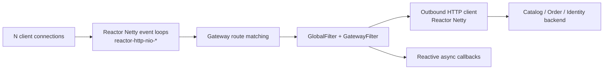
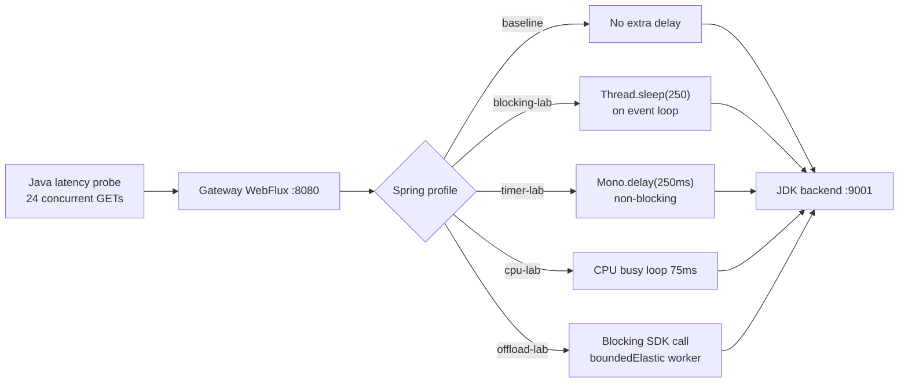
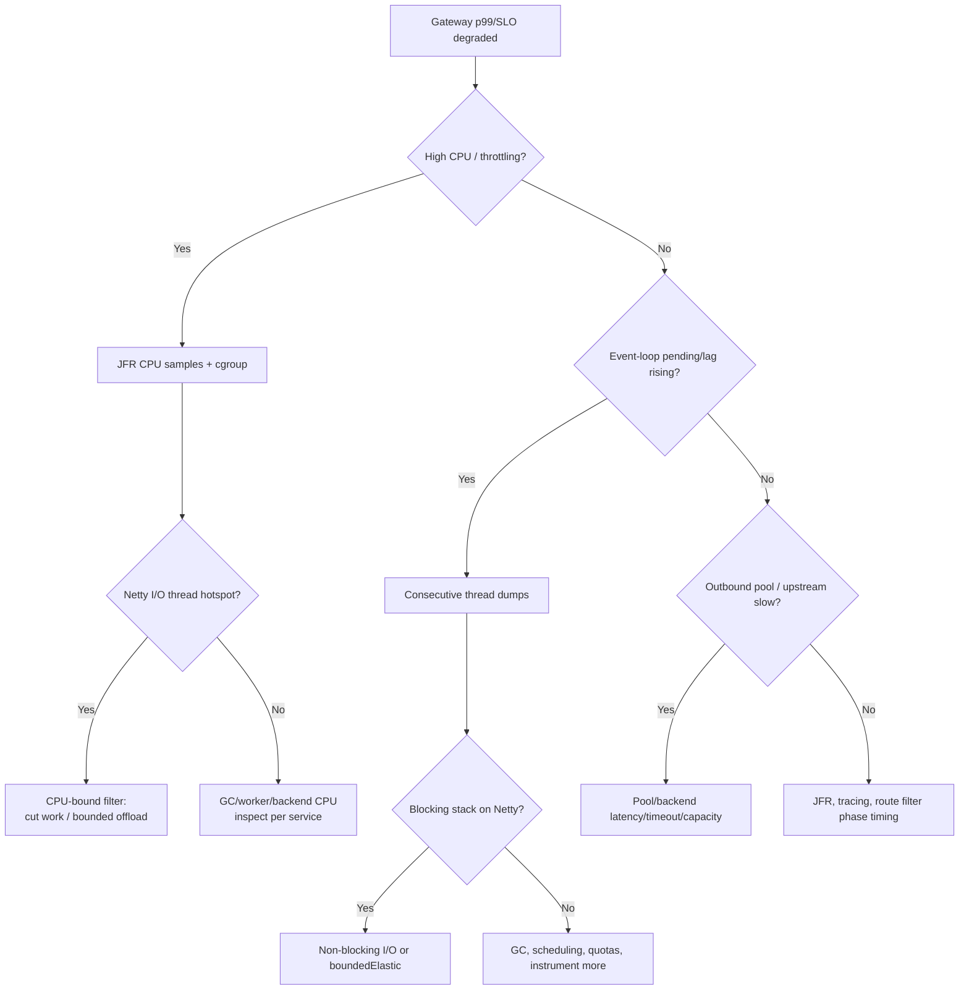

# Detecting Event-Loop Blocking Calls and CPU Bottlenecks in Spring Cloud Gateway

Spring Cloud Gateway serves as the entry point for microservices, responsible for selecting routes via route predicates, executing filter chains, rewriting paths/headers, using service discovery, and integrating authentication, rate limiting, circuit breakers, retries, TLS, and request observability. **Gateway performance depends heavily on keeping I/O threads unobstructed.** A synchronous JDBC call, `Thread.sleep()`, or CPU-intensive snippet placed in the wrong spot inside a filter can **slow down many unrelated requests simultaneously**, even when their upstreams are completely healthy.

This lesson belongs to the **Performance** chapter of the `SPRING_CLOUD_GATEWAY` module and focuses on **detecting event-loop blocking calls and CPU bottlenecks**, separating root causes, gathering evidence, and choosing the right fix. We will practice on **Spring Cloud Gateway Server WebFlux**, comparing cases that block Reactor Netty threads against non-blocking alternatives, using metrics, thread dumps, Java Flight Recorder (JFR), and BlockHound to narrow down issues. We will also explain why **Server Web MVC running on Servlets** has a different thread model and diagnostic workflow.

> **Technical scope:** Spring Cloud Gateway Server WebFlux **5.0.x** with compatible Spring Boot 4.x / Spring Cloud 2025.1.x; JDK 17+ (JDK 21 recommended for JFR and diagnostic tooling). Gateway WebFlux YAML properties use the `spring.cloud.gateway.server.webflux.*` prefix. Spring Cloud Gateway Server Web MVC uses Servlet/WebMvc.fn and does **not** automatically use Gateway Server WebFlux's Reactor Netty event loop. Examples that induce bottlenecks must only run **on loopback under a lab profile**; never enable that profile in shared or production environments.

## 1. Learning Objectives

After this lesson, you will be able to:

1. Describe the Reactor Netty **event loop** and explain why I/O thread counts are typically far smaller than concurrent request counts.
2. Distinguish **blocking I/O**, **CPU-bound code**, **connection pool waits**, **GC pauses**, **backpressure**, and slow upstreams.
3. Spot dangerous operations inside `GlobalFilter`, `GatewayFilter`, authentication, route lookup, logging, and body transformations.
4. Select the right signals: p50/p95/p99 latency, throughput, error rate, user/system CPU, event-loop pending tasks, outbound connections, GC, and scheduler queues.
5. Capture thread dumps via `jcmd`/`jstack`, JFR recordings via `jcmd JFR.start`, and controlled CPU profiles.
6. Use **BlockHound in tests** to catch instrumented blocking methods called on non-blocking threads, while understanding the tool's limits.
7. Run a lab comparing a filter with intentional `Thread.sleep()` against `Mono.delay` and `Schedulers.boundedElastic()`, distinguishing single-request latency from **ability to serve concurrent requests**.
8. Detect CPU-heavy loops that **BlockHound may not catch**, then profile and optimize or bound concurrency.
9. Build a reproducible regression/performance test matrix and incident workflow instead of blindly tweaking thread counts.

## 2. What Is the Event Loop and Why Must the Gateway Avoid Blocking It?

### 2.1. The WebFlux / Reactor Netty Model

Server WebFlux uses Reactor Netty for network I/O. A small group of event-loop threads handles socket reads/writes, network events, timers, and many reactive callbacks. Conceptually:



When the system runs cleanly, an event loop executes **a short piece of code**, registers asynchronous I/O, and immediately becomes ready to serve other connections. If one callback runs for a long time, other connections assigned to that same event loop may have to wait for it to finish.

In real applications, a request can switch threads when using Reactor schedulers, remote server callbacks, or library thread pools; **not every reactive pipeline stage always stays on the exact same event loop**. Yet the core rule still holds: **never perform long waits or long CPU-bound work on a Netty I/O thread**.

### 2.2. Illustration: "One Request Slows Down Other Requests"

Suppose a `GlobalFilter` runs before proxying:

```java
@Override
public Mono<Void> filter(ServerWebExchange exchange,
                         GatewayFilterChain chain) {
    // FORBIDDEN in WebFlux production: blocks the thread calling filter().
    Thread.sleep(250);
    return chain.filter(exchange);
}
```

This is an **illustrative anti-pattern snippet that does not compile as-is** because `Thread.sleep` throws a checked exception. If handled and placed in a filter running on the event loop, each request can hold an event-loop thread idle for 250 ms. With only a few event loops, a backlog forms even if the upstream responds in 1 ms.

Put simply: the 250 ms latency on a single request is not the only problem; the real problem is **monopolizing a thread needed to serve other requests**.

### 2.3. Non-Blocking I/O Is Not the Same as "Fast"

`WebClient`/Reactor Netty uses asynchronous network I/O, yet a request to a slow upstream can still take 2 seconds. Non-blocking **does not mean responses are always fast**; it means the Gateway does not tie up an I/O thread waiting 2 seconds per request.

Conversely, calling synchronous `RestTemplate.getForObject(...)` or `java.net.http.HttpClient.send(...)` on the event loop can block the thread until the upstream answers. Switching to a non-blocking client (or placing legacy calls onto a dedicated worker pool) frees the event loop for other requests, though **upstream latency and timeouts must still be bounded**.

### 2.4. How Does Server Web MVC Differ?

| Aspect | Gateway Server WebFlux | Gateway Server Web MVC |
|---|---|---|
| Inbound HTTP server | Reactor Netty event loops | Servlet container, e.g. Tomcat |
| Route/filter API | `GlobalFilter`/`GatewayFilter` + `Mono` | Spring MVC/WebMvc.fn `HandlerFilterFunction` and Servlet filters |
| Security | `SecurityWebFilterChain` | `SecurityFilterChain` |
| Typical execution threads | I/O event loop + reactive schedulers | Servlet request worker threads |
| `Thread.sleep` in request handler | Can stall an **event loop**, impacting many connections | Holds **one Servlet worker**, exhausting the worker pool under concurrency |
| Key diagnostics | Event-loop pending tasks, `reactor-http-nio-*` thread states, connection pool | Tomcat busy threads, request queue, `http-nio-*-exec-*` thread states |
| Remediation | Non-blocking I/O, offload blocking work to bounded workers, trim CPU per callback | Reduce blocking duration, timeouts, thread pool/queue sizing, async processing where fitting |

**Do not claim MVC "cannot stall because blocking is normal."** MVC can exhaust Servlet workers and build request queues quickly. The interpretation differs: Reactor Netty *event-loop starvation* is specific to **Server WebFlux**, whereas MVC requires checking request-thread pool limits and any async executors.

## 3. Three Types of "Slowness" Commonly Confused

### 3.1. Blocking I/O or Synchronous Waits

Examples:

```java
Thread.sleep(200);                       // Blocking timer
jdbcTemplate.queryForList("SELECT ..."); // Synchronous JDBC
legacyHttpClient.execute(request);       // Synchronous HTTP client
future.get();                            // Blocking wait on another thread
fileInputStream.read(bytes);             // Synchronous file I/O
latch.await();                           // Waiting on a lock/latch
```

These examples are **illustrative snippets**, not a standalone Java class. Such calls put a thread into `WAITING`/`TIMED_WAITING` or native I/O wait. When executed **on an event loop**, other requests queue up even while **JVM CPU stays low**.

**Key takeaway:** Low CPU + rising p99 latency + growing event-loop pending tasks is a strong clue to investigate event-loop blocking, but is **not enough on its own** to conclude the cause is JDBC or `sleep`. Inspect thread stacks, traces, and other queues.

### 3.2. CPU-Bound Code Hogging the Event Loop

Example:

```java
// CPU-heavy loop: burns CPU on whichever thread calls it.
for (int i = 0; i < 5_000_000; i++) {
    digest.update(someBytes);
}
```

If this runs inside a Gateway filter or body transformation on a Netty event loop, the thread stays `RUNNABLE` and burns CPU throughout the computation. Unlike `Thread.sleep`, the thread is **actively running**, yet it cannot service new socket events.

Real-world examples:

- Heavy cryptographic/signature verification or expensive custom JWT handling per request.
- Serializing/deserializing huge JSON payloads, XML parsing, or catastrophic regex backtracking.
- Compressing/decompressing, hashing, or encrypting entire large bodies.
- Synchronous logging with expensive string formatting or massive stack traces.
- Transforming request/response bodies in unbounded loops.
- Scanning a large route store and evaluating heavy predicates/regexes per request.

**BlockHound does not automatically catch every CPU loop.** It detects **instrumented blocking methods** invoked on non-blocking threads; long-running computation that calls no blocking primitive can pass BlockHound while still starving the event loop.

### 3.3. Slow Upstreams, Connection Pools, or GC

High p99 is not always caused by custom filters. Other causes include:

| Category | Common symptoms | Evidence to look for |
|---|---|---|
| Slow upstream | Gateway latency climbs in lockstep with upstream latency | Client span traces, upstream response times, backend saturation |
| Exhausted connection pool | Pending connection acquires/timeouts rise | Reactor Netty connection provider pending/active metrics |
| Slow DNS/TLS handshake | Connect/TLS phase grows, errors | HTTP client metrics, TLS diagnostics, name resolution |
| GC pauses | Requests experience simultaneous latency spikes matching GC pauses | JFR GC events, `jvm.gc.pause`, heap/off-heap pressure |
| Container CPU throttling | Host CPU looks fine yet the pod is throttled | cgroup throttled time, CPU limits, JFR sampled stacks |
| Memory/allocator pressure | High direct memory, rising GC/allocations | Netty `ByteBuf` allocator, heap/GC, JFR allocation profiles |
| Blocked event loop | Some `reactor-http-nio-*` threads stuck in JDBC/sleep/locks | Thread dumps/JFR + pending tasks |
| CPU hotspot on event loop | `reactor-http-nio-*` threads `RUNNABLE` in regex/crypto/body code | CPU profile and per-thread CPU |
| Full `boundedElastic` queue | Event loop is healthy, yet requests wait for offloaded tasks | Scheduler queue/active/pending metrics, thread dumps |
| Traffic spike or DDoS | RPS/connections far above baseline | Ingress request rate, admission control, per-route metrics |

Do not "fix" every p99 spike by increasing Netty worker counts. If the root cause is a 2-second upstream, an exhausted pool, or filter blocking, adding event loops merely shifts contention and adds overhead.

## 4. Common Places Where Blocking Code Sneaks Into a Gateway

| Location | Anti-pattern | Why it is dangerous | Alternative |
|---|---|---|---|
| `GlobalFilter.filter(...)` | `Thread.sleep`, sync DB calls | Often sits on the hot path of many routes | Reactive I/O or bounded offload |
| Custom `GatewayFilterFactory` | `Mono.block()`, `Future.get()` | Deadlock/blocked loop, loss of concurrency | Compose `Mono`/`Flux`, never block |
| Rate limiter `KeyResolver` | Sync user/session DB lookup | Quota lookup stalls requests before proxying | Reactive lookup + cache/timeout |
| Reactive Security auth | Synchronous password/provider/HTTP call | Blocks authentication and unrelated requests | Reactive `AuthenticationManager` or proper scheduler |
| Dynamic route locator | Blocking JDBC during refresh on event loop | Route rebuild stalls, delaying revision activation | Snapshot preload on dedicated worker or reactive repo |
| Service discovery | Sync registry client on the hot path | Route instance selection stalls | Reactive supplier/caching + timeouts |
| Request body filter | Large sync JSON/XML parsing or compression | CPU hotspots, memory and buffer spikes | Size limits, streaming/async, codec tuning |
| Response body filter | `collectList()` on the full stream | OOM/backpressure, delayed TTFB | Streaming transforms or skip stream rewriting |
| Audit/logging | Sync file or network logging | I/O and lock contention under load | Async bounded logging, sampling/redaction |
| Regex / path rewrite | Backtracking patterns on long inputs | Burns CPU even with zero I/O | Bounded/safe regex patterns + input limits |
| TLS / client trust | Disabling verification for speed | Introduces MITM risk without fixing root cause | Pool reuse, valid CA/SAN, measured TLS tuning |
| Retry / fallback | Unbounded retries + sync work | Amplifies load on backend and Gateway | Cap attempts/backoff, idempotency, CB |

Do not inspect only Gateway controllers. The **filter chain** executes even when zero business logic lives in the Gateway. A custom logger, `AuthenticationManager`, metrics binder, or library-bundled filter can still be the culprit.

## 5. Quantitative Model: Why Even Small Blocking Matters

Suppose there are `E` event loops, and each callback burns CPU or blocks for `T` seconds. A highly simplified theoretical bound is:

\[
\text{callback capacity} \lesssim \frac{E}{T}.
\]

Hypothetical example with `E = 4`, `T = 0.25` seconds: if every request holds an event loop for 250 ms, throughput is capped at roughly **16 callbacks/second** before counting any other overhead. This is **not** a measured Gateway throughput number: event-loop affinity, HTTP clients, TLS, CPU quotas, schedulers, connection reuse, and workload shapes alter real behavior significantly.

By Little's Law (in steady state):

\[
L = \lambda W,
\]

where `L` is average concurrency, `λ` is throughput, and `W` is average time in system. When throughput stays flat while `W` grows, in-flight waiting requests `L` climb. Yet the formula **does not reveal the root cause**; combine it with queue metrics, sampled stacks, and upstream latency.

Therefore, "8 CPU cores means raise Netty workers to 64" is not a principled optimization. First minimize event-loop hold time, stop ingress overload, handle external I/O properly, and eliminate CPU hotspots.

## 6. Measure Before Fixing: Essential Metrics

### 6.1. Four Golden Signals and Internal Signals

A minimal Gateway dashboard should expose:

- **Traffic:** RPS by route and HTTP method.
- **Latency:** p50/p95/p99 compared against baselines, SLOs, and upstream latency.
- **Errors:** 4xx/5xx, timeouts, connection resets, upstream failures.
- **Saturation:** CPU/cgroup throttling, memory/GC, Netty event-loop backlog, outbound connection pool.

Never conclude from **average latency**. For example, if 99% of requests take 5 ms and 1% take 3 seconds, the average can still look fine while p99 ruins user experience.

### 6.2. Enabling Actuator for the **WebFlux Lab** on Loopback

Relevant dependencies:

```xml
<dependencies>
    <dependency>
        <groupId>org.springframework.cloud</groupId>
        <artifactId>spring-cloud-starter-gateway-server-webflux</artifactId>
    </dependency>

    <dependency>
        <groupId>org.springframework.boot</groupId>
        <artifactId>spring-boot-starter-actuator</artifactId>
    </dependency>

    <!-- Only needed when scraping /actuator/prometheus. -->
    <dependency>
        <groupId>io.micrometer</groupId>
        <artifactId>micrometer-registry-prometheus</artifactId>
    </dependency>
</dependencies>
```

This is a **dependencies snippet**, not a complete `pom.xml`: the project needs a compatible Spring Boot parent/plugin and Spring Cloud BOM. When running Servlet Gateway MVC, use `spring-cloud-starter-gateway-server-webmvc` instead of the WebFlux starter; never mix them.

Minimal `application.yml` for lab metrics:

```yaml
server:
  address: 127.0.0.1
  port: 8080

spring:
  application:
    name: gateway-performance-lab
  cloud:
    gateway:
      server:
        webflux:
          metrics:
            enabled: true
            path-tags:
              enabled: false
          routes:
            - id: lab-fast
              uri: http://127.0.0.1:9001
              predicates:
                - Path=/demo/**
                - Method=GET
              filters:
                - StripPrefix=1

management:
  endpoints:
    web:
      exposure:
        include: health,metrics,prometheus
```

**Version note:** Gateway **5.0.5** Configuration Properties explicitly document `spring.cloud.gateway.server.webflux.metrics.enabled` with a default of `false`; in the lab, set it to **`true` explicitly** rather than assuming adding Actuator alone always creates Gateway timers. Some older guides describe different defaults; verify the effective configuration on your running Gateway release.

- `metrics.path-tags.enabled: false` prevents specific URL paths like `/users/12345` from becoming high-cardinality tags.
- `management.endpoints.web.exposure.include` **does not authenticate endpoints**; in the lab, the whole server binds `127.0.0.1`. Production needs a management network and dedicated Security policies.
- Never expose `threaddump`/`heapdump` to the Internet; use `jcmd` with proper process access when diagnosing.
- Gateway `metrics`, Boot `http.server.requests`, and Reactor Netty `eventloop` metrics belong to **different observation layers**.

### 6.3. Inspecting Gateway and HTTP Server Timers

After sending traffic through the Gateway:

```bash
curl -s http://127.0.0.1:8080/actuator/metrics
curl -s http://127.0.0.1:8080/actuator/metrics/spring.cloud.gateway.requests
curl -s http://127.0.0.1:8080/actuator/metrics/http.server.requests
curl -s http://127.0.0.1:8080/actuator/prometheus
```

Depending on instrumentation config and version, `spring.cloud.gateway.requests` is the Gateway timer with tags `routeId`, `routeUri`, `outcome`, `status`, and `httpMethod`; `http.server.requests` is Spring Boot's HTTP server metric. Neither automatically tells you which callback is blocking. In Prometheus, names are normalized (dots become underscores, and timers get `_count`/`_sum` suffixes).

**If a metric is missing:**

1. Verify real requests hit the target route.
2. Check Actuator, the Micrometer registry, `metrics.enabled`, and active profiles.
3. Check the Actuator path/management port and access permissions.
4. Cross-check metric names and enabled instrumentation for your release.
5. Never fabricate `0` just because a metric wasn't found; **missing instrumentation is not zero load**.

### 6.4. Reactor Netty Event Loop and Outbound Connection Pool

Reactor Netty documents metrics with names such as:

| Metric documented by Reactor Netty | Meaning | Interpretation limits |
|---|---|---|
| `reactor.netty.eventloop.pending.tasks` | Gauge of tasks waiting on the event loop | Sustained rise signals backlog, **does not by itself distinguish** I/O block vs. CPU hotspot |
| `reactor.netty.connection.provider.active.connections` | Active outbound connections in use | High values can reflect valid load or a slow backend |
| `reactor.netty.connection.provider.idle.connections` | Idle connections sitting in the pool | Not the number of "waiting" requests |
| `reactor.netty.connection.provider.pending.connections` | Requests waiting to acquire an outbound connection | Rising values suggest pool saturation, not event-loop blocking |
| `reactor.netty.connection.provider.pending.connections.time` | Wait time to acquire a connection | Compare against connect/response times |
| `reactor.netty.http.client.response.time` | HTTP client interaction duration per metric recorder | Inspect actual setup and tags |
| `reactor.netty.bytebuf.allocator.active.direct.memory` | Active Netty direct buffers in use | High values can cause memory pressure even when JVM heap looks healthy |

Names and tags follow current Reactor Netty documentation. **Do not assume every metric appears automatically just by adding Actuator**: several require enabling Reactor Netty instrumentation/connection-provider metrics and exercising that code path. Inspect `/actuator/metrics` and `/actuator/prometheus` before creating alerts. If a metric is absent, enable instrumentation via supported Netty/Boot configuration for your release or add a custom probe.

### 6.5. How Should an "Event-Loop Lag Probe" Be Understood?

You can schedule a **periodic task** directly onto the event loop and measure the drift between scheduled and actual execution timestamps. When lag spikes alongside rising pending tasks, the event loop is starved of CPU or tied up.

However, such a probe must:

- Keep overhead low and frequency bounded so it adds negligible load.
- Run on the actual event loop being measured, rather than using a separate `@Scheduled` executor and mislabeling it as event-loop lag.
- Distinguish **CPU throttling**, stop-the-world GC pauses, and blocked callbacks.
- Report aggregates/histograms with bounded tags—never label per connection.
- Be corroborated with JFR/thread dumps when an alert fires.

**Do not treat a hand-rolled event-loop lag probe as a standard Gateway API.** If your app lacks lag instrumentation, start with pending tasks, p99, CPU throttling, and stack sampling.

### 6.6. Read Signals Together, Never in Isolation

| Symptom | CPU | Event-loop backlog | Thread dump / JFR | Top suspect |
|---|---|---|---|---|
| p99 high, CPU low | Low | May grow | `TIMED_WAITING` in `Thread.sleep`/I/O on Netty threads | Blocking call |
| p99 high, CPU high | High | May grow | `RUNNABLE` hotspots in regex/JSON/crypto on Netty threads | CPU-bound filter |
| p99 high, CPU low, pool pending high | Low/moderate | Not necessarily | Many requests waiting to acquire HTTP connections | Outbound pool/upstream |
| p99 high, JVM heap/GC pauses up | Possibly high | Lag spikes during pauses | JFR GC pauses, allocations | GC/memory |
| p99 high, pod throttled time up | Host CPU may look normal | May grow | CPU throttling/cgroup events | CPU quota |
| p99 high, upstream slow too | Normal | Not necessarily | Long client spans, high backend p99 | Upstream |
| p99 high, `boundedElastic` queue high | Varies with work | May still look fine | Workers busy in JDBC/sync file I/O | Offload pool saturated |

Never calculate cluster p95/p99 by averaging per-pod p95/p99 values. Percentiles do not combine linearly; use proper histogram/metric aggregation for cluster-wide percentiles.

## 7. Gathering Evidence from a Slow JVM

### 7.1. Safe Observation Workflow

During a latency spike:

1. Record the **timestamp and duration** of the incident, route IDs, RPS, concurrency, and deployment revision.
2. Compare Gateway p95/p99 with upstream p95/p99, error rates, and connection pool metrics.
3. Inspect **process and cgroup CPU**, not only host CPU.
4. Inspect `reactor.netty.eventloop.pending.tasks` if instrumented.
5. Capture **several thread dumps** a few seconds apart, never just a single snapshot.
6. If still inconclusive, take a short controlled **JFR profile** or compatible CPU profiler capture.
7. Correlate stack frames with custom filters, auth providers, path/body rewrites, and logging.
8. Formulate a testable hypothesis and run an A/B test in an isolated environment before changing production settings.

**Thread dumps and JFR recordings can contain class names, stack traces, URLs, hostnames, and even sensitive data** depending on enabled events; protect files and retention, and never paste full artifacts into public issues.

### 7.2. Finding the Process and Taking Thread Dumps with `jcmd`

On a host/container with JDK tools and attach permissions:

```bash
# List JVMs visible in the current namespace:
jcmd -l

# Replace 12345 with the Gateway PID:
jcmd 12345 Thread.print -l
```

During a production investigation, redirect output to a secured file per team policy:

```bash
jcmd 12345 Thread.print -l > gateway-threads.txt
```

If the JVM runs inside Docker/Kubernetes, the PID inside the container may be `1` while the host PID differs. Run `jcmd` inside the same process namespace or an authorized debug container—do not assume `jcmd 1` on your local machine is the Gateway JVM.

On JDK 21+, you can also use:

```bash
# Especially helpful if the JVM uses virtual threads:
jcmd 12345 Thread.dump_to_file -format=text /tmp/gateway-dump.txt
```

This command requires a sufficiently recent JDK, attach permissions, and a writable path **inside the JVM process's filesystem**. `Thread.print` and `Thread.dump_to_file` differ in content and format; use the command supported by the running JDK.

### 7.3. Reading Sample Stack Traces

Excerpt of a thread dump:

```text
"reactor-http-nio-3" #23 ...
   java.lang.Thread.State: TIMED_WAITING (sleeping)
     at java.lang.Thread.sleep(Native Method)
     at com.example.gateway.BadBlockingFilter.filter(BadBlockingFilter.java:31)
     at org.springframework.cloud.gateway.handler.FilteringWebHandler...
```

This is a **simulated stack illustrating the pattern**, not output from a live production app. It points to `BadBlockingFilter` calling sleep directly on a Reactor Netty thread.

Another CPU hotspot pattern:

```text
"reactor-http-nio-2" ...
   java.lang.Thread.State: RUNNABLE
     at java.util.regex.Pattern$Loop.match(...)
     at com.example.gateway.ExpensiveRewriteFilter.filter(...)
```

A single snippet is only a **clue**, not proof that regex consumes all CPU. Confidence rises when the same frames appear repeatedly across JFR/CPU samples while the pod is hot.

### 7.4. Correlating PID, Thread ID, and CPU

On Linux, inspect per-thread CPU usage:

```bash
top -H -p 12345
```

Thread IDs in `top` are decimal OS TIDs. Traditional Java thread dumps show hexadecimal `nid=0x...`; convert and match carefully before linking a high-CPU TID to a Java stack. Windows, Linux, and macOS differ here; JFR avoids error-prone manual TID conversion.

Do not assume `RUNNABLE` means a thread burns 100% CPU: Java's `RUNNABLE` state can include blocking native calls where actual CPU utilization is low. Verify using process/thread CPU counters or profiler samples.

### 7.5. Using Java Flight Recorder

JFR is built into modern JDKs and records CPU samples, allocations, lock contention, GC, `ThreadSleep`, and other events based on recording settings. An example documented by Oracle:

```bash
jcmd 12345 JFR.start \
  name=GatewayPerf \
  settings=profile \
  duration=60s \
  filename=/tmp/gateway-perf.jfr
```

Then inspect using JDK Mission Control (JMC) or the `jfr` CLI:

```bash
jfr summary /tmp/gateway-perf.jfr

# Inspect specific event types that appear when enabled in the profile:
jfr print --events jdk.ThreadSleep,jdk.JavaMonitorEnter \
  /tmp/gateway-perf.jfr
```

**There is no guarantee a given event is always captured**: it depends on `settings`, JDK version, and event thresholds. If `jdk.ThreadSleep` is absent, check recording settings, method sampling, and thread dumps rather than concluding no sleeps occurred.

JFR writes files on a filesystem accessible to the JVM, introducing small overhead and data-sensitivity concerns. Run short, bounded recordings per operational policy—never leave `profile` running indefinitely in production without disk/retention limits.

### 7.6. When to Use a CPU Profiler?

When process/cgroup CPU is high and repeated thread dumps show `RUNNABLE` on `reactor-http-nio-*` or `parallel-*`, a CPU profiler captures **sampled stack traces** showing which methods consume execution time.

Common tools include JFR/JDK Mission Control, `async-profiler` (if approved by your organization), or an APM JVM profiler. What matters is not the brand name, but:

- Matching the recording window to the p99 spike.
- Distinguishing CPU sampling from wall-clock tracing.
- Enabling only needed events/sampling and checking overhead.
- Filtering by thread name/route/filter and **comparing against a baseline**.
- Verifying whether the hotspot sits in the Gateway JVM or backend JVM so you do not optimize the wrong service.

**A method showing many CPU samples is not automatically a bug** if that work is genuinely required. Optimize when per-request cost is excessive, caching/limits are missing, or CPU work runs on the wrong thread and causes starvation.

## 8. BlockHound: Detecting Blocking Calls on Non-Blocking Threads

### 8.1. How Does BlockHound Work?

**BlockHound** is a Reactor Java agent/instrumentation tool that detects known blocking APIs when invoked on threads marked **non-blocking** (such as Reactor `Schedulers.parallel()` and compatible Reactor/Netty threads).

Example call chain:

```text
reactor-http-nio-3
  -> GlobalFilter.filter()
     -> legacyDao.findAccount()
        -> java.lang.Thread.sleep()
           -> reactor.blockhound.BlockingOperationError
```

BlockHound is not a CPU profiler, cannot tell whether an uninstrumented SQL call took 50 ms or 5 seconds, and does not guarantee detection of every native or third-party blocking library.

### 8.2. Use in a **Test Profile**, Not Broadly in Production

Add `io.projectreactor.tools:blockhound` compatible with your project's Reactor/JDK version in **test scope**:

```xml
<dependency>
    <groupId>io.projectreactor.tools</groupId>
    <artifactId>blockhound</artifactId>
        <version>1.0.18.RELEASE</version>
    <scope>test</scope>
</dependency>
```

This example picks BlockHound `1.0.18.RELEASE` released in October 2026. It is a **concrete versioned test dependency**, yet you must verify compatibility with your actual Reactor and JDK versions. Java agents can encounter Byte Buddy/attach/instrumentation restrictions on certain JDK combinations even when the Maven artifact exists.

Basic JUnit 5 test:

```java
import java.time.Duration;

import org.junit.jupiter.api.BeforeAll;
import org.junit.jupiter.api.Test;

import reactor.blockhound.BlockHound;
import reactor.blockhound.BlockingOperationError;
import reactor.core.publisher.Mono;
import reactor.core.scheduler.Schedulers;
import reactor.test.StepVerifier;

class BlockHoundGuardTest {

    @BeforeAll
    static void install() {
        // Install early, before the application spawns many threads.
        BlockHound.install();
    }

    private static void sleepTenMillis() {
        try {
            Thread.sleep(10);
        } catch (InterruptedException ex) {
            Thread.currentThread().interrupt();
            throw new IllegalStateException(ex);
        }
    }

    @Test
    void detectsSleepOnNonBlockingScheduler() {
        Mono<Void> blockingWork = Mono
                .fromRunnable(BlockHoundGuardTest::sleepTenMillis)
                .subscribeOn(Schedulers.parallel());

        StepVerifier.create(blockingWork)
                .expectError(BlockingOperationError.class)
                .verify(Duration.ofSeconds(5));
    }
}
```

Requires `reactor-test` and `junit-jupiter` in test dependencies. This is a **BlockHound integration check**, not a test that automatically exercises all Gateway routes. To catch blocking in custom filters, write tests invoking those filters on non-blocking schedulers or an embedded Gateway.

**On JDK 13+**, BlockHound's documentation notes JVM instrumentation requirements/limitations and mentions `-XX:+AllowRedefinitionToAddDeleteMethods` for certain setups. Depending on JDK/Byte Buddy/BlockHound versions, the option or agent may fail; verify on your exact version before adding to CI. **Never treat a failed BlockHound install as proof that the application has no blocking calls.**

### 8.3. What BlockHound Can Miss

| Case | Will BlockHound reliably catch it? | What else is needed? |
|---|---|---|
| `Thread.sleep` on a thread marked non-blocking | Usually yes | Test on the right scheduler/thread |
| `Mono.block()` on a Reactor `NonBlocking` thread | Reactor itself checks in many cases | Reactive chain testing, stack traces |
| Sync JDBC/SDK going through uninstrumented APIs | Not guaranteed | JFR, traces, timings, wrapper metrics |
| 250 ms CPU loop/regex | **Not by default** | CPU profiler/JFR samples, event-loop lag |
| Blocking on `boundedElastic` | Normally permitted, not flagged as a violation | Monitor pool saturation, timeouts, and queues |
| Async I/O to a slow backend | Not local blocking | HTTP client spans/connection metrics |
| GC pauses / cgroup throttling | No | GC/JFR/cgroup metrics |
| Native calls or custom locks | Depends on instrumentation | Thread dumps/JFR/async-profiler |

**Do not "fix" alerts by allowlisting your entire application package.** `allowBlockingCallsInside` should only cover narrow, explained, and tracked false positives—otherwise you blind the tool.

### 8.4. Combining BlockHound with Code Review

When a BlockHound test fails:

1. Read the stack from `BlockingOperationError` down to the blocking call.
2. Check whether it sits on the **hot path** or only runs during startup/shutdown.
3. Identify the actual thread and work type (I/O, lock, CPU).
4. Replace with a non-blocking API or isolate onto a concurrency-capped worker.
5. Keep regression tests so `Thread.sleep` or sync JDBC never creeps back into Gateway filters.
6. Re-measure p95/p99 and saturation after fixing—do not stop at "BlockHound is green."

If BlockHound cannot run on a specific JDK/agent combination, still use JFR, thread dumps, and source reviews; never skip performance checks.

## 9. Choosing a Fix Matched to the Root Cause

### 9.1. If You Only Need a Timer Wait: Use `Mono.delay`

Anti-pattern:

```java
Thread.sleep(250);
return chain.filter(exchange);
```

Proper **non-blocking timer wait**:

```java
return Mono.delay(Duration.ofMillis(250))
        .then(Mono.defer(() -> chain.filter(exchange)));
```

`Mono.delay` schedules a callback instead of parking a Netty event-loop thread for 250 ms. Once the timer fires, the downstream chain runs when subscribed. **It does not make an individual request faster by 250 ms**; it frees the I/O thread during the wait.

Never try to use `Mono.delay` to "replace JDBC": `Mono.delay` does not make JDBC non-blocking or fetch data from a database.

### 9.2. If You Need Network I/O: Use a Non-Blocking Client

Anti-pattern in a Gateway filter:

```java
// Blocks the thread until the remote HTTP service responds.
String value = blockingHttpClient.get(...);
return chain.filter(exchange);
```

Better approach using a reactive HTTP client and signal composition:

```java
// PSEUDO-CODE: injected WebClient identityClient;
// explicit fallback/timeout/circuit-breaker policy required.
return identityClient.get()
        .uri("/internal/subject")
        .retrieve()
        .bodyToMono(Subject.class)
        .timeout(Duration.ofMillis(800))
        .flatMap(subject -> {
            // Use verified/authorized identity data.
            ServerHttpRequest request = exchange.getRequest()
                .mutate()
                .headers(headers ->
                    headers.set("X-Verified-Subject", subject.id()))
                .build();

            return chain.filter(exchange.mutate().request(request).build());
        });
```

This is a **structural skeleton**, not a standalone class: you need imports, an `identityClient` bean, a `Subject` type, error handling, and a clear trust policy. Never trust a client-supplied `X-Verified-Subject` header as authority; sanitize inbound headers first and populate it only from verified identity.

Pair it with **timeouts, connection pools/bulkheads, fallbacks, or failure policies**. Even a non-blocking client can overwhelm a Gateway if upstreams stall without concurrency bounds.

### 9.3. When Stuck with a Blocking Library: Offload via a Bounded Scheduler

When a synchronous SDK/JDBC driver cannot yet be replaced, wrap **only the blocking call** in `Mono.fromCallable` on `Schedulers.boundedElastic()`:

```java
return Mono.fromCallable(() -> legacyDao.findAccount(accountId))
        .subscribeOn(Schedulers.boundedElastic())
        .timeout(Duration.ofSeconds(2))
        .flatMap(account -> chain.filter(exchange));
```

**Important distinctions:**

- `Mono.fromCallable(...)` defers execution until subscription rather than calling JDBC when the pipeline is constructed.
- `subscribeOn(Schedulers.boundedElastic())` runs the callable on a bounded worker scheduler instead of the Netty event loop.
- `timeout` bounds the reactive publisher, but **does not prove** the underlying JDBC/native call actually aborts immediately on timeout; configure database/socket/query timeouts as well.
- `flatMap` continues the reactive chain on signal emission; callbacks may execute on a different scheduler from the original event loop. Do not assume `subscribeOn` automatically moves all subsequent work back onto the Netty thread.
- `boundedElastic()` has bounded threads and task queues, yet its default queue cap can be quite large. If bursts exceed the blocking dependency's capacity, queues fill and latency/rejections appear.

Never wrap **the entire `chain.filter(exchange)`** onto `boundedElastic` with `publishOn` expecting higher throughput. Isolate **only the genuinely blocking work**, cap concurrent tasks, and avoid buffering huge responses/bodies on the heap.

### 9.4. Isolating a Blocking SDK with a Dedicated Scheduler

If a legacy SDK has its own resource cap (e.g., a DB pool of at most 8 connections), give it a dedicated scheduler rather than sharing the global `boundedElastic` across all filters:

```java
import org.springframework.context.annotation.Bean;
import org.springframework.context.annotation.Configuration;
import reactor.core.scheduler.Scheduler;
import reactor.core.scheduler.Schedulers;

@Configuration
public class LegacySchedulerConfig {

    @Bean(destroyMethod = "dispose")
    Scheduler legacyScheduler() {
        // Max 8 threads, max 64 queued tasks
        // per the boundedElastic scheduler API.
        return Schedulers.newBoundedElastic(8, 64, "gateway-legacy");
    }
}
```

And:

```java
// Code fragment inside a class holding a Scheduler legacyScheduler field.
return Mono.fromCallable(() -> legacyDao.load(key))
        .subscribeOn(legacyScheduler)
        .timeout(Duration.ofSeconds(2))
        .flatMap(result -> chain.filter(exchange));
```

`Schedulers.newBoundedElastic` enforces thread and queue caps for this workload; **that does not mean 8 threads is universally optimal**. Size it by measuring DB pool capacity, SDK latency, CPU limits, concurrency, and SLOs. When the queue fills, fail with a controlled error/overload policy instead of letting requests wait indefinitely.

Also never run blocking JDBC on `Schedulers.parallel()`: that scheduler is designed for non-blocking CPU work, has few workers, and carries a `NonBlocking` marker.

### 9.5. If CPU-Bound: Reduce the Work Before Offloading

For CPU hotspots, **adding threads does not create extra CPU cores**. Steps:

1. Capture CPU samples to identify hot methods.
2. Eliminate redundant calls and move parsing/config out of the request hot path.
3. Cap payload sizes, regex complexity, and the number of routes/predicates evaluated per request.
4. Optimize algorithms and cache data that is **safe to cache**.
5. If lengthy CPU work remains unavoidable, move it to a **bounded CPU worker pool** with admission control so Netty event loops stay free.
6. For very heavy work, move it to a dedicated service/queue using async responses/workflows.
7. Re-measure CPU/cgroup throttling, event-loop lag, p99, and throughput.

`Schedulers.parallel()` can suit **short, controlled CPU tasks**, never blocking I/O. Do not push every request onto the parallel scheduler and ignore total CPU saturation.

### 9.6. Why Virtual Threads Do Not Automatically Fix Reactor Netty

JDK 21+ and Reactor `boundedElastic` offer an option to use **virtual threads** on certain setups (such as `reactor.schedulers.defaultBoundedElasticOnVirtualThreads` where supported by the Reactor version).

However:

- Reactor Netty I/O event loops do not turn into virtual threads simply by toggling a property.
- CPU-heavy callbacks on a Netty thread still stall the event loop.
- Virtual threads make synchronous I/O waiting cheaper, **they do not add CPU cores**.
- Monitor pinning, native locks, and driver behavior with JFR; not every JDBC driver benefits automatically.
- Gateway Server Web MVC's Servlet worker model is a different problem from this non-blocking WebFlux gateway.

**Do not promote virtual threads as "flip a flag and event-loop blocking disappears."** Prefer non-blocking APIs in WebFlux, and use bounded offloads for unreplaceable synchronous libraries.

## 10. Lab: Creating Multiple Performance States to Observe

Lab goals:

1. **Baseline:** Gateway proxies to a fast backend with no artificial delay filter.
2. **`blocking-lab`:** filter calls `Thread.sleep(250)` **directly** inside `GlobalFilter.filter(...)`.
3. **`timer-lab`:** identical 250 ms wait using **non-blocking** `Mono.delay`.
4. **`cpu-lab`:** a loop burning ~75 ms of CPU on the event loop to contrast with `Thread.sleep`.
5. **`offload-lab`:** simulates a legacy blocking SDK executed on a dedicated bounded scheduler.

All use the same Gateway route and backend. Enable **one Spring profile** at a time, and run only on **`127.0.0.1`**.



### 10.1. Small JDK Backend Returning Fast and Slow Responses

Create `LatencyBackend.java` in a lab directory separate from the Gateway project:

```java
import com.sun.net.httpserver.HttpServer;
import com.sun.net.httpserver.HttpExchange;

import java.net.InetSocketAddress;
import java.nio.charset.StandardCharsets;
import java.util.concurrent.Executors;
import java.util.concurrent.atomic.LongAdder;

public class LatencyBackend {

    private static final LongAdder CALLS = new LongAdder();

    public static void main(String[] args) throws Exception {
        HttpServer server = HttpServer.create(
                new InetSocketAddress("127.0.0.1", 9001), 0);
        server.createContext("/", LatencyBackend::handle);
        server.setExecutor(Executors.newFixedThreadPool(8));
        server.start();

        System.out.println("Lab backend at 127.0.0.1:9001");
        System.out.println("Routes: GET /fast and /slow");
    }

    private static void handle(HttpExchange exchange)
            throws java.io.IOException {

        String path = exchange.getRequestURI().getRawPath();
        int status;

        try (exchange) {
            if (!"GET".equals(exchange.getRequestMethod())) {
                status = 405;
            } else if ("/fast".equals(path)) {
                status = 200;
            } else if ("/slow".equals(path)) {
                // Simulates UPSTREAM latency on a backend worker.
                // Do not confuse this with the Gateway's Netty event loop.
                try {
                    Thread.sleep(120);
                } catch (InterruptedException ex) {
                    Thread.currentThread().interrupt();
                    exchange.close();
                    return;
                }
                status = 200;
            } else {
                status = 404;
            }

            CALLS.increment();
            String body = "backend=lab\n"
                    + "path=" + path + "\n"
                    + "count=" + CALLS.sum() + "\n";

            byte[] bytes = body.getBytes(StandardCharsets.UTF_8);
            exchange.getResponseHeaders().set(
                    "Content-Type", "text/plain; charset=utf-8");
            exchange.getResponseHeaders().set(
                    "X-Lab-Upstream", "reached");

            exchange.sendResponseHeaders(status, bytes.length);
            try (var output = exchange.getResponseBody()) {
                output.write(bytes);
            }
        }
    }
}
```

Run with JDK 17+:

```bash
java --add-modules jdk.httpserver LatencyBackend.java
```

The backend runs on its own **JDK `HttpServer`** worker threads, so `Thread.sleep(120)` on `/slow` intentionally simulates a slow upstream service. It is **not a blocking call on the Gateway event loop**. Use this pattern only in labs; production backends need I/O timeouts, request size caps, and authentication.

Verify directly:

```bash
curl -i http://127.0.0.1:9001/fast
curl -i http://127.0.0.1:9001/slow
```

`/fast` returns `200` almost immediately; `/slow` has roughly 120 ms of backend delay. Both include `X-Lab-Upstream: reached` proving the request reached the upstream.

### 10.2. Gateway Server WebFlux Application

Create a Spring Boot 4.x project compatible with Spring Cloud 2025.1.x. Core dependencies:

```xml
<dependencies>
    <dependency>
        <groupId>org.springframework.cloud</groupId>
        <artifactId>spring-cloud-starter-gateway-server-webflux</artifactId>
    </dependency>
    <dependency>
        <groupId>org.springframework.boot</groupId>
        <artifactId>spring-boot-starter-actuator</artifactId>
    </dependency>
</dependencies>
```

This is not a full `pom.xml`: add a compatible Spring Boot parent/plugin and Spring Cloud BOM.

Entrypoint class:

```java
import org.springframework.boot.SpringApplication;
import org.springframework.boot.autoconfigure.SpringBootApplication;

@SpringBootApplication
public class GatewayPerformanceApp {

    public static void main(String[] args) {
        SpringApplication.run(GatewayPerformanceApp.class, args);
    }
}
```

`application.yml`:

```yaml
server:
  address: 127.0.0.1
  port: 8080

spring:
  application:
    name: gateway-eventloop-performance-lab

  cloud:
    gateway:
      server:
        webflux:
          metrics:
            enabled: true
          routes:
            - id: lab-forward
              uri: http://127.0.0.1:9001
              predicates:
                - Path=/demo/**
                - Method=GET
              filters:
                - StripPrefix=1

management:
  endpoints:
    web:
      exposure:
        include: health,metrics
```

For `GET /demo/fast`, the Gateway applies `StripPrefix=1`, so the backend receives `GET /fast`. All lab profiles target the **same route**; with no special profile active, no custom blocking/delay filter runs, giving the baseline.

### 10.3. Profile That Intentionally **Blocks the Event Loop** — Lab Only

Create `BadBlockingFilter.java`:

```java
import org.springframework.cloud.gateway.filter.GlobalFilter;
import org.springframework.cloud.gateway.filter.GatewayFilterChain;
import org.springframework.core.Ordered;
import org.springframework.context.annotation.Profile;
import org.springframework.stereotype.Component;
import org.springframework.web.server.ServerWebExchange;

import reactor.core.publisher.Mono;

@Component
@Profile("blocking-lab")
public class BadBlockingFilter implements GlobalFilter, Ordered {

    @Override
    public Mono<Void> filter(
            ServerWebExchange exchange,
            GatewayFilterChain chain) {

        // INTENTIONALLY WRONG: blocks directly inside filter()
        // which typically executes on a Netty I/O thread.
        try {
            Thread.sleep(250);
        } catch (InterruptedException ex) {
            Thread.currentThread().interrupt();
            return Mono.error(new IllegalStateException(
                    "Blocking lab interrupted", ex));
        }

        return chain.filter(exchange);
    }

    @Override
    public int getOrder() {
        return -100;
    }
}
```

**Why `getOrder()=-100`?** It runs early in the combined filter chain to show the delay before HTTP proxying. This does **not** make `Thread.sleep` safe; at any order, blocking the event loop is still harmful.

**Warning:** This filter can slow down every matched route, including health/management routes if routed through the Gateway; bind the server only to loopback and **never** activate `blocking-lab` in shared environments.

### 10.4. Profile `timer-lab`: Same Wait Time, Different Thread Behavior

Create `NonBlockingTimerFilter.java`:

```java
import java.time.Duration;

import org.springframework.cloud.gateway.filter.GlobalFilter;
import org.springframework.cloud.gateway.filter.GatewayFilterChain;
import org.springframework.context.annotation.Profile;
import org.springframework.core.Ordered;
import org.springframework.stereotype.Component;
import org.springframework.web.server.ServerWebExchange;

import reactor.core.publisher.Mono;

@Component
@Profile("timer-lab")
public class NonBlockingTimerFilter implements GlobalFilter, Ordered {

    @Override
    public Mono<Void> filter(
            ServerWebExchange exchange,
            GatewayFilterChain chain) {

        // Does not call Thread.sleep(); the thread stays free for other connections.
        return Mono.delay(Duration.ofMillis(250))
                .then(Mono.defer(() -> chain.filter(exchange)));
    }

    @Override
    public int getOrder() {
        return -100;
    }
}
```

**The timer version still adds ~250 ms of latency to each individual request.** However, many requests can wait on timers simultaneously without tying up one Netty event-loop thread apiece. `Mono.delay` resumes on an appropriate Reactor `Scheduler`; it does not guarantee downstream callbacks return to **the exact** original thread.

### 10.5. Profile `cpu-lab`: CPU Hotspot **Without Any Blocking Call**

Create `CpuHotspotFilter.java`:

```java
import java.util.concurrent.TimeUnit;

import org.springframework.cloud.gateway.filter.GlobalFilter;
import org.springframework.cloud.gateway.filter.GatewayFilterChain;
import org.springframework.context.annotation.Profile;
import org.springframework.core.Ordered;
import org.springframework.stereotype.Component;
import org.springframework.web.server.ServerWebExchange;

import reactor.core.publisher.Mono;

@Component
@Profile("cpu-lab")
public class CpuHotspotFilter implements GlobalFilter, Ordered {

    @Override
    public Mono<Void> filter(
            ServerWebExchange exchange,
            GatewayFilterChain chain) {

        long deadline = System.nanoTime()
                + TimeUnit.MILLISECONDS.toNanos(75);
        long checksum = 0L;

        // Only for generating a CPU hotspot in the loopback lab.
        while (System.nanoTime() < deadline) {
            checksum ^= System.nanoTime() * 31L;
        }

        exchange.getAttributes().put(
                "lab.cpu.checksum", checksum);

        return chain.filter(exchange);
    }

    @Override
    public int getOrder() {
        return -100;
    }
}
```

This is an intentional **CPU busy-spin** lasting roughly 75 ms (not exact to the millisecond). It calls neither `Thread.sleep`, JDBC, nor `Future.get`. BlockHound may **report no error**, yet the thread monopolizes CPU and cannot handle new socket events. Watch JFR CPU samples, `RUNNABLE` `reactor-http-nio-*` threads, cgroup CPU/throttling, and event-loop backlog.

**Do not generate heavy load exceeding your machine's cores**; under CPU saturation, even the backend and other JVMs on the same laptop slow down, skewing comparisons.

### 10.6. Profile `offload-lab`: Isolating a Blocking SDK onto a Dedicated Scheduler

Create `LegacyOffloadConfig.java`:

```java
import org.springframework.context.annotation.Bean;
import org.springframework.context.annotation.Configuration;
import org.springframework.context.annotation.Profile;
import reactor.core.scheduler.Scheduler;
import reactor.core.scheduler.Schedulers;

@Configuration
@Profile("offload-lab")
public class LegacyOffloadConfig {

    @Bean(destroyMethod = "dispose")
    Scheduler legacyLabScheduler() {
        // Lab only: small worker count and bounded task queue.
        return Schedulers.newBoundedElastic(8, 64, "legacy-lab");
    }
}
```

Create `LegacyOffloadFilter.java`:

```java
import java.time.Duration;

import org.springframework.cloud.gateway.filter.GlobalFilter;
import org.springframework.cloud.gateway.filter.GatewayFilterChain;
import org.springframework.context.annotation.Profile;
import org.springframework.core.Ordered;
import org.springframework.stereotype.Component;
import org.springframework.web.server.ServerWebExchange;

import reactor.core.publisher.Mono;
import reactor.core.scheduler.Scheduler;

@Component
@Profile("offload-lab")
public class LegacyOffloadFilter implements GlobalFilter, Ordered {

    private final Scheduler legacyLabScheduler;

    public LegacyOffloadFilter(Scheduler legacyLabScheduler) {
        this.legacyLabScheduler = legacyLabScheduler;
    }

    @Override
    public Mono<Void> filter(
            ServerWebExchange exchange,
            GatewayFilterChain chain) {

        return Mono.fromCallable(() -> {
                // Simulates an unreplaceable blocking SDK/JDBC call.
                Thread.sleep(250);
                return Boolean.TRUE;
            })
            .subscribeOn(legacyLabScheduler)
            .timeout(Duration.ofSeconds(3))
            .then(Mono.defer(() -> chain.filter(exchange)));
    }

    @Override
    public int getOrder() {
        return -100;
    }
}
```

Here `Thread.sleep` still exists, but runs **on a bounded worker** instead of the Netty I/O thread. If more than eight jobs run concurrently, tasks queue up to the queue cap; beyond that limit, they can be rejected. `timeout(3s)` does not mean Java sleep/JDBC always aborts immediately after 3 seconds; the blocking driver still needs native timeouts and cancellation policies.

**In production, replace blocking SDKs with reactive APIs whenever possible.** Offloading is a compatibility bridge that requires metrics, concurrency bounds, bulkheads, and capacity planning—not magic infinite throughput.

## 11. Running Each Profile and Comparing Latencies Under Control

### 11.1. Running the Baseline Gateway

In Terminal 1, start `LatencyBackend` on `127.0.0.1:9001`. In Terminal 2, start the Gateway:

```bash
# Linux/macOS, no Spring profile active:
./mvnw spring-boot:run

# Windows PowerShell:
.\mvnw.cmd spring-boot:run
```

Verify:

```bash
curl -i http://127.0.0.1:8080/demo/fast
curl -i http://127.0.0.1:8080/demo/slow
```

Expected:

- `GET /demo/fast` reaches backend `/fast` with `X-Lab-Upstream: reached`.
- `GET /demo/slow` reaches backend `/slow`, slower due to ~120 ms upstream wait.
- No artificial blocking filter runs in baseline mode.
- Gateway metric `spring.cloud.gateway.requests` populates once the route receives traffic and metrics are enabled.

Note that single-request `curl -w` measures only **end-to-end elapsed time**; without further observation it cannot distinguish Netty event-loop blocking from backend delay.

### 11.2. Enabling `blocking-lab`

Stop the baseline Gateway and restart with one profile:

```bash
# Bash:
SPRING_PROFILES_ACTIVE=blocking-lab ./mvnw spring-boot:run
```

In PowerShell:

```powershell
$env:SPRING_PROFILES_ACTIVE = 'blocking-lab'
.\mvnw.cmd spring-boot:run
```

In this profile, `BadBlockingFilter` stalls a thread for 250 ms before forwarding upstream, even for `/demo/fast`. What matters is not merely "a single request is 250 ms slower," but how **concurrent requests** interfere with one another on the Netty event loops.

### 11.3. Enabling `timer-lab`, `cpu-lab`, and `offload-lab`

Stop the previous Gateway process before switching profiles; never run two processes on port `8080`.

```bash
# Bash, pick one command:
SPRING_PROFILES_ACTIVE=timer-lab ./mvnw spring-boot:run
SPRING_PROFILES_ACTIVE=cpu-lab ./mvnw spring-boot:run
SPRING_PROFILES_ACTIVE=offload-lab ./mvnw spring-boot:run
```

In PowerShell, set `$env:SPRING_PROFILES_ACTIVE` to one of the three profiles and rerun `.\mvnw.cmd spring-boot:run`. To return to baseline, **clear the environment variable** rather than leaving the previous profile set:

```powershell
Remove-Item Env:SPRING_PROFILES_ACTIVE
```

Never enable `blocking-lab,timer-lab,cpu-lab` together during comparison, or each request hits multiple filters and hides which bottleneck caused what.

### 11.4. One `curl` Request Is Not Enough; Test Concurrency

Measure one request:

```bash
curl -s -o /dev/null \
  -w "status=%{http_code} total_seconds=%{time_total}\n" \
  http://127.0.0.1:8080/demo/fast
```

Qualitative expectations:

| Profile | Single request | Multiple concurrent requests | Key diagnostic signal |
|---|---|---|---|
| Baseline | Near backend latency + overhead | Stable until another bottleneck hits | CPU/pending tasks normal |
| `blocking-lab` | Adds ≥250 ms (approx.) | Tail latency climbs with event-loop contention | `reactor-http-nio-*` `TIMED_WAITING` at sleep |
| `timer-lab` | Adds ~250 ms | Timers overlap concurrently without holding I/O threads | Low CPU, no sleep on Netty threads |
| `cpu-lab` | Adds ~75 ms | CPU rises; tail latency and event-loop wait grow | `RUNNABLE`/CPU samples inside loop |
| `offload-lab` | Adds ~250 ms | Bounded by 8 workers/queue without blocking Netty event loops | `legacy-lab-*` workers busy, queue saturation |

**These are qualitative expectations**, not measured benchmark numbers. Actual results vary with CPU cores, Netty I/O thread count, JIT warm-up, GC, schedulers, connection reuse, and request count. Notably, with 24 requests in `offload-lab` and only 8 workers, requests execute in batches, so p95 can exceed `timer-lab` even though Netty event loops remain unblocked.

### 11.5. Java HTTP Probe Firing 24 Concurrent Requests on Loopback

Create `GatewayLatencyProbe.java` outside the Gateway project. The probe uses Java's `HttpClient.sendAsync` to fire nearly concurrent requests, measures **total per-request duration**, and reports p50/p95/max plus HTTP error count. It restricts targets to **loopback** URLs to prevent accidentally load-testing public services.

```java
import java.net.URI;
import java.net.http.HttpClient;
import java.net.http.HttpRequest;
import java.net.http.HttpResponse;
import java.time.Duration;
import java.util.ArrayList;
import java.util.Comparator;
import java.util.List;
import java.util.concurrent.CompletableFuture;
import java.util.concurrent.TimeUnit;

public class GatewayLatencyProbe {

    record Sample(long millis, int status, boolean failed) { }

    public static void main(String[] args) throws Exception {
        if (args.length < 1) {
            throw new IllegalArgumentException(
                "Usage: java GatewayLatencyProbe.java <loopback-url> [count]");
        }

        URI target = URI.create(args[0]);
        String host = target.getHost();

        if (!"127.0.0.1".equals(host)
                && !"localhost".equalsIgnoreCase(host)) {
            throw new IllegalArgumentException(
                "Probe is restricted to loopback targets");
        }

        int count = args.length > 1
                ? Integer.parseInt(args[1]) : 24;
        if (count < 1 || count > 64) {
            throw new IllegalArgumentException(
                "Lab supports 1..64 requests only");
        }

        HttpClient client = HttpClient.newBuilder()
                .connectTimeout(Duration.ofSeconds(3))
                .followRedirects(HttpClient.Redirect.NEVER)
                .build();

        List<CompletableFuture<Sample>> calls = new ArrayList<>();

        long batchStart = System.nanoTime();

        for (int i = 0; i < count; i++) {
            HttpRequest request = HttpRequest.newBuilder(target)
                    .timeout(Duration.ofSeconds(15))
                    .GET()
                    .build();

            long started = System.nanoTime();

            CompletableFuture<Sample> future = client
                .sendAsync(request,
                        HttpResponse.BodyHandlers.discarding())
                .handle((response, failure) -> {
                    long elapsedMillis = TimeUnit.NANOSECONDS
                        .toMillis(System.nanoTime() - started);
                    return new Sample(elapsedMillis,
                        response == null ? -1 : response.statusCode(),
                        failure != null);
                });

            calls.add(future);
        }

        CompletableFuture.allOf(
                calls.toArray(new CompletableFuture[0])).join();

        List<Sample> samples = calls.stream()
                .map(CompletableFuture::join)
                .sorted(Comparator.comparingLong(Sample::millis))
                .toList();

        long success = samples.stream()
                .filter(s -> !s.failed() && s.status() == 200)
                .count();

        long p50 = percentile(samples, 0.50);
        long p95 = percentile(samples, 0.95);
        long max = samples.get(samples.size() - 1).millis();

        long batchMillis = TimeUnit.NANOSECONDS.toMillis(
                System.nanoTime() - batchStart);

        System.out.printf(
                "requests=%d ok200=%d failedOrNon200=%d%n",
                count, success, count - success);

        System.out.printf(
                "p50_ms=%d p95_ms=%d max_ms=%d batch_ms=%d%n",
                p50, p95, max, batchMillis);
    }

    private static long percentile(List<Sample> sorted, double q) {
        int index = Math.max(0,
                (int) Math.ceil(q * sorted.size()) - 1);
        return sorted.get(index).millis();
    }
}
```

Run against each profile once the Gateway is ready:

```bash
java GatewayLatencyProbe.java \
  http://127.0.0.1:8080/demo/fast 24
```

Measure directly against the backend as a control:

```bash
java GatewayLatencyProbe.java \
  http://127.0.0.1:9001/fast 24
```

The probe **intentionally discards response bodies**, uses no real credentials, and caps requests at 64 for laptop safety. It is not a production-grade benchmark tool: request distribution across connections/event loops is not guaranteed uniform, and JIT plus HTTP client pooling still influence timings. Use it to observe **trends** and collect evidence alongside thread dumps and metrics.

### 11.6. Combining the Probe with `jcmd`/JFR

While running `blocking-lab`, open a third terminal:

```bash
jcmd -l
jcmd 12345 Thread.print -l
```

Replace `12345` with the Gateway PID. Take repeated thread dumps while the probe runs; stacks should show `BadBlockingFilter.filter` beneath `Thread.sleep` on `reactor-http-nio-*`. A 24-request probe can finish quickly; if you miss the sampling window, **do not** crank load up to tens of thousands of requests. Run a few batches **on loopback** or record JFR over a controlled test interval.

In `cpu-lab`, thread dumps should show `CpuHotspotFilter.filter` as `RUNNABLE`, and JFR samples confirm CPU spent in the loop. In `offload-lab`, thread sleep appears on `legacy-lab-*` workers, **not** Netty I/O threads.

### 11.7. Recording Experimental Metadata in Your Report

A lab results table should include:

| Field | Example |
|---|---|
| Spring Boot/Gateway release | Boot 4.x, Gateway 5.0.x |
| Java version | JDK 21.x |
| CPU/container quota | 4 vCPU, throttling disabled/enabled |
| Gateway profile | baseline, blocking-lab, timer-lab, cpu-lab, offload-lab |
| Request count | 24, max 64 in probe |
| Upstream | JDK server `/fast`, 8 workers |
| Warm-up | Two batches before recording results |
| p50/p95/max | Actual measured values with ms unit |
| Failure rate | Non-200s, timeouts, connection errors |
| Event-loop metric | `pending.tasks` if instrumented |
| JVM evidence | JFR summary, thread dumps, CPU samples |
| Conclusion | Whether blocking or CPU bottleneck observed |

Never enter predicted numbers into a "measured" column. Lab results are **evidence for that exact configuration**, not production SLOs.

## 12. Interpreting Results: Same Latency, Completely Different Root Causes

### 12.1. Case A — Low CPU, High p99, Sleeping Netty Threads

```text
Observation:
  gateway route latency p99 high
  process CPU low/moderate
  reactor-http-nio-3 TIMED_WAITING at Thread.sleep
  stack -> BadBlockingFilter.filter

Hypothesis:
  blocking wait occurs on an event loop

Fix:
  remove synchronous wait, use async timer/non-blocking API
  or offload legacy SDK with bounded concurrency

Validation:
  no Netty sleep stack in repeated samples
  event-loop pending tasks and p99 improve
```

**Never use low CPU to rule out a bottleneck.** A thread can block for a long time using almost no CPU while delaying the event loop and many socket connections.

### 12.2. Case B — High CPU, `RUNNABLE` Netty Threads

```text
Observation:
  CPU per-process/cgroup high
  eventloop pending tasks may grow
  JFR CPU samples include CpuHotspotFilter.filter
  no Thread.sleep or JDBC on event loop

Hypothesis:
  CPU-bound code monopolizes event loop

Fix:
  remove/optimize computation on routing hot path
  enforce input/regex/body limits
  isolate bounded CPU work if unavoidable

Validation:
  CPU samples shift away from Netty I/O threads
  p95/p99 and connection acceptance recover
```

BlockHound may **miss** this case entirely. Turning off `BlockHound` or seeing "BlockHound tests pass" does not prove CPU hotspots are gone.

### 12.3. Case C — Idle Netty Threads, Outbound Pool Waiting

```text
Observation:
  reactor.netty.connection.provider.pending.connections increases
  backend request duration increases
  eventloop pending.tasks low
  CPU near baseline

Hypothesis:
  outbound connections/backend throughput saturated
  NOT necessarily a blocking call in custom filters

Fix:
  inspect backend latency, pool limits, timeout, load shedding
  consider upstream scaling, connection reuse and circuit breaker
```

Do not increase `boundedElastic` workers here if no blocking SDK is involved. Doing so can push more load onto the backend without resolving pool contention.

### 12.4. Case D — Offloaded Properly, Yet `boundedElastic` Is Overloaded

```text
Observation:
  Netty event loops responsive
  many legacy-lab workers waiting on JDBC/file sync
  task queue grows; some requests timeout/reject
  p99 high despite non-blocking event loops

Hypothesis:
  legacy dependency capacity lower than arrival rate

Fix:
  reduce request admission/parallelism
  optimize legacy query/client timeout/cache
  isolate scheduler, size based on DB pool
  migrate to async API when possible
```

**Offloading moves the bottleneck rather than eliminating work.** When a blocking dependency serves at most 20 ops/sec and clients send 200 RPS, no scheduler can keep every request within SLO without caching, load shedding, scaling the dependency, or changing the architecture.

## 13. Test Matrix for Detecting Blocking and CPU Saturation

A useful performance test distinguishes **root causes** rather than merely recording HTTP statuses and latency. Create controlled cases:

| ID | Profile / change | Load type | Expected observation | Key assertion |
|---|---|---|---|---|
| P01 | Baseline `/demo/fast` | 1 request | 200, upstream reached | No custom delay |
| P02 | Baseline `/demo/fast` | 24 concurrent | Baseline p95; no errors | Upstream counter rises, event loop responsive |
| P03 | `blocking-lab` | 1 request | Adds ~250 ms | Stack shows `BadBlockingFilter` on sampling |
| P04 | `blocking-lab` | 24 concurrent | Tail latency rises with event-loop count | Netty thread sleeping, pending tasks may grow |
| P05 | `timer-lab` | 1 request | Still adds ~250 ms | Timer wait does not park Netty thread |
| P06 | `timer-lab` | 24 concurrent | Multiple timers overlap | No filter `Thread.sleep` on Netty thread |
| P07 | `cpu-lab` | 1 request | CPU work adds ~75 ms | CPU samples pinpoint hotspot |
| P08 | `cpu-lab` | 24 concurrent | CPU saturation/tail latency rises | Thread `RUNNABLE`; BlockHound may stay silent |
| P09 | `offload-lab` | 1 request | Blocking worker, request delayed | `legacy-lab-*`, not `reactor-http-nio-*` |
| P10 | `offload-lab` | 24 concurrent | Worker cap=8, queueing occurs | Event loop stays free; measure queue/latency |
| P11 | `offload-lab` | Beyond capacity in isolated lab | Bounded queue/rejection/timeout | No unbounded queue or fail-open |
| P12 | `/demo/slow` baseline | 1 request | Upstream +~120 ms | Netty needs no `Thread.sleep` for outbound I/O |
| P13 | Stop backend `:9001` | 1 request | Connect error/5xx per release | Do not mistake upstream outage for event-loop block |
| P14 | Mock backend with long delay | Bounded 24 concurrent | Upstream span grows, pool may wait | Do not blame custom filters if event loop is responsive |
| P15 | Bad JDBC filter in test-only app | 1 request | BlockHound or thread dump catches sync I/O | Clear stack to dependency |
| P16 | Legacy JDBC offload with small DB pool | 24 concurrent | Queue/timeout on bounded workers | Cap DB+worker concurrency; prevent overload |
| P17 | `Mono.block()` filter on non-blocking thread | 1 request | Reactor may throw blocking-in-nonblocking exception | Never call `block()` in filters |
| P18 | Pathological regex input | Bounded long input | CPU grows with path length | Input/regex caps against ReDoS |
| P19 | Large JSON request body | 1–N small requests | CPU/allocations rise or rejected by size policy | No unbounded buffering |
| P20 | Low container CPU quota | Same workload | Throttling rises, latency degrades | Separate CPU throttling from code blocking |
| P21 | GC pressure | Controlled allocations | GC pauses align with latency spikes | Do not misattribute to Netty filter |
| P22 | Outbound pool saturation | Small test connection cap | Pending acquires rise | Tune pool/upstream, do not offload randomly |
| P23 | Retry/CB enabled at bottleneck | Transient upstream failures | Attempts/latency can multiply | Sufficient retry budget, timeouts, concurrency |
| P24 | Long-lived WebSocket + slow filter | Handshake and messages | Blocking handshake differs from message handling | HTTP 101 does not prove healthy session |
| P25 | Gateway Server Web MVC | Servlet handler with sleep | Tomcat workers can exhaust | Never use `eventloop.pending.tasks` as an MVC metric |
| P26 | Patch removing `Thread.sleep` | Regression load | p95/p99 and queues improve over broken baseline | No blocking stacks appear |
| P27 | Replace blocking SDK with `WebClient` | Slow-upstream integration | Event loop stays free during remote wait | `WebClient` spans and timeouts behave properly |
| P28 | JFR profiling on/off | Same controlled load | Measured overhead is acceptable | Profiler must not alter conclusions |
| P29 | High-cardinality metric tags | Many unique path IDs | Metrics registry swells | Set `pathTags=false` and cardinality limits |
| P30 | Rolling update with differing CPU/mem limits | 2 Gateway replicas | Each pod has its own latency/saturation | Do not average percentiles across pods |

This matrix provides **scenario guidance**, not pre-run results on the reader's machine. Heavy scenarios (P18, P20, P21, P29) must only run in **isolated resource-bounded environments**, never directly in production.

### 13.1. Assertions More Important Than "Status 200"

- Whether the backend was called or skipped, checked via `X-Lab-Upstream` or a request journal.
- Per-route p50/p95/p99 and error counts, not just average latency.
- Blocked threads and stacks **on Netty I/O threads**.
- **Process + container CPU throttling**, GC pauses, and memory.
- Reactor Netty event-loop pending tasks if instrumented.
- Active/pending outbound connections and HTTP client latency.
- Tasks queued/waiting in bounded worker pools.
- Blocking exceptions from BlockHound in test environments.
- Recovery time after rollouts or load drops.
- Absence of retry storms, thread leaks, unbounded queues, or memory leaks.

### 13.2. Split BlockHound and CPU Checks Into Separate CI Groups

| Group | Tool | Goal |
|---|---|---|
| `BLOCKING_GUARD` | BlockHound + `StepVerifier` | Catch known instrumented blocking calls |
| `REACTIVE_COMPOSITION` | `StepVerifier` + mock reactive deps | Prevent `block()` or fire-and-forget `subscribe()` |
| `CPU_REGRESSION` | Bounded JFR/benchmarks | Catch excessive per-request CPU or slow regexes |
| `LOAD_SMOKE` | Java `HttpClient`/concurrency probe | Check p95 and 5xx under bounded load |
| `SATURATION` | Metrics + fault injection | Separate event loop, pool, and worker queue saturation |
| `COMPATIBILITY` | Separate WebFlux vs. MVC suites | Prevent copying wrong thread-model tools across variants |

Deep JFR profiling need not run on every commit: fast unit tests run on PRs, while bounded load/JFR suites run nightly or when touching hot paths/dependencies. Security, routing, and TLS changes still need dedicated functional/regression tests.

## 14. Designing Alerts and SLOs Without False Alarms

### 14.1. Pick SLOs Based on Business Routes

Example organizational SLO definition:

```text
Route: /api/catalog/**
SLO: 99% of valid requests < 200 ms over 30 days
Error budget: 1% slow or failed requests per SLI definition
Scope: client-facing API, excluding standardized health probes
```

This is a **hypothetical organizational SLO**, not a Spring Gateway standard or default. A `/api/report/export` route naturally takes longer; do not apply one 200 ms threshold across every service.

To tell whether slowness lives inside the Gateway or upstream, define:

- **Gateway edge latency** client-to-client (or to the reverse proxy hop).
- **Upstream time** for outbound client requests.
- **Routing/filter time** instrumented for the right phase without double-counting.
- **End-to-end deadline** covering ingress, security, retries, fallback, and response.
- **Tail latency SLI** p95/p99 per route/capability with sufficient histogram resolution and sampling.

### 14.2. Alert Signals That Help Locate Root Causes

| Suggested alert | Proposed condition | Why not rely on it alone |
|---|---|---|
| Tail latency | p99 breaches route SLO across multiple windows | Doesn't identify the slow hop |
| Error budget burn | 5xx/timeouts rise against budget | May originate in backend |
| Event-loop backlog | `pending.tasks` climbs steadily above baseline | Could be CPU throttling or GC |
| CPU saturation | Container CPU near limit + rising throttling | Doesn't pinpoint the hotspot |
| Bounded worker queue | Rising pending/rejections/timeouts | Could be slow DB/SDK |
| Outbound pool acquire | Rising pending connections/acquire time | Could be slow upstream or tiny pool |
| GC pauses | Pause time rises alongside latency | Could come from body allocations/caching |
| Netty direct memory | Active direct buffers spike abnormally | Must rule out legitimate traffic growth |
| Route metric missing | Zero observations while traffic continues | Instrumentation outage ≠ zero traffic |
| Thread dump pattern | Netty threads in JDBC/sleep during lag | Confirm across multiple samples |

Use **baseline + multi-signal correlation**; never fire an alert just because `eventloop.pending.tasks > 0` once. Brief non-zero pending tasks can be normal. Derive thresholds from real traffic, SLOs, and CPU limits.

### 14.3. Metric Cardinality Risk

Enabling raw path tags like `/api/users/123456` creates huge time-series counts whenever URLs carry unique user or order IDs. That can drive up Prometheus/Micrometer memory and CPU until monitoring itself becomes the **Gateway's bottleneck**.

Safeguards:

- Use route IDs or normalized URI templates, never raw user paths or tokens.
- Cap tags/labels with Micrometer `MeterFilter.maximumAllowableTags` where fitting.
- Never add `userId`, raw IP, JWT, session ID, or request ID as metric tags.
- Use controlled tracing/sampling for high-cardinality requests.
- Separate logs from metrics: logs may carry opaque correlation IDs per privacy policy; metrics need low-cardinality labels.

### 14.4. Scaling Out Does Not Fix a Blocking Bug

Adding Gateway replicas can temporarily raise capacity, yet if every replica still blocks its event loop:

- Individual requests still hit tail latency spikes, and new pods saturate as load rises.
- More pods cannot speed up a single route stalled on long sync JDBC or regex ReDoS.
- Redis rate limiting, caches, and connection pools absorb extra load.
- Unscaled upstreams can become the next bottleneck.
- CPU-based HPA may **fail to scale** when Netty threads sit in `Thread.sleep` with low CPU.

Include **latency/concurrency/saturation** signals alongside CPU HPA, and fix blocking root causes rather than masking them with horizontal scaling.

## 15. Production Incident Runbook for the First 15 Minutes

This is a **step-by-step runbook**, not a promise every incident resolves in 15 minutes. Adapt it to your incident-response procedures and operational permissions.

**0–2 minutes:** Scope the blast radius: which routes, which pods, start time, recent changes/rollouts. Check ingress RPS, p95/p99 latency, 4xx/5xx, and active connections.

**2–5 minutes:** Compare Gateway against upstream spans/metrics and outbound connection pools. If the upstream slowed too, coordinate with that service team; if only the Gateway slowed, focus on filters, Security, and event loops.

**5–8 minutes:** Check CPU/cgroup throttling, GC pauses, event-loop pending tasks, and `boundedElastic`/legacy worker saturation. Pick a couple of affected pods for safe thread dumps.

**8–12 minutes:** If Netty threads sit in `TIMED_WAITING`/`WAITING` on sync code, suspect blocking; if `RUNNABLE` with high CPU, suspect a CPU hotspot. If still unclear, capture a short JFR recording and inspect sampled stacks.

**12–15 minutes:** Choose a bounded-impact mitigation: roll back the offending filter/deploy, disable an optional feature via safe controls, shed/reroute traffic, raise timeouts sensibly if upstream delay is confirmed, or isolate the blocking dependency onto a bulkhead worker pool. Log status, owner, and recovery verification steps.

**Never** expose Actuator `threaddump` publicly, disable authentication, turn off TLS verification, or blindly disable circuit breakers/rate limits just to make latency charts look good.

### 15.1. When to Roll Back Immediately

Consider immediate rollback when:

- Latency spikes immediately follow a `GlobalFilter`, Security provider, or route-rewrite change.
- A new deployment repeatedly produces `reactor-http-nio-*` blocking stacks.
- A new CPU hotspot causes traffic overload or continuous OOM/GC storms.
- Rate limit, connection pool, or retry changes amplify load onto backends.
- New code leaks PII, bypasses auth, or exposes management endpoints.

Follow **change-control processes** with health gates. For dynamic routes, ensure rollbacks refresh every Gateway replica and verify the active revision rather than merely updating a database row.

### 15.2. "Recovered" Verification Checklist

- P0/P1 routes return to baseline/SLO p95/p99 under comparable traffic.
- Error rates and timeouts drop, and upstreams are healthy.
- Event-loop pending tasks/lag no longer trend upward.
- Representative samples show zero blocking stacks on Netty threads.
- CPU/JFR samples show no abnormal hotspots; GC pauses and cgroup throttling stabilize.
- Bounded worker queues and connection pools are not pushed into a new bottleneck.
- Authentication, tenant isolation, TLS verification, quotas, and cache privacy remain intact.
- New WebSocket/SSE sessions work cleanly without reconnect storms.
- Regression tests and an owner are assigned for root cause/postmortem.

## 16. Common Pitfalls When Analyzing Gateway Performance

| Symptom | Common root cause | Proper check | Appropriate fix |
|---|---|---|---|
| Gateway p99 high while CPU is low | Blocking sleep/JDBC/file/network on event loop | `reactor-http-nio-*` stacks, pending tasks | Non-blocking I/O or bounded offload |
| Gateway CPU 100%, BlockHound silent | CPU loop/regex/JSON/crypto | JFR CPU samples, per-thread CPU | Optimize algorithm/input, bound CPU tasks |
| `Mono.block()` throws `IllegalStateException` | Blocking API called on Reactor `NonBlocking` thread | Stack trace of `block()`/scheduler | Compose `Mono`/`Flux`; never call `block()` |
| `Mono.fromCallable` still blocks event loop | Forgot `subscribeOn` or callable ran outside `Mono` | Thread names/JFR stacks | Wrap call in `Callable` + `subscribeOn` bounded scheduler |
| Already `subscribeOn(boundedElastic)` yet p99 high | Slow DB/SDK, exhausted queue/connection pool | `boundedElastic` active/queue, DB p99 | Bulkhead, pool cap, SDK timeout, query optimization |
| Offloaded yet errors increased | Bounded queue rejected tasks or timed out | Scheduler rejection metrics/logs | Admission control, controlled overload responses |
| Replaced sleep with `Mono.delay` yet p50 still +250 ms | Intentional timer delay | Timer profile, no Netty sleep | Remove delay if business logic doesn't need it |
| `reactor.netty.eventloop.pending.tasks` missing | Netty instrumentation disabled or no matching traffic | Actuator metric list, Netty config | Enable instrumentation for your release; missing ≠ 0 |
| Gateway metrics absent | `metrics.enabled` false in 5.0, missing Actuator, or no route traffic | Configprops, `/actuator/metrics` | Enable explicitly, test active profile |
| Node CPU looks "low" while pod is slow | Container CPU quota/throttling | cgroup throttled time, pod CPU limits | Adjust quota with measurements or cut CPU work |
| Requests spike periodically together | GC pauses, allocation bursts | `jvm.gc.pause`, JFR GC events | Cut allocations/body buffering/cache pressure |
| `reactor.netty.connection.provider.pending.connections` climbs | Outbound pool/high backend latency | Active/pending/time metrics, client spans | Tune capacity/timeouts, shed load |
| 503 surge after traffic spike | Insufficient backend capacity, retry amplification | Upstream request count, retry metrics | Retry budget, circuit breaker, load shedding |
| Small requests fine, large bodies slow other routes | Buffering/parsing/compressing on event loop | JFR allocations/CPU, body sizes | Request size limits, streaming, codec tuning |
| Route regex slow only on special paths | Catastrophic backtracking / ReDoS | CPU profile + bounded test input | Rewrite safe regex and limit input |
| TLS test only passes with verify disabled | Bad CA/SAN/mTLS, not event loop | TLS handshake logs, test CA | Fix certs/trust, never trust-all |
| `GatewayFilter` logs wrong `requestId` after offload | Context/MDC propagation across threads | Reactor Context, trace propagation | Instrument tracing/context propagation; don't copy `ThreadLocal` blindly |
| Custom filter calls `subscribe()` and returns immediately | Fire-and-forget loses errors/cancel/ordering | Race tests, missing auth headers | Return publisher chained to Gateway chain |
| Heavy `log.info` on hot path drives up CPU | Formatting/encoding/sync appender locks | CPU samples, logging latency | Async bounded logging/sampling + redaction |
| JFR missing `jdk.ThreadSleep` | Event disabled/threshold/profile didn't capture | JFR settings, event list | Use right config/sampling plus thread dumps |
| Thread dump lacks `reactor-http-nio-*` | Running Server Web MVC or another variant | Starter/runtime, thread names | Use Servlet diagnostics for MVC |
| `Thread.print` permission denied | Different user/namespace or attach disabled | Process identity/runtime permissions | Use authorized debug environment |
| Thread `RUNNABLE` in dump yet low real CPU | JVM thread state ≠ CPU utilization | Per-thread CPU/JFR | Never conclude from state alone |
| p95 looks fine, p99 terrible | Tail latency from queue/GC/lock contention | Histogram quantiles, exemplars | Locate tail source and admission limits |
| Dashboards slow after enabling path tags | High-cardinality metrics | Series count, registry memory/CPU | Use route IDs/URI templates, cap labels |
| Adding event-loop workers didn't help | Workload is blocked/upstream/CPU-bound | Same stacks before/after, saturation elsewhere | Fix root cause instead of adding threads blindly |
| CPU HPA doesn't scale even as users stall | Event loops `WAITING`, low CPU | Thread dumps, latency/connections | Scale on SLO/saturation + fix blocking |
| Flaky timer/CB retry tests | Fixed `sleep` or shared fixtures | Test timestamps, result distributions | Virtual clock/polling deadlines, isolate state |
| MVC request workers full | Blocking Servlet work and max threads | Tomcat busy threads/request queue | Tune MVC worker pool with data; cut blocking time |
| WebSocket upgrade succeeds yet session lags | Per-message CPU, broker/sessions, heartbeat timeout | Message latency/close codes | Instrument session layer, not just HTTP 101 |
| Slow route refresh | Sync DB locator, route conversion CPU, duplicates | Refresh timings, thread stacks | Preload validated immutable snapshots or reactive store |

### 16.1. Diagnostic Decision Tree



Do not treat this decision tree as absolute truth: a system can experience CPU throttling and JDBC blocking simultaneously, or a slow backend can fill connection pools and trigger a retry storm. Prioritize **direct evidence** and blast radius.

### 16.2. Distinguishing Status Codes from Gateway, Upstream, and Overload Controllers

- A slow `200` does not mean the upstream was fast; inspect client spans.
- A `429` from rate limiting may originate at the Gateway or upstream; check metrics/markers/traces.
- A `503` can mean missing service instance, connection pool timeout, custom bulkhead rejection, or backend 503.
- A `504` can come from ingress, Gateway, or upstream timeout; trace which layer generated it.
- TCP connection resets do not necessarily emit an HTTP status.
- JFR/BlockHound instrumentation failures can keep **tests from starting**, which differs from runtime request 5xxs.

Never randomly tweak HTTP statuses or turn off retries/circuit breakers in production just to see "if latency improves." Use staging or controlled rollouts.

## 17. Performance Checklist for Gateway Server WebFlux

- [ ] Confirmed **Server WebFlux** runtime (not Servlet MVC), using the matching starter and config namespace.
- [ ] `reactor-http-nio-*` threads are free of JDBC, `Thread.sleep`, `Future.get`, `Mono.block`, and sync file/network I/O on hot paths.
- [ ] Reactive code uses `Mono`/`Flux` **composition**, never calling `subscribe()` inside filters for critical side effects.
- [ ] Legacy blocking SDKs are wrapped in `Mono.fromCallable` with `subscribeOn` onto a properly bounded scheduler.
- [ ] Concurrency/queue caps and timeouts exist on both reactive publishers and underlying blocking SDKs.
- [ ] CPU-heavy regex/JSON/crypto/body work does not monopolize event loops; input/body/regex caps are enforced.
- [ ] Never use `Schedulers.parallel()` for sync JDBC/file I/O, and never use unbounded thread pools.
- [ ] Never enable virtual threads and assume the event loop is automatically protected.
- [ ] Have per-route baseline RPS, p50/p95/p99, 4xx/5xx, and upstream latency metrics.
- [ ] Have JVM/container CPU, cgroup throttling, heap/GC pause, and direct memory observability.
- [ ] Have Reactor Netty event-loop pending tasks/lag metrics where instrumentation supports them.
- [ ] Have HTTP client connection-provider active/pending/time metrics enabled.
- [ ] Have worker/`boundedElastic` queue, rejection, timeout, and resource-saturation signals.
- [ ] Enabled `spring.cloud.gateway.server.webflux.metrics.enabled: true` for Gateway timers on 5.0.5 and verified metrics **actually appear**.
- [ ] Bounded metric label cardinality; no `userId`, raw path IDs, JWTs, or session IDs.
- [ ] Actuator/diagnostics restricted to an authenticated management network; `threaddump`/`heapdump` never public.
- [ ] JDK tooling and permissions ready to capture `jcmd Thread.print` and short JFR recordings during incidents.
- [ ] BlockHound enabled in test environments where agent-compatible, without assuming it catches CPU loops.
- [ ] Dedicated regression tests for blocking I/O, CPU hotspots, pool saturation, and slow upstreams.
- [ ] Enforced request/response size caps, retry budgets, CB fallbacks, and rate limiters against overload.
- [ ] Cross-filter tests across Security/Cache/Retry/TLS ensuring optimizations never break correctness.
- [ ] Load tests run in isolated environments with throughput caps, deadlines, clean setup/teardown, and warm-up.
- [ ] Canary/rollback/alerts configured; route revisions verified on every Gateway instance.
- [ ] If using Server Web MVC, measure **Servlet worker saturation** instead of mislabeling Netty event-loop metrics.
- [ ] Never sacrifice security, TLS, authentication, or data isolation for lower latency.
- [ ] After fixes, re-measured p95/p99, CPU, queues, and errors under an **equivalent workload** and saved evidence.

### 17.1. Dedicated Code-Review Checklist for `GlobalFilter`

When reviewing a custom Gateway filter, ask:

1. Can any line executed **immediately when `filter(...)` is called** block or burn substantial CPU?
2. Are there calls to JDBC, synchronous Redis clients, `RestTemplate`, file SDKs, or `Future.get`?
3. Are there any `Mono.block()`, `Flux.blockFirst()`, or fire-and-forget `subscribe()` calls?
4. Are retry counts, circuit breakers, timeouts, and body buffering properly bounded?
5. Is there heavy regex/backtracking, JSON parsing, compression, or crypto inside `map`/`doOnNext`?
6. If using `subscribeOn(boundedElastic)`, is the blocking call genuinely **deferred** inside `fromCallable`?
7. Are worker queues bounded with backpressure/load shedding and saturation metrics?
8. On timeout or cancellation, does the underlying JDBC/network operation actually stop?
9. Are there concurrency tests, CPU profile/BlockHound checks, and hot-route regression tests?
10. Are logging, tracing, and context propagation safe without leaking raw bodies, tokens, or cookies?

Simply answering "we used Reactive `Mono`" without proving the points above is an incomplete review.

## 18. Self-Check Questions

**Q1.** If a request takes two seconds, does that mean the Gateway blocked an event loop for two seconds?

**A:** No. Outbound network I/O can be asynchronous—the request waits two seconds for the result while the event loop stays free. Check thread stacks, pool metrics, and traces.

**Q2.** Why can low CPU still coincide with rising p99?

**A:** Event loops may be sitting idle in `Thread.sleep`, JDBC, file I/O, locks, or `Future.get` consuming little CPU while forcing other connections to wait on the loop.

**Q3.** Can a CPU loop with no `Thread.sleep` cause event-loop starvation?

**A:** Yes. A CPU-bound callback on a Netty thread monopolizes time needed to service sockets, causing backlogs and latency; BlockHound does not automatically flag every CPU loop.

**Q4.** How does `Mono.delay(Duration.ofMillis(250))` differ from `Thread.sleep(250)`?

**A:** `Mono.delay` schedules a timer without parking an I/O thread, whereas `Thread.sleep` blocks the thread. Both still add roughly 250 ms to the **individual request's** latency.

**Q5.** Does `Mono.fromCallable(() -> jdbc.query(...))` without `subscribeOn` automatically run on a worker thread?

**A:** No. The callable executes on whichever thread subscribes (potentially an event loop). You need `subscribeOn(Schedulers.boundedElastic())` or a proper dedicated scheduler.

**Q6.** Why doesn't `subscribeOn(boundedElastic())` guarantee infinite throughput?

**A:** Worker threads and task queues are bounded, underlying DB pools/SDK capacities are bounded, and tasks can time out or be rejected. Offloading only relocates the wait.

**Q7.** Should you use `Schedulers.parallel()` for synchronous JDBC calls?

**A:** No. The parallel scheduler is for non-blocking CPU work, carries a `NonBlocking` marker, and has few workers; sync JDBC can stall it or trigger BlockHound errors.

**Q8.** What does a rise in `reactor.netty.eventloop.pending.tasks` indicate?

**A:** Tasks are queued waiting for the event loop. It signals a backlog, without pinpointing whether the cause is blocking I/O, CPU throttling, or GC.

**Q9.** If `reactor.netty.eventloop.pending.tasks` is absent, is the true value zero?

**A:** No. Instrumentation might be disabled or traffic hasn't exercised that path; check metric registration and config.

**Q10.** If `reactor.netty.connection.provider.pending.connections` rises while event-loop backlog stays low, what should you suspect?

**A:** Slow outbound connection pool acquisition/backends or tight pool capacity, not necessarily a custom filter blocking the event loop.

**Q11.** Why compare p95/p99 instead of only the average?

**A:** A small fraction of very slow requests can be masked by the average while tail latency violates SLOs.

**Q12.** Does a `RUNNABLE` thread in a dump guarantee high CPU usage?

**A:** No. Check per-thread CPU counters or profiler samples to confirm; Java thread state is not a CPU utilization meter.

**Q13.** Which tools reveal the source line sleeping on a Netty thread?

**A:** `jcmd Thread.print`/thread dumps or JFR events/stacks correlated with the incident window. In tests, BlockHound raises `BlockingOperationError` with a stack trace.

**Q14.** Does BlockHound catch every JDBC call and CPU loop?

**A:** No. It instruments known blocking methods on non-blocking threads, has JVM/third-party integration limits, and is not a CPU profiler.

**Q15.** In Web MVC, should you use Reactor Netty `eventloop.pending.tasks` to judge whether Servlet workers are blocked?

**A:** No. Gateway Server MVC runs on Servlet request worker threads; use Tomcat busy threads, thread dumps, and MVC observability. An MVC JVM can still use Reactor Netty elsewhere, which does not make it Gateway MVC's primary thread model.

**Q16.** If JFR shows no `jdk.ThreadSleep`, can you conclude the app has no sleeps?

**A:** No. The event may not have been enabled, thresholds not met, or sampling missed it. Check recording settings and other evidence.

**Q17.** Why can retries worsen congestion when an upstream slows down?

**A:** One client request generates multiple attempts, multiplying outbound connections, CPU, and load, driving up queues and tail latency. Use retry budgets, backoff, idempotency, and circuit breakers.

**Q18.** Does enabling virtual threads convert Reactor Netty I/O threads into virtual threads?

**A:** No. The virtual-thread option on `boundedElastic` (where supported) does not replace Netty event loops or add CPU cores.

**Q19.** Why shouldn't you enable path tags containing user IDs on metrics?

**A:** High cardinality inflates memory/CPU overhead, leaks sensitive info, and can turn monitoring itself into a bottleneck.

**Q20.** Which test combination distinguishes `blocking-lab` from `cpu-lab`?

**A:** Combine the load probe, process/CPU throttling metrics, thread dumps, and JFR/CPU profiling; `blocking-lab` shows Netty threads parked in `Thread.sleep`, while `cpu-lab` shows CPU hotspots and `RUNNABLE` samples.

**Q21.** Why isn't passing 24 requests in a lab enough to prove production handles 100,000 RPS?

**A:** The lab does not model production client/connection counts, TLS, memory, CPU limits, real upstreams, security, retry/cache interactions, replica counts, or traffic distributions; it only demonstrates the mechanism.

**Q22.** Once JDBC is offloaded, if p99 climbs inside the `boundedElastic` queue, what is the next fix?

**A:** Measure DB pool/SDK latency and queues, add admission limits, optimize queries/caching, evaluate reactive drivers and backend capacity—never grow the queue without limit.

## 19. Extended Exercises

### Exercise 1 — Reproducing Blocking on the Netty Event Loop

Run `LatencyBackend` and the Gateway under profile `blocking-lab`. Send `GET /demo/fast` using `GatewayLatencyProbe` and capture thread dumps while load is running.

Requirements:

- Record actual p50/p95 and request count; never fabricate numbers.
- Locate the `BadBlockingFilter.filter` → `Thread.sleep` stack on `reactor-http-nio-*`.
- Explain why CPU stays low while p95 rises.
- Switch to `timer-lab` and compare p95 and concurrent completion.
- Do not crank concurrency until your laptop overloads.

### Exercise 2 — From Blocking HTTP Client to Reactive `WebClient`

Suppose a legacy filter calls `RestTemplate` or `HttpClient.send` to query an identity service. Rewrite it to use reactive `WebClient` with timeouts, upstream URI allowlisting, authentication/authorization, and clear fallbacks.

Acceptance criteria:

- Zero blocking calls inside `GlobalFilter.filter`.
- Never call `subscribe()` and then return an unrelated `chain.filter(...)`.
- Include client timeout tests and ensure forged client identity headers are stripped.
- When the identity service slows down, the event loop continues serving routes that do not depend on identity.
- Do not call `WebClient` multiple times for one logical request due to misplaced subscriptions.

### Exercise 3 — Bounded Scheduler for a Legacy SDK

Replace `Mono.delay` with a synchronous stub function simulating a legacy driver. Use `Schedulers.newBoundedElastic(4, 16, "legacy-test")`. Run 24 concurrent requests and observe queueing/latency and rejection/timeout behavior.

Requirements: keep `Thread.sleep` off the event loop; verify concurrency stays within backend capacity and only retry when safe by policy. Do not raise the queued-task cap to infinity just to hide test errors.

### Exercise 4 — CPU Hotspot from Regex

Use a size-bounded input string in a test-only JVM and an illustrative regex prone to backtracking. Measure latency on `cpu-lab` or an equivalent filter and capture a JFR CPU profile to locate the stack.

Requirements:

- Never run pathological regexes on unbounded inputs or Internet-facing inputs in the lab.
- Rewrite using a safe/linear-time pattern if possible.
- Enforce length/path/body limits and compare before/after.
- Verify URL normalization does not bypass route Security/authorization.

### Exercise 5 — Distinguishing Slow Upstreams from Event-Loop Blocking

Run `GET /demo/slow` on baseline and `GET /demo/fast` on `blocking-lab`.

Answer:

1. Which request waits in a **backend worker** and which holds a **Netty event loop**?
2. Which CPU/stack/metric signals differentiate the two cases?
3. If both return 200 after 120–250 ms, does the status code reveal the cause?
4. If outbound pool pending climbs, what else must you check?

### Exercise 6 — BlockHound Regression Test

Install a JDK/Reactor-compatible BlockHound version in test scope. Write a test catching `Thread.sleep(10)` on `Schedulers.parallel()` and a control test using `Mono.delay`. Check what happens if BlockHound installation is incompatible with your JDK: the failure is in instrumentation, not proof that production filters are non-blocking.

### Exercise 7 — JFR Incident Report

Capture a short JFR recording while `cpu-lab` handles requests, and use JMC/`jfr` CLI to fill in:

```text
incident_id:
time_window:
route_id:
gateway_version:
java_version:
cpu_limit:
p95/p99:
event_loop_pending:
top_cpu_stack:
gc_pause:
hypothesis:
mitigation:
after_change:
```

Never include private network hostnames, JWTs/cookies, or raw request bodies in the report.

### Exercise 8 — Properly Comparing WebFlux and MVC

Create a separate Gateway Server Web MVC project with a test Servlet handler/filter calling `Thread.sleep(250)`. Compare:

- WebFlux's `reactor-http-nio-*` vs. Tomcat's `http-nio-*-exec-*`.
- Reactor Netty event-loop pending tasks vs. Tomcat busy threads.
- Why the same synchronous call creates **different saturation mechanics**.
- Inspect the matching Spring Security stack—do not use `SecurityWebFilterChain` in MVC.

### Exercise 9 — Retry/RateLimiter and Self-Inflicted Congestion

Build an upstream stub returning `503` then `200`, and add a Retry filter with one retry on a test route. Measure backend attempts and Gateway p95 before/after; then enable `CircuitBreaker` and rate limiting per your Gateway version. Demonstrate how **one client request** can trigger **multiple upstream attempts**, heating up the backend and connection pool even when the final HTTP response is 200.

### Exercise 10 — Designing Dashboards and Alerts

Design a dashboard covering at least three routes: public catalog, authenticated orders, and an SSE stream. Each route must have its own SLO/SLI and track:

- p95/p99, RPS, HTTP errors/timeouts;
- upstream/client latency, active/pending connection pools;
- process CPU, cgroup throttling, GC;
- event-loop pending tasks/lag where instrumented;
- bounded worker queues/rejections;
- deployment version and route ID metadata;
- zero raw user/session/token labels.

Explain why **a single `"CPU > 80%"` alert** misses a blocked event loop running at low CPU.

## 20. Official References and Technical Sources

1. [Spring Cloud Gateway 5.0 — Configuration Properties](https://docs.spring.io/spring-cloud-gateway/reference/5.0/configprops.html). Check `spring.cloud.gateway.server.webflux.metrics.enabled`, YAML prefixes, and HTTP client/WebFlux settings by release.
2. [Spring Cloud Gateway Server WebFlux — Global Filters](https://docs.spring.io/spring-cloud-gateway/reference/spring-cloud-gateway-server-webflux/global-filters.html). `GlobalFilter`, `GatewayFilterChain`, `Ordered`, Gateway timers, and Netty HTTP routing.
3. [Spring Cloud Gateway Server WebFlux — How It Works](https://docs.spring.io/spring-cloud-gateway/reference/5.0/spring-cloud-gateway-server-webflux/how-it-works.html). Route predicates, pre/post filter chains, and proxying mechanics.
4. [Spring Cloud Gateway Server Web MVC — How It Works](https://docs.spring.io/spring-cloud-gateway/reference/5.0/spring-cloud-gateway-server-webmvc/how-it-works.html). Servlet/WebMvc.fn architecture and differences from WebFlux.
5. [Spring Boot 4.0 — Metrics](https://docs.spring.io/spring-boot/4.0/reference/actuator/metrics.html). Micrometer, `http.server.requests`, HTTP client metrics, Reactor Netty/server instrumentation, and registries.
6. [Spring Boot — Actuator Endpoints](https://docs.spring.io/spring-boot/reference/actuator/endpoints.html). Exposure, security, and diagnostics; never expose `threaddump`/`heapdump` publicly.
7. [Reactor Netty — Observability](https://projectreactor.io/docs/netty/release/reference/observability.html). `reactor.netty.eventloop.pending.tasks`, HTTP client, and connection-provider metrics.
8. [Reactor Netty — HTTP Server](https://projectreactor.io/docs/netty/release/reference/http-server.html). HTTP server I/O, metrics, timeouts, and Netty runtime.
9. [Project Reactor — Threading and Schedulers](https://projectreactor.io/docs/core/release/reference/coreFeatures/schedulers.html). `subscribeOn`, `publishOn`, `parallel`, `boundedElastic`, and virtual-thread options.
10. [Project Reactor — Schedulers API](https://projectreactor.io/docs/core/release/api/reactor/core/scheduler/Schedulers.html). `boundedElastic` caps, queue limits, and shared/virtual-thread implementations.
11. [Project Reactor — Debugging Reactor](https://projectreactor.io/docs/core/release/reference/debugging.html). Operator assembly traces and reactive diagnostics.
12. [BlockHound — Reactor Project](https://github.com/reactor/BlockHound). `BlockingOperationError`, Java agent, JDK instrumentation limitations, and test usage.
13. [BlockHound — Customization](https://github.com/reactor/BlockHound/blob/master/docs/customization.md). Blocklists/allowlists and integrations; never allowlist unconditionally.
14. [BlockHound Maven Releases](https://mvnrepository.com/artifact/io.projectreactor.tools/blockhound). Check compatible artifact versions, e.g., `1.0.18.RELEASE` from October 2026.
15. [Oracle JDK 21 — jcmd](https://docs.oracle.com/en/java/javase/21/docs/specs/man/jcmd.html). `Thread.print` and `JFR.start` for process diagnostics.
16. [Oracle Java 21 — Java Flight Recorder](https://docs.oracle.com/en/java/javase/21/jfapi/flight-recorder.html). JFR mechanics and recording settings.
17. [Oracle — Troubleshooting Guide](https://docs.oracle.com/en/java/javase/21/troubleshoot/troubleshooting-guide.pdf). `jcmd` and JFR sampling commands for performance incidents.
18. [Oracle Java 21 — Virtual Threads](https://docs.oracle.com/en/java/javase/21/core/virtual-threads.html). Virtual-thread behavior and thread dumps; do not confuse with Reactor event loops.
19. [Spring Framework — WebClient](https://docs.spring.io/spring-framework/reference/web/webflux-webclient.html). Reactive HTTP client, request/response, and asynchronous composition.
20. [Spring Framework — WebFlux](https://docs.spring.io/spring-framework/reference/web/webflux.html). Reactive non-blocking I/O model, backpressure, and Server WebFlux architecture.
21. [Micrometer — Concepts and Meters](https://docs.micrometer.io/micrometer/reference/concepts.html). Timers, gauges, percentiles/histograms, tags, and cardinality.
22. [OpenTelemetry — Semantic Conventions](https://opentelemetry.io/docs/specs/semconv/http/). HTTP spans/metrics and conventions to verify against your live agent/runtime version.

**Remember:** When Gateway Server WebFlux slows down, **do not default to adding Netty threads or enabling virtual threads**. Distinguish **blocking I/O on the event loop** (CPU can stay low), **CPU-bound callbacks** (CPU can be high), and **connection pool/upstream/GC/cgroup bottlenecks**. Use latency, event-loop pending tasks, CPU/container metrics, JFR/thread dumps, and BlockHound in tests together to confirm the root cause. When fixing, prefer **non-blocking I/O** first; for unreplaceable sync libraries, offload **only the blocking segment** onto a bounded worker pool and monitor saturation. Always re-measure p95/p99 and error rates under equivalent load while preserving authentication, rate limits, TLS, session/tenant isolation, and microservice route correctness.
