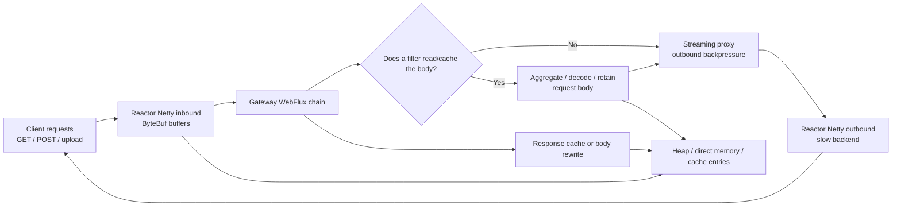

# Codec Limits, Direct Memory, and Retained Body Counts

## 1. The Performance Problem: Why Can a Gateway Run Out of Memory While CPU Is Idle?

**SPRING_CLOUD_GATEWAY** is the entry point for many microservices: accepting requests, matching routes via route predicates, running filter chains, transforming paths/headers, and proxying to backends over HTTP(S) or service discovery. Along that path, the Gateway also handles authentication, rate limiting, circuit breakers, retries, TLS, and traffic observability. Under heavy load, **data held in memory** often becomes a bottleneck even before CPU does.

Imagine the Gateway receives a stream of POST requests with 1 MiB bodies; each request takes 2 seconds because a backend is slow. One filter reads the body to inspect JSON, and another caches the body for retries. In-flight request counts can climb sharply. The JVM heap might not fill immediately; instead, Netty direct memory or container RSS can climb until logs emit `java.lang.OutOfMemoryError: Direct buffer memory`.



The **goal of this lesson** in the **Performance** chapter is to separate three easily confused questions:

1. **How many bytes at most does a codec buffer when decoding or aggregating data?** Relates to `maxInMemorySize` and `DataBufferLimitException`.
2. **How much native/direct memory do Netty and `DataBuffer` consume?** Relates to `ByteBuf`, reference counting, allocator pools, and release lifecycles.
3. **How many bodies are simultaneously cached or retained?** Relates to `CacheRequestBody`, `Retry`, `ModifyRequestBody`, response modification/caching, concurrency, backend latency, and load pressure.

These three questions are connected, yet **they do not share a single knob**. Raising `-Xmx` may fail to save an app running out of direct memory; raising `max-in-memory-size` lets larger bodies be buffered; enabling retries on large POSTs can raise memory usage even when codec limits stay unchanged.

### Learning Outcomes

After this lesson, you will be able to:

- Distinguish `DataBufferLimitException`, `OutOfMemoryError: Direct buffer memory`, body-pool/cache pressure, and container RSS/OOM issues without lumping them into one error.
- Use the **Spring Boot 3.5 WebFlux codec property** `spring.http.codecs.max-in-memory-size` within its true scope; never mistake it for a request-size firewall.
- Use `RequestSize` to enforce request sizes per your version's behavior, while **explicitly testing chunked transfers / missing `Content-Length`**.
- Know when `CacheRequestBody`, `ModifyRequestBody`, `ModifyResponseBody`, `Retry`, and `LocalResponseCache` create retained data.
- Estimate body-held memory via **size × concurrent requests × copies**, factoring in allocator/heap/native overhead.
- Manage `DataBuffer`s with `DataBufferUtils.join(source, maxByteCount)` and `DataBufferUtils.release`, avoiding leaks and double releases.
- Monitor heap, RSS, direct allocator gauges, concurrent requests, body sizes, latency, and OOMs at the JVM/Pod level.
- Establish baselines, run small controlled load tests, evaluate per-route optimizations, and verify JWT/rate-limit/TLS protections remain intact.

> **Version scope:** Spring Cloud Gateway **Server WebFlux 4.3.x**, Spring Cloud **2025.0.x**, Spring Boot **3.5.x**, Spring Framework **6.2.x**, Reactor Netty, and JDK 17+. This lesson uses the `spring.cloud.gateway.server.webflux` and `spring.http.codecs.max-in-memory-size` namespaces matching that release family. Gateway **Server Web MVC** uses a different Servlet runtime and buffering model; do not copy these tuning keys blindly to MVC. All capacity numbers in examples are **experimental values**, not universal optimums.

## 2. Four Memory Layers and Three Limit Boundaries

A WebFlux Gateway involves more than just the JVM heap.

| Region / entity | What it typically holds | How to observe | What to avoid |
| --- | --- | --- | --- |
| **JVM heap** | Java objects, decoded JSON/strings, metadata, collections, some caches, heap buffers. | `jvm.memory.used`, GC, heap histograms/dumps. | `Java heap space`, GC pauses, holding `String`/`byte[]` bodies long. |
| **Direct/native `ByteBuf`** | Netty pooled direct buffers for network I/O; `NettyDataBuffer` can wrap `ByteBuf`. | `reactor.netty.bytebuf.allocator.used.direct.memory`, Netty allocator diagnostics, RSS. | Missing releases, retaining buffers across request lifecycles, allocator fragmentation/arena growth. |
| **Other native regions** | Metaspace, thread stacks, code cache, TLS/native libraries, mmap, and runtime memory. | RSS/cgroup, `jcmd`, NMT when enabled; OS metrics. | Assuming `RSS == Xmx + direct` or watching heap alone. |
| **App-level retained memory** | Request body caches on exchange, Caffeine response caches, retry buffers, logging/inspection copies. | App-added counters/in-flight gauges, cache size, heap/direct metrics. | Bodies surviving across subscriptions or requests; caches exceeding budget. |

**Do not add numbers blindly:** `used.direct.memory` reflects memory **reserved/held by the Netty allocator**, not strictly the exact byte sum of live body payloads. A `ByteBuf` can be a slice/reference into a larger chunk, and pooled arenas retain capacity after a request finishes for reuse. Watch **trends under steady load and after load drops**, not just a single snapshot.

### 2.1. Three Easily Confused Limits

| Type | Example | What does it prevent? | What it does NOT guarantee |
| --- | --- | --- | --- |
| **Codec aggregation limit** | `spring.http.codecs.max-in-memory-size: 512KB` | Prevents certain decoders/readers from buffering past the cap during aggregation. | Not a global Gateway upload cap or a cap on every custom `DataBufferUtils.join`. |
| **Request body size policy** | `RequestSize` with `maxSize: 1MB` | Rejects requests exceeding the size policy per the active filter's inspection logic. | Does not automatically block every chunked/HTTP/2 stream missing `Content-Length`; must be tested. |
| **JVM/container/direct memory budget** | `-Xmx`, `-XX:MaxDirectMemorySize`, Kubernetes memory limits. | Caps total process/container resources. | Does not reduce concurrent requests or clean up improperly retained `DataBuffer`s. |

**Right reasoning order:** first identify **which component is retaining bodies**, next choose the **matching limit**, and finally test with concurrent requests while measuring RSS/heap/direct memory. Never follow "out of memory → raise every limit," which turns early controlled rejections into hard-to-recover OOM crashes.

### 2.2. Normal Streaming Does Not Mean the Whole Body Is Buffered

The normal proxy path in Gateway Server WebFlux forwards a `Flux<DataBuffer>` using reactive and network backpressure. A 50 MiB upload is not automatically turned into a `byte[50MiB]` on the heap.

Still, streaming **does not guarantee constant memory usage in all cases**:

- Socket buffers and allocator pools still have a footprint.
- A client faster than the downstream creates **queueing pressure**.
- Filters reading JSON, logging bodies, or rewriting bodies may **aggregate**.
- Retries on methods with bodies may cache for **replay**.
- Response caches retain data across requests.
- A custom filter calling unbounded `collectList()`/`join()` defeats streaming.
- Backpressure can break if code calls `.subscribe()`, unbounded `onBackpressureBuffer()`, or puts blocking work on the event loop.

## 3. Reading the Signals: Codec Limits, Direct Memory, and Container OOMs

### 3.1. `DataBufferLimitException`

Common error:

```text
org.springframework.core.io.buffer.DataBufferLimitException:
Exceeded limit on max bytes to buffer : 262144
```

`262144` bytes = 256 KiB. Per Spring Framework documentation, many codecs cap buffered aggregation data at **256 KiB** by default. This exception can occur when joining `DataBuffer`s into a single body **or** when a JSON/SSE parser accumulates decoded representations. <https://docs.spring.io/spring-framework/reference/web/webflux-webclient/client-builder.html>

Diagnostic steps:

1. Check whether the stack trace is in an **inbound decoder**, `CacheRequestBody`, `ModifyRequestBody`, custom `DataBufferUtils.join`, or a filter's `WebClient`.
2. Inspect the **actual input size** and content type. A 300 KiB body can fail at a 256 KiB codec cap **if** the code path decodes/aggregates the body; the same body can pass through a streaming proxy without failing.
3. Verify the property for **Spring Boot 3.5** and any custom `WebClient`/codec builders.
4. Adjust at the **actual decoding point** and configure request-size/admission controls separately.
5. Test valid requests near the threshold and oversized requests above it; confirm HTTP status and recovery.

`DataBufferLimitException` **does not mean the JVM ran out of RAM**. It is normally a guardrail stopping one aggregation operation from exceeding its configured limit.

### 3.2. `OutOfMemoryError: Direct buffer memory`

Example:

```text
java.lang.OutOfMemoryError: Direct buffer memory
```

This error points to **direct/native allocation** limits or pressure. Check causes such as:

- Many `ByteBuf`s retained by `CacheRequestBody`, retries, or custom filters.
- `DataBufferUtils.retain(...)` without matching ownership and `release`.
- Netty's pooled allocator holding many arenas/caches.
- Rapid growth in in-flight requests, connections, or response streams.
- Container native budget too tight for heap + direct + other native regions.

**Do not conclude every direct OOM is definitely a memory leak.** Under traffic spikes, normal behavior with high body concurrency can exhaust the budget. Conversely, raising `-XX:MaxDirectMemorySize` can mask a leak or push the Pod into a cgroup OOMKill.

### 3.3. Pod `OOMKilled` or High RSS While Heap Looks Normal

Kubernetes can kill a container when memory usage crosses its limit even if `-Xmx` has not been reached. Factor in:

- Direct buffer pools,
- Metaspace / code cache / thread stacks,
- TLS/compression native memory,
- File/page cache or mapped buffers depending on environment,
- Committed heap pages currently unused.

Inspection commands (operational examples, **not worker execution steps**):

```bash
kubectl describe pod gateway-pod
kubectl top pod gateway-pod
```

For a JVM on an authorized machine:

```bash
jcmd <PID> VM.flags
jcmd <PID> GC.heap_info
jcmd <PID> VM.native_memory summary
```

`VM.native_memory` requires **Native Memory Tracking (NMT) enabled at startup** and reports only regions tracked by HotSpot; never treat it as an exact accounting of every native allocation or Netty `ByteBuf`. NMT carries overhead; enable it only per runbook and operational policy.

## 4. Setting the Right Codec Limit for Spring Boot 3.5

### 4.1. Property to Use: `spring.http.codecs.max-in-memory-size`

In Spring Boot **3.5**, Common Application Properties define:

```yaml
spring:
  http:
    codecs:
      max-in-memory-size: 512KB
```

This property sets the **maximum bytes buffered when an input stream must be aggregated** on **auto-configured WebFlux server and `WebClient` instances**. When unset, each codec's default applies; **many codecs default to ~256 KiB**. <https://docs.spring.io/spring-boot/3.5/appendix/application-properties/>

**Compatibility warning:** many older blog posts use `spring.codec.max-in-memory-size`. That namespace belongs to earlier Spring Boot lines; **do not copy it into Boot 3.5 and assume it works**. Verify your version's properties, binding report, and integration tests around the threshold.

**What this property does NOT do:**

- It is not a **total HTTP request-size limit**.
- It does not cap **how many bodies are cached concurrently**.
- It does not set `-XX:MaxDirectMemorySize` or configure the Netty allocator.
- It does not apply to hand-written `DataBufferUtils.join(source)` calls **without `maxByteCount`**.
- It may not apply to a manually constructed `WebClient` with custom `ExchangeStrategies`.
- It does not clean up bodies retained in exchange attributes across async operations.
- It does not automatically map limit errors to HTTP 413; status mapping is a separate policy.

### 4.2. Configuring Codecs Manually When Needed

When not relying solely on codec auto-configuration, Spring WebFlux exposes `ServerCodecConfigurer`:

```java
import org.springframework.context.annotation.Configuration;
import org.springframework.http.codec.ServerCodecConfigurer;
import org.springframework.web.reactive.config.WebFluxConfigurer;

@Configuration
public class WebFluxCodecConfiguration implements WebFluxConfigurer {

    @Override
    public void configureHttpMessageCodecs(
            ServerCodecConfigurer configurer) {

        configurer.defaultCodecs()
                .maxInMemorySize(512 * 1024);
    }
}
```

This is an **alternative/customization for WebFlux codecs**. You do not need this class if `spring.http.codecs.max-in-memory-size` already meets your needs. When configuring in multiple places, verify precedence and do not assume one property updates every HTTP codec in the app.

If a custom filter builds its own `WebClient`:

```java
WebClient webClient = WebClient.builder()
        .codecs(configurer -> configurer.defaultCodecs()
                .maxInMemorySize(512 * 1024))
        .build();
```

That `WebClient` sets the codec limit for itself. **The Gateway's Reactor Netty routing client is not simply a user-defined `WebClient`**, so do not assume customizing an arbitrary `WebClient` bean alters Gateway Netty proxy behavior.

### 4.3. `maxInMemorySize` Semantics Depend on the Codec

For JSON, a decoder may buffer the payload or materialize objects/strings from the body. For SSE, it may accumulate bytes for one event; for text/line decoders, it may buffer up to a delimiter. Never assume a codec always buffers **an entire TCP stream** or that 512 KiB maps 1:1 to an entire HTTP message.

To pick a sound value:

1. Measure the **body-size distribution** for that exact route/Content-Type (e.g., P50/P95/P99 and accepted max).
2. Check whether the path even needs decoding. A route proxying video/files probably should not decode at the Gateway.
3. Keep the threshold **as low as practical** for typical business payloads rather than opening 50–100 MiB across all routes just to avoid one outlier failing.
4. For large uploads, use streaming or direct-to-object-storage uploads with dedicated limits; never turn the Gateway into a giant parser/buffer.
5. Verify property syntax via Actuator config/binding and test bodies on both sides of the threshold rather than trusting startup logs alone.

### 4.4. Multipart Has Different Thresholds—Do Not Confuse Them

Spring Boot 3.5 has separate properties for **WebFlux multipart**, such as:

```yaml
spring:
  webflux:
    multipart:
      max-in-memory-size: 256KB
      max-disk-usage-per-part: 20MB
      max-headers-size: 10KB
```

These are **limits for multipart parsing/part storage**, distinct from `spring.http.codecs.max-in-memory-size` and Gateway `RequestSize`. Multipart `max-in-memory-size` typically decides when a part spills to disk; **it is not a total upload cap**. Even when spilling to disk, enforce disk quotas, part counts, upload timeouts, and temp-file cleanup. If the Gateway proxies streams without parsing multipart, multipart parser properties do not act as a network body firewall.

## 5. Counting Retained Bodies: A Formula to Replace Guesswork

A **per-body** limit does not keep total retained memory bounded. Let:

- `B`: average size of a cached/aggregated body (bytes).
- `N`: number of concurrent requests **retaining that body**, not total TCP connections.
- `K`: number of coexisting copies or physical representations (raw buffers, `String`, `byte[]`, decoded objects...), measured or conditionally estimated.
- `H`: allocator/object/metadata overhead and miscellaneous buffers.

A budgeting approximation:

```text
M_retained_body ≈ B × N × K + H
```

This is **not** an exact law of Netty; zero-copy, pooled buffers, and object decoding vary `K`. Yet it shows why **body size × concurrency** is a critical variable to monitor.

### 5.1. Arithmetic Example

Suppose a route receives roughly **400 requests/second**, and each request holds its body for **2 seconds** waiting on a backend. By Little's Law intuition, average concurrent waiting requests are roughly:

```text
N ≈ 400 requests/s × 2 s = 800 requests
```

If each request retains **1 MiB**, even **a single copy of the body** takes roughly:

```text
800 × 1 MiB ≈ 800 MiB
```

If a route keeps both raw bytes and a decoded `String`/DTO, the real footprint is higher still. If the backend slows down 2x to 4 seconds at the same arrival rate, body-retaining concurrency grows proportionally. That is why **timeouts, concurrency limits, rate limiting, and body caching policies** must be designed together.

**Never use `N ≈ λW` as an exact forecast when the system is overloaded, bursting, queueing unstably, or serving mixed traffic.** Use it as a baseline, then measure live body-retaining counts and P95/P99 distributions.

### 5.2. In-Flight Requests vs. Retained Bodies Differ

A Gateway can hold 5,000 client connections while only 100 requests are caching bodies. Conversely, a Caffeine response cache can retain **hundreds of entries after requests finish**. Thus:

| Metric | Meaning | Equals retained body count? |
| --- | --- | --- |
| Active TCP connections | Open HTTP/TCP channels. | **No.** Keep-alives can sit idle. |
| In-flight HTTP requests | Unfinished requests. | Not necessarily; many proxy via streaming. |
| Body aggregation in progress | Requests decoding/joining bodies. | Close to temporarily held bodies. |
| Cached request bodies | Requests holding `CACHED_REQUEST_BODY_ATTR` or equivalent. | Must be instrumented per filter without double-counting. |
| Retry attempts | Outbound HTTP calls (can be multiple per request). | Not necessarily the number of body copies. |
| Local response cache entries | Responses stored across requests. | A retention type **distinct** from in-flight request bodies. |

### 5.3. Baseline by Distribution, Not "Average" Alone

You can classify body sizes:

| Body class (example) | Assumed size | Suggested handling |
| --- | --- | --- |
| Auth/context JSON | 1–32 KiB | Safe to decode, tight cap, latency-optimized. |
| Business API JSON | 32–512 KiB | Audit codec/response-body rewrites; cap per contract. |
| 1–5 MiB bodies | Medium–large | Avoid casual caching, bound concurrency, selective retries. |
| Tens of MiB+ files/videos | Large | Prefer streaming or direct-to-object-storage; avoid buffering. |

This is an **illustrative classification**, not thresholds enforced automatically by Spring Cloud Gateway. Base real policies on live traffic and approved API contracts.

## 6. Which Filters Make the Gateway Retain Bodies in Memory?

### 6.1. `CacheRequestBody`: Intentionally Reading and Caching Request Bodies

Per [Gateway Server WebFlux 4.3 docs](https://docs.spring.io/spring-cloud-gateway/reference/4.3/spring-cloud-gateway-server-webflux/gatewayfilter-factories/cacherequestbody-factory.html), a request body can normally be read once; if a filter reads it and downstream still needs it, the body must be **cached**. `CacheRequestBody` reads/converts the body to `bodyClass` and stores it in exchange attributes under `ServerWebExchangeUtils.CACHED_REQUEST_BODY_ATTR`.

Example **route needing a `String` body**:

```yaml
spring:
  cloud:
    gateway:
      server:
        webflux:
          routes:
            - id: inspected_post
              uri: http://127.0.0.1:9001
              predicates:
                - Path=/inspect/**
                - Method=POST
              filters:
                - StripPrefix=1
                - name: CacheRequestBody
                  args:
                    bodyClass: java.lang.String
```

This is not equivalent to a raw proxy route: a decoder and a `String` representation may be created, and the body stays retained across subsequent stages of the chain.

**Rule:** add `CacheRequestBody` only when re-reading the body is genuinely required. Never enable it across file/video upload routes or use it to log full request bodies. Bodies can contain access tokens, PII, and payment details. `CACHED_REQUEST_BODY_ATTR` is **exchange-scoped**, not a global TTL cache, yet it lives for the duration of request processing; if the upstream slows down, its lifetime stretches.

**Never assume** the attribute is always a `String` on every code path: `CacheRequestBody` converts to the configured `bodyClass`, whereas **retry/replay** or custom caching may store a `DataBuffer` under that same attribute key. Read/cast according to the exact filter and version. Never try to release a `String`, and never release a `DataBuffer` you **do not own**.

### 6.2. `ModifyRequestBody` and `ModifyResponseBody`

When the Gateway transforms JSON or bodies, content may be **decoded into objects** and re-encoded. In Gateway Server WebFlux 4.3, `ModifyRequestBody` is configured via **Java DSL**, e.g. a small route trimming text:

```java
@Bean
RouteLocator normalizeRoutes(RouteLocatorBuilder builder) {
    return builder.routes()
        .route("normalize_route", r -> r.path("/normalize/**")
            .filters(f -> f.stripPrefix(1)
                .modifyRequestBody(
                    String.class,
                    String.class,
                    MediaType.TEXT_PLAIN_VALUE,
                    (exchange, body) ->
                        Mono.justOrEmpty(body)
                            .map(String::trim)))
            .uri("http://127.0.0.1:9001"))
        .build();
}
```

This snippet assumes imports for `@Bean`, `RouteLocator`, `RouteLocatorBuilder`, `MediaType`, and `Mono`. It is **illustrative body-transformation filter code**, not a default optimization step. Verify `Content-Type`, empty bodies, sizes, and `Content-Length` via integration tests against a real backend.

During a body rewrite, multiple representations can coexist briefly:

```text
Inbound DataBuffer
    |
    +--> decode String/DTO
             |
             +--> create new String/DTO
                        |
                        +--> encode outbound DataBuffer
```

Do not assume `max-in-memory-size: 512KB` means **total heap/direct footprint is only 512 KiB/request**. Codec caps bound **one aggregation step**, not total allocations.

### 6.3. `Retry` on Methods with Bodies

Gateway 4.3 documentation explicitly warns: when `Retry` is used on HTTP methods with bodies, the Gateway may **cache the body** for replay, making the system **memory-constrained**; replay data involves `CACHED_REQUEST_BODY_ATTR` and `DataBuffer`s. <https://docs.spring.io/spring-cloud-gateway/reference/4.3/spring-cloud-gateway-server-webflux/gatewayfilter-factories/retry-factory.html>

A conservative configuration for read routes might retry only `GET`:

```yaml
spring:
  cloud:
    gateway:
      server:
        webflux:
          routes:
            - id: safe_get_retry
              uri: http://127.0.0.1:9001
              predicates:
                - Path=/read/**
                - Method=GET
              filters:
                - StripPrefix=1
                - name: Retry
                  args:
                    retries: 2
                    methods: GET
                    statuses: BAD_GATEWAY,SERVICE_UNAVAILABLE
                    backoff:
                      firstBackoff: 50ms
                      maxBackoff: 200ms
                      factor: 2
                      basedOnPreviousValue: false
```

**Never treat GET retries as free:** they still hold requests open longer, consume connection/time budgets, and multiply outbound attempts. For `POST`/`PUT`/`PATCH` with bodies, require clear **idempotency** guarantees, payload caps, and memory budgets. Misconfigured retries can **both amplify backend load and hold cached bodies longer**.

The `Retry` filter can also re-execute **filters ordered after it**. If downstream filters have side effects or hold bodies, verify filter order, replay behavior, and lifecycles.

### 6.4. `LocalResponseCache`: Distinct from Request-Body Caching

`LocalResponseCache` retains **responses** across requests, typically backed by Caffeine when enabled. This is **retention beyond a single request's lifetime**: even when in-flight requests drop to 0, cache entries remain in memory.

Per WebFlux docs, caching mainly applies to **bodyless GETs** with eligible statuses such as 200/206/301 and honors matching `Cache-Control` headers. Size/TTL limits and caching eligibility vary by Gateway version. Never cache `private` or `no-store` responses, or user/tenant data without proper cache-key isolation.

Dashboards should separate:

```text
M_active_request_body   = payloads currently held by active exchanges
M_local_response_cache  = live response cache entries
M_codec_decode          = transient allocations during parsing/encoding
M_netty_allocator       = pools/direct buffers held by the allocator
```

**Do not sum these as strictly disjoint byte pools**: shared buffer references, distinct heap/chunk layouts, and allocator pools overlap. Use this breakdown to ask the right questions, then confirm with profilers and metrics.

### 6.5. Body Logging and Custom Inspection

An anti-pattern that frequently shows up in `GlobalFilter`s:

```java
// DO NOT DO THIS: reads the entire raw body just to log it.
return DataBufferUtils.join(exchange.getRequest().getBody())
        .doOnNext(buffer -> log.info(
                "request body size={}, body={}",
                buffer.readableByteCount(),
                buffer.toString(StandardCharsets.UTF_8)))
        .then(chain.filter(exchange));
```

This snippet has multiple flaws:

- **Unbounded `join()`** can buffer arbitrarily large bodies.
- Ownership/`release` of the joined buffer is unhandled.
- It **consumes the request body**, leaving nothing for downstream handlers.
- Logging full bodies leaks passwords, tokens, cookies, PII, and sensitive payloads.
- Reactor's `.then(chain.filter(exchange))` does not magically turn an already-consumed body into a replayable publisher.
- Logging I/O can block the event loop or bloat heap while formatting large strings.

This is a **broken pattern for analysis**, not production code. For observability, log route ID, method, status, duration, **rounded/sanitized sizes or safe metadata**, and validated trace IDs—never raw bodies.

## 7. `DataBuffer`, Netty `ByteBuf`, and Memory Ownership

### 7.1. `DataBuffer` Is Not Always a Plain Java Byte Array

WebFlux provides the `DataBuffer` abstraction; on Reactor Netty, implementations typically wrap Netty `ByteBuf`s backed by pooled direct memory. `ByteBuf`s use **reference counting**.

```text
Netty pooled direct memory
        |
        v
  ByteBuf (refCount)
        |
        v
  NettyDataBuffer
        |
        +--> gateway route filter
        +--> decoder / body cache / request decorator
        +--> outbound write
```

Whenever a filter retains a buffer beyond the original subscriber, you must know **who owns the reference** and **when it gets released**. Call `DataBufferUtils.retain` only when genuinely extending ownership, paired with a matching `DataBufferUtils.release` upon completion. Never retain unconditionally, and never release before downstream finishes reading.

### 7.2. `DataBufferUtils.join(..., maxByteCount)` Bounds a Single Aggregation

Spring Framework provides:

```java
Mono<DataBuffer> join(
        Publisher<? extends DataBuffer> buffers,
        int maxByteCount)
```

When a stream exceeds `maxByteCount`, the operator emits `DataBufferLimitException`. For multi-`DataBuffer` publishers, the implementation releases accumulated buffers on error or cancellation per the Spring Framework contract. **If `join` succeeds, the consumer must release the resulting buffer once processed**, unless ownership is transferred to another API that assumes release responsibility. <https://docs.spring.io/spring-framework/docs/6.2.11/javadoc-api/org/springframework/core/io/buffer/DataBufferUtils.html>

Example of a **diagnostic endpoint that only counts bytes** without proxying the body onward:

```java
package com.example.gateway;

import org.springframework.core.io.buffer.DataBuffer;
import org.springframework.core.io.buffer.DataBufferLimitException;
import org.springframework.core.io.buffer.DataBufferUtils;
import org.springframework.http.HttpStatus;
import org.springframework.http.ResponseEntity;
import org.springframework.http.server.reactive.ServerHttpRequest;
import org.springframework.web.bind.annotation.PostMapping;
import org.springframework.web.bind.annotation.RestController;
import reactor.core.publisher.Mono;

@RestController
public class BoundedBodyLabController {

    private static final int CAP_BYTES = 128 * 1024;

    @PostMapping("/lab/bounded")
    public Mono<ResponseEntity<String>> countBytes(
            ServerHttpRequest request) {

        return DataBufferUtils.join(request.getBody(), CAP_BYTES)
                .map(buffer -> {
                    try {
                        int bytes = buffer.readableByteCount();
                        return ResponseEntity.ok("bytes=" + bytes);
                    } finally {
                        // Success: release ownership of the joined buffer.
                        DataBufferUtils.release(buffer);
                    }
                })
                .switchIfEmpty(Mono.just(
                        ResponseEntity.ok("bytes=0")))
                .onErrorResume(
                        DataBufferLimitException.class,
                        error -> Mono.just(
                                ResponseEntity
                                        .status(HttpStatus.PAYLOAD_TOO_LARGE)
                                        .body("body exceeds lab cap")));
    }
}
```

**Purpose of example:** shows **bounded `join`** and releasing where the `DataBuffer` is consumed. This endpoint does not forward the body to a backend, so it needs no cache/replay mechanism. In a real system where you inspect and then proxy a body onward, use a body-caching/decorator design with explicit ownership and retry/commit/cancellation semantics—**never** drop this method into a `GlobalFilter` expecting downstream to still read the body normally.

**Implementation note:** pick `CAP_BYTES` from your API contract rather than leaving the unbounded default (`-1`). If the source is already a `Mono<DataBuffer>` produced by another component, check the exact overload/version semantics; do not treat bounded `join` as a **cluster-wide HTTP upload shield**. Test with `WebTestClient` using bodies right below/above the cap and chunked transfers.

### 7.3. Why Release Inside `finally`?

A joined buffer can be backed by a composite/zero-copy buffer whose release decrements constituent references. If downstream logic throws an exception after receiving the buffer, `finally` guarantees release.

Conversely, this code:

```java
return DataBufferUtils.join(source, maxBytes)
        .map(buffer -> {
            String body = buffer.toString(StandardCharsets.UTF_8);
            return transform(body);
        });
```

has no explicit release for the joined buffer. On a high-traffic path with pooled buffers, this causes direct memory growth and leaks. **Never release the same buffer in both `doFinally` and `finally`**, as double releases also corrupt reference counts.

### 7.4. Streaming Inspection Without Joining

If you only need to count **bytes** while still forwarding the body, a request decorator can inspect each chunk's `DataBuffer.readableByteCount()` in flight **without joining the full stream**. Production-grade implementation must still address:

- Is there strictly a single valid subscriber reading the request body?
- Are buffers retained for reuse? If so, who retains and releases them?
- If the limit trips mid-stream, have some bytes already been sent outbound? Has the response already committed?
- Do cancellation and errors clean up queued buffers?
- Is filter ordering right relative to caching, retries, and HTTP routing?
- Are HTTP/2 streams and chunked uploads truly bounded by received byte counts?

Because mid-stream enforcement interacts with network flow and committed HTTP responses, **never ship a few-line custom request decorator to production without thorough integration tests**. Prefer combining ingress/reverse-proxy body limits with Gateway filters, **testing both `Content-Length` and missing `Content-Length`**.

## 8. `RequestSize` Is a Body-Size Policy, Not a Codec Limit

**Gateway Server WebFlux 4.3** docs describe `RequestSize` taking a `DataSize` `maxSize`; requests exceeding the threshold receive **413 Payload Too Large** with an `errorMessage` header in scenarios detected by the filter.

Example:

```yaml
spring:
  cloud:
    gateway:
      server:
        webflux:
          routes:
            - id: limited_upload
              uri: http://127.0.0.1:9001
              predicates:
                - Path=/limit/**
                - Method=POST
              filters:
                - StripPrefix=1
                - name: RequestSize
                  args:
                    maxSize: 512KB
```

When an HTTP request carries `Content-Length` above `512KB`, the filter can reject it **before proxying**. Yet extra caution is essential here:

**Warning per a 2025 Gateway report:** in some versions, `RequestSize` checks the **`Content-Length` header**; if a client sends a **chunked body or HTTP/2 stream without a known `Content-Length`**, relying solely on this filter may **fail to enforce actual transferred bytes**. See [spring-cloud-gateway issue #3843](https://github.com/spring-cloud/spring-cloud-gateway/issues/3843) regarding this limitation. Verify your exact patch behavior; never rely on one `Content-Length` test to declare protection against body-size DoS.

A rigorous upload policy uses defense in depth:

1. **Ingress / WAF / reverse proxy** enforcing real streaming request-body size limits and timeouts.
2. **Gateway** with per-route size policies and/or version-verified streaming byte counters.
3. **Backend** with its own parser/body caps; never rely on the Gateway alone to block every path.
4. **Admission / concurrency limits** preventing many valid uploads from exhausting memory or connections together.
5. **Logging / metrics** counting rejections per route without logging actual bodies.

### 8.1. Comparing `RequestSize` vs. `DataBufferLimitException`

| Scenario | Expected outcome |
| --- | --- |
| Client declares `Content-Length` 2 MiB; `RequestSize` max 512 KiB | Typically **413 before backend**, per filter behavior. |
| Client sends streaming/chunked 2 MiB without `Content-Length` | **Do not assume** it is blocked; test and enforce at ingress. |
| Route skips body reading, raw-proxies 300 KiB; codec cap 256 KiB | Can **still pass through**, since no decoding/aggregation runs. |
| Controller decodes 300 KiB text; codec cap 256 KiB | Can throw `DataBufferLimitException`; status depends on error policy. |
| Custom `DataBufferUtils.join(source, 128 KiB)` | Exceeding cap raises exception; e.g., diagnostic controller maps to 413. |
| 1,000 bodies of 100 KiB held simultaneously, each under 512 KiB | Still risks **~100 MiB+ total memory**; per-body caps do not solve concurrency. |

That is why this lesson tracks **three axes**: *single body size*, *how bodies are processed/retained*, and *how many bodies are held concurrently*.

## 9. Runnable Lab: Comparing Streaming, Decoding, and Body Caching

This lab uses **two processes** on a local machine:

```text
                       127.0.0.1:8080                  127.0.0.1:9001
  curl ---- POST ------> Gateway Server WebFlux ------> EchoBackend
              |            |          |
              |            |          +--> /proxy/** : raw proxy
              |            +-------------> /cache/** : CacheRequestBody
              +--------------------------> /limit/** : RequestSize
                           |
                           +--> /lab/decode  : WebFlux text codec
                           +--> /lab/bounded : bounded DataBufferUtils.join
                           |
                       Actuator 127.0.0.1:8081
```

**This is not a production configuration.** `EchoBackend` has no authentication and `/lab/**` endpoints intentionally inspect bodies. Run only on an isolated machine; never expose Gateway or Actuator to the Internet. Never use real PII, tokens, or credentials in lab exercises.

### 9.1. `pom.xml`

Requires JDK 17+, Maven, and `curl`. Create a **new learner Maven project**—do not edit build files inside the curriculum repository:

```xml
<?xml version="1.0" encoding="UTF-8"?>
<project xmlns="http://maven.apache.org/POM/4.0.0"
         xmlns:xsi="http://www.w3.org/2001/XMLSchema-instance"
         xsi:schemaLocation="http://maven.apache.org/POM/4.0.0
                             https://maven.apache.org/xsd/maven-4.0.0.xsd">
    <modelVersion>4.0.0</modelVersion>

    <parent>
        <groupId>org.springframework.boot</groupId>
        <artifactId>spring-boot-starter-parent</artifactId>
        <version>3.5.0</version>
        <relativePath/>
    </parent>

    <groupId>com.example</groupId>
    <artifactId>gateway-memory-lab</artifactId>
    <version>0.0.1-SNAPSHOT</version>

    <properties>
        <java.version>17</java.version>
    </properties>

    <dependencyManagement>
        <dependencies>
            <dependency>
                <groupId>org.springframework.cloud</groupId>
                <artifactId>spring-cloud-dependencies</artifactId>
                <version>2025.0.0</version>
                <type>pom</type>
                <scope>import</scope>
            </dependency>
        </dependencies>
    </dependencyManagement>

    <dependencies>
        <dependency>
            <groupId>org.springframework.cloud</groupId>
            <artifactId>spring-cloud-starter-gateway-server-webflux</artifactId>
        </dependency>

        <dependency>
            <groupId>org.springframework.boot</groupId>
            <artifactId>spring-boot-starter-actuator</artifactId>
        </dependency>

        <dependency>
            <groupId>org.springframework.boot</groupId>
            <artifactId>spring-boot-starter-test</artifactId>
            <scope>test</scope>
        </dependency>

        <dependency>
            <groupId>io.projectreactor</groupId>
            <artifactId>reactor-test</artifactId>
            <scope>test</scope>
        </dependency>
    </dependencies>

    <build>
        <plugins>
            <plugin>
                <groupId>org.springframework.boot</groupId>
                <artifactId>spring-boot-maven-plugin</artifactId>
            </plugin>
        </plugins>
    </build>
</project>
```

- The WebFlux starter provides Gateway routing and Reactor Netty.
- Actuator exposes health/metrics on a **local management port**, without exposing route administration.
- Test dependencies support unit/integration tests; complex load tests are not required yet.
- Versions `3.5.0` and `2025.0.0` simply illustrate a compatible pair; in deployments, use current supported patch releases.

### 9.2. Entry Point

Create `src/main/java/com/example/gateway/GatewayMemoryApplication.java`:

```java
package com.example.gateway;

import org.springframework.boot.SpringApplication;
import org.springframework.boot.autoconfigure.SpringBootApplication;

@SpringBootApplication
public class GatewayMemoryApplication {

    public static void main(String[] args) {
        SpringApplication.run(GatewayMemoryApplication.class, args);
    }
}
```

Place `BoundedBodyLabController` from Section 7.2 and `DecodeLabController` below in the **same package** `com.example.gateway` so component scanning discovers them.

### 9.3. `application.yml`: Three Routes and an Explicit Codec Cap

Create `src/main/resources/application.yml`:

```yaml
server:
  port: 8080
  address: 127.0.0.1

management:
  server:
    port: 8081
    address: 127.0.0.1
  endpoints:
    web:
      exposure:
        include: health,metrics

spring:
  application:
    name: gateway-memory-lab

  # Spring Boot 3.5: codec property in the right namespace.
  http:
    codecs:
      max-in-memory-size: 256KB

  cloud:
    gateway:
      server:
        webflux:
          httpclient:
            pool:
              metrics: true

          routes:
            - id: raw_proxy
              uri: http://127.0.0.1:9001
              predicates:
                - Path=/proxy/**
              filters:
                - StripPrefix=1

            - id: cached_post
              uri: http://127.0.0.1:9001
              predicates:
                - Path=/cache/**
                - Method=POST
              filters:
                - StripPrefix=1
                - name: CacheRequestBody
                  args:
                    bodyClass: java.lang.String

            - id: limited_post
              uri: http://127.0.0.1:9001
              predicates:
                - Path=/limit/**
                - Method=POST
              filters:
                - StripPrefix=1
                - name: RequestSize
                  args:
                    maxSize: 128KB
```

**Explanation of sections:**

- `/proxy/**`: normal proxy route; **does not decode to `String`**, illustrating the streaming path.
- `/cache/**`: intentionally adds `CacheRequestBody` with `bodyClass: java.lang.String` to demonstrate reading/retaining the body; default codec limits can apply.
- `/limit/**`: `RequestSize` enforces the filter's limit; **do not assume it protects chunked/unknown-length requests**.
- `/lab/decode` and `/lab/bounded`: **local controller endpoints** requiring no Gateway routes; used for codec and bounded-join experiments.
- `httpclient.pool.metrics: true`: enables Gateway HTTP client **pool metrics**; allocator gauges may require matching Netty/Micrometer instrumentation. Never assume every metric appears automatically from one property.
- Management server binds only `127.0.0.1:8081`; do not open `/actuator/env` or writable `/actuator/gateway` in the lab.

### 9.4. WebFlux Endpoint That Actually Decodes Text

Create `src/main/java/com/example/gateway/DecodeLabController.java`:

```java
package com.example.gateway;

import org.springframework.http.MediaType;
import org.springframework.http.ResponseEntity;
import org.springframework.web.bind.annotation.PostMapping;
import org.springframework.web.bind.annotation.RequestBody;
import org.springframework.web.bind.annotation.RestController;

import reactor.core.publisher.Mono;

@RestController
public class DecodeLabController {

    @PostMapping(
            path = "/lab/decode",
            consumes = MediaType.TEXT_PLAIN_VALUE)
    public Mono<ResponseEntity<String>> decode(
            @RequestBody Mono<String> text) {

        // WebFlux uses HttpMessageReader / codecs to decode.
        return text.map(body ->
                ResponseEntity.ok(
                        "decoded-chars=" + body.length()));
    }
}
```

Unlike raw proxying, `@RequestBody Mono<String>` invokes the **text decoder**. Because the lab codec cap is **256 KiB**, a 300 KiB ASCII body sent to `/lab/decode` can raise **`DataBufferLimitException`**.

If the client receives 5xx instead of 413, **do not alter the conclusion that the decoder enforces a limit**: exception-to-HTTP-status mapping is separate from codec buffer size. Expect 413 only when your error-handling layer is configured and tested for it.

### 9.5. `EchoBackend` Streaming Chunks Instead of Buffering the Whole Body

To keep the test backend itself from skewing memory via `readAllBytes()`, create `EchoBackend.java` in a **separate directory** (outside the Spring Boot project):

```java
import com.sun.net.httpserver.HttpServer;
import java.io.InputStream;
import java.net.InetSocketAddress;
import java.nio.charset.StandardCharsets;
import java.util.concurrent.atomic.AtomicLong;

public class EchoBackend {

    public static void main(String[] args) throws Exception {
        AtomicLong requests = new AtomicLong();

        HttpServer server = HttpServer.create(
                new InetSocketAddress("127.0.0.1", 9001), 0);

        server.createContext("/", exchange -> {
            long id = requests.incrementAndGet();
            long bytesRead = 0;
            byte[] chunk = new byte[8192];

            try (InputStream body = exchange.getRequestBody()) {
                int n;
                while ((n = body.read(chunk)) != -1) {
                    bytesRead += n;
                }
            }

            String output = "backend-request=" + id + "\n"
                    + "method=" + exchange.getRequestMethod() + "\n"
                    + "path=" + exchange.getRequestURI().getRawPath() + "\n"
                    + "bytes=" + bytesRead + "\n";

            byte[] response = output.getBytes(StandardCharsets.UTF_8);

            System.out.printf(
                    "ORIGIN #%d path=%s bytes=%d%n",
                    id, exchange.getRequestURI().getRawPath(),
                    bytesRead);

            exchange.getResponseHeaders().set(
                    "Content-Type", "text/plain; charset=UTF-8");
            exchange.sendResponseHeaders(200, response.length);

            try (var out = exchange.getResponseBody()) {
                out.write(response);
            }
        });

        server.start();
        System.out.println(
                "EchoBackend listening at 127.0.0.1:9001");
    }
}
```

Because the backend simply counts bytes into a reused 8192-byte array, this example contrasts a **streaming upstream reader** against a Gateway that may **decode/cache** bodies. It is not a production-grade benchmark and has no auth/TLS; run only on loopback.

### 9.6. Starting Up and Generating Test Payloads

In Terminal A:

```bash
# Separate directory containing EchoBackend.java:
java EchoBackend.java
```

In Terminal B:

```bash
# Spring Boot directory containing pom.xml:
mvn spring-boot:run
```

In Terminal C (Linux/macOS or a lab Bash shell), generate test files containing **zero bytes**:

```bash
dd if=/dev/zero of=payload-64KiB.bin bs=1024 count=64
dd if=/dev/zero of=payload-300KiB.bin bs=1024 count=300
dd if=/dev/zero of=payload-1MiB.bin bs=1024 count=1024
```

Zero bytes are binary data; `/lab/decode` accepts `text/plain` and codec charset handling for `NUL` may vary. When testing **strict text**, generate a file of ASCII `'a'` characters (e.g., via a small generator in your lab environment), while the three `dd` files work well for checking **byte counts** on HTTP proxy and size-limit paths.

**All commands here are for learners only**, not worker STEP 4 commands to execute in the content repository.

## 10. HTTP Experiments: Observing Boundaries Instead of Guessing

### 10.1. Raw Proxy Route with Body Larger Than the Codec Cap

```bash
curl -i -X POST \
  -H "Content-Type: application/octet-stream" \
  --data-binary @payload-300KiB.bin \
  "http://127.0.0.1:8080/proxy/upload"
```

When the Gateway has no decoding or aggregating filter on that route, **300 KiB exceeds the 256 KiB codec cap yet can still proxy cleanly**, and the backend echoes:

```text
method=POST
path=/upload
bytes=307200
```

`307200` bytes = 300 × 1024. Verify the backend counter increments by **1**, check status, and inspect direct allocator metrics. Do not treat raw-route success as proof that every payload type or huge stream is safe.

### 10.2. `CacheRequestBody` with the Same Payload Size

```bash
curl -i -X POST \
  -H "Content-Type: text/plain" \
  --data-binary @payload-300KiB.bin \
  "http://127.0.0.1:8080/cache/upload"
```

Because this route explicitly requests decoding/caching a `String`, it can hit **`DataBufferLimitException`** on code paths enforcing the 256 KiB codec cap. **Do not hard-assert the status** if no custom exception handler is configured; inspect logs, status codes, and backend counts.

If a specific release or patch implements caching differently, behavior may vary; **test on your exact artifact**, never infer from YAML alone. Raising the codec limit to 512 KiB may let this request decode/cache, yet doing so **increases retained memory per concurrent request** and does not protect against 50 MiB uploads.

### 10.3. `RequestSize` with Normal `Content-Length`

```bash
curl -i -X POST \
  -H "Content-Type: application/octet-stream" \
  --data-binary @payload-300KiB.bin \
  "http://127.0.0.1:8080/limit/upload"
```

`curl --data-binary @file` normally sends an accurate `Content-Length`. With `maxSize: 128KB`, the filter is expected to return **413 Payload Too Large** before the backend sees the request. Verify the **backend counter did not increment**.

**Do not confuse `128KB` with 128 bytes**, and do not assume the response body is always JSON: `RequestSize` docs mention the `errorMessage` header, while statuses/headers can be transformed by error-handling layers.

### 10.4. Testing Chunked / Unknown `Content-Length` — Mandatory Check

An HTTP/1.1 test where the client explicitly sends **`Transfer-Encoding: chunked`**:

```bash
cat payload-300KiB.bin | \
  curl --http1.1 -i -v \
    -X POST \
    -H "Transfer-Encoding: chunked" \
    -H "Content-Length:" \
    -H "Content-Type: application/octet-stream" \
    --data-binary @- \
    "http://127.0.0.1:8080/limit/upload"
```

**Before drawing conclusions, read `curl -v` output to confirm the HTTP request truly omits `Content-Length` and uses chunked encoding.** If your version's `RequestSize` checks only the length header, this request **may pass through even though it exceeds 128 KiB**. This is a **boundary test of the mechanism**, not advice to overload shared machines.

In production, enforce body-size limits at ingress and backends, and test chunked and HTTP/2 uploads separately. A header-only filter does not prove streaming bytes are bounded.

### 10.5. Decode Endpoint and Bounded Join

```bash
# Decode text via WebFlux codec:
curl -i -X POST \
  -H "Content-Type: text/plain" \
  --data-binary @payload-300KiB.bin \
  "http://127.0.0.1:8080/lab/decode"

# Bounded join with 128 KiB cap from Section 7.2:
curl -i -X POST \
  -H "Content-Type: application/octet-stream" \
  --data-binary @payload-300KiB.bin \
  "http://127.0.0.1:8080/lab/bounded"

# Smaller body under the cap to verify success:
curl -i -X POST \
  -H "Content-Type: application/octet-stream" \
  --data-binary @payload-64KiB.bin \
  "http://127.0.0.1:8080/lab/bounded"
```

Expected on `/lab/bounded`:

- 64 KiB → `200 OK`, body `bytes=65536`.
- 300 KiB → `413 Payload Too Large`, body `body exceeds lab cap`.
- Neither **calls `EchoBackend`**, since this is a local controller.
- For a 0-byte file, `switchIfEmpty` returns `bytes=0`.

On `/lab/decode`, the 256 KiB codec cap triggers a failure on the oversized body; HTTP status depends on the exception handler. This proves **codec limits differ from bounded `join`**, and **both differ from the `RequestSize` filter**.

### 10.6. Don't Jump Immediately to Hundreds of MiB

Test 64 KiB / 300 KiB / 1 MiB first. If testing larger payloads, step up gradually on a private machine with known CPU/RAM limits, monitor RSS/heap/direct memory, and stop when errors or latency spike. **Never** run load that degrades shared or production environments, and never turn a lab exercise into a denial-of-service load test.

## 11. Observing Direct Memory and Retained Body Counts

### 11.1. Metric Groups to Put on a Dashboard

| Group | Illustrative metrics / indicators | Why needed |
| --- | --- | --- |
| JVM heap | `jvm.memory.used`, `jvm.memory.max`, GC pauses. | Spot heap retention of objects and decoded bodies. |
| Netty allocator **reserved** | `reactor.netty.bytebuf.allocator.used.direct.memory`. | Bytes reserved by the allocator for direct buffer pools. |
| Netty allocator **active** | `reactor.netty.bytebuf.allocator.active.direct.memory` (if supported by instrumentation). | Bytes currently active in pooled direct buffers. |
| Netty heap buffer allocator | `reactor.netty.bytebuf.allocator.used.heap.memory`. | Heap buffers managed by the Netty allocator. |
| Outbound connections | `reactor.netty.connection.provider.active.connections`, `pending.connections` per instrumentation. | Watch connection pressure and backend wait queues. |
| Gateway requests | `spring.cloud.gateway.requests` by `routeId`/status. | Compare latency/error rates between raw and cached routes. |
| Response cache | Caffeine size/evictions/entries if enabled. | Track cross-request response retention separately. |
| Container memory | RSS/cgroup usage, `OOMKilled` count. | Detect memory limit pressure outside JVM heap. |
| **Custom** in-flight body counter | Requests holding cached/aggregated bodies, per route. | Quantify `N` in `B × N × K`. |
| **Custom** body-byte distribution | P50/P95/P99 size histogram by route/body class. | Align codec sizes and quotas with contracts. |

Reactor Netty defines the allocator gauges above, yet **there is no guarantee all of them appear in Actuator immediately**. Configure a Micrometer registry, enable HTTP/connection-allocator instrumentation appropriate for your Netty/Gateway version, and verify exact names in `/actuator/metrics`. <https://projectreactor.io/docs/netty/release/reference/http-server.html>

**Reserved ≠ active:** a direct allocator that grew to 128 MiB and keeps pooled arenas for reuse may not drop immediately when traffic stops. If `active.direct.memory` keeps climbing across load cycles without returning to baseline, investigate retention/leaks. Never declare a leak solely because `used.direct.memory` stays at a high plateau.

### 11.2. Querying Actuator Only via Local Management Port

Examples matching the Section 9 setup:

```bash
curl -i "http://127.0.0.1:8081/actuator/health"

curl -s "http://127.0.0.1:8081/actuator/metrics"

curl -s \
  "http://127.0.0.1:8081/actuator/metrics/jvm.memory.used"

curl -s \
  "http://127.0.0.1:8081/actuator/metrics/reactor.netty.bytebuf.allocator.used.direct.memory"
```

If a Netty metric name is missing, **do not record it as 0**. Micrometer/Netty metrics might not be enabled, metric naming might differ by release, traffic might not have triggered the allocator yet, or a registry might be missing. Check `/actuator/metrics`, Netty config, and version-specific docs.

In production, never expose `/actuator/metrics` or Prometheus to the Internet. Use endpoint authentication on an isolated management network with controlled scraping. Never put raw URLs, user IDs, JWTs, or unbounded trace IDs into metric labels—that causes **high cardinality** and leaks sensitive data.

### 11.3. Adding a Custom Retained-Body Counter at the Right Lifecycle Point

Spring Cloud Gateway **does not automatically export a gauge of "bodies currently cached in exchanges"** across all filters. To measure `N`, add application instrumentation—conceptually:

```java
AtomicInteger bodiesInUse = new AtomicInteger();

// Increment only when the body is genuinely retained.
bodiesInUse.incrementAndGet();

return processBody()
        .doFinally(signal -> {
            bodiesInUse.decrementAndGet();
        });
```

**This is ownership pseudocode, not a complete production filter:**

- Increment only when a cache/aggregation is actually created, not on every request hitting the route.
- `doFinally` runs on complete/error/cancel **of that subscription**; if multiple subscriptions exist, verify counting logic.
- When a body lives longer than `processBody()`, tie decrementing to **actual release/eviction**, not merely HTTP response completion.
- Use `LongAdder` or a suitable Micrometer gauge for high throughput and multi-route tracking.
- Never use request IDs or principals as meter tags.

To track retained bytes instead of counts, add a byte counter on acquire and subtract the exact bytes on release; never guess byte counts from `Content-Length` on streaming or encoded bodies.

### 11.4. Buffer Leak Symptoms and Investigation

In **lab/staging** environments (never leave enabled continuously when max performance is needed), enable Netty leak detection:

```bash
# Run only while diagnosing; adds overhead.
java -Dio.netty.leakDetection.level=advanced \
  -jar target/gateway-memory-lab-0.0.1-SNAPSHOT.jar
```

Or enable the `_reactor.netty.channel.LeakDetection` logger at DEBUG per Reactor Netty docs if applicable to your version. When leak warnings appear, audit custom filters for `DataBufferUtils.retain()`, `release()`, caching/decorators, and publisher cancellations.

A solid investigation workflow:

1. Record `active.direct.memory` before load.
2. Run **a small bounded batch of requests**.
3. Stop load and wait for all in-flight requests to finish.
4. Check `active.direct.memory`, RSS, and heap after a settling period.
5. Repeat cycles to distinguish pool/cache warm-up from non-recovering growth.
6. If a leak is suspected, use Netty leak detection/profiling and audit ownership plus `doOnDiscard` and `doFinally` callbacks.
7. Never disable TLS or log sensitive bodies just to make debugging easier.

### 11.5. JVM/Native Budget Is Not a Single Knob

An example JVM command for **testing limits in a lab**:

```bash
java -Xms256m -Xmx512m \
  -XX:MaxDirectMemorySize=256m \
  -jar target/gateway-memory-lab-0.0.1-SNAPSHOT.jar
```

**256 MiB direct** and **512 MiB heap** above are **not production recommendations**. Mis-sizing them can trigger premature direct OOMs on normal workloads. Budget using:

```text
Container memory limit
  >= committed heap + direct/native allocations + metaspace
     + thread stacks + code cache + TLS/compression native
     + OS/runtime overhead + headroom
```

No single arithmetic sum is exact; pooled direct buffers and shared memory require direct observation. Choose `-Xmx`, direct caps, and container limits using **baselines, load tests, and SLOs** rather than copying flags from unrelated articles. When OOMs happen, the right fix may be **removing a body-caching filter**, not raising heap or direct caps.

## 12. Controlled Measurement and Step-by-Step Optimization Workflow

**Optimization does not start by raising limits.** First identify which routes actually retain bodies, payload sizes, and in-flight request counts.

### 12.1. Establishing a Baseline

A reliable plan in dedicated staging:

1. Record JDK, Spring Boot/Cloud/Gateway/Reactor Netty versions, `-Xmx`, direct cap, cgroup memory limit, codec cap, and cache/retry settings.
2. Inventory routes with `CacheRequestBody`, `ModifyRequestBody`, `ModifyResponseBody`, `Retry` on body-bearing methods, `LocalResponseCache`, and custom body decorators.
3. Record request body size P50/P95/P99/max, per-route rate, and fraction of requests carrying bodies.
4. Monitor `jvm.memory.used`, GC, RSS, allocator `used.direct.memory` and `active.direct.memory`, and in-flight/retained-body counts.
5. Set up a stub backend with a fixed 50 ms latency and a slow 2-second variant; record P95/P99 response latency.
6. Record idle baseline, light-load behavior, and post-load settling. Never treat a single `used.direct.memory` peak as proof of a leak.
7. Define **stop conditions**: OOM, surging 5xxs, RSS nearing limit, P99 breaching threshold, or requests reaching the backend that should have been blocked.

### 12.2. Small Loopback Load Test

Example generating just **12 POSTs of 64 KiB**, max **3 concurrent requests** on a lab machine:

```bash
seq 1 12 | xargs -P 3 -I {} sh -c \
  'curl -sS --max-time 5 -o /dev/null \
     -X POST -H "Content-Type: text/plain" \
     --data-binary @payload-64KiB.bin \
     "http://127.0.0.1:8080/cache/upload"'
```

This command targets Bash/Linux/macOS using the files created in Section 9. **Never run against shared or production environments.** Afterward, wait for all requests to finish, then inspect RSS, heap, allocator active/used memory, errors, and latency.

Questions to answer:

- How long were bodies cached/retained, and were they released on completion/error/cancellation?
- Under a slow backend, did retained-body count grow proportionally with in-flight requests?
- Did `active.direct.memory` return to a reasonable baseline across multiple cycles?
- Did `used.direct.memory` plateau from Netty pooled arenas, or keep climbing unboundedly?
- When disabling `CacheRequestBody`, does the backend still receive bodies properly and does memory drop?
- When raising the codec cap, do decode errors drop while heap/direct/RSS and P99 degrade?

### 12.3. Change One Variable at a Time with Rollback

| Trial change | Hypothesis | Required evidence |
| --- | --- | --- |
| Codec cap 256 KiB → 512 KiB | Contract-compliant payloads stop getting rejected by the decoder. | `DataBufferLimitException` drops without OOM/GC breaching SLO. |
| Remove `CacheRequestBody` where body isn't re-read | Cuts retained bytes and copies. | Backend still receives valid data; active direct/heap drops. |
| Stop retrying POSTs with bodies | Cuts replay/retention and prevents duplicate side effects. | Attempts and memory match new policy. |
| Cap in-flight uploads | Shrinks `N` in `B × N × K`. | Memory stabilizes; reject/queue behavior accepted. |
| Lower response-cache TTL/size | Avoids holding responses longer than needed. | Cache entries/evictions/hit rate, privacy, and latency verified. |
| Tune `-Xmx` / direct cap | Balances JVM/container budget. | Adequate RSS/cgroup headroom without turning early rejections into OOMs. |

Never change codec caps, retries, connection pools, heap, and direct memory all at once and guess the cause. **One experiment = one primary change + identical workload + identical acceptance criteria.**

## 13. Automated Testing with `WebTestClient`

Codec and size tests should be layered: **unit tests** for `DataBuffer` operators and **HTTP integration tests** for codecs, Gateway filters, request framing, and upstreams.

### 13.1. Testing `/lab/bounded` over Real HTTP

Create `src/test/java/com/example/gateway/BoundedBodyIntegrationTest.java`:

```java
package com.example.gateway;

import org.junit.jupiter.api.Test;
import org.springframework.beans.factory.annotation.Autowired;
import org.springframework.boot.test.autoconfigure.web.reactive.AutoConfigureWebTestClient;
import org.springframework.boot.test.context.SpringBootTest;
import org.springframework.http.MediaType;
import org.springframework.test.web.reactive.server.WebTestClient;

@SpringBootTest(
        webEnvironment = SpringBootTest.WebEnvironment.RANDOM_PORT)
@AutoConfigureWebTestClient
class BoundedBodyIntegrationTest {

    @Autowired
    WebTestClient client;

    @Test
    void accepts64KiB() {
        client.post()
                .uri("/lab/bounded")
                .contentType(MediaType.APPLICATION_OCTET_STREAM)
                .bodyValue(new byte[64 * 1024])
                .exchange()
                .expectStatus().isOk()
                .expectBody(String.class)
                .isEqualTo("bytes=65536");
    }

    @Test
    void rejects300KiB() {
        client.post()
                .uri("/lab/bounded")
                .contentType(MediaType.APPLICATION_OCTET_STREAM)
                .bodyValue(new byte[300 * 1024])
                .exchange()
                .expectStatus().isEqualTo(413)
                .expectBody(String.class)
                .isEqualTo("body exceeds lab cap");
    }
}
```

This test verifies bounded `join` and mapping `DataBufferLimitException` to HTTP 413 **in the local controller**; it does not prove `RequestSize` counts bytes in chunked requests. To test chunked/HTTP/2 framing, use an HTTP client sending the appropriate framing against a backend stub counting received requests and bytes.

### 13.2. Regression Test Matrix

| ID | Request | Result to verify |
| --- | --- | --- |
| T01 | POST `/proxy/upload` 64 KiB | Raw proxy 200; backend receives 65536 bytes. |
| T02 | POST `/proxy/upload` 300 KiB | Not blocked by 256 KiB codec limit when purely streaming. |
| T03 | POST `/cache/upload` 64 KiB | Body decoded/cached and backend receives it properly. |
| T04 | POST `/cache/upload` 300 KiB | Observe codec limit, error handling, and backend count on actual artifact. |
| T05 | POST `/limit/upload` 300 KiB with `Content-Length` | Per `RequestSize`, typically 413, 0 backend calls. |
| T06 | POST `/limit/upload` 300 KiB **chunked, no `Content-Length`** | Do not assume 413; verify version limits and ingress size guard. |
| T07 | POST `/lab/bounded` 64 KiB | 200, `bytes=65536`, does not reach backend. |
| T08 | POST `/lab/bounded` 300 KiB | 413, `body exceeds lab cap`. |
| T09 | Client cancels mid-upload | No unrecovered retained buffers or in-flight counts. |
| T10 | Backend responds slowly (2 seconds) | Body retention, latency, and RSS remain within budget. |
| T11 | Retry POST body in isolated staging | Attempts/size/side effects respect idempotency and memory caps. |
| T12 | Response cache with `private`/`no-store` data | Never cached or leaked across principals/tenants. |
| T13 | N concurrent requests | No OOM, no lost data or cross-request body mix-up. |
| T14 | Upstream TLS cert with bad SAN/CA | Handshake fails; certificate checks stay enabled. |

**Not all of T01–T14 were executed in this lesson.** This is a recommended CI/staging contract. Only T07/T08 are shown with complete test code. Tests involving a backend require standing up an HTTP stub and injecting endpoints, similar to `EchoBackend` in the lab.

### 13.3. An HTTP Status Alone Does Not Prove Upstream Protection

For requests that must be blocked **before the backend**, require both conditions:

```text
Gateway response = 413
AND
Backend request count delta = 0
```

If a streaming limiter trips **after forwarding some chunks**, the backend may already have received the request and triggered side effects. Never declare a payload completely blocked just because the client saw 413. For order/payment POSTs, enforce validation/idempotency at the backend as well as early blocking at ingress.

## 14. Additional Boundaries: Decompression, Concurrency, and Security

Body size has multiple interpretations:

- **On-wire encoded bytes**: bytes traversing HTTP/TCP after compression/framing.
- **Decoded bytes**: bytes after `Content-Encoding: gzip` or parsing.
- **Parsed objects**: Java strings/DTOs/maps, often larger in memory than raw text.
- **Cached representations**: copies/retained buffers held across requests.
- **Response caches**: data living even after requests complete.

A 100 KiB compressed payload can decompress into vastly larger data (*decompression bomb*). If the Gateway or backend decompresses bodies, guard **compressed size, decoded size, CPU/time, and concurrency**, rather than trusting a `Content-Length` header.

Supporting policies that **do not replace codec caps**:

1. Verify JWT/tenant authorization before permitting large uploads; backends must still enforce authorization.
2. Rate limit by principal/IP from a trusted proxy chain, never a self-reported `X-Forwarded-For`.
3. Enforce concurrency/admission control per route or workload class.
4. Set timeouts for slow clients, backends, and overall requests; never retain bodies indefinitely.
5. Retry only under idempotency policies; never replay large bodies casually.
6. Enforce TLS/mTLS across proxy hops; never skip certificate/hostname verification for speed.
7. Enforce streaming byte-counting body limits at ingress/server layers.
8. Configure response-cache keys/TTL/size and `Cache-Control` so private data never leaks.
9. Keep raw bodies, access tokens, cookies, and PII out of logs and metrics.

## 15. Commonly Misdiagnosed Errors

| Symptom | What to investigate |
| --- | --- |
| `DataBufferLimitException: 262144` | Which codec/aggregation holds 256 KiB; does the path have `CacheRequestBody`, `String` decode, or custom join? |
| Raw 1 MiB proxy passes despite 256 KiB codec cap | Likely not decoding the body. Codec cap is not a request-size limit. |
| `RequestSize` blocks files but misses chunked uploads | Version checks `Content-Length`; test HTTP framing and add ingress guards. |
| `OutOfMemoryError: Direct buffer memory` | Netty `ByteBuf` pools, retention, body concurrency, `retain/release`. |
| Pod `OOMKilled` while heap isn't full | Native/direct + thread stacks + metaspace + cgroup RSS. |
| `used.direct.memory` high yet steady after load | Likely pooled allocator warm-up; inspect `active.direct.memory`. |
| `active.direct.memory` climbs each cycle | Suspected leak/retained buffers; enable controlled leak detection in staging. |
| Heap grows after adding `ModifyRequestBody` | Decoded `String`/DTOs and copies coexisting simultaneously. |
| Memory grows when backend slows down | In-flight requests and body retention duration climb per Little's Law. |
| Response-cache memory stays flat after traffic stops | Caffeine entries have not expired/evicted; check TTL/size/privacy. |
| Gateway returns 500 instead of 413 on codec error | Missing error mapping; does not mean the decoder ignored the limit. |
| Backend receives payload despite client error | Forwarded before rejection; inspect request counters/bytes and filter ordering. |
| Actuator reports Netty metric missing | Micrometer/Netty instrumentation not registered or meter not initialized yet. |
| Leak detector flags `ByteBuf` | Audit `retain/release`, `doOnDiscard`, cancellation, and cached-body lifecycles. |

**Avoid the wrong fix:** setting an unlimited codec cap or calling `DataBufferUtils.join(source)` without a byte cap just to silence an early decoder error. That turns a controlled failure into a native/heap OOM or denial-of-service risk under load.

## 16. Pre-Rollout Checklist

### Memory and Body Lifecycle

- [ ] Classified routes clearly into streaming, decoded, cached request, cached response, and retried body.
- [ ] Verified **Boot 3.5** property `spring.http.codecs.max-in-memory-size` with tests.
- [ ] Did not treat codec caps or multipart in-memory thresholds as max HTTP request sizes.
- [ ] Tested `RequestSize` both with and **without `Content-Length`**, alongside ingress/backend policies.
- [ ] Bounded all custom `DataBufferUtils.join` calls; tested release on success, error, and cancellation.
- [ ] Avoided retaining `ByteBuf` beyond lifecycle or releasing without ownership.
- [ ] Streamed large bodies or routed uploads directly to object storage rather than aggregating at the Gateway.
- [ ] Verified retried requests with bodies have idempotency, no duplicate side effects, and memory budgets.
- [ ] Configured `LocalResponseCache` with proper TTL, size, and private-data boundaries.
- [ ] Kept bodies, tokens, and PII out of logs and metric tags.

### Observability and Performance

- [ ] Monitored heap, GC, RSS/cgroup, `used.direct.memory`, and `active.direct.memory` where instrumented.
- [ ] Measured in-flight request counts, retained-body counts/bytes, and body-size distributions.
- [ ] Configured timeouts, concurrency limits, and rate limits for slow clients and backends.
- [ ] Ran bounded small load tests with explicit baselines and stop conditions.
- [ ] Aligned JVM `-Xmx`, direct caps, native headroom, and container memory limits.
- [ ] Confirmed no abnormal `active.direct.memory` climb across repeated load cycles.
- [ ] Mapped 413/429/5xx per API contract and verified backends see no unwanted side effects.
- [ ] Verified auth/authorization, TLS/mTLS, and circuit breakers remain intact after tuning.
- [ ] Prepared a rollback plan and assigned an owner for every config change.

## 17. Self-Check Questions

**1. Does setting `spring.http.codecs.max-in-memory-size` to 5MB block every HTTP request larger than 5MB?**

No. It is a codec aggregation limit, not an HTTP streaming body firewall.

**2. Why does `DataBufferLimitException` differ from `OutOfMemoryError: Direct buffer memory`?**

The first signals a single decode/join operation intentionally hit its configured cap. The second means the allocator/direct memory pool is exhausted due to concurrency, pooling, or leaks.

**3. Does `CacheRequestBody` store bodies permanently?**

No. It typically retains data for the lifetime of an exchange, though under a slow backend many concurrent exchanges retaining bodies still drive up total memory.

**4. Roughly how much payload data do 800 concurrent requests each retaining a 1 MiB body consume at minimum?**

Roughly **800 MiB of payload** if each retains one 1 MiB copy; decoded representations, allocators, and overhead push the total footprint higher.

**5. How do `used.direct.memory` and `active.direct.memory` differ?**

`used` is capacity reserved/held by the allocator, whereas `active` reflects bytes inside in-use pooled buffers. Pooled arenas do not immediately return memory to the OS when load stops.

**6. Does `RequestSize` 128 KiB guarantee blocking a 300 KiB chunked request?**

Never assume so; check your patch version, test requests omitting `Content-Length`, and combine with ingress/backend limits.

**7. When `DataBufferUtils.join(..., maxByteCount)` succeeds, who releases the joined buffer?**

The consumer/owner of the resulting buffer, unless ownership is explicitly handed off to an API with a documented release contract.

**8. Why do retries on POSTs with bodies create memory pressure easily?**

The Gateway may cache the body for replay, extending its lifetime and multiplying outbound attempts—alongside duplicate side-effect risks if the POST is not idempotent.

**9. Why can a Pod be `OOMKilled` before heap reaches `-Xmx`?**

Container limits count non-heap memory including direct buffers, metaspace, thread stacks, and native allocations.

**10. Is seeing a client receive 413 enough to conclude the backend received zero bytes?**

No. Check backend request counters and received byte counts, especially if limits trip mid-stream.

## Conclusion

**Codec limits, direct memory, and retained body counts** are three related yet distinct dimensions of memory management on **Spring Cloud Gateway Server WebFlux**. Spring Boot 3.5's codec limit (`spring.http.codecs.max-in-memory-size`) caps specific decode/aggregation operations. Netty `ByteBuf`/`DataBuffer` instances require strict ownership and release discipline. The number of bodies held by `CacheRequestBody`, body rewrites, retries, or response caches governs **total memory consumed under concurrent traffic**.

Never "tune" by opening every limit. Instead, measure body-size distributions, identify which routes genuinely need caching, eliminate unnecessary buffering/copies, cap concurrency and timeouts, avoid replaying request bodies needlessly, and monitor heap/direct/RSS together. Always test **chunked/unknown-length uploads** rather than trusting `RequestSize` on `Content-Length` alone. Performance gains only count when they **preserve authentication, rate limiting, circuit breakers, TLS, and backend access controls**.

### References

- [Spring Boot 3.5 — Common Application Properties, `spring.http.codecs.max-in-memory-size`](https://docs.spring.io/spring-boot/3.5/appendix/application-properties/)
- [Spring Framework — WebFlux WebClient `MaxInMemorySize`](https://docs.spring.io/spring-framework/reference/web/webflux-webclient/client-builder.html)
- [Spring Framework — WebFlux HTTP Message Codecs](https://docs.spring.io/spring-framework/reference/web/webflux/config.html)
- [Spring Framework 6.2 — `DataBufferUtils.join`/`release` Javadoc](https://docs.spring.io/spring-framework/docs/6.2.11/javadoc-api/org/springframework/core/io/buffer/DataBufferUtils.html)
- [Spring Framework 6.2 — `DataBufferLimitException` Javadoc](https://docs.spring.io/spring-framework/docs/6.2.12/javadoc-api/org/springframework/core/io/buffer/DataBufferLimitException.html)
- [Spring Cloud Gateway Server WebFlux 4.3 — `CacheRequestBody`](https://docs.spring.io/spring-cloud-gateway/reference/4.3/spring-cloud-gateway-server-webflux/gatewayfilter-factories/cacherequestbody-factory.html)
- [Spring Cloud Gateway Server WebFlux 4.3 — `ModifyRequestBody`](https://docs.spring.io/spring-cloud-gateway/reference/4.3/spring-cloud-gateway-server-webflux/gatewayfilter-factories/modifyrequestbody-factory.html)
- [Spring Cloud Gateway Server WebFlux 4.3 — `Retry`](https://docs.spring.io/spring-cloud-gateway/reference/4.3/spring-cloud-gateway-server-webflux/gatewayfilter-factories/retry-factory.html)
- [Spring Cloud Gateway Server WebFlux 4.3 — `RequestSize`](https://docs.spring.io/spring-cloud-gateway/reference/4.3/spring-cloud-gateway-server-webflux/gatewayfilter-factories/requestsize-factory.html)
- [Spring Cloud Gateway Server WebFlux 4.3 — GlobalFilters / LocalResponseCache](https://docs.spring.io/spring-cloud-gateway/reference/4.3/spring-cloud-gateway-server-webflux/global-filters.html)
- [Spring Cloud Gateway — Configuration Properties, Netty pool metrics](https://docs.spring.io/spring-cloud-gateway/reference/4.3/configprops.html)
- [Reactor Netty — HTTP Server Metrics / ByteBufAllocator](https://projectreactor.io/docs/netty/release/reference/http-server.html)
- [Reactor Netty — Reference Guide / Memory Leak Detection](https://projectreactor.io/docs/netty/release/reference/index.html)
- [Spring Cloud Gateway issue #3843 — RequestSize with chunked/no Content-Length](https://github.com/spring-cloud/spring-cloud-gateway/issues/3843)
- [Spring Cloud — Release Train Compatibility](https://spring.io/projects/spring-cloud/)


