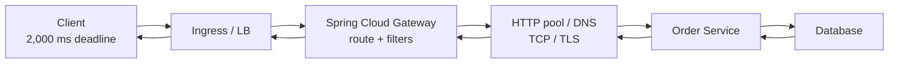
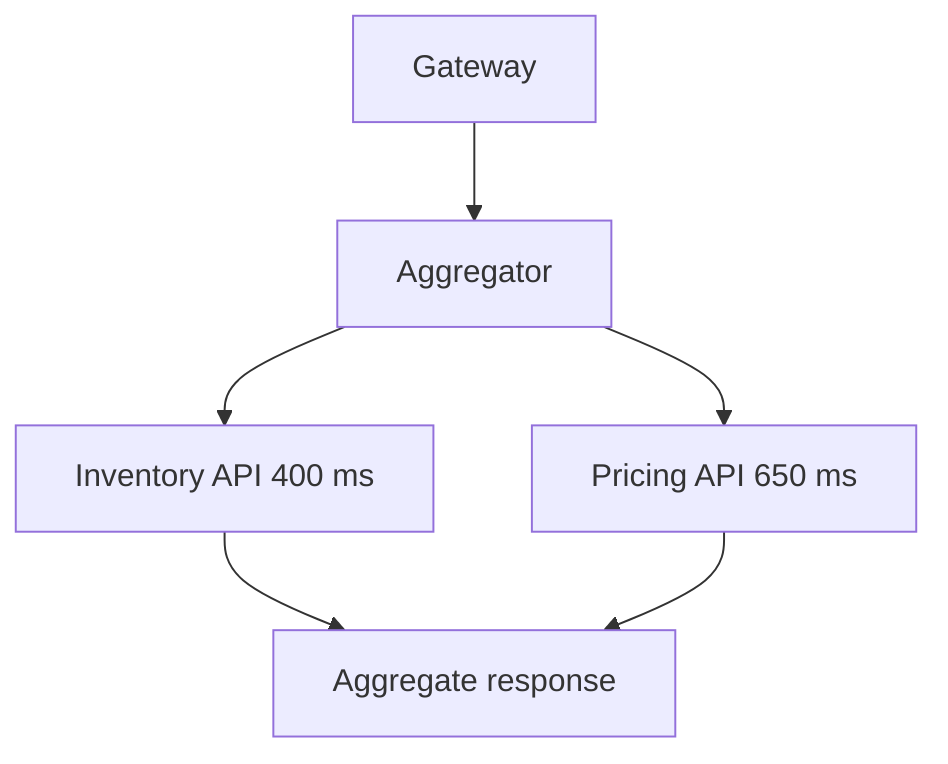

# Designing Timeout Budgets Across the Gateway and Services

## Lesson Objectives

Within the **Performance** chapter of the **SPRING_CLOUD_GATEWAY** module, this lesson explains how to design an **end-to-end timeout budget** spanning the client, ingress, Spring Cloud Gateway, service discovery/load balancing, HTTP client, backend microservices, and databases/dependencies. The goal is not picking a single `timeout` number to drop into YAML, but establishing a **time contract**: a request must succeed or fail cleanly before the caller gives up, and inner layers must stop burning resources pointlessly once that deadline passes.

Spring Cloud Gateway can evaluate route predicates, run filter chains, rewrite paths/headers, enforce authentication and rate limiting, retry, and trip circuit breakers before reaching a backend. Every step consumes part of the latency budget; setting `response-timeout: 5s` when the client already times out at `2s` solves nothing.

After this lesson, you will be able to:

- Distinguish **latency SLO**, **timeout**, **deadline**, and **remaining budget**.
- Model timing at every hop: DNS, connection pool wait, TCP connect, TLS, request write, response wait/read, backend processing, database calls, and writing back to the client.
- Allocate budgets with a **safety margin** for synchronous requests and determine the critical path under parallel fan-out.
- Configure **global** and **per-route** `connect-timeout` and `response-timeout` in **Spring Cloud Gateway Server WebFlux** with the right data types.
- Avoid confusing Netty's `response-timeout` with an **end-to-end whole-request deadline**, or with Resilience4j's `TimeLimiter` timeout.
- Fit retries, backoff, jitter, and attempt counts inside the **total budget**, factoring in idempotency, memory, and load amplification.
- Distinguish timeouts across pool acquire, DNS, TLS, upstream response, database, ingress, and client.
- Design **deadline propagation**, clamp untrusted client deadlines, track remaining time via a monotonic clock, and handle cancellation.
- Tailor timeouts for fast APIs, slow operations, fan-out, SSE, file downloads, WebSockets, and async batch/jobs.
- Test with latency/fault-injecting backend stubs, inspect p95/p99, and verify no orphaned work remains.

> **Technical scope:** Configuration examples target **Spring Cloud Gateway Server WebFlux** on Reactor Netty—not Web MVC, `ProxyExchange`, or ingress settings. Older Gateway releases use `spring.cloud.gateway.*`, whereas newer configuration properties tables use `spring.cloud.gateway.server.webflux.*`. Some official timeout docs still show the older prefix: verify against the **`configprops` table for your exact running version** and never mix both namespaces. Numbers in this lesson are **hypothetical design-exercise inputs**, not values to copy blindly into production.

## 1. A Timeout Budget Is a Time Contract

Suppose a web client calls:

```text
GET https://api.example.com/api/orders/42
```

The request traverses:



If the client allows at most **2,000 ms**, yet ingress waits **3,000 ms**, the Gateway HTTP client waits **5,000 ms**, and the backend DB query waits **30,000 ms**, then long after the client gave up, inner layers keep holding sockets, queue slots, DB connections, or running work nobody will ever read.

A **timeout budget** is a plan dividing the maximum allowed duration across request stages, paired with rules to **stop early when remaining time is insufficient**.

### 1.1. Distinguishing Four Concepts

| Concept | Meaning | Example |
| --- | --- | --- |
| **Latency SLO** | Percentage of requests expected to finish under a threshold | 99% of GET orders finish within 1,500 ms |
| **Timeout** | Wait cap for one operation or execution scope | TCP connect capped at 200 ms |
| **Deadline** | Final point in time by which the request must finish or be rejected | `now + 2,000 ms` |
| **Remaining budget** | Time left at a given step after subtracting time already spent | 780 ms left before querying the DB |

**An SLO does not enforce timeouts by itself.** A request taking 1,700 ms can still succeed yet violate a 1,500 ms SLO. Timeouts protect resources and enforce time contracts; they are not service-quality charts.

### 1.2. A Deadline Differs from a Chain of Independent Timeouts

Separate timeouts that "reset" at every hop accumulate:

```text
Gateway waits 2s for backend
  → Backend waits 2s for Service B
    → B waits 2s for DB
```

That does not mean the user agreed to wait **6s**. With an overall deadline:

```text
At Gateway:   remaining = 1,700 ms
At Backend:   remaining = 1,200 ms
At Service B: remaining =   700 ms
At DB call:   budget clamped <= remaining - reserve
```

Layers must **decrement remaining time**, never start a fresh unbounded clock per hop.

### 1.3. One Timeout Does Not Cover Everything

Configuring:

```yaml
httpclient:
  connect-timeout: 200
  response-timeout: 1200ms
```

does not guarantee every request finishes within `1,400 ms`. Elapsed time can also include route/security filters, DNS, connection-acquire queueing, TCP/TLS handshakes, request body writes, response body reads, retries/backoff, response serialization, and ingress/client latency. Netty limits have **specific scopes**; use instrumentation and tests to verify exact boundaries in your version.

## 2. Latency Map of an HTTP Request

A simple synchronous request breaks down into:

```text
T_total ≈ T_client_network
        + T_ingress_queue
        + T_gateway_inbound
        + T_auth_route_filters
        + T_service_discovery_or_LB
        + T_pool_acquire
        + T_DNS_if_needed
        + T_TCP_connect_if_needed
        + T_TLS_if_needed
        + T_request_write
        + T_backend_wait_and_processing
        + T_response_read
        + T_gateway_response_filters
        + T_egress_to_client
```

This is a **logical model**; steps do not always run strictly sequentially, nor does every request perform fresh DNS/TCP/TLS. **Keep-alive and connection pooling** reuse sockets; HTTP/2 multiplexes streams; streaming reads chunks repeatedly; filters and scheduling overlap.

### 2.1. Name Each Timeout Properly

| Wait point | Protection scope | On expiration |
| --- | --- | --- |
| Client total | User experience / caller deadline | Client aborts/cancels |
| Ingress / L7 LB | Proxy request/idle/read timeouts | Closes socket or returns error |
| Gateway total | Intentional inbound-to-completion deadline | Stops/fails request if uncommitted |
| Route/httpclient connect | **TCP connect** duration | Connect timeout |
| Pool acquire | Waiting for an available connection/channel | Pool acquire timeout/rejection |
| DNS resolution | Waiting on name resolver | DNS timeout/failure |
| TLS handshake | Waiting on TLS setup | TLS handshake timeout |
| HTTP response | Netty response read timeout per runtime semantics | Read/response timeout |
| Retry | Total attempts/backoffs per policy | Retry budget exhausted |
| CircuitBreaker / TimeLimiter | Wrapped publisher/call scope | Timeout/fallback/rejection per policy |
| Backend total | Service handling duration | Backend returns error or cancels task |
| DB query | Query execution/lock wait/statement timeout | Query aborted per DB/driver semantics |
| Outbound response streaming | Idle gap between chunks or stream lifetime | Stream aborted if exceeding policy |

Never write vague phrases like "Gateway timeout" in incident reports. Specify **which timeout fired and where**.

### 2.2. Queue Wait Counts as Latency Too

If a request waits **800 ms** in the connection pool even with `connect-timeout: 200` and `response-timeout: 500ms`, total latency is not capped at 500 ms. `connect-timeout` does not bound **acquiring** a connection; `response-timeout` is not a watchdog over total Gateway handling.

Example:

```text
Gateway filters                  50 ms
Pool acquire queue              800 ms
TCP connect                      90 ms
TLS                              70 ms
Upstream response               420 ms
Response copy                   100 ms
──────────────────────────────────────
Actual total                 ≈ 1,530 ms
```

Even when no individual timeout was breached, the request blew past the caller's deadline. **Measure and bound queues**, rather than merely raising connection counts.

### 2.3. Deeper Queues Make Timeouts Worse

An overloaded system can turn each request into:

```text
900 ms waiting in line + 100 ms processing
```

Raising a timeout from 1s to 5s lets more requests wait longer and hold resources longer; it creates zero extra CPU, DB connections, or throughput.

Combine:

- **Bounded concurrency** and **bounded pending queues**.
- Admission control, rate limiting, and bulkheads.
- Pool sizing matched to upstream capacity.
- Load shedding / fail-fast when remaining budget is too small.
- Autoscaling driven by meaningful signals (queues, CPU, throughput), not raw open socket counts.

## 3. Designing Budgets from Outside In

A useful rule of thumb:

> Inner-layer limits must leave enough time for outer layers to **detect failures, run valid fallbacks, emit telemetry, and return responses**—never set them nearly equal to the client timeout.

### 3.1. Example `GET Orders` Contract

**Exercise assumptions:**

```text
Client hard deadline:                    2,000 ms
Ingress request ceiling:                 1,850 ms
Gateway whole-request ceiling:           1,650 ms
Target outer HTTP-upstream attempt:      1,200 ms
Backend service internal budget:           900 ms
DB statement budget:                       500 ms
```

These are **nested ceilings**, not values to add together; each layer starts counting when the request arrives there. Time already spent before reaching the backend must be subtracted from remaining budget.

An allocation plan inside the Gateway after accepting the request:

| Activity | Reference budget |
| --- | ---: |
| Authentication, route match, filters | 100 ms |
| Outbound upstream call incl. pool/connect/TLS/read | 1,200 ms |
| Response filters, writing response to ingress | 150 ms |
| Margin for jitter/scheduling/variance | 200 ms |
| **Gateway whole-request ceiling** | **1,650 ms** |

**Do not misunderstand** Reactor Netty's `response-timeout: 1200ms` as creating a `1,200 ms` total upstream-operation deadline. You need a **separate outer deadline** to cover pool waits, connects, TLS, request/response handling, and retries.

### 3.2. Reserve Margin for Error Responses

If the upstream gets the full **1,650 ms** and leaves the Gateway only microseconds before ingress closes the socket, `fallbackUri` or a JSON error payload may never reach the client.

The **reserve** must cover:

- Response serialization and HTTP transfer time.
- Gateway post-filter execution.
- Load balancer/ingress flushing.
- A **short, safe fallback** if permitted by policy.
- Scheduler jitter and p99 variance.

Never try to send a "pretty" response by stretching past the client deadline; when budget runs out, fail fast and cancel to keep load from worsening.

### 3.3. Tailor Budgets by API Class—Never One Number for Everything

| API class | Characteristics | Design direction |
| --- | --- | --- |
| Small metadata GET | Fast read, likely idempotent | Tight deadline, minimal retries |
| Order-creating POST | Side effects may already have occurred | Clear deadline, **never retry blindly** |
| Multi-backend aggregator GET | Fan-out, compounding tail latency | Critical-path budget, parallelism caps |
| Large report export | Long computation | Return `202 Accepted` + polling/webhooks |
| SSE | Long-lived response stream | Separate stream idle timeout and connection lifetime |
| WebSocket | Long-lived upgraded connection | Handshake budget separate from heartbeat/idle policy |
| File download | Long body transfer | Separate initial timeout from throughput/idle timeout |

A Gateway should set **global defaults** to avoid infinite waits, plus **per-route overrides** for API classes with distinct SLOs.

## 4. Tracking Remaining Time: The Deadline Model

Suppose upon receiving a request, the Gateway allocates:

```text
deadline = now + 1,650 ms
```

After 300 ms spent in authentication and pool queueing:

```text
remaining ≈ 1,350 ms
```

Before calling upstream, subtract the response reserve:

```text
available_for_upstream =
    max(0, remaining - response_reserve)
```

If `remaining = 350 ms` and `response_reserve = 150 ms`, an upstream call needing at least 400 ms to succeed **should not even be started only to guarantee a timeout**. Return `503`/`504` or a safe fallback per contract.

### 4.1. Use a Monotonic Clock Within a Process

On the JVM, measure elapsed time with `System.nanoTime()`, never by subtracting `System.currentTimeMillis()` timestamps because wall clocks can jump due to NTP.

```java
import java.time.Duration;

final class LocalDeadlineBudget {
    private final long startNanos = System.nanoTime();
    private final long totalNanos;

    LocalDeadlineBudget(Duration total) {
        if (total.isZero() || total.isNegative()) {
            throw new IllegalArgumentException("Budget must be positive");
        }
        this.totalNanos = total.toNanos();
    }

    Duration remaining() {
        long elapsed = System.nanoTime() - startNanos;
        long left = Math.max(0L, totalNanos - elapsed);
        return Duration.ofNanos(left);
    }

    boolean expired() {
        return remaining().isZero();
    }
}
```

This is an **illustrative utility for short budgets**, without overflow guards for huge durations. `System.nanoTime` **must not** be sent across machines as a timestamp; monotonic clocks have process-local origins.

### 4.2. Absolute Deadline Model Across Services

Some systems define an internal header:

```http
X-Internal-Deadline-Epoch-Millis: 1795500000123
```

This is an **illustrative custom protocol header**, **not a built-in Spring Cloud Gateway standard**. It helps prevent budget resets across hops, provided you enforce:

1. Header generated/normalized only at a **trusted edge/Gateway**.
2. Never trust client-supplied deadlines from the Internet; strip or clamp per policy.
3. Validate parsing, range, size, negative/overflow values, and max TTL.
4. Synchronize wall clocks across nodes and define clock-skew handling.
5. Upon receipt, convert to a **remaining `Duration`** and track locally using a monotonic clock.
6. If integrity across trust boundaries is needed, enforce internal auth/mTLS or message signing.
7. Never put deadline timestamps or user-controlled values into unbounded metric labels.

**An absolute deadline header alone cannot "force every downstream to cancel"** unless downstreams implement logic to parse it and wire cancellation. Forwarding a header does not automatically control Reactor Netty, JDBC, or Resilience4j.

### 4.3. Timeout Hint vs. Enforced Deadline

A header like:

```http
X-Request-Timeout-Millis: 500
```

only works if downstreams obey it. If forwarded **unchanged** across 3 hops, each hop might give itself a fresh 500 ms, exceeding 1,500 ms total.

With a **remaining-time header**, each service must subtract **elapsed time** before forwarding. With an **absolute deadline**, handle clock skew and trust. Both require contract tests across languages and runtimes.

## 5. Configuring Timeouts in Spring Cloud Gateway Server WebFlux

Spring Cloud Gateway supports global **HTTP connect timeout** and **HTTP response timeout**, overridable per route via metadata.

**Critical data-type differences:**

| Property | Value | Meaning |
| --- | --- | --- |
| Global `httpclient.connect-timeout` | Integer **milliseconds** | e.g., `250` = 250 ms |
| Global `httpclient.response-timeout` | **`java.time.Duration`** | e.g., `1200ms`, `2s` |
| Route `metadata.connect-timeout` | Integer **milliseconds** | e.g., `200` = 200 ms |
| Route `metadata.response-timeout` | Integer **milliseconds** | e.g., `850` = 850 ms |

Specifically, writing `response-timeout: 850` on the **global HTTP client** instead of `850ms` can bind or interpret differently than intended under Spring Boot conversion. Write explicit Duration strings globally and integer milliseconds in route metadata.

### 5.1. Global Timeout Example for Lab Testing

```yaml
spring:
  cloud:
    gateway:
      server:
        webflux:
          httpclient:
            connect-timeout: 250
            response-timeout: 1200ms
          routes:
            - id: orders-read
              uri: http://localhost:9001
              predicates:
                - Path=/api/orders/**
                - Method=GET
              filters:
                - StripPrefix=1
```

`connect-timeout: 250` bounds HTTP client connect, not DNS + pool acquire + TLS + backend response combined. `response-timeout: 1200ms` does not replace ingress timeouts, caller deadlines, or DB query timeouts.

`localhost:9001` is a lab stub backend. In Kubernetes, `localhost` inside a Gateway pod **does not** reach a microservice in another pod—use deployment DNS/service discovery.

### 5.2. Per-Route Metadata Overrides

```yaml
spring:
  cloud:
    gateway:
      server:
        webflux:
          httpclient:
            connect-timeout: 250
            response-timeout: 1200ms
          routes:
            - id: orders-read
              uri: lb://order-service
              predicates:
                - Path=/api/orders/**
                - Method=GET
              metadata:
                connect-timeout: 200
                response-timeout: 850
              filters:
                - StripPrefix=1

            - id: reports-read
              uri: lb://report-service
              predicates:
                - Path=/api/reports/**
                - Method=GET
              metadata:
                connect-timeout: 300
                response-timeout: 3000
              filters:
                - StripPrefix=1
```

Here:

- `orders-read` uses `200 ms` connect and `850 ms` response via route metadata.
- `reports-read` uses `300 ms` connect and `3,000 ms` response.
- Other routes without overrides inherit the global defaults.
- `lb://` requires **Spring Cloud LoadBalancer** and registered service instances (assumed in this example).

**Important:** a longer route timeout on `reports-read` **cannot** override a shorter client or ingress timeout. Slow reports need an appropriate API/caller contract or an asynchronous job pattern.

### 5.3. Disabling Global Response Timeout with a Negative Value

Gateway docs describe:

```yaml
metadata:
  response-timeout: -1
```

on a route to **disable the global response-timeout** for that route. This is a **high-risk exception**, never a default fix for 504s:

- If a backend hangs or a stream stalls, the Gateway can wait indefinitely.
- Sockets and pending work continue tying up resources.
- Ingress/clients may already have closed the connection.
- For SSE/WebSocket/file streaming, use a dedicated **idle/lifetime policy**, never unbounded waits across everything.

If a long stream requires disabling response timeout, pair it with **connection limits, heartbeats, idle timeouts, client cancellation, monitoring, and graceful shutdown**.

### 5.4. Java DSL Metadata for Timeouts

Spring Cloud Gateway provides constants:

```java
import static org.springframework.cloud.gateway.support.RouteMetadataUtils
    .CONNECT_TIMEOUT_ATTR;
import static org.springframework.cloud.gateway.support.RouteMetadataUtils
    .RESPONSE_TIMEOUT_ATTR;

// Inside RouteLocatorBuilder routes() definition:
.metadata(CONNECT_TIMEOUT_ATTR, 200)
.metadata(RESPONSE_TIMEOUT_ATTR, 850)
```

These constants prevent string typos in Java DSL. Still, `metadata` configures **per-route HTTP timeouts**; it does not compute per-request remaining deadlines or propagate deadline headers downstream.

### 5.5. Old vs. New Namespace Prefixes

Some official timeout guides still show:

```yaml
spring:
  cloud:
    gateway:
      httpclient:
        connect-timeout: 1000
        response-timeout: 5s
```

That is the **legacy namespace** from earlier releases. Newer Gateway Server WebFlux property tables list:

```text
spring.cloud.gateway.server.webflux.httpclient.connect-timeout
spring.cloud.gateway.server.webflux.httpclient.response-timeout
spring.cloud.gateway.server.webflux.httpclient.pool.acquire-timeout
```

Verify your exact version and runtime effective properties. Never set both prefixes hoping one takes effect; that makes configuration confusing to maintain and debug.

## 6. Connection Pool Timeouts Are a Separate Part of the Budget

The Gateway maintains a pool of outbound HTTP connections. When concurrency exceeds pool or upstream capacity, new requests **queue waiting to lease a connection**.

Reactor Netty concepts:

- `maxConnections`: concurrent channels/connections per pool scope.
- `pendingAcquireMaxCount`: max queued acquisitions.
- `pendingAcquireTimeout`: max wait to acquire a connection.
- `maxIdleTime`, `maxLifeTime`: connection age/idle lifecycle limits, not request deadlines.
- Pool metrics: track idle/active/pending connections to detect saturation.

### 6.1. Fixed Gateway Pool Configuration

Intentional example:

```yaml
spring:
  cloud:
    gateway:
      server:
        webflux:
          httpclient:
            pool:
              type: fixed
              max-connections: 100
              acquire-timeout: 150
              metrics: true
            connect-timeout: 250
            response-timeout: 1200ms
```

**Explanation:**

- `acquire-timeout: 150` uses **milliseconds** in Gateway properties.
- `max-connections: 100` is illustrative; choose based on load tests, backend limits, sockets/FDs, HTTP protocol, and replica count—**not a universal "optimal" number**.
- `metrics: true` helps observe saturation when Micrometer is configured properly.
- `configprops` docs note `acquire-timeout`/`max-connections` apply to **`FIXED` pool type**; do not assume all pool types behave identically.

### 6.2. Never Multiply Connection Counts Arbitrarily

Suppose:

```text
20 Gateway replicas × 200 max connections = up to 4,000 outbound connections
```

If the upstream handles only 800 active requests, raising pool size from 100 to 200 per Gateway **amplifies overload** instead of improving p99.

Size total connection capacity from the backend's capacity, HPA policies, and replica count. If a service has concurrency budget C, apportion it across callers or enforce a service-side bulkhead.

### 6.3. Pool Acquire Timeout Differs from Connect Timeout

```text
T_pool_acquire = 120 ms
T_TCP_connect  =  90 ms
```

Even with both under their individual limits, 210 ms have already elapsed before TLS or HTTP even starts. Maintain an **outer request deadline** and fail fast if pool queueing consumed most of the remaining budget.

### 6.4. Stale Connections and Idle Timeouts

A connection pool keeping sockets alive longer than a load balancer or backend idle timeout causes premature closes and unexpected retries.

Size `maxIdleTime` against upstream/ingress idle timeouts; Reactor Netty recommends setting pool idle limits **no longer than** server-side idle limits where appropriate. Never confuse `maxIdleTime` (pooled socket idle age) with response timeouts or request TTLs.

## 7. DNS, TLS, and Network Proxies Have Their Own Timeouts

A call to `https://order.internal.example` can involve:

```text
Resolver lookup (DNS)
   ↓
Pool acquire
   ↓
TCP connect
   ↓
TLS handshake / SNI / certificate verification
   ↓
HTTP write
   ↓
Response read
```

Actual ordering varies with pooling and caches, yet **any step can fail before the upstream application sees the request**.

### 7.1. TCP Connect Timeout

Gateway global/route `connect-timeout` bounds establishing the **TCP connection** per the HTTP client. It is NOT:

- DNS resolution timeout;
- TLS handshake timeout;
- pool pending acquire timeout;
- backend DB wait time;
- full response body completion time.

When an incident report says "timeout is 200 ms yet requests hung for 1.2s," inspect **each phase's scope and duration** rather than assuming the property was ignored.

### 7.2. TLS Handshake Timeout

For HTTPS upstreams, Reactor Netty enforces a TLS handshake timeout. Newer Gateway configprops include:

```text
spring.cloud.gateway.server.webflux.httpclient.ssl.handshake-timeout
```

Example Duration setting:

```yaml
spring:
  cloud:
    gateway:
      server:
        webflux:
          httpclient:
            ssl:
              handshake-timeout: 500ms
```

`500ms` is a **test value**. TLS tail latency varies across networks, proxies, and certificate chains. Choose based on measured handshake p95/p99 and reliability targets. Never "fix" TLS timeouts by enabling an **insecure trust manager**; keep certificate trust, SNI, and hostname verification intact.

### 7.3. Resolver and Proxy Timeouts

Reactor Netty exposes timeout knobs for:

- Name resolver query timeouts.
- HTTP proxy connect timeouts when routing via an outbound proxy.
- TLS handshake timeouts.
- Pool pending acquire timeouts.

Never assume a Spring Cloud Gateway YAML key exists for **every** Reactor Netty option. For deep customization, use a version-supported HTTP client customizer with integration tests so pooling, proxy, TLS, and load-balancer behavior are not broken accidentally.

### 7.4. Timeouts Behave Differently When Connections Are Reused

**Cold request:**

```text
DNS + connect + TLS + request + response
```

**Warm keep-alive request:**

```text
Pool acquire + request + response
```

Never measure just the very first request and size timeouts for all traffic from it. Load tests need **warm-up** plus separate cold-start and connection-churn scenarios.

## 8. Response Timeout Is Not a Whole-Request Deadline

Reactor Netty `HttpClient.responseTimeout(Duration)` caps the **HTTP response/read** phase. It can be configured globally on the client or overridden per request. Netty docs explicitly distinguish it from pool, connect, SSL/TLS, proxy, and resolver timeouts.

### 8.1. Response Wait vs. Total Wall-Clock Time

Suppose:

```text
Pool acquire           200 ms
TCP connect            100 ms
TLS handshake          100 ms
Request write           50 ms
Upstream response      800 ms
Gateway response       100 ms
──────────────────────────────
Total                1,350 ms
```

Setting `response-timeout: 900ms` **does not** enforce `T_total <= 900ms`. With retries, total wall-clock time stretches further still.

### 8.2. Response Timeout and Streaming

An SSE service may emit heartbeats every 20s for hours. An HTTP response can **start quickly** yet stream for a long time. Distinguish:

- **Time to first response headers / first byte.**
- **Idle gap between chunks/messages.**
- **Full response completion time.**
- **Maximum stream lifetime.**

Never slap `Mono.timeout(Duration.ofSeconds(2))` onto **full response completion** and wonder why SSE streams drop at 2s. Conversely, **disabling all timeouts** leaves dead connections open forever.

For Reactor Netty's `responseTimeout`, verify on your exact runtime how it treats inactivity vs. reads across protocols and streams. Test **slow headers, slow first byte, slow body chunks, and heartbeats** separately.

### 8.3. HTTP Status Alone Cannot Identify the Timeout Source

A client seeing 504 could reflect:

- Ingress timing out before the Gateway answers.
- Gateway timing out on the outbound HTTP client.
- `CircuitBreaker`/`TimeLimiter` timing out.
- The upstream itself returning 504 from calling another service.

Never deduce from `504` alone that `spring.cloud.gateway.server.webflux.httpclient.response-timeout` fired. Inspect trace spans, exception classes, selected route, upstream attempt count, and error source.

## 9. End-to-End Deadlines via Reactor: Illustrating an Outer Guard

An outer deadline can use **Reactor's `timeout(Duration)`** to bound a `Publisher`, yet it must wrap the right **scope** and handle HTTP response lifecycles—unlike `connect-timeout` or `response-timeout`.

**Illustrative model** for a short-lived route:

```java
import java.time.Duration;
import java.util.concurrent.TimeoutException;

import org.springframework.cloud.gateway.filter.GatewayFilterChain;
import org.springframework.cloud.gateway.filter.GlobalFilter;
import org.springframework.core.Ordered;
import org.springframework.http.HttpStatus;
import org.springframework.stereotype.Component;
import org.springframework.web.server.ServerWebExchange;

import reactor.core.publisher.Mono;

@Component
public final class DemoGatewayDeadlineFilter
        implements GlobalFilter, Ordered {

    private static final Duration TOTAL_LIMIT =
        Duration.ofMillis(1650);

    @Override
    public int getOrder() {
        return -100; // Example: verify exact position in actual filter order
    }

    @Override
    public Mono<Void> filter(
            ServerWebExchange exchange,
            GatewayFilterChain chain) {

        return chain.filter(exchange)
            .timeout(TOTAL_LIMIT)
            .onErrorResume(TimeoutException.class, error -> {
                if (exchange.getResponse().isCommitted()) {
                    return Mono.error(error);
                }
                exchange.getResponse()
                    .setStatusCode(HttpStatus.GATEWAY_TIMEOUT);
                return exchange.getResponse().setComplete();
            });
    }
}
```

**This is not a production-ready blanket `GlobalFilter`.** Caveats:

1. It measures from when this `GlobalFilter` runs, **excluding** time already spent in ingress or earlier Security `WebFilter`s.
2. `chain.filter(exchange)` is a `Mono<Void>` spanning Gateway response completion; a hard outer timeout would **cut off valid SSE, WebSockets, and large downloads**.
3. Once the response is committed, **you cannot change the status to 504**; handle protocol-appropriate cancellation and socket closing instead.
4. `TimeoutException` from a publisher vs. HTTP client/`TimeLimiter` exceptions may differ in type—map causes explicitly.
5. `getOrder()` relative to `Retry` and `CircuitBreaker` defines what is wrapped. Do not treat `-100` as a magic standard order.
6. Timeout/cancellation does not guarantee a remote backend SQL query or payment transaction **stopped**; cooperative cancellation and idempotency are still needed.
7. A global filter needs an explicit **route policy** and exclusions instead of forcing one limit onto health checks, uploads, SSE, and long admin jobs.

**Purpose of this example:** contrasts an "outer total cap" with HTTP client timers. Real implementations must compute remaining deadlines from ingress, match route classes, handle committed responses, preserve Reactor Context, and test every error path.

### 9.1. Never Block the Netty Event Loop

In a reactive Gateway, never call:

```java
Thread.sleep(1000);
```

or:

```java
someMono.block();
```

on the event loop to "wait out a budget." Blocking holds event-loop threads and drives up p99 across unrelated requests, triggering cascading timeouts.

Use non-blocking HTTP/DB clients, backpressure, and bounded schedulers for unavoidable blocking libraries. Audit custom filters for blocking or CPU hotspots before raising timeouts.

## 10. Retries Must Fit Within Remaining Budget

Retries can boost success rates during transient faults. Yet if each attempt gets a full per-route timeout, total elapsed time easily blows past the hard deadline.

### 10.1. Budget Formula for Sequential Retries

With `N` as the **number of retries after the first attempt**, there are up to `N+1` attempts:

```text
T_total_retry ≈ Σ(i=1..N+1) T_attempt_i
              + Σ(j=1..N) T_backoff_j
              + T_filters_and_response
```

A conservative upper design bound:

```text
T_total_retry_upper <= (N+1) × T_attempt_cap
                     + Σ T_backoff_max
                     + T_overhead_reserve
```

**Note:** `T_attempt_cap` here must be a **well-defined per-attempt end-to-end cap**, not merely Reactor Netty's `response-timeout`. Each attempt also incurs pool acquire, TCP/TLS, and scheduling.

### 10.2. Example of Insufficient Budget

Suppose:

```text
Remaining Gateway budget:       1,300 ms
Single attempt total cap:         700 ms
Retries:                               1
Backoff:                           60 ms
Response/filters reserve:         100 ms
```

Worst case:

```text
2 × 700 + 60 + 100 = 1,560 ms
```

**Exceeds the 1,300 ms remaining budget.** You cannot allow a second attempt with a full 700 ms cap.

One revised plan:

```text
Attempt #1 cap:             600 ms
Max backoff:                 50 ms
Attempt #2 cap:             500 ms
Response reserve:           150 ms
──────────────────────────────────
Total:                    1,300 ms
```

These are design ceilings; production must also account for queue jitter and I/O overhead, verified with latency metrics. If attempt 1 took 580 ms and pool queueing stayed slow, attempt 2 **should be skipped** when remaining budget is insufficient.

### 10.3. `Retry` `GatewayFilter` in YAML

Test example for an **idempotent GET**:

```yaml
spring:
  cloud:
    gateway:
      server:
        webflux:
          routes:
            - id: orders-read
              uri: lb://order-service
              predicates:
                - Path=/api/orders/**
                - Method=GET
              metadata:
                connect-timeout: 200
                response-timeout: 700
              filters:
                - StripPrefix=1
                - name: Retry
                  args:
                    retries: 1
                    methods: GET
                    statuses:
                      - BAD_GATEWAY
                      - SERVICE_UNAVAILABLE
                    backoff:
                      firstBackoff: 30ms
                      maxBackoff: 50ms
                      factor: 2
                    jitter:
                      randomFactor: 0.3
                    timeout: 1250ms
```

**Read the config semantics carefully:**

- `retries: 1` means **one additional retry after the initial attempt**, not one total attempt.
- `statuses` restricts retryable status codes; never retry 401/403/404 since auth/missing-resource errors do not heal themselves.
- `methods: GET` prevents blindly replaying POST/PUTs with side effects.
- Backoff and jitter prevent synchronized retry waves against a struggling backend.
- `Retry.timeout` is a **Retry `GatewayFilter` option** in current versions; **do not assume it replaces an end-to-end client deadline**. Verify exact scope against filter ordering and runtime behavior.
- Route `response-timeout: 700` is the per-route HTTP-client read timeout, **not a whole-attempt cap**; an outer deadline layer is still needed to guard the full request.

With `Retry`, **filters ordered after it can run again**; verify ordering and behavior for `StripPrefix`, security, body caches, and telemetry. Gateway docs warn that retrying requests with bodies can buffer the body in memory—a major risk for large uploads.

### 10.4. Cancellation Does Not Undo Side Effects

Suppose `POST /payments/charge` already committed to the DB on the backend before the response timed out:

```text
Client/Gateway sees timeout
Backend may already have committed transaction
Gateway retries POST
→ risk of charging twice
```

**A timeout does not prove a transaction never executed.** Mutating operations need:

- Per-business-operation idempotency keys.
- Atomic deduplication on the backend.
- Status-query endpoints for ambiguous outcomes.
- Retry policies scoped strictly to safe status codes and phases.
- No unbounded body caching/replay.

Gateway's Retry filter never automatically guarantees exactly-once execution.

### 10.5. Multi-Layer Retry Amplification

If Gateway retries up to 2 attempts, Service A up to 3, and Service B up to 2, a single inbound request can trigger up to:

```text
2 × 3 × 2 = 12 downstream attempts
```

under nested retry scenarios. That is the **potential attempt count**, though not every request hits 12.

Before enabling multi-layer retries, designate **one retry owner**, cap attempt counts, and enforce a **total retry budget**. Avoid letting every microservice retry by default.

## 11. `CircuitBreaker`, `TimeLimiter`, and Fallbacks Within Budget

`CircuitBreaker` **stops sending calls** to a failing or overly slow upstream; `TimeLimiter` caps the duration of the wrapped execution scope. Both are **distinct** from Gateway TCP connect/response timeouts.

### 11.1. `CircuitBreaker` Does Not Automatically Cut Slow Calls

A circuit breaker tracks failures and transitions:

```text
CLOSED → OPEN → HALF_OPEN
```

While `OPEN`, requests **fail fast** without opening upstream connections. Yet configuring a CircuitBreaker with only a name and failure threshold **does not establish** a request timeout. With Spring Cloud CircuitBreaker + Resilience4j, `TimeLimiter` policies are configured separately and must be tested explicitly.

### 11.2. Resilience4j `TimeLimiter`

Example:

```yaml
resilience4j:
  timelimiter:
    instances:
      ordersRead:
        timeoutDuration: 1100ms
```

And a route:

```yaml
filters:
  - name: CircuitBreaker
    args:
      name: ordersRead
      fallbackUri: forward:/fallback/orders
```

Per Gateway Server WebFlux docs, this requires a compatible dependency such as:

```text
spring-cloud-starter-circuitbreaker-reactor-resilience4j
```

**Note:** `TimeLimiter` bounds the publisher/call wrapped by the **`CircuitBreaker` filter**, not the entire inbound request if authentication, earlier filters, or response writes sit outside it. Placing `Retry` before vs. after `CircuitBreaker` changes what is wrapped; test actual runtime ordering. Current Spring Cloud CircuitBreaker docs note `TimeLimiter` can be enabled by default with instance/group duration and disable options—never assume its default matches your SLO without checking.

### 11.3. Filter Order Produces Different Behavior

**Scenario A — `CircuitBreaker` wraps `Retry`:**

```text
CircuitBreaker/TimeLimiter
  └─ Retry
      └─ HTTP routing
```

`TimeLimiter` can bound **the entire retry sequence** when publisher composition aligns.

**Scenario B — `Retry` sits outside `CircuitBreaker`:**

```text
Retry
  └─ CircuitBreaker/TimeLimiter
      └─ HTTP routing
```

Each attempt gets `TimeLimiter` protection, yet **total retries and backoffs** are not bounded by a single `TimeLimiter`. This illustrates **wrapping scope**, not a promise that swapping two YAML lines yields that exact diagram; test `Ordered`, built-in filters, and Reactor publisher semantics directly.

### 11.4. Fallbacks Spend Time Too

When a circuit opens and `fallbackUri` calls another handler or backend, the fallback must:

- Have its own small, explicit budget.
- Never turn critical-transaction errors into "fake success."
- Never trigger calls costlier than the original upstream.
- Never wait past ingress/client socket closure.
- Return contract-compliant HTTP statuses/bodies with explicit cache-freshness rules.

A fallback that calls a second backend taking 2s when the client only has 200 ms left is a **useless fallback**.

## 12. Propagating Deadlines to Backends and Databases

A Gateway with a deadline calling a backend whose DB query runs forever creates **orphaned work**:

```text
T0: Gateway sends GET to Order Service
T0+900ms: Gateway runs out of budget; cancels HTTP subscription
T0+2000ms: DB query keeps running because driver/server missed cancellation
T0+5000ms: Backend finishes response, but caller is long gone
```

The rule is **best-effort cancellation propagation**, not a guarantee every unit of work halts instantaneously.

### 12.1. Backends Reading Remaining Budget

A service receiving a validated internal deadline should:

1. Parse and clamp the deadline per service policy.
2. Compute `remaining = deadline - now` (accounting for clock skew if needed).
3. Reject immediately if remaining time is below the minimum needed to succeed.
4. Set outbound HTTP client and DB call timeouts **below `remaining - reserve`**.
5. Cancel cancellation-aware publishers/queries when the caller disconnects.
6. Avoid committing business side effects that assume "the client is still waiting."

### 12.2. DB Query Timeouts and Lock Waits

Backends typically involve at least two DB timeout layers:

- **Connection acquisition:** waiting for a JDBC/R2DBC connection from the pool.
- **Statement/query timeout:** waiting on query/transaction execution inside the DB.

Both must track **remaining backend budget**; never treat `spring.datasource.hikari.connection-timeout` (for JDBC/Hikari) as proof every query completes under that limit. Configure DB drivers, dialects, and server-side `statement_timeout`/lock-wait limits properly.

Example with 700 ms remaining:

```text
Acquire DB connection:      max  80 ms
Query execution:            max 450 ms
Response mapping/commit:    res 100 ms
Safety margin:                   70 ms
──────────────────────────────────────
Total:                          700 ms
```

This is an allocation model, not universal YAML for PostgreSQL/MySQL/Oracle. Verify driver cancellation support, transaction commits, and connection pool lifecycles.

### 12.3. Fan-Out Needs Critical-Path Analysis

An aggregator service calls **two backends in parallel**:



If truly **parallel**, waiting for both takes roughly:

```text
max(400 ms, 650 ms) = 650 ms
```

rather than `400 + 650 = 1,050 ms`. Yet the aggregator still incurs dispatch, queue, and serialization overhead and waits on both branches. If call B starts only after A returns, total reverts to the **sequential sum**.

**Rule:** size timeouts from the **critical path of the dependency graph**, instead of blindly summing all service durations or giving every branch the entire deadline with unbounded concurrency.

### 12.4. Tail Latency Under Fan-Out

If each dependency finishes within threshold X with 99% probability, and an aggregator waits on 10 independent dependencies with identical odds, the probability **all 10** finish within X is roughly:

\[
P(\text{all 10 on time}) = 0.99^{10} \approx 0.904
\]

Only about **90.4%** of aggregator calls finish all branches within X under independence assumptions. In practice, latencies are correlated via shared DBs, networks, and load, so the formula is **illustrative**, not a production forecast.

Wide fan-out easily degrades end-to-end p99 even when each service has healthy p99 alone. Consider caching, partial responses, bulkheads, per-branch timeouts, narrower fan-out, or asynchronous processing.

## 13. Never Mechanically Add Hop p99s

Suppose an observation table shows:

| Hop | p95 | p99 |
| --- | ---: | ---: |
| Ingress | 30 ms | 70 ms |
| Gateway filters | 25 ms | 80 ms |
| Backend | 450 ms | 1,100 ms |
| DB | 280 ms | 750 ms |

**You cannot** simply compute `p99_total = 70 + 80 + 1100 + 750`. Why:

- DB latency is already **included inside backend latency** (double-counting).
- Quantiles of separate distributions do not add linearly.
- Some hops run in parallel.
- Tail latencies correlate under load or shared infrastructure.
- Timed-out requests may censor or skew sample distributions.

### 13.1. Measure End-to-End Directly

To design budgets, collect:

```text
Ingress request duration
Gateway route timer
Gateway HTTP client attempt latencies
Pool acquire waits
DNS/TCP/TLS phases (when needed)
Backend handler duration
DB query time
End-user observed latency
```

Then analyze:

- `p50`, `p95`, `p99`, **timeout rate**, and **error rate**.
- Differences between warm and cold connections.
- Peak hours, deployments, cache misses, and upstream saturation.
- Gateway latency **outside** backend spans.

### 13.2. Percentile SLOs vs. Hard Deadlines

Example:

```text
SLO: 99% of GET /orders finish <= 1,500 ms
Caller hard deadline:            2,000 ms
Gateway safety deadline:         1,650 ms
```

The gap between SLO and hard deadline absorbs tail spikes and ensures clean error handling—**it does not invite services to burn all 1,650 ms routinely**. When p95 creeps near the hard timeout, raising the timeout masks saturation rather than fixing root causes.

## 14. Timeout Errors Are Not Always HTTP 504

HTTP 504 Gateway Timeout is returned by a gateway/proxy when it fails to receive a timely response from an upstream. In practice, you also see:

| Signal | Likely meaning | What to measure |
| --- | --- | --- |
| `504` at ingress | Ingress waited too long on Gateway | Ingress access logs + Gateway spans |
| `504` at Gateway | Upstream response or `TimeLimiter` timeout | Gateway HTTP client, exception class |
| `502` | Connection reset, protocol error, TLS, upstream unavailable | HTTP client errors, TLS/connect metrics |
| `503` | Circuit `OPEN`, LB no-instance, admission/rejection | Circuit state, discovery, pool pressure |
| `408` | Server timed out reading request from client (per server policy) | Inbound HTTP server |
| `429` | Rate limit exceeded | Rate limiter metrics / `Retry-After` |
| `499` on some proxies | Client closed connection before response | Proxy-specific non-standard status |
| Client `TimeoutException` | Client hit its own deadline | Client timer; is the Gateway still working? |

**Never map every exception to 504** and blame a "slow backend"; distinct failure sources demand different operational responses.

### 14.1. An Upstream 504 May Simply Be Proxied Through

Order Service might act as a client to Payment Service and return `504` itself, which the Gateway merely forwards. In that case, Gateway `response-timeout` is not to blame.

Use structured error classification:

```text
routeId=orders-read
errorSource=upstream
upstreamStatus=504
gatewayTransportError=false
```

Never log raw bearer tokens, cookies, request bodies, or sensitive queries just to locate timeout sources.

### 14.2. Committed Responses

If the Gateway already sent status/headers `200` and partial body bytes to the client, a later timeout can only **close the stream**—it cannot rewrite the response into:

```http
HTTP/1.1 504 Gateway Timeout
```

on the same HTTP exchange. Streaming clients must handle truncated streams and retry/resume where protocol allows; telemetry should record `responseCommitted`, bytes sent, and close reason.

## 15. Timeouts for Streaming, SSE, and WebSockets

Never apply short REST JSON timeouts to long-lived connections.

### 15.1. SSE

SSE (`Content-Type: text/event-stream`) keeps an HTTP response open emitting events for hours. Useful timeouts:

- **Initial response/header timeout:** must connect and subscribe promptly.
- **Heartbeat/idle timeout:** if no bytes/events arrive for too long.
- **Maximum session lifetime:** proactively rotate streams per policy.
- **Reconnect policy:** clients use `Last-Event-ID` if resumption is supported.

Setting `metadata.response-timeout: -1` on an SSE route only disables the global response timeout per Gateway docs—**it does not remove the need for memory, socket, heartbeat, and cancellation controls**.

### 15.2. WebSockets

A WebSocket begins with an HTTP `101` handshake, then transitions into paired client–Gateway and Gateway–upstream WebSocket sessions. Separate:

```text
Handshake budget   ≠  WebSocket session lifetime
TCP/TLS timeout    ≠  Ping/Pong/heartbeat timeout
```

Gateway's `WebsocketRoutingFilter` for `ws://`, `wss://`, or `lb:ws://` has different semantics from HTTP `NettyRoutingFilter`. **Never assume HTTP `response-timeout` route metadata governs an entire WebSocket session lifetime**, and never retry an already upgraded session like a normal HTTP GET.

### 15.3. Large Downloads and Uploads

A 1 GiB file can take minutes to transfer even when the server sends headers immediately. Use:

- Inactivity / read / write timeouts.
- Minimum throughput or transfer caps if required.
- Request body size, backpressure, and concurrency caps.
- Range requests / resumable uploads where fitting.
- Never buffer entire responses just to fit a tiny fixed total timeout.

### 15.4. Long-Running Jobs

Instead of holding:

```http
POST /api/reports/export
```

open for 120 seconds, consider:

```http
POST /api/reports/export
→ 202 Accepted
Location: /api/jobs/job-123
```

The client polls:

```text
GET /api/jobs/job-123
→ PENDING / RUNNING / DONE / FAILED
```

or receives a webhook/event per security contract. The Gateway only needs short timeouts for **job creation** and **status polling**, while batch workers manage their own deadlines. This eliminates long-held sockets, simplifies retries/reconciliation, and handles client disconnects cleanly.

## 16. Testing Timeout Budgets with Stub Backends

A credible performance test **injects controlled latency**, rather than writing YAML and seeing one HTTP 200.

Setup:

- **Gateway** running a test profile on a random port.
- **Backend stub** (WireMock, MockWebServer, or test HTTP server).
- `WebTestClient.bindToServer()` or real HTTP client with explicit deadlines.
- Metrics/traces and outbound call counters.
- Purely synthetic test data—zero real JWTs, cookies, or PII.

### 16.1. Backend Stub Latency Matrix

| Case | Backend stub behavior | Expected outcome |
| --- | --- | --- |
| Fast | Headers/body after 50 ms | Succeeds, latency within SLO |
| Near threshold | Headers after 700 ms, route cap 850 ms | Usually succeeds if remaining budget allows |
| Slow | Headers after 1,300 ms, cap 850 ms | Fails per policy; never hangs indefinitely |
| Unresponsive | Holds connection open | Times out/cancels and frees resources |
| Slow between chunks | Fast headers, next body chunk after long gap | Exercises read-idle / stream semantics |
| Connection reset | Sends partial data then closes | `502` / connection failure per mapping |
| Returns 503 | Immediate 503 | Retries/fallback per policy; not treated as network timeout |
| DNS failure | Unresolvable hostname | Resolver error, not backend p99 |
| Closed TCP port | Connection refused | Fast connect failure; distinct from connect timeout |
| Bad TLS cert | Handshake fails | TLS error; never enable insecure trust |
| Pool exhausted | Holds multiple active calls | Pending acquire timeout / fail fast |
| Slow client | Client reads response very slowly | Backpressure / response-commit handling |

### 16.2. Testing Slow HTTP with `WebTestClient`

Test scaffold (requires running stub and route URI pointing to it):

```java
import java.time.Duration;

import org.junit.jupiter.api.Test;
import org.springframework.boot.test.context.SpringBootTest;
import org.springframework.boot.test.web.server.LocalServerPort;
import org.springframework.test.web.reactive.server.WebTestClient;

@SpringBootTest(
    webEnvironment = SpringBootTest.WebEnvironment.RANDOM_PORT
)
class GatewayTimeoutIntegrationTest {

    @LocalServerPort
    int port;

    private WebTestClient client() {
        return WebTestClient.bindToServer()
            .baseUrl("http://localhost:" + port)
            .responseTimeout(Duration.ofSeconds(4))
            .build();
    }

    @Test
    void upstreamQuickResponseIsSuccessful() {
        // Setup: stub /orders/42 returns 200 after ~50 ms.
        client().get()
            .uri("/api/orders/42")
            .exchange()
            .expectStatus().isOk();
    }

    @Test
    void verySlowUpstreamFailsByGatewayPolicy() {
        // Setup: stub holds response > 2s;
        // Gateway route response timeout = 850 ms in test profile.
        client().get()
            .uri("/api/orders/slow")
            .exchange()
            .expectStatus().is5xxServerError();
        // Also assert error category/latency and stub call counts.
    }
}
```

This snippet is a **test scaffold**, not standalone runnable code: you need the running stub, route URI injected into the application context, fixture security config, timeout profile, and compatible HTTP client dependencies. `@LocalServerPort` import varies by Spring Boot version. Do not hard-expect `504` if your project's exception handler, `Retry`, `CircuitBreaker`, or fallback maps timeouts to `502` or `503`.

`WebTestClient.responseTimeout(Duration.ofSeconds(4))` is the **test client's timeout**—not the Gateway or backend timeout.

### 16.3. Asserting Latency Without Flakiness

Never write:

```java
assertTrue(elapsedMillis == 850);
```

Thread scheduling, GC, loopback jitter, and CI contention cause timing variance. Instead, tests should:

- Assert timeouts fire **before a safe upper bound** (e.g., under 1.8s when the stub stalls for 5s).
- Assert error source/cause or contract outcome.
- Verify no pending backend calls linger after a reasonable settling period.
- Use virtual time for **unit-testing reactive operator timeouts** without Netty/real HTTP.
- Use real clocks with generous bounds in integration tests—never depend on exact 1 ms precision.

### 16.4. Virtual Time Differs from Network Time

Reactor's `StepVerifier.withVirtualTime` works well for testing:

```java
Mono.never().timeout(Duration.ofSeconds(1))
```

and publishers using compatible schedulers. However, virtual time **cannot fast-forward DNS, TCP connect, TLS handshakes, pool acquire, or external HTTP servers**. End-to-end Netty tests must run against **real networks or local stubs**.

### 16.5. Testing Deadline Propagation Across Two Services

Model:

```text
Client budget 2,000 ms
Gateway spends   300 ms
Order Service receives remaining ≈ 1,700 ms
Order Service spends 400 ms
Inventory Service receives remaining ≈ 1,300 ms
```

What to test:

- Internal deadline header is generated by trusted Gateway, ignoring forged client deadlines.
- Remaining time strictly decreases; never resets per hop.
- `remaining <= 0` → skips expensive backend/DB calls.
- Services receiving low `remaining` fail fast per policy.
- When clients cancel, downstream work cancels **as far as the stack supports**.
- Zero orphaned DB queries, leaked connections, or endless retries.

### 16.6. Testing Retries Within Budget

Stub:

```text
Attempt 1: 503 after 150 ms
Attempt 2: 200 after 200 ms
```

Expected when retries are permitted:

- One inbound GET, **two outbound attempts**.
- Total duration including backoff stays under the hard deadline.
- If attempt 1 consumes almost the whole budget, **attempt 2 never starts** or uses a smaller deadline.
- POSTs lacking an idempotency policy are never replayed accidentally.

Count attempts at the backend stub; never count Netty wiretap `WRITE` lines since one request can span multiple network writes.

### 16.7. Testing Pool Exhaustion

Simulate `N` upstream calls holding connections:

```text
maxConnections = 2
pending acquire max/timeout bounded
```

Send 3–5 concurrent requests:

- Two occupy active connections.
- Remaining requests wait to acquire or reject per policy.
- Exceeding acquire timeout aborts promptly rather than waiting until the client leaves.
- The Gateway continues serving unrelated routes and emits expected metrics.

Never use `Thread.sleep` directly on the Gateway Netty event loop to inject delay; delay inside the **backend test server** or use non-blocking delays.

## 17. Load Testing: Watch Tail Latency, Concurrency, and Queues

A clean p50 can hide a disastrous p99. Run multi-phase load tests:

1. **Warm-up:** prime pools, DNS caches, JIT, and connections.
2. **Baseline:** low load establishing fast-path latency.
3. **Normal load:** target RPS and concurrency.
4. **Peak/burst:** traffic spikes and fan-out bursts.
5. **Saturation:** ramp load until queues, timeouts, and error rates climb.
6. **Failure injection:** slow backends, 503s, partial closes, DNS/TLS/network faults.
7. **Recovery:** backend recovers; verify no lingering retry storms and clean pool draining.

### 17.1. Metrics to Collect

| Metric / signal | Why it matters |
| --- | --- |
| End-to-end latency p50/p95/p99 | User experience |
| Gateway route request timer | Latency across route/filter chain |
| HTTP client connect duration | Connection slowness |
| Pool active/idle/pending connections | Saturation and queue waits |
| Pending acquire timeouts | Undersized pool or overloaded upstream |
| DNS/TLS failures | Network or trust issues |
| Upstream response latency | Slow downstream service |
| Retry attempts per inbound request | Load amplification |
| Circuit state / rejections | Fail-fast behavior |
| 429/502/503/504 counts | Error classification |
| Gateway CPU/GC/event-loop lag | Blocking or saturation |
| Backend DB pool/query/lock wait | Deeper bottleneck |
| Cancellations / orphaned work | Wasted work after deadlines |

Exact Micrometer metric names vary across Spring Cloud Gateway, Reactor Netty, and Observability versions. Gateway docs describe `spring.cloud.gateway.requests`; Reactor Netty exports HTTP client and connection-provider meters. **Inspect `/actuator/metrics` and Prometheus output on your exact running version** rather than hardcoding alerts from memory.

### 17.2. Never Put IDs in Metric Labels

Use bounded metric labels:

```text
routeId=orders-read
method=GET
status=504
outcome=TIMEOUT
```

Never use:

```text
userId=<id>
requestPath=/api/orders/123456789
token=<jwt>
query=<customer-data>
```

High-cardinality labels explode time-series counts and leak data into monitoring systems. Use distributed tracing to inspect individual requests without stuffing raw identifiers into metric labels.

### 17.3. Measure Request Completion and Attempts Separately

With Retry:

```text
Inbound requests:      100
Outbound attempts:     170
```

Looking only at completion rate across 100 inbound requests hides the true **170-call** load hitting the backend. Track **attempt ratio** and error amplification, especially during degradation.

### 17.4. Open-Loop vs. Closed-Loop Load

A closed-loop client waiting for each response before sending the next **automatically reduces arrival rate** when the Gateway slows down, hiding production queueing. To model independent arrival rates, use an open-loop load generator at target RPS while guarding against coordinated omission.

Never cite a localhost laptop benchmark as proof of production p99 across multiple replicas behind TLS and ingress. Align test environments with real traffic shapes, body sizes, concurrency, latency, and hardware.

## 18. Security Implications of Timeout Budgets

Timeouts protect systems against prolonged resource exhaustion, yet loose configs can be abused.

### 18.1. Never Trust Client-Sent Deadlines

An attacker can send:

```http
X-Internal-Deadline-Epoch-Millis: 9999999999999
```

If the Gateway trusts that value, callers can force backends to run far past policy. Conversely, an artificially tiny deadline triggers false fail-fast errors, log noise, and skewed rate-limit behaviors.

At the edge:

- Strip or overwrite internal headers from public clients.
- Clamp requested timeouts to **min/max service policies**.
- Propagate only across trusted networks/mTLS.
- Validate numeric parsing, overflow, clock skew, and header injection.
- Never treat a deadline header as authentication proof.

### 18.2. Slowloris, Streaming, and Request Size

Upstream response timeouts **do not** stop all cases where an inbound client trickles headers or body bytes slowly. Ingress/HTTP servers need separate:

- Header read timeouts and size limits.
- Request body size and upload duration policies.
- Concurrent connection caps.
- Slow-client / read-idle handling.
- Appropriate rate limiters / WAFs.

Never rely on HTTP client response timeouts as a substitute for inbound anti-Slowloris defenses.

### 18.3. Retries and Sensitive Data

Retries re-send tokens and bodies multiple times, and Gateway wiretap can duplicate payloads into logs. Never enable raw wiretap on live traffic to debug timeouts; use synthetic delays and sanitized metadata logs like:

```text
routeId=orders-read
attempt=2
elapsedMs=780
remainingBucket=0-250ms
errorCategory=response-timeout
traceId=<valid-trace-id>
```

Never log `Authorization`, `Cookie`, personal data, raw request bodies, or arbitrary user-controlled deadline headers.

## 19. Troubleshooting Common Scenarios

### 19.1. Response Timeout Set to 1s Yet Clients Wait 3s

**Possible causes:**

- Response timer excludes pool acquire, DNS, connect, TLS, or response write.
- Retries, filters, or fallbacks add extra attempts.
- Property sits under the wrong namespace and never bound.
- Ingress or client enforces a longer timeout.

**Fix:** verify runtime `configprops`, split spans/timers per phase, count attempts, and add an explicit outer deadline.

### 19.2. Connect Timeout Is 200 ms Yet Connections Still Take Long

**Possible causes:** waiting on pool acquire, DNS, TLS, or another layer's accept queue. TCP connect timeout does not cover every setup phase.

**Fix:** inspect pool/connection metrics, resolver/TLS errors, and event-loop blocking before raising connect timeout.

### 19.3. Surge of 504s Right After Deployment

**Possible causes:**

- Cold DNS/TLS/connection pool initialization.
- JVM JIT and cache warm-up.
- Newly started backend instances not yet ready.
- Misaligned client/ingress/Gateway timeouts.

**Fix:** separate cold vs. warm latency, readiness probes, upstream health, and traffic-shifting rollouts—do not permanently inflate timeouts to hide cold starts.

### 19.4. p99 Climbs Near Peak RPS

**Possible causes:** bounded resources saturated, pool queues growing, DB lock waits, or CPU/GC/event-loop delays.

**Fix:** inspect saturation metrics, queue depths, active/pending sockets, concurrency limits, and backend DBs; consider load shedding, autoscaling, or caching. **Raising timeouts is not an optimization** when the system lacks capacity.

### 19.5. Retries Make the Backend Even Slower

**Possible causes:** retry amplification and synchronized backoff across callers; requests nearly out of budget still retrying.

**Fix:** lower retry counts, retry only transient errors, add jitter, gate on remaining budget, and enforce a single retry owner. Use circuit breakers and bulkheads to fail fast when overloaded.

### 19.6. POST Timed Out Yet the Transaction Still Appears

**Normal distributed-systems behavior:** a client timeout does not roll back a committed backend transaction.

**Fix:** idempotency keys, business state machines, and reconciliation/status queries; never auto-retry POSTs without deduplication.

### 19.7. Fallback Returns 200 Yet SLO Remains Bad

**Possible cause:** fallback runs only after waiting 2s on the upstream and takes another 1s while the client times out at 2s.

**Fix:** configure `TimeLimiter`/outer deadline including fallback reserve; fallbacks must use safe fast data and avoid faking success on critical payment/business writes.

### 19.8. SSE Drops Even While Backend Is Healthy

**Possible cause:** a layer applies a full-request timeout or an idle timeout shorter than the heartbeat interval; per-route response timeouts mismatch stream semantics.

**Fix:** separate initial-response, idle, and stream-lifetime budgets, emit timely heartbeats, and test ingress, Gateway, and backend hop by hop.

### 19.9. WebSocket Disconnects Every 60 Seconds

**Possible cause:** ingress/LB/backend idle timeout or insufficient heartbeats—not necessarily a `WebsocketRoutingFilter` bug.

**Fix:** measure connection lifetimes, close codes, ping/pong, application heartbeats, and proxy timeouts. Do not raise all HTTP timeouts to infinity.

### 19.10. `lb://` Route Returns 503 While the Service Is Running

**Possible cause:** discovery has no healthy instances, stale updates, LB health status, or connection pool/TLS fails against the chosen instance.

**Fix:** inspect service instance selection and readiness rather than blindly changing `response-timeout`.

### 19.11. `TimeoutException` Logged Yet Client Sees 502

**Possible cause:** exception mapping, route fallbacks, circuit breakers, or partially committed upstream responses. There is no universal 1-to-1 Java-exception-to-HTTP-status mapping.

**Fix:** test project error handling, tag `timeoutSource`, and check `responseCommitted`.

### 19.12. Disabling Global Response Timeout with `-1` Leaves Many Long-Lived Sockets

**Possible cause:** the route lacks idle/lifetime limits and peers stop sending data without closing cleanly.

**Fix:** enforce stream-appropriate idle/lifetime limits, connection caps, heartbeats, and cancellation; never leave resources unbounded.

## 20. Timeout Budget Operations Checklist

| Area | Questions to verify |
| --- | --- |
| **Client SLO** | Are target p95/p99, hard deadlines, and request classes clearly defined? |
| **Ingress** | Are request/idle timeouts shorter than caller deadlines with reserve? |
| **Gateway** | Is there an outer end-to-end budget beyond HTTP-client timers? |
| **Properties** | Do namespace, global `Duration`, and route-metadata milliseconds match your version? |
| **Routes** | Do fast and slow APIs have distinct per-route caps rather than blanket timeouts? |
| **Connection pool** | Are fixed/elastic type, max connections, acquire timeout, and queue metrics aligned? |
| **DNS/TCP/TLS** | Are resolver, connect, and handshake phases measured and tuned separately? |
| **Retry** | Do `(N+1)` attempts + backoff + overhead fit inside remaining budget? |
| **Methods** | Do retried POST/PUT/PATCH routes enforce idempotency and reconciliation? |
| **CircuitBreaker** | Does `TimeLimiter`/fallback wrapping match filter order and SLOs? |
| **Fallback** | Is reserve time left for error responses, avoiding fake success? |
| **Deadline header** | Internal-only, clamped, signed/trusted, and clock-skew aware? |
| **Backend** | Are HTTP/DB timeouts, cooperative cancellation, and anti-orphan guards active? |
| **Parallel fan-out** | Are critical paths, parallelism limits, and tail amplification accounted for? |
| **Streams** | Do SSE/WebSocket/upload/download routes have dedicated initial/idle/lifetime rules? |
| **Error mapping** | Are 408/429/502/503/504/499 cleanly attributed by source? |
| **Observability** | Tracking p50/p95/p99, pool pending, retries, circuits, timeout sources, cancellations? |
| **Security** | Public timeout headers untrusted; tokens/PII excluded from logs? |
| **Tests** | Tested slow headers/bodies, resets, pool exhaustion, TLS, retries, fan-out, client aborts? |
| **Change control** | Canary rollout, p99/error alerts, rollback plan, and updated SLO docs? |

## 21. Calculation Practice Exercises

### Exercise 1 — Is There Enough Budget for a Retry?

A GET has **1,400 ms** remaining at the Gateway. Response reserve is **150 ms**. Attempt 1 needs up to **700 ms**, max backoff is **100 ms**, and Attempt 2 also gets **700 ms**.

**Question:** Does this fit in the budget?

**Answer:**

```text
700 + 100 + 700 + 150 = 1,650 ms
```

**No.** Over budget by 250 ms. Lower per-attempt caps, skip Attempt 2 when remaining budget is low, or widen the caller contract **if the product truly allows it**. Never just tweak `response-timeout` while ignoring pool, connect, and retries.

### Exercise 2 — Does Pool Wait Matter?

Gateway filters take 70 ms, pool acquire 400 ms, connect/TLS 130 ms, backend response 600 ms, response write 100 ms.

**Question:** Roughly what is total latency?

**Answer:** `70 + 400 + 130 + 600 + 100 = 1,300 ms`. Having `response-timeout=700ms` does not force total latency under 700 ms. You still need an outer deadline and pool bounds.

### Exercise 3 — Sequential vs. Parallel?

An aggregator calls Inventory (350 ms) and Pricing (650 ms), with 100 ms dispatch/aggregation overhead.

**If parallel:** `max(350, 650) + 100 = 750 ms` in an ideal model.

**If sequential:** `350 + 650 + 100 = 1,100 ms`.

Size budgets from the real dependency graph and measure queueing/scheduling rather than simply adding or comparing standalone p99s.

### Exercise 4 — Retry POST After Timeout?

Payment Service receives `POST /charge` and commits successfully, yet the Gateway times out before receiving the response.

**Answer:** Do not retry blindly. Use idempotency keys, backend deduplication, and payment status-lookup endpoints. A client-side timeout **never rolls back a committed transaction**.

### Exercise 5 — How Should Timeout Ceilings Nest?

Client deadline 2,000 ms, ingress 2,500 ms, Gateway 1,900 ms, backend 4,000 ms.

**Answer:** Callers will time out before ingress and backends do, creating wasted work. Re-align so ingress and Gateway finish or time out with **reserve** before the caller, and backends receive a remaining budget smaller than available time. Optimal numbers depend on real latency and contracts.

### Exercise 6 — Why Isn't 99% Per-Service On-Time Enough?

An aggregator depends on 10 independent services, each completing under a threshold 99% of the time.

**Answer:** The probability all 10 finish on time is roughly `0.99^10 ≈ 90.4%`; fan-out amplifies tail latency. This assumes independence—in production, measure full distributions and correlations.

### Exercise 7 — HTTP Response Timeout vs. SSE

An SSE stream stays open for 2 hours with 20s heartbeats; the Gateway applies a whole-request `Mono.timeout(2s)`.

**Answer:** Because the publisher does not complete in 2s, the outer timeout kills a healthy stream. Separate handshake, idle, heartbeat, and session-lifetime budgets.

### Exercise 8 — Why Not Trust Client-Provided Deadlines?

A client sends `X-Internal-Deadline-Epoch-Millis` set 10 days in the future.

**Answer:** Headers can be spoofed. The trusted edge must overwrite or clamp them, and backends should trust deadline metadata only from authenticated/trusted hops—never let deadlines grant infinite socket retention.

### Exercise 9 — Route `response-timeout` Bounds

Global:

```yaml
httpclient:
  response-timeout: 2s
```

Route:

```yaml
metadata:
  response-timeout: 700
```

**Answer:** Per Gateway WebFlux docs, global uses `Duration`, while route metadata uses **700 ms**. That still bounds only the route's HTTP client response phase, not the total request cap.

### Exercise 10 — When Should You Increase a Timeout?

**Answer:** Only when business SLOs and caller contracts permit, measurements prove the legitimate operation needs more time under healthy capacity, and it does not mask overload. If p99 climbs from queue saturation or deadlocks, fix root causes, backpressure, and admission control first.

## 22. Practical Design Workflow for a New Route

### Step 1 — Lock the Client Contract

Document:

```text
API: GET /api/orders/{id}
Expected p99: 1,500 ms
Client hard deadline: 2,000 ms
Acceptable fallback: cached data only without authorization leaks
Request body: none
Retry safety: GET idempotent per business contract
```

Never pick timeouts before knowing **whether the operation is retryable or has side effects**.

### Step 2 — Draw the Dependency Graph

```text
Ingress
  → Gateway Security/Route/Filter
  → Order Service
      ├─ Database
      └─ Inventory Service
          └─ Cache
```

Mark parallel vs. sequential branches. Identify the critical path and every queue.

### Step 3 — Gather a Latency Baseline

Measure per-route/per-hop p50/p95/p99 under representative test traffic, separating cold connections from steady state.

### Step 4 — Distribute Limits with Reserve

Design:

```text
Client:     2,000 ms
Ingress:    1,850 ms
Gateway:    1,650 ms
Upstream:   1,200 ms outer cap
Backend:      900 ms
DB call:      500 ms
```

Then configure **each timeout to its exact scope**—never confuse route `response-timeout` with an outer operation cap.

### Step 5 — Assign Retry and Fallback Ownership

- Idempotent GETs retry only transient failures within an attempt budget.
- POSTs require idempotency.
- `CircuitBreaker`/`TimeLimiter` wraps the intended scope.
- Fallbacks are fast and contract-safe.

### Step 6 — Add Deadline Propagation and Cancellation

Design internal headers across multi-hop chains, clamp at trusted edges, compute remaining time per service, and shrink DB/HTTP client budgets accordingly.

### Step 7 — Fault Injection

Test slow upstreams, 503s, pool queues, TLS faults, dropped responses, client aborts, 2+ replicas, and streams.

### Step 8 — Roll Out and Monitor

Canary timeout changes; watch timeout rates, p99, attempt ratios, pool saturation, and user-visible errors. Keep a rollback ready if errors climb or canceled work continues running too long.

## 23. Official References

- [Spring Cloud Gateway Server WebFlux — HTTP Timeouts Configuration](https://docs.spring.io/spring-cloud-gateway/reference/spring-cloud-gateway-server-webflux/http-timeouts-configuration.html): global/per-route `connect-timeout`, `response-timeout`, route metadata, and negative values to disable global response timeout.
- [Spring Cloud Gateway — Configuration Properties](https://docs.spring.io/spring-cloud-gateway/reference/configprops.html): Server WebFlux namespace, HTTP client pool acquire, connect, response, and SSL properties.
- [Spring Cloud Gateway Server WebFlux — `Retry` `GatewayFilter` Factory](https://docs.spring.io/spring-cloud-gateway/reference/spring-cloud-gateway-server-webflux/gatewayfilter-factories/retry-factory.html): retries, statuses, methods, backoff/jitter, timeout, filter order, and cached request bodies.
- [Spring Cloud Gateway Server WebFlux — `CircuitBreaker` `GatewayFilter` Factory](https://docs.spring.io/spring-cloud-gateway/reference/spring-cloud-gateway-server-webflux/gatewayfilter-factories/circuitbreaker-filter-factory.html): circuits, Resilience4j, fallbacks, and status-code behavior.
- [Spring Cloud CircuitBreaker — Resilience4j Circuit Breaker Properties](https://docs.spring.io/spring-cloud-circuitbreaker/reference/spring-cloud-circuitbreaker-resilience4j/circuit-breaker-properties-configuration.html): `TimeLimiter` instance/default config and disable options.
- [Reactor Netty — HTTP Client Reference, Timeout Configuration](https://projectreactor.io/docs/netty/release/reference/http-client.html): connection-pool, response, connect, TLS, proxy, and name-resolver timeouts.
- [Project Reactor — Error Handling](https://projectreactor.io/docs/core/release/reference/coreFeatures/error-handling.html): reactive timeout, error, and cancellation semantics.
- [Spring Cloud Gateway Server WebFlux — Global Filters](https://docs.spring.io/spring-cloud-gateway/reference/spring-cloud-gateway-server-webflux/global-filters.html): Gateway metrics and filter chains.

## Summary

A **timeout budget across the Gateway and microservices** is an **end-to-end** design, not a grab bag of isolated numbers. Start from the **caller deadline**, reserve margin for ingress and Gateway error responses, and allocate remaining budget across connection acquire, DNS/TCP/TLS, HTTP clients, backends, databases, and downstream calls. Compute parallel branches via the **critical path**; budget retries across **attempts + backoff + filter overhead** while preventing amplification. A caller timeout never automatically cancels an in-flight transaction or DB query, making **deadline propagation, cooperative cancellation, and idempotency** essential.

In **Spring Cloud Gateway Server WebFlux**, carefully distinguish **global `connect-timeout` milliseconds**, **global `response-timeout` `Duration`**, **per-route metadata timeouts in milliseconds**, connection-pool acquire timeouts, and Resilience4j `TimeLimiter`. **Netty's response timeout is not a total request deadline**; test real request wall-clock duration and maintain separate timeout policies for streaming, SSE, and WebSockets. Combining **p95/p99 metrics, queue/pool saturation, tracing, synthetic fault tests, canary rollouts, and log privacy** keeps your Gateway within latency SLOs, failing fast under overload without turning one slow dependency into a cascading system outage.
