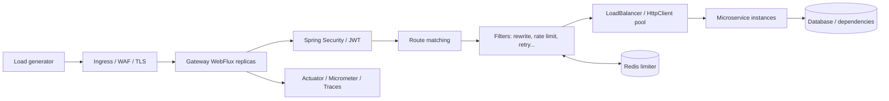
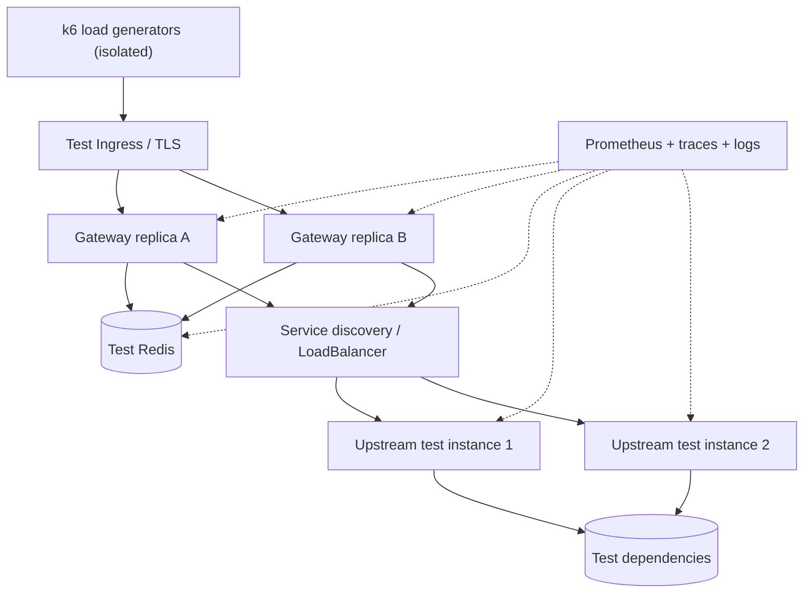
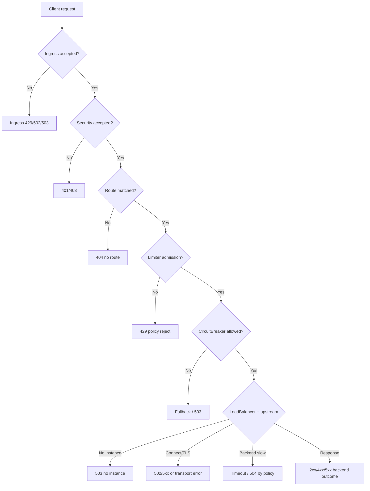

# Testing Saturation, Traffic Spikes, and Overload Behavior

A **Spring Cloud Gateway** can run smoothly at 500 requests/second yet behave drastically differently when traffic jumps to 1,500 requests/second for 30 seconds: p99 latency stretches, connection queues build, the Redis rate limiter returns `429`, `CircuitBreaker` opens, or Gateway replicas run out of memory one by one. The goal of **performance testing** is not only finding a "maximum RPS" figure, but proving **the system degrades gracefully and recovers** once load exceeds serving capacity.

This lesson belongs to the **Performance** chapter of **Spring Cloud Gateway** and focuses on three conditions: **resource saturation**, **traffic bursts/spikes**, and **overload behavior**. Examples connect route predicates, filter chains, path/header rewrites, `lb://` service discovery, authentication, Redis rate limiting, `Retry`, `CircuitBreaker`, TLS, and observability. It targets **Spring Cloud Gateway Server WebFlux** on Reactor Netty; Gateway Server Web MVC uses a Servlet stack with different metrics and HTTP client transports, requiring corresponding adjustments.

> **Operational warning:** Run stress, burst, and failure-injection tests only in authorized environments with resource isolation and strict caps on rate, duration, and test data. Never send disruptive load to public services or shared Redis/Identity Providers. Numbers and thresholds in this lesson illustrate experiment design only—**not universal SLOs or recommended defaults**. Metric names, property prefixes, and k6/Spring Cloud Gateway APIs can change across versions; always verify in your live environment.

## 1. What Are Saturation, Burst, and Overload?

Three related yet distinct concepts:

| Concept | Practical definition | Observable signs |
| --- | --- | --- |
| **Saturation** | A resource approaches its serving limit: connection pool, CPU, event loop, Redis, backend, memory... | Queues, pending counts, utilization, and wait times rise |
| **Traffic spike / burst** | Incoming traffic jumps very rapidly over a short window | Large step jump in arrival rate, surge in connections or Redis decisions |
| **Overload** | Demand exceeds serving capacity within time/SLO budgets | High latency, timeouts, rejected load, 5xxs, or shed traffic |
| **Recovery** | When load drops or dependencies heal, the system returns to steady state | Queues drain, latency returns to baseline, memory plateaus |
| **Cascading overload** | A bottleneck in one layer clogs other layers via retries, queues, and timeouts | Multiple routes degrade together, retry amplification, replica restarts |

**Saturation does not always cause immediate errors.** A Gateway can use 90% of outbound connections and still meet SLOs; yet once `pending acquire` queues grow continuously, p95 breaches deadlines, and timeouts climb, capacity is no longer keeping up.

**A burst does not necessarily exceed capacity.** A service with headroom, warm connections, and a well-sized token-bucket burst budget can absorb brief spikes with little latency jump. Test both **amplitude and ramp speed**, not just average RPS.

### A Concrete Example

```text
Load over time (requests/second):

t=00–02 min:     200 RPS  (baseline)
t=02–04 min:     400 RPS  (ramp)
t=04–06 min:     800 RPS  (ramp)
t=06–06:30:    2,400 RPS  (spike)
t=06:30–09:00:   300 RPS  (recovery)
```

Questions to answer: at 800 RPS does the system still meet SLOs? Jumping to 2,400 RPS, does it reject requests cleanly with `429`/`503` or let every request hang? After the 30-second spike, do queues drain and connections/memory return to steady state?

## 2. Testing Goals: Performance **and** Stability

A test must define **pass criteria** up front, rather than picking pretty charts after the run.

Example targets for `GET /api/orders/{id}` in a test environment:

- At **400 RPS** with the defined request mix: client-side p95 does not exceed **300 ms**.
- At sustained **800 RPS**: p99 does not exceed **800 ms**, and system 5xx errors stay under **0.5%**.
- During a 3x spike: **`429`s** are accepted per quota, with zero crashes/OOMs or unbounded queue growth.
- Requests rejected by the rate limiter **never reach the upstream**.
- Once load drops back to 200 RPS, p95 and pending connections return near baseline within a **defined recovery window**.
- Zero cross-tenant leaks, broken authorization, or duplicate side effects from retries.

**The figures above are sample acceptance criteria for learning.** Real SLOs must be confirmed by operations and API owners based on business criticality, workloads, and infrastructure capacity.

### What Makes a Result "Good"?

A Gateway that protects itself by returning `429` during a spike can be **far better** than one returning 200 to a fraction of traffic while hanging 60 seconds on the rest until pools and backends collapse.

Evaluate at least three dimensions:

1. **Correctness:** Accepted requests hit the right route, backend, and auth/tenant context without bad replays.
2. **SLO/performance:** Latency, throughput, and error budgets hold at declared load levels.
3. **Graceful degradation:** Beyond capacity, the Gateway fails fast, keeps critical routes alive, and recovers once load subsides.

## 3. The Gateway Is Not a Single Bottleneck

A client request traverses multiple layers:



Every layer can become a breaking point:

| Layer | Resource / limit | Symptoms |
| --- | --- | --- |
| Load generator | CPU, NIC, sockets/file descriptors | Fails to emit target RPS, invalidating results |
| Ingress/WAF | TLS, connection caps, request queues | `429`/`502`/`503` before the Gateway |
| Security | JWT signature/issuer verification, JWK cache | `401`s or high CPU |
| Gateway route/filter | Regexes, body rewrites, logging, authorization | Blocked event loop, rising heap/direct memory |
| Redis rate limiter | Redis RTT, command throughput, keys, connections | Admission latency, `429`s, or Redis errors |
| Outbound `HttpClient` | Pool active/max/pending, connect/TLS | Pool acquire timeouts, tail latency |
| Service discovery | Instance list, caches, readiness | No-instance, stale endpoints, `503` |
| Upstream | Threads, DB pools, I/O latency | `503`, `504`, or slow request processing |
| Retry/CircuitBreaker | Attempt amplification, breaker state/fallbacks | Extra internal load or shed traffic |
| Response cache/streaming | Memory, bandwidth, slow consumers | Cache misses, queues, buffer pressure |

**A load test that fails to separate these layers can misidentify the bottleneck.** For example, a client 504 from a 5-second Ingress timeout tells nothing about whether the backend actually finished processing.

## 4. Distinguishing Requests, Attempts, Connections, and Frames

Four quantities are frequently conflated in load tests:

- **Client request:** One HTTP request sent by the load generator to the Gateway.
- **Gateway route execution:** A request that matched a route and entered the filter chain.
- **Upstream attempt:** One outbound call to a backend; `Retry` can multiply attempts.
- **Connection:** A TCP/TLS socket reused or held open; HTTP/2 can multiplex many requests.
- **WebSocket frame:** A message after HTTP `101`; not a new HTTP request.

Example:

```text
1,000 client GET requests
  -> 800 requests allowed by rate limiter
  -> 200 requests receive 429
  -> Among the 800 allowed: 100 requests need 1 retry
  -> Upstream receives 900 attempts
```

You cannot sum `http.server.requests`, `spring.cloud.gateway.requests`, and outbound HTTP client attempts and call that "total requests." They measure **different layers**.

### Why Measure Both Ends?

If a client ultimately receives `200` thanks to a retry after an upstream `503`, the Gateway's 5xx rate looks low even while the backend is failing heavily and absorbing extra traffic.

If the Gateway returns `429`, a drop in upstream calls signals successful protection—**not missing measured traffic**.

## 5. Define Success Before Sending Load

A test produces varied outcomes:

| HTTP outcome | Possible meaning | How to count against test goals |
| --- | --- | --- |
| `200`/`201` | HTTP success | Still verify response body and backend correctness |
| `204` | Success without body | Valid if allowed by API contract |
| `301`/`302` | Redirect | May be wrong if unexpected (e.g., kicked to login) |
| `400` | Bad input | Exclude from eligible traffic or count per policy |
| `401`/`403` | Unauthenticated/unauthorized | Do not treat as Gateway outage |
| `404` | Route miss or missing upstream resource | Classify exact source |
| `429` | Rate limit / admission rejection | **May be right under overload**, yet still unserved work |
| `502` | Proxy/transport or upstream gateway error | Inspect ingress/Gateway/HTTP client |
| `503` | Load shedding, no-instance, breaker, upstream unavailable | Isolate source before judging |
| `504` | Timeout on a hop | Inspect the full deadline chain |
| Other `5xx` | Server error | Inspect both upstream attempts and Gateway logs |

Do not lump every `429` into user-SLO "success." Separate **admission-policy correctness** from **useful work served**: an overload test can pass self-protection while failing an acceptance test requiring a guaranteed request rate to be served.

## 6. Open-Loop, Closed-Loop, and Coordinated Omission

How you generate load strongly shapes your conclusions.

### Closed-Loop: Virtual Users Wait for Each Response Before Sending Next

```text
VU 1: send request -> wait for response -> think time -> send next
VU 2: send request -> wait for response -> think time -> send next
...
```

When the Gateway slows down, each VU issues fewer requests. Total arrival rate **drops automatically**, easing pressure on the system right when it bottlenecks. This models interactive human users well, yet fails if your goal is **holding arrival rate fixed to find the saturation point**.

### Open-Loop: Send Requests on a Fixed Schedule

```text
t=0.0s: request 1
t=0.1s: request 2
t=0.2s: request 3
...
Even if earlier responses are still waiting, arrivals stay on schedule
(so long as the load generator has enough capacity).
```

Open-loop or **arrival-rate executors** expose queue growth and tail latency when the system falls behind target RPS. Still, generators have VU/CPU/network limits; always track **achieved RPS and dropped iterations**.

### Coordinated Omission

If a load generator waits for a stalled request to finish before starting the next, few new latency samples get recorded while the system is stalled, making p99 look **artificially good**. This is coordinated omission.

**How to reduce bias:**

1. Use an arrival-rate model for capacity/saturation tests.
2. Record **target arrivals, achieved starts/completions, and dropped starts**.
3. Set explicit deadlines/request timeouts.
4. Inspect client-side latencies **alongside** Gateway/backend spans.
5. Track connection errors and timeouts, not only percentiles of completed successes.
6. If your tool supports scheduled-latency correction, understand its exact semantics before comparing numbers.

**No single load model fits every purpose.** Use closed-loop for interactive user flows and open-loop to test arrival-spike absorption.

## 7. Throughput Does Not Equal Arrival Rate

Consider a 10-second window:

```text
Planned arrivals:          10,000 requests
Requests actually started:  9,800
Responses completed:        7,500
Requests still in-flight:   1,800
Client timeouts/failures:     500
Dropped iterations:           200
```

Looking only at "7,500 requests completed" and reporting `750 RPS` ignores 2,500 requests that failed to finish as expected.

Distinguish:

\[
\text{Offered load} \neq \text{Admitted load} \neq
\text{Completed throughput}
\]

Over short windows, completed throughput lags behind offered load due to queueing; after a spike ends, backlogged requests continue draining. That is why you must measure **in-flight counts, pending queues, and recovery time**.

## 8. Little's Law and Saturation Knees

In steady state:

\[
L = \lambda W
\]

- \(L\): average operations currently inside the system.
- \(\lambda\): average throughput (operations/second).
- \(W\): average time one operation spends in the system (seconds).

If a backend handles 500 calls/sec at 0.2 s mean response time:

\[
L = 500 \times 0{,}2 = 100
\]

Roughly 100 concurrent upstream operations is an **average estimate**. If the backend slows to 1 second while arrivals stay at 500/sec:

\[
L \approx 500
\]

Concurrency surges, eating up pools, heap, and direct memory. Yet **Little's Law does not directly say "set `maxConnections=500`"**—queue scopes, HTTP/2 multiplexing, retries, and window stability change the math.

### The Load Curve "Knee Point"

Step arrival rate upward and measure:

```text
Offered RPS      Completed RPS     p95 latency    5xx/timeouts
200              200                70 ms         ~0
400              400               100 ms         ~0
600              595               180 ms         ~0
800              740               900 ms         rising
1000             750               3.5 s          rising sharply
```

This is simulated data. Around 600–800 offered RPS, the system hits a **knee point**: pushing more input stops scaling completed throughput while latency and errors shoot up.

Never define "max RPS" as 1,000 merely because the tool tried to send 1,000 arrivals/s. Identify **sustainable throughput under SLO** and **out-of-SLO overload behavior**.

## 9. Test Types to Keep Separate

| Type | Load pattern | Goal |
| --- | --- | --- |
| **Baseline** | Low, steady load | Establish latency/resource baselines |
| **Load test** | Expected production load | Verify SLOs under normal demand |
| **Ramp/step test** | Stepwise RPS increases | Locate knee point and capacity margin |
| **Stress/saturation** | Beyond expected capacity | Identify bottlenecks and failure behavior |
| **Spike/burst** | Very rapid, brief surge | Test burst absorption and rate limiting |
| **Soak/endurance** | Sustained moderate load | Catch memory leaks and cache/socket growth |
| **Recovery test** | Drop load after spike/stress | Measure queue drain, reconnects, return to baseline |
| **Failure-injection** | Slow or fail Redis/backends/instances | Verify `CircuitBreaker`, failure policies, resilience |
| **Scale-out test** | Add Gateway replicas under rising load | Verify capacity, shared quotas, and hot spots |
| **Mixed-traffic test** | Multiple routes, methods, body sizes | Avoid benchmarking only one trivial GET |

A stress test may **deliberately breach SLOs**. That does not make it "useless"; rather, its pass criteria become **safe rejection and clean recovery**, not 0% errors at infinite load.

## 10. Preparing a Production-Representative Workload

A test calling only:

```http
GET /health HTTP/1.1
```

exercises zero Gateway route predicates, Redis limiters, LoadBalancers, path rewrites, JWT verification, or backend proxying, yielding an illusionary "max RPS."

### Sample Multi-Route Workload

| Route | Share | Method | Body | Effect |
| --- | ---: | --- | --- | --- |
| `orders-read` | 50% | GET | Small | `lb://order-service`, rewrite |
| `catalog-read` | 25% | GET | None | Cache or backend read |
| `orders-create` | 10% | POST | JSON 2–10 KiB | Auth, body/side effects |
| `payments-create` | 5% | POST | Small JSON | No retries without idempotency |
| `reports-download` | 5% | GET | Multi-MiB response | Bandwidth/direct buffers |
| `events-stream` | 5% | SSE/WS | Long-lived | Connection lifecycles and backpressure |

Shares are illustrative. Derive real mixes from production logs/metrics and isolate distinct workload classes.

### Characteristics to Model

- Authenticated vs. anonymous traffic per policy.
- Multiple **authenticated** user/tenant IDs, never spoofed headers.
- Request/response body size distributions, not just averages.
- Cache hit/miss ratios.
- HTTP/1.1 vs. HTTP/2, TLS handshakes vs. reuse.
- Keep-alive, connection churn, and client timeouts.
- Fraction of requests hitting `Retry`/`CircuitBreaker` fallbacks.
- Varying fast/slow backend instances.
- WebSocket connection setup rates and long-lived session counts.
- Geographic/network RTT where significant.

**Never use production credentials, real PII, or real payment side effects** in load tests. Use isolated test identities, synthetic datasets, and idempotency controls.

## 11. Verify Route Predicates and Filter Chains Before Benchmarking

Example WebFlux route:

```yaml
spring:
  cloud:
    gateway:
      routes:
        - id: orders-read
          uri: lb://order-service
          predicates:
            - Path=/api/orders/**
            - Method=GET
          filters:
            - StripPrefix=1
```

Request flow:

```text
GET /api/orders/42
  -> Path + Method predicates
  -> route orders-read
  -> StripPrefix=1
  -> GET /orders/42 on an order-service instance
```

Before stressing, verify:

1. The route loaded in the runtime.
2. `Method`/`Path`/`Host` predicates match as intended.
3. The upstream receives the right rewritten path.
4. JWT/authorization actually enforces access.
5. No filter accidentally short-circuits with fake responses.
6. Service discovery has at least one healthy test instance.
7. Gateway/Ingress metrics and tracing are active.

**Never judge a benchmark by HTTP 200 counts** if requests actually hit a fallback/cached stub or got rewritten to a trivial endpoint.

> **Compatibility:** Newer Spring Cloud Gateway releases use `spring.cloud.gateway.server.webflux.routes` instead of `spring.cloud.gateway.routes`. Check starter names and Gateway filter properties against your pinned version. Never assume one namespace works across all versions.

## 12. Designing a Controlled Load-Test Environment



Control everything outside the test target:

- Keep load generators off the Gateway's CPU quota so they don't skew results.
- Keep Redis and backends separate from production.
- Record Gateway CPU/memory limits, HPA, replicas, and JVM settings.
- Record Spring Boot/Gateway/Reactor Netty versions and route config revisions.
- Match target TLS certs/trust, DNS, and Ingress config for integration-scale performance tests.
- Establish network latency/bandwidth baselines; never confuse loopback throughput with Internet paths.
- Fix rate-limiter policy upfront: explicitly on or off per experiment.
- Have Prometheus scrape **each Gateway pod individually**, never through a load-balanced Service.
- Define rollback/stop conditions and authorized test operators.

Never run a load test that starves a Redis or DB shared with other teams.

## 13. Warm-Up and Controlling Variables

Right after startup, one-time costs occur:

- JVM class loading and JIT compilation.
- TLS handshakes and connection pool warm-up.
- DNS cache and discovery client instance-list priming.
- JWT decoder / JWK cache / OIDC metadata fetches.
- `CircuitBreaker` initialization and Redis script loading.
- Cold HTTP response caches.
- Backend JVM and DB pool warm-up.

A 30-second test right after startup measures **cold start**, not steady-state capacity.

Sound procedure:

1. Deploy test build and verify readiness.
2. Warm up with light traffic for a defined interval.
3. Confirm caches and connection pools reached expected steady state.
4. Capture a baseline over at least one full measurement window.
5. Ramp load per the test plan.
6. Cool down / recover and confirm zero lingering backlog.
7. Repeat runs as needed and report variance.

**Cold-start performance** can also be an explicit test goal, especially for autoscaling—just name it clearly and never mix it with steady-state runs.

## 14. Measure the Right Latency: Client, Gateway, or Backend?

Three distinct spans:

```text
Client end-to-end:
  TLS / send + Gateway queue/filters + upstream + receive

Gateway request duration:
  Span measured by Gateway instrumentation

Backend handler duration:
  Processing inside the microservice
```

They are not equal. k6 HTTP metrics typically break down into:

- `http_req_blocked`: waiting for a free connection slot in the load generator.
- `http_req_connecting`: TCP connection setup time.
- `http_req_tls_handshaking`: TLS handshake time.
- `http_req_sending`: sending the request.
- `http_req_waiting`: waiting for the first response byte (TTFB).
- `http_req_receiving`: reading the response.
- `http_req_duration`: sending + waiting + receiving per k6 semantics, **excluding blocked/connecting/TLS setup**.

Check your k6/tool version. When reporting "user wait from call to response," clarify whether connection setup, client scheduling, and client retries are included.

### p95 and p99

`p95 = 500 ms` means roughly 95% of samples within that **measurement scope** finished at or below 500 ms (depending on estimator). It does NOT mean "only 5% of requests failed."

p99 captures tail latency yet requires enough samples. With 100 requests, a single p99 value is very noisy; run sufficient volume/windows and inspect statuses and timeouts alongside it.

**Never compute cluster-wide p95 by averaging per-pod p95s.** Aggregate histogram buckets properly or measure from client distributions, because percentiles are not additive.

## 15. Classifying Errors by Source and Stage



Statuses map differently depending on Ingress, Gateway, and custom error handlers. This diagram guides investigation—not a promise that "TLS failures always return 502" or "timeouts always return 504."

### Why Error Source Matters

If the Redis rate limiter legitimately rejects requests with `429`, enlarging the outbound pool fixes nothing.

If the Gateway cannot find a `lb://order-service` instance, more aggressive retries only add load to Redis/other layers without creating new backend instances.

If a backend returns `404` due to a wrong `StripPrefix`, that is a routing logic bug, not capacity saturation.

## 16. Connection Pool Saturation Model

Reactor Netty `HttpClient` manages outbound sockets in `ConnectionProvider`:

```text
Gateway route -> Outbound HttpClient
                   |
                   +-- idle connections
                   +-- active connections
                   +-- pending acquisitions
                   +-- new TCP/TLS connections
```

Common meters in Reactor Netty versions:

| Sample Micrometer meter | Meaning |
| --- | --- |
| `reactor.netty.connection.provider.active.connections` | Currently active connections |
| `reactor.netty.connection.provider.idle.connections` | Idle connections |
| `reactor.netty.connection.provider.total.connections` | Total connections in provider/pool scope |
| `reactor.netty.connection.provider.max.connections` | Configured limit |
| `reactor.netty.connection.provider.pending.connections` | Queued acquire waiters |
| `reactor.netty.connection.provider.pending.connections.time` | Wait duration to acquire a connection |

Meters may not appear if metrics are disabled, traffic has not hit that pool, or naming differs. Inspect live `/actuator/metrics` and `/actuator/prometheus`.

### Failure Pattern

```text
Backend latency rises
  -> outbound connections stay active longer
  -> idle drops, active nears max
  -> pending acquires climb
  -> acquire time climbs
  -> client p95/p99 climbs
  -> deadlines/timeouts fire
  -> retries amplify pressure further
```

**Never raise `maxConnections` unconditionally.** If a backend handles at most 100 concurrent requests, letting the Gateway open 500 sockets makes the backend crash faster.

## 17. Using Active/Max, Pending, and Acquire Latency

Illustrative PromQL (only when your exporter emits these exact names/labels):

```promql
reactor_netty_connection_provider_active_connections
```

```promql
reactor_netty_connection_provider_pending_connections
```

Utilization ratio:

```promql
100 *
reactor_netty_connection_provider_active_connections
/
clamp_min(
  reactor_netty_connection_provider_max_connections,
  1
)
```

**Condition:** numerator and denominator labels must match and represent the **exact same provider/remote pool scope**. Mismatched labels silently drop or mis-pair series. Never sum maxes across differently bounded pools to mask a hot spot on one remote address.

Pending connections is a **gauge**, not a counter. Never run `rate(pending_connections[5m])` and call it "pending RPS"; to see wait duration, inspect acquire-duration timers and timeout metrics.

### Diagnostic Examples

| State | Active/max | Pending | Backend p95 | Initial hypothesis |
| --- | --- | --- | --- | --- |
| Normal | 40/200 | 0 | 80 ms | Healthy headroom |
| Starting to congest | 180/200 | 25 | 350 ms | Slow upstream or pool nearing full |
| Overloaded | 200/200 | 400 | 2 s | Demand > capacity; timeout risk |
| Pool not full yet p99 high | 60/200 | 0 | 1.5 s | Backend, TLS, or event-loop/filter issue |
| One pool full, others empty | Varies | Per remote | Varies | Hot spot / instance skew |

These are hypotheses only; corroborate with HTTP client timings, backend metrics, and per-route traffic.

## 18. Event-Loop Saturation Differs from Connection Pool Saturation

The **Reactor Netty event loop** handles non-blocking I/O and fast callbacks. If a custom `GatewayFilter` calls `Thread.sleep`, `.block()`, blocking JDBC, or heavy JSON processing, one stalled event loop delays many connections.

```java
// ANTI-PATTERN: Never do this inside a reactive GatewayFilter.
public Mono<Void> filter(ServerWebExchange exchange,
                         GatewayFilterChain chain) {
    legacyDatabaseClient.querySync("some-query");
    return chain.filter(exchange);
}
```

That synchronous call blocks whichever thread runs `filter()` before returning `Mono`. A temporary bridge when the client cannot be replaced:

```java
public Mono<Void> filter(ServerWebExchange exchange,
                         GatewayFilterChain chain) {
    return Mono.fromCallable(() ->
            legacyDatabaseClient.querySync("some-query"))
        .subscribeOn(Schedulers.boundedElastic())
        .flatMap(result -> chain.filter(exchange));
}
```

This is an **illustrative skeleton**—add imports, error/timeout handling, concurrency caps, and input validation. `boundedElastic` merely moves blocking onto a bounded scheduler; it does not make the dependency non-blocking or replace capacity planning.

### Event-Loop Metric

Some Reactor Netty versions expose:

```text
reactor.netty.eventloop.pending.tasks
```

Continuously rising pending tasks alongside rising p99 demands investigation. **`pending == 0` does not prove zero blocking**, since a thread can be stuck inside one long running task. Use CPU profiling, thread dumps, JFR, and BlockHound in tests when appropriate.

### Separating the Two Bottlenecks

| Metric | Pool saturation | Event-loop saturation |
| --- | --- | --- |
| Outbound active/max | Typically high | Can be high or low |
| Pending acquire | Rises early | Can rise indirectly |
| Event-loop pending tasks | Often normal | Usually climbs from scheduling delays |
| Backend response time | High if upstream is slow | Often still normal |
| Thread dumps | Waiting asynchronously on sockets/I/O | Blocking call, lock, or CPU loop |
| Multiple routes slow together | Only if sharing the pool | Broadly affects routes on that event loop |
| Remediation | Capacity, bulkhead, timeouts, backend fix | Remove blocking, proper offload, optimize CPU |

## 19. Heap, Direct Memory, and `DataBuffer` Under Bursts

Gateway WebFlux uses **Netty pooled direct `ByteBuf`s** wrapped as `DataBuffer`s. With body modification, retry/replay, or caching, payloads stay in memory.

```text
100 concurrent requests
  × 5 MiB body each
  ≈ 500 MiB retained data

500 concurrent requests
  × 5 MiB body each
  ≈ 2.5 GiB retained data
```

This is a **single-copy raw payload estimate**, before heap objects, copies, decompression, buffers, TLS, and pool overhead.

### Charts to Watch Together

- `jvm.memory.used` (heap/non-heap).
- `jvm.gc.pause` and allocation/GC pressure.
- Netty direct memory allocator meters where available.
- Container RSS/working set and memory limit.
- Active requests/connections/streams.
- Request/response body size percentiles.
- `DataBuffer` leak detector warnings.
- Retry body buffering and cache sizes.

**Stable heap does not rule out direct memory OOM.** Containers can be `OOMKilled` from native/direct allocations long before JVM heap hits `-Xmx`. Never "fix" it by pushing `-Xmx` near the container limit, which squeezes direct-memory headroom further.

## 20. Saturation Testing with Body Rewrites vs. Streaming

Compare two routes with identical payload sizes:

**A. Streaming pass-through:**

```text
Client -> Gateway -> backend
         streams chunks as available
```

**B. Body transform:**

```text
Client -> Gateway
         aggregate/decode body
         rewrite JSON
         encode/forward
         -> backend
```

Route B consumes more heap/direct memory and CPU due to aggregation and copies. If a custom filter retains `DataBuffer` references without releasing per ownership rules, burst tests cause unbounded memory growth.

Tests should cover:

1. Body sizes of 1 KiB, 1 MiB, and 10 MiB.
2. Concurrency of 1, 10, 100, and 500 within budget.
3. Client cancellation mid-upload or mid-download.
4. Backend 503/timeout with request-body retries.
5. Slow streams / SSE slow consumers.
6. Verifying direct memory, active buffers, and RSS settle across multiple load–idle cycles.
7. Zero data leaks or cross-tenant response caching.

**Never raise `spring.codec.max-in-memory-size` (or Boot 3.5's `spring.http.codecs.max-in-memory-size`) indefinitely** to bypass `DataBufferLimitException` without budgeting \(body\ size \times concurrency\).

## 21. Rate Limiting: Protecting Against Overload with Redis

With `RequestRateLimiter`/`RedisRateLimiter`, the token bucket defines:

- `replenishRate`: tokens refilled per second.
- `burstCapacity`: maximum accumulated tokens.
- `requestedTokens`: token cost per request.
- `KeyResolver`: authenticated quota subject (user/tenant/API key).

Example WebFlux lab route:

```yaml
spring:
  cloud:
    gateway:
      routes:
        - id: orders-limited
          uri: lb://order-service
          predicates:
            - Path=/api/orders/**
          filters:
            - name: RequestRateLimiter
              args:
                key-resolver: "#{@userRateKeyResolver}"
                redis-rate-limiter.replenishRate: 100
                redis-rate-limiter.burstCapacity: 200
                redis-rate-limiter.requestedTokens: 1
            - StripPrefix=1
```

Numbers above illustrate policy only. Starting with a full bucket, one key on one route can burst ~200 requests, then refill at ~100/s per the algorithm. This is **not `maxConnections`** or a concurrency cap.

### Testing the Rate Limiter Under a Spike

- Send a 500-request burst in 1 second for **a single key**.
- Measure allowed vs. `429` counts and backend calls.
- Confirm denied requests **never hit the backend**.
- Repeat across 100 distinct keys: aggregate backend load multiplies because quotas are per key.
- For cluster-wide quotas, send interleaved load across at least **two Gateway replicas** sharing the same Redis, route ID, and `KeyResolver`.
- Redis outage: test the actual failure policy rather than assuming automatic `429` or fail-open.
- Check whether clock/TTL/route config changes reset or double quotas.

**Important:** Per-user rate limiting does not protect aggregate backend capacity when 100,000 active users hit simultaneously. Add a **global admission/concurrency policy** or backend-level bulkheads where needed.

## 22. Token Bucket vs. Concurrency Limit

Two distinct mechanisms:

| Mechanism | What it bounds | What it does NOT guarantee |
| --- | --- | --- |
| Token-bucket rate limiter | Average rate and burst allowance per key | Max simultaneous in-flight requests |
| Concurrency limiter / bulkhead | Concurrent executing operations | Long-window requests/sec |
| Connection pool max | Sockets per pool/remote scope | Concurrent business requests under HTTP/2 multiplexing |
| Queue cap | Waiting requests | Backend throughput |
| `CircuitBreaker` | Calls to a failing backend per policy | Throttling spikes when the backend still returns slow 200s |
| Ingress rate limit | Arrivals at network edge | Internal Gateway/backend resource budgets |

If a backend handles 100 concurrent operations, a 500 RPS rate limiter **does not keep concurrency ≤100** when latency suddenly spikes to 2 seconds.

Effective overload protection therefore combines **rate limiting + concurrency/bulkheads + bounded queues + deadlines + circuit breakers**, tested in their actual runtime execution order.

## 23. Retry Amplification: When the Gateway Multiplies Load

One client request can produce multiple upstream attempts:

```text
Client GET /orders/42
  -> attempt 1: timeout
  -> attempt 2: HTTP 503
  -> attempt 3: HTTP 200
Client receives HTTP 200
```

At 500 client requests/sec averaging 2.4 attempts/request:

\[
\text{upstream attempts/s} = 500 \times 2{,}4 = 1{,}200
\]

The backend absorbs ~1,200 attempts/s despite only 500 client RPS. When already saturated, unchecked retries form a **positive feedback loop**: slow → timeout → retry → heavier load → slower still.

### Principles When Testing Retries

1. Use `GET` or idempotent operations with clear contracts.
2. Cap max attempts, backoff, jitter, and **total deadline**.
3. Distinguish `retries` from total attempts (usually max attempts = 1 + retries when eligible).
4. Retry only verified transient failures; never blindly retry `4xx`/`429`.
5. Verify how `Retry` wraps (or is wrapped by) rate limiters, LoadBalancer, and `CircuitBreaker`.
6. Track attempts per client request and % of retries exhausted.
7. Ensure canceled requests do not spawn post-cancellation business calls outside policy.
8. For `POST`/`PATCH`, enforce idempotency keys and backend deduplication before permitting retries.

**Never treat final HTTP 200s as proof the upstream is healthy**; retries can mask heavy upstream failure rates.

## 24. Anti-Storm Retry Config Is More Than `retries=2`

Key variables:

- Eligible **statuses / series / methods**.
- **Exceptions** classified as transient.
- **Backoff** and jitter to avoid synchronized retry waves.
- Per-attempt **connect/response timeouts**.
- **Overall request deadline**.
- Service/route **retry budget** where needed.
- Coordination with **`CircuitBreaker`** and bulkheads.
- **Body replay memory** for body-bearing requests.
- **Instance selection** (whether retries pick another instance or hit the same one).

Example:

```text
Client deadline:           2.0 s
Attempt 1 response budget: 700 ms
Backoff 1:                 100–200 ms
Attempt 2 budget:          700 ms
Remaining time:            reserved for response/transfer
```

Design realistic budgets; if each attempt times out at 5 seconds with `retries=2` plus backoff, total time far exceeds client deadlines.

### Retry Storm Test Matrix

| Scenario | What to measure |
| --- | --- |
| Backend 503 for 5 seconds | Attempts/client, backend load, recovery |
| Backend times out after committing side effect | Duplicate operations |
| 50% of instances unhealthy | LB instance picks vs. retry spread |
| `CircuitBreaker` `OPEN` | Are rejected calls retried? |
| Client disconnects | Does cancellation stop further attempts? |
| Rate limiter `429` | Do Gateway/clients wrongly retry 429s? |
| Full bulkhead | Fast shedding vs. queued attempts? |
| Slow Redis limiter | Total deadline and upstream calls |

## 25. `CircuitBreaker`: Stopping Cascading Failures

A `CircuitBreaker` such as Resilience4j transitions between **`CLOSED`**, **`OPEN`**, and **`HALF_OPEN`**. When upstream failure rates spike:

- `CLOSED`: forwards calls and tracks outcomes.
- `OPEN`: rejects calls inside the protected boundary immediately.
- `HALF_OPEN`: permits a limited probe batch to check recovery.

During overload tests, watch:

| Metric | Meaning |
| --- | --- |
| Breaker state | Did it transition to `OPEN`? |
| Failure rate / slow-call rate | Why did the breaker open? |
| Calls not permitted | How many calls were blocked |
| Fallback activations | Is functionality degraded? |
| Backend call count | Did `OPEN` genuinely relieve backend load? |
| Client-visible errors/latency | How are users impacted? |
| Recovery time | Does the breaker close cleanly once the backend heals? |

Do not expect the breaker to open automatically whenever Gateway CPU saturates: it reacts to **calls inside its protected boundary**, not every kind of local saturation.

### Fallbacks Must Honor Business Contracts

Returning stale catalog data with `200` may work for public browsing; returning a fake `200` for payments is dangerous. Assert business correctness, not just HTTP statuses and latency.

## 26. Admission Control and Load Shedding

When demand exceeds capacity, you have three broad options:

1. **Unbounded queueing:** accept every request hoping to catch up later.
2. **Fail fast:** reject excess/overload with contract-defined statuses.
3. **Prioritize:** preserve critical requests and shed lower-priority ones fairly.

For a Gateway, **unbounded queueing is usually fatal**: memory climbs, client deadlines expire, and retry storms erupt. Enforce:

- Bounded pending-acquire and connection queues.
- Bounded per-route/per-backend concurrency.
- Rate limiting and quotas by trusted identity.
- Fail-fast status codes when deadlines cannot be met.
- Retry budgets and circuit breakers.
- Priority/fairness tiers for critical routes where needed.
- Monitoring on rejected load so `429`/`503`s never hide an outage.

### Why Not Return 429 for Every Kind of Overload?

`429 Too Many Requests` signals **a client/subject exceeded its rate policy**. When the Gateway or backend is globally unavailable, `503 Service Unavailable` fits most API contracts better. Keep status semantics consistent across Ingress, filters, and upstreams.

**Shed traffic must not be retried blindly forever.** Clients need backoff, deadlines, and contract rules governing when retries are allowed.

## 27. `Retry-After` Headers and Client Behavior

`429` or `503` may carry `Retry-After` per HTTP semantics—never assume `RedisRateLimiter`, `CircuitBreaker`, or Ingress automatically emits it in every version.

When publishing retry guidance:

- Use valid `Retry-After` units and values.
- Require client backoff with jitter and an overall cap.
- Never instruct every client to reconnect at the same absolute timestamp.
- Never promise retries succeed during prolonged capacity shortages.
- Never put internal diagnostics or PII into `429` response bodies.

### Testing Coordinated Client Retries

A Gateway can look great in a k6 benchmark whose script **never retries**, while production mobile SDKs retry `429`/`503` five times automatically. Run at least two test profiles:

1. Raw offered arrivals without client retries (to measure raw Gateway capacity).
2. Realistic client retry/backoff behavior (to measure feedback and amplification).

State clearly which profile produced each report.

## 28. Redis Rate Limiter: Shared Quotas Do Not Equal Aggregate Capacity

Suppose each user gets 20 RPS across 100 active users:

\[
100 \times 20 = 2{,}000\ \text{RPS}
\]

Even with `RedisRateLimiter` working accurately per user, a backend sized for 800 RPS still overloads.

Tests must verify:

- **Single key:** burst capacity and refill rate behave as configured.
- **Many keys:** aggregate allowed load vs. backend capacity.
- **Multi-replica:** one key's quota does not double across Gateway pods.
- **Redis outage:** failure mode does not unleash a sudden flood.
- **Key spoofing:** clients cannot rotate `X-User-Id` headers to bypass quotas.
- **Key cardinality:** attackers cannot explode Redis keys or metric labels.
- **Policy rollout:** Gateway replicas do not drift in route IDs or limiter parameters.

If you need a **global backend capacity cap**, add dedicated global admission control or coordinated aggregate quotas—never assume per-subject buckets stay under backend capacity.

## 29. LoadBalancer and Hot-Spot Instances

With `lb://order-service`, the Gateway selects among:

```text
order-service:
  - instance A: 10.20.1.11:8080
  - instance B: 10.20.1.12:8080
  - instance C: 10.20.1.13:8080
```

Aggregate Gateway RPS may look normal while instance B lags due to DB pool pressure or GC. While service discovery caches still include B, a fraction of requests hit tail latency—and retries may hit B again depending on policy.

### Tests Must Identify the Actual Destination

- Correlate `routeId`, Gateway replica, selected `ServiceInstance`, and backend instance ID.
- Measure p95/p99 and error rates per backend instance.
- Mark/stop instance B as unhealthy in staging and observe discovery convergence.
- Check how long connection pools retain stale sockets.
- Test rolling deploys and graceful draining.
- With a per-route `CircuitBreaker`, remember it can trip **for the whole route**, not just instance B.

**Matching the right route and picking an instance does not prove the upstream is healthy.** Check backend metrics and access logs.

## 30. TLS, DNS, and New Connections During Spikes

A spike generating many **fresh TCP/TLS handshakes** can saturate even when connection-reusing steady state looks fast.

Variables:

- Public HTTPS handshakes at Ingress/Gateway.
- Outbound TLS to `https://` upstreams.
- Certificate chains/trust/SNI and hostname verification.
- DNS lookups and caching.
- TCP listen backlogs and ephemeral ports.
- Connection pool keep-alive and idle eviction.
- HTTP/1.1 vs. HTTP/2 multiplexing.
- File descriptors and NAT/conntrack table limits.

Separate tests for:

1. **Warm keep-alive:** persistent client sockets and warm upstream pools.
2. **Cold connection bursts:** many new clients opening TCP/TLS simultaneously.
3. **Connection churn:** clients opening/closing sockets continuously (mobile/reconnect patterns).
4. **Backend rolling restarts:** existing sockets draining/resetting.
5. **DNS/instance rotation:** services shifting IPs after rollouts.

Never turn off TLS verification to boost RPS. If a benchmark skips TLS while production uses TLS, explicitly state that results **exclude production encryption overhead**.

## 31. HTTP/2 and WebSockets Change the Capacity Model

One HTTP/2 socket multiplexes many concurrent streams. Low active TCP connection counts therefore **do not mean** the Gateway handles few requests; inspect HTTP/2 stream concurrency and flow control where instrumented.

For **WebSockets**:

- The HTTP `101` handshake is one request, yet the socket stays open long-term.
- Rate-limiting HTTP handshakes does not cap **messages/second**.
- Active sessions, inbound/outbound queues, frame sizes, and slow consumers govern RAM and CPU.
- Restarting a Gateway drops sockets; clients often reconnect simultaneously.
- Reconnect storms can overwhelm auth, Redis, or upstreams without jitter.

For **SSE/streaming**, request timers may finish only when streams close; track active stream gauges and byte/event throughput alongside short-HTTP p95.

### WebSocket Spike Test

1. Open 100, then 1,000 test sockets at a controlled pace.
2. Measure handshake successes and 401/403/429/5xx counts.
3. Hold sessions open for a defined duration.
4. Send a designed message rate (authenticated).
5. Simulate slow readers and server-side closes.
6. Drain/close one Gateway replica to observe reconnect surges.
7. Measure recovery, memory, and active connection counts.

Never emit raw session cookies or tokens into telemetry.

## 32. k6: Picking the Right Executor

**k6** is a popular HTTP load generator with distinct executor models:

| Executor | Load style | When to use |
| --- | --- | --- |
| `constant-vus` / `ramping-vus` | Closed-loop based on VUs | Simulating concurrent active users |
| `constant-arrival-rate` | Open-loop targeting starts/s | Fixed arrival load and capacity testing |
| `ramping-arrival-rate` | Open-loop varying starts/s | Ramps, spikes, locating knee points |
| `per-vu-iterations` | Fixed iterations per VU | Functional flows and exact counts |

A VU normally starts its next iteration after the previous one completes. With arrival-rate executors, k6 allocates available VUs to sustain the target starts/s. Running out of VUs increases **`dropped_iterations`**—a load-generator or request-latency limit you must check before claiming the Gateway rejected traffic.

### Why Scripts Must Document Versions and Environment

A benchmark comparing before/after a Gateway upgrade must record at least:

- k6/tool version and executor.
- Load generator CPU/network specs.
- Gateway version, pod count, and resource limits.
- Redis/upstream/dependency versions and configs.
- TLS/HTTP protocol settings.
- Warm-up, traffic mix, and token sourcing.
- Offered/completed load and error status classification.

Without these, a "max RPS" number is not reproducible.

## 33. k6 Baseline Script with Fixed Arrival Rate

Example k6 script sending **`GET`** requests to a route with an upstream stub and valid test token:

```javascript
import http from "k6/http";
import { check } from "k6";
import { Rate } from "k6/metrics";

const gateway5xx = new Rate("gateway_5xx_ratio");

export const options = {
  scenarios: {
    baseline: {
      executor: "constant-arrival-rate",
      rate: 100,
      timeUnit: "1s",
      duration: "2m",
      preAllocatedVUs: 100,
      maxVUs: 300,
    },
  },
  thresholds: {
    "gateway_5xx_ratio": ["rate<0.01"],
    "http_req_duration": ["p(95)<500"],
  },
};

export default function () {
  const base = __ENV.GATEWAY_URL || "http://127.0.0.1:8080";
  const token = __ENV.TEST_TOKEN;

  const headers = token
    ? { Authorization: "Bearer " + token }
    : {};

  const response = http.get(
    base + "/api/orders/42",
    {
      headers,
      tags: { operation: "orders-read" },
      timeout: "3s",
    }
  );

  gateway5xx.add(response.status >= 500);
  check(response, {
    "HTTP 200 per test contract": (r) => r.status === 200,
  });
}
```

Example command in a test environment:

```bash
GATEWAY_URL=http://127.0.0.1:8080 \
TEST_TOKEN="$TEST_TOKEN" \
k6 run baseline.js
```

**Caveats:**

- This script is a test-client example and does not mint JWTs; `TEST_TOKEN` must be a valid test credential if the route enforces auth.
- Never use production tokens or print tokens into console/CI artifacts.
- `http_req_duration` excludes full connection setup time; inspect built-in connect/TLS metrics too.
- Thresholds of 500 ms and 1% are illustrative; real SLOs differ.
- This test omits client retries and targets a single operation/key; it **does not represent a full production workload**.
- With a rate limiter set to 100 RPS per key, a 100 RPS run can hit the quota; to measure raw proxy capacity, use a test profile with a higher quota or disable the limiter **in an isolated, clearly documented environment**.

## 34. k6 Ramp and Spike by Arrival Rate

A script using `ramping-arrival-rate`:

```javascript
import http from "k6/http";
import { Counter, Rate } from "k6/metrics";

const rejected429 = new Counter("gateway_rejected_429_total");
const response5xx = new Rate("gateway_5xx_ratio");

export const options = {
  scenarios: {
    saturation_spike: {
      executor: "ramping-arrival-rate",
      timeUnit: "1s",
      startRate: 100,
      preAllocatedVUs: 200,
      maxVUs: 800,
      stages: [
        { target: 100, duration: "2m" }, // baseline
        { target: 300, duration: "2m" }, // ramp
        { target: 600, duration: "2m" }, // ramp
        { target: 1800, duration: "15s" }, // burst
        { target: 1800, duration: "20s" }, // hold spike
        { target: 150, duration: "15s" }, // fast drop
        { target: 150, duration: "3m" }, // recovery
      ],
    },
  },
};

export default function () {
  const base = __ENV.GATEWAY_URL || "http://127.0.0.1:8080";
  const token = __ENV.TEST_TOKEN;
  const headers = token
    ? { Authorization: "Bearer " + token }
    : {};

  const r = http.get(base + "/api/orders/42", {
    headers,
    tags: { operation: "orders-read" },
    timeout: "3s",
  });

  if (r.status === 429) {
    rejected429.add(1);
  }
  response5xx.add(r.status >= 500);
}
```

Key notes on this script:

- `target` is the scheduled arrival rate in k6—**not guaranteed achieved RPS**.
- Check `dropped_iterations`, `vus`, and load-generator CPU.
- Ramping 600 → 1,800 RPS in 15 seconds is an example spike, not necessarily realistic for every production app.
- Never enforce `"429 == 0"` when the test specifically verifies admission shedding.
- Analyze status distributions per phase rather than averaging over all 12 minutes.
- Guard staging/Redis/backends with independent stop conditions; a script is never a license to cause an outage.

### Tests Should Never Run Blindly to Completion

While the script has fixed durations, if a pod OOMs or pending counts blow past budget, abort immediately per runbook rather than waiting for the timer to finish "to get all samples."

## 35. Testing Two Profiles: Limiter ON vs. Limiter OFF

To evaluate protection, run **two isolated experiments**, never flipping configs mid-run and mixing numbers.

### Profile A — Limiter ON

- Redis and `RequestRateLimiter` active.
- Consistent `KeyResolver` and quota for test subjects.
- Spike intentionally exceeds quota.
- Expect `429` rate to rise per policy.
- Backend RPS stays below offered load.
- Gateway does not stall on Redis or event loops while rejecting.
- After the spike, traffic resumes per refill rate and latency returns to baseline.

### Profile B — Limiter OFF (isolated staging only)

- Limiter disabled in an approved dedicated test profile.
- Identical workload, Gateway resources, and backend stub.
- Observe pool/backend saturation point, p99, and 5xxs.
- Abort if stop conditions trip.

**Never conclude the limiter "increased capacity" solely because backend requests dropped.** It can improve latency for **accepted traffic** by shedding excess load, without increasing served throughput.

### Segment Results in Your Report

| Result | Limiter ON | Limiter OFF |
| --- | --- | --- |
| Offered RPS | Measured | Measured |
| Accepted RPS | Measured | Measured |
| Rejected 429 RPS | Measured | Measured |
| Upstream attempts/s | Measured | Measured |
| p95 accepted requests | Measured | Measured |
| p95 all responses | Measured | Measured |
| 5xx/timeouts | Measured | Measured |
| Pool pending peak | Measured | Measured |
| Redis p95 latency | Measured | N/A |
| Recovery time | Measured | Measured |

When `429`s return fast, a combined p95 across all responses looks artificially low. **Always separate accepted-request latency from rejected-response latency.**

## 36. Testing Multiple Gateway Replicas with Shared Redis

Goal: verify quotas **do not multiply by replica count** when scaling out.

```text
            Load generator
              /     \
      Gateway A      Gateway B
          \             /
              Shared Redis
                   |
             order-service
```

Test profile:

1. Two independent Gateway processes or pods A and B.
2. Identical effective route ID, `KeyResolver`, quota parameters, and Redis namespace.
3. One test principal with a valid JWT.
4. Send interleaved and concurrent requests targeting **each pod's address**, avoiding random LB bias.
5. Sum allowed and `429` counts across A + B.
6. Count backend requests to verify denied requests never reach the upstream.
7. Scale HPA from 2 to 3/4 replicas in a controlled run; verify the aggregate quota follows policy.
8. Test Redis timeouts/failover separately.

**Trap:** If A and B have different route IDs, common `RedisRateLimiter` implementations create separate buckets even when pointing to the same Redis. Inspect runtime route configs on every replica.

### Many Concurrent Users

A per-user quota does not protect total backend RPS when user counts are huge. 10 users vs. 10,000 users stress Redis keys, JWT verification, and upstream throughput completely differently. Test **per-subject quotas** and **aggregate admission control** separately.

## 37. Both Connection Pool and Redis Can Saturate

During a burst:

```text
Client arrivals spike
    -> Security verifies more JWTs
    -> Redis limiter executes more commands
    -> Allowed requests hit the HttpClient pool
    -> Upstream concurrency climbs
```

If Redis slows down, `429` responses slow down too because the Gateway must **wait for an admission decision**. When Redis errors out, the limiter lacks bucket state; exception handling requires an explicit failure policy.

Never assume Redis down == `429`. Failures can produce 5xxs or timeouts depending on version and custom handlers.

### Monitor Redis Separately

- Command latency p95/p99.
- Redis CPU, network, and used memory.
- Connected clients and command timeouts.
- Key counts, evictions, and expirations.
- Redis errors and failover events.
- Gateway rate-limit allowed/denied decisions.
- Gateway p95 of **`429` responses** vs. accepted requests.

Never log raw Redis keys containing user or tenant IDs. Use allowlisted low-cardinality error categories.

## 38. Redis Failure Injection and Failure Policies

A "Redis slow by 1 second" stress test can create a Gateway bottleneck even when the backend is completely healthy.

Scenarios:

| Fault | Test objective |
| --- | --- |
| Redis service down | System fails open or closed strictly per policy |
| Redis RTT jumps 200–1,000 ms | Gateway total deadline and queue budget hold |
| Redis command timeout | No unbounded queueing or silent bypass |
| Redis Cluster failover | Scripts, key state, and latency through role change |
| Redis restart losing state | Bucket reset burst behavior understood |
| One Gateway replica loses Redis | Does not create an unintended quota bypass |
| Redis key cardinality spikes | Memory and CPU stay within budget |
| Skewed route policy rollout | No split quotas from mismatched route IDs/params |

**Fail-open** and **fail-closed** are business decisions. Never write a test expecting "Redis always fails open" when the default implementation throws exceptions; controlled fail-open requires explicit design, security review, and monitoring.

## 39. Autoscaling: Does Adding Replicas Scale Capacity Linearly?

Not automatically.

Suppose:

```text
1 Gateway pod handles   500 RPS within SLO.
2 pods do not necessarily handle 1,000 RPS.
4 pods do not necessarily handle 2,000 RPS.
```

Shared bottlenecks may include:

- One shared Redis `RateLimiter` instance/cluster.
- One backend service or DB pool.
- Ingress CPU/TLS and load-balancing policies.
- Network bandwidth or NAT connection tracking.
- Per-pod service discovery / HTTP client pools.
- HPA scale-up lag and pod cold starts.
- Cache locality and route config drift.

### Controlled Autoscaling Test

1. Ensure the backend has ample capacity and Redis has headroom.
2. Step offered RPS upward.
3. Record Gateway pod counts, CPU, memory, and readiness.
4. Measure delay from metric trigger to pod Ready and serving traffic.
5. Verify route metrics and backend selection on new pods.
6. Confirm Redis quotas stay invariant as pod count rises.
7. Lower load to verify scale-down, draining, in-flight requests, and clean socket closes.
8. Repeat with the upstream as the bottleneck to prove Gateway scale-out **cannot rescue** a saturated backend.

**Never treat low average CPU as reason not to scale** if queues, pending sockets, or latency are climbing. CPU-driven HPAs react slowly to network or Redis waits; validate triggers against real workloads.

## 40. Measuring Capacity Across Resource Budgets

Each request consumes multiple budgets:

```text
CPU time
Heap allocations
Direct buffer bytes
Outbound connections / concurrent streams
Network bytes
Redis commands
Backend requests / DB operations
Request deadline
```

Effective capacity is determined by whichever resource **hits its ceiling first** for that workload.

Example:

| Resource | Simulated capacity | Cost / operation | Potential bottleneck |
| --- | ---: | ---: | --- |
| Gateway CPU | 4 vCPU | 4 ms CPU/request | ~1,000 RPS ideal CPU-bound, before overhead |
| Redis | 10,000 commands/s | 1 decision/request | Not bottlenecked at 1,000 RPS |
| Backend | 700 operations/s | 1 operation/request | Likely bottleneck early |
| Outbound pool | 200 H1 connections | ~0.3 s/operation | Roughly ~667 ops/s on average |
| Network | 100 MiB/s | 200 KiB/response | Roughly ~512 responses/s if bandwidth-bound |

These divisions are **idealized estimates**, not guarantees; latency distributions, connection reuse, compression, HTTP/2, GC, TLS, and contention alter real ceilings.

Adding Gateway replicas cannot raise throughput if a shared DB, backend, or network link is the bottleneck.

## 41. Minimum Observability Before Running Tests

Use a synchronized-timestamp dashboard covering:

| Signal | Scope |
| --- | --- |
| Offered arrivals, dropped iterations | Load generator |
| Completed RPS, p50/p95/p99, timeouts | Client / load generator |
| Gateway `spring.cloud.gateway.requests` | By route/outcome, version-dependent |
| HTTP server requests | Inbound requests including Security/route misses when instrumented |
| 429, 503, 504 by source | Ingress / Gateway / backend |
| Outbound pool active/idle/pending/acquire time | Reactor Netty provider/remote |
| Event-loop pending tasks | Gateway process |
| CPU, JVM heap/direct memory, RSS, GC | Gateway pod/container |
| Redis decisions/latency/errors | Rate-limiting tier |
| Breaker state/rejections, retry attempts | Resilience tier |
| Backend requests/s, p95, DB pool | Microservice |
| Gateway pod count/readiness/restarts | Cluster |
| Traces / correlation IDs | Request path across tiers |

**Never use dynamic paths, user IDs, or tokens as metric labels.** Use route IDs/operation templates, status groups, pod IDs, and environments; high-cardinality tags turn monitoring itself into a bottleneck.

## 42. Actuator, Micrometer, and Prometheus

In Gateway WebFlux, common components include:

- `spring-boot-starter-actuator`.
- `micrometer-registry-prometheus`.
- Gateway metrics instrumentation.
- Reactor Netty metrics instrumentation for connection/event-loop meters.
- Resilience4j metrics binder when using circuit breakers.

Endpoints:

```bash
curl -sS http://127.0.0.1:9090/actuator/health

curl -sS http://127.0.0.1:9090/actuator/metrics

curl -sS \
  http://127.0.0.1:9090/actuator/metrics/spring.cloud.gateway.requests

curl -sS http://127.0.0.1:9090/actuator/prometheus
```

These examples target a **lab environment** with the management port bound to loopback. Production requires auth, TLS, and network segmentation—never expose Actuator publicly just to benchmark.

### Verify Metric Names Live

Micrometer's `spring.cloud.gateway.requests` meter typically exports as:

```text
spring_cloud_gateway_requests_seconds_count
spring_cloud_gateway_requests_seconds_sum
spring_cloud_gateway_requests_seconds_bucket
```

`_bucket` appears only when histograms/buckets are configured and supported by the registry. Verify tag names like `routeId`, `httpStatusCode`, and `httpMethod` on your running version before writing PromQL.

## 43. PromQL for RPS, Error Rate, and p95

**RPS per route** (example):

```promql
sum by (routeId) (
  rate(spring_cloud_gateway_requests_seconds_count[5m])
)
```

**5xx ratio per route** when `httpStatusCode` exists:

```promql
sum by (routeId) (
  rate(
    spring_cloud_gateway_requests_seconds_count{
      httpStatusCode=~"5.."
    }[5m]
  )
)
/
clamp_min(
  sum by (routeId) (
    rate(spring_cloud_gateway_requests_seconds_count[5m])
  ),
  0.001
)
```

**p95 per route** when histogram buckets exist:

```promql
histogram_quantile(
  0.95,
  sum by (le, routeId) (
    rate(spring_cloud_gateway_requests_seconds_bucket[5m])
  )
)
```

Never compare `p95 == mean` or average per-pod p95s. Compute cluster-wide quantiles by aggregating histogram buckets over the proper dimensions or from client observations.

### High 429 Ratios Make Combined p95 Look Artificially Good

If 50% of requests get `429` in 5 ms while 50% of allowed requests take 3 seconds, p95 over **all responses** reflects slow allowed traffic yet p50 looks tiny; at even higher rejection rates, fast `429`s dominate combined percentiles.

Always graph side by side:

- p95 of **accepted/proxied** requests.
- p95 of **rejected** responses.
- Accepted throughput.
- Rejected throughput / status ratios.
- Upstream latency.
- Offered arrivals and completed responses.

## 44. PromQL for Pool and Memory Saturation

When your exporter emits series shaped like:

**Active outbound connections:**

```promql
reactor_netty_connection_provider_active_connections
```

**Pending acquires:**

```promql
reactor_netty_connection_provider_pending_connections
```

**Event-loop pending tasks:**

```promql
reactor_netty_eventloop_pending_tasks
```

**JVM heap used:**

```promql
sum by (instance) (
  jvm_memory_used_bytes{area="heap"}
)
```

**GC pause time rate:**

```promql
sum by (instance) (
  rate(jvm_gc_pause_seconds_sum[5m])
)
```

**Direct memory:** Several Reactor Netty versions expose allocator used-direct-memory meters whose Prometheus names can vary. Inspect raw `/actuator/prometheus` first rather than assuming a `_bytes` suffix.

### Never Lose Replica Identity

If Prometheus scrapes a `Gateway Service` behind a load balancer, each scrape hits a different pod, making counters jump wildly and mixing gauges inconsistently. Scrape **each pod/instance directly**, then aggregate intentionally with `sum by (routeId)` or `max by (pod)`.

## 45. Monitoring Recovery Time

When load drops after a spike, don't just stop the test after seeing one HTTP 200. Verify:

1. Offered RPS returned to baseline.
2. Backend/Gateway completed RPS stabilized.
3. In-flight requests and pending connections dropped back to normal.
4. Event-loop pending tasks and CPU/GC dropped.
5. Direct memory/RSS settled on a flat plateau rather than climbing forever.
6. Retry attempts/s and breaker rejections dropped.
7. Redis command latency and errors returned to baseline.
8. `CircuitBreaker` transitioned back per policy.
9. All Gateway replicas are `Ready` with zero crash loops.
10. Critical routes serve traffic with p95 inside SLO.

**Recovery time** is a concrete metric: duration from when offered load drops until the system stabilizes. Define stability explicitly, such as p95 and pool pending staying below baseline thresholds for 2 continuous minutes.

## 46. Detecting Memory Leaks with Soak and Load–Idle Cycles

A 30-second stress run misses slow `DataBuffer` leaks or pool churn. A **soak test** holds moderate load long enough to expose trends:

```text
Round 1: 10 min load / 5 min idle
Round 2: 10 min load / 5 min idle
Round 3: 10 min load / 5 min idle
```

Compare peaks and plateaus across rounds for:

- JVM heap used/committed.
- Netty direct allocator memory.
- Container RSS.
- Active/idle connections.
- File descriptors.
- Active WebSocket sessions/stream buffers.
- GC pause rates.
- Backend errors/latency.

**A pooled allocator keeping memory for reuse is not automatically a leak.** Memory rising once and staying flat across repeated load rounds indicates normal pooling. Memory climbing steadily round after round without dropping during idle points to body caches, retain/release mismatches, leaks, or slow-consumer queues.

## 47. Cancellation Behavior When Clients Time Out

A test sets a 1-second deadline while the backend responds in 5 seconds. The client times out early:

```text
t=0s: client sends request
t=1s: client times out / disconnects
t=5s: backend completes operation
```

Never assume without testing that:

- The Gateway canceled the outbound request right at 1 second.
- The backend stopped processing.
- Zero side effects happened.
- Redis tokens were refunded.
- Zero post-cancellation retry attempts ran.

Run cancellation integration tests against a backend stub, inspecting upstream call traces, socket cleanup, and body-buffer lifecycles. For mutating writes, enforce idempotency/transaction contracts—**a client timeout never proves the backend wrote nothing**.

## 48. Response Caching Changes the Meaning of Capacity

When `LocalResponseCache` or a CDN takes effect:

```text
10,000 client GET requests
  -> 8,000 cache hits
  -> 2,000 upstream calls
```

The Gateway serves higher RPS because backend load fell. Yet tests must model **production cache-key distributions, hit ratios, and TTLs**.

Never benchmark one repeated cache-hit URL and report "Gateway proxies 50,000 RPS" as if it called the backend 50,000 times.

### Cache Security in Tests

When responses depend on auth or tenant scope:

- Never cache private responses in a shared cache without verified eligibility and key isolation.
- Test `Cache-Control`, `Vary`, cookies, `Authorization`, and response statuses.
- Hit the same path with two different users/tenants to catch cross-user leaks.
- Test stale responses past TTL and cache invalidation.
- Never chase hit ratios at the expense of correctness.

## 49. Comparing Releases Before/After: Keep Experiments Fair

A performance comparison is credible only when variables are controlled:

| Factor | Release A | Release B |
| --- | --- | --- |
| Hardware / CPU / memory limits | Identical or differences documented | Identical or differences documented |
| Gateway replica count | Fixed | Fixed |
| JVM flags / heap / direct | Documented | Documented |
| Spring Cloud / Boot version | Documented | Documented |
| Route predicates / filters | Equivalent or changes documented | Equivalent or changes documented |
| Redis state / quotas | Reset / identical initial state | Reset / identical initial state |
| Backend instances / version | Fixed | Fixed |
| DNS / TLS / cache warm-up | Identical procedure | Identical procedure |
| Offered load schedule | Identical script | Identical script |
| Auth tokens / test data | Equivalent | Equivalent |
| Observability overhead | Equivalent | Equivalent |

Repeat runs multiple times and inspect distributions and noise. Never run once and announce a "20% speedup."

### Watch Out for Startup and Cold Caches

If Release A warmed up for 10 minutes while Release B was tested right after deploy, the comparison is unfair. If startup performance is the goal, design a **dedicated cold-start test**.

## 50. Acceptance Criteria: Define PASS/FAIL Up Front

Example test acceptance matrix:

| Phase | Illustrative PASS criterion |
| --- | --- |
| Baseline | p95 < 200 ms, 5xx < 0.1%, backend accurate |
| Ramp to 600 RPS | p95 < 400 ms, no memory leaks, stable pending |
| Burst 1,800 RPS | Rejects per quota; Gateway never OOMs/crashes |
| During burst | 429s never hit upstream; 503 sources identified |
| Multi-replica limiter | Total quota does not multiply by pod count |
| Retry | Attempts/client stay within budget |
| `CircuitBreaker` | When `OPEN`, upstream calls drop and fallback honors contract |
| Recovery | Pending/latency return to baseline within defined window |
| Security | Zero token/user/tenant leaks in telemetry; no auth bypass |
| Scale-out | New pods `Ready`; route configs and quotas consistent |

Not every product needs these exact numbers; derive thresholds from your application's SLO and risk register.

### Practical Stop Conditions

- Gateway pod `OOMKilled` or crash-looping.
- Container RSS nearing memory limit and threatening the host node.
- Staging backend DB/Redis exceeding safe limits.
- Event-loop pending tasks or backlogs climbing unboundedly.
- Ingress/Gateway returning mass timeouts with no recovery.
- Load generator saturating and invalidating the test.
- Test traffic affecting shared systems.

When a stop condition trips, halt offered load and record the result as a **measured capacity boundary**, not a hurdle to power past for a record RPS number.

## 51. Gateway Saturation Test Matrix

| ID | Scenario | Outcome to observe |
| --- | --- | --- |
| S01 | 100 RPS baseline | p95/errors/resources steady |
| S02 | Ramp 100 → 400 → 800 RPS | Knee point and latency curve |
| S03 | High RPS, few users | Per-key quota and token bucket accuracy |
| S04 | Many users in one tenant | Aggregate backend capacity and fairness |
| S05 | Valid routes vs. route misses | Do not count fast 404s as serving capacity |
| S06 | JWT verification under load | Security CPU/cache and accurate 401s |
| S07 | `RewritePath`/Header filters | Backend still receives right path/headers |
| S08 | Low outbound `max-connections` | Bounded pending-acquire growth |
| S09 | Rising backend latency | Pool/queue response measured |
| S10 | Backend has no instances | Isolate no-instance `503` |
| S11 | One slow backend instance | Hot spot / selected-instance tracing |
| S12 | Blocked event loop in isolated test | Latency/pending climb; caught by detectors |
| S13 | 5 MiB body rewrite × concurrency | Heap/direct memory stays within budget |
| S14 | Client aborts mid-body | Clean buffer and socket cleanup |
| S15 | `429` before upstream | Backend journal stays flat |
| S16 | `CircuitBreaker` `OPEN` | Upstream attempt count drops |
| S17 | Retry on 503/timeouts | Attempt budget respected |
| S18 | TLS handshake churn | Connect/TLS timings without insecure bypasses |
| S19 | High Redis limiter RTT | Admission latency and timeout handling |
| S20 | Redis down | Configured failure policy verified |
| S21 | HPA adds Gateway pods | Shared quotas and SLOs verified |
| S22 | HTTP/2 multiplexing | Do not equate TCP socket count to concurrency |
| S23 | WebSocket burst | Connection caps, message limits, recovery |
| S24 | Cache hit/miss mix | Backend RPS and correctness |
| S25 | 30–60 min memory soak in staging | Flat plateau, zero leaks |
| S26 | Post-spike recovery | Queues drain, p95 returns to baseline |
| S27 | Two releases A/B | Compared under identical conditions |
| S28 | Overloaded load generator | `dropped_iterations` detected |
| S29 | Rolling pod restarts | Clean in-flight draining |
| S30 | High-cardinality telemetry | Zero PII leaks, bounded metric cost |

Never run S01–S30 mashed into one unreadable script. Each test should isolate a hypothesis before combining into mixed workloads once every layer is understood.

## 52. Spike and Overload Response Matrix

| ID | Spike / fault | Desired behavior |
| --- | --- | --- |
| O01 | 5x arrivals, Redis limiter has capacity | Allowed within policy without stalling |
| O02 | 5x arrivals exceeding per-user quota | `429` returned; denied calls skip upstream |
| O03 | Many users exceed aggregate backend cap | Global admission/bulkhead keeps backend stable |
| O04 | Backend p95 jumps 100 ms → 3 s | Bounded queues/retries; no cascade |
| O05 | Continuous upstream 503s | Breaker/fallback honor contract |
| O06 | `CircuitBreaker` `OPEN` | Rejected calls are not retried endlessly |
| O07 | Backend 504/timeouts | Consistent overall deadlines |
| O08 | Redis commands take 1 s | Event loop never blocks; no infinite hang |
| O09 | Redis unavailable | Predictable fail-open or fail-closed per policy |
| O10 | Route ID mismatch across Gateway replicas | Detects split quotas |
| O11 | 2 → 4 Gateway replicas | Capacity rises without multiplying quotas |
| O12 | WebSocket client reconnect storm | Jitter/admission protects auth |
| O13 | 1,000 cold TLS connections | Handshake capacity stays in budget |
| O14 | Huge response bodies | No OOM or direct-buffer leaks |
| O15 | Ingress returns 503 before Gateway | Logs/metrics distinguish origin |
| O16 | One backend instance removed | Discovery, draining, and recovery |
| O17 | Retry + downstream timeout | Requests do not exceed attempt budget |
| O18 | 429s + naive client retries | Limits feedback storms |
| O19 | Client aborts mid-attempt | Cleanups run without duplicate writes |
| O20 | Spike ends | Pending, RSS, and breaker state return to baseline |

**Expectations must align with each application's SLOs**; `429`/`503` is not identically "correct" across every API.

## 53. Case Study: Ramping Load from 300 to 1,800 RPS

Suppose a staging environment has:

- 2 Gateway replicas, 2 vCPU / 2 GiB per pod.
- Redis backing `RequestRateLimiter`.
- 3 `order-service` instances via `lb://order-service`.
- JWT Resource Server, `StripPrefix=1`.
- GET retries capped at 2 on upstream 503s.
- k6 open-loop arrival schedule: 300 → 600 → 1,800 → 300 RPS.

Illustrative numbers:

| Phase | Offered | Completed | Gateway p95 | 429 | 5xx | Pool pending |
| --- | ---: | ---: | ---: | ---: | ---: | ---: |
| Baseline | 300 | 300 | 90 ms | 0 | 0.1% | 0 |
| Ramp | 600 | 590 | 220 ms | 0 | 0.5% | 30 |
| Spike | 1,800 | 1,500 | 1.8 s | 24% | 6% | 500 |
| Early recovery | 300 | 600* | 950 ms | 5% | 2% | 230 |
| Late recovery | 300 | 300 | 100 ms | 0 | 0.2% | 0 |

*Completed throughput can exceed offered arrivals during recovery while spike backlogs finish draining. These are simulated values, not live benchmarks.

### Layer-by-Layer Analysis

1. p95 jumps already at 600 RPS: check backend time, active/pending pools, and `Retry`.
2. `429`s during spike: verify Redis quota policy and confirm denied calls never hit the upstream.
3. 5xxs also rise: distinct origin from 429s (pool timeouts, backend 503s, breaker).
4. `pending = 500`: clear queueing; check acquire time and max pending limits.
5. Completed 1,500 vs. offered 1,800: check `dropped_iterations`, in-flight counts, and timeouts.
6. After load drops, p95 stays 950 ms: backlogs are still draining; "RPS dropped" does not mean instant recovery.
7. Late recovery shows pending=0 and near-baseline p95: also inspect RSS/direct memory, breaker state, and every Gateway replica before declaring full recovery.

### Never Jump to Conclusions

From this table alone, you cannot tell whether Redis or the backend was the primary bottleneck. You still need **Redis command latency, `HttpClient` pool acquire time, upstream p95, retry attempts, and per-pod CPU/memory**.

## 54. Runbook When Gateway p99 Climbs While CPU Is Low

1. Check offered vs. achieved RPS; ensure the load generator isn't bottlenecked.
2. Check HTTP client connection pool active/idle/pending and acquire latency.
3. Compare backend p95 and selected instances.
4. Check DNS/connect/TLS durations and error categories.
5. Check Redis limiter command p95 and timeouts.
6. Check event-loop pending tasks, GC pauses, and thread dumps if needed.
7. Check Retry attempts/backoff and `CircuitBreaker` state.
8. Check response sizes, streaming/slow clients, and network bandwidth.
9. When pending queues form, review timeout budgets and recovery.
10. If only one Gateway pod degrades, inspect route/filter version drift and cgroup CPU throttling.

**Low CPU never proves spare capacity** when workloads stall on network waits, DB waits, or pending connection pools.

## 55. Runbook When Higher Load Drives Up 5xx Rates

1. **Classify statuses:** did 502/503/504 originate at Ingress, Gateway, or backend?
2. **Pinpoint timing:** coincided with RPS spike, deploy, HPA, or Redis failover?
3. **Check route ID and Gateway replica:** one route or all routes?
4. **Security / rate limits:** are calls blocked with 401/403/429 before upstream?
5. **`CircuitBreaker`:** `OPEN`/`HALF_OPEN`/rejections/fallbacks?
6. **`LoadBalancer`:** healthy instances, readiness, stale discovery?
7. **`HttpClient` pool:** pending/acquire timeouts, socket errors?
8. **Network / TLS:** DNS/SNI/trust/connection churn?
9. **Upstream:** 503s, DB pool, CPU, GC, response time?
10. **Retry:** are extra attempts amplifying load?
11. **Response / cancellation:** clients timing out while backends keep running?
12. **Controlled load reduction:** admission/bulkhead/rate limits—never just inflating pools.
13. **Verify recovery:** 5xx, p95, pending, memory, and backend metrics return to baseline.

If errors stem from `RewritePath` hitting a wrong path and returning 404, load shedding will not "fix" it. Fix correctness before tuning capacity.

## 56. Runbook When Pods Are `OOMKilled` in Stress Tests

1. Check container exit reason: `OOMKilled` vs. Java `OutOfMemoryError`?
2. Compare container memory limit against process RSS/working set.
3. Compare JVM heap used/committed/max, GC pauses, and direct allocator metrics.
4. Inspect pending requests, in-flight body sizes, and response buffers.
5. Audit `ModifyRequestBody`/`ModifyResponseBody`, cached bodies, and request/response logging.
6. Check Retry body replay and response cache retention.
7. Check open connections/streams/file descriptors; does memory scale with socket count?
8. Run load–idle cycles in staging to separate pooled memory plateaus from leaks.
9. Enable controlled leak detection if needed—never leave paranoid mode on permanently.
10. Fix buffer ownership, sizes, or concurrency, then verify headroom under peak memory.

Never set `-Xmx` nearly equal to the container memory limit expecting zero OOMs; Netty direct/native memory, TLS, metaspace, and thread stacks need room too.

## 57. Runbook When the Load Generator Saturates First

Symptoms:

- `dropped_iterations` climbs while Gateway metrics show modest traffic.
- k6 VUs hit `maxVUs`.
- Load-generator CPU, NIC, or memory hits 100%.
- `http_req_blocked` climbs from client-side socket constraints.
- Gateway/backend sit nearly idle.

Actions:

1. Monitor load-generator resource usage.
2. Distribute load across multiple generator nodes with synchronized clocks/aggregation.
3. Raise `preAllocatedVUs` sensibly, not infinitely.
4. Check client TLS, DNS, keep-alive, and ephemeral port/FD caps.
5. Place generators on an appropriate network avoiding unintended WAN bottlenecks.
6. Whenever the generator hits its ceiling, mark that target level **test inconclusive**—never claim the Gateway maxed out.

**Never report a higher target RPS when the tool failed to sustain target arrivals.**

## 58. Reproducible Test Report Template

A sound report includes:

### A. Test Configuration

```text
Test ID:        PERF-GW-OVERLOAD-2026-01
Gateway:        Spring Cloud Gateway Server WebFlux
Version:        <pinned version>
Replicas:       2
Pod resources:  <CPU/memory limits>
JVM:            <JDK, -Xmx, direct memory settings>
Ingress:        <vendor/config/TLS>
Redis:          <version/topology>
Upstreams:      <count/version/resources>
Load tool:      k6 <version>
Executor:       ramping-arrival-rate
Traffic mix:    <route/method/body/key distribution>
Time windows:   warm-up, baseline, ramp, spike, recovery
Test data:      synthetic identities, isolated backend state
```

### B. Quantitative Results

| Measurement | Baseline | Ramp | Spike | Recovery |
| --- | --- | --- | --- | --- |
| Offered RPS | ... | ... | ... | ... |
| Achieved arrival rate | ... | ... | ... | ... |
| Completed RPS | ... | ... | ... | ... |
| Accepted RPS | ... | ... | ... | ... |
| 429 RPS | ... | ... | ... | ... |
| 5xx rate | ... | ... | ... | ... |
| p50/p95/p99 accepted requests | ... | ... | ... | ... |
| Timeouts | ... | ... | ... | ... |
| Retry attempts/request | ... | ... | ... | ... |
| Pool pending peak | ... | ... | ... | ... |
| Redis command p95 | ... | ... | ... | ... |
| CPU/RSS/direct peak | ... | ... | ... | ... |
| Gateway restarts | ... | ... | ... | ... |
| Recovery time | N/A | N/A | N/A | ... |

### C. Evidence-Backed Conclusions

- **Sustainable throughput under SLO:** a range, not a single magic number.
- **First saturation point:** which resource and supporting evidence.
- **Overload behavior:** did shedding/throttling/fallbacks/timeouts follow policy?
- **Safety/correctness:** authn/authz, bodies, duplicate side effects, tenant isolation.
- **Recovery:** recovery duration and resource plateaus.
- **Action items:** filter, timeout, pool, limiter, backend, alerting, or test improvements.
- **Test limitations:** stubbed backends, simplified traffic mix, generator/network bounds, untested failovers, etc.

Never write "Gateway sustains 10,000 RPS" if only 10,000 planned iterations were configured without measuring completed throughput, errors, and latency.

## 59. Pre-Stress-Test Operational Checklist

- [ ] Authorized test confined to staging/test networks.
- [ ] Redis, Identity Provider, DB, and upstreams isolated from production.
- [ ] Stop conditions and a designated owner to halt the test defined.
- [ ] Rollback and deployment revisions recorded.
- [ ] Exact Gateway Server WebFlux/Web MVC variant and versions recorded.
- [ ] Route predicates and path/header rewrites passed functional tests.
- [ ] Valid test JWT/session identities used—zero production credentials.
- [ ] Load script emits measurable arrival rates without confusing target with achieved.
- [ ] Load generator CPU, network, and FDs have ample headroom.
- [ ] Includes baseline, warm-up, ramp, spike, cooldown, and recovery phases.
- [ ] Per-replica Gateway, backend, and Redis metrics collected.
- [ ] Clear definitions for success, `429`/`503`/`504`, and SLO-eligible requests.
- [ ] Upstream attempt counts tracked to spot Retry amplification.
- [ ] `ConnectionProvider` pending/acquire, event loops, and direct memory monitored.
- [ ] Concurrency, streaming/body sizes, and cancellation tested where applicable.
- [ ] HPA/route policy drift and Redis shared quotas verified.
- [ ] Actuator/Prometheus not exposed publicly; zero PII or high-cardinality tags.
- [ ] Report captures timestamps, test configs, and clear pass/fail outcomes.
- [ ] Test data, backends, and caches cleaned up after testing per procedure.

## 60. Capstone Exercise: Protecting the Orders API on Black Friday

An e-commerce system runs:

- 3 Spring Cloud Gateway Server WebFlux replicas.
- `GET /api/orders/**` via `lb://order-service` and `StripPrefix=1`.
- `POST /api/orders` creating orders with an idempotency key.
- `RequestRateLimiter` using per-user Redis quotas.
- `CircuitBreaker` for orders and bounded `Retry` on `GET`.
- 6 `order-service` instances sharing one database pool.
- Prometheus, tracing, and logs per route and pod.
- Autoscaler scaling Gateway up to 6 replicas.

Production expects a 5x traffic surge for 30 seconds at sale launch.

### Task A — Define SLOs

Write separate SLOs for:

1. Order-read `GET`: latency and availability.
2. Order-create `POST`: idempotency and zero duplicate side effects.
3. Quota-exceeded behavior: `429`, headers/body, and zero upstream calls.
4. Recovery: how fast after the spike ends the service returns to baseline.

Never write a single `"every request returns 200"` SLO, since auth rejections, invalid inputs, and rate-limit `429`s can be right behavior.

### Task B — Build the Workload

Use a k6 arrival-rate script with:

```text
Warm-up      100 RPS for 2 minutes
Steady       400 RPS for 5 minutes
Ramp         400 -> 800 RPS for 2 minutes
Spike       2400 RPS for 30 seconds
Recovery     200 RPS for 5 minutes
```

Choose realistic GET/POST shares and identities. Record `dropped_iterations`, HTTP statuses, achieved arrivals, and per-route p95.

### Task C — Verify Per-User Redis Quotas and Aggregate Backend Load

For one user exceeding quota, `429`s must rise while denied calls never hit the backend. Across thousands of users, combined allowed traffic can still exceed backend capacity; propose global load shedding or bulkheads where needed.

When scaling out to Gateway replicas 4–6, a single user must still share **one global quota** if required by policy; verify Redis, route ID, and `KeyResolver` consistency.

### Task D — Controlled Fault Injection

In staging:

- One backend instance returns `503`.
- One instance responds with 3-second latency.
- Redis runs slowly or becomes unavailable per scenario.
- A Gateway pod drains mid-spike.
- Clients cancel requests after timeouts.

Measure Retry attempts, `CircuitBreaker` state, rate-limiter behavior, pool pending counts, and backend calls.

### Task E — Define PASS Criteria

The system passes not because every request returns 200 at 2,400 RPS, but because:

- Accepted traffic meets SLOs within declared load regions.
- Shed/rejected traffic uses proper policies and statuses.
- Cluster-wide quotas and auth boundaries remain intact.
- Zero duplicate `POST` side effects occur.
- Zero OOMs, crash loops, or unbounded queues happen.
- Redis and backends suffer no Retry storm.
- After the spike, all pods and backends recover within the defined window.

## 61. Self-Check Questions

1. How do saturation, spike, and overload differ?
2. Why doesn't saturation always trigger immediate HTTP 5xxs?
3. Why doesn't target RPS equal completed RPS?
4. What does `dropped_iterations` in k6 tell you?
5. How can a closed-loop workload hide saturation through coordinated omission?
6. How does open-loop arrival rate help locate knee points?
7. How does Little's Law relate concurrency, throughput, and response time?
8. Why shouldn't you plug Little's Law directly into `maxConnections`?
9. Why doesn't benchmarking `GET /health` represent Gateway proxy capacity?
10. Which workload properties besides RPS must be modeled?
11. Why warm up before a steady-state load test?
12. How does a cache-hit benchmark differ from a proxy-throughput benchmark?
13. Why can client p95 differ from backend p95?
14. Can you average per-pod p95s to compute cluster p95?
15. Under overload, when is `429` the right policy?
16. By what criteria is `429` counted as success vs. failure in SLOs?
17. Why can fast `429` rejections make aggregate latency look artificially good?
18. Does high active/max connection pool utilization alone prove the backend is bottlenecked?
19. Why must pending acquires be measured alongside acquire latency?
20. How does event-loop blocking differ from outbound connection pool waits?
21. What problems can `.block()` inside a WebFlux `GatewayFilter` cause?
22. Does low heap usage rule out Netty direct-memory OOM?
23. What pressure can 5 MiB bodies × 500 concurrent requests create?
24. Why doesn't a per-user rate limiter automatically cap aggregate backend RPS?
25. Which settings must stay consistent across Gateway replicas sharing `RedisRateLimiter`?
26. Does Redis down always default to `429`?
27. Why might adding Gateway replicas fail to scale throughput linearly?
28. How do retries make upstream attempts exceed client requests?
29. Does an `OPEN` `CircuitBreaker` protect Gateway event loops from every overload type?
30. How do rate limits, concurrency limits, and connection pool limits differ?
31. Why are unbounded queues dangerous when clients enforce deadlines?
32. Does a client timeout guarantee the backend stopped processing?
33. How do you detect duplicate side effects when `POST`s are retried?
34. How does a TLS handshake burst differ from a warm keep-alive test?
35. How does HTTP/2 multiplexing change connection interpretation?
36. What metrics beyond HTTP request rate do WebSockets and SSE need?
37. When only one Gateway pod shows high pool pending counts, what should you check?
38. When RPS drops yet latency stays high, what backlog might exist?
39. Why measure post-spike recovery time?
40. Is a post-load memory plateau automatically a leak?
41. How does 100% load-generator CPU invalidate a benchmark?
42. Why track the origin of 502/503/504 rather than only the HTTP code?
43. What defines sustainable throughput under SLO?
44. What details must be recorded to reproduce a benchmark?
45. Why should Prometheus scrape every Gateway replica individually?
46. Why keep `userId`, `traceId`, and access tokens out of metric labels?
47. When a `CircuitBreaker` fallback returns `200`, what else must SLOs track besides HTTP status?
48. How do you distinguish saturation in Redis, the Gateway pool, and the upstream?
49. For a 5x 30-second spike, how should stop conditions be defined?
50. What proves a Gateway degraded safely and genuinely recovered after overload?

**Remember:** Testing saturation, spikes, and overload in **Spring Cloud Gateway** must measure the full path—**offered arrivals → Security/route/filter admission → connection pool/LoadBalancer → upstream attempts → client outcomes**—not merely the RPS your load tool tried to emit. Use **open-loop arrival rates** to locate saturation knees, monitor **latency/errors/saturation** across every Gateway replica, Redis, and backend, and verify **rate limiting, `Retry`, `CircuitBreaker`, queues/deadlines, TLS, memory, and business data integrity**. A trustworthy Gateway does not try to return 200 at all costs under infinite load; it **enforces policy when within capacity, sheds cleanly when overloaded, and recovers predictably once the spike ends**.
