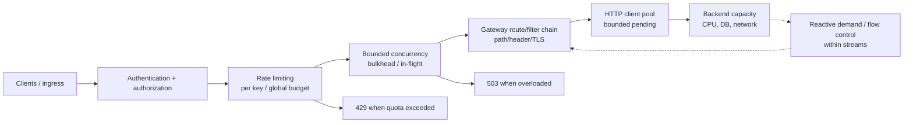
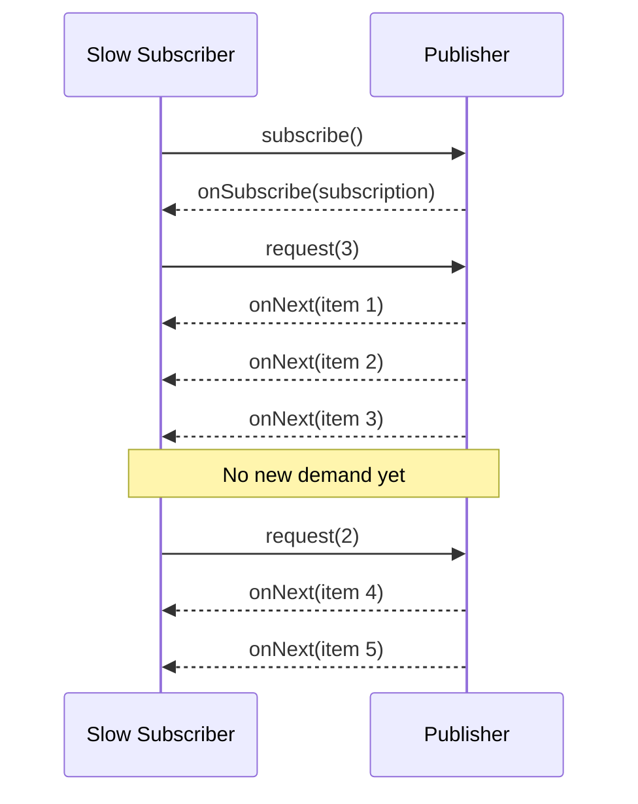
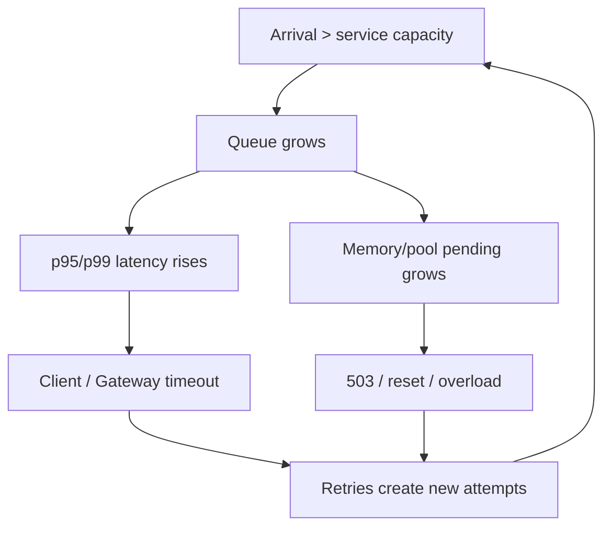
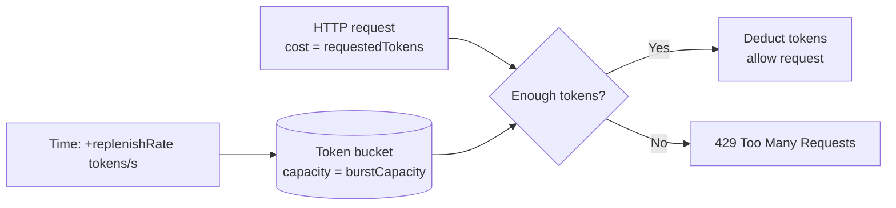
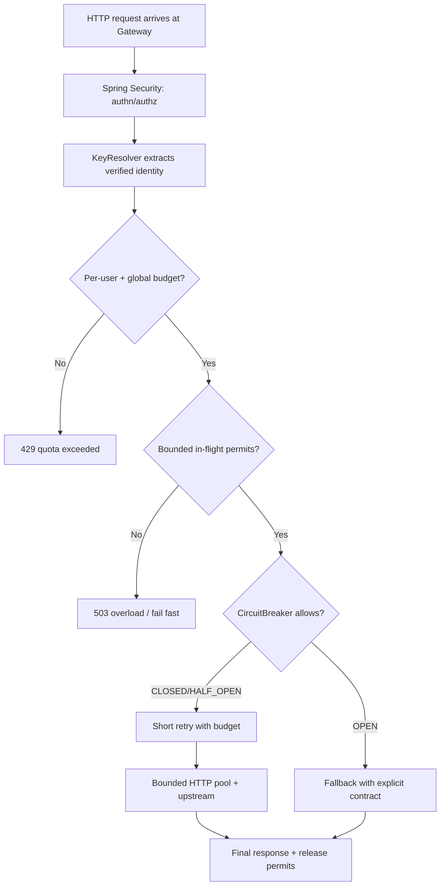
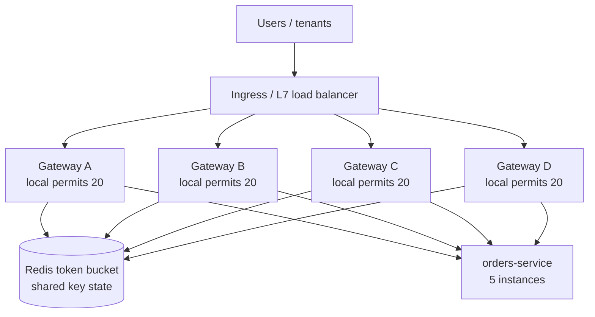

# Balancing Backpressure, Rate Limiting, and Service Capacity

An API Gateway must not only **route requests accurately** but also keep the system operational when request volume exceeds backend capacity. For example, the Gateway receives 1,000 requests/second while the microservices can stably process only 300 requests/second. Even though filters use **Spring WebFlux/Reactor** and do not block the event loop, they cannot create additional CPU capacity, database connections, or downstream capacity. If requests are allowed to queue without bounds, wait times, memory usage, retries, and error rates can all rise simultaneously.

Three mechanisms are often conflated:

- **Backpressure:** the consumer in a reactive stream signals **data demand** upstream, helping avoid emitting data faster than it can be processed.
- **Rate limiting:** controls **the rate of accepted requests** over a period of time, typically counted per user, API key, tenant, route, or a shared budget.
- **Capacity/concurrency control:** controls **how much work is running concurrently**, how much queueing is permitted, and the maximum load placed on the Gateway/backend.

This lesson belongs to the **Performance** chapter of the **SPRING_CLOUD_GATEWAY** module. The goal is to combine route predicates, filter chains, path/header transformations, service discovery, authentication, Redis `RequestRateLimiter`, Retry, CircuitBreaker, TLS, and observability into a measurable **admission control + backpressure + overload protection** strategy.

**After this lesson, you will be able to:**

1. Accurately explain why **Reactive Streams backpressure is not equivalent to HTTP request rate limiting**.
2. Calculate incoming load, post-retry load, concurrency via **Little's Law**, and backend limits with headroom.
3. Configure a Redis token bucket via `RequestRateLimiter`, `KeyResolver`, and `replenishRate`, `burstCapacity`, `requestedTokens`.
4. Design **per-user/tenant** and **aggregate/global** limits without confusing the two.
5. Apply a bounded **concurrency limiter** to avoid unbounded queues and buffers.
6. Read saturation signals from the Reactor Netty connection pool, 429/503 responses, p95/p99 latency, and retry attempts.
7. Test burst load, sustained overload, Redis failures, and overload when the backend slows down.
8. Choose a strategy to fail fast, protect fairness, and recover without causing a retry storm.

> **Scope:** This lesson uses **Spring Cloud Gateway Server WebFlux 5.x** as an example, with the `spring.cloud.gateway.server.webflux.*` namespace. Gateway WebFlux 4.3.x typically uses the `spring.cloud.gateway.*` prefix, and Gateway Server Web MVC uses a different Servlet/HTTP client. Verify the starters and configuration properties of the release train you are running. All RPS thresholds, connection counts, timeouts, and permit counts in this lesson are **illustrative lab values**, not default production configurations.

## 1. Three Different Questions About Speed and Load Capacity

Ask in order:

| Question | Mechanism | Scope of Control |
| --- | --- | --- |
| Is the downstream data stream consuming slower than the producer? | **Reactive backpressure** | Data/items within a `Flux`/`Publisher` subscription |
| Is a single user sending too many HTTP requests per second? | **Rate limiting** | Request frequency by key and window/token bucket |
| Is the system processing too many open calls simultaneously? | **Concurrency limit / bulkhead** | Number of in-flight requests/calls |
| Has the outbound HTTP pool run out of connections for the upstream? | **Connection pool** | Sockets/channels and pending acquires |
| Is the backend starting to fail in bulk? | **Circuit breaker** | Whether new calls should be sent to the dependency |
| Should transient failures be retried? | **Retry budget** | Number of outbound attempts per logical request |
| Does the total request exceed the client's deadline? | **Timeout/deadline** | Duration of a call/request |

**No single mechanism completely replaces the others.** An endpoint with a "fully reactive" `Flux` can still receive hundreds of thousands of new requests. A RedisRateLimiter can reject with 429 when exceeding 10 requests/s/user, yet **cannot** stop 100,000 users each sending 9 requests/s. A fixed connection pool of 100 connections can cap sockets yet still allow calls to queue before acquire and then time out.



The diagram shows the **intended structure**; the actual ordering of Spring Security WebFilters, Gateway GlobalFilters, route GatewayFilters, and Netty handlers must be verified on your exact version. Never assume that because a filter appears earlier in documentation, it always executes before every other filter.

## 2. What Is Backpressure in Reactor Really?

In **Reactive Streams**, a `Subscriber` requests the number of elements it will receive via `Subscription.request(n)`. The `Publisher` is permitted to emit at most up to the remaining demand. This is a mechanism for **throttling items within a single subscription**, not an application-wide HTTP request quota.



A simple example with Reactor:

```java
import org.reactivestreams.Subscription;
import reactor.core.publisher.BaseSubscriber;
import reactor.core.publisher.Flux;

Flux.range(1, 100)
    .doOnRequest(n -> System.out.println("requested: " + n))
    .subscribe(new BaseSubscriber<Integer>() {
        @Override
        protected void hookOnSubscribe(Subscription subscription) {
            request(3);
        }

        @Override
        protected void hookOnNext(Integer value) {
            System.out.println("received: " + value);
            if (value == 3) {
                request(2);
            }
            if (value == 5) {
                cancel();
            }
        }
    });
```

This is an **educational example of Reactive Streams demand**. It does not open HTTP sockets, create Redis tokens, or limit the number of requests coming from browsers.

### Operators Also Modify Demand

`limitRate(n)` splits demand requested from upstream into smaller batches. `flatMap` takes **concurrency** and **prefetch** parameters, which alter the number of active inner publishers or items that can be prepared ahead of time.

```java
// Limits concurrent inner calls *within a single subscription*.
Flux.fromIterable(productIds)
    .flatMap(id -> lookupProduct(id), 16)
    .limitRate(32);
```

If there are 200 independent HTTP requests and each request uses `flatMap(..., 16)`, total potential concurrency can reach **200 × 16**, not 16 across the entire application. A **local** operator limit does not automatically become a **global bulkhead**.

## 3. Non-Blocking Does Not Mean Unlimited Resources

WebFlux and Reactor Netty use event loops to serve many connections without needing a blocking thread per request. That is an advantage in **thread utilization efficiency**, not a guarantee of unlimited resources.

Limits still remain:

- CPU to parse TLS/HTTP/JWT, evaluate predicates, run filters, and serialize headers.
- Heap/off-heap RAM, Reactor queues, `DataBuffer`, TLS connections, and buffers.
- Outbound TCP connections, ephemeral ports, file descriptors, and connection pools.
- Thread/event-loop scheduling, GC pauses, and blocking tasks accidentally executed on the event loop.
- Redis QPS/latency if every request queries the rate limiter.
- Backend workers, database connection pools, caches, disk, and message brokers.
- The number of requests waiting on downstream response time.

**Counterexample:** The Gateway does not block a single thread, yet it accepts 10,000 stream subscriptions waiting 30 seconds on the backend. Every subscription/socket/metadata entry still carries cost; a small Netty connection pool will accumulate pending acquires; client p95 rises even when JVM CPU is low.

### Distinguishing Backpressure from TCP Flow Control

TCP has receive window/flow control, HTTP/2 has stream/connection flow control, and Reactor has `request(n)`. These govern **transferring bytes/items**, but they do not establish an HTTP-level policy such as "accept only 200 order requests/s". Clients can still open **many new requests**. To reject requests beyond capacity, you need **admission control**, not just Reactive Streams.

## 4. Capacity Planning: Start from the Backend, Not Gateway Pod Count

Suppose `orders-service` has:

- **5 healthy instances**.
- Each instance stably handles **100 requests/s** for the workload under test.
- The operations team keeps **20% headroom** to absorb bursts, deployments, and latency variance.
- The Gateway may retry a fraction of requests.

Raw capacity:

\[
C_{\text{raw}}=5 \times 100 = 500\ \text{requests/s}.
\]

Capacity with headroom:

\[
C_{\text{safe}}=500 \times (1-0.20)
=400\ \text{backend attempts/s}.
\]

**This is backend capacity**, not per-Gateway-pod capacity. Scaling Gateway replicas from 2 to 5 **does not** turn 400 into 1,000 backend attempts/s.

### Distinguishing Logical Requests from Outbound Attempts

Suppose 25% of requests are retried **once more** by the Gateway due to transient errors, and the remaining requests are not retried. If `p=0.25` is the retried fraction, expected attempts per request:

\[
A=1+p=1.25.
\]

If the Gateway accepts `\lambda=280` logical requests/s:

\[
\lambda_{\text{out}}
=280 \times 1.25
=350\ \text{attempts/s}.
\]

350 is below `C_safe=400`. However, if it accepts 400 logical requests/s at the same retry ratio:

\[
400 \times 1.25 = 500
\]

then the backend hits **100% of raw capacity**, leaving zero headroom.

**The retry ratio is not constant when the backend saturates.** As latency and errors increase, the retry rate can rise as well, driving outbound throughput even higher. Therefore, capacity planning must account for a **worst-case retry budget**, not only the happy path.

## 5. Little's Law: Rate and Latency Produce Concurrency

In a sufficiently stable system, **Little's Law**:

\[
L=\lambda W
\]

Where:

- `L`: average number of requests/calls **in the system**.
- `\lambda`: average arrival/throughput rate (requests/s).
- `W`: average time a request spends in the system (seconds).

If the Gateway sends `280` calls/s and mean outbound duration is `0.2` seconds:

\[
L=280\times0.2=56\ \text{in-flight calls}.
\]

If the backend slows down to `W=1` second while the Gateway still tries to send 280 calls/s:

\[
L=280\times1=280\ \text{in-flight calls}.
\]

Same **RPS**, yet concurrency increases by **5x** because latency increased. If the system only permits 80 in-flight calls, the excess must either **wait in a bounded queue** or **be rejected**; it cannot vanish simply because I/O is non-blocking.

**Limitations of the formula:** Little's Law applies to steady-state systems measured over a consistent scope. Use **mean duration** over the same request set; do not substitute p95 for W to infer exact concurrency. For bursty workloads and long-tailed response times, run additional load tests.

## 6. Why Unbounded Queues Slow Systems Down and Cause Crashes

If requests arrive at rate `\lambda_{\text{in}}` higher than completion rate `\mu` over a sustained interval, the backlog grows approximately by:

\[
\Delta Q/\Delta t \approx
\max(0,\lambda_{\text{in}}-\mu).
\]

For example, input rate `400/s` while backend max is `300/s`:

\[
\Delta Q/\Delta t \approx 100\ \text{requests/s}.
\]

After 10 seconds, if there is no rejection and all else stays constant, roughly **1,000 requests** can pile up in the queue. As the queue lengthens, more clients time out; client retries add even more arrival rate, triggering an **overload feedback loop**.



### Backpressure vs. Buffering

Unbounded `onBackpressureBuffer()` can turn a rate mismatch into **memory debt**. If the producer stays faster for long enough, even buffered pipelines eventually exhaust memory. A **bounded buffer** absorbs only short bursts; on overflow, you must have an explicit policy: error, drop (if data loss is acceptable), or reject requests at ingress.

A transactional request/response system should normally **fail fast intentionally** rather than hold HTTP calls for tens of seconds after the client has already given up.

## 7. Optimizing Across Three Layers: Rate, Concurrency, and Queue

Overload protection designs typically consist of:

1. **Rate limit:** reduces arrival rate based on quota/traffic source.
2. **Concurrency limit/bulkhead:** keeps in-flight calls aligned with backend latency.
3. **Bounded queue + deadline:** allows small bursts without accumulating work that cannot finish before the client times out.

| Layer | Example Limit | What Should Happen When Exceeded? |
| --- | --- | --- |
| User quota | 10 req/s/user, burst 20 | 429 `Too Many Requests` |
| Tenant quota | 100 req/s/tenant | 429; quota per service plan |
| Aggregate route/backend | 280 logical req/s (estimated) | Policy-based admission shed 429/503 |
| Local in-flight | 20 calls per pod × 4 pods | 503/overload or very brief wait |
| HTTP pool | 50 active connections/pod | Pending acquire with deadline |
| Buffer/queue | 20 items or a very small number | Reject/error when full |
| Backend | 400 safe attempts/s cluster-wide | Circuit breaker, horizontal/vertical backend scaling |

**Do not turn these numbers into rigid rules.** If HTTP/2 multiplexing is enabled, **TCP connection count differs from in-flight HTTP requests**. If the workload consists mostly of long-lived WebSocket/SSE streams, request duration and active-session capacity must be measured separately.

## 8. Redis RequestRateLimiter: How the Token Bucket Works

`RequestRateLimiter` is a **GatewayFilter Factory** that decides whether a request may proceed; when rate-limited, it returns **HTTP 429** by default in Gateway WebFlux. With `RedisRateLimiter`, the algorithm is a **token bucket**.



Three parameters:

| Parameter | Meaning | Example |
| --- | --- | --- |
| `redis-rate-limiter.replenishRate` | Tokens replenished per second | `10` tokens/s |
| `redis-rate-limiter.burstCapacity` | Maximum capacity of the bucket | `20` tokens |
| `redis-rate-limiter.requestedTokens` | Cost per request | `1` token |

With a bucket initially full at `20` tokens, 20 closely spaced requests can be accepted (assuming no other constraints); the 21st request is rate-limited. After one second, the bucket can replenish up to roughly 10 tokens depending on timing/algorithm behavior.

**Do not read `burstCapacity=20` as "20 requests/s sustained forever"**. The sustained rate is the number of tokens replenished per second divided by tokens per request, not the bucket size.

## 9. Token Bucket Formulas and Configuration Choices

Let:

- `R` = `replenishRate` (tokens/s),
- `B` = `burstCapacity` (tokens),
- `K` = `requestedTokens` (tokens/request).

Approximate sustained average request rate:

\[
r_{\text{sustained}} = \frac{R}{K}\ \text{requests/s}.
\]

Number of requests that can pass in a burst from a full bucket, excluding refill during the burst:

\[
N_{\text{burst}} =
\left\lfloor \frac{B}{K}\right\rfloor.
\]

Examples:

| Goal | R | B | K | Sustained Rate | Full-Bucket Burst |
| --- | ---: | ---: | ---: | ---: | ---: |
| 10 req/s, burst 20 | 10 | 20 | 1 | 10 req/s | 20 |
| 10 req/s, minimal burst | 10 | 10 | 1 | 10 req/s | 10 |
| 1 request/60s | 1 | 60 | 60 | 1/60 req/s | 1 |
| 5 req/s, burst 10 | 5 | 10 | 1 | 5 req/s | 10 |
| 20 tokens/s, cost 2 | 20 | 40 | 2 | 10 req/s | 20 |

Spring Cloud Gateway specifically documents setting `R=1`, `K=60`, `B=60` to achieve roughly **1 request/minute**, because `replenishRate` is measured in tokens/s and `requestedTokens` is the cost of one request.

**Do not set `burstCapacity=0`** hoping for "no burst while still accepting 10 req/s": the documentation notes this configuration **blocks all requests**. For a relatively steady rate, typically set `B=R` when `K=1` and adjust for the desired allowable burst.

## 10. Dependencies for Redis Rate Limiter on Gateway WebFlux

Illustrative Maven configuration:

```xml
<!-- WebFlux Gateway; let Spring Boot/Spring Cloud BOM choose versions. -->
<dependency>
  <groupId>org.springframework.cloud</groupId>
  <artifactId>spring-cloud-starter-gateway-server-webflux</artifactId>
</dependency>

<!-- Reactive Redis used by RedisRateLimiter. -->
<dependency>
  <groupId>org.springframework.boot</groupId>
  <artifactId>spring-boot-starter-data-redis-reactive</artifactId>
</dependency>

<!-- Metrics and system observability. -->
<dependency>
  <groupId>org.springframework.boot</groupId>
  <artifactId>spring-boot-starter-actuator</artifactId>
</dependency>

<dependency>
  <groupId>io.micrometer</groupId>
  <artifactId>micrometer-registry-prometheus</artifactId>
</dependency>
```

A Redis server/cluster reachable from the Gateway is required. Redis acts as the **rate-limit state store**; it does not create backend capacity or fix database bottlenecks.

### Things You Must Not Overlook

- Redis must be secured via network policy/TLS/auth; never expose it to the public internet.
- Redis latency/timeouts become **a dependency on the request processing path**.
- If multiple Gateway pods must enforce shared quotas, those pods must share a consistent **rate-limit state** (e.g., the same Redis), avoiding per-pod isolated quotas.
- Each route/key can maintain separate state; verify your namespace/key strategy when you want a budget **shared across multiple routes**.
- Redis used for `RedisRateLimiter` and Redis used as a `RouteDefinitionRepository` serve **different functions**; never flush all keys in production to "reset quotas".

## 11. KeyResolver: Whom to Limit and by What Criterion?

`KeyResolver` selects the **rate-limit key**. If an untrusted key is used, clients can vary its value on each request to bypass the quota.

**WebFlux Java bean** example:

```java
package example.gateway.performance;

import java.security.Principal;

import org.springframework.cloud.gateway.filter.ratelimit.KeyResolver;
import org.springframework.context.annotation.Bean;
import org.springframework.context.annotation.Configuration;

@Configuration(proxyBeanMethods = false)
class GatewayRateLimitKeys {

    @Bean
    KeyResolver principalRateKey() {
        return exchange -> exchange.getPrincipal()
            .map(Principal::getName)
            .filter(name -> !name.isBlank());
    }
}
```

**Condition:** The route must be properly authenticated by Spring Security in the WebFilter chain before using `Principal` for quota enforcement. `Principal.getName()` may be an identifier generated by Security; make sure it is **stable and cannot be forged by the user**. If the gateway allows anonymous requests onto the route, do not lump them onto one shared `anonymousUser` inadvertently, as they will either fight over a single bucket or be treated as a real user.

In Gateway documentation, `PrincipalNameKeyResolver` is already the default key resolver. Declaring it explicitly here helps readers see the choice **key = authenticated identity**. For per-tenant quotas, use a **verified tenant ID from an authenticated JWT** paired with membership enforcement, rather than taking a raw `?tenant=...` query parameter.

### Do Not Use Self-Supplied Input as Quota Identity

```java
// ONLY illustrates a vulnerability: clients change "user" to bypass limits.
// Do not use as a production KeyResolver.
@Bean
KeyResolver unsafeUserKey() {
    return exchange -> Mono.justOrEmpty(
        exchange.getRequest().getQueryParams().getFirst("user"));
}
```

Similarly, client-supplied `X-User-ID`/`X-Tenant-ID` headers are untrusted, `X-Forwarded-For` can be spoofed without a trusted proxy chain, and IP addresses can collide due to NAT. **KeyResolver is part of your security/quota policy**, not merely a string extraction helper.

## 12. Configuring a Route with RequestRateLimiter

**Gateway Server WebFlux 5.x** example:

```yaml
spring:
  data:
    redis:
      host: localhost
      port: 6379
  cloud:
    gateway:
      server:
        webflux:
          routes:
            - id: orders-read
              uri: http://localhost:8081
              predicates:
                - Path=/api/orders/**
                - Method=GET
              filters:
                - StripPrefix=1
                - name: RequestRateLimiter
                  args:
                    key-resolver: "#{@principalRateKey}"
                    redis-rate-limiter.replenishRate: 10
                    redis-rate-limiter.burstCapacity: 20
                    redis-rate-limiter.requestedTokens: 1
```

Here:

- `orders-read` matches only `GET /api/orders/**`.
- `StripPrefix=1` rewrites `/api/orders/42` to `/orders/42`.
- Each identity key has a replenish rate of **10 tokens/s** and a maximum burst of **20 tokens**.
- Requests denied by the rate limiter normally return **429** instead of being proxied to the backend.
- `uri: http://localhost:8081` is for **lab use**; production setups can use `lb://orders-service` with properly configured LoadBalancer/service discovery.

**Do not use the shortcut syntax `RequestRateLimiter=10,20,...`**. Official documentation emphasizes that this filter **does not support** shortcut configuration like other GatewayFilters; you must use `name`/`args`.

### On Empty Keys

When the resolver yields no key, the Gateway **denies by default** according to the documentation. Verify the exact status code and configuration property for your version. **Never force anonymous requests onto a random per-request key** to "fix 429 errors": that nullifies the quota. Require authentication or design an anonymous bucket with its own dedicated cap.

## 13. RedisRateLimiter and Fair Use: One Key Is Not the Entire System

Suppose each user has a quota of `10 req/s`, and **100 users** are active simultaneously. Maximum total request rate:

\[
100 \times 10 = 1{,}000\ \text{req/s}.
\]

If the backend is only safe up to **400 attempts/s**, a **per-user** Redis token bucket cannot prevent aggregate overload. No individual user exceeds their quota, yet **the system as a whole exceeds capacity**.

### Budget Layers

| Quota | Suggested Key | Purpose |
| --- | --- | --- |
| Per-user | Authenticated user ID, tenant-bound | Prevent a single user from generating excessive load |
| Per-tenant | Verified tenant ID | Enforce contractual fairness |
| Per-client/application | Verified OAuth2 client ID | Isolate an abusive integration app |
| Per-route | Route ID + key | API-specific policy |
| Per-backend aggregate | Service identity/capacity group | Protect shared backend capacity |
| Per-pod concurrency | Local in-flight permits | Protect Gateway instance memory/sockets |

A well-designed system typically needs **at least per-key quotas plus an aggregate capacity budget**. For expensive endpoints, you can also add **weighted cost** (for example, a report request costs 5 tokens instead of 1), though costs reflecting true load should be benchmarked first.

### Multiple RequestRateLimiters on the Same Route?

You might consider chaining two filters: a user limiter followed by a backend-wide limiter. **Be careful:** two token deductions **do not form an atomic transaction** just because they sit in the same filter chain. If the first limiter deducts a token and the second rejects the request, the first quota may already have been consumed. You need clear policies for fairness, ordering, and failure behavior.

For accurate aggregate enforcement across multiple routes and pods, consider a **custom admission-control service/RateLimiter** with unified enforcement semantics, or global load shedding at the edge/mesh, and test consistency thoroughly.

## 14. Combining Per-User Rates with a Backend-Wide Budget

Suppose:

- The backend safely handles **400 attempts/s**.
- Each logical request averages **1.25 attempts** due to retries.
- You choose **280 logical requests/s** to leave extra headroom.
- A normal user can reach 10 req/s, burst 20.
- There are 4 Gateway pods.

Design:

```text
Client (user key)
  └── Per-user RedisRateLimiter: 10 req/s, burst 20
       └── Aggregate admission budget: ~280 logical req/s
            └── Local in-flight limiter: e.g., ~20 calls/pod
                 └── HTTP client + backend
```

**Do not infer `4 Gateway pods × 280 req/s = 1,120 req/s`.** If 280 is the budget for the **entire backend**, you must enforce a shared limit or scale pods in coordination. Static equal splitting gives each pod 70 req/s, which **allocates unevenly under skewed traffic** (pod A can saturate while B sits idle). A global token bucket can be more flexible, at the cost of depending on the latency and availability of the state store.

**Do not put every user onto a single shared constant key without a fairness policy**, because the noisiest tenant can consume all tokens before important customers get through. Combine per-user quotas, tenant quotas, and global load shedding.

## 15. Concurrency Limiter: Protecting In-Flight Request Count

Rate limits measure **requests/second**; concurrency limiters measure **currently active work**. For instance, 280 req/s with a 200 ms mean duration produces around 56 concurrent calls. You might start testing with **80 total permits** to absorb variance, though that is not yet a production-proven threshold.

Split evenly across 4 Gateway pods, you could configure **20 permits per pod**. However, the sum equals 80 only when all four pods share identical configuration and receive balanced traffic; lost pods, added pods, rolling deployments, or ingress skew change effective capacity. Local permits are **not** a global quota.

### What Does a Bulkhead Mean?

A **bulkhead** isolates concurrency so that a slow dependency cannot exhaust resources needed by other routes:

```text
catalog-service: max in-flight 40
orders-service:  max in-flight 20
reports-service: max in-flight 10

Do not use a single unbounded shared queue for all backends.
```

If `reports-service` slows down, it consumes only its own quota; `orders-service` retains its permits, preventing cascading failure.

Spring Cloud CircuitBreaker/Resilience4j supports **Reactive Bulkhead** using `SemaphoreBulkhead` for reactive chains. Do **not assume by default** that simply adding a `CircuitBreaker` route filter automatically enforces the bulkhead you expect across every version and configuration. Verify the dependencies/auto-configuration and test actual in-flight call counts.

## 16. Illustrative Java GlobalFilter for Fail-Fast In-Flight Permits

The example below illustrates **local concurrency admission** in Gateway WebFlux. It is **not a general production implementation**: it applies to all matched routes and controls only a **single JVM**; it has no awareness of per-backend capacity, HTTP/2 streams, or multiple pods.

```java
package example.gateway.performance;

import java.util.concurrent.Semaphore;

import org.springframework.cloud.gateway.filter.GatewayFilterChain;
import org.springframework.cloud.gateway.filter.GlobalFilter;
import org.springframework.core.Ordered;
import org.springframework.http.HttpStatus;
import org.springframework.stereotype.Component;
import org.springframework.web.server.ServerWebExchange;
import reactor.core.publisher.Mono;

@Component
public final class LocalInFlightGuard implements GlobalFilter, Ordered {

    private final Semaphore permits = new Semaphore(80);

    @Override
    public Mono<Void> filter(
            ServerWebExchange exchange,
            GatewayFilterChain chain) {

        return Mono.defer(() -> {
            // Never block the Netty event loop waiting for a permit.
            if (!permits.tryAcquire()) {
                exchange.getResponse()
                    .setStatusCode(HttpStatus.SERVICE_UNAVAILABLE);
                return exchange.getResponse().setComplete();
            }

            // Release on normal completion, error, or cancellation.
            return chain.filter(exchange)
                .doFinally(signal -> permits.release());
        });
    }

    @Override
    public int getOrder() {
        return -50;
    }
}
```

**Key points:**

- `Semaphore.tryAcquire()` does not wait/block.
- `Mono.defer` makes the acquire decision at subscription time.
- `doFinally` releases the permit on success, error, or chain cancellation.
- Here, 503 means **the Gateway is rejecting due to overload**, distinct from 429 for client quota exhaustion.
- `getOrder=-50` is an **example**, not a universal standard order: inspect the **combined filter chain** relative to `RequestRateLimiter` and other filters.
- If one critical route needs 20 permits and another needs 60, **do not share one pool of 80** and assume both are fairly protected.
- If a Gateway pod crashes mid-request, the in-process semaphore disappears with it; no "distributed permit" needs to be released in Redis.
- A custom filter does not replace input/body size limits, response timeouts, or outbound connection pools.
- If the retry filter sits **inside** the guard, one logical request can hold a permit across all attempts and backoff; if it sits outside, each attempt may acquire its own permit. Test the actual semantics.

To be production-ready, add **route/service keying, metrics, safe dynamic configuration, shutdown behavior, fairness, and load tests**. When an established framework bulkhead fits, prefer a supported, tested mechanism over building complex concurrency primitives from scratch.

## 17. Reactor Netty HTTP Client Pool: Capping Sockets, Not Replacing Limiters

Gateway WebFlux uses the Reactor Netty HTTP client to proxy HTTP upstream. A fixed pool can cap active connections and acquire wait time:

```yaml
spring:
  cloud:
    gateway:
      server:
        webflux:
          httpclient:
            connect-timeout: 1000     # milliseconds
            response-timeout: 2s      # Duration
            pool:
              type: fixed
              max-connections: 100
              acquire-timeout: 300   # milliseconds
              metrics: true
```

**Details to read accurately:**

- `pool.type: fixed` enables capping active connections via `max-connections`.
- `acquire-timeout` is the wait timeout to acquire a connection for a fixed pool, **measured in milliseconds** per Gateway configuration properties.
- `connect-timeout` is the TCP connection establishment timeout, also in **milliseconds**.
- Global `response-timeout` uses `Duration` (for example, `2s`).
- `pool.metrics: true` enables Reactor Netty connection provider instrumentation when a compatible metrics registry is present.
- These values are **lab examples**, not universally good defaults for every backend.

**Do not equate `max-connections=100` with "100 HTTP requests across the whole gateway"**. The pool can track multiple remote addresses/pool identities, and HTTP/2 multiplexing behaves differently from HTTP/1.1. Connection limits constrain one resource type but are neither a per-user quota nor a global concurrency policy.

### Every Queue Needs a Deadline

If all connections are busy, requests wait to acquire. Excessive pending requests drive up latency while still consuming memory and metadata. Pick timeouts aligned with the **client deadline**; bound total pending acquires where supported by the HTTP client/framework and verify actual behavior. When your policy requires **immediate rejection**, place a concurrency/admission guard in front of the outbound pool instead of letting requests sit in the pool until timeout.

## 18. Backpressure in Bodies and Streams: Bound Buffers and Concurrency

In a data transformation pipeline:

```java
Flux<Product> products = fetchProducts();

return products
    .flatMap(this::enrichProduct, 16)
    .limitRate(32);
```

- `flatMap(..., 16)` caps active inner publishers to roughly 16 **within this subscription**.
- `limitRate(32)` shapes upstream demand.
- Neither sets a global Gateway RPS limit.
- If `enrichProduct` calls a blocking client, never invoke it directly on the Reactor Netty event loop. Offload blocking work onto an appropriate scheduler or replace it with a reactive client and bound concurrency.

### Avoid Unbounded Buffering

```java
// ANTI-PATTERN to avoid with fast push producers:
// a high-volume sink using unbounded onBackpressureBuffer()
// while the consumer is frequently slow or disconnected.
Sinks.Many<Event> sink =
    Sinks.many().unicast().onBackpressureBuffer();
```

Reactor documentation notes that a unicast sink configured this way **can buffer without bound by default**. If a use case requires buffering, choose a **bounded queue**/publisher policy, and verify overflow behavior and memory budget.

```java
// Illustrates a bounded buffer for a stream that may signal an error on overload.
// Do not use for storing orders or money unless loss/replay is designed.
Flux<Event> controlled = source
    .onBackpressureBuffer(64);
```

Once pending items exceed the bound, Reactor can **error/cancel** according to the operator's overload policy instead of growing indefinitely. For telemetry streams where **data loss is acceptable**, explicit drop/sampling policies can be designed; for orders/payments, use a durable broker with ack/replay rather than silently dropping data.

### DataBuffer and Request Bodies

Filters like `ModifyRequestBody`, `CacheRequestBody`, or Retry with a request body can **aggregate/copy the body into memory**. That is a different resource boundary from `Flux` demand. Enforce request-size limits, test large uploads and cancellation cleanup, and avoid unconditionally retrying large POST bodies.

## 19. Rate Limiting Does Not Measure Backend Execution Time

A user is allowed 10 req/s. Compare two request types:

| Request | Backend Duration | Average In-Flight at 10 req/s |
| --- | ---: | ---: |
| GET cache hit | 20 ms | 0.2 calls |
| GET complex report | 2 seconds | 20 calls |
| Long-lived SSE stream | 10 minutes | Should not be accounted like JSON GET |
| WebSocket session | Multiple hours | Requires separate concurrent-session quota |

The same **10 req/s** yields **drastically different** concurrency and memory loads. Rate limiting may therefore need tiering by **endpoint cost**:

- Cheap reads: higher quota.
- Heavy reporting: low quota and tight concurrency cap.
- Uploads: body size/bandwidth limits and concurrent upload caps.
- SSE: active streams, duration, per-user session caps.
- WebSockets: handshake rate **and** active socket/session counts.
- Writes: idempotency/rate caps and database protection.

**Do not apply the same Redis token cost=1 and same concurrency cap to every API** and assume resource fairness. One heavy reporting request can consume more backend capacity than ten cache hits.

## 20. How Can Retries Break Load Balancing?

Suppose the backend receives 300 logical requests/s; 20% time out and each failed request is retried **once**:

\[
\lambda_{\text{out}}=300(1+0.2)=360\ \text{attempts/s}.
\]

If 50% fail:

\[
\lambda_{\text{out}}=300(1+0.5)=450\ \text{attempts/s}.
\]

A backend that is safe at 400 attempts/s gets **pushed to 450 by retries** as errors spike — the exact moment load needs to go down.

### Rules to Prevent Retry Storms

1. Retry only **transient** failures on requests with **idempotent** semantics.
2. Enforce a **maximum attempt count**, bounded backoff, and jitter.
3. Set an overall deadline so clients do not time out before the Gateway finishes its retry sequence.
4. Never retry `401`/`403`; be cautious retrying overload `429`/`503` responses.
5. Avoid simultaneous multi-layer retries across client, ingress, Gateway, and backend.
6. Maintain a dedicated **retry budget** and track `outbound attempts / logical requests`.
7. When the breaker is OPEN or backend saturation is evident, **shed/load-limit** instead of sending more attempts.
8. If Retry sits after an admission guard, verify whether tokens/permits are consumed **once per logical request** or **once per attempt**.

Spring Cloud Gateway's Retry documentation explicitly warns: **filters positioned after Retry can be executed multiple times**. Therefore, the ordering of `RequestRateLimiter`, Retry, custom filters, and CircuitBreaker determines how quotas and metrics are counted. Do not guess from filter names; inspect a backend request journal in integration tests.

## 21. CircuitBreaker and Bulkhead Complement Each Other

CircuitBreaker detects high upstream error/slow-call rates and short-circuits new calls when OPEN. **Bulkhead** caps concurrent calls **even while the breaker is CLOSED**.

| Condition | Rate Limiter | Bulkhead | CircuitBreaker |
| --- | --- | --- | --- |
| Normal traffic | Allows within quota | Allows within permits | CLOSED, passes traffic |
| Single abusive tenant | 429 for that tenant | Does not necessarily fill | Likely stays CLOSED |
| Backend slow, few 5xx yet | Quota unchanged | Permits fill, sheds excess | May open on slow-call threshold if configured |
| Backend returns 503 repeatedly | Unaware of backend health | Blocks overload | Opens after failure threshold |
| CircuitBreaker OPEN | Quota remains separate policy | Outbound permits not consumed if ordered properly | Short-circuits + fallback |
| Backend recovering | Quota still bounds traffic | Caps concurrent probes | HALF_OPEN → CLOSED |

**Common mistake:** "We already have a CircuitBreaker, so we don't need a concurrency limit." Breakers usually require enough sampled calls to trip and may stay closed during a sudden burst of several hundred requests; a concurrency guard **limits immediately**.

### Reactive Bulkhead and Dependencies

In Spring Cloud CircuitBreaker/Resilience4j, **ReactiveResilience4jBulkheadProvider** wraps `Mono`/`Flux` with `SemaphoreBulkhead`, avoiding fixed blocking thread pools for reactive pipelines. Verify the actual integration and factory active in your deployed version.

Do not assume that declaring:

```yaml
resilience4j:
  bulkhead:
    instances:
      ordersBulkhead:
        maxConcurrentCalls: 20
```

automatically caps every `orders-read` route at 20. That configures **a bulkhead instance**; there still must be **a wrapper around the Gateway call** referencing the matching name/factory. Verify with a load test measuring in-flight count and bulkhead rejection metrics.

## 22. Ordering Load Controls and Business Errors

A **logical** design for a protected route:



**Do not treat this as automatic framework default ordering.** Spring Security executes in the WebFilter chain; `GlobalFilter` and `GatewayFilter` follow their own merging and ordering rules. Placing a filter before or after Retry/CircuitBreaker yields different semantics (counting logical requests vs. attempts). Verify using a request journal, Redis counters, and breaker state.

### Rejecting at the Right Moment

If security already rejects a request with `401/403`, do not spend backend quota on it. If the rate limiter returns `429`, do not open an outbound connection. If the concurrency guard has no available permits, do not hold the request in a queue for seconds before returning `503`.

**A policy only helps if it sits in the right place** on the data path; a filter executing too late cannot relieve expensive steps preceding it.

## 23. Choosing 429, 503, 504, and Retry-After Correctly

| HTTP Status | When Appropriate | How Clients Should Interpret It |
| --- | --- | --- |
| `429 Too Many Requests` | Client/tenant exceeded published quota | Slow down, back off according to quota |
| `503 Service Unavailable` | Gateway/backend temporarily overloaded or unavailable | May retry **with control**, never immediately or infinitely |
| `504 Gateway Timeout` | Gateway waited on upstream past deadline (per error mapping) | Cannot assume backend did not process the request |
| `401 Unauthorized` | Unauthenticated | Log in / obtain valid token; do not retry blindly |
| `403 Forbidden` | Unauthorized for resource | Do not retry to bypass |
| `502 Bad Gateway` | Gateway hit proxy/upstream error | Diagnose DNS/TLS/connection reset/upstream issue |

**`RequestRateLimiter` returns 429 by default** per documentation. In a custom local guard returning `503` as shown in Section 16, that status code is an explicit code choice, not Spring Cloud Gateway's built-in default when a pool is exhausted.

### Retry-After

Under HTTP semantics, `Retry-After` can inform clients **when to try again**. However, Spring Cloud Gateway **does not automatically compute an exact `Retry-After` header for all Redis token bucket or 503 overload scenarios**. If you attach it via custom policy, ensure the delay reflects reality and does not synchronize thousands of clients to retry at the exact same instant.

Clients should implement **exponential backoff + jitter** with attempt/deadline caps, rather than relying on the header always being present. For non-idempotent `POST` requests, even `Retry-After` does **not** make retrying safe.

## 24. Redis Outage: The Rate Limiter Is a New Dependency

If Redis times out while the Gateway is checking tokens, what happens?

**There is no universal fail-open or fail-closed answer across all versions and customizations.** Your implementation, error mapping, and fallback logic determine the outcome. You must **test the exact binary** you deploy using Toxiproxy or a staging Redis container with severed connectivity.

Three policy directions:

| Approach | Benefit | Risk |
| --- | --- | --- |
| **Fail-closed** | Prevents uncontrolled traffic from hitting backend | Valid requests get rejected while Redis is down |
| **Fail-open** | Preserves short-term availability | Can overload the entire backend or open an abuse vector |
| **Degraded mode with local cap** | Sustains limited service under a hard cap | Requires careful coding/testing; loses cluster-wide quota accuracy |

**Never switch from fail-closed to fail-open by swallowing every exception with `onErrorResume(e -> allowAll)`.** If you want a degraded mode, pair it with a **local concurrency cap, emergency aggregate budget, alerting, and a time limit**. For sensitive APIs (payments/security quotas), fail-closed may be safer; for critical public read APIs, a capped fallback design may make sense.

### Specific Metrics to Watch

- Redis command latency/errors and timeout rate.
- 429 rate by route/key class (never raw user IDs).
- Accepted vs. rejected RPS.
- Backend 5xx/p95/pool pending when Redis fails.
- Redis connection pool saturation and network errors.
- Time the Gateway spends waiting for quota decisions.

## 25. Caching, Service Discovery, and Resource Limits

Not all requests cost the same. A cached `GET /catalog/items/42` hit can be virtually free; `GET /reports/monthly` may fan out across multiple services and databases.

Ways to reduce load **before** raising rate limits:

- Properly cache public/cacheable GETs according to contract, with explicit TTLs and tenant/PII isolation.
- Coalesce duplicate calls where possible without breaking isolation.
- Optimize backend queries, indexes, and DB connection counts.
- Eliminate N+1 call patterns in Gateway or Backend-for-Frontend logic.
- Offload heavy routes to asynchronous workers/queues returning a job ID when business semantics permit.
- Tune response compression, TLS session reuse, and HTTP keep-alive.
- Use LoadBalancer/service discovery to route to **healthy instances**, without confusing load distribution with total capacity.
- Configure timeouts and circuit breakers so an unhealthy backend cannot tie up connections indefinitely.

**Be careful with caching:** never store user-specific responses in a shared cache lacking proper key/authorization boundaries. Caching is also not a general-purpose solution for POSTs or WebSocket streams.

## 26. Connection and TLS Costs When Scaling

A WebFlux Gateway commonly terminates HTTPS at the edge and opens HTTP(S) connections upstream. Adding pods introduces costs beyond raw RPS:

- TLS handshake CPU if connection reuse is low.
- Total outbound connections to backends.
- DNS queries and cache lifecycle churn.
- Load balancer / ingress target connections.
- Socket and file descriptor limits.
- JVM direct memory buffers / Netty allocator overhead.
- Redis connections and commands for rate limiting.

For example, 4 Gateway pods each configured with a fixed pool of max 100 connections to the same backend **can** create several hundred total outbound connections depending on pool/remote address mapping, not 100 across the whole cluster. Scaling out to 10 pods can significantly increase concurrency hitting the backend and database.

**Do not increase `max-connections` and Gateway replicas together expecting latency to drop automatically.** When the bottleneck is the database, you merely increase the number of requests queued on DB locks/connections, often worsening p99.

## 27. Essential Metrics to See Balance vs. Imbalance

| Signal | Why It Matters |
| --- | --- |
| `spring.cloud.gateway.requests` by routeId, status, method | RPS and outcomes of logical client requests |
| Rate-limit accepted/rejected counts | Confirms quota shedding works as intended |
| `429` by route/tenant class | Detects abnormal throttling of clients |
| `503` by source (gateway guard/backend/breaker) | Distinguishes overload shedding from dependency outage |
| p50/p95/p99 and latency SLO | Queueing rises before 5xx spikes |
| Outbound attempts per logical request | Detects retry amplification |
| Reactor Netty active/max/pending connections | Reveals pool saturation |
| Pool pending acquire duration | Shows connection wait time |
| JVM heap/direct memory, GC, CPU throttling | Reflects Gateway runtime health |
| Redis latency/command errors | Spots quota decision bottlenecks |
| Backend p95/5xx, DB pool/queue | Locates the real downstream bottleneck |
| CircuitBreaker OPEN/half-open/fallback | Shows whether upstream protection is active |
| Active WS/SSE sessions | Captures streaming-specific capacity |
| Per-pod/cluster revision/config | Detects quota drift across replicas |

Gateway WebFlux documentation describes the `spring.cloud.gateway.requests` timer when Actuator/Gateway metrics are enabled. With Prometheus, Micrometer Timers typically export `spring_cloud_gateway_requests_seconds_count`, `_seconds_sum`, and `_bucket` histograms when configured.

### Enabling Netty Pool Metrics

```yaml
spring:
  cloud:
    gateway:
      server:
        webflux:
          httpclient:
            pool:
              metrics: true

management:
  endpoints:
    web:
      exposure:
        include: health,metrics,prometheus
```

**Remember:** The configuration namespace may differ in 4.x. `management.endpoints.web.exposure.include` only exposes the endpoints; it **does not secure them**. Restrict access via management network, TLS/auth/RBAC, and never expose topology or metrics publicly.

## 28. PromQL: Traffic, 429s, 5xxs, and Pool Pending

**Verify metric names and labels on your actual binary** before relying on these queries. In some setups, labels like `httpStatusCode` may vary by version or exporter.

RPS recorded by Gateway route metrics:

```promql
sum by (routeId) (
  rate(spring_cloud_gateway_requests_seconds_count{
    job="gateway-prod"
  }[5m])
)
```

429 RPS (when RequestRateLimiter 429s are captured by the Gateway timer for the matching route):

```promql
sum by (routeId) (
  rate(spring_cloud_gateway_requests_seconds_count{
    job="gateway-prod",
    httpStatusCode="429"
  }[5m])
)
```

5xx RPS:

```promql
sum by (routeId) (
  rate(spring_cloud_gateway_requests_seconds_count{
    job="gateway-prod",
    httpStatusCode=~"5.."
  }[5m])
)
```

Pending outbound connections:

```promql
sum by (instance, name) (
  reactor_netty_connection_provider_pending_connections{
    job="gateway-prod"
  }
)
```

**Never treat 429 count alone as proof that quotas work properly.** If requests are rejected before route matching or in Security, the Gateway route timer may never observe them. Instrument your admission layer and HTTP server/ingress metrics, plus a **backend request journal** during load tests.

### Rejected vs. Saturated

A healthy system can exhibit elevated 429s from enforcing quotas while p95 for **accepted** requests and backend 5xx remain low. That indicates protection mechanisms may be doing their job.

Conversely, if 429s drop while backend 503s and pool pending rise, operators may have **loosened quotas too far**. Never optimize a single metric in isolation.

## 29. Designing a Meaningful Load Test

To select rate limits and concurrency permits, benchmark real workloads rather than picking arbitrary numbers.

### Environment Preparation

1. Deploy Gateway WebFlux, Redis, and a test backend with a traffic profile close to production.
2. Include at least one cheap read endpoint, one slow/heavy endpoint, and one controllable error response.
3. Use real test identities/tokens accepted by Security; never rely on spoofable `X-User` headers.
4. Measure backend throughput **without Retry**, ramping RPS until p95 or error rate breaches SLO.
5. Record backend capacity across different instance counts.
6. Enable per-user RedisRateLimiter and observe 429/burst behavior.
7. Add aggregate admission/concurrency guards and re-run the same load.
8. Enable bounded Retry and observe outbound attempts rising and safe capacity falling.
9. Increase backend response time to simulate saturation.
10. Test Redis failure, pod restarts, and skewed traffic across Gateway replicas.

### Open-Loop vs. Closed-Loop Load Generators

A load generator producing an **arrival rate independent of response latency** (open-loop) exposes real overload behavior. If clients **wait for each response before sending the next request** (closed-loop), slower backends automatically throttle request generation, which can **mask** the real arrival load production clients and queues continue generating.

**Do not run unbounded load tests against production.** Load tests establish configuration baselines; they are not an exercise in taking down live traffic.

## 30. k6 Example with Controlled Arrival Rate

An **illustrative** k6 script using **multiple staging IdP test access tokens**. Never hard-code JWTs in source control or log tokens.

```javascript
import http from "k6/http";
import { check } from "k6";
import { Counter, Trend } from "k6/metrics";

const rejected429 = new Counter("gateway_rejected_429");
const unavailable503 = new Counter("gateway_unavailable_503");
const successLatency = new Trend("accepted_latency_ms", true);

const baseUrl = __ENV.BASE_URL || "http://127.0.0.1:8080";
const tokens = (__ENV.TEST_TOKENS || "")
  .split(",")
  .map(x => x.trim())
  .filter(Boolean);

if (tokens.length === 0) {
  throw new Error("Provide staging-only TEST_TOKENS securely");
}

export const options = {
  scenarios: {
    controlled_arrivals: {
      executor: "ramping-arrival-rate",
      startRate: 30,
      timeUnit: "1s",
      preAllocatedVUs: 100,
      maxVUs: 300,
      stages: [
        { target: 100, duration: "1m" },
        { target: 250, duration: "2m" },
        { target: 400, duration: "2m" },
        { target: 100, duration: "1m" }
      ]
    }
  }
};

export default function () {
  // Tokens must represent distinct real authenticated principals,
  // not duplicates of the same token.
  const token = tokens[(__VU - 1) % tokens.length];

  const res = http.get(
    baseUrl + "/api/orders/42",
    {
      headers: { Authorization: "Bearer " + token },
      timeout: "5s"
    }
  );

  if (res.status === 429) rejected429.add(1);
  if (res.status === 503) unavailable503.add(1);
  if (res.status >= 200 && res.status < 400) {
    successLatency.add(res.timings.duration);
  }

  check(res, {
    "response is 2xx, 3xx, 429 or controlled 503": r =>
      (r.status >= 200 && r.status < 400) ||
      r.status === 429 || r.status === 503
  });
}
```

### Interpreting Test Results

- With **a single token**, a 10 req/s per-user quota blocks most traffic; **never** use that result to estimate aggregate backend capacity.
- Use multiple authorized tokens/principals/tenants to generate aggregate load without exceeding test permissions.
- k6 enforces a virtual user limit; check `dropped_iterations` to verify the generator actually sustained the target arrival rate.
- `http_req_duration` includes fast 429 rejections by default, so inspect `accepted_latency_ms` and backend p95 separately to avoid hiding latency degradation.
- Record actual completed RPS, 429/503 counts, backend attempts, and active connections, not only target arrival rate.
- A 503 from custom load shedding differs from a 503 caused by backend outage; use distinct correlation/metrics to tell them apart.

Run only in authorized staging/lab environments with explicit stop conditions if Redis, DB, or shared backends breach limits.

## 31. Acceptance Test Suite for Load-Balancing Behavior

| Test | Given | When | Then |
| --- | --- | --- | --- |
| T01 | Single user, full bucket (20) | Burst 20 GETs near-simultaneously | Accepts up to ~20 tokens depending on timing |
| T02 | Single user, empty bucket | Send more requests immediately | 429 returned; backend sees zero denied requests |
| T03 | 100 users, each under quota | Total RPS exceeds backend safe capacity | Aggregate admission/bulkhead sheds load; accepted p95 protected |
| T04 | Backend mean 200ms | 280 req/s | In-flight matches forecast with headroom |
| T05 | Backend mean rises to 1s | Arrival rate unchanged | In-flight guard/pool does not grow unbounded |
| T06 | 20% retried once | 300 logical req/s | Outbound attempts approx. 360/s |
| T07 | CircuitBreaker OPEN | Send GET | New upstream attempts drop to 0 for route; fallback responds |
| T08 | Missing/invalid JWT | Send request | Security returns 401/403; quota cannot be bypassed via spoofed identity |
| T09 | KeyResolver returns empty | Send request | Denied per policy; never generates random key to allow |
| T10 | Redis disconnected | Send quota-protected requests | Configured fail-open/closed behavior verified; alert fires |
| T11 | Gateway pod restarts | Send requests across multiple pods | Cluster rate-limit state remains consistent |
| T12 | Scale 4 pods to 6 | Add Gateway instances | Does not unintentionally multiply backend quota |
| T13 | Slow backend, fixed pool full | Send requests | Pending acquire respects deadline; no memory leak |
| T14 | Heavy report and cheap GET share route | Same RPS | Weighted quota/concurrency reflects true cost |
| T15 | Payment POST times out | Any Retry configuration | Zero duplicate side effects if business permits retry |
| T16 | Streaming/SSE | Open many sessions | Session/concurrency cap enforced; JSON latency budget not misapplied |
| T17 | 429 from rate limiter | Load test multiple clients | Clients do not hammer with unbounded tight retries |
| T18 | Redis rate-limit latency rises | Hold load steady | Metrics distinguish quota bottleneck from backend latency |
| T19 | Admission layer disabled | Arrival > service capacity | p95/queues/5xx degrade as control hypothesis predicts |
| T20 | Designed admission enabled | Same arrival rate | Accepted SLO improves; rejections stay within policy |

**Do not expect every test to emit an exact fixed count of 429s per "exact second"**. Token buckets replenish continuously/algorithmically, and requests cannot always land on identical timestamps. Assertions should verify **upper bounds, eventual refill, expected patterns**, and backend request counts.

## 32. Multi-Replica Gateways and Fairness

With 4 Gateway pods behind ingress:



**What Redis solves:** When Gateway pods share a **common rate-limit key namespace/state**, a user does not multiply their quota by 4x merely by hitting different pods.

**What Redis does not solve:** 20 local permits/pod do not automatically create a **perfectly fair cluster-wide 80-permit distributed semaphore**. Ingress may send 70% of traffic to one pod, causing it to return 503 while sibling pods remain idle. Measure traffic distribution and adjust capacity/placement. If strict cluster-wide concurrency or quota fairness is required, use a dedicated admission system or a consistent aggregate token budget design.

### Tiered Quotas Require Verified Entitlements

For example:

- Gold tenant: 100 req/s, burst 150.
- Standard tenant: 20 req/s, burst 30.
- Anonymous: 2 req/s (per controlled identity/IP policy).

**Never take the plan tier straight from a client-sent `X-Plan: gold` header.** Plan entitlements must derive from verified identity/claims or a quota service across a clear trust boundary. Rate limiting is both a commercial/security policy and performance tuning.

## 33. Adaptive Concurrency: When Capacity Changes Over Time

Backend capacity is not constant: cache-miss spikes, database maintenance, GC pauses, or cross-region failover can shift sustainable throughput rapidly.

### Static vs. Adaptive

| Limiting Approach | Advantage | Weakness |
| --- | --- | --- |
| Static per-user token bucket | Simple, easy to document as SLA/quota | Does not react when backend slows down |
| Static concurrency permits | Simple overload isolation | Can be too tight or too loose at different times |
| Adaptive concurrency (latency/queue-based) | Adapts to observed capacity | Can oscillate if algorithm/signals are noisy |
| CircuitBreaker | Avoids calling severely failing upstreams | Insufficient to control sudden bursts before errors accrue |
| Backend autoscaling | Expands long-term capacity | Startup lag; DB/shared dependencies still bottleneck |

An adaptive limiter can shrink permits as **queueing delay/p95 rises** and grow slowly when the backend is healthy. Because this is a **feedback control loop**, it needs guardrails: min/max bounds, hysteresis, sampling windows, cooldowns, fairness, and protection against synchronized oscillation across pods.

**Do not mistake raising CPU or HTTP pool size for adaptive concurrency.** If the database is the bottleneck, raising local permits makes things worse. Measure **accepted-request latency and backend completion rate** before and after tuning.

## 34. Tuning for SLOs Instead of Raw Throughput

A system "handling 1,000 RPS" while returning 20% 503s and a 15-second p99 **fails** if its SLO requires 99.9% availability and p95 < 500 ms.

### Choosing the Operating Point

1. Classify API tiers: critical, interactive, background, streaming.
2. Run backend baseline tests until p95 or 5xx starts breaching SLO.
3. Reserve headroom, such as 20%, for bursts, GC, and rollouts.
4. Factor in realistic Retry amplification.
5. Pick an aggregate admitted logical RPS below safe capacity.
6. Choose in-flight bounds from mean duration and burst profile.
7. Ensure pool, queue, and deadline settings do not conflict with those bounds.
8. Use per-user/tenant quotas to preserve fairness.
9. When over budget, **shed intentionally**: return 429/503 rather than timing out after tens of seconds.
10. Track 429s, accepted p95, backend 5xx, saturation, and business/user impact after every change.

**An elevated 429 rate can be completely acceptable when a client intentionally exceeds quota**, whereas unexpected 429s on normal valid traffic indicate a quota or service-contract incident. Build separate dashboards and alerts rather than lumping every 429 into "backend errors".

## 35. Runbook: Backend Overloaded Before Gateway 5xx Spikes

**Symptoms:**

```text
Ingress logical RPS:         340
Backend allowed safe RPS:    400 attempts/s
Retry fraction:              25%
Backend attempts/s:          ~425
Gateway HTTP pool pending:   rising
Accepted route p95:          200ms -> 900ms
5xx client-visible:          minimal increase so far
```

**Analysis:** 340 × 1.25 = 425 attempts/s, already past the 400 safe limit. Retries may mask client-visible 5xx while steadily overloading the backend.

**Priority actions:**

1. Check `outbound attempts / logical request` alongside backend errors and timeouts.
2. If retries are amplifying overload, lower max retries or disable retries on controlled overload errors.
3. Verify per-user Redis rate limiters remain active; do not loosen quotas just because 429s appear.
4. Enforce or tighten the aggregate admission budget and bounded in-flight limit.
5. Confirm clients handle 429/503 with proper retry/backoff rather than creating a storm.
6. Inspect backend DB pools, GC, and readiness probes to isolate the bottleneck.
7. If the bottleneck can scale, add **verified backend capacity**, not merely Gateway pods.
8. Monitor accepted p95, pending queues, 5xx, and error budget after mitigation.

**Do not try to fix this solely by increasing HTTP pool `max-connections`.** That simply lets the already-overloaded backend absorb even more concurrent requests.

## 36. Runbook: Raising Rate Limits Lowers 429s but Worsens p99

Suppose before adjustment:

| Metric | Before | After Raising Quota |
| --- | ---: | ---: |
| Per-user quota | 10 req/s | 30 req/s |
| 429 fraction | 8% | 1% |
| Backend p95 | 300 ms | 1,200 ms |
| Gateway pool pending | 2 | 40 |
| 503 fraction | 0.2% | 4% |

**Do not call this an "improvement" just because 429s fell**. Clients see fewer upfront rejections yet fewer successful completions and dramatically higher latency. The **accepted arrival rate** exceeded the **backend completion rate**.

**Action:** Restore safe quotas, check which specific tenants or routes genuinely need higher limits, measure backend capacity, and separate heavy endpoints from cheap ones. To serve more traffic, **increase backend capacity or lower cost per request** rather than simply opening the gate wider.

## 37. Troubleshooting Common Mistakes

| Symptom | Likely Cause | How to Check |
| --- | --- | --- |
| "Using WebFlux yet still getting OOM" | Body caching, unbounded sink/buffer, too many open connections | Heap/direct memory, DataBuffer/queue sizes |
| "Rate limiter set to 10 req/s yet backend sees 1,000 RPS" | 100 users/keys with no aggregate quota | Key cardinality, Redis keys, total traffic |
| "A user gets more quota when pods scale up" | Per-pod limiter without shared state | Test requests routed to each pod |
| "Same tenant gets inconsistent quotas" | KeyResolver extracts user instead of tenant, inconsistent identity | JWT/Principal mapping |
| "Anonymous requests bypass quota" | KeyResolver generates random key or falls through | Deny-empty-key / security path |
| "429s even below quota" | Bucket hasn't refilled, burst exhausted, cost > 1 | Check R/B/K and timestamps |
| "Huge 429 spike when Redis is slow" | Quota decision error/timeout or fail-closed policy | Redis latency/logs, error mapping |
| "503s despite CLOSED breaker" | Concurrency guard/pool/discovery/backend overload | Trace 503 source and in-flight metrics |
| "Pool pending rises while CPU is low" | Slow upstream, connection leak, acquire queue | Active/max/pending counts, backend latency |
| "Adding pods increases backend errors" | Backend/DB bottleneck amplified by more connections | Backend saturation, attempt counts |
| "Low p95 despite high 5xx" | Fast failures skew latency downward | Accepted p95 + error SLI |
| "Retries crash backend faster" | Amplification, missing backoff/jitter | Attempts/logical ratio, retry status policy |
| "Overload happens even with CircuitBreaker" | Breaker lacks sample volume; CLOSED still passes bursts | Add bulkhead/concurrency cap |
| "429s missing from Gateway metrics" | Rejected prior to route timer or metrics disabled | Ingress metrics, Actuator, filter instrumentation |
| "Too many open WebSockets" | Handshake quota doesn't cap active sessions | Active session count, connection limits |
| "More concurrent HTTP/2 requests than 10-socket pool" | Multiplexing multiple streams per connection | Track in-flight streams; don't equate sockets = calls |
| "Redis bucket empties on one heavy request" | `requestedTokens` > 1 with small bucket | Calculate B/K, test refill behavior |
| "Changing user header resets quota" | Trusting client-supplied identity | Switch to verified principal/tenant |
| "Queues stay long despite backpressure" | Independent HTTP requests, buffered/pending work | Bound admission queues |
| "Route config updated but quota unchanged" | Pods didn't receive config/route refresh | Verify per-pod config and Redis state |

### Quick Debug Checklist

1. Are the WebFlux starter, version, and property namespace correct?
2. What are client RPS, admitted RPS, and backend attempts/s?
3. Are RedisRateLimiter `R/B/K` and the key resolver using the right identity?
4. Is the quota per-key, per-route, or aggregate, and do pods share Redis?
5. Are client, ingress, or backend retries multiplying load?
6. How are active calls, pool pending, queue time, and backend duration changing?
7. Are requests being rejected by Security or quota before route matching?
8. Is there any custom blocking filter, DataBuffer caching, or unbounded reactive queue?
9. Is the bottleneck in CPU, DB, Redis, TLS/DNS, or service registry?
10. Which mitigation improves the **SLO of accepted requests** without punching holes in auth/quotas?

## 38. Reinforcement Exercises

### Exercise 1 — Backpressure vs. Rate Limiting

A handler uses `Flux.limitRate(16)`, yet 500 concurrent clients open 500 HTTP requests.

**Answer:** `limitRate` throttles demand **per reactive subscription**, not total HTTP request arrivals. You need rate limiting and/or concurrency admission.

### Exercise 2 — Little's Law

The Gateway sends 200 requests/s with a mean outbound duration of 0.3 seconds.

**Answer:** Approximately `L=200×0.3=60` in-flight calls on average at steady state.

### Exercise 3 — Slow Backend Failure

Mean duration jumps from 0.3s to 1.2s while arrival rate remains 200 requests/s.

**Answer:** In-flight calls jump from ~60 to ~240. If capacity is bounded at 80, you need load shedding/deadlines; reactive backpressure alone will not save it.

### Exercise 4 — Token Bucket

`R=10`, `B=20`, `K=1`.

**Answer:** Sustained rate ~10 req/s/key, max burst ~20 requests from a full bucket (excluding refill during the burst).

### Exercise 5 — Limiting Below 1 Request/s

You want an average of 1 request/minute using a Redis token bucket.

**Answer:** Per the docs example: `R=1`, `K=60`, `B=60`. Each request costs 60 tokens, replenishing at 1 token/s.

### Exercise 6 — Fairness

There are 100 users, quota 10 req/s/user, and a backend safe up to 400 attempts/s.

**Answer:** Aggregate demand can still reach 1,000 logical requests/s. You need aggregate admission and a capacity/retry budget in addition to per-user quotas.

### Exercise 7 — Retry Amplification

250 logical requests/s, 40% retried once.

**Answer:** Expected load is roughly `250×1.4=350` backend attempts/s.

### Exercise 8 — CircuitBreaker OPEN

The breaker is OPEN, clients still receive fallback 503 responses, and the backend receives no new requests.

**Answer:** That is intentional short-circuiting; it does not mean RedisRateLimiter issued 429s. Track dedicated breaker/fallback metrics.

### Exercise 9 — HTTP Pool

Configured with `max-connections=100` and HTTP/2 multiplexing.

**Answer:** You cannot claim at most 100 HTTP requests in flight. Connections and concurrent streams are not the same.

### Exercise 10 — Retry-After

The Gateway returns 429, and clients immediately retry every 1 ms.

**Answer:** Clients add pointless pressure and keep getting 429s. Require backoff/jitter, attempt/deadline limits, and honor `Retry-After` only when meaningfully provided.

### Exercise 11 — Redis Outage

RedisRateLimiter times out on a system enforcing security-critical quotas.

**Answer:** Enforce an approved fail-closed or hard-capped degraded-mode policy — never blind `onErrorResume(allowAll)`. Test real version behavior.

### Exercise 12 — Scaling the Gateway

Backend capacity stays unchanged while scaling the Gateway from 4 to 8 pods.

**Answer:** Backend capacity does not increase. Per-pod concurrency limits and connection pools can increase total attempts and sockets; you need an aggregate budget.

## 39. Checklist for Safe Load-Balancing Operations

- [ ] Distinguish reactive backpressure, HTTP rate limiting, concurrency control, and pool limits.
- [ ] Never equate WebFlux/non-blocking with infinite service capacity.
- [ ] Establish backend capacity through load testing with realistic workloads and SLOs.
- [ ] Reserve headroom for bursts, GC, deployments, and network variance.
- [ ] Include Retry amplification in total backend attempts/s, not just client RPS.
- [ ] Use Little's Law with same-scope mean duration to estimate in-flight load.
- [ ] Keep queues/buffers bounded with explicit deadlines; never accumulate unbounded work.
- [ ] Configure `RequestRateLimiter` with valid `name/args`, not an invalid shortcut.
- [ ] Verify the Redis reactive starter/client and connectivity in WebFlux.
- [ ] Tune `replenishRate`/`burstCapacity`/`requestedTokens` to match cost and contract.
- [ ] KeyResolver reads verified identity; never trust raw query strings or client headers.
- [ ] Enforce appropriate deny/mapping behavior when KeyResolver produces no key.
- [ ] Combine per-user/tenant quotas **and** aggregate backend protection where needed.
- [ ] Never multiply backend quotas by Gateway replica count.
- [ ] When chaining multiple limiters, account for non-atomic token consumption.
- [ ] Never use a shared constant key while ignoring tenant fairness.
- [ ] Maintain local/global bounded in-flight caps or bulkheads for heavy dependencies.
- [ ] With a custom Semaphore, acquire non-blockingly and release on every reactive signal.
- [ ] Place RedisRateLimiter/bulkhead/Retry/CB in a tested filter order.
- [ ] Verify Gateway httpclient fixed pool, max connections, acquire timeout, and metrics.
- [ ] Do not assume socket count = HTTP request count under HTTP/2 multiplexing.
- [ ] Protect backends with sensible connect/response timeouts and client deadlines.
- [ ] Never retry 401/403/429 indefinitely; control retries on overload/503.
- [ ] Apply backoff/jitter and an overall retry budget across tiers.
- [ ] Never retry payment/order POSTs without atomic idempotency.
- [ ] Configure and measure CircuitBreaker and bulkhead separately; a breaker does not replace a concurrency cap.
- [ ] Separate quotas for reports/uploads/SSE/WebSockets by actual cost and concurrency.
- [ ] Never use unbounded `onBackpressureBuffer()` or uncontrolled large body caching.
- [ ] Keep blocking work off the event loop and cap scheduler concurrency.
- [ ] Have an alerted, hard-capped fail-closed/degraded policy for Redis outages.
- [ ] Measure accepted/rejected counts, 429, 503, p95, pool pending, Redis latency, and retry attempts.
- [ ] Measure Gateway logical requests and outbound backend attempts separately.
- [ ] Never expose Actuator/Prometheus publicly or log JWTs/PII in metric labels.
- [ ] Load test with an open-loop arrival rate, diverse verified identities, and backend stubs.
- [ ] Test bursts, sustained overload, backend slowdowns, Redis failures, and rolling restarts.
- [ ] Observe cluster-wide, per-pod, and per-backend views rather than a single Gateway instance.
- [ ] Maintain rollback runbooks for quotas/filters and stop conditions for load/chaos tests.
- [ ] Increase rate limits, pool sizes, or replicas only after measuring **backend capacity**.
- [ ] Verify availability/latency SLOs of **accepted requests** and overall client impact.

## Conclusion

**Backpressure, rate limiting, and capacity control are not three names for the same mechanism.** Reactor backpressure regulates how many items are demanded within reactive streams; `RequestRateLimiter` limits **HTTP request arrival rate** by key; and bulkheads/concurrency limits alongside the Reactor Netty connection pool govern **active and queued work and sockets**. A resilient system needs all three layers so short bursts do not snowball into unbounded queues or retry storms.

With **Spring Cloud Gateway Server WebFlux**, a Redis token bucket is a practical tool for per-user/tenant quotas, yet each bucket protects only the **key scope** it targets. Protecting the backend requires accounting for **aggregate logical RPS, retry amplification, latency, and in-flight concurrency**. Sustainable capacity should be established by SLOs and load tests, not Gateway pod count or an arbitrary CPU threshold.

A sustainable operating model is **admit within budget → process reactively with bounded demand and buffers → bound concurrency and HTTP pools → apply controlled timeouts, Retry, and CircuitBreaker → monitor 429/503s, p95, pool pending, and backend attempts**. Under overload, rejecting early by policy is far safer than admitting everything and watching every request time out together. That is the foundation of reliable microservices API Gateway performance.

## References

- [Spring Cloud Gateway Server WebFlux 5.1 — RequestRateLimiter GatewayFilter Factory](https://docs.spring.io/spring-cloud-gateway/reference/spring-cloud-gateway-server-webflux/gatewayfilter-factories/requestratelimiter-factory.html)
- [Spring Cloud Gateway — Configuration Properties for WebFlux HTTP Client Pool and Redis Rate Limiter](https://docs.spring.io/spring-cloud-gateway/reference/configprops.html)
- [Spring Cloud Gateway Server WebFlux — Gateway Metrics Filter](https://docs.spring.io/spring-cloud-gateway/reference/spring-cloud-gateway-server-webflux/global-filters.html)
- [Spring Cloud Gateway Server WebFlux — Retry GatewayFilter Factory](https://docs.spring.io/spring-cloud-gateway/reference/spring-cloud-gateway-server-webflux/gatewayfilter-factories/retry-factory.html)
- [Spring Cloud Gateway Server WebFlux — CircuitBreaker GatewayFilter Factory](https://docs.spring.io/spring-cloud-gateway/reference/spring-cloud-gateway-server-webflux/gatewayfilter-factories/circuitbreaker-filter-factory.html)
- [Spring Cloud Gateway Server WebFlux — HTTP Timeouts](https://docs.spring.io/spring-cloud-gateway/reference/spring-cloud-gateway-server-webflux/http-timeouts-configuration.html)
- [Reactor Core — Backpressure and Request Demand](https://projectreactor.io/docs/core/release/reference/subscribe-backpressure.html)
- [Reactor Core — Sinks and Bounded/Unbounded Buffering](https://projectreactor.io/docs/core/release/reference/coreFeatures/sinks.html)
- [Reactor Netty — Connection Provider Observability](https://projectreactor.io/docs/netty/release/reference/observability.html)
- [Spring Cloud CircuitBreaker — Reactive Bulkhead with Resilience4j](https://docs.spring.io/spring-cloud-circuitbreaker/reference/spring-cloud-circuitbreaker-resilience4j/bulkhead-pattern-supporting.html)
- [Spring Cloud CircuitBreaker — Bulkhead Configuration Properties](https://docs.spring.io/spring-cloud-circuitbreaker/reference/spring-cloud-circuitbreaker-resilience4j/bulkhead-properties-configuration.html)
- [AWS Well-Architected — Control and Limit Retry Calls](https://docs.aws.amazon.com/wellarchitected/latest/framework/rel05-bp03.html)
- [Google SRE Book — Handling Overload](https://sre.google/sre-book/handling-overload/)
- [Google SRE Book — Monitoring Distributed Systems](https://sre.google/sre-book/monitoring-distributed-systems/)