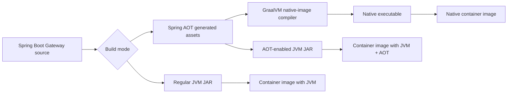
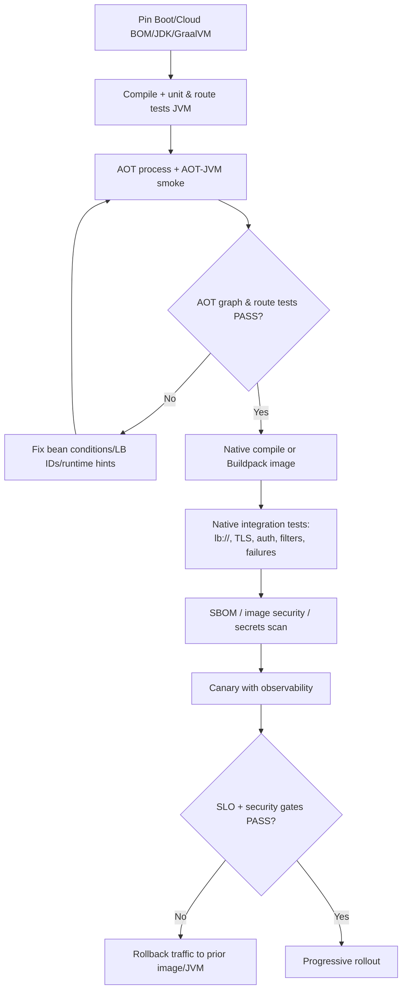

# Spring AOT, Native Image, and Declaring Load-Balanced Services by Supported Version

**Chapter:** Deployment  
**Module:** `SPRING_CLOUD_GATEWAY` — Building an API Gateway with Spring Cloud Gateway: routing with predicates, filter chains, path/header transformations, service discovery; combining authentication, rate limiting, circuit breakers, retries, TLS, and request observability.

An API Gateway typically sits in the path of almost every request entering a microservices system. When many Gateway instances need to start quickly in Kubernetes or serverless environments, using **Spring AOT** and **GraalVM Native Image** can help reduce startup time and runtime memory footprint. However, native architecture imposes a different requirement: many decisions for building the Spring `ApplicationContext` are processed **before the application runs**, instead of discovering all dependencies/beans at runtime.

This directly affects routes such as `lb://catalog-service`. Spring Cloud LoadBalancer normally builds **one child context per service ID** the first time it must select an instance. With native images, the service IDs to be used must be **explicitly declared** so AOT knows to prepare load balancer configurations for them. Simply having a list of instances fetched from Eureka/Kubernetes without declaring the service ID during AOT processing may prevent LoadBalancer context initialization from working at runtime the way it does on a normal JVM.

This lesson explains:

- The differences among JVM JAR, Spring AOT, GraalVM Native Image, and container images.
- Support conditions **by version and Gateway flavor**; in particular, the official Server WebFlux documentation records AOT support starting from **Spring Cloud Gateway 4.0.0**.
- Two ways to declare service IDs: `spring.cloud.loadbalancer.eager-load.clients` or `@LoadBalancerClient(name/value=...)`.
- A lab with a Gateway WebFlux routing `lb://catalog-service` to two backends, testing **regular JVM → AOT-enabled JVM → native executable/container**.
- Limitations of closed-world assumptions, `@Profile`, `@ConditionalOnProperty`, `@RefreshScope`, dynamic routes, service discovery, reflection/resources/serialization.
- Safe deployment with TLS, secrets, readiness, metrics, CI/CD, canary, rollback, and troubleshooting.

> **Version Principle:** The primary examples target **Spring Cloud Gateway Server WebFlux** in release trains supporting Spring Boot AOT (4.x/5.x lines). In 5.x, the modern route namespace is `spring.cloud.gateway.server.webflux.routes`; in some 4.x versions it uses `spring.cloud.gateway.routes`. **Gateway Server Web MVC** uses a different starter, configuration, and HTTP stack, requiring separate verification of native/AOT support per release train; do not infer from WebFlux having AOT support that all MVC customizations, WebSockets, or filters run equivalently in native mode. Use a compatible Spring Boot/Spring Cloud BOM rather than picking arbitrary version numbers.

## 1. Learning Objectives

After this lesson, you will be able to:

1. Distinguish **Spring AOT processing**, **AOT-optimized JVM execution**, and **GraalVM native compilation**.
2. Accurately describe closed-world semantics: **the classpath and bean graph are analyzed at build time**, rather than "every runtime configuration value is permanently frozen."
3. Explain why `lb://service-id` in a native image requires **explicit service ID declaration**.
4. Properly use `spring.cloud.loadbalancer.eager-load.clients` or `@LoadBalancerClient` to declare `catalog-service` and `payment-service`.
5. Set up a WebFlux Gateway and two HTTP backends where the selected instance is observable.
6. Build and run a regular JVM JAR, an AOT-processed JAR, a native executable, or a native container with Maven/Gradle.
7. Distinguish a **service ID known at AOT time** from the **address/port/health of a ServiceInstance** provided by discovery at runtime.
8. Identify and test differences in `@Profile`/`@Conditional`/`@RefreshScope`, dynamic routes, and native reachability hints.
9. Design readiness, graceful shutdown, security, TLS, tracing, rate limiting, circuit breakers, retries, and failover scenarios on native builds.
10. Establish evaluation criteria for startup, RSS, throughput, p95/p99, build time, pre/post-deploy errors, and rollback.

## 2. Three Deployment Levels: JVM, Spring AOT, and Native Image

| Execution mode | Artifact | When is the Spring bean graph analyzed? | Characteristics |
|---|---|---|---|
| Regular JVM | `gateway.jar` | Primarily at JVM startup | Relatively flexible dynamic classloading/reflection and auto-configuration |
| **JVM with Spring AOT** | JAR with generated AOT assets, run with `-Dspring.aot.enabled=true` | Build time, then applies generated initialization on the JVM | Helps catch AOT issues early before native compilation |
| **GraalVM Native Image** | OS/architecture-specific executable, can be containerized | Spring AOT + GraalVM closed-world compilation | No JVM runtime needed inside executable; typically faster startup and lower footprint on suitable workloads |

**Do not confuse:**

- **Spring AOT** is the process where Spring analyzes configuration and generates Java source/bytecode/proxies/runtime hints for a relatively static application graph.
- **Native Image** is the process where GraalVM analyzes reachability and compiles Java code into an executable for **one** specific architecture/operating system.
- **Container image** is a deployment package (filesystem/layers/metadata). A container may hold either a **JVM JAR** or a **native executable**.
- JVM **CDS/AOT Cache** is a different optimization approach; it is not synonymous with native image or native binary. Check exact feature support for your JDK/Spring Boot version.

### 2.1. Two Independent Decision Axes



Each arrow carries **its own testing responsibility**. A route working in an IDE/JVM does not prove the native image has all required service IDs, hints, SSL truststores, or resources. Conversely, a successful native build **does not prove** health/readiness, OAuth2, TLS, retries, and load balancing remain correct upon deployment.

### 2.2. Benefits Must Be Measured, Not Assumed

Native images typically offer advantages in startup and resident memory, especially for scale-to-zero or rapid autoscaling. However, trade-offs may include:

- Longer **build times**, requiring CI CPU/RAM and a native toolchain.
- **Peak throughput**/p99/GC and warm-up behavior can vary by workload; native is not automatically faster in all cases.
- **Debuggability** differs from the JVM: profiling, stack traces, JFR, attach agents, reflection, and dynamic instrumentation may be restricted depending on GraalVM/version.
- A **native binary** does not automatically "port" across Linux/Windows/macOS or amd64/arm64; artifacts must match the target architecture.
- Putting a native image in a container does not automatically fix Kubernetes readiness, network egress, service discovery, certificate trust, or session management.

## 3. Support Matrix and Version Limitations

The official **Gateway Server WebFlux — AOT and Native Image Support** documentation notes that Gateway supports Spring AOT/native starting from **4.0.0**, while emphasizing that load-balanced routes must declare service IDs. The **Spring Cloud Commons — LoadBalancer** documentation also records AOT/native support starting from **4.0.0** with the same condition. See the official Spring documentation links at the end of this lesson.

| Component | Documented support | Must verify on project |
|---|---|---|
| Gateway **Server WebFlux** 4.x/5.x | Dedicated AOT/native page, requires declaring service IDs for LB | Starter, property namespace, custom filters, dependencies |
| Spring Cloud LoadBalancer 4.x/5.x | Supports AOT/native; explicit service IDs | Child contexts, custom `ServiceInstanceListSupplier`, discovery implementation |
| Gateway **Server Web MVC** | Servlet/WebMvc.fn stack with different DSL/client | Target version native support, WebSocket/MVC filters, HTTP client, AOT hints |
| DiscoveryClient | Depends on Eureka/Consul/Kubernetes/custom adapter | Does the adapter have native hints, health/registry access, client certificates? |
| Spring Boot Maven/Gradle | AOT/native build via build plugins/native profile | JDK/GraalVM, wrapper, Spring Boot BOM, CI OS/arch |
| Spring Cloud Context Refresh | **Not supported in AOT/native**; requires `spring.cloud.refresh.enabled=false` | How to roll out config/bean changes without `@RefreshScope` |
| Runtime route repository | Depends on Gateway flavor/version | Do route refresh/metadata and new IDs exceed AOT scope? |

**Do not treat "native-supported feature" as a guarantee that every extension works.** A custom `GatewayFilter` using dynamic reflection, a custom DNS resolver, a JNI library, or a Lua/JavaScript engine may require reachability hints or redesign, even though Gateway core supports AOT.

### 3.1. Locking the Version Set

Before adding a native profile, record:

| Component | Value to record |
|---|---|
| JDK and vendor | Exact JDK major/patch, OS/architecture |
| Spring Boot | Exact version and parent/plugin config |
| Spring Cloud release train/BOM | Exact BOM, Boot compatibility |
| Spring Cloud Gateway | Gateway 4.x or 5.x, WebFlux or Web MVC |
| Spring Cloud Commons/LoadBalancer | Versions from BOM |
| GraalVM/native-image | Version compatible with JDK and Boot |
| Other dependencies | Eureka/Consul/Kubernetes, Reactor Netty, Security, Redis, Resilience4j |
| Native build strategy | Local GraalVM, Buildpacks, or CI builder |

Do not invent a property `spring.cloud.gateway.aot.enabled=true` from memory: **there is no such global switch needed for this lesson**. Spring Boot AOT is activated via plugin/build profile; service IDs are what must be explicitly declared.

## 4. What Does AOT Analyze and What Does It Not?

Spring relies on **inversion of control**: on normal JVM startup, Spring scans configurations, evaluates conditions, registers beans, and creates proxies and runtime metadata. AOT shifts most of the **graph preparation step** to build time so GraalVM can compile a known application graph ahead of time.

### 4.1. Closed-World and "Freezing" the Bean Graph

Key assumptions of Spring AOT:

1. **Fixed classpath at build time.** You cannot drop a JAR containing a new `GatewayFilterFactory` at runtime and expect the native executable to dynamically load it.
2. **Relatively fixed bean definitions.** Conditions like `@ConditionalOnClass`/`@ConditionalOnProperty` governing whether a bean exists are already evaluated during AOT processing.
3. **`@Profile` affecting bean registration** cannot be arbitrarily toggled after the image is built to produce an unanalyzed graph.
4. Reflection, dynamic proxies, resource loading, and serialization require metadata/hints whenever GraalVM cannot infer them from reachability.
5. Certain dynamic bean registration patterns (such as arbitrarily registering singletons after context bootstrap) do not go through transformations as code authors might assume.

**Example of a misplaced expectation:**

```java
@Configuration(proxyBeanMethods = false)
@ConditionalOnProperty(name = "gateway.security.enabled",
                       havingValue = "true")
class AuthConfiguration {
    // Security bean graph only exists when the condition is enabled during AOT.
}
```

If you build native with `gateway.security.enabled=false`, and then deploy the binary with `GATEWAY_SECURITY_ENABLED=true`, do not assume security beans will be created identically to a regular JVM app. The condition regarding **bean existence** may already be fixed in the generated AOT code. Likewise, building with security enabled and setting false at runtime is not a safe switch to bypass policy.

In production, **never build a native image with authentication disabled** hoping to turn it back on after deployment. Build/test/deploy must remain consistent for properties participating in bean configuration conditions.

### 4.2. Which Values Can Still Change at Runtime?

**AOT does not mean every value is hard-compiled.** For example:

- Server port chosen via `server.port`;
- A password read from a mounted Secret instead of baked into the binary;
- Service **instance** addresses/ports returned by discovery;
- A threshold read at runtime by an existing bean designed to be update-safe;
- Route URLs/headers fetched from a config source at runtime **if the implementation in use supports that lifecycle** and does not require creating a new bean type.

However, for every change you must verify whether the property **affects the bean graph**, **affects binding/route definitions**, or is purely **data consumed by an existing bean**. Do not claim every `@ConfigurationProperties` updates live when a config source changes: many beans bind only at startup; `@RefreshScope` is unsupported in native.

### 4.3. Distinguishing Three Commonly Confused Concepts

| Concept | Example | When typically determined | Impact when changed |
|---|---|---|---|
| **Service ID** | `catalog-service` | Should be declared for AOT/build | LB child context needs hints/config for this ID |
| **ServiceInstance** | `10.10.2.17:8080`, `10.10.2.18:8080` | Runtime via discovery | Can change during scaling/rollout |
| **Gateway route definition** | `id=catalog-route, uri=lb://catalog-service, Path=/api/catalog/**` | YAML, Java DSL, repository, or locator | Runtime reload depends on implementation; may reference a different service ID |

**Conclusion:** A native image does not permanently freeze every Pod IP, but you must design upfront **the set of service IDs** and the beans/configurations needed for the Gateway to route to them. A pattern of "inventing a brand-new service ID on the first incoming request," which is easy on the JVM, can be an unsupported path under AOT if not properly declared/hinted.

## 5. Why Does `lb://` Require Explicit Service ID Declaration?

Spring Cloud LoadBalancer provides `ReactorLoadBalancer` for the reactive stack and blocking client options for the servlet stack. When a WebFlux Gateway sees a route:

```yaml
uri: lb://catalog-service
```

`ReactiveLoadBalancerClientFilter` resolves `catalog-service`, obtains a `ServiceInstance` via suppliers/discovery adapters, and rewrites the outbound request's host/port.

### 5.1. Child Context per Service ID

Spring Cloud LoadBalancer uses `LoadBalancerClientFactory` to manage load balancing configurations per **service ID**. On a standard JVM, child contexts can be created **lazily** the first time a service needs load balancing. Under AOT/native, however, static analysis must know upfront which service IDs may require their own context so corresponding bean definitions and native hints can be generated.

```mermaid
flowchart TD
    AOT["AOT build-time config"] --> IDS["Known service IDs:<br/>catalog-service, payment-service"]
    IDS --> HINT["Prepare LB child contexts / AOT metadata"]
    REG["Runtime DiscoveryClient"] --> LIST["Live ServiceInstances:<br/>IPs, ports, secure metadata"]
    R["Gateway route: lb://catalog-service"] --> LB["ReactiveLoadBalancerClientFilter"]
    HINT --> LB
    LIST --> LB
    LB --> SELECT["Selected catalog instance"]
    SELECT --> PROXY["HTTP proxy request"]
```



If at runtime the Gateway encounters `lb://new-service-not-declared` for the first time, do not expect the native image to dynamically synthesize a full LB child context as a JVM with dynamic reflection/scanning might. The safe approach is to **register the service ID before building**, adjust route config, or deploy a new image when service scope expands.

### 5.2. Approach A — `spring.cloud.loadbalancer.eager-load.clients`

This approach fits systems configuring most routes in YAML:

```yaml
spring:
  cloud:
    loadbalancer:
      eager-load:
        clients:
          - catalog-service
          - payment-service
          - inventory-service
```

This property is documented by **Spring Cloud Commons LoadBalancer** to eager-load child contexts, and also serves as the **way to declare service IDs for AOT/native**. For native builds, ensure this list is present **when AOT processing runs** and matches the routes/filters actually shipped.

Do not confuse with:

```yaml
spring:
  cloud:
    loadbalancer:
      enabled: true
```

`enabled=true` merely enables the LB mechanism (if dependencies/config exist); it **does not declare** the set of service IDs needed for AOT. Also do not use the route ID in place of the service ID:

```text
Route ID:    catalog-public
Route URI:   lb://catalog-service
Eager ID:    catalog-service       (correct)
Eager ID:    catalog-public        (wrong target)
```

### 5.3. Approach B — `@LoadBalancerClient` / `@LoadBalancerClients`

If you want to declare service IDs directly in code:

```java
package com.example.gateway;

import org.springframework.cloud.client.loadbalancer.LoadBalancerClient;
import org.springframework.cloud.client.loadbalancer.LoadBalancerClients;
import org.springframework.context.annotation.Configuration;

@Configuration(proxyBeanMethods = false)
@LoadBalancerClients({
    @LoadBalancerClient(name = "catalog-service"),
    @LoadBalancerClient(name = "payment-service")
})
public class KnownLoadBalancedServices {
}
```

Similarly, for a single client:

```java
@Configuration(proxyBeanMethods = false)
@LoadBalancerClient(value = "catalog-service")
class CatalogClientDeclaration {
}
```

The Commons docs note that either the **`value` or `name`** attribute of `@LoadBalancerClient` can be used; you do not need `configuration=...` if using the default configuration. This is a **client name declaration**, not an annotation to create a new WebSocket/HTTP controller.

**With custom configuration:**

```java
@Configuration(proxyBeanMethods = false)
@LoadBalancerClient(
    name = "catalog-service",
    configuration = CatalogLoadBalancerConfiguration.class)
class CatalogClientConfigRegistration {
}
```

`CatalogLoadBalancerConfiguration` is a class providing `ServiceInstanceListSupplier` or `ReactorLoadBalancer` beans per policy. According to the docs, a class passed to `configuration` should **not be placed under regular component scanning** (or not annotated with `@Configuration`) if it is meant to apply only to a single client, avoiding leaking beans into every LB context. If you do not need a special policy, prefer the annotation without `configuration` from the earlier example.

### 5.4. Do You Need Both Approaches Together?

**Not required.** Both `eager-load.clients` and `@LoadBalancerClient` are documented as valid declaration mechanisms. For apps with many route IDs generated from Config Server, pick **one authoritative source** to list service IDs to prevent drift:

| Situation | Recommendation |
|---|---|
| Routes mostly in YAML with few IDs | `eager-load.clients` in controlled build/deploy config |
| Stable IDs, team prefers annotations | `@LoadBalancerClient(name=...)` |
| Custom per-service LB policy | `@LoadBalancerClient(configuration=...)` with AOT tests |
| Routes generated from dynamic registry, many/unpredictable service IDs | Re-evaluate AOT/route exposure strategy; define an ID allowlist or stay on JVM if the graph cannot be fixed |

### 5.5. Watch Out for Service ID Names and Public Paths

`lb://CATALOG-SERVICE`, `lb://catalog-service`, and `lb://catalog_service` may be handled differently depending on the registry/discovery adapter. Never assume every registry is case-insensitive. With the DiscoveryClient route locator, `lower-case-service-id` may alter **predicate/filter paths**, without automatically changing the client IDs declared to LoadBalancer for AOT.

If the service registry returns uppercase names, test accurately:

- The ID used in the route URI;
- The ID declared in `eager-load.clients` or annotations;
- The ID returned by `DiscoveryClient`/`ServiceInstanceListSupplier`;
- The client-visible path, such as `/api/catalog/**`, which does not have to match the service ID.

## 6. Lab: Two HTTP Backends and One Gateway Route `lb://catalog-service`

The lab goal is to verify **clean separation between service ID and runtime instances**. Three processes on the same machine:

| Component | Port | Purpose |
|---|---:|---|
| Catalog backend A | `8081` | Returns JSON with `instance=A` |
| Catalog backend B | `8082` | Returns JSON with `instance=B` |
| Gateway WebFlux | `8080` | Accepts `/api/catalog/**`, selects A/B via LB |

The lab uses `SimpleDiscoveryClient` — a static list of instances configured for the **Gateway process**. This lets us test LB without needing Eureka/Consul. **`SimpleDiscoveryClient` does not automatically remove dead instances from its list**; real runtime discovery and native compatibility of each adapter are tested separately later.

### 6.1. Separate Backend Project: Spring MVC Echo

Create a Spring Boot project with the **Spring Web** dependency; neither Spring Cloud Gateway nor LoadBalancer is needed in the backend. Java example:

```java
package com.example.catalog;

import java.util.Map;
import org.springframework.beans.factory.annotation.Value;
import org.springframework.boot.SpringApplication;
import org.springframework.boot.autoconfigure.SpringBootApplication;
import org.springframework.web.bind.annotation.GetMapping;
import org.springframework.web.bind.annotation.PathVariable;
import org.springframework.web.bind.annotation.RestController;

@SpringBootApplication
@RestController
public class CatalogBackendApplication {

    @Value("${demo.instance-id:A}")
    private String instanceId;

    @GetMapping("/items/{sku}")
    public Map<String, String> getItem(@PathVariable String sku) {
        return Map.of(
            "sku", sku,
            "instance", instanceId,
            "service", "catalog-service");
    }

    @GetMapping("/healthz")
    public Map<String, String> health() {
        return Map.of("status", "UP", "instance", instanceId);
    }

    public static void main(String[] args) {
        SpringApplication.run(CatalogBackendApplication.class, args);
    }
}
```

Backend `src/main/resources/application.yml`:

```yaml
server:
  port: ${PORT:8081}
spring:
  application:
    name: catalog-backend
demo:
  instance-id: ${INSTANCE_ID:A}
```

**This is a learning backend application**, without auth, persistence, TLS, or quotas. Do not deploy it as a production catalog. If your Spring Boot version uses a different Maven starter artifact name, choose the matching starter from Spring Initializr for your release train; the `@RestController`/`@GetMapping` API still illustrates the HTTP response.

### 6.2. Running Two Instances

Build the backend JAR once in the lab environment (after creating the project):

```bash
./mvnw -DskipTests package
```

Open two terminals:

```bash
# Backend A — use the actual JAR produced by Maven (name below is illustrative).
PORT=8081 INSTANCE_ID=A java -jar target/catalog-backend.jar

# Backend B.
PORT=8082 INSTANCE_ID=B java -jar target/catalog-backend.jar
```

On Windows PowerShell, set `$env:PORT` and `$env:INSTANCE_ID` in **two separate terminals** before running the JAR. Replace `target/catalog-backend.jar` with the exact filename generated by the build (usually including version, e.g., `catalog-backend-0.0.1-SNAPSHOT.jar`).

Verify the backends directly:

```bash
curl -i http://localhost:8081/items/SKU-42
curl -i http://localhost:8082/items/SKU-42
```

Example output:

```json
{"sku":"SKU-42","instance":"A","service":"catalog-service"}
```

and:

```json
{"sku":"SKU-42","instance":"B","service":"catalog-service"}
```

If a backend does not respond directly, do not debug AOT/native or LoadBalancer yet; fix the backend/port/path first.

### 6.3. Gateway WebFlux Project

Create **another Spring Boot project** for the Gateway (do not mix the Spring MVC backend into the same runtime). Choose a compatible Spring Cloud BOM. Required Maven dependencies:

```xml
<dependencies>
    <dependency>
        <groupId>org.springframework.cloud</groupId>
        <artifactId>spring-cloud-starter-gateway-server-webflux</artifactId>
    </dependency>
    <dependency>
        <groupId>org.springframework.cloud</groupId>
        <artifactId>spring-cloud-starter-loadbalancer</artifactId>
    </dependency>
    <dependency>
        <groupId>org.springframework.boot</groupId>
        <artifactId>spring-boot-starter-actuator</artifactId>
    </dependency>
    <dependency>
        <groupId>org.springframework.boot</groupId>
        <artifactId>spring-boot-starter-test</artifactId>
        <scope>test</scope>
    </dependency>
</dependencies>
```

This is a **`pom.xml` snippet**: you still need the Spring Boot parent/plugin and Spring Cloud dependency management from a compatible release train. For Spring Boot 4, use the artifacts/Boot starters provided in the BOM and Spring Initializr for that version. Do not add `spring-boot-starter-web` to Gateway Server WebFlux just to "have a web server"; if choosing Gateway MVC, create a separate project.

Main class `GatewayApplication.java`:

```java
package com.example.gateway;

import org.springframework.boot.SpringApplication;
import org.springframework.boot.autoconfigure.SpringBootApplication;

@SpringBootApplication
public class GatewayApplication {
    public static void main(String[] args) {
        SpringApplication.run(GatewayApplication.class, args);
    }
}
```

### 6.4. Gateway `application.yml`: Route + Eager Service ID

```yaml
server:
  port: 8080

spring:
  application:
    name: native-catalog-gateway-lab

  cloud:
    # Spring Cloud Context Refresh is not supported with AOT/native.
    refresh:
      enabled: false

    # Declare client ID at build time for LoadBalancer AOT.
    loadbalancer:
      eager-load:
        clients:
          - catalog-service

    # Lab: static list of two instances under the same service ID.
    discovery:
      client:
        simple:
          instances:
            catalog-service:
              - uri: http://localhost:8081
              - uri: http://localhost:8082

    gateway:
      server:
        webflux:
          routes:
            - id: catalog-route
              uri: lb://catalog-service
              predicates:
                - Path=/api/catalog/**
                - Method=GET
              filters:
                - StripPrefix=2
                - AddRequestHeader=X-Edge-Lab, native-gateway

management:
  endpoints:
    web:
      exposure:
        include: health,info
```

**Why is this configuration snippet especially important?**

1. `spring.cloud.loadbalancer.eager-load.clients[0]=catalog-service` declares the **exact ID of `lb://`** for Spring AOT.
2. `simple.instances.catalog-service` supplies the host/port of **two ServiceInstances**. It does not automatically generate LB child context hints just from having an IP list; the explicit clients requirement must still be met.
3. `uri: lb://catalog-service` requires `spring-cloud-starter-loadbalancer`.
4. `Path=/api/catalog/**` and `StripPrefix=2` transform `/api/catalog/items/SKU-42` into `/items/SKU-42` at the backend.
5. `spring.cloud.refresh.enabled=false` applies to **Spring Cloud Context Refresh**; it does not mean every load balancing algorithm or runtime instance list is frozen.
6. Actuator exposes only `health` and `info`; do not expose gateway route write/admin endpoints to the Internet.

### 6.5. Do Not Confuse `eager-load.clients` with `SimpleDiscoveryClient`

The two configurations serve **different** purposes:

```yaml
spring:
  cloud:
    loadbalancer:
      eager-load:
        clients: [catalog-service]
```

Tells AOT: **there is a LoadBalancer client named catalog-service** whose configuration needs to be known.

```yaml
spring:
  cloud:
    discovery:
      client:
        simple:
          instances:
            catalog-service:
              - uri: http://localhost:8081
              - uri: http://localhost:8082
```

Tells DiscoveryClient: **service catalog-service currently has two instances** with statically bound addresses/ports. In production, this second section is usually replaced by Eureka/Consul/Kubernetes/custom supplier (with verified native support).

### 6.6. Testing the Gateway on Regular JVM

In the Gateway project, in another terminal:

```bash
./mvnw spring-boot:run
```

Once Gateway is listening on `8080`:

```bash
curl -i http://localhost:8080/api/catalog/items/SKU-42
curl -i http://localhost:8080/api/catalog/items/SKU-42
curl -i http://localhost:8080/api/catalog/items/SKU-42
```

Responses may show `"instance":"A"` or `"instance":"B"`. **An exact A,B,A sequence is not mandatory:** LoadBalancer strategy, health, caching, concurrency, and release train can vary. Verify:

- Gateway returns `200` and JSON containing `sku=SKU-42`;
- Upstream receives `/items/SKU-42` and the `X-Edge-Lab` header;
- Both configured instances are valid;
- The route uses `lb://catalog-service`, not hardcoded `http://localhost:8081`.

### 6.7. Intentional Error: Removing the Eager Client ID

Only in a **copy of the lab environment**, remove:

```yaml
spring.cloud.loadbalancer.eager-load.clients
```

then compare regular JVM and native/AOT behavior:

- **Regular JVM** can still lazily create a LoadBalancer child context for `catalog-service` and work.
- **AOT/native** no longer satisfies the condition required by Spring Cloud LoadBalancer documentation; it may lack context configuration/hints and fail at startup or on the first request, depending on versions.
- **Not every native build will necessarily fail immediately** when the declaration is omitted: another configuration such as `@LoadBalancerClient`, a custom bean, or optimizations may already have declared the client. The goal is to understand the **support contract**, not to predict one fixed exception.

Restore the eager client before continuing. Do not use a test containing only a `http://localhost:8081` route to conclude `lb://catalog-service` is AOT-compatible.

## 7. Maven Build: JVM, JVM-AOT, Native, and Buildpack

### 7.1. Preparing the Maven Project per Spring Boot Version

With a project based on a compatible `spring-boot-starter-parent`, add the Spring Boot Maven plugin and GraalVM Native Build Tools Maven plugin per Boot docs (omit explicit versions if already managed).

```xml
<build>
  <plugins>
    <plugin>
      <groupId>org.springframework.boot</groupId>
      <artifactId>spring-boot-maven-plugin</artifactId>
    </plugin>
    <plugin>
      <groupId>org.graalvm.buildtools</groupId>
      <artifactId>native-maven-plugin</artifactId>
    </plugin>
  </plugins>
</build>
```

If not using Spring Boot starter parent or in a multi-module project, you must explicitly configure executions for `process-aot`/native metadata/plugins. Do not copy a plugin fragment into an enterprise parent and assume a native build profile already exists.

**System prerequisites:**

- GraalVM/Mandrel/native-image toolchain compatible with the Spring Boot version and build JDK.
- Matching compiler/system libraries and OS/architecture.
- Sufficient CPU/RAM/disk for native compilation (typically higher than JVM JAR builds).
- If building containers via Spring Boot buildpacks: supported Docker daemon/buildkit or container builder environment.
- Approved access to Maven repositories and SBOM/license/security scans.

### 7.2. Step 1 — Regular JVM JAR

```bash
# For the Gateway project in the learner's environment.
./mvnw clean package
java -jar target/native-catalog-gateway-lab.jar
```

Replace `target/native-catalog-gateway-lab.jar` with the **actual JAR filename** (usually versioned). This is the baseline: if REST/lb routes do not yet work on the JVM, do not start a native build.

### 7.3. Step 2 — Generate AOT Assets and Run on JVM

According to Spring Boot, when a Maven project has a suitable `native` profile:

```bash
./mvnw -Pnative package

# This JAR must genuinely contain generated AOT assets.
java -Dspring.aot.enabled=true \
  -jar target/native-catalog-gateway-lab.jar
```

Running with `spring.aot.enabled=true` is a **screening step**: if build-time bean graph/conditions/route configuration mismatch, it often catches them before waiting through a GraalVM native compilation.

**Insufficient if:**

- The build only ran `mvn package` without executing `process-aot`;
- No generated AOT initializers/classes/hints exist;
- Enabling `-Dspring.aot.enabled=true` on a JAR that was never AOT-processed and then calling startup errors a "native limitation."

Boot guides note that the starter parent's `native` profile configures the AOT/native plugins appropriately; verify the effective POM and build logs.

### 7.4. Step 3 — Local Native Executable

If the GraalVM Native Image toolchain is installed and version-compatible:

```bash
./mvnw -Pnative native:compile
```

The executable typically resides in `target/` under the artifact name, for example:

```bash
./target/native-catalog-gateway-lab
```

On Windows, the executable name may include `.exe` and require different invocation syntax. **Do not treat binary names in documentation as mandatory** — plugins/projects may name them differently. Do not run Linux commands directly in Windows PowerShell when they use `./` or incompatible environment syntax.

A native executable does not need `java -jar`, yet it still requires **config, certificate trust, DNS/registry access, environment variables, health probes, and security policies** at runtime.

### 7.5. Step 4 — Build a Container Image with the Native Binary

With the Spring Boot Maven plugin and supported Docker/Buildpacks:

```bash
./mvnw -Pnative spring-boot:build-image
```

Spring Boot uses Cloud Native Buildpacks to build a container image containing the native executable. You do not need to write a custom Dockerfile for a simple lab; however, compatible OS/architecture builder/run images, Docker daemon, and build quotas are required. For multi-arch, build/test/publish artifacts separately per architecture or use a supported buildpacks workflow; do not treat a `linux/amd64` binary as if it runs natively on ARM64.

An illustrative container test command:

```bash
docker run --rm -p 8080:8080 \
  --name native-gateway-lab \
  <local-native-image-tag>
```

**Must replace** `<local-native-image-tag>` with the actual tag produced by the build. Important: a Gateway running inside a container cannot reach host backends via `localhost:8081`/`localhost:8082` the way it does when running directly on the host. Section 11 covers container networking before testing LoadBalancer with Docker.

### 7.6. Notes on Build Metrics

Do not measure native startup from a single Maven build log line. Measure **the time from process start until ready to serve route traffic**, and also record:

| Metric | Why |
|---|---|
| Build duration | Native compilation consumes CI resources |
| Artifact/container size | Affects push/pull/cold-start, though dependent on builder/layers |
| Startup to readiness | Whether the API Gateway can actually route yet |
| RSS/heap/CPU | Footprint under load and memory headroom |
| p50/p95/p99, RPS | Verify performance after warm-up |
| TLS/auth/Retry/LB behavior | Native is functionally correct, not merely fast to start |
| Native image arch/version | Prevent deploying for the wrong platform/ABI |

## 8. Gradle: Same Goal, Different Build Tasks

If your organization uses **Gradle**, a compatible Native Build Tools plugin provides `processAot`/`nativeCompile`/`nativeTest` tasks. A `build.gradle` (Groovy) skeleton for **Gateway WebFlux**:

```groovy
plugins {
    id 'java'
    id 'org.springframework.boot' version '<compatible-boot-version>'
    id 'io.spring.dependency-management' version '<compatible-version>'
    id 'org.graalvm.buildtools.native' version '<compatible-version>'
}

group = 'com.example'
version = '0.0.1-SNAPSHOT'

java {
    toolchain {
        languageVersion = JavaLanguageVersion.of(21)
    }
}

dependencyManagement {
    imports {
        mavenBom "org.springframework.cloud:spring-cloud-dependencies:<compatible-cloud-release-train>"
    }
}

dependencies {
    implementation 'org.springframework.cloud:spring-cloud-starter-gateway-server-webflux'
    implementation 'org.springframework.cloud:spring-cloud-starter-loadbalancer'
    implementation 'org.springframework.boot:spring-boot-starter-actuator'
    testImplementation 'org.springframework.boot:spring-boot-starter-test'
}

tasks.named('test') {
    useJUnitPlatform()
}
```

The `<compatible-...>` strings are **intentional placeholders**, not immediately buildable versions; replace them with versions **provided by Spring Initializr/compatible Boot BOM**. Java toolchain 21 is merely a lab choice; with Boot 4/GraalVM native, choose the JDK/GraalVM supported by the release vendor.

### 8.1. Gradle Tasks

```bash
# JVM baseline
./gradlew clean bootJar

# Generate AOT sources
./gradlew processAot

# Local GraalVM native compile (requires native plugin/toolchain)
./gradlew nativeCompile

# Buildpack container, uses native image if native plugin is applied
./gradlew bootBuildImage
```

Do not run `./gradlew` from a module lacking a wrapper/project build. Some organizations pin Gradle in CI and require using the repository's wrapper. Examples are for learning only; the STEP 4 worker **does not run Gradle** or create new projects.

### 8.2. Running JVM with Generated AOT Code in Gradle

Recommended workflow:

1. Build tasks must include AOT sources/classes/resources in the artifact.
2. Run the artifact with `-Dspring.aot.enabled=true`.
3. Verify beans, routes, LoadBalancer clients, and security.
4. Only then run `nativeCompile` or `bootBuildImage`.

If `processAot` only generates a directory of files that `bootJar` has not packaged into the JAR as expected, **do not** run an ordinary JAR with the system property and conclude AOT is broken. Per docs, task dependencies are configured by the Boot plugin and GraalVM plugin; inspect Gradle build scans/logs for your exact plugin versions.

## 9. Testing All Three Modes Against the Same HTTP Contract

With backends A/B running:

```bash
# Send identical requests across all three modes:
curl -sS -i http://localhost:8080/api/catalog/items/SKU-42
curl -sS -i http://localhost:8080/api/catalog/items/SKU-43
curl -sS -i http://localhost:8080/no-route
```

Create a results table as follows:

| Test | Regular JVM | JVM with AOT | Native |
|---|---|---|---|
| Gateway starts and binds port | PASS/FAIL | PASS/FAIL | PASS/FAIL |
| `GET /api/catalog/items/SKU-42` → 200 | ? | ? | ? |
| Backend sees `/items/SKU-42` | ? | ? | ? |
| `X-Edge-Lab` header added | ? | ? | ? |
| `catalog-service` resolved | ? | ? | ? |
| Both A/B instances can be selected | ? | ? | ? |
| Missing service → configured status | ? | ? | ? |
| Unmatched route → 404 | ? | ? | ? |
| Instance count changes per discovery test | ? | ? | ? |
| TLS/security/filter smoke tests | ? | ? | ? |
| Startup to readiness (ms) | Measure | Measure | Measure |
| Steady-state RSS/CPU | Measure | Measure | Measure |

**Do not fill in fake PASS/FAIL/latency numbers** without running the tests. All three modes must use:

- The same route predicates/filters;
- The same backend, request data, and auth contract;
- The same service IDs declared for AOT;
- The same load balancing/discovery policy;
- The same TLS/certificate chain configuration;
- The same resource limits when comparing performance.

A running native process that only hits `http://localhost:8081` **does not prove** `lb://catalog-service` or AOT LB contexts work. A single 200 request also does not prove both instances are properly managed. Observe both the backends and Gateway/LoadBalancer metrics.

### 9.1. Running with One Missing Backend

In the lab, stop backend B while leaving `SimpleDiscoveryClient` configured with both instances. Depending on whether LoadBalancer picks A or B, requests may succeed or hit connection refused. **This is not a native-image-specific bug**; a static instance list does not automatically detect that B died. With a health-checking `ServiceInstanceListSupplier` or a real registry, behavior can differ. Test both JVM and native against the same data source to avoid false conclusions.

### 9.2. Testing an Undeclared Service ID

Add a route:

```yaml
- id: inventory-route
  uri: lb://inventory-service
  predicates:
    - Path=/api/inventory/**
  filters:
    - StripPrefix=2
```

but **do not** add `inventory-service` to `eager-load.clients` or `@LoadBalancerClient`, then run AOT/native. The goal is to reproduce the **unsupported configuration path** when a route references a client ID outside the declared set. Afterward, add that ID to build-time config, rebuild, and retest. **Do not modify a production image for this exercise.**

Distinguish:

| Case | Analysis |
|---|---|
| AOT client ID present, no instances | AOT context may be ready, yet request still has **no backend** |
| Instances present, missing AOT client ID | Discovery data exists, yet native client initialization may not be prepared properly |
| Client ID and instances present, wrong `StripPrefix` | LB works, yet backend returns 404 |
| Client ID, instances, path all right, wrong TLS | Connection fails at outbound TLS/hostname |
| All above right, custom filter uses reflection lacking hint | May fail when filter processes payload at runtime |

## 10. Runtime Discovery: Fixed Service IDs, Dynamic Instances

In real environments, a service can scale rapidly: Pods are created/deleted, IPs change, and health/readiness fluctuate. The AOT requirement **does not** force declaring every Pod IP upfront.

### 10.1. `ServiceInstance` Sources

| Source | Mechanism | Native notes |
|---|---|---|
| `SimpleDiscoveryClient` | Static `simple.instances.*` properties | Easy for labs; IPs/ports must be reachable at runtime |
| Eureka | Client registers/queries registry and receives service instances | Check Eureka client + HTTP/JSON/native hints, heartbeat, TTL |
| Consul | Health checks and discovery API | Check adapter native support, ACL/TLS, and readiness |
| Kubernetes DiscoveryClient | Adapter reads Services/Endpoints/EndpointSlices | Adapter native support, K8s RBAC/network, watch, DNS |
| Custom `ServiceInstanceListSupplier` | Bean returning instance list per custom policy | Verify bean AOT transform, reflection/serialization/metadata |
| DNS/Kubernetes Service | `http://service.namespace.svc` via platform LB | Not the same as Spring Cloud `lb://` route without LB filter |

**Each discovery integration has its own lifecycle, network requirements, and native support level.** Never assume every Spring Cloud adapter supports native solely because Gateway core and LoadBalancer core do. Check docs/issues/CI tests specifically for Spring Cloud Kubernetes or registry clients in your release train.

### 10.2. Runtime IP/Port Updates Do Not Create New Client IDs

Example:

```text
Build-time known client:
  catalog-service

Runtime at 10:00:
  catalog-service -> 10.2.0.10:8080
  catalog-service -> 10.2.0.11:8080

Runtime at 10:10 after rollout:
  catalog-service -> 10.2.0.21:8080
  catalog-service -> 10.2.0.22:8080
```

If the discovery adapter supports updating instances in a native-compatible way, LoadBalancer can select new IPs within the **same** `catalog-service`. The child contexts needed by AOT still belong to the **ID catalog-service**. Thus:

**Topology churn inside a service ≠ creating a new service ID.**

A new route `lb://loyalty-service` introduces a **new service ID**. If the native image did not declare this ID, do not expect a dynamic route repository to construct a working LoadBalancer context for it at runtime.

### 10.3. Reconnection, Caching, and Readiness

LoadBalancer may cache the `ServiceInstance` list; some DiscoveryClients also cache. After an instance dies while still cached, selecting it can cause `Connection refused`/TLS timeouts/5xx. Tests include:

1. Start A/B, verify native Gateway selects instances properly.
2. Mark B not-ready/unregister via test registry.
3. Measure how long it takes for registry updates to reach LB.
4. Send new requests; verify B is not selected beyond the cache TTL policy.
5. Restart B and verify healthy recovery.
6. Observe retries/circuit breakers to ensure no retry storm occurs.

Do not draw conclusions by stopping B under **static SimpleDiscoveryClient** and blaming AOT: native has no magical mechanism to know B died if the source emits no health updates.

### 10.4. LoadBalancer Eager-Load Impact on Startup

Declaring many IDs in `eager-load.clients` informs AOT of clients while also causing LB child contexts to initialize eagerly instead of lazily. This can **increase startup cost somewhat** if the list is very large. Do not declare thousands of IDs "just in case" and then claim ultra-fast native startup without measuring. Best practices:

- Declare only the set of service IDs actually within the Gateway's routing scope.
- Enforce naming/ownership/allowlisting for LB client IDs.
- Monitor client context count, memory, startup time, and runtime errors.
- For systems auto-generating routes for every service in a registry, review exposure policy: an API Gateway should not automatically expose unapproved services publicly.

### 10.5. A LoadBalancer Child Context Is Not a Route Entry

When `eager-load.clients` contains `catalog-service`:

```text
Known LB client: catalog-service   ✅
Public route: /api/catalog/**     ❓ depends on route definitions
ServiceInstance healthy: ...      ❓ depends on discovery
Gateway security policy: ...      ❓ depends on filters/auth
```

Declaring a client **does not automatically create a public route**; for client requests to be forwarded, a Gateway `RouteDefinition`/`RouterFunction` matching path/method/host is still required. Conversely, defining a route `lb://catalog-service` does not supply instances if discovery has no data.

## 11. From Localhost to Docker/Kubernetes

When Gateway and backends run **directly on the same host**, `localhost:8081`/`localhost:8082` in `SimpleDiscoveryClient` is valid. Once Gateway runs inside a **container**, `localhost` **inside the container** points to that container itself, not the host or another backend container.

### 11.1. Networking for Docker Compose

Suppose you have three Docker Compose services built from the lab backend/gateway projects. An **illustrative** `compose.yaml`, not a file the worker will create:

```yaml
services:
  catalog-a:
    image: catalog-backend:lab
    environment:
      PORT: "8080"
      INSTANCE_ID: "A"
    networks: [gateway-lab]

  catalog-b:
    image: catalog-backend:lab
    environment:
      PORT: "8080"
      INSTANCE_ID: "B"
    networks: [gateway-lab]

  gateway:
    image: native-catalog-gateway:lab
    ports:
      - "8080:8080"
    environment:
      # Add only a data-only config source to override URLs.
      SPRING_CONFIG_ADDITIONAL_LOCATION: "optional:file:/workspace/config/"
    volumes:
      - ./config/gateway-application.yml:/workspace/config/application.yml:ro
    depends_on: [catalog-a, catalog-b]
    networks: [gateway-lab]

networks:
  gateway-lab:
    driver: bridge
```

**Important:** `./config/gateway-application.yml` in the example is a **file the learner creates to run Compose**, not a file created by the STEP 4 worker. Minimum content to override instance addresses:

```yaml
spring:
  cloud:
    discovery:
      client:
        simple:
          instances:
            catalog-service:
              - uri: http://catalog-a:8080
              - uri: http://catalog-b:8080
```

Mount this file as `/workspace/config/application.yml`. `SPRING_CONFIG_ADDITIONAL_LOCATION` points to that directory so Spring Boot reads an external source outside the JAR; verify **property precedence** in the actual application. If a config profile or property affects **bean creation**, build-time and runtime environments must align; change only **data-only instance URIs** of a bean already prepared by AOT. Mapping a map/list property to environment variable names sometimes hits relaxed binding rules (especially hyphenated keys); mounted YAML config is generally clearer for labs. For production, prefer a native-compatible registry/discovery mechanism.

A `docker run` option for a native container sharing the Compose network with backends:

```bash
docker run --rm --network mylab_gateway-lab \
  -p 8080:8080 \
  native-catalog-gateway:lab
```

This is only a networking idea; the actual network name depends on the Docker Compose project and is not guaranteed to be `mylab_gateway-lab`. When testing, use `docker network inspect` (as the learner, in an authorized environment) and DNS names `catalog-a`/`catalog-b` in the right namespace.

### 11.2. Kubernetes: Two Different Models

**Model A — Gateway calls Kubernetes Service DNS**:

```yaml
uri: http://catalog-service.apps.svc.cluster.local:8080
```

Here, **Kubernetes Service** handles endpoint selection at the platform layer. The Gateway route does not need `lb://` or Spring Cloud LoadBalancer for that destination. Do not claim "Spring Cloud LoadBalancer AOT passed" merely because a DNS HTTP route works.

**Model B — Gateway selects instances itself via Spring Cloud LoadBalancer**:

```yaml
uri: lb://catalog-service
```

The Gateway requires:

- `spring-cloud-starter-loadbalancer`;
- A DiscoveryClient/ServiceInstanceListSupplier returning endpoints;
- `catalog-service` **explicitly declared for AOT**;
- Kubernetes RBAC/network and a native-compatible discovery adapter.

Model B is not inherently superior to A. If you simply need to connect to an existing Kubernetes Service, Model A can be simpler with fewer dependencies/AOT constraints; if you need LoadBalancer policies by zone/weight/version/instance metadata, Model B can fit once support is verified.

### 11.3. Readiness and Shutdown

A native image may start fast, yet **readiness must not simply mean the process exists**. A Gateway should only become Ready when:

1. The HTTP listener is accepting requests;
2. Route configuration has been loaded properly;
3. Required discovery registry/DNS/secret/TLS configurations are ready per policy;
4. The security chain is active; never fail-open just to become Ready early;
5. Backend availability policy fits product requirements: it may still be Ready even if a secondary service is down.

Configure probes using Spring Boot Actuator `/actuator/health/liveness` and `/actuator/health/readiness` **when probes are enabled**; do not assume every project exposes all endpoints by default. Condensed illustrative Kubernetes manifest:

```yaml
apiVersion: apps/v1
kind: Deployment
metadata:
  name: catalog-gateway
spec:
  replicas: 2
  selector:
    matchLabels:
      app: catalog-gateway
  template:
    metadata:
      labels:
        app: catalog-gateway
    spec:
      terminationGracePeriodSeconds: 30
      containers:
        - name: gateway
          image: registry.example.test/catalog-gateway:native-v1
          ports:
            - containerPort: 8080
          readinessProbe:
            httpGet:
              path: /actuator/health/readiness
              port: 8080
            initialDelaySeconds: 1
            periodSeconds: 5
          livenessProbe:
            httpGet:
              path: /actuator/health/liveness
              port: 8080
            periodSeconds: 10
          resources:
            requests:
              cpu: 100m
              memory: 128Mi
            limits:
              memory: 512Mi
```

**Numbers and image tags are illustrative**, not sizing recommendations. These probes require Boot Actuator/probe endpoints to be properly enabled. Do not tie liveness directly to a slow backend, which causes Kubernetes to repeatedly restart the Gateway during backend outages. For WebSocket/SSE, longer drain windows or application-protocol client reconnection are needed.

### 11.4. Spring Boot Health Probes for the Lab

An application config that can be used:

```yaml
management:
  endpoint:
    health:
      probes:
        enabled: true
  endpoints:
    web:
      exposure:
        include: health,info
```

If using a separate management port, kubelet could probe a healthy port while the main `8080` listener is down. Design probes so they genuinely reflect the **public Gateway ingress port**; avoid overly complex liveness checks. Restrict public Actuator exposure; protect information about routes, discovery topology, and secrets.

### 11.5. Graceful Shutdown with Long-Lived Traffic

The Gateway may be proxying HTTP streaming or long-lived WebSocket sessions. During a rolling deployment:

- Mark the Gateway instance **not-ready** before SIGTERM/drain if supported by the platform.
- Stop accepting new connections per policy.
- Allow in-flight HTTP requests to complete within a reasonable grace period.
- For WebSocket connections, a terminated Gateway Pod **does not automatically migrate** TCP connections to another replica; clients must reconnect and re-subscribe.
- Retries can multiply load during rollouts, requiring rate limiting/circuit breakers alongside observability.

A faster-starting native image does not eliminate the need for **graceful shutdown**, shared session state, or idempotency.

## 12. Route Dynamics, RefreshScope, and AOT: Crucial Boundaries

### 12.1. Two Different "Refresh" Concepts

**Spring Cloud Context Refresh** (involving `@RefreshScope`, rebinding config/bean graphs) **is not supported with Spring AOT/native**. Spring Cloud Commons docs require:

```yaml
spring:
  cloud:
    refresh:
      enabled: false
```

This **does not mean** a Gateway instance cannot reload **route data** by any mechanism. Gateway WebFlux has its own route locator/cache/Actuator route refresh depending on version. However:

- Route data refresh differs from **changing the Spring Bean graph**.
- A new route with `lb://unknown-service` may require an LB child context that was not declared at AOT time.
- A new custom filter factory/bean cannot materialize from a route definition if its class/bean was never compiled into the native binary.
- `@Conditional...` properties, profiles, and dependencies will not alter the bean graph after native build.
- Test the Actuator management endpoint and repository for your version; do not assume all Gateway flavors/native binaries support the exact same runtime route write/refresh workflow.

### 12.2. Three Levels of Post-Deploy Changes

| Change | Typically possible at runtime? | Risks to evaluate |
|---|---|---|
| Backend IP/port changes for a **known service ID** | Possible with a compatible discovery adapter | Registry latency/cache/health, TLS/metadata |
| Route switches path/filter URI among **known service IDs** | Depends on route source + refresh mechanism | Route cache, filter serialization, auth policy, concurrency |
| Route adds a **new service ID** or new plugin/filter bean | Must not be assumed safe by default under AOT/native | Missing LB child context/hints/class reachability; rebuild/rollout recommended |

### 12.3. A Safe Deployment Strategy

Suppose native version v1 only declares:

```text
known: catalog-service, payment-service
```

To launch `loyalty-service`:

1. Conduct a design review of URI/filters/security to prevent SSRF/route shadowing.
2. Add `loyalty-service` to `eager-load.clients` or `@LoadBalancerClient` in build source config.
3. Add dependencies/hints if custom adapters/filters exist.
4. Rebuild the AOT/native artifact and run integration tests with `lb://loyalty-service`.
5. Deploy canary native v2; verify discovery + TLS + auth/rate limiting.
6. Roll out traffic per SLO; roll back to v1 on errors.
7. Only after the image supports it, publish the public route via the control plane per policy.

If a system must introduce thousands of brand-new service IDs every hour without build/rollout, a native Gateway with fixed LB clients may not be the right strategy; consider a **JVM deployment** or a **platform DNS routing layer** with fewer dynamic bean contexts instead of trying to "infinitely stretch" AOT mechanics.

### 12.4. What `spring.cloud.refresh.enabled=false` Does Not Solve

- Does not fix certificate trust/SNI errors or missing CAs.
- Does not refresh endpoint lists from a registry if the adapter does not support it.
- Does not clean up stale runtime routes.
- Does not create a `ServiceInstance` when the registry is empty.
- Does not alter circuit breaker state, limiter quotas, or session state.
- Does not re-enable `@ConditionalOnProperty` beans excluded from the AOT build graph.

Therefore, **setting the right property is not an acceptance test**. End-to-end routing/management/discovery tests in the native runtime plus sufficient logs/metrics are needed to isolate root causes.

## 13. Reflection, Resources, Proxies, and `RuntimeHints`

Spring Boot/Framework/Gateway/LoadBalancer provide AOT contributions and hints for many standard components. However, **custom code** in the Gateway may use reflection or load resources via dynamic string names, preventing GraalVM from inferring class/resource paths.

### 13.1. Symptoms of Missing Reachability Metadata

| Symptom | Possible cause | Investigation path |
|---|---|---|
| JVM returns 200, native filter fails deserializing JSON | Missing DTO reflection/serialization metadata | DTO/Jackson converters/custom serializers and runtime hints |
| Native fails to load `gateway/policies/default.json` | Classpath resource lacks hint/packaging | Resource configuration and whether file actually exists in artifact |
| `Class.forName("...")` cannot find type | Dynamic loading invisible to static analysis | Redesign or add reflection/runtime hints |
| Proxy creation exception | Undeclared JDK dynamic proxy/interface or class proxy | `RuntimeHints.proxies()`/generated proxies, versions |
| Native image builder fails on reflection/initialization | Unsupported dependency or build/run-time class init | GraalVM logs, dependency reachability metadata |
| Standard routes work, custom `GatewayFilterFactory` fails | Filter uses custom reflection/codec/library | Unit tests + AOT-JVM + native integration |

**Do not add blanket reflection access for every class.** It bloats the native binary, masks design issues, and exposes unnecessary runtime behavior. Hints should be **minimal and scoped to components that truly need them**.

### 13.2. Example: A Custom Policy JSON Resource + DTO

Suppose the Gateway has an internal filter reading `gateway/policies/default.json` from the classpath and binding to record `GatewayPolicy`. Illustrative Java snippet:

```java
package com.example.gateway;

import java.util.List;
import org.springframework.aot.hint.RuntimeHints;
import org.springframework.aot.hint.RuntimeHintsRegistrar;
import org.springframework.aot.hint.annotation.RegisterReflectionForBinding;
import org.springframework.context.annotation.Configuration;
import org.springframework.context.annotation.ImportRuntimeHints;

record GatewayPolicy(String policyName, List<String> allowedScopes) {}

@Configuration(proxyBeanMethods = false)
@RegisterReflectionForBinding(GatewayPolicy.class)
@ImportRuntimeHints(GatewayResourcesHints.class)
class GatewayNativeHintsConfiguration {}

final class GatewayResourcesHints implements RuntimeHintsRegistrar {
    @Override
    public void registerHints(RuntimeHints hints, ClassLoader loader) {
        hints.resources().registerPattern("gateway/policies/*.json");
    }
}
```

**Meaning:**

- `@RegisterReflectionForBinding(GatewayPolicy.class)` creates hints so the DTO can be serialized/bound with required reflection elements.
- `RuntimeHintsRegistrar` declares the resource pattern when code loads resource names dynamically.
- `@ImportRuntimeHints` registers the registrar when the bean/config class participates in the AOT graph; no need to edit global GraalVM configs if annotations suffice.
- This is an **example for custom application code**; Spring already infers hints for many standard DTOs appearing in controller signatures, so avoid redundant declarations.

You must actually create the resource `src/main/resources/gateway/policies/default.json` **in the learner's project** to run the example; the STEP 4 worker does not create that file. Simply listing a pattern in native hints **does not make a resource appear** if the file is not packaged onto the classpath.

### 13.3. Testing Hints Without Compiling Native on Every Test

Spring Framework provides `RuntimeHintsPredicates`:

```java
import static org.assertj.core.api.Assertions.assertThat;
import org.junit.jupiter.api.Test;
import org.springframework.aot.hint.RuntimeHints;
import org.springframework.aot.hint.predicate.RuntimeHintsPredicates;

class GatewayResourcesHintsTest {
    @Test
    void hasPolicyResourceHint() {
        RuntimeHints hints = new RuntimeHints();
        new GatewayResourcesHints()
            .registerHints(hints, getClass().getClassLoader());

        assertThat(RuntimeHintsPredicates.resource()
            .forResource("gateway/policies/default.json"))
            .accepts(hints);
    }
}
```

This tests **hints registered by the component**, not a substitute for testing that the resource is actually packaged in the native executable and readable at runtime. You can use a native test profile or minimal native smoke test to verify file loading. Do not run the GraalVM tracing agent in production with real credentials without a secure process for storing/handling output.

### 13.4. Does Custom LoadBalancer Configuration Need AOT Hints?

If you use the default configuration and declare client IDs, Spring Cloud LoadBalancer handles standard cases per docs. If you create custom:

- `ServiceInstanceListSupplier` reading JSON/metadata via reflection;
- Custom DNS/Consul/Eureka client with custom SSL/codecs;
- Routing policy loading scripts/plugins by class name;
- `@LoadBalancerClient(configuration=...)` from a class not discoverable at AOT time;

then **custom dependencies must also be native-compatible**, beyond simply annotating the client name. Test:

1. Native build completes.
2. Native Gateway starts up.
3. First `lb://service` route selects an instance.
4. ServiceInstance metadata (zone, weight, secure) is read accurately.
5. When the registry updates instances, the supplier refreshes properly.
6. When no instance exists, failure is controlled and metrics are accurate.

### 13.5. Manual JSON Hints When Truly Needed

Spring AOT can generate GraalVM metadata under `META-INF/native-image/...`. For third-party libraries lacking hints, JSON metadata can be added via Native Build Tools mechanisms or the GraalVM Reachability Metadata Repository. **Never edit generated files in build output** hoping changes survive the next build. Keep hints under source control in tooling-supported locations, tested and reviewed.

Adding reflection hints **does not fix**:

- Missing `catalog-service` in the LoadBalancer client list;
- Wrong `lb://` route URI;
- Empty registry with no instances;
- Invalid certificates;
- Custom filters excluded from the native binary;
- Code relying on APIs fundamentally unsupported by GraalVM.

## 14. Securing Native Gateway Deployments

A native image is no more secure on its own than a Gateway with misconfigured authentication, outbound routing, or TLS. Precisely because the app boots fast, misconfigurations can propagate rapidly across many replicas if CI/canary bypasses security gates.

### 14.1. Authentication/Authorization Must Not Change Unintentionally

With Gateway Server WebFlux:

- Authentication can use Spring Security `SecurityWebFilterChain` and OAuth2 Resource Server/OAuth2 Client just like its JVM counterpart.
- `TokenRelay` should only forward access tokens to approved backends with matching audiences/scopes.
- Backends must still verify issuer/audience and per-resource authorization; **never** trust client-supplied `X-User-Id` as a principal.
- If Spring Security config uses `@ConditionalOnProperty`, those properties must be accounted for at **AOT build time**; never build an image with security beans excluded.
- Native JWT/JWKS/OIDC/TLS libraries must be tested against real test-environment key/certificate/issuer endpoints, never trust-all.

**Negative tests**:

| Request | Result per security contract |
|---|---|
| Anonymous to `/api/catalog/private` | 401 or login redirect; backend not called if blocked by Gateway |
| Expired token/wrong issuer | 401 |
| Valid token missing scope/tenant | 403 |
| Valid token, right audience/scope | Route proxied per policy |
| Client spoofing `X-Authenticated-User` | Access not granted |
| Origin not in allowlist | Blocked by CORS/WebSocket policy accordingly |
| New route to backend outside allowlist | Rejected by control plane |

Never disable Spring Security just to get a native image to compile/start. If a dependency is unsupported, fix AOT/hints infrastructure or stay on JVM builds until resolved.

### 14.2. Inbound/Outbound TLS

There are at least two hops:

```text
Client --HTTPS/TLS--> Ingress or Gateway
Gateway --HTTPS/TLS or HTTP (per policy)--> Backend
```

What to test on native:

1. Is inbound TLS terminated properly at Gateway or ingress?
2. Do outbound routes use `https://` or `lb://` with appropriate secure metadata/route scheme?
3. Are certificate chains/truststores/SSL bundles packaged or mounted securely?
4. Do SNI and hostname validation work?
5. Is the CA rotation/restart policy clear when truststores cannot refresh beans via `@RefreshScope`?
6. Are mTLS identity and renewal policies right for Gateway→backend?
7. Are cert private keys, Authorization headers, cookies, or bearer tokens kept out of logs?

Avoid:

```yaml
# Do not use in production:
# spring.cloud.gateway.server.webflux.httpclient.ssl.use-insecure-trust-manager: true
```

For lab self-signed certificates, the right approach is **trusting the specific test CA/cert** and verifying hostname. A native executable does not automatically share the same truststore layout as a JDK/container JVM image if builder/runtime layouts differ; test on the **final image** with the same CA mounting.

### 14.3. Preventing SSRF via Dynamic Routes

If users or admins can specify arbitrary `uri` values, the Gateway can be abused to reach metadata services, private IPs, loopback, internal admin APIs, or external backends outside the trust boundary. With native:

- Allowlist permitted service IDs/URI hosts.
- Validate `http/https/lb/ws/wss` schemes and filters.
- Enforce network egress policies, DNS/proxy trust, and mTLS.
- Maintain audit logs for route changes and approver identity.
- Avoid public actuator write endpoints and custom dynamic route admin APIs.
- Prevent new routes from altering `Path`/`order` to shadow strongly authorized routes.

**AOT known LB clients are not a security allowlist**: someone could still create a route `http://some-host` if an admin/control plane fails to validate. Declaring IDs serves AOT initialization, **not** RBAC/route policy.

### 14.4. Secrets Must Not Be Baked into the Native Binary

Never place credentials in `application.yml` committed to source repos or build args:

```yaml
# Wrong in production
registry:
  password: secret-value-hardcoded
```

Secrets should come from **Kubernetes Secrets, Vault, runtime environment, or a secret manager** with controlled permissions/rotation. However:

- If a secret/config toggles **bean existence**, consider AOT build-time decisions; ideally beans always exist and credentials are runtime values.
- Do not make production AOT builds query production DBs/registries/secrets just to analyze the bean graph.
- Separate **build-time** and **runtime** credentials; build-time should use mock environments/minimal permissions, while runtime uses dedicated secrets.
- Never turn on debug logging for raw headers/tokens to diagnose native issues.

### 14.5. Rate Limiting, Retry, and CircuitBreaker Keep Their Contracts

| Feature | Considerations when moving to native |
|---|---|
| `RequestRateLimiter`/RedisRateLimiter | Redis client, TLS, serialization/native dependencies; quotas shared across replicas |
| `CircuitBreaker`/Resilience4j | State/metrics/threads/timers; AOT/native dependencies, fallback behavior |
| `Retry` | Status/exception mapping, backoff, request body caching, idempotency |
| `CacheRequestBody`/`ModifyRequestBody` | Buffer/codec/DTO reflection; memory/serialization limits |
| `TokenRelay` | OAuth2 client, cookies/headers, token audience and secrets |
| `WebsocketRoutingFilter` | Handshakes/long-lived sockets, reconnect, proxy ping per flavor |
| `LocalResponseCache` | Caching library, privacy, resource sizing |

Native may reduce RSS on some workloads, but it **does not** make Redis connection pools, custom filters, outbound buffers, or binary message sizes infinite. Resource limits may need tuning differently from the JVM because memory allocation/GC and client pools differ; measure each component.

## 15. Observability, Logs, Metrics, and Profiling Native Builds

A native Gateway that **starts successfully** yet lacks route metrics or drops trace context while proxying is a severe operational regression. When comparing JVM and native, send the exact same HTTP request set and measure across **client – Gateway – backend**.

### 15.1. What to Collect?

| Signal | Question to answer | Notes |
|---|---|---|
| Startup-to-ready (ms) | How long until Gateway is ready to route requests? | Must measure readiness, not just `Started` log line |
| RSS/working set | How much footprint does native save? | Observe under load too, not just idle |
| CPU and GC/allocations | Does CPU or pause time increase vs JVM? | Native profiling differs from JFR/Java agents |
| HTTP RPS and p50/p95/p99 | Does proxying meet SLOs? | Same workload and network/resources |
| Gateway 4xx/5xx by route | Are auth/mapping/downstream errors rising? | Do not blame every 503 on AOT failure |
| LB instance selection | Is `catalog-service` A/B selected properly? | Client ID, instance metadata/health |
| LB no-instance/failure | Is the registry returning empty or stale? | Distinguish missing ID vs zero instances |
| Retry attempts/fallbacks | Is a retry storm occurring after an outage? | Backend call count and breaker state |
| TLS handshake errors | Are hostname/CA/mTLS working on the final binary? | Never log cert private keys |
| WebSocket/SSE active sessions | Are long-lived streams dropping prematurely? | Fast native startup does not guarantee streams |
| Dependency reachability warnings | Are reflection classes/resources missing? | Add minimal hints |

### 15.2. Gateway Metrics and LoadBalancer Metrics

With Actuator + Micrometer/registry configured, Gateway WebFlux can expose HTTP routing metrics like `spring.cloud.gateway.requests` with version-documented tags. Spring Cloud LoadBalancer exposes metrics for load-balanced requests such as `loadbalancer.requests.success`, `loadbalancer.requests.failed`, and `loadbalancer.requests.discard` when instrumentation is enabled and registries are ready.

**Do not assume** metrics automatically appear in every project just by adding `spring-boot-starter-actuator`. Check registry dependencies, endpoint exposure/security, enablement properties, and Gateway/Commons versions. A test can start with:

```bash
curl -i http://localhost:8080/actuator/health
```

Querying `/actuator/metrics` or `/actuator/prometheus` requires **appropriate exposure and dependency configuration**. Never open public endpoints revealing detailed service topology/sensitive tags to arbitrary clients.

### 15.3. Cardinality and Log Security

Use bounded labels:

```text
gatewayFlavor=server-webflux
runtime=native|jvm
routeId=catalog-route
serviceId=catalog-service
httpStatusClass=2xx|4xx|5xx
```

Never put raw request URLs `/users/{id}` with real IDs, bearer JWTs, cookies, passwords, session IDs, or full query strings into metric labels. For traces, spans can include route ID + backend service name **without** raw payloads or tokens. If using Micrometer Observation/OpenTelemetry agents, verify **native instrumentation support**; JVM javaagent attach cannot be assumed to behave identically on a native executable.

### 15.4. Differences Between JVM Instrumentation and Native Profiling

On the JVM you can use JFR/JMX/profilers/agents depending on deployment. GraalVM Native Image has different measurement tools with support varying by version/build flags. Do not pass `-javaagent:...` when running a native binary as if it were a JVM. When investigating native performance, use:

1. Platform metrics: CPU/RSS/netstat/file descriptors/container cgroups.
2. Micrometer/HTTP metrics built into the application.
3. Native-compatible tracing/exporters where supported.
4. Profiling/debug build flags per GraalVM Native Image docs.
5. Backend timings to separate LB latency from application latency.

## 16. CI/CD and Testing Matrix Before Native Release

### 16.1. Recommended Pipeline



**AOT-JVM smoke tests do not replace native integration tests.** A bean graph may initialize with generated code on the JVM while the native runtime still hits resource/reflection/SSL/unsupported library issues. Likewise, native compilation success does not prove endpoints route properly.

### 16.2. Test Stages

| Stage | How to test | Acceptance criteria |
|---|---|---|
| S1 — JVM baseline | Mock backend/WireMock or backends A/B | Routes + filters + auth accurate |
| S2 — AOT-JVM | JAR with generated AOT assets, `spring.aot.enabled=true` | Startup, routes, and LB contexts valid |
| S3 — Native functional | Native executable/container, test backend | HTTP 2xx/4xx/5xx, path, headers, LB, TLS |
| S4 — Native resilience | Stale instances, 503, timeouts, retries, breaker | No fail-open, bounded retries/fallback |
| S5 — Native security | Invalid/expired/wrong-scope JWT, CORS/Host spoofing | No security bypass |
| S6 — Native streaming | SSE/WebSocket if supported by product | Timings, disconnect, stable memory |
| S7 — Native operations | Health probes, SIGTERM/drain, logs/tracing | Readiness/termination cause no outage |
| S8 — Canary | Live traffic with monitoring and rollback | Error budget, p95/p99, RSS pass |

### 16.3. Testing With and Without Service ID

Design **two distinct test cases**:

**T1 — Known ID but empty registry:**

```text
route: lb://catalog-service
eager clients: [catalog-service]
discovery: []
expected: no instance -> 503/404 per Gateway config
```

**T2 — ID absent from AOT declarations:**

```text
route: lb://new-service
eager clients: [catalog-service]
discovery: new-service -> one live instance
expected: unsupported AOT config path; verify error per version
```

Do not apply T1's expected status to T2 and assume both share the same root cause. T2 can fail differently depending on custom annotations/hints/dependencies; this is precisely why service ID declaration is mandatory per docs.

### 16.4. Image Build and Provenance

Every native artifact should record:

- Git commit/SBOM/Boot/Cloud BOM and GraalVM version;
- Build OS/architecture, builder/run-image digest;
- JDK toolchain, compile flags, and runtime config checksum;
- Count/names of permitted LB client IDs without publicly exposing sensitive topology;
- Vulnerability scan, image signature/SLSA provenance if used by the organization;
- Contract/integration test report;
- Canary/rollback image references.

Never build a native image by taking a production JAR and manually injecting a secret hints file into `target` outside version control. Image builds must be **reproducible** from the same commit and toolchain.

### 16.5. Post-Upgrade Version Testing

When upgrading Spring Boot 3 → 4, Spring Framework 6 → 7, or Gateway/Commons release trains:

1. Review dependency compatibility/BOMs and starter artifacts.
2. Check config props `server.webflux.routes` vs older prefixes, `discovery.locator`, and filters.
3. Review AOT/native support changes in registry adapters, Redis, Security, and HTTP clients.
4. Build AOT-JVM, then native integration tests—not just JVM compilation.
5. Compare route filter ordering, LB selected instances, and error mapping.
6. Compare startup/memory/throughput to avoid regressing SLOs.

Do not treat a specific version number here as a "latest forever" policy; vendor docs evolve. Lock the exact BOM in your pipeline and pin dependencies, avoiding mixing milestones/snapshots with GA without dedicated testing/approval.

## 17. Performance Measurement: Comparing JVM and Native Fairly

### 17.1. Workloads to Compare

A Gateway typically handles a mix of:

- Small 1–10 KB JSON GETs and authenticated JSON POSTs;
- Outbound HTTP client TLS to backends;
- `lb://` across multiple discovered instances;
- Retry/CircuitBreaker/RateLimiter under policy;
- Header/path filters and CORS;
- Long-lived SSE/WebSocket streams;
- Large request bodies/slow downstreams;
- Traffic bursts during rolling deployments.

**A single `curl` test reveals nothing about footprint and p99 under load.** At a minimum, collect steady-state and burst/cold-start measurements.

### 17.2. Metrics to Record

| Metric | Unit | How to compare |
|---|---|---|
| Process start → HTTP port bound | ms | Note bound port does not equal readiness |
| Process start → readiness | ms | Same health policy |
| Container pull + init → readiness | ms | For cold deploys if relevant |
| Peak RSS/working set | MiB | Per cgroups/OS |
| CPU per request | CPU-seconds/RPS | Same backend/load |
| p50/p95/p99 request latency | ms | Measured from client |
| Error rate 4xx/5xx | % | Separate policy rejections from failures |
| Active HTTP connections | count | Client/Gateway/backend |
| Native build duration | min | CI resource cost |
| Artifact/image size | MiB | Per builder/platform |
| Time-to-drain | s | Rolling deployment |

### 17.3. An Illustrative Cold Startup Measurement

Do not impose a fixed threshold like "native must be Ready in 50ms." Instead:

```text
JVM baseline:
  startup-to-ready = measured from process launcher to /health/readiness UP
  peak RSS         = measured via container cgroups
  p99 HTTP latency = measured after warm-up and during bursts

Native candidate:
  use identical machine/CPU/RAM/OS/backend/routes/security
  measure those three metrics across multiple runs
  record median/P95 startup and variance
```

Native builds may increase CI cost while reducing cold-start/RSS. Base decisions on **total operational impact** (pods, autoscaling, cost, build time, debuggability, SLOs) rather than startup seconds alone.

### 17.4. Virtual Threads, JVM CDS, and Native Are Different Paths

If the goal is purely reducing startup/memory:

- JVM **Class Data Sharing (CDS)** or **AOT Cache** (depending on JDK/Spring Boot version) may be a less invasive option.
- WebFlux non-blocking routing is already efficient under high I/O wait; native does not change the reactive model.
- Gateway Server Web MVC can use virtual threads on supported runtimes, but that does not turn it into WebFlux or eliminate AOT LB client ID requirements.
- A native binary may lack equivalent JVM observability agents/diagnostic tooling.

Benchmark the actual options available in your stack rather than assuming native is the only way to scale.

## 18. Troubleshooting Table for Building and Running AOT/Native Gateway

| Symptom | Possible cause | How to verify/resolve |
|---|---|---|
| Maven reports no `native` profile | Not using Boot starter parent/proper plugin executions | Inspect effective POM and native plugin per Boot version |
| `native:compile` lacks toolchain | GraalVM Native Image not installed or wrong version | `java -version`, GraalVM distribution, native-image, native plugin logs |
| Native compilation OOM | Insufficient build host RAM/CPU | Build machine limits, max heap/native-image flags per docs |
| Docker image build fails on daemon | Docker not running/insufficient build permissions | Docker daemon, builder/run image, network repo |
| Running native binary on ARM64 gives exec format error | Image/binary built for amd64 | Check image architecture and CI build matrix |
| JVM works, AOT-JVM fails at startup | `@Profile`/`@Conditional`/bean graph differs from build-time | Build profiles, properties, generated code |
| JVM-AOT runs, native fails to load JSON policy | Missing resource/serialization hint | `RuntimeHints`/resource packaging |
| `ClassNotFoundException`/reflection error | Dynamic class access stripped by GraalVM | Hints or redesign dynamic lookup |
| Native starts but `lb://` route fails | Missing eager service ID/`@LoadBalancerClient` | Match ID, AOT build config, and dependencies |
| `503` no instance | Discovery returns empty list | `ServiceInstance` list, registry access, health |
| Some calls fail after backend B stops | Static SimpleDiscoveryClient still lists B | Health registry/readiness, cache refresh; do not blame AOT |
| `404` even though backend has data | Wrong `Path`/`StripPrefix`/route prefix | Test downstream path and route config |
| All routes 404 after Gateway upgrade | `spring.cloud.gateway.routes` vs `server.webflux.routes` | Configprops matching release train |
| TLS handshake failed | Missing CA/truststore/SNI, hostname mismatch | Final native image, SSL bundle/mTLS validation |
| `401/403` differs from JVM | Security condition frozen at build time or missing metadata | Build-time conditions, JWT/OIDC config/hints |
| `@RefreshScope` does not update | Spring Cloud Context Refresh unsupported | `spring.cloud.refresh.enabled=false`, rebuild/rollout |
| Dynamic route adding new service ID fails | ID not declared for AOT LB clients | Add ID + rebuild/deploy, or change architecture |
| Actuator route refresh fails | Gateway route cache/schema/authorization/version | Distinguish Gateway route refresh from Spring Cloud Context Refresh |
| Missing metrics/traces | Native instrumentation/registry not shipped | Dependencies, exporter config, native support |
| `localhost` wrong inside container | Gateway container calling itself | Service DNS/Compose network/Config mount |
| Image Ready yet cannot reach backend | Probe only checks port/process | Smoke test actual route, discovery/network/TLS |
| Native memory higher than expected | Custom buffers/Redis/Netty/native heap/GC | Measure RSS under load, profile, tune resource limits |
| Native throughput drops | Client pools/GC/CPU characteristics differ from JVM | Realistic load test, p95/p99, and backend timings |
| OOM retrying large POST/bodies | Request body caching plus retries | Size limits, per-route idempotency, memory budget |
| Error loading filter class from plugin JAR at runtime | Class absent from closed-world binary | Do not dynamically load arbitrary JARs; rebuild |
| Cannot run on Windows CI | Different shell syntax/Linux toolchain | OS/arch-matched CI runners, adapt commands |
| Native build succeeds yet fails startup fetching Config Server | Build/runtime config sources differ | Build-time env, Config Client support, and network availability |

### 18.1. Ordered Debugging Procedure

1. **Version:** Are Boot/Cloud BOM/Gateway flavor/JDK/GraalVM/native tools compatible?
2. **AOT graph:** Do `@Profile`/`@Conditional`/`@RefreshScope` make bean presence differ between build and runtime?
3. **Artifact:** Does the JAR include AOT assets? Does the native binary match OS/architecture?
4. **Gateway route:** Are prefix, route ID, predicate/filter chain, and URI right?
5. **LoadBalancer client ID:** Was it in `eager-load.clients` or `@LoadBalancerClient` at build time?
6. **Discovery:** Are healthy `ServiceInstance` entries present and host/port reachable?
7. **HTTP path:** Does the backend receive the expected path/headers/body after `StripPrefix`/`RewritePath`?
8. **TLS/security:** Are cert trust, hostname/SNI, auth chain, token audience, and network policies valid?
9. **Runtime resources:** Are reflection/resource/proxy hints missing or a dependent library unsupported?
10. **Operational:** Are probes, readiness, retries, memory, metrics/traces, and rollout config drift clean?

**Do not fix a missing instance by adding a reflection hint**, do not fix a missing client ID by enabling CORS, do not disable TLS verification for an AOT error, and do not fix a wrong route path by restarting the whole cluster.

### 18.2. Distinguishing Three Errors That Can All Surface as 5xx

```text
Case A:
  Service ID = catalog-service
  Eager declaration = missing
  Native route may fail at LB child context initialization

Case B:
  Service ID = catalog-service
  Eager declaration = present
  Discovery instances = []
  -> no instance; typically 503 under Gateway defaults

Case C:
  Service ID = catalog-service
  Eager declaration = present
  Discovery instances = [backend-B]
  Backend-B process = stopped
  -> connection refused/timeout; distinct from "no instance"
```

Tests should log **LB selection, service instance count, request exception, and backend connect**, rather than lumping all three under "native image network failure."

### 18.3. Build-Time vs Runtime Config Flags

A useful cross-check table:

| Property | At AOT build | At runtime deploy | Can vary arbitrarily? |
|---|---|---|---|
| `spring.cloud.loadbalancer.eager-load.clients` | Must list known IDs | Should match/subset what image supports | **Do not** expand arbitrarily beyond supported IDs |
| `spring.cloud.refresh.enabled` | false | false | Do not turn RefreshScope on in native |
| `spring.profiles.active` | Affects bean graph | Profile path constrained by AOT | Do not activate a new unanalyzed graph |
| `gateway.security.enabled` if used with `@ConditionalOnProperty` | Determines bean presence | Must stay consistent with graph/security | **Cannot** toggle off/on post-build like JVM |
| `simple.instances.catalog-service` | Test may use A/B | Can swap addresses per policy | Only if data binding/source fits AOT |
| `server.port` | Default port | Runtime port | Generally yes, if it does not affect bean presence |
| Secrets/CA path | Build with dummy/non-secret config | Runtime mount/secret manager | Data-only; validation must still pass |

**Explanation:** This table is an architectural guide and does not claim uniform runtime binding semantics across every Spring Boot version. A property set outside `application.yml` can subtly influence multiple conditions/beans; verify via integration tests on the **final native binary**.

## 19. Choosing Between JVM and Native for Production Gateways

Not every Gateway needs to be native. Evaluate these criteria:

### 19.1. When Native Is Worth Trying

- Gateway scales to zero or cold-starts frequently and startup latency is a genuine bottleneck.
- The set of routable service IDs is **bounded and well governed**.
- Discovery/HTTP client/security/filter dependencies have native support.
- CI has budget for native builds and integration tests.
- Operations teams have adequate native debugging/tracing/profiling tooling.
- Native improves RSS/startup without breaking p99/throughput/SLOs.

### 19.2. When JVM May Be the Better Choice

- Routes/service IDs change completely unpredictably with custom dynamic bean loading.
- Java libraries rely heavily on classloaders/reflection/JNI without native support.
- CI lacks CPU/RAM for native builds, or release cycles demand very fast builds.
- Dynamic JVM attach agents/profiling are required with no native equivalent.
- JVM already meets SLOs and cost targets using CDS, memory tuning, autoscaling, virtual threads (if MVC), or appropriate caching.

### 19.3. Writing a Concise Decision Record

```text
Decision: native image for Gateway Server WebFlux?

Scope:
  - route IDs: ...
  - known lb service IDs: ...
  - custom filters: ...
  - discovery adapter: ...

Evidence:
  - JVM baseline tests: ...
  - AOT-JVM smoke: ...
  - Native integration/security tests: ...
  - Native p99/RSS/startup: ...

Risks:
  - build-time condition drift
  - dynamic route addition
  - native reachability metadata
  - TLS/observability

Decision:
  - go / no-go / canary
Rollback:
  - previous JVM image / native image revision
```

Never treat "native image build success" as a decision record substituting for operational evidence.

### 19.4. Canary and Rollback

Because a Gateway fronts many microservices, swapping binaries can affect multiple routes simultaneously. One strategy:

1. Deploy the native candidate to a **separate pool/replica**, keeping the JVM baseline intact.
2. Run synthetic HTTP requests through canary ingress to critical routes.
3. Shift a small traffic percentage per policy (e.g., 1% of low-risk public GETs).
4. Compare 4xx/5xx errors, p95/p99, auth failures, LB no-instance, backend calls, and native RSS.
5. Increase traffic only after passing acceptance gates; never ramp purely because startup looked fast.
6. **Roll back immediately** on auth bypass/wrong-audience TokenRelay, SSRF, data leakage, sharp 5xx spikes, or cross-user caching.
7. During rollback, in-flight requests/WebSocket sessions may drop; clients must retry/reconnect per contract rather than assuming seamless transfer back to a JVM Pod.

Do not shadow side-effecting POSTs to a second backend when canarying solely to compare latency, unless an approved dedupe/no-side-effect mechanism exists. Fast native startup does not automatically roll back business transactions.

## 20. Hands-On Exercises

Practice only on **authorized lab projects/clusters**. Never disable authentication, TLS validation, or health readiness in production to "test native faster"; never use real secrets, endpoints, or customer data.

### Exercise 1 — Distinguishing JVM JAR, AOT-JVM, and Native Executable

Create a comparison table for the three execution modes:

| Property | JVM | AOT-JVM | Native |
|---|---|---|---|
| Requires JRE/JVM runtime | ? | ? | ? |
| Must run Spring AOT build step | ? | ? | ? |
| Can freely alter bean graph via `@Profile` post-build | ? | ? | ? |
| Requires GraalVM compiler | ? | ? | ? |
| Can build container | ? | ? | ? |
| Shares classpath/reflection constraints similar to native | ? | ? | ? |

Explain why AOT-JVM **is not** a native executable, and why a native image can behave differently from the JVM when loading a class by string name.

### Exercise 2 — Run Gateway LB on JVM First

Bring up both `8081`/`8082` backends and the `8080` WebFlux Gateway per the lab. Call `GET /api/catalog/items/SKU-42` at least 10 times and record A/B markers, HTTP status, and backend path. Why don't 10 requests necessarily yield an exact 5 A / 5 B split?

### Exercise 3 — Declaring Known Service IDs via YAML

Given route:

```yaml
uri: lb://catalog-service
```

declare:

```yaml
spring:
  cloud:
    loadbalancer:
      eager-load:
        clients:
          - catalog-service
```

Explain: should this ID match the **route ID**, **path prefix**, or **hostname**? At build time, what does it help AOT prepare?

### Exercise 4 — Declaring Known IDs via Annotation

Instead of YAML `eager-load.clients`, use:

```java
@Configuration(proxyBeanMethods = false)
@LoadBalancerClients({
    @LoadBalancerClient(name = "catalog-service"),
    @LoadBalancerClient(name = "payment-service")
})
class KnownClients {}
```

Add imports per section 5, ensuring the class is component-scanned. Explain why `configuration=...` is unnecessary when using LoadBalancer defaults. If adding a custom config class, why should it be placed outside regular component scanning?

### Exercise 5 — AOT-JVM Smoke

Build a JAR with AOT assets using the right profile for your Spring Boot version, then run:

```bash
java -Dspring.aot.enabled=true -jar target/<gateway-artifact>.jar
```

Run the same request list as the JVM baseline, recording startup/route/instance markers. If the JAR never went through AOT processing, why shouldn't you conclude "Gateway is incompatible with native" from startup errors?

### Exercise 6 — Native Compile

With a compatible GraalVM native-image toolchain:

```bash
./mvnw -Pnative native:compile
```

or:

```bash
./gradlew nativeCompile
```

Record native build duration, binary size, version/architecture, and run the smoke tests. Compare against JVM startup-to-ready and RSS; do not fabricate numbers like "native is 10x faster" without measuring.

### Exercise 7 — Missing Service ID Declaration

In a **copied config for lab testing**, remove `catalog-service` from `eager-load.clients` and all `@LoadBalancerClient` annotations while keeping route `lb://catalog-service`. Test regular JVM and native. Describe expectations per the support contract rather than demanding one exact exception message. Restore the ID and rebuild before the next exercise.

### Exercise 8 — Known ID with Zero Instances

Keep `catalog-service` in AOT client declarations, but delete `simple.instances` for that service in test config or have the test registry return empty. Requests may return 503/404 per Gateway policy. Why can't adding reflection hints create a ServiceInstance?

### Exercise 9 — Changing IPs/Ports Without Changing the ID

Keep client ID `catalog-service`, switch backend instances from A/B to C/D in a **supported** runtime discovery test. Verify native LB picks the new instances without needing a new client ID. If using static `SimpleDiscoveryClient` properties, a restart may be needed to re-read config; do not describe static properties as a live registry watcher.

### Exercise 10 — Route Adding a New Service ID

Suppose the control plane adds route `lb://loyalty-service` while the native build only has `catalog-service`. Design a safe approval and rollout workflow:

1. Update the service ID allowlist.
2. Update `@LoadBalancerClient` or `eager-load.clients`.
3. Add discovery/client hints if needed.
4. Build native v2 and run tests.
5. Canary, monitor failures/rollback.

Why isn't simply POSTing a new RouteDefinition and refreshing the cache **enough** to change the AOT bean graph?

### Exercise 11 — Reflection Resource

Create `gateway/policies/default.json` in the lab project and code reading `ClassPathResource`. Test native without a resource hint, then add `RuntimeHintsRegistrar` and `@ImportRuntimeHints`. Use `RuntimeHintsPredicates` to test the pattern. Why can't metadata replace a resource file that was never packaged?

### Exercise 12 — Build Profile and Security

Add a custom `@ConditionalOnProperty(name="gateway.security.enabled")` on a security bean in the **lab** project. Compare AOT builds with the condition on/off and runtime behavior. Use synthetic data only; describe the risk if CI builds production native with security beans excluded while deployment expects an environment variable to enable them.

### Exercise 13 — Testing TLS Trust

Stand up an HTTPS backend with a test CA, and a native Gateway route `https://` or `lb://` with appropriate secure instance metadata. Test valid certificates and hostname mismatches. Record exceptions/statuses without using trust-all. Explain how to mount/rotate CAs without relying on `@RefreshScope`.

### Exercise 14 — Container Networking

Run native Gateway in Docker and a backend in another container. First intentionally try `localhost:8081` in SimpleDiscoveryClient and observe the failure; then use Docker DNS/Compose networks and mounted YAML instance URIs. Explain why this is a **network namespace** error, not GraalVM.

### Exercise 15 — Kubernetes Readiness

Create a test Deployment/Service for the native Gateway. Enable Actuator readiness/liveness and perform a rolling deployment. Stop backend B and observe: should Gateway liveness immediately flip DOWN when a secondary backend drops? When a Gateway Pod drains, how must existing WebSocket sessions recover?

### Exercise 16 — Controlled Performance Comparison

Measure the same 100–1,000 requests (or controlled workload) on JVM and native against backends A/B. Record:

- Startup-to-readiness, RSS;
- p50/p95/p99, 5xx;
- Active connections;
- LoadBalancer calls/backend instance distribution;
- CI native compile duration;
- CPU and container resource limits.

From the results, recommend **Go/No-go/Canary** against SLOs. Do not promote to production based on a single `time curl`.

### Exercise 17 — Discovery Adapter Native Compatibility

Choose Eureka, Consul, or Kubernetes DiscoveryClient **for your version**. Document:

1. Does this adapter have documented native/AOT support?
2. Does it need custom reflection/resource hints/HTTP client TLS config?
3. Is a registry/test cluster available for native integration tests?
4. On unregister/scale, how long before Gateway sees the updated instance list?
5. Is there a JVM fallback or platform DNS routing option if the adapter lacks support?

Never label an adapter "native-supported" solely because Spring Cloud Commons LoadBalancer core is.

### Exercise 18 — Distinguishing RefreshScope from Gateway Route Refresh

In a test environment with a route repository, describe:

- Which mechanism does `spring.cloud.refresh.enabled=false` disable?
- Which cache does `POST /actuator/gateway/refresh` on Gateway WebFlux (when exposed per policy) affect?
- If a new route points to `lb://unknown-service`, why can't route refresh create the LB client bean graph missing at AOT time?
- What tests must pass to accept dynamic route updates?

Do not expose Actuator write endpoints on the Internet for practice.

### Exercise 19 — Security Regression

Design a negative test suite for native vs JVM:

- Missing/expired/wrong-scope token;
- TokenRelay audience correctness;
- CORS preflight allowed/denied;
- Client-spoofed `X-Forwarded-*`;
- Route shadowing and SSRF destinations;
- Invalid TLS certificates.

For each test, record expected 401/403/404/5xx per contract and observe **whether the backend is unexpectedly called**.

### Exercise 20 — Release and Rollback Pipeline

Write a CI plan covering:

```text
JVM tests
 -> AOT-JVM smoke
 -> Native compile
 -> Native integration tests (LB/TLS/security)
 -> SBOM/sign image
 -> Canary
 -> SLO gate
 -> Rollout or rollback
```

Assign owners for build toolchain, route/security policy, registry, monitoring, and rollback. Explain why native build success plus runtime health 200 **is still insufficient** to ramp traffic.

### Self-Assessment Rubric

| Competency | Achieved when |
|---|---|
| Concepts | Distinguishes regular JVM, JVM-AOT, and GraalVM native |
| AOT | Understands bean graph/`@Profile`/`@Conditional` are evaluated at build time |
| LoadBalancer | Properly declares service IDs via eager-load or annotations |
| Discovery | Distinguishes known service IDs from changing ServiceInstances |
| Lab | Gateway `lb://catalog-service` selects backends A/B |
| Native build | Knows Maven/Gradle/Buildpacks steps |
| Runtime | Tests routes/paths/headers/statuses after native startup |
| Config refresh | Knows `@RefreshScope` differs from route data refresh |
| Hints | Knows when runtime reflection/resource metadata is required |
| TLS/Security | No fail-open, no trust-all, no baked-in secrets |
| Operations | Has probes, graceful shutdown, metrics, and rollback |
| Decision-making | Backed by benchmarks + SLOs/evidence, no fabricated metrics |

## 21. Review Questions and Guided Answers

**1. What is Spring AOT?**  
It is the process where Spring analyzes the `ApplicationContext` and shifts part of bean registration/proxy/hint generation to build time to produce generated code/metadata. AOT is a mandatory step when building a GraalVM native image, but can also be used to run a JAR on the JVM with `spring.aot.enabled=true`.

**2. How does GraalVM Native Image differ from a JVM JAR?**  
Native Image compiles the application into an OS/architecture-specific executable requiring no JVM runtime inside it. A JAR runs on a JDK/JRE, offering greater flexibility for dynamic classloading/reflection under the JVM model.

**3. Is a container image a native image?**  
No. A container image can hold either a JAR/JVM or a native binary. Choosing Docker/Buildpacks does not automatically turn an app native unless the native build mode is enabled.

**4. From which version does Spring Cloud Gateway support AOT/native according to docs?**  
The Gateway **Server WebFlux** page states **from 4.0.0**. However, you must verify your exact flavor/release train and native support for individual dependencies/custom filters.

**5. Why must a `lb://catalog-service` route declare its service ID when building native?**  
LoadBalancer normally creates a child context per service ID on demand. AOT needs to know client IDs upfront to process configurations/hints for those contexts.

**6. What are the two ways recommended by Spring Cloud docs to declare service IDs?**  
`@LoadBalancerClient(name/value="catalog-service")` or `spring.cloud.loadbalancer.eager-load.clients`. Either appropriate method can suffice alongside the right dependencies/discovery.

**7. Does `eager-load.clients` automatically provide backend IPs?**  
No. It declares client identity/initializes the LB context. `ServiceInstance` entries must come from SimpleDiscoveryClient, Eureka, Consul, Kubernetes, or another supplier.

**8. Does `simple.instances.catalog-service` automatically guarantee native AOT LB support?**  
Do not assume so. The instance list is used at runtime; explicit service ID declaration per AOT requirements is still needed.

**9. Do you need to declare every instance IP in the native binary?**  
No. IPs/ports can update at runtime if the discovery adapter and route implementation allow it. What matters is that the service ID and bean graph were prepared for AOT.

**10. If `lb://catalog-service` has no instances, what does Gateway return?**  
Typically `503 Service Unavailable` under default configuration in many Gateway WebFlux versions, though it can be configured to return 404 or use a fallback; having zero instances differs from missing an AOT client ID.

**11. Why might regular JVM work with an undeclared service ID while native fails?**  
The JVM can lazily create a LoadBalancer child context via dynamic Spring mechanisms; closed-world native requires AOT to prepare contexts/hints from the list of known IDs.

**12. Can you arbitrarily change `spring.profiles.active` when running native?**  
Not if the profile alters an unanalyzed bean graph. AOT evaluates profiles/conditions at build time; build/runtime consistency is required for configs affecting bean registration.

**13. What risk does `@ConditionalOnProperty` pose?**  
If a bean was excluded during AOT build, toggling the property at runtime will not recreate that bean. This is especially dangerous when properties guard security filters or DiscoveryClient.

**14. Why is `spring.cloud.refresh.enabled=false` needed?**  
Spring Cloud Context Refresh/`@RefreshScope` is unsupported for AOT/native per Spring Cloud Commons docs. Avoid relying on refreshing the bean graph inside a native app.

**15. Does `spring.cloud.refresh.enabled=false` mean Gateway cannot reload route data?**  
Not necessarily. Spring Cloud Context Refresh is distinct from Gateway route cache/repository refresh. Native route refresh capability must be verified per Gateway flavor/version, and it still cannot create beans/client IDs omitted at build time.

**16. Why can a dynamic route `lb://new-service` be riskier than changing `catalog-service` IPs?**  
A route with a brand-new service ID may need a LoadBalancer child context not declared during AOT. Changing IPs under a known service ID is purely instance data updates if discovery supports it.

**17. Can you declare several thousand service IDs "just to be safe"?**  
In theory you can configure many IDs, but eager initialization can increase startup/memory/complexity and expose route scope if the control plane is poorly governed. Limit IDs to approved requirements.

**18. When are `RuntimeHints` needed?**  
When custom code/libraries use reflection, resource lookups, dynamic proxies, or serialization that AOT cannot infer. Built-in Gateway includes hints for standard cases, so you do not need to register everything manually.

**19. Can `RuntimeHints` create a JSON resource missing from the JAR?**  
No. Hints tell GraalVM to include the resource if it exists on the build classpath/sources; the file must still be properly packaged.

**20. Should you run the native tracing agent against production bearer tokens?**  
Not by default. It can record runtime metadata/reflection/other details; use a lab environment, synthetic data, and secure collection/storage policies for outputs.

**21. Why must native images be built per OS/architecture?**  
GraalVM emits platform-specific binaries. A Linux x86_64 binary will not run natively on Windows or Linux ARM64.

**22. Which Maven command is commonly used to compile native?**  
`./mvnw -Pnative native:compile` with Spring Boot starter-parent/native plugin/toolchain properly configured. To build a container via Buildpacks: `./mvnw -Pnative spring-boot:build-image`.

**23. What is the equivalent Gradle command?**  
With the GraalVM native plugin configured: `./gradlew nativeCompile` for a local executable and `./gradlew bootBuildImage` for a Buildpacks native image when plugin/Boot integration supports it.

**24. Why test JVM-AOT before native compilation?**  
JVM-AOT helps catch part of generated bean graph/condition errors when running the AOT JAR with `spring.aot.enabled=true`, saving long native compile cycles; however, it does not replace native integration tests.

**25. Why is a successful native build insufficient to approve a release?**  
It does not prove HTTP routing, LB, auth, TLS, headers, error semantics, streaming, probes, metrics, and p99 behave properly under real runtime conditions.

**26. Is a `localhost:8081` failure inside Docker related to AOT?**  
Usually it is a **network namespace** error: `localhost` inside the Gateway container refers to that container itself. Use Compose/Kubernetes DNS or appropriate runtime instance URIs.

**27. Is Spring Cloud Kubernetes DiscoveryClient guaranteed native-ready just because LoadBalancer supports native?**  
No. Discovery adapters have their own dependencies/RBAC/HTTP clients/reflection; verify against your release train and run native integration tests.

**28. Does a native image automatically enable HTTPS/TLS between Gateway and backend?**  
No. Schemes, server/client TLS, truststores, SNI, certificates, and mTLS must still be configured and tested independently.

**29. Can you use `use-insecure-trust-manager` to fix TLS handshake errors when moving to native?**  
Not in production. Trust the proper CA, validate hostnames/SNI, and inspect truststore behavior inside the native image runtime.

**30. Does native automatically improve security compared to the JVM?**  
No. It does not automatically enforce JWT/scopes, CORS, SSRF, rate limiting, token relay, or API Gateway route access control. Those policies must exist and operate in the native runtime.

**31. Are eager LoadBalancer clients a security allowlist?**  
No. They serve AOT/LB initialization. Routes like `http://arbitrary-host` must still be blocked by network/route control-plane policies.

**32. Is native faster than JVM in every benchmark?**  
No. Startup and resident memory are often better for suitable workloads, but build time, throughput, p99, GC, compression, TLS, and buffering depend on the environment. Conclude only from your system's SLO benchmarks.

**33. Why measure startup-to-readiness instead of the `Started` log line?**  
Because the HTTP server may have started before routes/discovery/TLS/security are ready to serve real traffic. Kubernetes should rely on the readiness contract.

**34. Can JVM Java agents be attached identically to a native binary?**  
No. A native executable is not a regular JVM runtime; metrics/tracing/profiling require integrations supported by your GraalVM/native version.

**35. During a rolling deploy of native Gateway, do open WebSocket sessions migrate automatically to another replica?**  
No. TCP/WebSocket connections are bound to the process. Clients must reconnect/resubscribe, and backends need shared state/message recovery when required by the product.

**36. If Gateway gets 503 when B died while A is still up, is the cause definitely missing known IDs?**  
No. A static/cached discovery source may still select B, or the HTTP connection fails post-selection. Separate AOT LB declarations, instance lists, selected instances, and transport exceptions.

**37. Can you drop a new filter JAR onto a running native image?**  
Not under the JVM dynamic classpath model. A closed-world native binary requires classes/plugins to be compiled/reachable ahead of time. Most cases require rebuilding/redeploying.

**38. What if Config Server is only available at runtime while AOT build has bean conditions depending on its config?**  
Build-time property evaluation may be wrong or fail; design a build-time accessible config source or decouple bean graphs from runtime values. Never put production secrets or privileged networks in CI solely to satisfy AOT builds.

**39. Why watch component scanning when using `@LoadBalancerClient(configuration=...)`?**  
Because if a custom child-context configuration gets scanned as a global `@Configuration`, its beans can apply across the entire application or unintentionally to multiple LB clients. Keep the class outside scanning per Commons docs and test per-service policies.

**40. When should you stay on a JVM Gateway?**  
When service IDs/plugins are highly dynamic, dependencies lack native compatibility, JVM diagnostics are needed, or native fails to improve SLOs/cost in benchmarks. JVM is a valid engineering choice, not a failure.

## 22. AOT/Native Gateway Deployment Checklist

- [ ] Selected the right **Spring Cloud Gateway Server WebFlux** or separately evaluated **Server Web MVC**.
- [ ] Boot/Cloud BOM/Gateway/Commons/GraalVM/JDK versions are compatible and pinned.
- [ ] Build includes appropriate Spring Boot AOT + Native Build Tools plugins/parent profile.
- [ ] JVM baseline routes/filters/security passed before enabling AOT.
- [ ] **JVM-AOT smoke test** executed with generated AOT assets and `-Dspring.aot.enabled=true`.
- [ ] Native executable/container built cleanly for the target OS/architecture.
- [ ] Every `lb://service-id` is **explicitly** declared via `@LoadBalancerClient` or `eager-load.clients`.
- [ ] Service ID names match case/registry conventions; not confused with route IDs or public paths.
- [ ] `spring-cloud-starter-loadbalancer` and appropriate `DiscoveryClient`/`ServiceInstanceListSupplier` are present.
- [ ] Native support verified for **each discovery adapter**, not inferred from Gateway core.
- [ ] Tested no-instance, instance failure, registry refresh, and runtime instance changes.
- [ ] `spring.cloud.refresh.enabled=false` and not relying on `@RefreshScope` in native.
- [ ] Build-time `@Profile`/`@Conditional` match runtime bean graph, especially **Security**.
- [ ] Introducing a new service ID goes through build/redeploy or a proven native-compatible mechanism.
- [ ] Custom `GatewayFilter`/DTOs/resources have minimal RuntimeHints where needed.
- [ ] Tested runtime resource reflection/serialization, not just native compilation.
- [ ] Route prefix `spring.cloud.gateway.server.webflux.routes` or legacy prefix matches the release train.
- [ ] Tested `Path`/`Method`/`StripPrefix`/headers/body and actual downstream URIs.
- [ ] No `localhost` used from inside a container to point to another backend container.
- [ ] Kubernetes/Docker DNS, network policies, service registrations, and ports verified.
- [ ] HTTP health liveness/readiness properly enabled and reflecting the Gateway listener.
- [ ] Graceful shutdown/draining, retries/reconnect configured for rolling deploys.
- [ ] JWT issuer/audience/scopes, TokenRelay, CORS, and authorization unchanged after AOT.
- [ ] TLS chain/hostname/SNI/truststore/mTLS verified on the **final native image**; no trust-all.
- [ ] Runtime secrets not hardcoded/baked into native binary or CI build logs.
- [ ] Dynamic route writes/refreshes protected by RBAC, allowlists, auditing, and native integration tests.
- [ ] Rate limiting/circuit breaker/retry boundaries protect against retry storms and POST side effects.
- [ ] Metrics/traces/logs cover route ID, LB selection, 4xx/5xx, latency, RSS, and native startup.
- [ ] No raw tokens/cookies/PII logged and no raw URL paths used as high-cardinality metric tags.
- [ ] Performance benchmarks cover SLOs/resources: startup, RSS, p95/p99, RPS, build cost.
- [ ] CI separates JVM, AOT-JVM, native integration, security scans, canary, and rollback gates.
- [ ] SBOM/version/provenance and native artifacts match target architecture.
- [ ] Runbooks exist for AOT client ID, no-instance, TLS, reflection/resource, prefix, and container networking errors.
- [ ] Traffic ramped only after contract/security/SLO pass; tested binary/JVM rollback image ready.

## 23. Summary

**Spring Cloud Gateway Server WebFlux** supports Spring AOT and GraalVM Native Image starting from **4.0.0** according to official documentation. However, to use routes like `lb://catalog-service` in native deployments, **service IDs must be explicitly declared for AOT**. The two mechanisms documented by Spring Cloud Gateway and Spring Cloud LoadBalancer are `spring.cloud.loadbalancer.eager-load.clients` or `@LoadBalancerClient(name/value=...)`. A route definition or a registry containing `ServiceInstance` entries does not replace that requirement.

**AOT fixes many bean graph decisions without freezing the entire runtime topology.** Instances of a **known service ID** can change via a compatible discovery implementation; adding a **new service ID**, on the other hand, may require rebuilding/rolling out to generate full LoadBalancer child contexts/hints. `@RefreshScope`/Spring Cloud Context Refresh **is not supported** in AOT/native; do not confuse it with refreshing route data in a specific Gateway flavor/version.

The practical workflow should be **JVM baseline → AOT-JVM smoke → native build → native integration/security/TLS/load-balancer tests → observed canary → rollout or rollback**. Measure startup-to-readiness/RSS/p95/p99/cost to verify native truly improves operations; test TLS, OAuth2/JWT, Redis rate limiters, circuit breakers, Retry, streaming, and graceful shutdown because native image **does not automatically fulfill** API Gateway safety requirements.

## Official References

1. [Spring Cloud Gateway Server WebFlux — AOT and Native Image Support](https://docs.spring.io/spring-cloud-gateway/reference/spring-cloud-gateway-server-webflux/aot-and-native-image-support.html) — AOT/native support from 4.0.0 and explicit LoadBalancer client service ID requirement.
2. [Spring Cloud Commons — Spring Cloud LoadBalancer](https://docs.spring.io/spring-cloud-commons/reference/spring-cloud-commons/loadbalancer.html) — `@LoadBalancerClient`, eager-load client contexts, ServiceInstanceListSupplier, native support, and metrics.
3. [Spring Cloud Commons — Application Context Services](https://docs.spring.io/spring-cloud-commons/reference/spring-cloud-commons/application-context-services.html) — `@RefreshScope`, Spring Cloud Context Refresh limitations in AOT/native.
4. [Spring Cloud Gateway Server WebFlux — Configuration](https://docs.spring.io/spring-cloud-gateway/reference/spring-cloud-gateway-server-webflux/configuration.html) — route configuration and `lb://`.
5. [Spring Cloud Gateway — Configuration Properties](https://docs.spring.io/spring-cloud-gateway/reference/configprops.html) — `server.webflux` prefix, discovery locator, filters, and timeouts per release.
6. [Spring Cloud Gateway — Global Filters](https://docs.spring.io/spring-cloud-gateway/reference/spring-cloud-gateway-server-webflux/global-filters.html) — `ReactiveLoadBalancerClientFilter` and routing flow.
7. [Spring Cloud Gateway — DiscoveryClient Route Definition Locator](https://docs.spring.io/spring-cloud-gateway/reference/spring-cloud-gateway-server-webflux/the-discoveryclient-route-definition-locator.html) — distinguishing auto-discovered routes and LoadBalancer.
8. [Spring Boot — Introducing GraalVM Native Images](https://docs.spring.io/spring-boot/reference/packaging/native-image/introducing-graalvm-native-images.html) — closed-world, Spring AOT, reflection/resources/proxies.
9. [Spring Boot — Ahead-of-Time Processing With the JVM](https://docs.spring.io/spring-boot/reference/packaging/aot.html) — building AOT JARs and `spring.aot.enabled` on the JVM.
10. [Spring Boot — Developing Your First GraalVM Native Application](https://docs.spring.io/spring-boot/how-to/native-image/developing-your-first-application.html) — Maven/Gradle nativeCompile and Buildpacks workflows.
11. [Spring Boot Maven Plugin — Ahead-of-Time Processing](https://docs.spring.io/spring-boot/maven-plugin/aot.html) — `process-aot`, `native` profile, build-time environment.
12. [Spring Boot — Testing GraalVM Native Images](https://docs.spring.io/spring-boot/how-to/native-image/testing-native-applications.html) — native tests and AOT-JVM smoke.
13. [Spring Boot — Advanced Native Images Topics](https://docs.spring.io/spring-boot/reference/packaging/native-image/advanced-topics.html) — native metadata, manual hints, packaging.
14. [Spring Framework — Ahead-of-Time Optimizations](https://docs.spring.io/spring-framework/reference/core/aot.html) — AOT bean graph, RuntimeHints, `@ImportRuntimeHints`, reflection/serialization.
15. [Spring Framework — AOT Support for Tests](https://docs.spring.io/spring-framework/reference/testing/testcontext-framework/aot.html) — AOT test context and hints.
16. [Spring Boot — Actuator Endpoints](https://docs.spring.io/spring-boot/reference/actuator/endpoints.html) — health/readiness/liveness/exposure.
17. [GraalVM — Native Image Reference Manual](https://www.graalvm.org/latest/reference-manual/native-image/) — native compiler, reachability, and platform limitations.
18. [Kubernetes — Liveness, Readiness, and Startup Probes](https://kubernetes.io/docs/concepts/configuration/liveness-readiness-startup-probes/) — service readiness and container lifecycle.
19. [Spring Cloud Gateway Server Web MVC — How to Include](https://docs.spring.io/spring-cloud-gateway/reference/spring-cloud-gateway-server-webmvc/starter.html) — distinguishing Gateway WebMvc.fn/Servlet from Server WebFlux.

> **Final Note on Versions and Practice:** Content focuses on **Gateway Server WebFlux** when native/AOT is supported under the matching BOM. Gateway Server Web MVC, Eureka/Consul/Kubernetes adapters, custom filters, TLS, and native instrumentation must be verified individually on the exact release. Example ports, Docker/Compose/Kubernetes manifests, and build commands are for learning only; **nothing was executed or files created** during this authoring step. This STEP 4 lesson is complete as documentation and does not replace STEP 6 academic QA, integration tests, load benchmarks, or security reviews on real systems.
