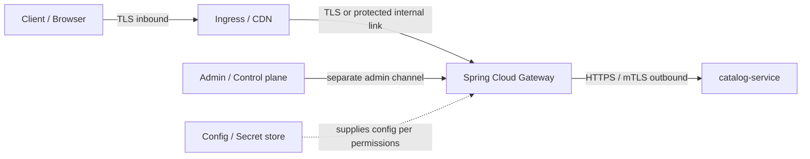
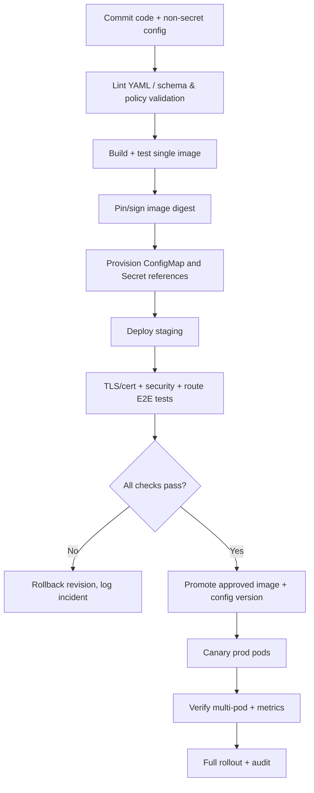

# Managing Configuration, Certificates, and Secrets by Environment

## 1. The Challenge of Deploying Spring Cloud Gateway Safely Across Multiple Environments

When building an API Gateway with **Spring Cloud Gateway**, we configure route predicates, filter chains, path/header transformations, service discovery, authentication, rate limiting, circuit breakers, retries, TLS, and request observability. Most of these features depend on **environment-specific configuration**, and several depend directly on **certificates or secrets**. The challenge arises when the exact same application must run across three environments:

| Environment | Example client → Gateway URL | Target backend | Operational conditions |
|---|---|---|---|
| **dev** | `http://localhost:8080` | `http://127.0.0.1:8081` | Easy debugging, synthetic data, no real credentials |
| **staging** | `https://staging.api.example.test` | `https://catalog.staging.svc.example.test` | Real test-environment TLS/certificates, auth/quotas, rollback testing |
| **production** | `https://api.example.test` | `https://catalog.prod.svc.example.test` | Secrets managed by a secret manager, TLS/mTLS, auditing, rollouts, and rotation |

**The goal is not three different JARs.** The goal is **one built and tested application artifact** consuming external configuration per environment, with secrets distributed securely and rotatable/revocable without committing them to source control.

A misconfiguration in the Gateway can have wider blast radius than in a single service: pointing a production route to staging; forwarding JWTs to an untrusted upstream; disabling TLS verification; leaking a private key in an image; or deploying a new certificate while some pods keep serving the old one.

### Learning Outcomes

After this lesson from the **Deployment** chapter, you will be able to:

1. Classify **configuration**, **certificates**, **private keys**, **trusted CAs**, and **runtime secrets**.
2. Use Spring Boot **externalized configuration** and `dev`, `staging`, `prod` profiles without hardcoding secrets.
3. Distinguish TLS **client → Gateway**, TLS **Gateway → backend**, and TLS **management plane**.
4. Configure Spring Boot **SSL bundles** and Gateway Server WebFlux HTTP-client SSL using the exact 5.0.x namespace.
5. Mount ConfigMaps and Secrets into Kubernetes Pods via env/volumes, understanding update limits and `subPath`.
6. Know when to use Spring Cloud Config, Spring Cloud Vault, or an external secret manager.
7. Establish workflows for **testing, rotation, canary, rollback, and auditing** for route/certificate/credential changes.
8. Diagnose "route right but TLS wrong," "Secret changed yet Pod still uses old value," and "overlapping or unintended config source overrides."

> **Scope:** Spring Cloud Gateway **Server WebFlux 5.0.x** with Spring Boot **4.x** and a compatible Spring Cloud BOM. Several client TLS features have a different namespace in **Gateway Server Web MVC**; do not copy WebFlux YAML directly onto Servlet. Paths, hostnames, secret names, and credentials in this lesson are **illustrative examples**, not live operational data.

## 2. Classify Data Before Deciding Where to Store It

### 2.1. Non-Secret Configuration vs Sensitive Data

| Category | Gateway examples | Store in Git? | Appropriate source/control |
|---|---|---|---|
| **Non-secret config** | route ID, `Path`, `StripPrefix`, `order`, timeouts, quota thresholds | **Yes**, after review | YAML/IaC/Git, ConfigMap, Config Server |
| **Upstream names** | `https://catalog.prod.svc.example.test` | Possibly, if policy permits | Git/config; no userinfo/passwords inside URIs |
| **Public certificates** | Server leaf certificate/fullchain, root/intermediate CAs | **Public certs** may be stored with integrity control | ConfigMap/CA bundle, integrity governance |
| **TLS private keys** | `tls.key`, PKCS12 containing private keys | **Never** commit to repo | Secret manager/Kubernetes Secret volume, restricted permissions |
| **Trust store / keystore passwords** | Password unlocking PKCS12/JKS containing private keys | **No** | Secret reference/volume/config tree |
| **OAuth2 client secrets** | Secret for TokenRelay/OAuth2 client registration | **No** | Vault/Secrets, rotation |
| **API keys / HMAC shared secrets** | Keys for internal calls or request signing | **No** | Secret manager/short-lived identity, never log |
| **Short-lived tokens** | Active Bearer access tokens/JWTs | **No** | Token service/runtime memory; limit propagation |
| **Operational policy** | RBAC, secret expiry SLAs, rollout thresholds | Can be versioned | Git/IaC/policy-as-code and approvals |

A **certificate** is not the same as a **private key**. A TLS server public certificate can generally be distributed openly; its **corresponding private key** is a secret that must be protected. CA trust certificates are primarily **identity trust anchors**; they may be public, yet must never be replaced arbitrarily with attacker-supplied certificates.

### 2.2. Every Request Crosses at Least Three Trust Boundaries



In practice, TLS may terminate **at ingress** or **directly at the Gateway**. With multiple hops, each hop has its own TLS trust, certificate identity, URI scheme, and passwords/keys. Having `https://` on the client side **does not prove** Gateway → backend traffic is encrypted, and a Gateway server certificate **does not automatically become a CA trusted by the outbound HTTP client**.

### 2.3. Three Design Principles

1. **Same artifact, different config:** use an approved image digest paired with per-environment configuration revisions. Never rebuild an image just to change a hostname.
2. **Secrets never live in code/images:** use a secret manager or tightly scoped volumes; never embed secrets in JARs, Dockerfiles, committed Helm values, or CI outputs.
3. **Fail closed appropriately:** if a required production credential or TLS trust anchor is missing, **never silently fall back to cleartext HTTP**, never enable an insecure trust manager, and never substitute fake defaults to force startup.

## 3. Spring Boot Externalized Configuration and Override Order

### 3.1. Spring Environment Aggregates Multiple PropertySources

Spring Boot supports `application.yml`, profile-specific files, environment variables, JVM system properties, command-line arguments, Config Data imports, and external sources. In a typical deployment:

```text
application.yml in JAR             ┐
application-prod.yml in JAR        │
external application-prod.yml      ├─> Spring Environment
OS env / JVM -D / --arguments      │     └─> Bind @ConfigurationProperties
Config Data / Secret store         ┘          └─> Spring Cloud Gateway
```

Under standard precedence, **config data** is read before **OS environment variables**, **JVM system properties**, and **command-line options**; later sources in precedence order override earlier ones. However, **imports, profile groups, and location groups have specific rules**. Never assume "a file in a ConfigMap always beats an env var" or "a file named prod automatically beats every other config source."

### 3.2. Shared Non-Secret Configuration

Example `src/main/resources/application.yml` (in the learner's app, not a curriculum file):

```yaml
spring:
  application:
    name: gateway-edge
  cloud:
    gateway:
      server:
        webflux:
          httpclient:
            connect-timeout: 2000
            response-timeout: 5s
          routes:
            - id: catalog
              uri: ${GATEWAY_CATALOG_URI:http://127.0.0.1:8081}
              predicates:
                - Path=/api/catalog/**
              filters:
                - StripPrefix=2

management:
  endpoints:
    web:
      exposure:
        include: health,info
```

This is a **convenient dev default**, not a complete production config. In production, **require** `GATEWAY_CATALOG_URI`/route configs from controlled sources and block any fallback pointing to localhost. `spring.cloud.gateway.server.webflux.routes` is the WebFlux namespace in Gateway 5.0.x; do not use the legacy `spring.cloud.gateway.routes` prefix from older guides.

**Note:** the `${NAME:default}` placeholder uses `:` to specify a default value. Never define default values for **required secrets** such as client secrets or private-key passwords.

### 3.3. Profile-Specific Configuration

In dev:

```yaml
# application-dev.yml
server:
  port: 8080

spring:
  cloud:
    gateway:
      server:
        webflux:
          httpclient:
            response-timeout: 10s
```

In production:

```yaml
# application-prod.yml (non-secret, example)
server:
  port: 8443

spring:
  cloud:
    gateway:
      server:
        webflux:
          httpclient:
            response-timeout: 3s
```

Activate via **deployment**, never hardcode the prod profile in code:

```bash
# Dev shell:
SPRING_PROFILES_ACTIVE=dev java -jar gateway-edge.jar

# Prod is usually set by Deployment env, not typed manually on a node:
SPRING_PROFILES_ACTIVE=prod java -jar gateway-edge.jar
```

If an application activates multiple profiles simultaneously, **a later-listed profile can override an earlier one** per location group rules. Prefer **one primary environment profile** to avoid mixing `dev,prod`. `spring.profiles.active` must be placed in a valid Spring Config Data location and provided by the orchestrator; do not use `spring.config.activate.on-profile` to activate that profile itself.

### 3.4. Environment Variables and Property Names

Spring Boot relaxed binding maps environment variables such as:

```text
SPRING_PROFILES_ACTIVE=prod
SERVER_PORT=8443
SPRING_CLOUD_GATEWAY_SERVER_WEBFLUX_HTTPCLIENT_CONNECTTIMEOUT=2000
```

For hyphenated properties, Boot's canonical rule typically **replaces dots with underscores, removes hyphens, and uppercases**. However, **list/map** properties follow index/key rules; when route lists grow long, prefer **versioned YAML configuration** over complex env vars like `...ROUTES_0_PREDICATES_0`, and test actual binding.

**Warning:** command-line `--some.secret=value` and env vars can leak through process metadata, debug dumps, or Pod spec viewers; for sensitive credentials prefer mounted files/secret agents with tight permissions.

### 3.5. `spring.config.location` and `spring.config.additional-location` Are Not Identical

```bash
# Keep defaults and add an environment config directory:
java -jar gateway-edge.jar \
  --spring.config.additional-location=optional:file:./deploy-config/

# Replace the default search locations (requires deliberate design):
java -jar gateway-edge.jar \
  --spring.config.location=file:./deployment-only/
```

`additional-location` adds external sources alongside default search paths, whereas `location` can **replace** default locations. Directories generally require a trailing `/`. `optional:` ignores missing locations; **do not use optional for mandatory production secrets or critical policies**.

### 3.6. Avoid Unverified "Partial Route List Overrides"

Route definitions are a **list**, e.g., `routes[0]`, `routes[1]`. When an environment overrides list configuration, **never assume elements merge by `id`**. An external `application-prod.yml` defining only `catalog` can wipe out other routes depending on binding/override behavior. Manage the **entire intended route set** per authoritative config source and verify at runtime:

```text
expectedRouteIds = {catalog, orders, auth}
actualRouteIds   = GET /actuator/gateway/routes
assert expected == actual  (in a controlled environment)
```

Checking a config file does not replace testing real HTTP routing, especially when discovery locators or external dynamic route stores exist outside YAML.

## 4. Designing Environment-Separated Configuration Trees

### 4.1. Do Not Treat Three Environments as Three Copies of a Password-Laden YAML

A relatively auditable layout:

```text
source code / Git:
  application.yml                  # shared defaults, no secrets
  application-dev.yml              # dev overrides, local only
  deploy/staging/routes.yml        # staging route snapshot, non-secret
  deploy/prod/routes.yml           # prod route snapshot, non-secret
  deploy/prod/values-public.yaml   # image digest, resources, probes...

runtime outside the image:
  /etc/gateway/config/             # ConfigMap or Config Server config
  /etc/gateway/tls/                # certificate + PRIVATE KEY: Secret volume
  /etc/gateway/trust/              # approved CA bundles
  /etc/gateway/secrets/            # OAuth client secret, API key... files
```

**This layout only illustrates partitioning** and does not force every organization to use these exact filenames. What matters is that **secrets never enter Git or the image** and are never copied into build artifacts. Even in test environments, real test secrets still need protection; never reuse production OAuth client secrets, private keys, or credentials in staging.

### 4.2. Ownership and Mutability Matrix

| Component | Owning person/team | Changed via | Restart needed after change? |
|---|---|---|---|
| Route predicates/filters/URIs | Platform/app owner | GitOps/Config Server/RouteDefinition source | Depends on config source and refresh mechanism; must verify |
| Timeout, pool, metrics configuration | Gateway platform | External YAML/env | Usually applied at startup; verify whether property supports refresh |
| Inbound TLS key/cert | PKI/SRE | Secret mount + SSL bundle or rollout | Boot 4 supports bundle reload on Netty server when enabled properly; do not assume by default |
| Outbound trusted CA | PKI/SRE | CA bundle/secret/config + client SSL bundle | **Do not assume** Netty HttpClient reloads live; test or roll out |
| OAuth2 client secret | IAM/secret platform | Vault/secret service/Secret volume | Depends on client lifecycle/cache; often requires restart |
| RBAC/management exposure | Security/platform | IaC/release | Test pre-deploy; never "refresh routes" to change security |
| Gateway image | App/platform | CI/CD + pinned digest | Requires rollout/pod replacement |

**Route refresh** is not **full-JVM configuration hot reload**. Specifically, `POST /actuator/gateway/refresh` refreshes **routes**, not SSL private keys or OAuth2 client secrets already bound to beans at startup.

### 4.3. Naming Conventions and Environment Isolation

Use clear identifiers:

```text
gateway-dev / gateway-staging / gateway-prod      # workloads
gateway-inbound-tls                               # k8s Secret per namespace
catalog-upstream-ca                               # CA/trust bundle per namespace
gateway-oauth-client                              # OAuth2 secret (when needed)
catalog                                             # keep route ID stable
```

A Secret with the **same name** across three Kubernetes namespaces still represents **three distinct objects** with independent permissions and contents. Do not derive route IDs from secret names or embed environment passwords in route URIs. Keeping the same route ID `catalog` pointing to environment-specific hostnames makes auditing much cleaner.

### 4.4. Change Control: Route Config Is Security-Sensitive Data

Even a YAML file **containing zero passwords** can be highly sensitive:

- `uri: https://malicious.example.test` diverts traffic and Authorization headers.
- A low-`order` `Path=/**` route hijacks the entire API namespace.
- `RemoveRequestHeader=Authorization` can break the security contract.
- `Retry` mistakenly applied to POST duplicates write operations.
- `RequestRateLimiter` with a bad key resolver can cause widespread false rejections.
- `httpclient.ssl.use-insecure-trust-manager: true` undermines the trust model.

Therefore, route configs require **code review, policy validation, change ownership, signatures/provenance, canarying, and rollback**, even when not stored in Secret objects.

## 5. Inbound TLS (Client/Ingress → Gateway)

### 5.1. Three Common Topologies

| Topology | Where is TLS terminated? | Gateway listener | What to verify |
|---|---|---|---|
| Client HTTPS → Ingress TLS → Gateway HTTPS | Ingress, then re-encrypted TLS to Gateway | HTTPS/TLS | Both certificates, ingress trust, and Gateway identity |
| Client HTTPS → Ingress TLS → internal HTTP Gateway | Ingress | Cleartext HTTP | Acceptable only with a trust boundary/network/mesh protecting the internal hop |
| Client HTTPS passthrough → Gateway HTTPS | Gateway | HTTPS/TLS | Gateway certificate for public hostname, SNI/ALPN, and ingress passthrough |

When TLS terminates at ingress, `server.ssl.bundle` on the Gateway **does not protect the client → ingress hop**; the edge certificate belongs to Ingress/CDN. If ingress → Gateway also requires TLS/mTLS, you need a **Gateway server certificate** and ingress client trust configuration.

### 5.2. Spring Boot 4: Defining a PEM SSL Bundle for the Server

Suppose the certificate/private key are provisioned by a secret manager and mounted at:

```text
/etc/gateway/tls/tls.crt    # full certificate chain (public cert)
/etc/gateway/tls/tls.key    # PRIVATE KEY, strict read permissions
```

Configure in an external production file, **without embedding the private key contents**:

```yaml
server:
  port: 8443
  ssl:
    bundle: gateway-inbound
  http2:
    enabled: true

spring:
  ssl:
    bundle:
      pem:
        gateway-inbound:
          keystore:
            certificate: "file:/etc/gateway/tls/tls.crt"
            private-key: "file:/etc/gateway/tls/tls.key"
```

Spring Boot builds a bundle named `gateway-inbound` from the certificate and private key; `server.ssl.bundle` instructs the web server to use it. `server.http2.enabled: true` is a **separate setting** for HTTP/2 on the listener; ALPN/TLS/client compatibility still must be tested. Never put `tls.key` inside `src/main/resources` or copy it into a Docker layer.

If using **JKS/PKCS12**, you can configure `spring.ssl.bundle.jks.<name>.keystore.location/password/type` and reference `server.ssl.bundle`; the password must come from a Secret. Do not mix a PEM bundle with unrelated `server.ssl.key-store` settings without verifying precedence/validation rules.

### 5.3. Configuring Inbound Client-Auth/mTLS Security

If the Gateway must authenticate the **caller's certificate (ingress or service)**:

```yaml
server:
  ssl:
    bundle: gateway-mtls
    client-auth: need

spring:
  ssl:
    bundle:
      pem:
        gateway-mtls:
          keystore:
            certificate: "file:/etc/gateway/tls/tls.crt"
            private-key: "file:/etc/gateway/tls/tls.key"
          truststore:
            certificate: "file:/etc/gateway/trust/allowed-client-ca.crt"
```

The `gateway-mtls` bundle holds the Gateway's certificate and the CA used to validate **client certificates**. `client-auth: need` forces clients to present a valid certificate to the TLS engine. However, **a valid certificate does not automatically authorize calling every route**; authorization must still verify identity/issuer/SAN/policy and handle revocation/rotation. If ingress terminates TLS without forwarding mTLS to the Gateway, the app cannot safely infer mTLS client identity from raw Internet-supplied headers.

### 5.4. Testing Inbound TLS Without Disabling Verification

Using the lab CA:

```bash
# Verify Gateway certificate, hostname, and HTTP response.
curl --noproxy '*' -v \
  --cacert ./certs/lab-root-ca.crt \
  https://localhost:8443/actuator/health

# Inspect certificate subject/issuer/dates/chain and ALPN on listener.
openssl s_client \
  -connect localhost:8443 \
  -servername localhost \
  -alpn h2,http/1.1 \
  -CAfile ./certs/lab-root-ca.crt \
  </dev/null
```

For the `localhost` test to succeed, the certificate must contain **SAN DNS:localhost** (and IP SAN if called by IP) signed by the trusted lab CA. With mTLS `client-auth: need`, `curl`/`openssl` also need a matching **client certificate + private key** signed by the Gateway's trusted CA.

Avoid `curl -k` or `use-insecure-trust-manager=true` in production validation; they destroy proof that identity verification succeeded.

### 5.5. HTTPS Management Is a Separate Listener

If placing Spring Boot Actuator on a separate `management.server.port`, e.g., `9090`, **do not assume it shares the API port's TLS/RBAC policies**. Options include blocking it externally outside the cluster, binding to loopback/private networks, or configuring management-specific SSL and Spring Security properly.

`/actuator/env`, `/actuator/configprops`, and `/actuator/gateway` can reveal topology and configuration, or allow **modifying routes** if write access is granted. Even sanitized output is no excuse to expose management endpoints to the Internet.

## 6. Outbound TLS (Gateway Calling Backends)

### 6.1. Distinguishing Server SSL from Netty HTTP Client SSL

In Gateway Server WebFlux:

```text
Client/Ingress             Gateway                     Backend
     |                        |                           |
     +---- TLS inbound ------>|                           |
                              +------ TLS outbound ------>|
                     server.ssl.*              spring.cloud.gateway.
                                               server.webflux.httpclient.ssl.*
```

`server.ssl.bundle` **does not configure** trust or certificates for the outbound Netty HTTP client. Conversely, adding a CA to the Gateway HTTP client **does not alter** the certificate Gateway presents to browsers.

### 6.2. Outbound HTTPS with a Private CA

Suppose backend `catalog.prod.svc.example.test` uses a certificate signed by a private PKI. The CA is mounted at `/etc/gateway/trust/catalog-ca.crt`. Spring Boot defines a **trust-only PEM SSL bundle**, and Gateway HTTP client references that bundle name:

```yaml
spring:
  ssl:
    bundle:
      pem:
        catalog-upstream:
          truststore:
            certificate: "file:/etc/gateway/trust/catalog-ca.crt"

  cloud:
    gateway:
      server:
        webflux:
          httpclient:
            connect-timeout: 2000
            response-timeout: 5s
            ssl:
              ssl-bundle: catalog-upstream
              handshake-timeout: 10s
              use-insecure-trust-manager: false
          routes:
            - id: catalog
              uri: https://catalog.prod.svc.example.test
              predicates:
                - Path=/api/catalog/**
              filters:
                - StripPrefix=2
```

The property **`spring.cloud.gateway.server.webflux.httpclient.ssl.ssl-bundle`** is listed in Gateway 5.0.x's configuration properties reference. It targets the **Netty HttpClient** used by Gateway Server WebFlux to proxy HTTP traffic; inspect WebSocket client/LoadBalancer behavior separately if workloads use other protocols.

**Scope of application:** HTTP client configuration here can apply across **multiple routes sharing that client/pool**, rather than automatically isolating CA trust per route. When upstreams have differing trust policies, design reviewed trust store unions, segmented Gateway instances/HTTP clients, or custom strategies—never blindly add an untrusted CA just to "make all backends work."

### 6.3. When Outbound Requires Mutual TLS (mTLS)

A client SSL bundle can hold **both key material presenting Gateway identity** and **trust material verifying the backend**:

```yaml
spring:
  ssl:
    bundle:
      pem:
        catalog-mtls:
          keystore:
            certificate: "file:/etc/gateway/client-tls/client.crt"
            private-key: "file:/etc/gateway/client-tls/client.key"
          truststore:
            certificate: "file:/etc/gateway/trust/catalog-ca.crt"
  cloud:
    gateway:
      server:
        webflux:
          httpclient:
            ssl:
              ssl-bundle: catalog-mtls
              use-insecure-trust-manager: false
```

The **client certificate** in `client.crt` must be trusted by the backend; `client.key` must be protected as a secret. Never reuse the public inbound Gateway private key for outbound mTLS unless explicitly designed in PKI (typically use **separate identities and keypairs**).

### 6.4. Testing Outbound TLS from the Actual Runtime Environment

```bash
# Run in an authorized debug tool sharing the Gateway's network path.
curl --cacert /etc/gateway/trust/catalog-ca.crt \
  -v https://catalog.prod.svc.example.test/health

# Inspect backend certificate chain, preserving SNI hostname.
openssl s_client \
  -connect catalog.prod.svc.example.test:443 \
  -servername catalog.prod.svc.example.test \
  -CAfile /etc/gateway/trust/catalog-ca.crt \
  </dev/null
```

If the backend requires mTLS, pass `--cert`/`--key` for an **approved client identity** and ensure tools never print private keys. Direct connectivity checks prove the backend is reachable over TLS **from the test environment**, not that Gateway's HTTP client loaded the right bundle; proceed to **send requests through the Gateway**, inspect the backend, and verify transport logs/metrics.

### 6.5. Dangerous Workarounds

| "Quick fix" | Why is it wrong? | Correct approach |
|---|---|---|
| `use-insecure-trust-manager: true` | Disables backend certificate verification | Trust valid CA/certificate chains and hostnames |
| Switching `https://` to `http://` | Sends tokens/data in cleartext without another secure channel | Fix TLS handshake/trust/DNS/SNI |
| `curl -k` in production tests | Masks certificate/hostname errors | Use `--cacert` or proper trust stores |
| Copying private keys into images | Hard to revoke; anyone with image access can steal the key | Mount Secrets with least privilege |
| Sharing one client key across all environments | Breaks dev/staging/prod isolation and enlarges blast radius | Separate identities/certs/keys per environment |
| Trusting unvetted CAs | Expands upstream spoofing surface | Trust only policy-approved CAs and check hostnames |

**Never treat certificates as ordinary config files**: changing a certificate, CA trust, or private key alters trust boundaries and requires commensurate auditing, approval, rollout, and rollback testing.

## 7. Secret Management: Env Vars, Mounted Files, and Config Trees

### 7.1. Secrets Require Full Lifecycle Governance

A secret is not just "a hidden string in YAML." For OAuth2 client secrets, API keys, PKCS12 passwords, or TLS keypairs, establish:

- **Who issues it?** Authorized IAM, PKI, secret manager, or CI.
- **Who can read it?** ServiceAccount/workload identity, role, namespace, and process.
- **What is it scoped for?** Correct upstream/audience, environment, and scope.
- **How long does it live?** Expiration date, TTL, rotation schedule, and revocation plan.
- **Where could it leak?** Git, image layers, Helm release metadata, process env, stdout, Actuator, heap dumps, traces.
- **How is it rotated?** Volume updates, client reload, rolling restarts, dual-key overlap, and smoke tests.

**Base64 encoding does not make a value a protected secret.** Kubernetes `Secret.data` uses base64 merely to encode bytes in YAML; anyone permitted to read the Secret can decode it. Encryption at rest, RBAC, restricted API access, auditing, and backup/CI log protection are essential.

### 7.2. Using Environment Variables for Secrets When Infrastructure Permits

Example of a custom application property **declared by application code**:

```yaml
app:
  integrations:
    partner:
      api-key: ${GATEWAY_PARTNER_API_KEY}
```

The application can bind via `@ConfigurationProperties(prefix = "app.integrations.partner")`, **without logging it** or exposing it in `toString()`. In deployment, inject `GATEWAY_PARTNER_API_KEY` from a secret reference; **never place real values in Dockerfiles or Git manifests**.

Note: `app.integrations.partner.api-key` is only a **custom property example**, not a built-in Gateway filter that automatically applies an API key. If authenticating to upstreams via Spring Security OAuth2 client, configure client registrations, providers, credentials, and token relay policies per Spring Security documentation.

**Limits of env vars:** Secrets passed into the environment at container startup can appear in process diagnostics, error dumps, or tools inspecting the environment. Updating a Kubernetes Secret object **does not update env vars inside an already-running Pod**. A restart/rollout is required for the process to pick up the new value.

### 7.3. Config Trees for Secrets Mounted as Individual Files

Spring Boot supports `spring.config.import=configtree:/path/`. When mounted:

```text
/etc/gateway/credentials/
  app.integrations.partner.api-key    # file content: <secret-bytes>
  app.integrations.partner.key-id     # file content: <version-label>
```

Configuration:

```yaml
spring:
  config:
    import: "configtree:/etc/gateway/credentials/"
```

Each **filename becomes the property key**, and file contents become the value. Because this import omits `optional:`, a missing directory can prevent startup. That behavior is generally desirable for security-critical config, yet **mandatory-key validation is still needed**: an existing directory missing the `api-key` file might not populate the expected property.

For secret files, set `readOnly`, appropriate permissions, and owner/group matching the Java process UID. Do not mount an entire namespace's Secrets into a Pod just for one small key. Loading property values via `configtree:` **does not mean** Gateway code automatically rebinds/recreates beans when files change; verify the lifecycle.

### 7.4. File Path vs Secret Content

Two distinct forms:

```yaml
spring:
  ssl:
    bundle:
      pem:
        gateway-inbound:
          keystore:
            private-key: "file:/etc/gateway/tls/tls.key"

app:
  integrations:
    partner:
      api-key: ${GATEWAY_PARTNER_API_KEY}
```

- `file:/etc/gateway/tls/tls.key` is a **path to a file holding the private key**, not the private key text itself.
- `${GATEWAY_PARTNER_API_KEY}` is a **value injected from the environment** into a property.

Do not swap a required file path for a multiline PEM env var without checking formatting and how Spring Boot parses resources. Never print secret/file contents into CI logs while debugging.

### 7.5. When to Use a Secret Manager Instead of Direct Kubernetes Secrets

| Requirement | K8s Secret / mounted files | Vault / cloud secret manager / workload identity |
|---|---|---|
| Static secrets, few keys | Reasonable when cluster has strong RBAC/encryption/auditing | Also suitable |
| Short-TTL rotation | Needs operators/automation and proper reload/restarts | Typically offers stronger lifecycle/lease support |
| Dynamic DB credentials/tokens | Requires external integration | Often provides built-in secret engines/identity APIs |
| Per-environment access isolation | Namespaces/RBAC/ServiceAccounts | Dedicated policies/roles/identities |
| Avoid storing secret values in Kubernetes API | Only via CSI/agent with specific design | Can inject directly via CSI/agent/service identity |
| Secret access auditing | Kubernetes API audit (scoped by access) | Secret manager audit events and policies |

No tool makes secrets automatically safe if permissions are overly broad or the app logs raw values. Enforce **least privilege**, **workload identity**, scoped secrets, deny-by-default, and revocation testing.

## 8. Spring Cloud Config and Vault: Separating Config Sources from Secret Sources

### 8.1. Spring Cloud Config for Versioned Config

Spring Cloud Config Client uses `spring.config.import=configserver:...` to load Config Data:

```yaml
spring:
  application:
    name: gateway-edge
  config:
    import: "configserver:https://config.internal.example.test"
  cloud:
    config:
      label: "release-2026-11"
```

Because this import omits `optional:`, failing to fetch mandatory configuration causes the application to **fail startup** instead of running with wrong defaults. The `label` parameter maps to a tag/branch/commit in the Config Server's backing repository (per backend). These are **example names**; replace them with CI/CD-approved versioned sources.

**Never store Config Server usernames/passwords or OAuth tokens inside Git config itself.** If Config Server requires credentials, supply them via a secret store/workload identity/env/mTLS separately, ensuring SSL CA trust and endpoint availability. If dev tolerates an absent Config Server, use `optional:configserver:...` **deliberately**, never enabling optional by default for production security-critical config.

### 8.2. Config Server Does Not Automatically Apply Every Runtime Change

After updating a file in Git:

1. Config Server must observe/serve the new revision.
2. The Gateway client must **fetch/rebind** the affected properties.
3. Gateway route definitions must be **reloaded or refreshed** via the proper mechanism.
4. TLS clients, OAuth2 registrations, and HTTP connection pools may need recreation/restart.
5. Every Gateway instance must converge on **the same config revision** or follow an intentional rollout.

`POST /actuator/gateway/refresh` is purely a **route cache refresh**; it does not guarantee re-fetching Config Server, rebinding every `@ConfigurationProperties`, or rotating SSL keys. Dynamic config requires designing **source change notification**, **refresh lifecycle**, and **end-to-end tests** together.

### 8.3. Importing Secrets with Spring Cloud Vault

Spring Cloud Vault integrates with Spring Boot Config Data:

```yaml
spring:
  config:
    import: "vault://"
  cloud:
    vault:
      uri: "https://vault.internal.example.test"
      # Authentication should use workload identity/Kubernetes auth
      # or a security-approved mechanism;
      # never commit personal tokens into YAML.
```

This is a **conceptual snippet**, insufficient on its own to run a real Vault Client. You need the BOM-compatible Spring Cloud Vault dependency, properly enabled secret backends, authentication, service identity, TLS trust, and read policies scoped to the environment's paths. `vault://` is a Config Data import mechanism; it does not make Gateway's HTTP client automatically trust arbitrary certificates.

**Production practice:** prefer workload identity/Kubernetes auth/OIDC with TTLs/rotation; never hardcode a Vault root token. If Vault is unavailable at startup, fail closed or follow an approved caching/lease strategy; **never fall back to default client secrets**.

### 8.4. Reading Sources and Modifying Routes Are Different Permissions

A pod permitted to read configuration should not implicitly hold permission to:

- Write route definitions belonging to other teams.
- Write secrets for other tenants/environments.
- Create RouteDefinitions pointing arbitrary URIs at metadata endpoints.
- Enable `unrestricted` public Actuator Gateway endpoints.
- Read and decrypt every certificate private key.

Read-secret/read-config, publish-config, and approve/activate-route permissions should follow **separation of duties** with auditing.

## 9. Kubernetes Example: ConfigMap + Secret Volumes + Single Image

### 9.1. Deployment Diagram

```text
GitOps (non-secret config)             PKI/Secret Platform
            |                                   |
            v                                   v
    ConfigMap gateway-prod-config        Secret gateway-inbound-tls
      application-prod.yml               Secret catalog-upstream-ca
            |                                   |
            +----------- Kubernetes ------------+
                             |
                             v
                       Gateway Pod
                        fixed image
                         8443 TLS
                /etc/gateway/config/ (ConfigMap)
                /etc/gateway/tls/    (Secret)
                /etc/gateway/trust/  (Secret/CA)
                             |
                             v
                 HTTPS catalog.prod.svc.example.test
```

**This is a reference architecture**, not infrastructure assumed to exist for the learner. ConfigMaps hold non-secret YAML, while Secrets supply private keys and trust material per policy; public certificates can be shared openly provided **integrity and provenance** are preserved.

### 9.2. ConfigMap Contains Only Config Files, Never Private Keys

Example `gateway-prod-config.yaml` in a GitOps repository:

```yaml
apiVersion: v1
kind: ConfigMap
metadata:
  name: gateway-prod-config
  namespace: gateway-prod
data:
  application-prod.yml: |
    server:
      port: 8443
      shutdown: graceful
      ssl:
        bundle: gateway-inbound
    spring:
      lifecycle:
        timeout-per-shutdown-phase: 30s
      ssl:
        bundle:
          pem:
            gateway-inbound:
              reload-on-update: true
              keystore:
                certificate: "file:/etc/gateway/tls/tls.crt"
                private-key: "file:/etc/gateway/tls/tls.key"
            catalog-upstream:
              truststore:
                certificate: "file:/etc/gateway/trust/catalog-ca.crt"
      cloud:
        gateway:
          server:
            webflux:
              httpclient:
                connect-timeout: 2000
                response-timeout: 5s
                ssl:
                  ssl-bundle: catalog-upstream
                  use-insecure-trust-manager: false
              routes:
                - id: catalog
                  uri: https://catalog.prod.svc.example.test
                  predicates:
                    - Path=/api/catalog/**
                  filters:
                    - StripPrefix=2
    management:
      endpoints:
        web:
          exposure:
            include: health,info
      endpoint:
        health:
          probes:
            enabled: true
```

`application-prod.yml` here is a **complete YAML file inside the ConfigMap's `data`**. It contains only **file paths** pointing to Secret volumes. Never place private-key PEMs, OAuth2 secrets, or tokens inside `data.application-prod.yml`.

If your organization uses Config Server instead of ConfigMaps, drop this file and configure the matching import/credentials policy; avoid running two competing config sources without explicit precedence.

### 9.3. Secrets Provisioned from a Secure Source

Expected Secret objects **already provisioned by the PKI/secret platform** in namespace `gateway-prod`:

| Secret | Expected type/data | Mounted at |
|---|---|---|
| `gateway-inbound-tls` | `kubernetes.io/tls` with keys `tls.crt`, `tls.key` | `/etc/gateway/tls/` |
| `catalog-upstream-ca` | Generic Secret with key `catalog-ca.crt` | `/etc/gateway/trust/` |

Illustrative command **only for lab environments with a lab-CA-issued keypair**:

```bash
# NEVER run with real private keys outside an authorized environment.
# NEVER paste private key contents into terminals, shell history, or chat.
kubectl -n gateway-dev create secret tls gateway-inbound-tls \
  --cert=./certs/gateway.crt \
  --key=./certs/gateway.key
```

In production, let **cert-manager/PKI/External Secrets Operator/CSI providers** or an approved secret workflow create and update Secrets rather than manual personal credentials. Granting access to a Kubernetes Secret **does not automatically provide end-to-end encryption**; verify encryption at rest, RBAC, etcd/backup security, and node/workload privileges.

### 9.4. Deployment Mounting ConfigMap and Secrets by Path

Excerpt from `gateway-deployment.yaml`, assuming namespace, ServiceAccount, Secrets, and image are already provisioned:

```yaml
apiVersion: apps/v1
kind: Deployment
metadata:
  name: gateway-edge
  namespace: gateway-prod
spec:
  replicas: 2
  selector:
    matchLabels:
      app: gateway-edge
  template:
    metadata:
      labels:
        app: gateway-edge
    spec:
      serviceAccountName: gateway-edge
      securityContext:
        runAsNonRoot: true
        runAsUser: 10001
        runAsGroup: 10001
        fsGroup: 10001
        seccompProfile:
          type: RuntimeDefault
      terminationGracePeriodSeconds: 45
      containers:
        - name: gateway
          # Replace with a CI-signed/approved image digest:
          image: registry.example.test/gateway-edge@sha256:REPLACE_DIGEST
          imagePullPolicy: IfNotPresent
          ports:
            - name: https
              containerPort: 8443
          env:
            - name: SPRING_PROFILES_ACTIVE
              value: prod
            - name: SPRING_CONFIG_ADDITIONAL_LOCATION
              value: "file:/etc/gateway/config/"
          volumeMounts:
            - name: configuration
              mountPath: /etc/gateway/config
              readOnly: true
            - name: inbound-tls
              mountPath: /etc/gateway/tls
              readOnly: true
            - name: backend-ca
              mountPath: /etc/gateway/trust
              readOnly: true
            - name: tmp
              mountPath: /tmp
          securityContext:
            allowPrivilegeEscalation: false
            readOnlyRootFilesystem: true
            capabilities:
              drop: ["ALL"]
          readinessProbe:
            httpGet:
              path: /actuator/health/readiness
              port: https
              scheme: HTTPS
            initialDelaySeconds: 5
            periodSeconds: 5
      volumes:
        - name: configuration
          configMap:
            name: gateway-prod-config
        - name: inbound-tls
          secret:
            secretName: gateway-inbound-tls
            defaultMode: 288
        - name: backend-ca
          secret:
            secretName: catalog-upstream-ca
            defaultMode: 288
        - name: tmp
          emptyDir:
            sizeLimit: 64Mi
```

Easily overlooked details:

- `SPRING_CONFIG_ADDITIONAL_LOCATION=file:/etc/gateway/config/` tells Boot to load the **external `application-prod.yml`** alongside the `prod` profile without replacing all default config search locations.
- `defaultMode: 288` is **decimal for 0440 (octal)**. `fsGroup` allows the non-root process to read mounted files cleanly; verify actual permissions against your image/cluster security policy.
- Do not use `subPath` for the TLS Secret here: Secret volumes update via projection, whereas `subPath` **never receives automatic updates**.
- `readOnlyRootFilesystem` requires the image not to write elsewhere; `emptyDir` at `/tmp` supports valid temporary operations. Production also needs resource limits, topology spread, disruption budgets, HPA, and network policies tailored to workload.
- The image digest above is an **unusable placeholder** and must be replaced by CI/CD with a valid SHA-256 digest; never deploy literal `REPLACE_DIGEST` to a cluster.
- An HTTPS readiness probe checks HTTP response, yet **kubelet's HTTPS probe does not validate certificates like a full production client**; run separate TLS/SAN/CA verification from real clients. Green health/readiness also does not prove every route/upstream works.

### 9.5. Config Updates Do Not Automatically Equal JVM Updates

Kubernetes **re-projects** ConfigMap/Secret files after object changes (with sync/cache delay). However:

| Delivery method | When ConfigMap/Secret object changes | Does the Gateway JVM automatically adopt the new value? |
|---|---|---|
| Env var via `secretKeyRef` | Existing Pod env **does not change** | **No**; requires rollout/restart |
| Direct Secret volume | Files update **eventually** | **Only if the consumer supports watch/reload** |
| Secret volume via `subPath` | Mounted contents **never** update automatically | Avoid if hot rotation is needed |
| Mounted ConfigMap file | Files may update eventually | Boot does not automatically rebind all config properties |
| Config Server Git revision | Remote repository changes | Clients/beans/caches need appropriate reload mechanisms |
| Spring Boot PEM SSL bundle with `reload-on-update` | When key/cert files change and watcher detects it | **Can reload on Netty web server** when conditions are met |

**Do not confuse Kubernetes file projection with Spring bean reconfiguration.** A newer file timestamp on disk does not prove Gateway's outbound HttpClient swapped SSL contexts or closed old connection pools.

### 9.6. Inspecting Pods Without Printing Secrets

**Illustrative** commands in an authorized environment:

```bash
# Check Pod/deployment rollout without printing Secret.data.
kubectl -n gateway-prod rollout status deployment/gateway-edge
kubectl -n gateway-prod get pods -l app=gateway-edge

# View logs already scrubbed of sensitive data by the app.
kubectl -n gateway-prod logs deployment/gateway-edge \
  --tail=100

# Read object metadata; do not dump raw Secret YAML.
kubectl -n gateway-prod get configmap gateway-prod-config
kubectl -n gateway-prod get secret gateway-inbound-tls
```

Discourage running `kubectl get secret ... -o yaml`, indiscriminate `printenv`, `cat /etc/gateway/tls/tls.key`, or `kubectl exec ... env` to debug production: those habits push credentials into terminal history, logs, or inappropriate channels.

### 9.7. Revision Tracking for Explicit Pod Configuration Updates

An easily traceable GitOps pattern uses **versioned ConfigMap/Secret names**, or stores a **secret-free** checksum/hash in Pod template annotations to trigger rollouts when sources change:

```yaml
spec:
  template:
    metadata:
      annotations:
        config-revision: "git-commit-or-config-version"
        trust-bundle-revision: "ca-release-id"
```

This is a **PodTemplate annotations snippet**, not a complete Deployment. Never put raw Secret values or weak hashes of secrets into annotations. Every change requires a revision, owner, approval, and rollback path. Even if certificates rotate automatically via watchers, telemetry must still confirm which certificate the listener actually serves.

## 10. Zero-Downtime Rotation of Certificates, CAs, and Secret Keys

### 10.1. At Least Four Rotation "Clocks" Exist

A certificate may be **newly issued** by PKI yet still remain **unused by the application**:


Verify every step. Seeing an updated object via `kubectl get secret` **only confirms step B**, not that file projection converged or that the Netty listener is serving the new leaf certificate.

### 10.2. Inbound PEM SSL Bundles Support File-Based Reload

Spring Boot 4.x supports:

```yaml
spring:
  ssl:
    bundle:
      pem:
        gateway-inbound:
          reload-on-update: true
          keystore:
            certificate: "file:/etc/gateway/tls/tls.crt"
            private-key: "file:/etc/gateway/tls/tls.key"

server:
  ssl:
    bundle: gateway-inbound
```

Boot docs confirm **Netty web server** and **Tomcat web server** are among the consumers supporting SSL bundle reloading. A file watcher monitors certificate/key files, including appropriate symlinks; upon update it can build a new SSL context without restarting **when consumer and mode match**.

However, keep these distinctions in mind:

- **Private key and certificate files must match as a pair**, updated via coordinated/atomic projection; avoid multi-step file writes where the listener observes a half-old, half-new pair.
- **File watching has latency** and a quiet period; existing open connections may persist across rotation.
- **Successful reload does not issue or renew certificates.** External cert-manager/ACME/PKI handles issuance/renewal.
- **Kubernetes-mounted Secrets** have propagation latency; if mounted via `subPath`, automatic updates never happen.
- **Netty outbound HttpClient** is not guaranteed to hot-reload merely because the server PEM bundle reloads; test or roll out client pods separately.

### 10.3. Inbound Certificate Rotation Plan

Reference production workflow:

1. **Inventory:** active certificate, serial number, SANs, issuer, chain, expiration date, owner, and TLS hop.
2. **Issue:** new certificate for the same identity (or approved new identity) and new keypair in PKI; private key never leaves the secret trust boundary.
3. **Staging:** verify chain, SAN/SNI, TLS version, mTLS client certs, and HTTP routing with the new certificate.
4. **Deploy Secret:** update Secret/volume via PKI/automation; confirm projected file versions without printing the private key.
5. **Activate:** via Boot's watcher if enabled, or rolling restart/rollout if reload is unsupported.
6. **Verify:** connect from a **real** client to the target pod/edge, inspect certificate serial/expiry, and run business HTTP requests.
7. **Converge:** verify every Gateway instance serves the new certificate version, not just one pod.
8. **Revoke/cleanup:** only after confirming zero consumers still rely on the old cert/key; record audit trail and verify rollback plan.

### 10.4. Rotating Outbound CAs in Order to Avoid Breaking Trust

When a backend migrates from CA-A to CA-B, the least disruptive sequence is usually:

```text
T0: Gateway trusts CA-A; backend serves cert signed by CA-A.
T1: Gateway trusts CA-A + CA-B (if policy allows).
T2: Backend rolls out new cert signed by CA-B.
T3: Verify all Gateway clients connect and pass hostname verification.
T4: Remove CA-A after no upstreams depend on it.
```

If **backends switch to CA-B before** Gateway trusts CA-B, Gateway TLS handshakes fail. If **CA-A is removed too early**, unrotated backends fail simultaneously. If PKI policy forbids trusting both CAs concurrently, design a coordinated/canary cutover instead of disabling trust verification.

**Crucial detail:** Outbound TLS can hold persistent connection pools; older SSL contexts/certificates may only be replaced on new connections or client recreation depending on implementation. Testing one request over an existing pooled connection **is insufficient**; test new connections, rolling restarts, and long-lived streams.

### 10.5. Secret Rotation for OAuth2/API Keys

Many providers support **dual-credential overlap** during cutover:

1. Provider issues a **new secret** while keeping the old secret active.
2. Update the secret manager/K8s Secret with the new version.
3. Force Gateway clients to actually **reload/recreate/restart** to pick up the new secret.
4. Smoke-test **token acquisition/upstream calls** with the expected identity and scopes.
5. Confirm all instances have switched over.
6. Revoke the old secret, watch for 401/403 spikes, and record audit trail.

Not every provider supports two active client secrets simultaneously; some rotations are **hard cutovers** requiring maintenance windows or blue-green deployments. Never keep expired secrets in fallback configs. If a secret leaks, perform **emergency incident revocation** rather than waiting for the scheduled rotation window.

### 10.6. Certificate Inspection Commands Without Printing Private Keys

```bash
# Inspect certificate file (public cert) without reading private key contents.
openssl x509 -in ./certs/gateway.crt \
  -noout -subject -issuer -serial -dates

# Inspect certificate SANs.
openssl x509 -in ./certs/gateway.crt \
  -noout -ext subjectAltName

# Inspect actual certificate presented by Gateway over TLS/SNI.
openssl s_client \
  -connect gateway.example.test:443 \
  -servername gateway.example.test \
  -CAfile ./certs/trusted-root.crt \
  </dev/null
```

`gateway.example.test` and paths are illustrative. With ingress termination, testing the public endpoint shows the **ingress certificate**, not the Netty Gateway backend listener. To verify the Gateway's own certificate, **connect directly to the Gateway listener** over an authorized private test path with matching SNI.

### 10.7. Alerting Before Certificates Expire

Monitor:

- **Days to expiry** for public, mTLS client, and backend certificates.
- Certificate serial/fingerprint, issuer/SANs, and key rotation version.
- TLS handshake failures, unknown CA, expired certificate, hostname mismatch.
- Secret projection lag, file watcher/reload errors, Pod readiness/drain.
- Count of instances still serving old certificates; long-lived connection behavior.
- Pre-expiry alert escalation aligned with organizational SLAs.

**Never rely solely on health returning 200** to conclude PKI is healthy: a Gateway can serve `/actuator/health` over HTTP/localhost while outbound HTTPS routes are failing due to a CA change.

## 11. Deploying, Verifying, and Rolling Back Configuration by Revision

### 11.1. Three Revisions to Track per Release

| Revision | Example | Why record it |
|---|---|---|
| **App image** | SHA-256 digest of Gateway JAR/container | Prevents "same tag, different code" |
| **Non-secret config** | Git commit/Config Server label/ConfigMap hash | Identifies exact predicates/filters/URIs/TLS paths applied |
| **Secret/cert** | Secret version/cert serial/key version (never values) | Identifies which credential version a pod uses |

Rolling back only the app image can fail if current config uses a property unsupported by the older version. Conversely, rolling back route config can fail TLS if a CA or secret has already been revoked. Maintain a **compatibility matrix** across image, config, and secret revisions.

### 11.2. Recommended CI/CD Pipeline



**Promote only after verifying with real HTTP traffic.** Valid YAML, existing certificate files, and Ready Pods do not prove requests route to the right backend or enforce Spring Security properly.

### 11.3. Enforcing Environment Isolation

Promotion checks should validate:

```text
DEV:
  base URI: http://127.0.0.1:8081
  client auth: test identities only
  certificates: lab CA

STAGING:
  base URI: https://catalog.staging.svc.example.test
  client auth: staging identities only
  certificates: staging PKI

PRODUCTION:
  base URI: https://catalog.prod.svc.example.test
  client auth: prod identities only
  certificates: prod PKI
```

**Never allow** a production pod to read a staging Vault path/namespace or use a staging CA/client key simply because "it still connects." Tests should explicitly assert hostname, environment marker, and authorization audience—not merely HTTP 200.

### 11.4. Rolling Back a Bad Route Config

When routes live in YAML/IaC:

1. Identify the **previous verified config revision**; do not copy `GET /actuator/gateway/routes` output and POST it back as a body (runtime GET JSON differs from RouteDefinition JSON).
2. Revert/redeploy/reload the config source via the system's proper mechanism.
3. Refresh the Gateway route cache **if** runtime/route locators actually ingested the new definitions; `POST /actuator/gateway/refresh` alone does not change YAML baked inside a JAR.
4. Verify route IDs/predicates/URIs/order and actual backend responses on **every pod**.
5. Monitor 401/403/429/5xx, retries, circuit breakers, and error ratio.

When routes are managed via Actuator, **do not POST an existing route ID to overwrite it** without deleting first, per the duplicate route definitions warning in the docs. Production requires a single authoritative route source, versioning, and change locks—never manually patch one pod and forget to synchronize the rest.

### 11.5. Rolling Back Secrets/Certificates Differs from Route Rollback

| Failure type | Appropriate recovery | Safety condition |
|---|---|---|
| Wrong API key secret | Restore valid prior version or issue new secret; reload/roll out consumer | Never reuse a leaked/revoked credential |
| Inbound server cert mismatches key | Roll out matching cert+key pair at same revision | Verify SAN/chain/SNI on every listener |
| Wrong outbound CA trust | Restore valid trust set; recreate/restart clients if needed | Never enable insecure trust manager |
| Route URI points to wrong environment | Revert config version/route source; inspect traffic | Check for data exfiltration & audit |
| Secret mount lacks read permissions | Fix Secret/Pod security ownership and roll out | Never make private keys world-readable |
| Config Server unavailable | Fail closed or follow approved continuity strategy | Never fall back prod secrets/routes to dev |

Never "roll back" a certificate revoked due to a security incident just to restore availability. For compromised identities, issue new identities and rotate affected clients/servers.

### 11.6. One Successful Pod Does Not Prove the Entire Rollout Succeeded

Across multiple Gateway instances, skew can occur:

```text
Pod A: image=v8, config=prod-42, cert=new, client CA=CA-B
Pod B: image=v8, config=prod-42, cert=old, client CA=CA-A
Pod C: image=v7, config=prod-41, cert=old, client CA=CA-A
```

Load balancers can make the same API call succeed intermittently, fail TLS, or hit the wrong upstream. Verify **per-instance** convergence, version provenance, and readiness routing; a single passing `curl` through a public LB **does not prove convergence**.

## 12. Minimal Lab: Same JAR, Different Config per Environment

### 12.1. Setup

This lab uses a demo Gateway Server WebFlux and a simple backend. It focuses on **property overrides** and **TLS validation** without requiring a real Kubernetes, Config Server, or Vault setup.

Suppose backend `catalog-demo` at `http://127.0.0.1:8081` returns:

```json
{
  "service": "catalog-demo",
  "environment": "dev",
  "id": 42
}
```

This is an **illustrative body**; the learner runs a backend to test HTTP end-to-end. The route in Section 3's `application.yml` uses `GATEWAY_CATALOG_URI` to point to the backend host.

### 12.2. Running Dev with Environment Overrides

```bash
export SPRING_PROFILES_ACTIVE=dev
export GATEWAY_CATALOG_URI=http://127.0.0.1:8081

# JAR filename is illustrative after building the learner's app.
java -jar gateway-edge.jar

# In another terminal:
curl --noproxy '*' -i \
  http://127.0.0.1:8080/api/catalog/items/42
```

Goals:

1. Request matches route `catalog`.
2. `StripPrefix=2` causes the backend to receive `/items/42`.
3. The environment-provided `GATEWAY_CATALOG_URI` overrides the default.
4. No production API keys/certs/keys enter dev.

### 12.3. Generating a Self-Signed Lab Certificate (Never for Production)

To test local HTTPS on Spring Boot:

```bash
# OpenSSL 1.1.1+; this is a LAB certificate, never trusted in production.
mkdir -p certs
openssl req -x509 -nodes -newkey rsa:2048 \
  -days 3 \
  -keyout certs/gateway-local.key \
  -out certs/gateway-local.crt \
  -subj "/CN=localhost/O=Training" \
  -addext "subjectAltName=DNS:localhost,IP:127.0.0.1"
```

Create a separate **dev-https** config file usable via profile or external config, without committing `gateway-local.key`:

```yaml
server:
  port: 8443
  ssl:
    bundle: local-inbound

spring:
  ssl:
    bundle:
      pem:
        local-inbound:
          keystore:
            certificate: "file:./certs/gateway-local.crt"
            private-key: "file:./certs/gateway-local.key"
```

Since a self-signed certificate is not trusted by system stores by default, pass it as the CA cert **strictly within the lab**:

```bash
curl --noproxy '*' -v \
  --cacert ./certs/gateway-local.crt \
  https://localhost:8443/api/catalog/items/42
```

**Do not use `-k` as TLS validation.** `--cacert` verifies the chain and SAN in the lab. A 3-day self-signed cert is purely for testing configuration and must never be issued publicly. To test **mTLS**, you also need a client certificate and matching truststore, not just a server self-signed cert.

### 12.4. Proving Environment Precedence

Suppose `application-dev.yml` sets `server.port: 8080`. Run:

```bash
SPRING_PROFILES_ACTIVE=dev SERVER_PORT=8181 \
  GATEWAY_CATALOG_URI=http://127.0.0.1:8081 \
  java -jar gateway-edge.jar
```

Per Boot's property source order, `SERVER_PORT` overrides the config file in this setup. Clients must then call `http://127.0.0.1:8181/...`.

**Proper verification:** observe the actual listening port or issue HTTP requests rather than dumping the entire Spring Environment to "check if secrets bound."

### 12.5. Intentionally Creating a Config Error and Fixing It at the Right Source

In **isolated dev**, point the URI to a non-running backend:

```bash
SPRING_PROFILES_ACTIVE=dev \
  GATEWAY_CATALOG_URI=http://127.0.0.1:59999 \
  java -jar gateway-edge.jar
```

The route still loads validly, yet business HTTP requests fail with connection errors/5xx. This illustrates the distinction between:

- Syntactically valid config.
- Route present at runtime.
- Backend actually reachable.
- TLS/identity policy satisfied at each hop.

If a URI is wrong due to an **env var**, fix the env var and restart/roll out the app properly. **Do not** merely call `POST /actuator/gateway/refresh` expecting a running JVM's env vars to change.

## 13. Observing Configuration and Certificates Without Leaking Secrets

### 13.1. Telemetry to Collect

| Component | Permitted telemetry | Avoid logging |
|---|---|---|
| Gateway deployment | image digest, config revision, profile name, Pod ID | raw env dumps, credentials |
| Routes | route ID, approved backend service, status/latency | route URIs containing username/password, raw bearer headers |
| Inbound TLS | certificate serial, issuer, expiry, TLS handshake errors | private key PEMs |
| Outbound TLS | upstream service name, trust bundle revision, error categories | full sensitive request/response headers |
| Secret rotation | key version/lease TTL, last reload/rollout time | secret values/encoded data |
| Config Server/Vault | source revision, success/failure count, fetch latency | auth tokens, plaintext secrets |
| Security | denied admin actions, unexpected egress attempts | full JWTs, cookies, PII |

A `traceId`/request ID correlates Gateway and backend logs, yet the ID itself does not prove a secret updated to the new version. Record **non-sensitive revision metadata** and verify via end-to-end HTTP/TLS checks.

### 13.2. Actuator /env and /configprops: Useful Yet Sensitive

Spring Boot provides `/actuator/env` and `/actuator/configprops` to diagnose binding. Per Boot docs, sensitive values are sanitized by default, and `show-values`/custom sanitizers control visibility.

**Do not expose these two endpoints publicly** just because values appear as `******`; they still leak property names, sources, structure, and topology. In production, keep exposure minimal (e.g., `health,info`) and keep the management plane network-isolated, authenticated, and audited. Never flip `show-values` to always just to debug a secret.

### 13.3. Route Cache Metrics and TLS Metrics Measure Different Things

Suppose Gateway has a route:

```yaml
predicates:
  - Path=/api/catalog/**
filters:
  - StripPrefix=2
uri: https://catalog.prod.svc.example.test
```

A successful `GET /actuator/gateway/routes` only proves the route is loaded **in the cache**. A `spring.cloud.gateway.requests` 200 metric (when enabled) indicates request trends; it does not prove new handshakes are serving the new certificate. To verify TLS rotation, **open fresh connections** to the target listener and verify certificate/ALPN/hostname plus end-to-end requests.

### 13.4. Securing Management Access

In Gateway 5.0.x, avoid enabling:

```yaml
# DO NOT deploy publicly.
management:
  endpoint:
    gateway:
      access: unrestricted
  endpoints:
    web:
      exposure:
        include: "*"
```

Instead, if route inspection is needed within a private control plane:

```yaml
management:
  endpoint:
    gateway:
      access: read-only
  endpoints:
    web:
      exposure:
        include: health,info,gateway
```

**`read-only` still exposes route metadata and upstream hostnames**, so enforce auth/RBAC/network restrictions. Do not call `POST /refresh` when the endpoint is read-only; if dynamic route management is required, expose it on an authenticated, audited control plane.

### 13.5. Alerts to Configure

- Inbound certificates nearing expiration, unexpected SAN/issuer.
- Spikes in **SSLHandshakeException**, unknown CA, or hostname mismatches.
- Spikes in `401/403` from OAuth2/token backends after credential rotation.
- Gateway pod rollout failing to converge, pods stuck on old config revisions.
- Certificate watcher/reload errors, Secret mount/projection errors.
- Route `5xx`/timeouts/connection pool saturation after config rollout.
- Unauthorized attempts against Actuator management or non-allowlisted URI egress.

**Evaluate by phase**: distinguish brief connection-draining spikes from a broken certificate knocking out half of production traffic. Attach deployment/change revisions to alerts to reduce false positives.

## 14. Troubleshooting: Config Changed Yet Gateway Still Behaves Wrongly

### 14.1. Layered Troubleshooting Table

| Symptom | Common cause | Resolution |
|---|---|---|
| Dev runs, staging fails to start | Missing profile/Config Data, required secret, or cert file | Check active profiles, external location, and Secret volumes |
| Production suddenly calls `localhost:8081` | Placeholder has dev default and prod env var wasn't provided | Fail closed on critical config; validate upstream allowlist |
| `SERVER_PORT` differs from YAML | Env var/CLI property overrides file | Check property-source precedence without printing secrets |
| `application-prod.yml` not loaded | Profile inactive, wrong filename/path, missing additional-location | Verify `SPRING_PROFILES_ACTIVE` and config source |
| `spring.config.location` wipes default routes | Replaces default search locations | Use `additional-location` to preserve defaults |
| Adding a route in prod file drops other routes | List binding/override doesn't merge by ID | Manage complete route set; assert runtime route IDs |
| `spring.config.import=optional:configserver:` hides config errors | Optional allows starting without remote config | Require import for prod policies, fail closed |
| Config Server serves stale revision | Wrong label/profile, caching, client hasn't fetched | Check Config Server revision and client refresh/rollout |
| Pod sees new Secret file yet app uses old secret | Bean/client doesn't reload files even after K8s updates | Recreate/restart consumer, verify new credential |
| Env var secret stays old after Secret update | Env vars don't update inside existing Pods | Rolling restart Pods with new secret revision |
| Secret mounted via `subPath` never updates | Kubernetes does not project updates onto subPath mounts | Mount whole volume or roll out |
| Gateway cannot read `tls.key` | UID/GID/permissions, missing Secret key, bad volume mount | Fix permissions/Secret projection; never `chmod 777` |
| Inbound TLS reports `no suitable certificate` | Bundle missing key/cert, bad format, mismatched pair | Verify bundle paths and cert/key pair in PKI |
| HTTPS starts yet curl reports hostname mismatch | SAN misses host/SNI | Issue cert with right SAN; never use `-k` |
| Browser reports expired certificate | Certificate not renewed or listener didn't reload | Check serial/dates over network, then rotate/restart |
| External ingress presents old cert while Gateway has new cert | TLS terminates at ingress | Rotate cert **at ingress**; inspect the right hop |
| Gateway server cert valid yet backend call fails TLS | Outbound HttpClient has separate trust | Configure `httpclient.ssl.ssl-bundle`/trusted CA |
| `SSLHandshakeException: PKIX path building failed` | Backend CA not trusted or incomplete chain | Supply right CA, verify chain/hostname |
| TLS handshake succeeds yet request gets 403 | Valid client identity lacks authorization | Check authn/authz/audience/scopes |
| Inbound mTLS fails for client without cert | `server.ssl.client-auth=need` and client sent no cert | Provision valid client identity and trust CA |
| Outbound mTLS fails after rotating client cert | Backend doesn't trust new CA/client identity yet | Overlap trust / coordinate backend & Gateway rollout |
| HTTPS route accidentally hits staging | Wrong ConfigMap/Config Server label or env override | Diff approved revision vs actual URI; fail deployment |
| One pod returns 200, another returns TLS 5xx | Skewed certificates/trust/secret revisions | Test pods individually; roll out until converged |
| Readiness 200 yet catalog 503 | Health group doesn't test upstream TLS/routes | Add E2E route checks/metrics; don't rely solely on readiness |
| First hop uses HTTP/2 while upstream uses H1 | ALPN/protocol negotiated independently per hop | Measure each hop; inbound SSL doesn't enable outbound H2 |
| Debug logs leak token from config | App/Actuator/HTTP wiretap logging secrets | Stop logging, redact, revoke/rotate secret, investigate |
| Changed YAML and called `/actuator/gateway/refresh` with no effect | Config source wasn't rebound into route definitions | Deploy/reload config at source, then refresh if supported |
| `GET /actuator/gateway/routes` shows route yet HTTP 5xx | Backend offline, wrong path/filter, DNS/TLS failure | Test live traffic and inspect backend identity/transport logs |
| New cert fails on new connections while old connections work | Client pool/SSL context retains old trust | Test fresh handshakes; recreate/roll out client |
| CI-built image contains private key | Docker COPY context or generated artifacts included key | Revoke key, rebuild clean, scan images, audit registry |
| Pod missing Secret fails to start | Required K8s secret reference doesn't exist | Provision Secret in right namespace before deploy |
| Deploy placed TLS key inside ConfigMap | Misclassified; ConfigMap lacks secrecy protections | Rotate/revoke key; move to Secret/PKI and audit |

### 14.2. Ordered Upstream Mismatch Diagnosis

1. Capture the **image digest/config revision/pod identity** of the Gateway handling the request.
2. Verify the **active profile** and actual config source without dumping plaintext secrets.
3. Inspect runtime routes or the versioned repository for `id`, `uri`, predicates/filters, and order.
4. Check backend DNS, network policies, ports, and TLS trust from the Gateway's environment.
5. Check which SSL bundle Gateway's HTTP client uses, including CA and mTLS client cert.
6. Execute a real GET and correlate backend access logs, statuses, headers, and route ID.
7. If pods behave inconsistently, repeat on **each instance**, not just behind the public LB.
8. If failures follow rotation, compare old vs new certificate serial/expiry and trust revisions.
9. Roll back the **right state layer**: config, route, cert, CA, or credential.
10. Close with regression tests covering the same failure mode.

### 14.3. Diagnosing "Certificate File Looks Right Yet HTTPS Still Fails"

Never start by disabling TLS verification. Ask in order:

- Is the request hitting **ingress or the Netty Gateway listener**? Is there a proxy/mesh in between?
- What TLS `server_name`/SNI is sent? Does the server present the right certificate for that name?
- Does the certificate SAN match the called hostname or IP?
- Is the issuer/intermediate chain complete, and does the client trust the root CA?
- Is the server cert unexpired and matching the private key?
- Was the Secret file updated without the **SSL consumer reloading/restarting**?
- For outbound, is Netty HttpClient using the new `ssl-bundle` on fresh connections?
- If mTLS is required, did the client send its cert/key and does the server trust the client CA?
- Are all pods/ingress replicas on the same revision?

Direct `openssl s_client` checks the chain, yet **does not prove Gateway is using that SSL context**. Measure traffic through the Gateway and inspect actual protocol/handshakes when needed.

### 14.4. Status 200 Does Not Prove Data Went to the Right Environment

If Gateway mistakenly routes production traffic to a staging backend, staging can return HTTP 200 cleanly. Assert **backend identity/environment markers** (free of secrets), authorization audiences, audit logs, expected route IDs, and data isolation. That is why deployments need **environment contract tests**, not just `GET /health` smoke checks.

## 15. Configuration and Secret Deployment Checklist

### 15.1. Pre-Release Design

- [ ] **One verified artifact/image digest**; no secret-laden per-environment rebuilds.
- [ ] `dev`/`staging`/`prod` strictly separated via profiles, namespaces, PKI, and workloads.
- [ ] Inventory of RouteDefinition owners/URIs/Paths/Methods/filters/order.
- [ ] Non-secret config reviewed/versioned; zero passwords/tokens/private keys in Git.
- [ ] Clear config file precedence; avoid accidental env overrides.
- [ ] No localhost/insecure-cert defaults for mandatory production properties.
- [ ] Entire route list verified after profile overrides.
- [ ] Mandatory remote config imports in prod have clear fail-closed/continuity policies.
- [ ] Config Server/Vault auth uses workload identity or secure secret references.
- [ ] Route, config, and secret governance have **separate owners/approvals**.

### 15.2. TLS and Identity

- [ ] Mapped all TLS hops accurately: client → ingress → Gateway → backend.
- [ ] Inbound certificate fullchain/SAN/SNI/expiry match the target public/private hostname.
- [ ] Private keys and certificates mounted with proper source/permissions, never baked into images.
- [ ] Inbound SSL bundle `server.ssl.bundle` separated from client outbound trust bundle.
- [ ] Gateway HTTP client does not enable `use-insecure-trust-manager`.
- [ ] Backend outbound TLS trusts the right CA; mTLS client identity/CA verified if used.
- [ ] Management endpoints have network restrictions and dedicated TLS/auth where required.
- [ ] Certificate rotation tested for reload/rollout, fresh connections, and multi-pod convergence.
- [ ] CA rotation has planned trust overlap or coordinated cutover.
- [ ] Pre-expiry alerts configured for SSL errors and expiring certs.

### 15.3. Kubernetes and Secrets

- [ ] ConfigMaps contain only non-secret data; Secret objects/CSI/agents follow least privilege.
- [ ] Secrets scoped to the right namespace/ServiceAccount/workload identity.
- [ ] K8s Secrets encrypted at rest per cluster policy with API auditing enabled.
- [ ] Base64 never treated as encryption; Secret data never dumped into logs/CI.
- [ ] Private keys mounted read-only with UID/GID/mode matching the non-root process.
- [ ] No `subPath` mounts where automatic file updates are expected.
- [ ] Env-var secrets acknowledged as requiring Pod restart/rollout to update.
- [ ] Consumers tested for actual reload/restart; file updates alone are insufficient.
- [ ] Config revisions/Secret versions recorded via non-sensitive metadata.
- [ ] TTL/rotation/revocation policies and secret-manager unavailability fallbacks defined.

### 15.4. Operations Verification and Rollback

- [ ] Verified response path/status/headers and actual **backend identity**.
- [ ] Verified certificates presented both via ingress and on private Gateway hops.
- [ ] Tested fresh outbound TLS connections to the target backend service/port.
- [ ] Dashboards and on-call alerts cover post-rotation HTTP 401/403/5xx.
- [ ] Confirmed all pods converged on the target revision or follow clear canary policies.
- [ ] Rollback artifacts/configs/secrets are mutually compatible and exclude revoked keys.
- [ ] Actuator `/env`, `/configprops`, and unrestricted route management are not public.
- [ ] Observability never prints bearer tokens, private keys, cookies, plaintext secrets, or raw config dumps.
- [ ] Audit records change ID, actor, revision, timestamp, and outcome.
- [ ] Runbooks exist for secret leaks, cert expiration, and upstream CA migrations.

## 16. Environment Deployment Testing Matrix

### 16.1. Positive, Negative, and Recovery Tests

| ID | Condition / action | Assertion to verify |
|---|---|---|
| T01 | Dev runs with `SPRING_PROFILES_ACTIVE=dev` | Dev port, route URL, and timeouts apply; no prod Secrets read |
| T02 | Staging runs with `SPRING_PROFILES_ACTIVE=staging` | Connects only to staging backends/identities/certificates |
| T03 | Prod runs with `SPRING_PROFILES_ACTIVE=prod` | No `localhost` fallback, no test credentials |
| T04 | OS `SERVER_PORT` overrides dev YAML | Listener actually binds the overridden port |
| T05 | External `application-prod.yml` mounted | Bound routes/settings match target config revision |
| T06 | Required external config missing | Startup fails per policy; does not run with dev config |
| T07 | `optional:configserver` in a dev lab | Do not equate behavior with prod fail-closed |
| T08 | Route list overridden by external config | Test catches missing route IDs prior to promotion |
| T09 | ConfigMap defines multiple route IDs | Every route `Path`/`Method`/`order` and backend identity valid |
| T10 | Private key not mounted into Pod | TLS startup fails; secret never replaced with dummy prod key |
| T11 | Certificate lacks public hostname SAN | TLS client hostname verification fails |
| T12 | Expired certificate | CA-trusting client still rejects expired cert |
| T13 | Valid inbound PEM TLS bundle | TLS handshake succeeds against trusted CA; HTTP request succeeds |
| T14 | Inbound mTLS `client-auth: need`, client sends no cert | TLS handshake/request rejected per policy |
| T15 | Inbound mTLS with valid client cert | Handshake succeeds; authorization still enforced separately |
| T16 | Outbound backend HTTPS CA untrusted | Gateway rejects TLS without falling back to cleartext |
| T17 | Outbound bundle has right CA/SNI | Gateway calls backend cleanly without insecure trust manager |
| T18 | Outbound mTLS client cert has wrong identity | Backend rejects; gateway never substitutes shared prod key |
| T19 | Rotate inbound Secret mounted volume | Files project; listener reloads or Pod rolls out; new cert observed |
| T20 | Rotate inbound Secret mounted via `subPath` | Test confirms no auto-update expected; use rollout/fix mount |
| T21 | Secret injected via env var updated | Existing Pod keeps old value until restart |
| T22 | Boot PEM bundle `reload-on-update: true` | Netty server presents new cert when watcher/consumer supports it; test fresh connection |
| T23 | Outbound trust bundle file updated | Do not assume client reloaded; test fresh connections/pod restart |
| T24 | CA-A → CA-B migration | Gateway trusts new CA before backend leaf cutover |
| T25 | OAuth2 client secret rotation | Token fetch/upstream call succeeds on new key; old key revoked |
| T26 | Secret deleted in namespace | New Pod fails start/ready per policy without falling back to weak password |
| T27 | ConfigMap updated without JVM rebinding | Test detects config drift; roll out/refresh proper consumer |
| T28 | Wrong Config Server label | Rollout blocked; prevents loading another environment's config |
| T29 | Public access to management endpoints | Security/network policy tests reject unauthenticated access |
| T30 | ConfigMap/Secret mounted for non-root user | Readable only by target UID/GID; no `chmod 777` |
| T31 | Rolling restart across two Gateway pods | All pods post-rollout share right image/config/cert revisions |
| T32 | Valid route while backend offline | End-to-end test detects 5xx, not just config validity |
| T33 | Overly high-priority `Path=/**` route added | Policy/contract test blocks namespace hijacking |
| T34 | Client GET after TLS termination at ingress | Inspect edge cert and internal hop separately |
| T35 | Post-incident logs/traces | Zero raw tokens, private keys, Secret.data, or PII |
| T36 | Route config rollback | Runtime and traffic return to approved backend |
| T37 | Rolling back a revoked certificate | **Never** reuse compromised key; issue new per incident process |
| T38 | App image downgraded against new config revision | Compatibility test catches unsupported properties/features |

**All scenarios are proposed tests**, not executed during lesson authoring. Use test fixtures/CAs and fake secrets; never intentionally break TLS or introduce SSRF routes in production.

### 16.2. Three-Layer Smoke Test: Property, TLS, and HTTP Traffic

A solid release pipeline runs:

```text
L1. Configuration:
    right profile, right revision, right route IDs/URIs/order,
    required Secrets exist, zero insecure flags.

L2. Transport:
    inbound certificate matches hostname/SAN/expiry,
    outbound CA + mTLS identity valid, TLS handshakes succeed.

L3. Business traffic:
    client hits public route, reaches right backend instance,
    response body/status/headers and authorization contract match.
```

Example verification procedure **without printing secrets**:

```bash
# 1. Verify public endpoint certificate against the right CA.
curl --noproxy '*' --cacert ./certs/prod-root-ca.crt \
  -sS -o /dev/null \
  -w 'HTTP %{http_code}\n' \
  https://api.example.test/api/catalog/items/42

# 2. Verify environment-specific payload in staging via backend marker
#    and your organization's JSON parser (with test data only).
curl --noproxy '*' --cacert ./certs/staging-root-ca.crt \
  -sS https://staging.api.example.test/api/catalog/items/42
```

This snippet **cannot run in a lab unless the domain/CA/backend are provisioned**. Never treat `-w HTTP 200` as sufficient for L3: assert backend identity, zero PII exposure, HTTP headers/auth, and exact response payload.

### 16.3. What Should Automated Config Checks Enforce?

Before deploying, CI can validate **non-secret files**:

```text
assert route.uris all in APPROVED_UPSTREAM_HOSTS[environment]
assert routeIds unique
assert route Path/Host/Method conflicts reviewed
assert no gateway.httpclient.ssl.use-insecure-trust-manager == true
assert prod has no default localhost/HTTP outside approved mesh
assert management.gateway.access != unrestricted for public plane
assert image digest pinned and signed as required
assert secret references exist in expected namespace
assert profile == deployment environment
assert certificate target hostname covered by SAN
assert no private-key PEM or token in Git diff/image
```

This is **policy pseudocode**, not an executable YAML/Java file. Each check must emit actionable failure messages **without printing secret values**. If using policy-as-code (OPA/Gatekeeper/Kyverno or similar), verify schemas and cluster version compatibility.

### 16.4. Crucial Negative Tests for Secret Management

Do not test only "everything works when secrets are present." Test under controlled conditions:

1. Missing key in Secret volume → startup/readiness fails clearly without fallback.
2. Wrong key type/corrupted PEM format → TLS listener refuses to serve mismatched cert.
3. Wrong CA chain → backend TLS rejected without enabling insecure trust manager.
4. Expired token/client secret → OAuth2 client fails token fetch; on-call alerted.
5. Pod lacks RBAC to read cross-namespace secret → access denied.
6. Staging config source mistakenly targeted at prod → cross-environment guard blocks promotion.
7. Mounted file updated without app reload → smoke test catches stale revision.
8. Secrets rotated during long-lived SSE/WebSocket sessions → measure lifecycle behavior without expecting mid-stream identity swaps.

### 16.5. When Does a Deployment Test Pass?

A deployment **PASSES** only when:

- **Configuration PASS**: right source and revision, no dangerous dev fallbacks.
- **Identity/TLS PASS**: valid certificates, trusted CAs, valid client certs/secrets.
- **Gateway traffic PASS**: expected route IDs, predicates/filters, and backend responses.
- **Security PASS**: admin/secret access restricted to authorized principals.
- **Consistency PASS**: all participating instances converge within deadline.
- **Recovery PASS**: rollback restores a valid state without reusing revoked secrets.

**A Pod Ready checkbox or `curl 200` cannot substitute for these six categories of evidence.**

## 17. Exercises and Self-Check Questions

**Exercise 1 — Data Classification.** A team plans to commit `catalog-ca.crt`, `gateway-tls.key`, route YAML, and an OAuth client secret into Git for faster deploys. Classify each item and fix the design.

**Exercise 2 — Single Image.** Why deploy the exact same Gateway image digest across dev, staging, and prod while supplying separate configs/Secrets per environment? When can a new config revision become incompatible with an older image?

**Exercise 3 — Precedence.** `application-prod.yml` specifies `server.port: 8443`, while the Pod sets `SERVER_PORT=9090`. Which port does the listener bind in typical Boot setups, and where should you verify it?

**Exercise 4 — Active Profiles.** A production Pod runs with `SPRING_PROFILES_ACTIVE=dev,prod`. What are the risks, and why avoid mixing two environment profiles?

**Exercise 5 — External Files.** Distinguish `spring.config.location` from `spring.config.additional-location`. When might the default `application.yml` stop being loaded?

**Exercise 6 — Route List Binding.** Shared YAML defines three routes; `application-prod.yml` defines one route with the same `id`. Should you assume route lists merge by ID? How would you test this?

**Exercise 7 — Inbound vs Outbound TLS.** Browsers validate the Gateway's certificate cleanly over HTTPS, yet the Gateway logs `SSLHandshakeException` calling the catalog backend. Why aren't those two facts contradictory?

**Exercise 8 — SSL Bundles.** State the difference between `server.ssl.bundle` and `spring.cloud.gateway.server.webflux.httpclient.ssl.ssl-bundle`. What role does a PEM bundle containing only `truststore.certificate` typically serve?

**Exercise 9 — mTLS.** The Gateway server enables `server.ssl.client-auth: need` and a client presents a valid certificate. Does that automatically prove the client is allowed to invoke any `/admin/**` route?

**Exercise 10 — Trust Certificates.** Why must CA certificates still have strict integrity and provenance controls even though they are not secrets?

**Exercise 11 — ConfigMap vs Secret.** A developer proposes storing a base64-encoded private key in a ConfigMap because "base64 is encryption." Analyze the risk and recommend the proper alternative.

**Exercise 12 — Mounted Files.** A Secret volume updated to the new certificate, yet `openssl s_client` still sees the old certificate. Name at least four causes to investigate.

**Exercise 13 — Environment Secrets.** A Pod receives an OAuth client secret env var via Kubernetes `secretKeyRef`. After rotating the Secret object, why might the process continue using the old value?

**Exercise 14 — subPath.** Why is mounting a Kubernetes Secret via `subPath` unsuitable if you expect automatic file updates?

**Exercise 15 — Cert Reload.** Spring Boot offers `reload-on-update: true` for inbound Netty server PEM SSL bundles. Does it issue/renew certificates automatically? Does it guarantee the outbound Gateway HTTP client reloads CAs immediately?

**Exercise 16 — CA Migration.** Backends are migrating from CA-A to CA-B. Write the rollout order for trusting the new CA, rotating backend leaf certs, and removing the old CA to minimize outages.

**Exercise 17 — Config Server.** Why can `optional:configserver:` be unsuitable for production when route/security config is mandatory? What does `spring.cloud.config.label` control?

**Exercise 18 — Vault.** Contrast `vault://` with committing a Vault token in `application.yml`. Which mechanism should authenticate a Vault Client running in Kubernetes?

**Exercise 19 — Route Refresh.** A team rotates a private key/TLS client trust bundle, calls `POST /actuator/gateway/refresh`, and declares certificate rotation complete. Where is their conclusion wrong?

**Exercise 20 — Multiple Gateway Pods.** Pod A has the new certificate while Pod B has the old one; the public LB intermittently succeeds and fails. Design a testable convergence check.

**Exercise 21 — Token Leakage.** An API Gateway is logging raw `Authorization` headers and private-key PEMs due to wiretap/debug logging. List the top-priority incident response steps.

**Exercise 22 — Rollback.** An older mTLS client certificate was revoked after key compromise. May you roll back to it to restore traffic quickly? What is the better approach?

**Exercise 23 — SNI/Hostname.** The Gateway truststore contains the right CA yet still hits hostname mismatch. Why doesn't trusting the CA fix SAN errors?

**Exercise 24 — Management Plane.** Actuator Gateway `unrestricted` is exposed to the Internet. Why is this a security incident even if all business API requests use HTTPS?

**Exercise 25 — Production Verification.** A Pod is Ready and `/actuator/health` returns 200. Is that sufficient proof that routes reach the right environment's backend with proper TLS and auth?

**Exercise 26 — Deployment Security.** `readOnlyRootFilesystem` and a non-root UID prevent the app from reading a private key, and the team suggests `chmod 777`. Show a safer solution.

**Exercise 27 — Property Secrets.** A config tree mounts file `app.integrations.partner.api-key`. Beyond checking the directory exists, what validation ensures the app only starts with a valid secret?

**Exercise 28 — Design Review.** A Gateway fronts 15 backends, each using a different private CA. Why might a single global SSL bundle on Netty HttpClient fail to isolate trust per route? Propose alternatives.

### Suggested Answers

1. Route YAML and CA public certificates may be versioned per policy; **never commit** `gateway-tls.key` or OAuth client secrets to Git. Provision them via PKI/Vault/Secrets with RBAC and rotation.
2. One artifact reduces configuration drift and boosts reproducibility; environment-specific configs must be versioned. Older images may lack newer properties/filters, requiring compatibility tests.
3. Typically `SERVER_PORT=9090` overrides config data `server.port=8443`. Verify the actual bound listener/Pod config and property-source order without printing secrets.
4. Risk of overlapping dev/prod properties and pointing at wrong-environment upstreams/secrets; use one primary environment profile paired with independent feature flags.
5. `additional-location` adds external sources alongside default locations; `location` can replace the default search set. Precedence across file lists and imports must be checked.
6. **No.** List properties follow binding/override rules rather than merging by route ID by default. Manage complete route sets and assert runtime route IDs/behavior after startup.
7. Inbound TLS and outbound TLS are **two separate connections and trust policies**. A valid Gateway server cert does not make Netty HttpClient trust a backend's CA.
8. `server.ssl.bundle` applies to the inbound web server; `httpclient.ssl.ssl-bundle` applies to the outbound Gateway Netty client. A trust-only bundle verifies the **peer server's** certificate.
9. No. mTLS authenticates identity at the TLS layer; Spring Security/route authorization still governs access to specific resources.
10. If a CA is swapped for an unapproved CA, spoofed upstream certificates could be trusted. Protect integrity, provenance, and review even for public contents.
11. Base64 is byte encoding, not encryption. Private keys belong in Secrets/secret managers with encryption at rest, RBAC, and strict volume permissions; rotate if exposed.
12. K8s projection hasn't converged, `subPath` mount, watcher/reload disabled, app using cached SSL context, hitting wrong pod/ingress listener, mismatched cert/key, or pooled existing connections.
13. Env vars inside running Pods do not update automatically after Secret edits; Pods must restart/roll out to pick up the new version, followed by token acquisition verification.
14. `subPath` does not receive automatic projected Secret updates; mount the whole volume or trigger rollouts for file changes.
15. No. Certificate issuance/renewal belongs to PKI/cert-manager. Netty server reload support **does not imply outbound HttpClient reload**; test/roll out separately.
16. Where policy permits: trust CA-A + CA-B at Gateway → rotate backend leaf certs to CA-B → verify all clients/pods → remove CA-A last.
17. `optional` can silently skip an unavailable Config Server, risking missing policies. `label` selects the remote config version/revision; production should pin approved sources.
18. `vault://` uses Config Data to fetch secrets per identity/policy; committing a Vault token leaks credentials. Prefer Kubernetes/workload identity/OIDC or approved auth flows.
19. `/gateway/refresh` only targets the route cache; TLS/private keys/HTTP clients/beans have separate lifecycles requiring consumer reload/restart and live certificate verification.
20. Test each pod over a private path/SNI, compare cert serial/issuer/expiry/config revision, send HTTP traffic; then test repeatedly through the LB until rollout converges.
21. Disable raw logging/wiretap, restrict log access, revoke/rotate affected credentials/keys, assess blast radius, audit per policy, and add regression tests.
22. No. Compromised/revoked credentials must be replaced with a **new identity/keypair**. Use coordinated cutover/CA trust instead of reactivating dangerous keys.
23. The truststore verifies the **signing chain**; hostname verification requires a SAN matching the SNI/URL host. Issue a properly named cert instead of disabling verification.
24. Attackers could create/delete routes, hijack traffic, perform SSRF against internal endpoints, and bypass filters/headers. Lock down the management network, auth/RBAC, auditing, and read-only defaults.
25. No. Assert route/backend identity, outbound TLS, auth responses, target environment, and all Gateway pods; health probes do not verify end-to-end route contracts.
26. Adjust `fsGroup`/Secret `defaultMode`/mounts/UID properly, keeping files read-only and scoped to the ServiceAccount—never open permissions to all users.
27. Enforce bean/property validation, check non-empty/valid formats, fail closed on missing or invalid keys, and avoid logging values.
28. A global client bundle can span multiple routes. Use a policy-approved trust bundle (possibly multi-CA), partition Gateway instances/clients, or use verified per-upstream custom SSL contexts—never install an insecure global trust manager.

## Official References

- [Spring Boot 4.0 — Externalized Configuration](https://docs.spring.io/spring-boot/4.0/reference/features/external-config.html) — property-source order, profile files, `spring.config.additional-location`, `spring.config.import`, and `configtree:`.
- [Spring Boot 4.0 — Profiles](https://docs.spring.io/spring-boot/4.0/reference/features/profiles.html) — profile activation, profile-specific files, and environment configuration.
- [Spring Boot 4.0 — SSL](https://docs.spring.io/spring-boot/4.0/reference/features/ssl.html) — PEM/JKS SSL bundles, `server.ssl.bundle`, certificates/private keys, truststores, and `reload-on-update` for compatible web servers.
- [Spring Boot 4.0 — Embedded Web Servers](https://docs.spring.io/spring-boot/4.0/how-to/webserver.html) — HTTP/2, TLS server settings, and container runtime behavior.
- [Spring Cloud Gateway 5.0 — Configuration Properties](https://docs.spring.io/spring-cloud-gateway/reference/5.0/configprops.html) — `spring.cloud.gateway.server.webflux.httpclient.ssl.ssl-bundle`, trusted certificates, timeouts, insecure trust manager.
- [Spring Cloud Gateway Server WebFlux — TLS and SSL](https://docs.spring.io/spring-cloud-gateway/reference/spring-cloud-gateway-server-webflux/tls-and-ssl.html) — inbound/outbound TLS and trust manager safeguards.
- [Spring Cloud Gateway Server WebFlux 5.0 — Actuator API](https://docs.spring.io/spring-cloud-gateway/reference/5.0/spring-cloud-gateway-server-webflux/actuator-api.html) — route management/refresh and admin API restrictions.
- [Spring Cloud Config Client](https://docs.spring.io/spring-cloud-config/reference/client.html) — `configserver:` imports, `optional`, fail-fast, and labels.
- [Spring Cloud Vault — Config Data API](https://docs.spring.io/spring-cloud-vault/reference/config-data.html) — `vault://` imports and secret backends.
- [Spring Boot 4.0 — Actuator Endpoints](https://docs.spring.io/spring-boot/4.0/reference/actuator/endpoints.html) — access restrictions, env/configprops sanitization, and endpoint exposure.
- [Kubernetes — ConfigMaps](https://kubernetes.io/docs/concepts/configuration/configmap/) — non-secret configuration, mounted files, update behavior, and `subPath`.
- [Kubernetes — Secrets](https://kubernetes.io/docs/concepts/configuration/secret/) — Secret volumes/env vars, update propagation, and limitations.
- [Kubernetes — Good Practices for Kubernetes Secrets](https://kubernetes.io/docs/concepts/security/secrets-good-practices/) — least privilege, RBAC, encryption at rest, and preventing Secret leaks.
- [Kubernetes — Projected Volumes](https://kubernetes.io/docs/concepts/storage/projected-volumes/) — how K8s projects multiple configuration/identity types into Pods.
