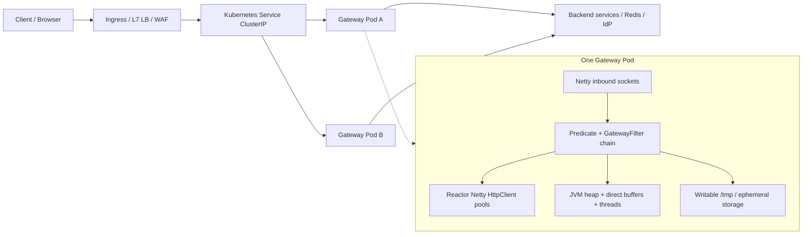
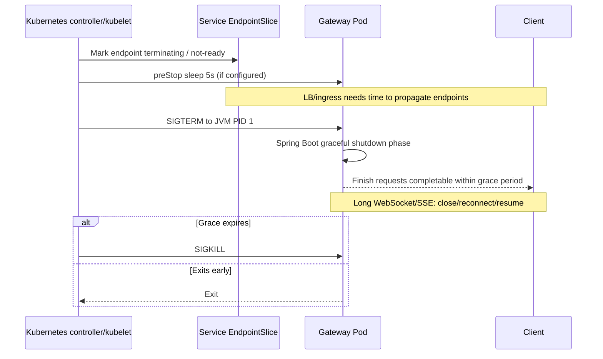
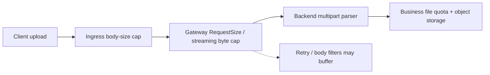

# Deploying Containers and Configuring Resource Limits for Spring Cloud Gateway

## 1. From a Local API Gateway to an Operable Workload

**Spring Cloud Gateway** serves as the entry point to microservices: receiving HTTP requests, selecting routes via **predicates**, running **GatewayFilter/GlobalFilter chains**, transforming paths/headers, leveraging service discovery/load balancing, and enforcing authentication, rate limiting, circuit breaking, retries, TLS, and request observability. When packaging the Gateway into a container and deploying to Kubernetes, an application that runs at `localhost:8080` solves only a **small fraction** of production requirements.

For example, a Gateway running smoothly at 100 requests/second can fail when:

- The **container memory limit** sits too close to the heap, while Reactor Netty also consumes direct buffers, JVM metaspace, thread stacks, code cache, and native libraries.
- A too-low **CPU limit** triggers throttling; p99 latency spikes even though heap and backends look healthy.
- A route enables `Retry`/`ModifyResponseBody` and buffers request/response bodies in RAM; concurrent uploads cause the pod to be `OOMKilled`.
- WebSockets and SSE hold connections for minutes/hours; rollouts delete pods and disconnect clients, triggering reconnect storms.
- `livenessProbe` depends on a failing Redis/backend, causing Kubernetes to restart all Gateway replicas continuously instead of temporarily refusing traffic.
- Outbound HTTP connection pools lack proper bounds, allowing more connections/pending requests than backends can handle.
- Actuator and secrets appear behind public ingress, images run as root, or containers retain unnecessary filesystem write access.

This lesson builds a workflow **from OCI image → Gateway config → CPU/memory/ephemeral-storage limits → Kubernetes Deployment/Service → probes → rollout/autoscaling → load testing and troubleshooting**. All numbers are **starting budgets for learning how to calculate**, **not** universal presets for every system.

### Learning Outcomes

1. Package the Gateway into an **OCI container image** using a Dockerfile or Cloud Native Buildpacks.
2. Distinguish **heap, direct memory, native memory, filesystem cache, and cgroup memory limits**.
3. Configure Kubernetes `requests`/`limits` for CPU, memory, and `ephemeral-storage`; understand `OOMKilled`, CPU throttling, and pod eviction.
4. Tune Reactor Netty HTTP connection pools, streaming/body filters, and long-lived connection limits.
5. Write Kubernetes `ConfigMap`, `Deployment`, and `Service` manifests with probes, security context, graceful shutdown, and environment configuration.
6. Distinguish **liveness, readiness, and startup** probes and avoid restart loops on downstream failures.
7. Deploy safely with rolling updates, PodDisruptionBudget, HPA, NetworkPolicy, Secret/RBAC, and management access controls.
8. Measure p95/p99, active connections, heap/direct memory, GC, sockets/file descriptors, and test rollbacks.

> **Scope:** Primary examples target **Spring Cloud Gateway Server WebFlux 4.3+/5.x** on Java 21, Spring Boot, and Reactor Netty, using prefix `spring.cloud.gateway.server.webflux.*`. Server **Web MVC** uses Servlet/RestClient with different thread/connection models and properties. For Gateway WebFlux 4.2 and earlier, the prefix is typically `spring.cloud.gateway.*`; cross-check your actual release train.

## 2. Resource Layering Diagram Inside a Gateway Pod



A short JSON request typically traverses the Gateway in milliseconds, whereas an **SSE stream**, **WebSocket session**, or **large download** can hold **multiple resources concurrently**: inbound connections, outbound connections, encoder/decoder state, TLS buffers, kernel sockets, pending writes, and application queues.

| Layer | Resources to govern | Primary controls |
|---|---|---|
| Container/JVM | Heap, direct/native memory, CPU, GC, threads | Java flags, cgroups, `JAVA_TOOL_OPTIONS`, profiler |
| Kubernetes pod | CPU/memory, temp disk, lifecycle, security context | `resources`, `emptyDir`, `securityContext`, probes |
| Gateway Netty | Client connections, acquire queue, response/connect timeouts | `spring.cloud.gateway.server.webflux.httpclient.*` |
| Gateway filters | Request body caching, retries, streaming, rate limits, caches | Filter/route policies, bounded queues, body limits |
| Ingress | Total connections, TLS handshakes, idle timeouts, request sizes | Ingress controller/LB config |
| Backend | Capacity, Redis/DB pools, fallbacks, service discovery | Per-service quotas and metrics |
| Observability | Cardinality, Prometheus scraping, log retention | Actuator, Micrometer, tracing, dashboards |

**There is no single Gateway `max-connections` knob that enforces all of the limits above.** For instance, the outbound HTTP client pool does not cap all **inbound** WebSocket/SSE sessions, and a token-bucket `RequestRateLimiter` per request/sec does not count **active connections**.

## 3. Selecting the Right Starter, Java Version, and Packaging

### 3.1. Sample Dependencies

```xml
<!-- pom.xml: versions managed by compatible Spring Boot parent + Spring Cloud BOM -->
<dependency>
    <groupId>org.springframework.cloud</groupId>
    <artifactId>spring-cloud-starter-gateway-server-webflux</artifactId>
</dependency>
<dependency>
    <groupId>org.springframework.boot</groupId>
    <artifactId>spring-boot-starter-actuator</artifactId>
</dependency>
<dependency>
    <groupId>io.micrometer</groupId>
    <artifactId>micrometer-registry-prometheus</artifactId>
    <scope>runtime</scope>
</dependency>
```

`spring-boot-starter-actuator` and `micrometer-registry-prometheus` provide health and metrics. If using `lb://`, add Spring Cloud LoadBalancer and a service instance supplier; Kubernetes DNS HTTP service URIs **do not require** Eureka/Consul or Spring Cloud Discovery. Only add Redis/Resilience4j when actually enabling those rate limiters/circuit breakers.

**Do not mix** `spring-cloud-starter-gateway-server-webmvc` and `server-webflux` just to support both modes. This lesson focuses on reactive Server WebFlux—do not treat Servlet Tomcat container thread settings as a tuning mechanism for Netty.

### 3.2. Image Build Pipeline


An OCI image should:

- Use a Java runtime matching the dependency train and a **security-patched base image**.
- Run as a **non-root** user with reduced Linux capabilities; avoid shipping compilers, shells, and debug tools in runtime layers unless needed.
- Keep build secrets out of the image: **never copy** `.env`, private keys, JWT secrets, or registry credentials into image layers.
- Record versions/revisions and SBOMs in build metadata; deploy using **immutable image digests** or tags published strictly once per policy.
- Never run `mvn/gradle` inside a **production container**; build/test in CI and let the container strictly run the app.

## 4. Packaging with a Dockerfile: Keep It Simple First, Optimize Layers Later

### 4.1. Minimal Dockerfile Using JRE and an Unprivileged User

Assume CI has produced **one executable Spring Boot JAR** at `target/gateway.jar` (explicitly named by the pipeline; Maven ordinarily outputs versioned JAR names):

```dockerfile
# Dockerfile at build context root containing target/gateway.jar
# Pin base image digest in production pipelines.
FROM eclipse-temurin:21-jre-jammy

WORKDIR /app
RUN groupadd --gid 10001 gateway && \
    useradd --uid 10001 --gid 10001 --no-create-home --shell /usr/sbin/nologin gateway

COPY --chown=10001:10001 target/gateway.jar /app/app.jar

USER 10001:10001
EXPOSE 8080

# Use exec-form so JVM runs as PID 1 and receives SIGTERM.
ENTRYPOINT ["java", "-jar", "/app/app.jar"]
```

**Rationale:**

1. Runtime only needs a **JRE**, not a full JDK unless a feature explicitly requires the JDK.
2. `USER 10001:10001` restricts write/modify privileges inside the container; Kubernetes still needs `securityContext` to enforce cluster policy.
3. JSON exec-form `ENTRYPOINT` delivers shutdown signals directly to the JVM, avoiding shell wrappers that swallow `SIGTERM`.
4. `EXPOSE` is metadata only and **does not publish ports**; Docker `-p` or Kubernetes Service/Ingress provides network reachability.
5. This Dockerfile assumes a Debian/Ubuntu base image with `groupadd`/`useradd`. On distroless/UBI/other base images, user provisioning differs; do not copy commands verbatim without verifying the build.

Illustrative commands in a **test environment** (not executed while authoring this lesson):

```bash
# CI builds the project JAR; commands are illustrative.
./mvnw -DskipTests=false package
cp target/gateway-*.jar target/gateway.jar

docker build -t gateway-demo:0.1.0 .
docker run --rm --name gateway-demo \
  --cpus=1 --memory=768m \
  --read-only --tmpfs /tmp:rw,nosuid,nodev,size=64m \
  --cap-drop=ALL --security-opt no-new-privileges \
  -p 8080:8080 \
  -e JAVA_TOOL_OPTIONS='-XX:MaxRAMPercentage=50.0 -XX:+ExitOnOutOfMemoryError' \
  gateway-demo:0.1.0
```

**Watch out when copying JARs:** a project can output both `original-*.jar`/thin JARs and a `repackaged executable jar`; `cp target/gateway-*.jar` only works if CI fixes naming to **match exactly one artifact**. Production should specify the exact artifact path, verify signatures/SBOMs, and pin image digests. If an image cannot run read-only root yet, pinpoint exactly where the app/libraries write and **mount narrow writable volumes** instead of opening the entire filesystem.

### 4.2. Spring Boot Layered JARs

To improve layer caching when app code changes often while dependencies rarely change, Spring Boot supports **layered jars** and `jarmode=tools`:

```dockerfile
# Illustrative example using Spring Boot layered jar with a JRE supporting tools mode.
FROM eclipse-temurin:21-jre-jammy AS extract
WORKDIR /builder
COPY target/gateway.jar application.jar
RUN java -Djarmode=tools -jar application.jar extract --layers --destination extracted

FROM eclipse-temurin:21-jre-jammy
WORKDIR /app
COPY --from=extract /builder/extracted/dependencies/ ./
COPY --from=extract /builder/extracted/spring-boot-loader/ ./
COPY --from=extract /builder/extracted/snapshot-dependencies/ ./
COPY --from=extract /builder/extracted/application/ ./
USER 10001:10001
EXPOSE 8080
ENTRYPOINT ["java", "-jar", "application.jar"]
```

**Prerequisites:** the executable Spring Boot JAR must support the layer index/`tools` mode; Boot docs note `jarmode=tools` does not apply to **fully executable archives with an embedded launch script**. Extracted layout and launchers can vary between Boot versions; check `list-layers`/docs for your version. Numeric `USER 10001` works even without an `/etc/passwd` entry, though if the runtime needs `/etc/passwd` or `HOME` entries, configure them accordingly.

For Gateways with large dependency sets and frequent code tweaks, separating layers shrinks rebuild/pull size per release. **Layering does not change memory limits or boost throughput**; never skip security patching just to keep layer caches warm.

### 4.3. Cloud Native Buildpacks: No Custom Dockerfile Needed

Spring Boot Maven/Gradle plugins build OCI images via **Cloud Native Buildpacks**:

```bash
# Maven:
./mvnw spring-boot:build-image \
  -Dspring-boot.build-image.imageName=registry.example.test/platform/gateway:0.1.0

# Gradle (alternative):
./gradlew bootBuildImage \
  --imageName=registry.example.test/platform/gateway:0.1.0
```

Buildpacks typically produce **non-root** images and manage runtime layers/builders per configuration. Building requires an OCI daemon or buildpack platform; the command alone does not push to a registry or perform vulnerability scanning/signing. In production, pin builder/run images, scan SBOMs, sign, and publish via CI.

### 4.4. Preventing Secret Leakage in Images

Do not do this:

```dockerfile
# NEVER do this in production:
ARG JWT_SECRET
ENV JWT_SECRET=$JWT_SECRET
COPY ./secrets /app/secrets
```

`ARG`/`ENV`/`COPY` can bake secrets into build history/layers or image metadata. Use **Kubernetes Secrets/secret managers/external secret integrations** with least privilege at runtime. Image registry credentials also belong to CI/workload identity, never inside the source Dockerfile.

## 5. Java in Cgroups: Container Limit Does Not Equal `-Xmx`

Modern JDKs are aware of **cgroup CPU/memory constraints**, yet the JVM **does not use heap alone**. Setting `-Xmx` equal to `resources.limits.memory` can get the container OOM-killed by the kernel before the JVM ever throws `OutOfMemoryError`.

### 5.1. Sample Memory Budget for a `1Gi` Pod

Suppose the container is capped at **1 GiB (1024 MiB)**. An *illustrative* budget to validate under load testing:

| Category | Illustrative allocation | Notes |
|---|---|---|
| JVM heap (Java objects, cached bodies) | ~512 MiB | `MaxRAMPercentage=50.0` on a 1 GiB limit when JDK detects cgroups properly |
| Netty direct/off-heap buffers | Up to `MaxDirectMemorySize=192m` if set | Not all native memory |
| Metaspace, code cache, thread stacks, JVM native | e.g., 180 MiB | Varies by classes, threads, TLS, and load |
| Temp/tmpfs, OS accounting, runtime headroom | e.g., 140 MiB | Measure actual RSS/cgroup usage |
| **Planned total budget** | **1024 MiB** | Purely an allocation example; **not** guaranteed to stay within bounds |

The `192m` figure caps only **Java NIO direct-buffer allocations governed by that flag**, not an absolute ceiling on all Netty/native mallocs, memory maps, kernel socket buffers, or page cache. Treat **cgroup memory.current/working set**, JVM heap/GC, direct-buffer gauges, and process RSS as complementary views.

### 5.2. JVM Flags in Containers

```yaml
# Excerpt of env inside Kubernetes container spec:
env:
  - name: JAVA_TOOL_OPTIONS
    value: >-
      -XX:MaxRAMPercentage=50.0
      -XX:MaxDirectMemorySize=192m
      -XX:+ExitOnOutOfMemoryError
```

**Notes:**

- `-XX:MaxRAMPercentage` caps max heap relative to JVM-visible memory; explicit `-Xmx` overrides it. Do not combine them inconsistently.
- Too low `-XX:MaxDirectMemorySize` can cause `OutOfDirectMemoryError` under TLS/streaming/large uploads; do not treat `192m` as a universal recommendation.
- `-XX:+ExitOnOutOfMemoryError` forces JVM exit on Java-level OOM so orchestration restarts it; it **does not prevent** Linux cgroup `OOMKilled` if total memory breaches the limit.
- `JAVA_TOOL_OPTIONS` should hold **non-secret flags only**. Never pass passwords, JWT signing keys, or truststore passwords in a CLI/env variable visible in process info/logs.
- Avoid forcing `ActiveProcessorCount` unnecessarily; observe JVM/container CPU detection first before overriding.

### 5.3. Distinguishing JVM OOM from Kubernetes `OOMKilled`

| Situation | Symptoms | Investigation path |
|---|---|---|
| Java heap OOM | `java.lang.OutOfMemoryError: Java heap space`, rising heap/GC | Inspect request-body caches, unbounded queues, object leaks, heap sizing |
| Direct-buffer pressure | `OutOfDirectMemoryError`/Netty allocation failures | Measure direct memory, HTTP connections, DataBuffer lifecycle, TLS buffers |
| Container cgroup OOM | Pod status `OOMKilled`, typically exit code 137 | RSS/cgroup exceeded memory limit; may show **zero** Java heap OOM |
| Node memory pressure/eviction | Pod `Evicted`, node `MemoryPressure` | Check requests/limits, node capacity, noisy neighbors |
| Disk pressure/eviction | `EphemeralStorage`/`DiskPressure`, bloated temp/logs | Cap writable layers, `emptyDir`, temp uploads, and log volumes |

Kubernetes memory limits are enforced via kernel OOM mechanisms, **unlike** CPU limits which are enforced via throttling. Never blindly raise `-Xmx` to cure `OOMKilled`: that can trigger cgroup OOM even faster.

## 6. Kubernetes `requests`, `limits`, and Pod Quality of Service

### 6.1. Distinguishing Requests from Limits

```yaml
# Excerpt inside spec.containers[].resources
resources:
  requests:
    cpu: 500m
    memory: 512Mi
    ephemeral-storage: 256Mi
  limits:
    cpu: "2"
    memory: 1Gi
    ephemeral-storage: 1Gi
```

| Field | Practical meaning | Consequence if misconfigured |
|---|---|---|
| `requests.cpu: 500m` | Scheduler reserves 0.5 CPU and sets CPU share weight under contention | Too low skews HPA utilization and oversubscribes nodes |
| `limits.cpu: "2"` | Cgroup enforces a 2-CPU ceiling per scheduling period | CPU throttling stalls event loops/GC, hurting p99 latency |
| `requests.memory: 512Mi` | Scheduler reserves 512 MiB for placement; not a hard cap | Too low increases eviction risk under node memory pressure |
| `limits.memory: 1Gi` | Hard cgroup memory ceiling; breaching triggers OOMKill | Excess heap + direct/native/tmpfs causes restarts |
| `requests.ephemeral-storage: 256Mi` | Scheduler estimates temporary local disk usage | Too low exposes pod to node disk pressure |
| `limits.ephemeral-storage: 1Gi` | Kubelet monitors ephemeral usage and can evict pods exceeding it | Logs/temp/multipart staging can get the pod `Evicted` |

**CPU limits and memory limits handle overload differently.** Exceeding CPU limits typically causes **throttling**, not automatic container restarts. Exceeding cgroup memory limits can trigger kernel **OOMKilled**. Ephemeral disk limits relate to **eviction**, not typically a Java exception.

Kubernetes QoS classes also depend on requests/limits: the example above has `requests != limits`, yielding **Burstable**. Achieving **Guaranteed** requires matching equal CPU/memory requests and limits on every container in the pod per QoS rules; even that does not prevent OOM. Choose QoS based on node budgets and scheduling goals rather than chasing a "Guaranteed" label.

### 6.2. CPU Throttling in a Reactive Gateway

WebFlux relies on a small pool of event-loop threads to handle high request volumes. Under CPU throttling:

- Reactive callbacks miss scheduling windows; p95/p99 latencies jump.
- TLS handshakes, JSON encoding/decoding, JWT verification, and GC compete for CPU.
- Even routes proxying to healthy backends slow down.
- CPU-based HPA may react late because CPU utilization differs from queuing/active connections.

Some clusters/teams **set CPU requests without CPU limits** to avoid throttling, where namespace policy and capacity planning allow. That is an operational choice requiring approval, not a blanket rule. **Memory limits** remain vital because a buggy body cache/queue can exhaust node RAM.

### 6.3. Self-Checking a Sample Budget

With `limits.memory=1Gi`:

```text
Planned heap cap                  ~512 MiB
Direct memory cap (if set)        ~192 MiB
Native/metaspace/threads/GC       measure under workload
/tmp and memory-backed volumes    measure per volume type
OS/cgroup accounting/headroom     must remain positive
----------------------------------------
Total cgroup memory must stay below 1024 MiB
```

Do not assume `512 + 192` equals RSS. Other allocations, file-backed pages/kernel accounting, and shared mappings count differently. Confirm using **container memory working set/cgroup metrics** alongside JVM heap, never `jvm.memory.used{area="heap"}` alone.

## 7. Configuring Spring Cloud Gateway for Resource-Bounded Pods

### 7.1. Sample Configuration for Short JSON Routes

```yaml
# application.yml used by the Section 8 Deployment example.
server:
  port: 8080

spring:
  lifecycle:
    timeout-per-shutdown-phase: 30s
  cloud:
    gateway:
      server:
        webflux:
          httpclient:
            connect-timeout: 2000       # Milliseconds
            response-timeout: 5s
            pool:
              type: fixed
              max-connections: 200
              acquire-timeout: 1000     # Milliseconds, for FIXED pool
              metrics: true
          metrics:
            enabled: true
            path-tags:
              enabled: false
          routes:
            - id: orders-api
              uri: http://orders-api.default.svc.cluster.local:8080
              predicates:
                - Path=/api/orders/**
              filters:
                - StripPrefix=1

management:
  server:
    port: 9090
  endpoint:
    health:
      probes:
        enabled: true
        add-additional-paths: true
  endpoints:
    web:
      exposure:
        include: health,info,metrics,prometheus
```

**Reading each limit accurately:**

- `connect-timeout: 2000` is in **milliseconds** for outbound connection establishment; it does not bound total backend processing time.
- `response-timeout: 5s` is a global HTTP client `Duration`; long-lived SSE streams need **dedicated routes** with distinct timeout policies.
- `pool.type: fixed` enables `max-connections` and `acquire-timeout` per Gateway docs. This caps the **outbound HTTP client pool**; it does not cap all inbound requests, WebSocket sessions, Redis connections, or combined multi-target totals across mechanisms.
- `max-connections: 200` and `acquire-timeout: 1000` are **illustrative values**; pool exhaustion causes errors/latency. Size against active/pending connection metrics and backend capacity.
- `metrics.path-tags.enabled: false` avoids tagging Gateway metrics with raw paths containing order IDs, controlling cardinality.
- `management.server.port: 9090` isolates a dedicated admin port. Restrict access to monitoring/ops via network and authentication; never expose 9090 on a public Service/Ingress.
- `management.endpoint.health.probes.add-additional-paths: true` exposes `/livez` and `/readyz` **on application port 8080**, even when Actuator uses another port. Thus kubelet probes the exact web server handling live traffic.

`orders-api.default.svc.cluster.local:8080` is an **illustrative backend name**. A matching Kubernetes Service DNS and network policy permitting Gateway calls must exist. If using `lb://orders-api`, add the LoadBalancer dependency and instance supplier; never treat Kubernetes DNS and `lb://` as identical.

### 7.2. `response-timeout` Does Not Replace Rate Limiting

A pod may cap outbound connections at 200 while accepting thousands of inbound HTTP requests queuing for the pool. Therefore you need:

- Rate limiting **per client/principal**, not just "total edge requests."
- Timeouts and bounded queues to avoid holding requests indefinitely.
- Circuit breakers/bulkheads tailored to backend failures.
- Retry policies with a **bounded attempt budget**, especially for POST/multipart.
- Ingress/body-size limits rejecting oversized payloads **before** they enter the Gateway.

Token-bucket `RequestRateLimiter` normally limits **request rate**, not open WebSocket/SSE connection counts or body bytes. Bounding long-lived streams requires a separate **active-session quota**, potentially synchronized across replicas.

### 7.3. Avoiding Unbounded Body Buffering

| Feature | Resource risk | Usage guidance |
|---|---|---|
| `Retry` on requests with bodies | Caches request body for replay, raising heap/direct memory | Limit attempts, bound body size, require idempotency |
| `ModifyRequestBody`/`ModifyResponseBody` | Deserializes/aggregates body; can hold entire JSON/file in RAM | Use only for small capped payloads |
| `LocalResponseCache` | Consumes cache memory; requires TTL/size policies | Enable only for bounded cacheable responses, never SSE |
| `RequestSize` | If checking only `Content-Length` in a given version, chunked uploads may bypass | Test both with/without length; add streaming byte limits at ingress/backend |
| SSE `text/event-stream` | Long-lived connections, buffers/queues on slow clients | Flush/heartbeats, dedicated response timeouts, reconnect + replay |
| WebSocket | Long-lived inbound/outbound sockets, frames/queues | Frame limits, idle timeouts, connection quotas, close/reconnect |
| Netty wiretap | Logs payloads/headers and adds I/O overhead | Enable briefly only in redacted sandboxes |

For large file uploads, consider **presigned object-storage URLs or chunked upload protocols** instead of proxying huge bodies through the Gateway with Retry enabled. Backends must still verify ownership, checksums, real Content-Types, and multipart part limits.

## 8. Kubernetes Manifests: ConfigMap, Deployment, and Service

### 8.1. ConfigMap Separating Config from Image

Assume namespace `edge` exists per cluster policy. Below is a **sample ConfigMap** using Section 7's config; in production manage via GitOps/Helm/Kustomize with reviews:

```yaml
apiVersion: v1
kind: ConfigMap
metadata:
  name: gateway-config
  namespace: edge
data:
  application.yml: |
    server:
      port: 8080
    spring:
      lifecycle:
        timeout-per-shutdown-phase: 30s
      cloud:
        gateway:
          server:
            webflux:
              httpclient:
                connect-timeout: 2000
                response-timeout: 5s
                pool:
                  type: fixed
                  max-connections: 200
                  acquire-timeout: 1000
                  metrics: true
              metrics:
                enabled: true
                path-tags:
                  enabled: false
              routes:
                - id: orders-api
                  uri: http://orders-api.default.svc.cluster.local:8080
                  predicates:
                    - Path=/api/orders/**
                  filters:
                    - StripPrefix=1
    management:
      server:
        port: 9090
      endpoint:
        health:
          probes:
            enabled: true
            add-additional-paths: true
      endpoints:
        web:
          exposure:
            include: health,info,metrics,prometheus
```

The ConfigMap holds **non-secret configuration only**. JWT client secrets, Redis passwords, TLS private keys, and DB credentials belong in **Secrets/secret managers** with least privilege. Volume-mounted ConfigMaps can be updated by kubelet, yet **Spring Boot/Gateway does not automatically refresh every bound property/route**; production should roll out explicit revisions/rolling restarts rather than assuming editing a ConfigMap immediately shifts traffic.

### 8.2. Deployment with Resource Limits, Probes, and Filesystem Controls

```yaml
apiVersion: apps/v1
kind: Deployment
metadata:
  name: edge-gateway
  namespace: edge
  labels:
    app: edge-gateway
spec:
  replicas: 3
  revisionHistoryLimit: 5
  minReadySeconds: 5
  strategy:
    type: RollingUpdate
    rollingUpdate:
      maxUnavailable: 0
      maxSurge: 1
  selector:
    matchLabels:
      app: edge-gateway
  template:
    metadata:
      labels:
        app: edge-gateway
    spec:
      automountServiceAccountToken: false
      terminationGracePeriodSeconds: 60
      securityContext:
        runAsNonRoot: true
        runAsUser: 10001
        runAsGroup: 10001
        fsGroup: 10001
        seccompProfile:
          type: RuntimeDefault
      containers:
        - name: gateway
          image: registry.example.test/platform/gateway:0.1.0
          imagePullPolicy: IfNotPresent
          ports:
            - name: http
              containerPort: 8080
            - name: management
              containerPort: 9090
          env:
            - name: JAVA_TOOL_OPTIONS
              value: >-
                -XX:MaxRAMPercentage=50.0
                -XX:MaxDirectMemorySize=192m
                -XX:+ExitOnOutOfMemoryError
            - name: SPRING_CONFIG_ADDITIONAL_LOCATION
              value: optional:file:/etc/gateway/
          resources:
            requests:
              cpu: 500m
              memory: 512Mi
              ephemeral-storage: 256Mi
            limits:
              cpu: "2"
              memory: 1Gi
              ephemeral-storage: 1Gi
          startupProbe:
            httpGet:
              path: /livez
              port: http
            periodSeconds: 2
            failureThreshold: 30
          livenessProbe:
            httpGet:
              path: /livez
              port: http
            periodSeconds: 10
            timeoutSeconds: 2
            failureThreshold: 3
          readinessProbe:
            httpGet:
              path: /readyz
              port: http
            periodSeconds: 5
            timeoutSeconds: 2
            failureThreshold: 3
          lifecycle:
            preStop:
              sleep:
                seconds: 5
          securityContext:
            allowPrivilegeEscalation: false
            readOnlyRootFilesystem: true
            capabilities:
              drop:
                - ALL
          volumeMounts:
            - name: config
              mountPath: /etc/gateway
              readOnly: true
            - name: temp
              mountPath: /tmp
      volumes:
        - name: config
          configMap:
            name: gateway-config
        - name: temp
          emptyDir:
            sizeLimit: 256Mi
```

**This is an illustrative manifest; adjust before production use:**

1. `image` uses an **illustrative** registry/tag; production should pin a scanned/signed `@sha256:<digest>` rather than mutable `latest`. For private registries, configure image pull secrets or workload identity per cluster policy.
2. `namespace: edge` and the backend Service must exist and be permitted by network policies. `SPRING_CONFIG_ADDITIONAL_LOCATION` tells Boot to load `application.yml` from the mounted ConfigMap directory; verify precedence and other profiles.
3. `securityContext.runAsNonRoot`, `readOnlyRootFilesystem`, dropped capabilities, and `seccompProfile: RuntimeDefault` reduce privileges; they **do not replace JWT/TLS/network authorization**.
4. `emptyDir` omits `medium: Memory`, so it defaults to **node local ephemeral storage**. It still counts toward quotas/eviction and vanishes when the Pod is deleted; never store durable business files there.
5. `startupProbe` allows ~60 seconds for startup before liveness/readiness probes engage; tune against actual startup and JVM warm-up.
6. `/livez` and `/readyz` are exposed on **port 8080** via `add-additional-paths: true` in the ConfigMap. If custom HTTP Security blocks these paths, probes fail; permit kubelet probes safely without opening all of `/actuator/**`.
7. `preStop.sleep.seconds` uses the **lifecycle Sleep hook**, which requires Kubernetes support (Boot docs suggest **1.32+**). On older clusters, use a supported hook without assuming `sh` exists in distroless images.
8. `terminationGracePeriodSeconds: 60` covers `preStop`, Spring Boot's `30s` shutdown phase, plus margin. It **does not guarantee** unbounded WebSocket/SSE streams finish cleanly; clients must reconnect/resume.
9. `JAVA_TOOL_OPTIONS` and the resource budget are **starting baselines**, not fixed prescriptions. Load-test on nodes with real CPU quotas, TLS, and network setups.
10. If Gateway uses Kubernetes API discovery/ConfigMap watches rather than static service DNS, `automountServiceAccountToken: false` may not fit; provision a dedicated ServiceAccount with minimal RBAC, never `cluster-admin`.

### 8.3. Service Exposing Only the Traffic Port

```yaml
apiVersion: v1
kind: Service
metadata:
  name: edge-gateway
  namespace: edge
spec:
  type: ClusterIP
  selector:
    app: edge-gateway
  ports:
    - name: http
      port: 80
      targetPort: http
      protocol: TCP
```

This Service **does not** expose `9090`. An Ingress controller can route public HTTPS to `edge-gateway:80`, **strictly on approved hosts/paths**; never let a public wildcard ingress forward `/actuator/**` if management shares a port. With management isolated on port 9090, Prometheus/operations must scrape via a **separate network path** protected by NetworkPolicy and authentication.

**Do not mistake `containerPort` for a firewall:** declaring a container port is metadata only; Pod IPs may still be reachable if cluster networking allows it. Real network control requires NetworkPolicies/CNI/eBPF policies, a service mesh, or equivalent ACL layers.

## 9. Probes: `startup`, `liveness`, and `readiness` Have Distinct Jobs

### 9.1. Separate Questions

| Probe | Question | On failure |
|---|---|---|
| **startupProbe** | Has the app finished its **startup sequence**? | Past threshold, kubelet restarts container; shields app from premature liveness/readiness kills during warm-up |
| **livenessProbe** | Is the process **capable of serving/recovering**, or wedged and needing a restart? | Kubelet restarts container per restart policy |
| **readinessProbe** | Should the Pod **receive new traffic** from Services/Endpoints right now? | Pod is removed from ready endpoints, **without automatically restarting** |

Spring Boot Actuator provides `/actuator/health/liveness` and `/actuator/health/readiness` when Kubernetes probes are enabled. With a separate management port, consider `management.endpoint.health.probes.add-additional-paths: true` to expose **`/livez` and `/readyz` on port 8080**.

### 9.2. Why Liveness Should Not Call Backends or Redis

Suppose the Redis backing `RequestRateLimiter` suffers an outage. If every Gateway pod's **liveness probe** calls Redis and reports DOWN, Kubernetes restarts the entire Gateway fleet, disrupting healthy traffic on routes that do not even use Redis. **Restarting the Gateway will not fix a Redis outage.**

**Liveness** should reflect internal Gateway/process health. For **readiness**, consider downstream dependencies only when **operational policy genuinely requires halting all traffic**; by default, Boot excludes external dependencies from readiness groups to avoid cascading failures. Prefer per-route rate limiters, circuit breakers, and fallbacks over pulling the entire pod out of the Service.

### 9.3. Testing Probes Like a Real HTTP Client

```bash
# In an authorized sandbox with port-forwarding/internal port access:
curl -i http://localhost:8080/livez
curl -i http://localhost:8080/readyz

# With management network access:
curl -i http://localhost:9090/actuator/health/liveness
curl -i http://localhost:9090/actuator/health/readiness
```

**Expected result:** HTTP 200 when healthy and non-200 when Boot health groups flip DOWN/OUT_OF_SERVICE. Do not hardcode `"status":"UP"` as the sole assertion if custom indicators exist. If Spring Security blocks `/livez`/`/readyz` with 401/403, probes fail; scope Security matchers/paths to **kubelet network access** and least privilege rather than opening `anyExchange().permitAll()` across APIs.

### 9.4. Do Not Turn Probes into Load Tests

Probes should be lightweight, deterministic, short-timeout, and **avoid expensive I/O**. Never route probes through backends with costly retries/circuit breakers. Under CPU throttling, probe timeouts can trigger restart loops; distinguish a **genuinely broken process** from a **CPU-starved pod**.

## 10. Graceful Shutdown and Rolling Updates with Long-Lived Connections

### 10.1. Sequence When Kubernetes Deletes a Pod



Spring Boot supports graceful shutdown with Reactor Netty. `spring.lifecycle.timeout-per-shutdown-phase: 30s` grants **a window** for in-flight requests to finish while stopping the application context, refusing new requests per web server mechanics. Kubernetes `terminationGracePeriodSeconds: 60` caps the **entire Pod termination sequence**, including `preStop`.

**Key takeaway:** a WebSocket session can last an hour, and an SSE stream can run indefinitely. No `grace=60s` **keeps an existing TCP connection alive across pod replacement**. Clients must handle close/reconnect, auth refresh, backoff, SSE `Last-Event-ID`, and replay from a backend/event store (when zero event loss is required).

### 10.2. Impact of `preStop`

Section 8 uses:

```yaml
lifecycle:
  preStop:
    sleep:
      seconds: 5
```

A sleep hook shrinks the window during which ingress/LBs still send traffic to a terminating pod while endpoint updates propagate. **It is not zero-downtime magic.** It consumes part of the grace period and requires Kubernetes version support; if 5 seconds is insufficient for your infrastructure, measure endpoint propagation before tuning.

Do not use `preStop: exec sleep` on distroless images lacking a shell. Likewise, **never stretch grace periods to hours** waiting for every WebSocket session to close; that stalls rollouts, node drains, and capacity management.

### 10.3. RollingUpdate `maxUnavailable`/`maxSurge`

With 3 replicas:

```yaml
strategy:
  type: RollingUpdate
  rollingUpdate:
    maxUnavailable: 0
    maxSurge: 1
```

- `maxUnavailable: 0`: during normal rollouts, the Deployment does not proactively reduce ready replicas below desired count for the update (subject to real capacity/health).
- `maxSurge: 1`: allows creating up to one extra pod above desired replicas at a time during rolling updates.
- `minReadySeconds: 5`: requires new pods to stay ready for the specified window before counting as available, catching early startup instability.

If the node pool lacks CPU/memory for the **fourth surge pod**, rollouts can **stall in Pending** even while all three existing pods remain healthy. Capacity planning must include **surge pod count**, covering CPU/memory requests and topology constraints.

### 10.4. What Disruptions Does PodDisruptionBudget Protect Against?

```yaml
apiVersion: policy/v1
kind: PodDisruptionBudget
metadata:
  name: edge-gateway-pdb
  namespace: edge
spec:
  minAvailable: 2
  selector:
    matchLabels:
      app: edge-gateway
```

With three replicas, `minAvailable: 2` aims to keep at least two pods available during **voluntary evictions via the Eviction API** (e.g., node drains respecting PDBs).

**Limitations:** a PDB **does not prevent** node crashes, kernel OOMs, disk pressure, or involuntary disruptions. Direct Pod/Deployment deletions can bypass PDBs, and Deployment controller rollouts **are not governed by PDBs the way the Eviction API is**; `maxUnavailable`/`maxSurge` govern rolling updates.

### 10.5. Spreading Replicas Across Nodes/Zones

Three pods on a single node provide no real HA if that node fails. Use **topology spread constraints**:

```yaml
# Place under Deployment.spec.template.spec when the cluster supports this topologyKey.
topologySpreadConstraints:
  - maxSkew: 1
    topologyKey: kubernetes.io/hostname
    whenUnsatisfiable: ScheduleAnyway
    labelSelector:
      matchLabels:
        app: edge-gateway
```

This is a fragment, **not a standalone manifest**. `ScheduleAnyway` prefers spreading without strictly blocking scheduling when nodes are scarce; `DoNotSchedule` is stricter and can leave pods Pending. Align node/zone topology, capacity, and cluster autoscaling with availability targets.

## 11. Autoscaling: CPU HPA Alone Cannot Protect the Whole Gateway

### 11.1. CPU-Based HPA as a Starting Point

```yaml
apiVersion: autoscaling/v2
kind: HorizontalPodAutoscaler
metadata:
  name: edge-gateway-hpa
  namespace: edge
spec:
  scaleTargetRef:
    apiVersion: apps/v1
    kind: Deployment
    name: edge-gateway
  minReplicas: 3
  maxReplicas: 10
  metrics:
    - type: Resource
      resource:
        name: cpu
        target:
          type: Utilization
          averageUtilization: 60
  behavior:
    scaleDown:
      stabilizationWindowSeconds: 300
```

HPA requires **Metrics Server/metrics.k8s.io** or an equivalent metrics pipeline. With `requests.cpu: 500m`, a target `averageUtilization: 60` corresponds to roughly **300m average CPU usage per pod**, **not 60% of `limits.cpu: 2`**. HPA applies its scaling algorithm/tolerance and readiness rules to compute desired replicas; this describes the target basis, not an instant trigger.

When HPA manages `replicas`, stop GitOps controllers from fighting HPA by overwriting a static replica count; coordinate field ownership and minimum replicas per cluster workflow.

### 11.2. Why WebSocket/SSE Can Overload Before CPU Rises

A pod holding **8,000 WebSocket connections** can still show low CPU if messages are infrequent. Yet:

- File descriptors, sockets, and native buffers grow.
- During bursts, send queues and TLS traffic surge rapidly.
- Memory and backend subscription counts can hit ceilings long before CPU.
- CPU HPA is blind to **active connections** or queue depth without custom metrics.

For long-lived stream workloads, measure **active sessions per pod**, HTTP client pool pending counts, new connection rates, direct memory, event-loop latency, and backend lag. HPA can consume **custom/external metrics** via an adapter—such as average active connections or a composite capacity metric—never assume raising CPU limits alone protects long-lived workloads.

### 11.3. Scale-Out Does Not Automatically Prevent Scale-In Disconnects

When HPA scales down, terminated pods drop WebSocket/SSE connections and clients can reconnect simultaneously, causing a **reconnect storm**. Mitigate with:

- `scaleDown.stabilizationWindowSeconds` to avoid thrashing on transient dips.
- Adequate minimum replicas/connection headroom; avoid setting CPU target thresholds too high.
- Client reconnection jitter, backoff, and connection caps; browser SSE auto-retry needs application-level handling too.
- Backend replay/idempotency for critical events.
- Never store subscription state or route caches **solely in a single pod's memory** if failover recovery is required.

### 11.4. Sizing by Throughput and Connections

An **illustrative** calculation:

\[
N_{\text{RPS}} = \left\lceil \frac{\text{Peak RPS}}{\text{RPS/pod at SLO}} \right\rceil
\]

Suppose peak is **1,200 requests/s** and load tests prove one pod handles **300 requests/s** within p99 latency/error targets:

\[
N_{\text{RPS}} = \lceil 1200/300 \rceil = 4
\]

If the same workload also holds **12,000 active SSE/WS connections** and each pod is tested to sustain **2,000 active connections** within memory/socket budgets:

\[
N_{\text{connections}} = \lceil 12000/2000 \rceil = 6
\]

The baseline starts at **at least 6 pods** before adding headroom, failure capacity, and zone distribution—**never** pick 4 pods just because RPS allows it. Figures like `300 RPS/pod` and `2,000 conns/pod` **must come from real benchmarks**, not assumed Spring Cloud Gateway defaults.

## 12. Container Security, Secrets, and Network Paths

### 12.1. Non-Root Containers and Read-Only Root Filesystems

The Deployment example includes:

```yaml
securityContext:
  runAsNonRoot: true
  runAsUser: 10001
  runAsGroup: 10001
  fsGroup: 10001
  seccompProfile:
    type: RuntimeDefault

# Under spec.containers[].securityContext:
allowPrivilegeEscalation: false
readOnlyRootFilesystem: true
capabilities:
  drop:
    - ALL
```

These are **two fragments at different YAML nesting levels**—do not paste them into one `securityContext` block. Pod-level configures UID/GID; container-level configures privilege escalation, rootfs, and capabilities.

Verification principles:

- The JVM can read JARs and libraries in `/app`, but cannot modify binaries/layers.
- Apps/libraries write only to `/tmp` or explicitly permitted volumes with bounded quotas.
- If a base image needs to write under `/home`, `/var/log`, or font/native caches, **identify the exact write path** and mount a narrow bounded volume rather than reflexively disabling `readOnlyRootFilesystem`.
- A Gateway primarily proxying HTTP does not need `NET_ADMIN`/`SYS_ADMIN` capabilities or root privileges to bind port 8080.
- If native DNS/TLS/OpenSSL libraries are used, test against `seccompProfile: RuntimeDefault` and real cluster policies; never drop seccomp without diagnosing the underlying syscall error.

### 12.2. Keep Secrets Out of ConfigMaps and Dockerfiles

Connecting the Gateway to authenticated Redis, TLS/mTLS backends, or an IdP can require secrets. Reference **Kubernetes Deployment env** snippet:

```yaml
env:
  - name: SPRING_DATA_REDIS_PASSWORD
    valueFrom:
      secretKeyRef:
        name: gateway-redis-auth
        key: password
```

Prerequisites: Secret `gateway-redis-auth` was provisioned **via an approved secret workflow** in the same namespace and Redis auto-configuration actually reads `spring.data.redis.password`. Never create real secrets by committing passwords to Git, CI logs, or documentation examples. Standard Kubernetes Secret data is **base64-encoded, not encrypted at rest by default**; enforce encryption at rest, RBAC, workload identity/external secret managers, and organizational rotation.

TLS spans two distinct hops:

```text
Browser --HTTPS/WSS--> Ingress --HTTP/HTTPS--> Gateway
Gateway --HTTPS/mTLS--> backend/Redis/IdP (per service)
```

Terminating TLS at ingress **does not prove** Gateway→backend uses TLS. For Gateway Server WebFlux, configure HTTP client trust/SSL bundles under `spring.cloud.gateway.server.webflux.httpclient.ssl.*` per version; **never** set `use-insecure-trust-manager: true` in production. Certificates/private keys should come from Secrets/CSI/projected volumes with proper rotation and file permissions.

### 12.3. NetworkPolicy Allowing Only Required Sources per Port

Example **Ingress-only NetworkPolicy** for the Gateway in namespace `edge`:

```yaml
apiVersion: networking.k8s.io/v1
kind: NetworkPolicy
metadata:
  name: edge-gateway-ingress
  namespace: edge
spec:
  podSelector:
    matchLabels:
      app: edge-gateway
  policyTypes:
    - Ingress
  ingress:
    - from:
        - namespaceSelector:
            matchLabels:
              kubernetes.io/metadata.name: ingress-nginx
      ports:
        - protocol: TCP
          port: 8080
    - from:
        - namespaceSelector:
            matchLabels:
              kubernetes.io/metadata.name: monitoring
      ports:
        - protocol: TCP
          port: 9090
```

**This is an illustrative namespace-scoped policy; verify before applying:**

- Namespaces `ingress-nginx`/`monitoring` are **assumptions** and must match your real cluster topology.
- `namespaceSelector` above allows **all pods in that namespace** to reach the target port without restricting pod identity; combine `podSelector` within the same `from` item to tighten it.
- Kubernetes **NetworkPolicies require CNI enforcement**; creating the object on an unsupported CNI enforces nothing.
- Some ingresses using `hostNetwork`/node proxies change source traffic identity so it lacks expected pod/namespace labels; test on your real CNI/infrastructure.
- This policy covers `Ingress` only and imposes **no egress restrictions**. Production needs explicit egress rules for DNS, approved backends, Redis, IdP/OTel collectors, and certificate services. A default-deny egress policy that forgets DNS breaks `lb://` and hostname resolution.
- If kubelet health probes or node-IP monitoring do not match those selectors, confirm CNI behavior and adjust carefully without reopening port `9090` broadly.
- NetworkPolicies **combine via logical OR** across policies selecting the same pod; an unrelated allow-all policy can undermine this restriction.

**Do not expose Actuator management over the same public Ingress** just so Prometheus can scrape it. Prefer a dedicated path from the monitoring namespace or an authenticated sidecar/proxy per reviewed policy.

### 12.4. Actuator `/actuator/prometheus` Requires Authentication

Management port `9090` is omitted from the public Service, yet Pod IPs may still be reachable depending on cluster networking. Protect it with:

1. NetworkPolicy/mesh policies allowing only monitoring and operator traffic.
2. TLS/mTLS when crossing untrusted network segments.
3. Monitoring identity and authorization; if using Spring Security, write matchers scoped to the **management context/port**.
4. Minimal endpoint exposure: `health`, `metrics`, `prometheus`, and `info` if truly needed; `gateway` Actuator route management should remain `read-only` unless explicitly justified.
5. Auditing and redaction, avoiding logging credentials or TLS key paths.

Never expose `/actuator/env`, `/actuator/heapdump`, `/actuator/loggers`, or `/actuator/gateway/routes` publicly. Route/URI/filter listings expose internal topology, and heapdumps can contain request bodies and tokens.

### 12.5. Do Not Grant Overly Broad Kubernetes API Permissions

When a Gateway uses only **service DNS URIs** and static config, it generally needs no Kubernetes API access. Thus `automountServiceAccountToken: false` is a strong baseline.

If **Kubernetes service discovery or ConfigMap watching** is truly required, assign a dedicated ServiceAccount with minimal `get/list/watch` RBAC on services/endpoints in target namespaces only. Never grant `cluster-admin` or mount default tokens merely because the app uses Spring Cloud.

## 13. Bounding Temp Files, Multipart Uploads, Logs, and Streaming

### 13.1. Does `emptyDir` Use Disk or RAM?

Two distinct configurations:

```yaml
# Disk-backed local ephemeral storage (Section 8 Deployment demo):
emptyDir:
  sizeLimit: 256Mi
```

```yaml
# Memory-backed tmpfs (avoid if memory budget is already tight):
emptyDir:
  medium: Memory
  sizeLimit: 64Mi
```

- **Disk-backed `emptyDir`** counts against local ephemeral storage and can trigger **eviction** if pod/node quotas are exceeded; files disappear when the pod terminates.
- **Memory-backed `emptyDir`** uses tmpfs; its pages **count against cgroup/container memory accounting**, competing with heap/Netty direct/native memory and risking OOM.
- `sizeLimit` caps the volume; total writable layers, node logs, and other `emptyDir` mounts still count against the `ephemeral-storage` budget.
- Never store durable business files, persistent uploads, or token caches that must survive restarts inside `emptyDir`.

With `readOnlyRootFilesystem: true`, identify every write path: `/tmp`, `java.io.tmpdir`, multipart parsers, SSL/native libraries, file-based logs, and cert rotation. Prefer **stdout/stderr logs** shipped via a collector instead of writing large log files inside containers.

### 13.2. Bounding Request Bodies Across Multiple Layers



If using `RequestSize` in Spring Cloud Gateway, test all of:

- Requests with accurate `Content-Length` exceeding the threshold.
- `Transfer-Encoding: chunked`/HTTP/2 requests **lacking Content-Length**.
- Mismatched/falsified Content-Length and malformed multipart boundaries.
- Individual parts exceeding limits even when total request size stays modest.
- High concurrency uploads and mid-transfer client disconnects.

Some `RequestSize` implementations/versions focus on `Content-Length`. **Do not assume it meters raw byte streams to completion in every version.** Pair it with streaming byte-counting/ingress limits and backend validation, asserting the backend **never commits files** violating policy.

When `Retry` or `ModifyRequestBody`/`ModifyResponseBody` buffers entire payloads, 100 concurrent 10 MiB uploads can require ~**1000 MiB** just for one copy of the payload, blowing a `1Gi` pod budget before JVM overhead. Large uploads should use direct/presigned object-storage flows or chunked upload protocols with quotas.

### 13.3. WebSocket/SSE Cannot Be Governed by `RequestRateLimiter` Alone

| Stream type | Resources held | Required policies |
|---|---|---|
| Short JSON HTTP | Worker callbacks, short-lived outbound connections | Timeouts, request-rate limits, pool caps |
| WebSocket | Inbound/outbound sockets, TLS buffers, frames, pending send queues | Active session cap, frame size limit, idle ping/pong, reconnect |
| SSE | Long-lived HTTP response, producer subscription, response buffers | Connection cap, heartbeats, replay, slow-consumer handling |
| Multipart upload | Inbound body, parser/buffers, temp files, outbound writes | Total/per-part limits, concurrency, disk quota, cancel cleanup |
| File download | Long outbound reads + inbound writes, kernel/socket buffers | Concurrency, bandwidth, backpressure, timeouts, Range/resume if needed |

SSE does not use `ws://`; WebSocket uses dedicated `ws/wss` routes. During rollouts, **there is no way to transparently migrate an open TCP connection to another pod**. Clients must reconnect; for SSE, `Last-Event-ID` only works if the **backend provides durable event storage/replay logic**, not automatically via the Gateway.

### 13.4. The Netty Connection Pool Is Not Every Socket in the Pod

`httpclient.pool.max-connections: 200` on a FIXED pool limits connections managed inside Reactor Netty's HTTP client pool per provider/target mechanics. It **does not** account for:

- Inbound TCP connections in the Netty HTTP server.
- WebSocket connections and WebSocket protocol-specific client lifecycles.
- Redis reactive client connections, databases, IdPs, or OTel exporters.
- Pending subscribers in a `Flux` or queues inside custom filters.
- Total process file descriptors, especially across many backend origins.

At 1,000 active HTTP/WebSocket connections, total sockets/file descriptors can far exceed a single pool limit; monitor `ulimit -n`, kernel TCP limits, NAT/port exhaustion, memory buffers, and load balancer behavior. Do not raise `ulimit` arbitrarily without capacity planning.

## 14. Metrics for Scaling Decisions and Catching Risk Before `OOMKilled`

### 14.1. Every Layer Emits a Distinct Signal

| Layer | Metrics/signals to watch | Question answered |
|---|---|---|
| Kubernetes cgroup | Memory usage/working set vs limit, container restarts, `OOMKilled` | Is the pod approaching real limits? |
| JVM | Heap used/max, allocation rate, GC pauses, metaspace, thread counts | Object leaks, body caching, or GC pressure? |
| Netty | Direct buffers/native allocations, event loop latency, active channels | Are event loops/sockets/buffers congested? |
| Outbound HTTP client | Active/idle/pending pool counts, acquire time, connect/read errors | Waiting on pool connections or backends? |
| CPU/cgroup | CPU usage, throttling time/ratio | Are CPU limits causing high p99? |
| Gateway routes | `spring.cloud.gateway.requests`, route ID, status/outcome, latency | Which route drives load or errors? |
| Long-lived traffic | Active WS sessions, SSE subscriptions, bytes/s, reconnects | Does the pod have connection headroom? |
| Ephemeral disk | Logs, writable layer, `emptyDir` usage, node `DiskPressure` | Could uploads/temp/logs evict the pod? |
| Ingress/backend | 4xx/5xx, 429, TLS errors, upstream latency, retry counts | Which hop originates errors? |

`httpclient.pool.metrics: true` exports Gateway pool metrics when a compatible Micrometer registry is present. Series names can vary across Gateway/Reactor Netty/Micrometer versions; **inspect `/actuator/metrics` and real Prometheus exposition** instead of guessing metric names for dashboards.

### 14.2. Actuator/Prometheus and Low-Cardinality Labels

With Spring Boot Actuator/Prometheus registry and administrative access:

```bash
# Within an authorized admin network (e.g., dedicated port-forward).
curl -sS http://localhost:9090/actuator/metrics
curl -sS http://localhost:9090/actuator/metrics/jvm.memory.used
curl -sS http://localhost:9090/actuator/metrics/spring.cloud.gateway.requests
curl -sS http://localhost:9090/actuator/prometheus
```

**Never place** raw `path`, user/tenant IDs, tokens, or trace IDs into metric tags. `routeId`/`routeUri` should remain bounded; Prometheus `pod`/`zone` labels scale with replica count, while status/method belong to small finite sets. Enabling histograms adds a series per bucket, so budget accordingly.

An illustrative PromQL query for request rate, **only when matching your exported metric name**:

```promql
sum by (routeId) (
  rate(spring_cloud_gateway_requests_seconds_count{job="edge-gateway"}[5m])
)
```

`job="edge-gateway"` is an illustrative Prometheus scrape job name. `spring_cloud_gateway_requests_seconds_count` also appears only when Gateway's request timer is enabled and traffic traverses the Gateway filtering chain. Requests rejected by ingress or Security **before route matching** may not appear under the same route ID.

### 14.3. Container Metrics ≠ JVM Heap Metrics

Common Kubernetes/Prometheus metrics depending on exporters:

```promql
# Example when cAdvisor/kubelet metrics are scraped with matching labels:
container_memory_working_set_bytes{namespace="edge",container="gateway"}

# Example when kube-state-metrics is installed:
kube_pod_container_status_last_terminated_reason{
  namespace="edge",container="gateway",reason="OOMKilled"
}
```

`container_memory_working_set_bytes` is not identical to cgroup `memory.current` or RSS, and `jvm_memory_used_bytes{area="heap"}` captures only one JVM memory region. If a container gets `OOMKilled` while heap looks low, investigate direct/native/tmpfs/kernel accounting and memory limits—**never declare the bug fixed simply because the heap graph looks green**.

### 14.4. Essential Operational Dashboards

1. **Availability:** ready vs desired replicas, rollout state, restarts/`OOMKilled`.
2. **Latency:** p50/p95/p99 Gateway latency per route, upstream timings if instrumented, ingress latency.
3. **Traffic/errors:** RPS, HTTP 4xx/5xx, 429 rate limiting, circuit breaker states, retry counts.
4. **Resources:** CPU usage/throttling, memory working set vs limit, heap/direct/native indicators, GC pauses.
5. **Connections:** active inbound/outbound, pool acquire pending, WebSocket/SSE sessions, file descriptors.
6. **Disk:** ephemeral storage, temp directories, node disk pressure, and log throughput.
7. **Security:** unauthorized rejections, WAF/body-size rejections, certificate expiry, egress denials.

Never alert solely on average CPU. A Gateway at low CPU with 95% of its connection budget exhausted or surging pool acquire queues may be seconds from failing. Tie alerts to **headroom and SLOs** verified under load tests.

## 15. Verified Deployment and Rollback Runbook

### 15.1. Pre-Deploy Checks

Minimum production workflow:

1. **Lock dependency train:** Spring Boot, Spring Cloud Gateway, Java, Reactor Netty, and Kubernetes/CNI versions.
2. **CI builds/tests:** unit tests, Gateway integration tests for routes/filters, WebSocket/SSE/multipart, body sizes, JWT/TLS.
3. **Image checks:** vulnerability scans, SBOMs, non-root user, zero secrets, patched base image.
4. **Publish by digest:** one revision mapped to one immutable, rollbackable artifact.
5. **Validate manifests:** YAML/schema, namespaces, ConfigMap/Secret refs, resources, probes, NetworkPolicies, immutable fields.
6. **Verify node headroom:** account for `replicas + maxSurge`, CPU/memory requests, and node/zone spread.
7. **Run pre-production load tests** matching real route mixes, duration, and TLS topology.
8. **Canary/rolling deploy** monitoring HTTP errors, p99, OOM/restarts, and active sessions.

### 15.2. Sample Commands in a Sandbox Namespace

The following commands are **guidance only**, assuming you saved manifests at local workspace paths and the cluster/test namespace `edge` exists. **Never run on production without authorization and an approved change window.**

```bash
# Validate YAML/server schema and diff using an authorized kubeconfig.
kubectl -n edge diff -f k8s/gateway-configmap.yaml
kubectl -n edge diff -f k8s/gateway-deployment.yaml
kubectl -n edge diff -f k8s/gateway-service.yaml

# Apply per approved release workflow.
kubectl -n edge apply -f k8s/gateway-configmap.yaml
kubectl -n edge apply -f k8s/gateway-service.yaml
kubectl -n edge apply -f k8s/gateway-deployment.yaml

# Check rollout, Pods, and causes of readiness failures.
kubectl -n edge rollout status deployment/edge-gateway --timeout=180s
kubectl -n edge get pods -l app=edge-gateway -o wide
kubectl -n edge describe deployment edge-gateway
kubectl -n edge get events --sort-by=.lastTimestamp

# Instantaneous CPU/memory requires Metrics Server/metrics.k8s.io.
kubectl -n edge top pods -l app=edge-gateway
```

Paths `k8s/*.yaml` are **example filenames created by the learner**; this article does not generate those files. Split ConfigMap/Deployment/Service into separate manifests or a valid multi-document YAML, managing **Secrets/PDB/HPA/NetworkPolicy** via their proper workflows.

`kubectl top` shows only instantaneous CPU/memory snapshots—not enough to prove non-heap budgets are safe or p99 meets SLOs. Use Prometheus/JVM/Netty metrics and load generators over realistic durations.

### 15.3. Checking Probes and Routes Inside the Cluster

When port-forwarding is permitted by RBAC, e.g., using `kubectl` in a sandbox terminal:

```bash
# Open a port-forward session to inspect the API port.
kubectl -n edge port-forward deployment/edge-gateway 18080:8080

# In another terminal:
curl -i http://127.0.0.1:18080/livez
curl -i http://127.0.0.1:18080/readyz
curl -i http://127.0.0.1:18080/api/orders/42
```

This does not test public ingress/TLS: port-forwarding **bypasses upstream hops and real client network policies**. Supplement with client→ingress→Gateway tests covering CORS/Host/forwarded headers, timeouts, and rate limiting.

To inspect management port `9090`, open a **separate port-forward per RBAC/runbook**, keeping application admin authentication active. `kubectl port-forward` is no excuse to disable auth or expose Actuator externally.

### 15.4. Spotting Stuck Rollouts

| Symptom | Common cause | Action |
|---|---|---|
| Pod `Pending`, `Insufficient memory/cpu` | Insufficient request capacity for `maxSurge=1` | Add nodes/headroom or adjust reviewed rollout strategy |
| `ImagePullBackOff` | Wrong registry/auth/tag/digest | Check image reference, registry policy/credentials |
| Immediate `CrashLoopBackOff` on start | Bad JVM flags, app config, certificates, missing Secret | Inspect `kubectl logs --previous` and startup failures |
| `startupProbe` fails | Slow Boot startup, wrong config path, Security blocking `/livez` | Measure startup, fix path/auth or adjust threshold reasonably |
| `readinessProbe` fails while liveness passes | App not ready yet or refusing traffic | Check availability state, route config, resource saturation |
| Pod `OOMKilled` | Total cgroup memory exceeds limit | Measure heap/direct/native, `/tmp`, and body caches |
| Pod `Evicted` on disk | Logs/temp/writable layer exceed ephemeral budget | Check `emptyDir`/log collectors and node `DiskPressure` |
| Rolling update stalls | New Pod fails to stay ready for `minReadySeconds` | Inspect events, probes, networking, CPU throttling |

### 15.5. Rollback Is More Than Reverting an Image Tag

```bash
# View Deployment history and status in sandbox.
kubectl -n edge rollout history deployment/edge-gateway
kubectl -n edge rollout status deployment/edge-gateway

# Example rollback after confirming a new release causes errors:
kubectl -n edge rollout undo deployment/edge-gateway
```

**Note:** `rollout undo` restores the **Pod template/image revision**, yet **does not automatically roll back** external ConfigMaps, Secrets, database schemas, or route repositories modified independently. Production requires **reverting the full GitOps/Helm release**, coordinating backend compatibility, and verifying every new Pod picks up the expected configuration.

If an incident stems from JWT audiences, Redis trust, or NetworkPolicies, rolling back the image alone will not fix it. Post-rollback, still check p99/5xx/reconnect rates and route inventories across **every replica**.

## 16. Testing Resource Limits Before Production

### 16.1. Test Matrix

| Test case | How to run in an authorized sandbox | PASS criteria |
|---|---|---|
| Cold/warm startup | Boot pods with real resource requests/limits | Startup probe causes no false restarts; readiness flips up only when actually ready |
| JSON requests | Ramp RPS gradually with healthy backends | p95/p99, CPU, pending pool, and error rates meet SLOs |
| Slow backend | Delay/stop **test** backend | Contractual timeouts/fallbacks trigger; no unbounded pending requests |
| CPU throttling | Drive CPU load and inspect cgroup stats | Understand p99 degradation threshold; HPA/limits justified |
| Memory/GC | Load routes with permitted small JSON/body transforms | Heap/direct/native and working set stay within budget |
| Large uploads | Send small → near-limit → over-limit files, including chunked | Contractual 413/validation; backend never commits disallowed files |
| SSE streams | Open 10, 20,... streams then close | Active subscriptions and buffers return to baseline |
| WebSocket sessions | Open/close sessions; test ping/close/payloads | Zero file descriptor leaks; clean reconnects |
| Slow consumers | Client reads SSE/downloads slowly | Queues stay bounded with cancellation/backpressure policies |
| Backend outage | Restart test backend or block test egress | Gateway doesn't crash/restart en masse; fail-safe policies hold |
| Rollout | Swap test image/config revisions | New Pods become ready before capacity drops; clients reconnect cleanly |
| Node drain | Evict pods in test cluster honoring PDB | Available replicas match policy; no readiness skew |
| Temp disk quota | Write multipart temp files/logs near small limits | Does not fill node ephemeral storage; cleanup succeeds |
| Redis/IdP outage | Inject failure fixtures | Safe auth/rate-limit behavior; liveness free of external dependencies |

### 16.2. Designing a Mixed-Traffic Load Test

Suppose production traffic looks like:

```text
75% short JSON GETs
15% authenticated JSON POSTs with small bodies
 5% multipart uploads within limits
 3% long-lived SSE subscriptions
 2% WebSocket sessions
```

These are **illustrative ratios**; substitute distributions derived from PII-scrubbed telemetry. Measure at minimum:

1. p95/p99 latency and 4xx/5xx rates per route.
2. CPU utilization/throttling, GC pauses, and working set vs limit.
3. Netty HTTP pool active/pending/acquire timeouts and TLS handshakes.
4. Active SSE/WS sessions, reconnect rates, and memory per connection.
5. Body-size rejections, multipart buffers/temp disk, and actual backend request counts.
6. Startup/rollout durations, graceful closes, and PodDisruptionBudget behavior.

Running short HTTP GET `wrk` benchmarks **will not** prove the Gateway survives thousands of concurrent long-lived sessions, body caching, or TLS/mTLS.

### 16.3. Accounting for Load During Rollouts and Node Loss

Suppose 3 pods each handle 300 RPS on average during peak. If one pod dies, the remaining two absorb the extra traffic; without headroom or fast HPA reaction, p99 can breach SLOs.

When planning availability, design for **N-1 capacity**: surviving replicas after losing one pod/node must carry peak load during recovery. In multi-zone setups, evaluate losing an **entire availability zone**, not just a single pod.

**Do not confuse HPA adding Gateway pods with adding backend capacity:** scaling out the Gateway can sharply amplify traffic into downstream services, Redis, and DBs—especially with retries. Design backend admission control, rate limiting, and circuit breakers together.

### 16.4. Keeping OOM Tests Safe and Bounded

Never launch unbounded uploads or unlimited connection floods just to "wait for a pod to OOM." In an isolated sandbox, deliberately narrow memory budgets and run bounded workloads while observing **memory slope**, GC, direct buffer usage, rejected requests, and restart behavior. The goal is identifying **where headroom runs out before an outage**, not exhausting cluster resources.

### 16.5. Deployment Sign-Off Criteria

A release fails sign-off if:

- Resource/probe configs fail to bind properly.
- Any replica gets `OOMKilled` under expected load.
- Liveness probes restart the Gateway during an isolated **backend/Redis** outage.
- Logs, Actuator endpoints, or secrets leak through public ingress.
- `maxUnavailable=0` is configured yet the cluster lacks headroom for the surge pod.
- HPA scale-in disconnects thousands of SSE/WS clients without quotas/backoff.
- Over-limit uploads still get committed by backends via chunked/missing Content-Length paths.
- Gateway requires `use-insecure-trust-manager` or running as root to work.

These criteria are **acceptance guidelines**; operations teams must add SLOs, traffic profiles, and compliance policies tailored to the real system.

## 17. Container Deployment Troubleshooting Matrix

| Symptom | Possible cause | Evidence-based checks and fixes |
|---|---|---|
| `CrashLoopBackOff` right after startup | Non-executable JAR, Java mismatch, missing ConfigMap/Secret, bad JVM flags | Inspect previous logs, image entrypoint, Java version, config mounts, and startup exceptions |
| `ImagePullBackOff` | Wrong registry/digest, missing pull credentials, or unreachable registry | `describe Pod`, image ref, registry auth, and networking |
| Pod `Pending` | `requests` exceed node allocatable, taints/tolerations, affinity/topology, or missing volume | `describe Pod` Events, node headroom, surge capacity |
| `OOMKilled` exit 137 | Heap + direct/native/tmpfs/page accounting exceeded cgroup memory limit | Compare working set/limit, heap, Netty direct buffers, logs/temp, body caches |
| Java `OutOfMemoryError: Java heap space` | Full-body caching, high-cardinality meters, unbounded queues/leaks | Heap histograms/GC, meter counts, request body policies |
| Netty `OutOfDirectMemoryError` | Insufficient direct memory budget, `DataBuffer` leak, or socket surge | Direct memory gauges, pending writes, buffer release/cancellation, max direct flag |
| High CPU and rising p99 | TLS/JWT overhead, body transforms, GC, or load exceeding target | CPU profiling, GC logs, HPA behavior, throttling metrics |
| Low CPU yet rising latency | Outbound pool pending, slow DNS/backend, or active connection caps | Pool acquire time, connect/read timings, backend traces |
| HPA fails to scale | Missing Metrics Server, missing CPU requests, unavailable metrics, or wrong target | `kubectl get/describe hpa`, target metrics, adapters |
| HPA scales out yet p99 worsens | Downstream backend/Redis/DB overloaded or reconnect storm | Backend capacity, retries, rate limiters, circuit breakers |
| Readiness 401/403 | Spring Security blocks `/readyz` or wrong port/path | Health group config, Security matchers, main server port |
| Probes green yet API fails to serve | Probe hits healthy management context while main Netty listener is broken | Enable `add-additional-paths`, probe main port, test real routes |
| Liveness fails when Redis is down | Liveness health group depends on external services | Remove external checks from liveness; review readiness/fallback policy |
| Rolling update stuck at 3 pods | `maxUnavailable: 0` with insufficient capacity for surge pod | CPU/memory requests, node pool headroom, topology constraints |
| WebSocket clients disconnect on rollout | Pod termination closes TCP connections | Client reconnect/jitter, grace/PDB, active session quotas |
| SSE loses events after pod restart | Cursors/events kept only in pod/backend memory | Durable event store + `Last-Event-ID`/replay |
| Responses cut off after 5 seconds | Global response timeout mistakenly applied to SSE/streaming routes | Per-route policies, ingress idle timeouts, heartbeats |
| `readOnlyRootFilesystem` breaks startup | Library writes to `/tmp`/HOME or log files | Mount narrow writable volume at exact path; never reopen full rootfs |
| Pod `Evicted` for ephemeral storage | Logs/temp uploads/`emptyDir`/writable layer full | Temp cleanup, ephemeral limits, node DiskPressure, log rotation |
| JWT/TLS fails across environments | Wrong Secret/CA bundle, DNS name/SAN mismatch, or clock drift | TLS chain/hostname, issuer/audience, secret mount/rotation |
| Gateway routes return 404 in Kubernetes | Wrong DNS service URI, `StripPrefix`, route predicate/Host, or NetworkPolicy | Test direct backend `GET`, route inventory, Service endpoints |
| Gateway returns 503 on `lb://` | Missing instances or discovery/RBAC failure | LoadBalancer deps, instances, DNS, service selectors |
| Outbound pending queue fills up | FIXED pool too small or backend too slow | Active/pending/timeout metrics; tune pool **and backend capacity** |
| Prometheus cannot scrape | Port `9090` lacks Service discovery or blocked by NetworkPolicy/security | Scrape targets, ports, network paths, auth/TLS |
| Actuator exposed publicly | Misconfigured ingress/service mapping or management network | Remove public exposure, enforce NetworkPolicy, Security review |
| Routes vanish after ConfigMap edit | App didn't auto-refresh config; pods mixed on old/new configs | Release revision/rollout, profile precedence, per-pod readback |
| Raising CPU limit doesn't stop OOM | Memory issue independent of CPU (body cache/native buffers) | Measure memory paths and cgroups instead of tuning CPU |

### 17.1. Distinguishing `OOMKilled` from `Evicted`

- `OOMKilled` appears in **container last termination state**; the container restarts inside the same pod if restartPolicy permits. There may be no Java heap dump because the kernel killed the process abruptly.
- `Evicted` is a **Pod phase/reason** triggered when kubelet evicts a pod due to node memory/disk pressure or ephemeral-storage limits. The container itself may not carry an `OOMKilled` reason.
- `CrashLoopBackOff` is a **restart backoff state**, not a root cause; inspect `--previous` logs and `Last State`.
- `Pending` is not CPU throttling: the scheduler could not place the pod, usually due to `requests`, constraints, or missing volumes.

Never lump all of those states under "memory error." Each requires distinct measurements and remediation.

### 17.2. Read-Only Diagnostic Commands in a Sandbox

```bash
kubectl -n edge get pods -l app=edge-gateway -o wide
kubectl -n edge describe pods -l app=edge-gateway
kubectl -n edge logs deployment/edge-gateway --tail=100
kubectl -n edge get deployment edge-gateway -o yaml
kubectl -n edge describe hpa edge-gateway-hpa
kubectl -n edge get pdb edge-gateway-pdb
kubectl -n edge top pods -l app=edge-gateway
```

If a pod recently restarted, check prior container logs:

```bash
# Replace POD_NAME with a verified pod name from kubectl get pods.
kubectl -n edge logs POD_NAME -c gateway --previous --tail=100
```

Never paste raw logs containing tokens/cookies/PII into issues or public chat. Under strict security, extract only redacted fields: exception class, route ID, pod/revision, resource usage, and timestamps.

## 18. Pre-Production Release Checklist for a Gateway

### 18.1. Image and Supply Chain

- [ ] Correct Gateway Server WebFlux starter and compatible BOM/version.
- [ ] Image uses a matching JRE, runs non-root, and omits build tools/debug secrets.
- [ ] Runtime image scanned, with SBOM/signature and immutable version/digest.
- [ ] ENTRYPOINT forwards `SIGTERM` directly to the JVM; no shell wrapper hijacking PID 1.
- [ ] Certificates, passwords, and JWT signing material absent from Docker layers/ConfigMaps/CLI args.

### 18.2. Resource Budget

- [ ] CPU/memory requests fit **scheduler capacity** with surge/zone-failure headroom.
- [ ] Memory limit exceeds load-tested **heap + direct/native + tmpfs/headroom**.
- [ ] CPU limits/throttling measured and chosen per SLO rather than copied blindly.
- [ ] Ephemeral-storage requests/limits, `emptyDir.sizeLimit`, and log collectors have quotas.
- [ ] HTTP client FIXED pool/timeouts, pending acquires, Redis/DB pools, and connection quotas have owners.
- [ ] SSE/WS active connections, file descriptors, body caches, and slow consumers are bounded.

### 18.3. Traffic and Security

- [ ] Ingress TLS/host/path/size/timeouts valid; Backend TLS/mTLS follows trust boundaries.
- [ ] Request predicates/`StripPrefix`/route URIs verified per replica.
- [ ] Gateway/Backends enforce JWT issuer/audience/scope/resource ownership.
- [ ] NetworkPolicies/egress permit only necessary sources/destinations; CNI enforces policies.
- [ ] Management port 9090 resides on a private network with minimal read-only endpoints and auth.
- [ ] `RequestSize` tested **with and without Content-Length**; backends enforce real quotas.
- [ ] Zero raw tokens, PII, or sensitive queries/bodies logged; `routeId` metric labels bounded, raw paths off.

### 18.4. Availability and Operations

- [ ] `startupProbe`, `livenessProbe`, and `readinessProbe` have clear policies and timeouts.
- [ ] Liveness does not depend on unrelated backend outages.
- [ ] Primary probes run **on the main API port** when management port is separate.
- [ ] Graceful shutdown and `terminationGracePeriodSeconds` align with `preStop`/ingress propagation.
- [ ] RollingUpdate `maxSurge`/`maxUnavailable` and node/zone placement are capacity-planned.
- [ ] HPA has minimum replicas, anti-flap stabilization, and WS/SSE-aware metrics where needed.
- [ ] PDB protects against voluntary evictions properly without expecting protection from involuntary outages.
- [ ] Mixed-traffic load tests, outage drills, and rollback plans verified for **both image and config**.
- [ ] Alerts configured for OOM/restarts, CPU throttling, Netty pool pending, disk usage, p99/5xx, and reconnect storms.

## 19. Practice Questions with Answers

**Exercise 1 — Heap vs Pod Limit.** A pod has `limits.memory=1Gi` and JVM `-Xmx1g`. Is this safe?

**Answer:** Usually no. Heap alone nearly equals the entire memory limit, while Netty direct buffers, metaspace, code cache, thread stacks, and native allocations still need RAM. Reserve headroom backed by load testing.

**Exercise 2 — CPU Limit.** The Gateway shows high p99 latency and CPU `throttling` even though backends respond quickly. Will increasing the memory limit fix the root cause?

**Answer:** Unlikely. Inspect CPU quotas, CPU requests/limits, TLS/JWT overhead, GC, and node contention. Memory is a separate resource.

**Exercise 3 — Requests.** Do `requests.cpu: 500m` and `limits.cpu: "2"` mean Kubernetes guarantees the pod always runs on 2 dedicated CPUs?

**Answer:** No. The 500m request governs scheduling and CPU share weights; the 2-CPU limit is an enforced ceiling, not a guaranteed allocation.

**Exercise 4 — Memory Request.** `requests.memory: 512Mi`, `limits.memory: 1Gi`. Can the pod consume 800 MiB?

**Answer:** Yes if the node has free capacity, since requests primarily govern scheduling while limits are the cgroup cap; under node memory pressure, exceeding requests increases eviction risk.

**Exercise 5 — Failure States.** Are `OOMKilled` and `Evicted` the same JVM error?

**Answer:** No. `OOMKilled` stems from kernel/cgroup memory limits recorded on container termination; `Evicted` occurs when kubelet removes a Pod due to node/resource pressure or ephemeral-storage limits via a separate mechanism.

**Exercise 6 — Direct Memory.** With `-XX:MaxDirectMemorySize=192m`, is total native memory guaranteed not to exceed 192 MiB?

**Answer:** No. That flag caps specific Java NIO direct-buffer allocations, not all native mallocs, metaspace, code cache, thread stacks, or kernel memory.

**Exercise 7 — Readiness vs Liveness.** Redis has a temporary outage while the Gateway still serves many HTTP routes that do not use Redis. Should liveness go DOWN on all pods?

**Answer:** Generally no. That triggers a restart storm without fixing Redis. Use circuit breakers/fallbacks, route-specific policies, and evaluate readiness strictly per requirements.

**Exercise 8 — Health Port.** Management port 9090 is healthy yet Gateway port 8080 stopped accepting traffic. What should you do?

**Answer:** Expose `/livez`/`/readyz` on **main port 8080** via `management.endpoint.health.probes.add-additional-paths=true` and probe there.

**Exercise 9 — PDB.** With PDB `minAvailable: 2` across 3 pods, the node hosting all 3 loses power. Does the PDB prevent the outage?

**Answer:** No. PDBs govern voluntary evictions via the Eviction API; they cannot stop node crashes, OOMs, or involuntary disruptions. Spread pods across nodes/zones and maintain failover capacity.

**Exercise 10 — Surge.** A Deployment has 3 replicas, `maxSurge: 1`, `maxUnavailable: 0`. How many pods of headroom might the cluster need during a rollout?

**Answer:** Capacity for up to **4 pods** concurrently (before accounting for overhead/sidecars and constraints), because a new pod must be created before an old one can be terminated.

**Exercise 11 — Shutdown.** Does setting `terminationGracePeriodSeconds=60` keep a 4-hour WebSocket session alive onto a new pod?

**Answer:** No. The old TCP connection belongs to the old pod and closes on shutdown. Clients need reconnect/backoff and backends need state/replay per contract.

**Exercise 12 — HPA.** With `requests.cpu: 500m` and target `averageUtilization: 60`, is 60% calculated against the 2-CPU limit or the 500m request?

**Answer:** Calculated against the **CPU request**; the target corresponds to ~300m average usage, not 1.2 CPUs.

**Exercise 13 — SSE Scale.** The Gateway holds 10,000 SSE connections at only 15% CPU. CPU HPA does not scale out. Is the system definitely safe?

**Answer:** Not necessarily. Connections, socket buffers, direct memory, file descriptors, and subscriptions may be near exhaustion. Use active-connection/custom metrics and headroom.

**Exercise 14 — Temp Volume.** You replace disk-backed `emptyDir` with `medium: Memory` for faster uploads. Is the pod's memory limit affected?

**Answer:** Yes. `emptyDir.medium: Memory` uses tmpfs, whose memory counts toward container/pod memory accounting and can trigger OOM if large files accumulate.

**Exercise 15 — K8s Service.** A Deployment declares `containerPort: 9090`, while the Service exposes only port 80→8080. Is port 9090 completely firewalled off?

**Answer:** Not yet. The Service simply does not publish 9090 via **that Service**, yet the Pod IP may still be reachable if cluster networking permits. NetworkPolicies/mesh/ACLs and Security are needed for real isolation.

**Exercise 16 — HTTP Pool.** Does `httpclient.pool.max-connections: 200` cap total WebSocket/SSE clients on a pod at 200?

**Answer:** No. It configures the Reactor Netty outbound HTTP client FIXED pool per provider mechanics; inbound sessions and other clients require separate limits.

**Exercise 17 — Content Size.** `RequestSize` returns 413 for uploads with `Content-Length`. Does that prove chunked uploads cannot exceed the limit?

**Answer:** Not yet. Test requests **without Content-Length**/HTTP chunked and verify backends refuse to commit out-of-policy payloads.

**Exercise 18 — Image.** Is `ENV JWT_SECRET=...` in a Dockerfile safe as long as application code never prints the secret?

**Answer:** No. Secrets baked into `ENV` remain inspectable in image layers/metadata/build history by anyone able to pull the image. Use Secrets/secret managers with RBAC/rotation.

**Exercise 19 — Rolling Update.** Does `kubectl rollout undo` automatically restore an external ConfigMap modified outside the Deployment?

**Answer:** No. Rolling back a Deployment revision does not revert resources outside the Pod template. Use GitOps/Helm release rollbacks to restore matching configs/secrets/routes.

**Exercise 20 — Capacity.** Benchmarks show one pod sustains 300 RPS at SLO (peak 1,200 RPS) and 2,000 long-lived connections (peak 12,000). What is the minimum pod count before headroom?

**Answer:** RPS needs 4 pods and connections need 6 pods, so the starting point is **at least 6 pods** before factoring in N-1/zone failure, rollout surge, and safety margin.

## 20. Official References

- [Spring Cloud Gateway Server WebFlux – Configuration Properties](https://docs.spring.io/spring-cloud-gateway/reference/5.1/configprops.html): route prefix, `httpclient.pool`, connect/response timeouts, metrics, WebSocket flags.
- [Spring Cloud Gateway Server WebFlux – Global Filters](https://docs.spring.io/spring-cloud-gateway/reference/spring-cloud-gateway-server-webflux/global-filters.html): Netty routing, filter chain, and Gateway metrics.
- [Spring Cloud Gateway – HTTP Timeouts Configuration](https://docs.spring.io/spring-cloud-gateway/reference/spring-cloud-gateway-server-webflux/http-timeouts-configuration.html): global/per-route timeouts and units.
- [Spring Cloud Gateway – RequestSize](https://docs.spring.io/spring-cloud-gateway/reference/spring-cloud-gateway-server-webflux/gatewayfilter-factories/requestsize-factory.html): body-size policy and 413.
- [Spring Boot – Dockerfiles](https://docs.spring.io/spring-boot/reference/packaging/container-images/dockerfiles.html): OCI images, layered jars, and `jarmode=tools`.
- [Spring Boot – Packaging OCI Images with Buildpacks](https://docs.spring.io/spring-boot/maven-plugin/build-image.html): `spring-boot:build-image`, Cloud Native Buildpacks, and non-root images.
- [Spring Boot – Kubernetes probes](https://docs.spring.io/spring-boot/reference/actuator/endpoints.html#actuator.endpoints.kubernetes-probes): liveness/readiness groups, `add-additional-paths`.
- [Spring Boot – Graceful Shutdown](https://docs.spring.io/spring-boot/reference/web/graceful-shutdown.html): graceful lifecycle and `spring.lifecycle.timeout-per-shutdown-phase`.
- [Spring Boot – Deploying to the Cloud/Kubernetes](https://docs.spring.io/spring-boot/how-to/deployment/cloud.html): Pod lifecycle, `preStop`, termination grace.
- [Kubernetes – Resource Management](https://kubernetes.io/docs/concepts/configuration/manage-resources-containers/): requests/limits, CPU throttling, OOM, and memory-backed `emptyDir`.
- [Kubernetes – Local Ephemeral Storage](https://kubernetes.io/docs/concepts/storage/ephemeral-storage/): writable layers, container logs, `emptyDir`, and eviction.
- [Kubernetes – Termination of Pods](https://kubernetes.io/docs/concepts/workloads/pods/pod-termination/): SIGTERM/SIGKILL, `preStop`, and `terminationGracePeriodSeconds`.
- [Kubernetes – Deployments](https://kubernetes.io/docs/concepts/workloads/controllers/deployment/): RollingUpdate, `maxUnavailable`, `maxSurge`, and revisions.
- [Kubernetes – Pod Disruptions](https://kubernetes.io/docs/concepts/workloads/pods/disruptions/): PDB, voluntary vs involuntary disruptions.
- [Kubernetes – Horizontal Pod Autoscaling](https://kubernetes.io/docs/tasks/run-application/horizontal-pod-autoscale-walkthrough/): `autoscaling/v2`, CPU utilization relative to requests, and Metrics Server.
- [Kubernetes – Network Policies](https://kubernetes.io/docs/concepts/services-networking/network-policies/): namespace/pod selectors, CNI enforcement, ingress/egress isolation.
- [Kubernetes – Secrets](https://kubernetes.io/docs/concepts/configuration/secret/): secrets, RBAC, encryption at rest, and volume mounts.
- [Kubernetes – Volume Types / emptyDir](https://kubernetes.io/docs/concepts/storage/volumes/#emptydir): disk-backed and memory-backed `emptyDir`.

**Key Takeaway:** Deploying Spring Cloud Gateway in containers is far more than `docker build` and `replicas: 3`. It requires a **secure OCI image**, a JVM memory budget with **heap + direct/native headroom**, accurate Kubernetes `requests/limits`, independent Netty pool and body/connection quotas, **probes on the main port**, private Actuator endpoints, graceful lifecycle/rollout handling, workload-appropriate HPA, and observability across **both container resources and Gateway request/connection metrics**. A pod surviving a short JSON test without `OOMKilled` does not prove it can withstand WebSockets, SSE, multipart uploads, backend outages, and rolling deployments; verify all of those workloads in a sandbox before operating production.
