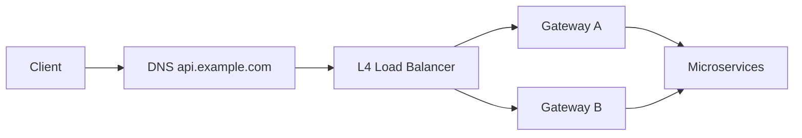
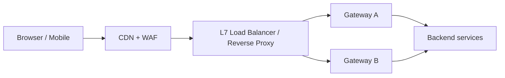
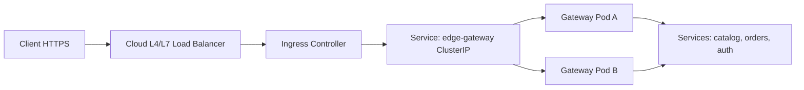
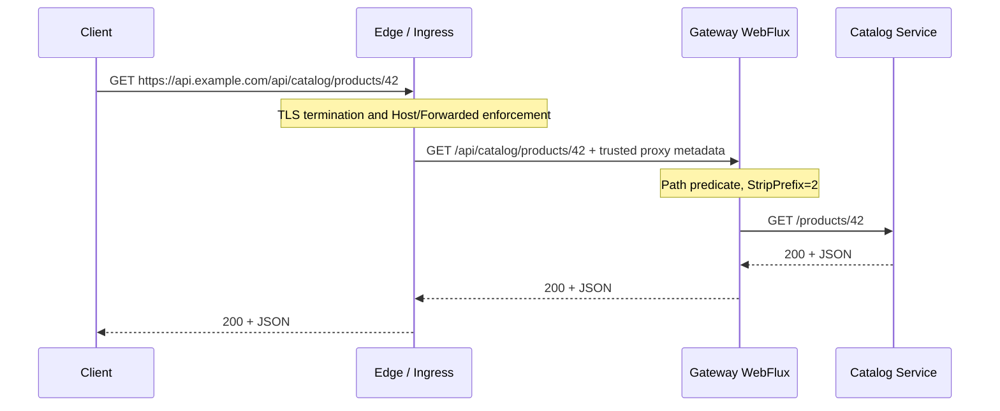
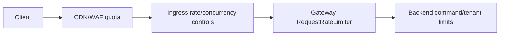
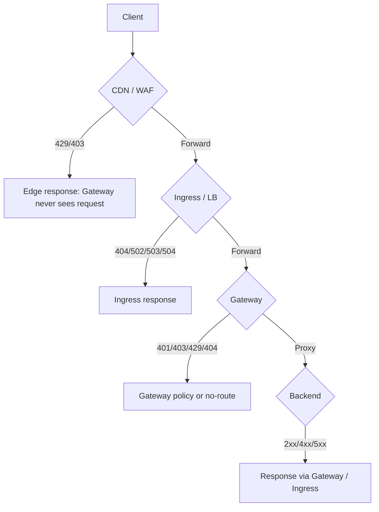

# Placing the Gateway Behind a Load Balancer, Ingress, or Reverse Proxy in Spring Cloud Gateway

During local development, a **Spring Cloud Gateway** application usually listens directly on port `8080`:

```text
Client → http://localhost:8080 → Gateway → Catalog / Orders / Payments
```

In production, clients rarely connect directly to a single Gateway instance. A common path is **DNS → CDN/WAF → load balancer or ingress/reverse proxy → multiple Gateway replicas → microservices**. Upstream layers can terminate TLS, balance connections, run health checks, rewrite paths, inject headers, enforce request size limits, and govern timeouts.

Putting a Gateway behind these layers is not just "opening another port." If misconfigured, the Gateway can emit redirects from HTTPS down to HTTP, misidentify client IP addresses, trust attacker-spoofed headers, return 404 due to **double path rewriting**, break WebSocket Upgrades, drop SSE streams after an idle interval, or expose Actuator admin endpoints to the Internet.

This lesson belongs to the **Deployment** chapter of the `SPRING_CLOUD_GATEWAY` module. It ties into an API Gateway routing via route predicates and filter chains, transforming paths/headers, and discovering services; protecting traffic with authentication, rate limiting, circuit breakers, retries, TLS, and request observability to run microservices safely.

**After this lesson, you will know:**

1. When to place an **L4 load balancer**, **L7 load balancer**, **Kubernetes Ingress**, or **reverse proxy** in front of Spring Cloud Gateway.
2. How to design TCP/TLS/HTTP paths, choosing TLS termination or re-encryption.
3. How to preserve the right public `Host`, scheme, client IP, and path with bounded-trust `Forwarded`/`X-Forwarded-*` headers.
4. How to configure an example **Ingress → ClusterIP Service → Gateway WebFlux Deployment** with readiness/liveness and protected management endpoints.
5. How proxies affect JWT/CORS, rate limiting, redirects, cookies, WebSocket/SSE, retries, and long-lived connections.
6. How to trace 404/401/429/502/503/504 errors per hop and build a test/rollout checklist.

> **Scope:** Examples prioritize **Spring Cloud Gateway Server WebFlux** with Spring Boot and Kubernetes. Gateway Server Web MVC is Servlet-based with different namespaces and filter APIs. Property names like `spring.cloud.gateway.server.webflux.*` belong to newer Gateway lines; older lines use different prefixes. Kubernetes YAML/NGINX snippets illustrate the corresponding ingress controller only and **are not manifests deployed or benchmarked in a live project**. All `example.com` addresses and documentation IPs are illustrative.

## 1. Why Still Use a Load Balancer/Ingress When You Already Have an API Gateway?

Spring Cloud Gateway can:

- Match requests by `Path`, `Host`, `Method`, `Header`, and other route predicates.
- Route to `lb://service-id` via Spring Cloud LoadBalancer and service discovery.
- Rewrite paths, queries, headers, and status codes.
- Enforce JWT/resource server policies, RequestRateLimiter, Retry, CircuitBreaker, and response filters.
- Record per-route metrics/traces for request observability.

However, it does not automatically replace **edge load balancers, ingress controllers, CDNs, and WAFs**. Components in front of the Gateway serve distinct duties:

| Component | Primary role | Common misconception |
| --- | --- | --- |
| **DNS/CDN/WAF** | Edge routing, caching, malicious traffic filtering, TLS, and bot/DDoS protection per provider. | CDN caching is not Spring Cloud Gateway caching. |
| **L4 load balancer** | Distributes **TCP/UDP connections** by IP/port; may pass through or terminate TLS depending on product. | Does not natively understand Spring Cloud Gateway route predicates. |
| **L7 load balancer** | Inspects HTTP host/path/headers; can handle TLS termination, HTTP routing, redirects, and health checks. | L7 rewrite rules can conflict with Gateway filters. |
| **Kubernetes Ingress controller** | Implements HTTP(S) Ingress rules, typically behind a cloud LB or Service. | An `Ingress` resource does nothing without a matching controller. |
| **Reverse proxy** | Forwards requests, load balances, protects TLS/headers, buffers/timeouts. | Adds another proxy hop and timeout budget. |
| **Spring Cloud Gateway** | API-level routing, filter chains, per-route security/resilience policies. | Does not replace network ingress layers or all backend authorization. |
| **Service discovery/LoadBalancer behind Gateway** | Picks an upstream instance for `lb://catalog-service`. | A **different** load balancing hop from the LB in front of the Gateway. |

A production system has load balancing in both places:

```text
Client
  ↓
Cloud Load Balancer distributes across Gateway pods
  ↓
Spring Cloud Gateway selects route and upstream service ID
  ↓
Spring Cloud LoadBalancer selects a backend instance
```

The **front** LB distributes client requests/connections across Gateway replicas. The **back** LB (via discovery) picks a microservice instance. They have different scopes and SLOs.

## 2. Common Deployment Topologies

### 2.1. An L4 LB Directly in Front of Gateway Instances



**Fits when:** the platform needs no extra L7 hop or wants the Gateway to own primary HTTP routing.

**Decisions required:**

- Terminate TLS at the LB or at the Gateway? With **TCP passthrough**, the Gateway needs TLS certificates and handles HTTPS directly.
- If the L4 LB terminates TLS, does the Gateway receive internal HTTP or re-encrypted TLS?
- How is client source IP preserved? SNAT and Proxy Protocol, if used, must be configured **consistently on both sides**.
- Do L4 health checks verify HTTP readiness or merely open TCP ports?
- A long-lived TCP connection stays pinned to one instance; an L4 LB does not split individual HTTP requests inside that connection automatically.

### 2.2. CDN/WAF + L7 LB or Reverse Proxy + Gateway



**Fits when:** edge-level TLS, WAF, domain routing, CDN caching, ingress observability, and shared edge policies are needed.

**Risks:** multiple layers can append `X-Forwarded-For`, rewrite `Host` or paths, apply idle timeouts, and emit their own error responses. Establish a **clear contract specifying which layer owns which policy**, otherwise you get "Gateway works when called directly yet breaks over the Internet."

### 2.3. Kubernetes: Cloud LB → Ingress Controller → Gateway Service



`Ingress` declares host/path/TLS rules in the Kubernetes API. An **Ingress controller** such as ingress-nginx, HAProxy, or a cloud-specific provider actually enforces them. Annotations specific to ingress-nginx **do not automatically apply** across all controllers.

### 2.4. L4 Passthrough vs HTTP-Aware Ingress

| Aspect | TCP/L4 passthrough | L7 HTTP reverse proxy |
| --- | --- | --- |
| Reads Host/path to route | Usually no (exceptions exist with SNI/TLS routing per product). | Yes. |
| Can Gateway terminate TLS? | Yes. | Proxy can terminate and optionally re-encrypt. |
| Forwarded headers | Pure TCP passthrough does not inject HTTP proxy `X-Forwarded-*` headers. | Usually present; requires trust policy. |
| WebSocket HTTP Upgrade | Frames flow over TCP in passthrough; Gateway handles Upgrade. | Proxy must support protocol Upgrade/tunneling. |
| HTTP caching/redirects | None at pure L4. | Available at L7. |
| Failure visibility | Transport/TCP/TLS. | HTTP 4xx/5xx, upstream metrics, and logs. |

**Do not stack extra HTTP router layers just thinking "more layers are safer."** Every hop adds latency, header complexity, timeout interactions, and debugging overhead.

## 3. End-to-End Request Contract from Internet to Upstream

Suppose the public API is:

```text
https://api.example.com/api/catalog/products/42
```

We want:

```text
Client URL:       https://api.example.com/api/catalog/products/42
Ingress:          preserves path /api/catalog/products/42
Gateway route:    Path=/api/catalog/**
Gateway filter:   StripPrefix=2
Backend catalog:  GET /products/42
```

Flow:



**Explicitly document the contract at every hop:**

1. Public URL/scheme/host/port.
2. Address and protocol from ingress to Gateway.
3. Path **before** and **after** each rewrite layer.
4. Which headers are preserved, overwritten, stripped, or allowed to forward.
5. How client IP is determined.
6. Which layer emits which error codes and who owns logs/metrics.
7. Deadlines/timeouts/connection lifetimes.
8. TLS encryption and identity between hops.
9. Where authentication, authorization, and rate limiting run.
10. Retry/reconnect semantics.

This prevents multiple teams from editing "the same path" with conflicting assumptions.

## 4. TLS Termination: Choosing Where to Stop and Protecting the Internal Hop

Three common models exist.

### 4.1. TLS Termination at Edge/Ingress

```text
Client --HTTPS--> Ingress --HTTP--> Gateway --HTTP/HTTPS--> Backend
```

Ingress holds `api.example.com`'s certificate, decrypts HTTPS, and sends HTTP into the cluster. Pros: centralized cert management, easy WAF/redirects/domain rules. However:

- The Ingress–Gateway hop **is unencrypted** in this model.
- Gateway may see internal requests as `http://` unless trusted forwarded scheme handling is configured properly.
- NetworkPolicy/namespace isolation and trust boundaries must be evaluated.
- Compliance or zero-trust mandates may forbid internal plaintext HTTP.

**Never call traffic "end-to-end encrypted" just because client–ingress uses HTTPS.**

### 4.2. TLS Termination Followed by Re-Encryption

```text
Client --HTTPS--> Ingress --HTTPS/mTLS--> Gateway --HTTPS/mTLS--> Backend
```

Pros: hop-by-hop encryption and optional mTLS identity verification. Trade-offs:

- Requires CA/trust stores, cert rotation, SNI, and hostname verification.
- Both proxy and Gateway pay TLS handshake/connection pool overhead.
- If the edge terminates and re-encrypts, the user's mTLS client certificate **does not pass through intact** to the Gateway as a direct peer certificate; use a verified identity propagation mechanism instead.
- `502` errors can occur from untrusted upstream certificates even when Gateway routing logic is completely right.

### 4.3. TLS Passthrough

```text
Client --TLS through L4--> Gateway (TLS termination)
```

Gateway holds the public certificate and handles TLS directly. Fits when Gateway must own the handshake, but:

- Front L4 cannot inspect HTTP paths/headers without terminating.
- Every Gateway replica bears TLS cost and needs cert rotation.
- If relying on Proxy Protocol to preserve client IP, both listener and ingress must support it—never enable on one side alone.
- WAF/L7 HTTP routing features at the passthrough layer cannot operate.

### 4.4. TLS Selection Matrix

| Requirement | Sensible option | Must verify |
| --- | --- | --- |
| Public certs managed at edge | Edge TLS termination. | Internal hop after edge has appropriate network protection. |
| Encrypt every hop | Edge termination + re-encrypt/mTLS. | CA, SNI, trust store, rotation. |
| Gateway must terminate client TLS directly | L4 passthrough. | Certificate management and LB behavior. |
| WAF must inspect HTTP | L7 TLS termination. | Security headers, forwarded metadata. |
| Ingress/service mesh manages mTLS | Hop-specific TLS. | No broken double termination or disabled hostname verification. |

Never disable **certificate validation** just to "quickly fix a 502" in production.

## 5. `Host`, Scheme, Port: Sources of Redirects and Absolute URLs

When Gateway receives HTTP from ingress, internal socket metadata might look like:

```text
Connection to Gateway: http://edge-gateway.default.svc.cluster.local:8080
Public client URL:     https://api.example.com/
```

If a filter or backend builds a redirect from the internal scheme/host without using the trusted external origin, users may receive:

```http
HTTP/1.1 302 Found
Location: http://edge-gateway.default.svc.cluster.local:8080/login
```

This redirect both breaks functionality and leaks internal topology.

### 5.1. Metadata Typically Preserved

- **`Host`:** public domain `api.example.com` or backend host per policy.
- **`X-Forwarded-Host`:** original client-facing host managed along a trusted proxy chain.
- **`X-Forwarded-Proto`:** outer edge scheme, typically `https`.
- **`X-Forwarded-Port`:** external port when needed; do not assume every request uses 443.
- **RFC 7239 `Forwarded`:** can carry `for=...;proto=https;host=...`.
- **`X-Forwarded-Prefix`:** external path prefix when an upstream is published under a different base path.

Do not blindly trust both `Forwarded` and all `X-Forwarded-*` headers simultaneously without precedence rules. Attackers can send two conflicting sets of values.

### 5.2. Cookies, Absolute URLs, and `Location`

When the external scheme is HTTPS:
- Redirects should use the public HTTPS origin or appropriate relative paths.
- Login cookies need `Secure`, `HttpOnly`, and `SameSite` matched to the use case.
- Cookie `Domain`/`Path` must match the public domain/base path.
- Backend-returned `Location` headers may need filter/contract rewriting; never reflect internal hosts.
- Open redirect vulnerabilities arise if apps trust client-supplied `X-Forwarded-Host`.

**Never use raw `Host` or `X-Forwarded-Host` for security-sensitive redirects or allowlists without validation.**

## 6. `Forwarded` and `X-Forwarded-*`: The Most Critical Trust Boundary

A "system-looking" header is still **untrusted HTTP data** that a client can forge. An Internet attacker can send:

```http
GET /api/orders HTTP/1.1
Host: api.example.com
X-Forwarded-For: 127.0.0.1
X-Forwarded-Proto: https
X-Forwarded-Host: admin.internal
```

If the Gateway immediately treats those as client identity, an attacker can:
- Bypass IP-based rate limits.
- Access "localhost-only" endpoints.
- Poison redirect or password-reset links with an attacker host.
- Corrupt audit logs or IP allowlists.
- Fool Security filters relying on scheme or host.

**The trust boundary is not "header exists so trust it," but "which proxy sent the header, and did that proxy strip untrusted input and overwrite it?"**

### 6.1. An Address Chain Can Span Multiple Hops

```text
Client:          203.0.113.10
CDN:             198.51.100.20
Ingress:         10.10.0.5
Gateway peer:    10.10.0.5

Properly managed header might look like:
X-Forwarded-For: 203.0.113.10, 198.51.100.20
```

Reading the "leftmost IP" is safe only if the **edge entrypoint stripped untrusted headers** and the entire trusted proxy chain is properly defined. If an Internet client sends `X-Forwarded-For: 1.2.3.4` and the CDN appends to it, the leftmost IP is spoofed.

### 6.2. Proper Trust Workflow

1. Identify the **first controlled HTTP entrypoint** (CDN or edge LB/ingress).
2. Strip or overwrite untrusted incoming `Forwarded`/`X-Forwarded-*` from public clients.
3. Accept only managed CDN/LB proxy IP ranges via the provider's mechanism.
4. Standardize one primary header format/family and IP-chain parsing order.
5. Lock down networking so clients **cannot bypass ingress to hit the Gateway directly**.
6. In the app, configure forwarded-header handling matching the server variant.
7. Test spoofed headers, host poisoning, redirects, and rate limiting.

### 6.3. Never Use Raw `X-Forwarded-For` as a Rate-Limit Key

In `RequestRateLimiter` or a custom IP KeyResolver:

```java
// UNSAFE PATTERN: client can forge this header if the edge does not strip it.
String key = exchange.getRequest()
    .getHeaders()
    .getFirst("X-Forwarded-For");
```

A safe resolver extracts the **effective client IP verified by a trusted-proxy algorithm**, not a raw multi-IP string. When unverified, prefer authenticated principals/API keys or a fail-safe fallback matching your threat model.

### 6.4. `X-Forwarded-Prefix` Does Not Equal `StripPrefix`

`X-Forwarded-Prefix: /api` indicates that externally the request arrived under a base path. It **does not automatically strip** `/api` from the request target sent upstream. Path rewriting and advertising the public prefix are two distinct responsibilities.

## 7. Spring Boot WebFlux Forwarded Header Handling

Spring Boot provides a general setting controlling how the app interprets forwarded headers. For **WebFlux**, an example:

```yaml
server:
  forward-headers-strategy: framework
```

Depending on Spring Boot version and runtime, options include `none`, `native`, and `framework`:

| Strategy | Idea | Notes |
| --- | --- | --- |
| `none` | Does not alter request view using proxy-forwarded metadata. | Can misreport public scheme/host behind a TLS terminator. |
| `native` | Relies on web server/native adapter handling. | Semantics and support vary across Netty/Tomcat/Undertow. |
| `framework` | Spring Framework processes forwarded metadata (e.g., WebFlux `ForwardedHeaderTransformer`). | **Enable only behind a controlled trusted proxy boundary.** |

`framework` lets the application observe the external URI as HTTPS even when the Gateway's socket from ingress is HTTP. However, **this does not verify whether a proxy is trustworthy**: if the Gateway accepts direct traffic or the edge fails to strip spoofed headers, trusting forwarded values is dangerous.

### 7.1. Do Not Conflate Two Separate Mechanisms

- **Spring Boot `server.forward-headers-strategy` / WebFlux `ForwardedHeaderTransformer`:** governs **how incoming requests are interpreted inside the Gateway application**.
- **Spring Cloud Gateway `ForwardedHeadersFilter` / `XForwardedHeadersFilter`:** governs **creating/forwarding headers on outbound proxy requests** per route and config.

Similar names, different scopes. Never assume enabling one property protects against all spoofing or ensures downstream headers carry identical semantics.

### 7.2. Gateway Prefix and Trusted Proxies Policy by Version

Some newer Gateway branches use `spring.cloud.gateway.server.webflux.trusted-proxies` (a regular expression matching trusted proxy addresses in relevant forward-header features), whereas earlier branches use legacy namespaces and separate header-filter toggle configs.

**Required step:** check documentation and configuration metadata for your **exact running Spring Cloud Gateway Server WebFlux version**, configure proxy trust per its implementation, and inspect actual headers arriving upstream. Never copy a regex from another environment and assume every forwarded header is automatically verified.

### 7.3. Post-Deployment Verification

```text
Public URL:       https://api.example.com/api/catalog/42
Ingress → GW:     http://edge-gateway:8080/api/catalog/42
Trusted proto:    https
Trusted host:     api.example.com
Public redirect:  https://api.example.com/...
Client IP:        from trusted-proxy policy, never raw client headers
```

Never let raw `X-Forwarded-Host` drive access decisions or security URLs.

## 8. NGINX as a Reverse Proxy in Front of the Gateway

An Internet-facing NGINX can terminate TLS and proxy into the Gateway:

```nginx
# map belongs in the http {} context in nginx.conf
map $http_upgrade $connection_upgrade {
    default upgrade;
    ''      '';
}

upstream gateway_pool {
    server gateway-a.internal:8080;
    server gateway-b.internal:8080;
    keepalive 32;
}

server {
    listen 443 ssl;
    server_name api.example.com;

    ssl_certificate     /etc/nginx/certs/fullchain.pem;
    ssl_certificate_key /etc/nginx/certs/privkey.pem;

    location / {
        proxy_pass http://gateway_pool;
        proxy_http_version 1.1;

        proxy_set_header Host $host;
        proxy_set_header X-Forwarded-Host $host;
        proxy_set_header X-Forwarded-Proto $scheme;
        proxy_set_header X-Forwarded-Port $server_port;

        # Only at a public entrypoint where $remote_addr is truly the client.
        # OVERWRITE incoming XFF; do not append client-supplied headers.
        proxy_set_header X-Forwarded-For $remote_addr;
        # Strip proxy metadata that Internet clients might forge.
        proxy_set_header Forwarded "";
        proxy_set_header X-Forwarded-Prefix "";

        proxy_set_header Upgrade $http_upgrade;
        proxy_set_header Connection $connection_upgrade;

        proxy_connect_timeout 3s;
        proxy_read_timeout 60s;
        proxy_send_timeout 60s;
    }
}
```

**Caveats for this config fragment:**

- `map` must sit in the `http` context; `server` and `upstream` blocks must sit in their appropriate contexts too.
- `$remote_addr` represents the client IP **only if NGINX is the direct HTTP entrypoint**. If a CDN/LB sits in front, `$remote_addr` is the proxy IP; configure **Real IP / trusted-proxy policies** and trust only authorized source IP ranges.
- `proxy_set_header X-Forwarded-For $remote_addr` is an **overwrite at the first trusted edge** strategy. Subsequent internal proxies can append trusted chains by convention; never concatenate unfiltered Internet input.
- `proxy_set_header Host $host` requires an explicit `server_name`/host allowlist; avoid accepting arbitrary Hosts that could poison redirects.
- When no Upgrade header exists, `map` sets `Connection` empty so HTTP/1.1 keep-alive is not forced closed on every request; actual upstream keep-alive also depends on NGINX and backend settings. `Forwarded` and `X-Forwarded-Prefix` from untrusted public sources are stripped in this example.
- NGINX does not handle HTTP/2 and WebSocket proxying with identical syntax across all versions. `Upgrade`/`Connection` here covers HTTP/1.1 Upgrade.
- `keepalive 32` caches upstream connections inside NGINX—it is **not** the Reactor Netty outbound pool limit inside the Gateway.
- `60s` timeouts are **illustrative**; short APIs and SSE/WebSockets need separate profiles.

### 8.1. Do Not Rewrite the Path Twice

With `proxy_pass http://gateway_pool;` omitting a trailing URI path, NGINX forwards the original request URI per its config semantics. Using `proxy_pass http://gateway_pool/;` inside `location /api/` alters the URI per NGINX rules before it even hits the Gateway.

Therefore:
- Assign **one layer to own path rewriting**.
- Keep `/api/catalog/42` intact at Ingress if Gateway matches `Path=/api/catalog/**`.
- Run `StripPrefix=2` only in Gateway unless both layers explicitly coordinate.
- Verify the actual upstream path received rather than just reading YAML/nginx.conf.

## 9. Kubernetes Ingress → Gateway: Sample Manifests

The example below models a WebFlux Gateway workload with three replicas, an internal Service, and a TLS Ingress. Replace images, hostnames, namespaces, cert secrets, and resources per environment.

### 9.1. Gateway Deployment

```yaml
apiVersion: apps/v1
kind: Deployment
metadata:
  name: edge-gateway
  namespace: gateway
spec:
  replicas: 3
  revisionHistoryLimit: 5
  selector:
    matchLabels:
      app: edge-gateway
  strategy:
    type: RollingUpdate
    rollingUpdate:
      maxSurge: 1
      maxUnavailable: 0
  template:
    metadata:
      labels:
        app: edge-gateway
    spec:
      terminationGracePeriodSeconds: 45
      containers:
        - name: gateway
          image: registry.example.com/platform/edge-gateway:1.0.0
          ports:
            - name: http
              containerPort: 8080
          env:
            - name: SERVER_PORT
              value: "8080"
          readinessProbe:
            httpGet:
              path: /actuator/health/readiness
              port: http
            initialDelaySeconds: 5
            periodSeconds: 5
            timeoutSeconds: 2
            failureThreshold: 3
          livenessProbe:
            httpGet:
              path: /actuator/health/liveness
              port: http
            initialDelaySeconds: 15
            periodSeconds: 10
            timeoutSeconds: 2
            failureThreshold: 3
          resources:
            requests:
              cpu: 200m
              memory: 256Mi
            limits:
              cpu: "2"
              memory: 1Gi
```

**Prerequisites:** The app includes Spring Boot Actuator with health probes enabled and responding on **port 8080**. Do not copy these exact requests/limits/probe timings onto a Gateway handling multi-hour WebSockets or 20,000 connections without load testing, graceful shutdown tuning, and capacity planning.

### 9.2. ClusterIP Service

```yaml
apiVersion: v1
kind: Service
metadata:
  name: edge-gateway
  namespace: gateway
spec:
  type: ClusterIP
  selector:
    app: edge-gateway
  ports:
    - name: http
      port: 80
      targetPort: http
      protocol: TCP
```

This creates an internal Service address for the Ingress controller to reach **Gateway pods**. It **does not** expose the Gateway directly via NodePort/LoadBalancer unless you deliberately add another path.

### 9.3. Ingress with TLS

```yaml
apiVersion: networking.k8s.io/v1
kind: Ingress
metadata:
  name: public-api
  namespace: gateway
spec:
  ingressClassName: nginx
  tls:
    - hosts:
        - api.example.com
      secretName: api-example-com-tls
  rules:
    - host: api.example.com
      http:
        paths:
          - path: /
            pathType: Prefix
            backend:
              service:
                name: edge-gateway
                port:
                  name: http
```

**Explanation:**

- `ingressClassName: nginx` works only if the cluster has the corresponding **IngressClass**/controller.
- The TLS secret must exist and be managed/rotated in the right namespace and workflow.
- `path: /` with `Prefix` forwards every path on that host to Gateway, keeping fine-grained routing in Gateway.
- The Ingress controller may sit behind a cloud LoadBalancer Service; an Ingress manifest **does not create or define** all network layers on its own.
- Service port `80` maps to Pod port `8080`.
- If a public path matches no Gateway route, Gateway can return 404; that differs from a 404 generated by ingress failing to match a host/rule.

### 9.4. Spring Boot Health Probes

Application config fragment:

```yaml
management:
  endpoint:
    health:
      probes:
        enabled: true
  endpoints:
    web:
      exposure:
        include: health,info,metrics,prometheus

server:
  shutdown: graceful

spring:
  lifecycle:
    timeout-per-shutdown-phase: 30s
```

This is an example for supported Spring Boot versions; verify active probes, paths, and ports.

`server.shutdown: graceful` is normally written as two YAML lines `server:` → `shutdown: graceful` above (or `server.shutdown=graceful` in properties). It lets Spring Boot execute graceful shutdown per lifecycle, though it cannot keep WebSocket sessions alive forever.

**Critical security note:** Ingress `path: /` can allow public clients to reach **`/actuator/*` on the same application port** unless Spring Security/network policies block it. `exposure.include` is not an authorization control. In production, expose only essential endpoints, block management paths at the public edge/app, and prefer an isolated authenticated management network/port.

### 9.5. Ingress-nginx Is Not Every Ingress Controller

When custom timeout annotations are needed for community **ingress-nginx**:

```yaml
metadata:
  annotations:
    nginx.ingress.kubernetes.io/proxy-read-timeout: "300"
    nginx.ingress.kubernetes.io/proxy-send-timeout: "300"
```

This is a **metadata fragment**, not a complete Ingress manifest. Values of `300` are **seconds** per common ingress-nginx annotations, purely illustrative for long-lived streams. Cloud ingress controllers or NGINX Inc controllers use **different** annotation names/semantics.

Do not raise every route's timeout to 300 seconds just to support WebSockets: short JSON APIs should keep tight deadlines while active streams and connection resources are capped independently.

## 10. Placing Gateway Routes Behind Ingress: Keeping Path Contracts Clear

Gateway Server WebFlux route example using the modern namespace:

```yaml
spring:
  cloud:
    gateway:
      server:
        webflux:
          routes:
            - id: catalog-api
              uri: lb://catalog-service
              predicates:
                - Path=/api/catalog/**
              filters:
                - StripPrefix=2
                - AddRequestHeader=X-Gateway-Route,catalog-api

            - id: orders-api
              uri: lb://order-service
              predicates:
                - Path=/api/orders/**
              filters:
                - StripPrefix=2
```

Expected results:

| Client request | Ingress forwards to Gateway | Backend receives |
| --- | --- | --- |
| `GET /api/catalog/products/42` | `/api/catalog/products/42` | `/products/42` |
| `GET /api/orders/123` | `/api/orders/123` | `/123` |
| `GET /unknown` | `/unknown` | No upstream if no route matches. |

**Remember:** `StripPrefix=2` drops exactly the first two path segments, not two characters or two host components. If ingress also strips `/api`, `Path=/api/catalog/**` will stop matching and return 404.

### 10.1. Prefix Rewriting Should Have One Owner

Both options work if applied consistently:

**Option A (usually easier to manage):** Ingress preserves the public path; Gateway matches and rewrites.

**Option B:** Ingress rewrites to an internal prefix; Gateway routes match the **already-rewritten path**, carrying external prefix metadata/headers if needed.

**Do not use Option A in staging and Option B in production while keeping identical route tests.** Path/security matchers, CORS policies, and metrics can all break.

### 10.2. Host Predicates Behind Ingress

Gateway may declare:

```yaml
predicates:
  - Host=api.example.com
  - Path=/api/orders/**
```

If ingress rewrites `Host` to `edge-gateway.gateway.svc`, the `Host` predicate stops matching. Decide whether to preserve the original host or rewrite intentionally, and verify trusted proxy/scheme forwarding.

**Never trust an arbitrary Host** to grant access to admin routes; Host predicates perform routing only, not authentication.

## 11. Balancing Across Multiple Gateway Replicas: Statelessness

With three Gateway pods:

```text
Ingress/LB
   ├── Gateway A
   ├── Gateway B
   └── Gateway C
```

Ideally, requests from the same user can hit any Gateway instance with **consistent permissions and business behavior**.

This requires:

- Synchronized route definitions/configs or a single trusted release source.
- Equivalent authentication/JWT validation across all instances.
- Shared cluster-wide quota state when using RedisRateLimiter rather than isolated in-memory limiters.
- Consistent secrets, certificates, issuers, and JWKs.
- Never storing critical business session or idempotency state solely in one Gateway pod's RAM.
- Ensuring custom filters do not rely on mutable singleton state leaked across requests.

### 11.1. Are Sticky Sessions Mandatory?

**No** for most stateless HTTP APIs. Session affinity may be justified for legacy apps or stateful protocols, yet it **never replaces shared state**.

With HTTP/1.1 keep-alive, an LB may keep one TCP connection pinned to a single Gateway; that does not mean requests across multiple connections from the same user always hit the same replica.

### 11.2. What Happens When a Gateway Pod Dies?

The Ingress/LB must:
1. Stop sending **new connections/requests** to the unready pod.
2. Allow active requests time to finish within termination grace.
3. Drain/close sockets cleanly.
4. Let clients retry/reconnect per contract.
5. Avoid retrying side-effecting POSTs lacking idempotency.

**Per-replica rate limiting, retries, and resilience** must fit overall cluster capacity—especially when one pod dies and the remaining replicas absorb the load.

## 12. Readiness, Liveness, and Startup: Don't Manufacture Outages

The three probes serve distinct purposes:

| Probe | Question | Typical Kubernetes action |
| --- | --- | --- |
| **Startup** | Has the app finished starting up? | Delays liveness/readiness until startup succeeds. |
| **Readiness** | Is the Pod ready to serve **new** requests? | Removes from Service endpoints when unready. |
| **Liveness** | Is the process wedged and requiring a restart? | Restarts container after consecutive failures. |

### 12.1. Do Not Tie Liveness to All Upstream Health

If Gateway liveness depends on Catalog Service, a Catalog outage causes Kubernetes to restart every Gateway pod simultaneously. That is an unnecessary **cascading failure**.

Liveness should reflect whether a restart would fix the Gateway process itself. Readiness can reflect ability to accept traffic per policy, yet be careful not to gate the entire Gateway fleet on non-critical downstreams.

### 12.2. Readiness and 503s

If all Gateway pods become unready, Ingress returns 503 because the Service has zero healthy endpoints. That happens **before requests reach the Gateway route chain**, so Gateway route metrics stay flat.

When diagnosing 503s, check simultaneously:
- Kubernetes pod readiness.
- Service endpoints/EndpointSlices.
- Ingress controller upstream health.
- Downstream Gateway route/LoadBalancer service discovery.
- Whether the actual backend returned 503.

### 12.3. Test Startup Probes for Slow-Starting Gateways

A Gateway loading many route definitions or initializing TLS/JWK/connection pools can take time to warm up. If liveness timeouts are too tight, Kubernetes repeatedly kills pods before they become ready. Use a startup probe or measured thresholds rather than guessing random delays.

## 13. Graceful Shutdown and Rolling Deployments

Safe rollouts must trace request flow as a pod terminates:

```mermaid
sequenceDiagram
    participant K as Kubernetes
    participant I as Ingress
    participant G as Gateway Pod
    participant C as Client
    K->>G: SIGTERM / start shutdown
    K->>I: Endpoint readiness removed from healthy set
    Note over I,G: Endpoint propagation is not instantaneous
    I->>G: Requests on existing connections may still arrive
    G-->>C: Requests finish or connections drain
    K->>G: Termination grace expires; process must exit
```

Exact ordering and propagation delays depend on the Kubernetes runtime. **Never assume readiness updates reach every L7 LB instantaneously**; LBs have health intervals, endpoint caches, and keep-alive pools.

### 13.1. Essential Rollout Practices

- `replicas >= 2` or appropriate HA topology.
- `maxUnavailable: 0` and `maxSurge` backed by real capacity to prevent OOM.
- Distinct startup/readiness/liveness probes aligned to their roles.
- Graceful shutdown with `terminationGracePeriodSeconds` sized for important requests.
- A controlled drain/propagation delay if needed and justified.
- PDBs, topology spread, and resource budgets preventing simultaneous replica loss.
- Canary rollouts and rollbacks on 5xx/latency spikes.
- Client retry policies with backoff and idempotency.

### 13.2. WebSocket/SSE Cannot "Wait Forever to Finish"

A WebSocket session can stay open for hours. `terminationGracePeriodSeconds=45` **cannot keep all sessions alive indefinitely** through a rolling deploy.

Required design:
- Maintenance/reconnect notices where protocol permits.
- Controlled closure of long-lived sessions.
- Client reconnection to another pod with jitter.
- Replay cursors/event offsets to avoid data loss.
- Presence leases/TTLs instead of keeping crashed-pod users "online" forever.

## 14. WebSockets Through Ingress or Reverse Proxy

WebSockets start with an HTTP/1.1 Upgrade handshake returning **101 Switching Protocols**, followed by frame exchange. NGINX/Ingress HTTP proxies must forward Upgrade headers properly and configure timeouts suited for long-lived connections.

```text
Browser --wss://api.example.com/realtime/events-->
Ingress --ws://edge-gateway:8080/realtime/events-->
Gateway --lb:ws://realtime-service-->
Realtime Service
```

In this example, **WSS only encrypts client–Ingress**. Gateway–Realtime backend uses `ws`; if every hop must be encrypted, use `wss` or mesh TLS/mTLS per infrastructure/version.

### 14.1. Proxy Timeout Configuration

In NGINX, `proxy_read_timeout` measures the interval between successive reads from upstream, **not total connection duration**. If the server sends nothing to the proxy within that window, the tunnel closes even if the client keeps sending messages upstream.

Example policy:

```text
NGINX proxy_read_timeout: 300 seconds
Application heartbeat:    30 seconds
Heartbeat response TTL:   15 seconds
Connection maximum age:   per infrastructure / security policy
```

This is for discussion only. Measure the shortest idle limit across **every hop** (CDN, LB, ingress, Gateway, backend). Some proxies enforce a **hard maximum connection lifetime** that heartbeats will not override.

### 14.2. Ping/Pong Does Not Guarantee Healthy Business Messaging

- Protocol-level Ping/Pong only checks peer/hop liveliness per implementation.
- Native browser WebSockets do not expose APIs to send arbitrary control Ping frames; application-level `PING:<id>` / `PONG:<id>` messages may be needed.
- Gateway WebFlux exposes version-specific proxy Ping frame settings, **not** an automatic heartbeat generator.
- An OPEN socket does not prove the backend is processing business events cleanly.

### 14.3. Session Affinity and Reconnection

An established WebSocket stays bound to one Gateway/backend instance until closed. When a pod dies, clients must reconnect and load balancing picks another endpoint. Sticky sessions help in narrow cases, yet **cannot survive pod crashes or in-memory-only state**.

Tests to run:
- HTTP 101 handshake.
- Bidirectional frames via a real WebSocket client.
- Idle timeouts/heartbeats.
- Close codes and reconnection.
- Graceful shutdown, backgrounded browser tabs, network switches.
- Backend state replay after reconnect.

## 15. SSE/Streaming: Buffering and Idle Timeouts

SSE uses a long-lived `text/event-stream` HTTP response, **not WebSocket Upgrade**. NGINX or ingress can buffer responses, causing browsers to receive backend-emitted events only in delayed batches.

With community ingress-nginx, common annotations on an **SSE-dedicated Ingress** are:

```yaml
metadata:
  annotations:
    nginx.ingress.kubernetes.io/proxy-buffering: "off"
    nginx.ingress.kubernetes.io/proxy-read-timeout: "300"
```

**Caveat:** Annotations depend on controller/version. Disabling buffering affects performance, memory, and certain response types—**do not turn it off globally** across all routes without measuring.

An SSE server can emit comment heartbeats:

```text
: keep-alive

id: event-103
event: notification
data: {"message":"ready"}

```

- Heartbeats keep the HTTP stream alive through idle-timeout proxies.
- `id:` and `Last-Event-ID` are useful only if the backend implements durable event replay.
- `proxy_read_timeout` does not bypass maximum connection age limits.
- Never apply short JSON API response timeouts blindly to SSE without accounting for stream lifecycles.

## 16. Client IP, WAF, and Multi-Layer Rate Limiting

Rate limiting can live at multiple layers:



They do not replace each other:

| Layer | Typically protects against | Key/semantics to understand |
| --- | --- | --- |
| CDN/WAF | Bots/DDoS/abusive IP patterns. | Client IP per provider/ASN/rules; not user identity by default. |
| Ingress | Upstream availability, connection/RPS caps. | IP, host, or controlled headers. |
| Gateway | Route/user/tenant/API-key quotas. | JWT principal, verified tenant, Redis shared state. |
| Backend | Expensive business commands, payment/order quotas. | Business-level authorization and idempotency. |

### 16.1. Do Not Misuse RemoteAddress Predicates Behind a Reverse Proxy

At the Gateway, the remote TCP peer may be the Ingress IP. If a rate limiter or `RemoteAddr` route predicate uses that IP, all users collapse into one bucket or IP allowlists malfunction.

Some Gateway versions provide `XForwardedRemoteAddressResolver` with a `maxTrustedIndex` strategy; when using it, count **the exact number of trusted proxy hops** and strip spoofed headers at the edge. Never treat `trustAll()` or "take the first element" as safe in public environments.

### 16.2. RedisRateLimiter Requires Shared State for Cluster-Wide Quotas

If three Gateway replicas keep independent local buckets, each user gets triple quota. To enforce cluster-wide quotas per key, use distributed coordination like Redis with consistent namespaces and KeyResolvers.

Watch out for:
- Rate limiting the **handshake** does not automatically throttle WebSocket frames after 101.
- Per-request rate limiting does not bound upstream Retry attempts.
- Ingress may return 429 **before Gateway**, leaving Gateway route metrics blind to it.

### 16.3. Attributing 429s to the Right Source

If the edge returns 429, clients get HTTP 429 even though Gateway never saw the request. If Gateway returns 429 after route matching, it may appear in Gateway route timers depending on filter semantics/version. If a backend returns 429, Gateway forwards it.

Debug using ingress access logs, Gateway route IDs, limiter decision metrics, and backend logs. Never treat a 429 status alone as proof that "RedisRateLimiter is working properly."

## 17. JWTs, Cookies, and CORS Behind a TLS-Terminating Ingress

When clients call `https://api.example.com` and Gateway receives internal HTTP:

- Spring Security Resource Server still validates JWT issuer/signature/audience/expiration.
- TLS termination does not inherently validate or invalidate JWTs.
- Browser `Secure` cookies bind to the public HTTPS origin, not the Gateway pod address.
- CORS policies evaluate the browser's **public Origin** and allowed headers/methods per security policy.
- Redirect/login callback URIs must use controlled public HTTPS URLs.
- Never trust client-supplied `X-User-Id`, `X-Role`, or `X-Tenant-Id` headers for authentication.
- If an auth proxy forwards identity, enforce trust boundaries/mTLS/signed claims and strip headers from the Internet.

### 17.1. Which Layer Handles CORS Preflight?

Browsers send `OPTIONS` preflight requests to public APIs. Ingress, Spring Security WebFilters, and Gateway CORS handlers can intercept them at different stages.

A common failure:

```text
Preflight OPTIONS → 401/403 before reaching the route
Actual POST request never sent
Browser reports "CORS error"
```

Permit valid preflight requests per policy and ensure 401/403/429/5xx responses carry appropriate CORS headers so frontends can read error codes. **Never enable wildcard origins with credentials just to mask errors.**

### 17.2. WebSocket Origin Is Not Standard HTTP CORS Preflight

WebSocket handshakes carry a browser `Origin` header without running an HTTP `OPTIONS` CORS preflight like `fetch`. Configure **allowed origins** matching your WebSocket server/route version alongside authentication. Non-browser clients can spoof `Origin`, so Origin checks never replace JWT/cookie authorization.

## 18. Retries, Timeouts, and Circuit Breakers Across Multiple Hops

A client request traverses stacked deadlines:

```text
Client timeout
  ↓
CDN response timeout
  ↓
Ingress proxy_read_timeout
  ↓
Gateway pool acquire / connect / response timeout
  ↓
Backend service deadline
```

**Each layer measures time differently.** An ingress `proxy_read_timeout=60s` does not guarantee Gateway has 60 seconds to open a socket or that the backend always receives a full 60 seconds.

### 18.1. Timeout Budget Rules

For short JSON APIs, design:

1. Client deadline exceeds target latency plus reasonable network overhead.
2. Gateway sets explicit connect/response budgets; retry counts and backoffs fit inside the end-to-end deadline.
3. Ingress timeouts avoid cutting off valid Gateway responses per contract without hanging indefinitely.
4. Backends enforce deadlines, cancellation cleanup, and bounded queues.
5. Streaming/WebSockets get separate timeout profiles.

No universal formula like "Ingress timeout = Gateway timeout + 1s" fits every protocol, because timeouts can govern idle gaps, TCP connect, first-byte, or full response duration.

### 18.2. Retrying at Two Layers Amplifies Load

If ingress retries up to 2 attempts and Gateway also retries up to 3 attempts, one client request can trigger **up to 6 upstream attempts** when both policies fire sequentially.

```text
1 client request
  × up to 2 Ingress upstream attempts
  × up to 3 Gateway attempts per turn
= up to 6 backend attempts under that scenario
```

This is purely a mathematical illustration; real retry behavior depends on method, body, committed response state, and each proxy's route/filter semantics.

**Never blindly enable retries on payment/order POSTs.** Require idempotency keys and backend deduplication; circuit breakers and rate limiters do not prevent duplicate writes on their own.

### 18.3. CircuitBreakers Can Make the Gateway Return Fallback Responses

If Gateway returns 200 from a fallback while the backend is returning 503, the edge logs 200 despite degraded downstream health. Monitor **circuit breaker state/rejections, retry attempts, and upstream error rates**, not merely final edge status codes.

### 18.4. Header Size, Body Size, and Buffering

Ingress can enforce:
- Max request body size (typically rejecting with 413).
- Max HTTP header size (e.g., large cookies/JWTs).
- Request/response buffering.
- Connection idle/read/write timeouts.

Gateway enforces its own max body/memory limits and filters. Align budgets across both layers; an upload rejected with 413 at ingress **will not** appear in Gateway route metrics.

## 19. Security Hardening: Preventing Gateway Bypass via Internal Paths

A fragile architecture looks like:

```text
Internet → Ingress → Gateway → Services
             ╲        ╱
              Alternate NodePort/LoadBalancer path straight into Gateway
```

If clients reach the Gateway directly, they can **forge `X-Forwarded-*` headers**, bypass CDN/WAF/ingress controls, and spoof client IPs.

### 19.1. Core Safeguards

- Keep the Gateway Service as `ClusterIP` when only Ingress should call it.
- Enforce NetworkPolicies permitting Gateway inbound only from **Ingress controller namespaces/pods** and authorized internal sources.
- Do not expose backend services publicly around Gateway policies when business rules mandate Gateway mediation.
- Restrict Actuator management endpoints to limited networks/ports with authorization.
- Accept only valid hostnames and SNI, rejecting unknown Hosts.
- Sanitize forwarded headers at the first trusted edge.
- Encrypt hops requiring TLS/mTLS and **verify certificates**; keep secrets in secret managers/Kubernetes Secrets with access control.
- Prevent SSRF/unsafe dynamic `http(s)://` routes if Actuator CRUD/control-plane APIs exist.
- Restrict Gateway egress toward metadata endpoints and non-allowlisted local/private services.
- Never log full JWTs, cookies, Authorization headers, or payment data.

### 19.2. NetworkPolicies Are Not Absolute Guarantees on Their Own

Kubernetes NetworkPolicy enforcement depends on CNI support and how selectors/namespaces match actual traffic. Ingress controllers may run in another namespace, or cloud LBs may route directly depending on mode. Test actual allowed and blocked network paths against platform rules.

### 19.3. Do Not Confuse IngressClass with Security Policy

`ingressClassName: nginx` merely selects the controller; it does not mean WAF, TLS, cert validation, rate limiting, or header sanitization are securely configured. Security depends on controller configuration, cloud LBs, certificates, network policies, and Gateway Security.

## 20. Per-Hop Observability When Failures Occur

Requests can fail or be rejected at any layer:



A bare status code does not identify the failing hop. Cross-reference:

| Symptom | Where to check first |
| --- | --- |
| Ingress returns 404; Gateway has zero request logs. | Host/path/TLS rules, IngressClass, controller config. |
| Gateway returns 404; upstream receives nothing. | Route predicates, ingress-rewritten path, Host/headers. |
| Gateway returns 404; upstream received request. | Backend resource/route/path mapping. |
| 401/403 before route matching. | Spring Security, CORS, cookies/JWT, forwarded scheme. |
| 429 at CDN with zero Gateway metrics. | WAF/CDN quotas/IP resolution. |
| 429 at Gateway. | RequestRateLimiter key/quota, Redis health, route filter order. |
| 502 connecting to Gateway after a TLS change. | Ingress upstream scheme, certificate, trust, Service port. |
| 503 from Ingress with zero healthy endpoints. | Pod readiness, Service selectors/EndpointSlices. |
| 503 from Gateway `lb://`. | Backend discovery/LoadBalancer instances or upstream 503. |
| 504 after exact timeout interval. | Hop timeout budgets, slow backend, proxy read timeout. |
| Redirect to `http://` or internal host. | Trusted `X-Forwarded-Proto/Host`, `Location` rewrites. |
| WebSocket drops after fixed interval. | CDN/Ingress idle/read timeout, heartbeats/max age. |
| SSE events arrive in batches. | Proxy buffering/compression or un-flushed backend writes. |
| Only some Gateway pods fail. | Route config drift, readiness, differing env/JWK/Redis state. |

### 20.1. Gateway Metrics Do Not See Requests Blocked at the Edge

Gateway WebFlux provides `spring.cloud.gateway.requests` timers with route tags per version. However, requests blocked by CDN/WAF/Ingress or rejected by Security **before route matching** may never enter the Gateway route timer.

Complement with:
- CDN/WAF request and rate-limit metrics.
- Ingress/LB request, status, latency, and upstream target metrics.
- Spring Boot HTTP server observations.
- Gateway route metrics: `routeId`, `httpStatusCode`, `outcome`, latency.
- Gateway HTTP client/LoadBalancer/Retry/CircuitBreaker metrics.
- Backend metrics and traces.
- Kubernetes Service endpoint/readiness/deployment events.

### 20.2. Correlation IDs and Trace Propagation

Every layer should support correlation/tracing, keeping these rules:
- Never put raw trace/request IDs into high-cardinality Prometheus labels.
- Never trust a client-supplied `X-Request-ID` to authorize actions or query private logs.
- If accepting client-supplied IDs, sanitize/validate length and format to prevent header injection.
- Use OpenTelemetry/W3C `traceparent` for standard distributed tracing; note sampled tracing omits some requests.
- Redact Authorization headers, cookies, and PII in logs and traces.

An ingress 502 log and a Gateway 200 log with nearby timestamps might belong to different requests or retry attempts without correlation—never match by timestamps alone.

## 21. Outside-In Testing Practice

Suppose staging domain `api.staging.example.com` points to Ingress. Test step by step without opening non-compliant public test ports.

### 21.1. Testing TLS and Public Hostname

```bash
curl -i \
  "https://api.staging.example.com/api/catalog/products/42"
```

Verify:
- TLS certificate matches hostname.
- Expected response status/headers/JSON.
- No redirect to HTTP or internal `*.svc`.
- CORS headers appear strictly per allowed-origin policy.
- Correlation ID included if implemented.

If using a local test CA, configure the client trust store properly; **never use `curl -k` as a production workaround**.

### 21.2. Testing Invalid Origins/Hosts

Send a request with an unapproved Host header to the test ingress using an appropriate tool; expect rejection or default backend, **never** routing to a privileged Gateway route.

Do not assume every controller returns the exact same 404/400/421 code for bad Hosts; verify controller-specific behavior.

### 21.3. Verifying the Actual Path Reaching the Backend

A mock Catalog Service logs incoming paths for:

```text
Public:   /api/catalog/products/42
Ingress:  /api/catalog/products/42
Gateway:  StripPrefix=2
Backend:  /products/42
```

If the backend sees `/catalog/products/42`, either ingress stripped one segment or Gateway filter config differs. Never tweak both ingress and Gateway simultaneously without a request trace.

### 21.4. Testing Spoofed Forwarded Headers

Send a staging test request:

```bash
curl -i \
  "https://api.staging.example.com/api/debug/whoami" \
  -H "X-Forwarded-For: 127.0.0.1" \
  -H "X-Forwarded-Host: admin.internal" \
  -H "X-Forwarded-Proto: http"
```

`/api/debug/whoami` is strictly a **protected staging test endpoint**—never expose public debug endpoints leaking identity/cookies in production.

Expected: client IP and public origin **come from the trusted edge**, unaffected by spoofed inputs. If debug URLs or rate-limit keys shift with forged headers, fix the trust boundary.

### 21.5. Testing No-Route and Readiness

Send a path matching no Gateway route: Gateway should return 404. Also check Ingress Service endpoints and Gateway pod readiness. If the Service has zero endpoints, ingress may return 503 before Gateway ever gets a chance to return 404.

### 21.6. Verifying Post-Rollout State

In multi-replica staging:
- Change route/Ingress config incrementally.
- Confirm requests succeed across all Gateway pods.
- Restart one pod under controlled traffic.
- Confirm p95/5xx/retries show no abnormal spikes.
- Verify WebSocket/SSE reconnect, session cleanup, and replay.
- Roll back if TLS/Host/path/security regressions appear.

## 22. Common Error Matrix and Remediation

| Symptom | Likely cause | How to verify |
| --- | --- | --- |
| Works directly on Gateway, 404 via Ingress. | Wrong Ingress rewrite, Host predicate, or path prefix. | Compare public URI, Gateway input URI, and backend path. |
| Redirects from HTTPS to HTTP. | Gateway lacks trusted external scheme. | `server.forward-headers-strategy`, edge overwrite, `Location`. |
| Gateway returns `*.svc.cluster.local` URLs. | Internal Host/scheme leaked into URL generation. | Validate Host/XFH/XFP, absolute Location rewrites. |
| IP-based RateLimit blocks all users. | Gateway sees ingress/edge IP instead of client IP. | Trusted client IP chain and KeyResolver. |
| Clients spoof XFF to bypass quotas. | Edge appends dirty headers or app trusts raw XFF. | Spoofed-header test, sanitize at first edge. |
| Ingress fails to load TLS cert. | Wrong Secret namespace/host/format. | Ingress events/controller logs, cert SANs. |
| Ingress returns 502 after enabling upstream HTTPS. | Backend Service still HTTP, SNI/CA mismatch, or wrong port. | Controller upstream scheme/TLS logs. |
| Ingress returns 503 after rollout. | No ready endpoints, mismatched selectors. | Pod readiness/Service EndpointSlices. |
| Gateway returns 503 on `lb://`. | No service instances; not an Ingress bug. | Discovery/LoadBalancer metadata and backend health. |
| 429 missing from Gateway route metrics. | CDN/WAF or Ingress rejected first. | Edge logs vs origin request counts. |
| 413 on file upload. | Ingress or Gateway body-size limit too small. | Response source, body-size policy. |
| Browser reports CORS error when actually 401/429. | Preflight/error response missing allowed-origin headers. | Inspect OPTIONS and actual HTTP responses. |
| WebSocket never gets 101. | Controller drops Upgrade, or Security/Origin blocks. | Ingress config, Gateway ws route, handshake status. |
| WebSocket drops after ~60s. | Proxy idle timeout or heartbeats not reaching upstream. | Per-hop timeline, Ping/Pong. |
| SSE arrives in bursts. | Proxy buffering/flushing/compression. | Test `text/event-stream` and controller buffering. |
| 5xx spikes when one Gateway pod dies. | Insufficient endpoint propagation/draining. | Ingress logs, termination timeline. |
| Gateway returns 200 while backend is unhealthy. | Retry or CircuitBreaker fallback masks errors. | Upstream attempts and breaker metrics. |
| Sticky sessions look fine until a pod dies and state vanishes. | Relying on in-memory sessions. | Reconnect to another pod, shared state/replay. |
| Management endpoint reachable via public Ingress. | Catch-all `/` plus missing security policy. | External auth tests, ingress deny rules, network paths. |

## 23. Practice Exercises with Answers

### Exercise 1 — Distinguishing LB Before and After the Gateway

A cloud load balancer distributes requests to three Gateway pods, and then a Gateway route `lb://orders-service` selects between two backend pods. Do these two load balancers perform the same role?

**Answer:** No. The LB in front distributes client connections/requests across Gateway replicas; the LoadBalancer behind the Gateway selects **upstream service instances** per route.

### Exercise 2 — TLS Termination

Clients use HTTPS to ingress, and ingress uses HTTP to the Gateway. Can you call this path end-to-end encrypted?

**Answer:** No. The ingress–Gateway leg is plaintext HTTP. If the threat model requires encryption everywhere, use re-encryption or mTLS/mesh TLS.

### Exercise 3 — HTTP Redirects

A client calls `https://api.example.com/login` and receives `Location: http://edge-gateway:8080/auth`. Which config groups should you inspect?

**Answer:** Public Host/scheme, trusted forwarded headers, Spring Boot `server.forward-headers-strategy`, and response Location rewriting. Never force clients to patch URLs themselves.

### Exercise 4 — Spoofed IP Headers

An Internet client sends `X-Forwarded-For: 127.0.0.1`. Can the Gateway trust this as the real client IP?

**Answer:** No. Only trust a verified trusted-proxy chain sanitized at the first controlled edge.

### Exercise 5 — Double Rewriting

Ingress strips `/api`, while Gateway still matches `Path=/api/catalog/**`. What usually happens?

**Answer:** The route fails to match because Gateway sees `/catalog/**`, returning 404 or matching the wrong route. Assign rewrite ownership to one layer.

### Exercise 6 — ClusterIP Service

Why does a Gateway Service behind Ingress typically use `ClusterIP`?

**Answer:** To minimize direct external exposure while letting Ingress call the internal Service. Pair with NetworkPolicies and Security—`ClusterIP` alone is not an absolute firewall.

### Exercise 7 — Readiness and Liveness

A Catalog Service outage causes Gateway liveness to fail, and Kubernetes restarts all Gateway pods. Is this sensible?

**Answer:** Usually no. Liveness should not depend on all downstreams; restarting the whole Gateway fleet during a backend outage triggers a cascading failure.

### Exercise 8 — Ingress 503

Ingress returns 503 while Gateway has zero request logs. What should you inspect?

**Answer:** Gateway Pod readiness, Service selectors/EndpointSlices, Ingress upstream endpoints, and controller logs before editing Gateway routes.

### Exercise 9 — `Host` Predicate

Ingress rewrites Host to `edge-gateway.svc`, while the Gateway route has `Host=api.example.com`. What happens?

**Answer:** The Host predicate fails to match. Either preserve/propagate the public Host under a trust policy or update the route per an agreed contract.

### Exercise 10 — Rate Limiting Through a Proxy

Gateway's RateLimiter keys on `getRemoteAddress()`, and all requests appear to come from one IP. Why?

**Answer:** The remote TCP peer is the ingress. Use a trusted-client-IP resolver or key on authenticated user/API key—never raw XFF.

### Exercise 11 — WebSocket 101

A WebSocket gets HTTP 101 but disconnects after 60 seconds. Does that prove the Gateway route is misconfigured?

**Answer:** No. The handshake succeeded; the drop likely stems from a CDN/Ingress/proxy idle timeout or missing heartbeats. Check timeouts at every hop.

### Exercise 12 — SSE

An SSE server emits events every second, yet browsers receive them only every 30 seconds in batches. What is the first thing to check?

**Answer:** Response buffering/compression at ingress/reverse proxy or missing server flushes; do not try fixing SSE with WebSocket Pings.

### Exercise 13 — Retry Amplification

Ingress retries up to 2 attempts and Gateway retries up to 3 attempts. How many upstream attempts can one client request generate in the simple worst case?

**Answer:** Up to \(2 \times 3 = 6\) attempts when both layers retry sequentially, though HTTP methods, bodies, and timeouts may limit actual retries.

### Exercise 14 — WebSocket Rollouts

A Gateway pod is terminating while holding 2,000 open WebSocket sessions. Is raising `terminationGracePeriodSeconds` indefinitely the right fix?

**Answer:** No. Use controlled drain/reconnect with backoff/jitter and durable event replay/presence TTLs.

### Exercise 15 — 429 Missing from Gateway Metrics

The CDN WAF blocks a bot surge with 429, yet Gateway timers show zero 429s. Is that contradictory?

**Answer:** No. The CDN returned 429 **before** requests ever reached the Gateway. Combine edge metrics with correlation.

### Exercise 16 — Client IP Behind a CDN

Ingress sits behind a CDN, so `$remote_addr` is the CDN IP. Should you immediately switch `X-Forwarded-For` to whatever value the client sent?

**Answer:** No. Configure trusted CDN IP ranges/Real IP logic and sanitize headers at the first trusted edge; never trust raw Internet input.

### Exercise 17 — Actuator Exposed Externally

A catch-all `/` Ingress routes to Gateway, allowing public clients to hit `/actuator/gateway`. Is that caused by an insecure IngressClass?

**Answer:** The issue is **route exposure and authorization/network policies**, not the IngressClass name alone. Block management endpoints at the edge and via Security.

### Exercise 18 — Sticky Sessions and State

Ingress uses a sticky cookie to pin a user to Gateway A. If A restarts, does the cookie preserve in-memory quotas/sessions?

**Answer:** No. Sticky routing cannot preserve local RAM across crashes. Use shared/distributed state or stateless design.

### Exercise 19 — 502 from Upstream TLS

After enabling re-encryption from ingress to Gateway, requests start returning 502. Should you disable TLS verification on ingress?

**Answer:** No. Fix certificate SANs/CAs, upstream SNI, ports, and schemes while keeping verification enabled.

### Exercise 20 — Defining a Strong Smoke Test

List at least four pieces of evidence proving `https://api.example.com/api/catalog/products/42` is deployed properly.

**Answer:** (1) Valid public TLS certificate; (2) expected client status/body; (3) mock backend receives `/products/42` after rewrite; (4) public Host/scheme/redirects and trusted client IP cannot be spoofed; optionally add readiness/route metrics and 401/429 negative tests.

## 24. Pre-Production Deployment Checklist

- [ ] Mapped full topology: DNS, CDN/WAF, L4/L7 LB, Ingress, Gateway, and backend services.
- [ ] Every layer has a clear owner for TLS termination, HTTP Host/path rewrites, proxy headers, auth/rate limits, and timeouts.
- [ ] Gateway exposed solely via approved paths; `ClusterIP` Service and NetworkPolicies fit the topology.
- [ ] Zero NodePort/LoadBalancer/public services bypassing ingress without equivalent security.
- [ ] Public hostnames and TLS certs/SNI/trust chains verified with a rotation plan.
- [ ] Hops requiring TLS/mTLS encrypt and **verify certificates** with zero insecure bypasses.
- [ ] Trusted `Forwarded`/`X-Forwarded-*` policy chosen and sanitized at the first controlled edge.
- [ ] Raw XFF/XFH/XFP never used for auth, rate limiting, or redirects.
- [ ] `server.forward-headers-strategy` matches Spring Boot/WebFlux version and tested via public URLs.
- [ ] Gateway's own ForwardedHeaders/XForwardedHeadersFilters evaluated separately from Boot's transformer.
- [ ] Ingress preserves/rewrites `Host` consistently with Gateway `Host` predicates.
- [ ] Single clear path-rewriting contract with no double `StripPrefix`/rewrites.
- [ ] CORS, CSRF, JWT/cookies, and WebSocket Origins tested through ingress, not just internal Gateway calls.
- [ ] Per-user/tenant quotas/rate limits use shared state across multi-replica Gateways.
- [ ] Client IP resolvers follow the trusted proxy chain; `RemoteAddr` not misused.
- [ ] Gateway route configs, secrets, and feature flags consistent across all replicas.
- [ ] `IngressClass`, Ingress TLS secrets, and Service selectors/ports/EndpointSlices verified.
- [ ] Startup, readiness, and liveness probes properly scoped; downstream outages cannot restart all Gateway pods.
- [ ] Rolling deployments/draining do not cause abnormal 502/503/504 spikes.
- [ ] WebSocket Upgrades/heartbeats/close/reconnect tested; SSE buffering/timeouts tested separately.
- [ ] Client/ingress/Gateway/backend timeout budgets and retry attempts aligned.
- [ ] Side-effecting POSTs protected from proxy/Gateway retries unless idempotent.
- [ ] HTTP body/header limits, compression, caching, and max connections have capacity budgets.
- [ ] Actuator health/metrics/probes exposed safely; **write/admin endpoints never public**.
- [ ] Ingress/Gateway/backend metrics and tracing wired; aware that pre-Gateway blocks lack route IDs.
- [ ] Dashboards distinguish edge 429, Gateway 429, ingress 503/no endpoints, Gateway `lb://` no-instance, and backend 503.
- [ ] Tested spoofed forwarded headers, Host poisoning, absolute redirects/cookie paths, and TLS negative cases.
- [ ] Canary load tests, rollback manifests/configs, p95/p99, RPS, 5xx, and ready endpoint counts verified.
- [ ] Cross-checked ingress controller flavor/version alongside the running Spring Cloud Gateway Server variant/BOM.
- [ ] Demo manifests not treated as production-tested systems or academic Content QA sign-off.

## 25. References and Version Notes

Official documentation to cross-check during implementation:

1. **Spring Cloud Gateway Server WebFlux** — Routing, GatewayFilter factories, Forwarded Headers, and Global Filters:  
   https://docs.spring.io/spring-cloud-gateway/reference/spring-cloud-gateway-server-webflux/
2. **Spring Cloud Gateway configuration properties** — version-specific prefixes:  
   https://docs.spring.io/spring-cloud-gateway/reference/configprops.html
3. **Spring Boot — HTTP Server Forward Headers** — `server.forward-headers-strategy` and forwarded metadata handling:  
   https://docs.spring.io/spring-boot/reference/how-to/webserver.html
4. **Spring Framework WebFlux — Forwarded Headers** — `ForwardedHeaderTransformer`:  
   https://docs.spring.io/spring-framework/reference/web/webflux/forwarded-headers.html
5. **Kubernetes — Ingress**:  
   https://kubernetes.io/docs/concepts/services-networking/ingress/
6. **Kubernetes — Liveness, Readiness, Startup Probes**:  
   https://kubernetes.io/docs/concepts/configuration/liveness-readiness-startup-probes/
7. **NGINX — Reverse proxy and WebSocket proxying**:  
   https://nginx.org/en/docs/http/ngx_http_proxy_module.html  
   https://nginx.org/en/docs/http/websocket.html
8. **Ingress-nginx controller — Annotations** (applicable only to that community controller):  
   https://kubernetes.github.io/ingress-nginx/user-guide/nginx-configuration/annotations/
9. **Spring Boot Actuator — Kubernetes Probes**:  
   https://docs.spring.io/spring-boot/reference/actuator/endpoints.html#actuator.endpoints.kubernetes-probes

**Note:** Some ingress controllers use Gateway API or custom resources instead of Ingress. Kubernetes `Ingress` does not cover every TCP/UDP/TLS passthrough use case; those depend on controller-specific features or dedicated APIs. Do not copy `ingressClassName: nginx` examples onto ALB, Traefik, Kong, or other controllers without consulting their documentation.

## 26. Summary

Placing **Spring Cloud Gateway** behind a **load balancer, ingress, or reverse proxy** is standard practice for HA, TLS/certificate management, traffic distribution, and edge security. Yet each added hop introduces potential conflicts around **Host, path rewrites, TLS scheme, client IP, forwarded headers, timeouts, and retries**. Safe operation requires a clear per-hop contract and a controlled trust chain from the public edge to the Gateway.

In Kubernetes, a manageable topology is **TLS Ingress → ClusterIP Service → multiple Gateway WebFlux pods**, backed by readiness/liveness probes, graceful draining, and network/security policies. Ingress can preserve public paths while Gateway uses `Path`/`StripPrefix` to route to `lb://service-id`, provided all replicas stay consistent on route configs, JWTs, rate limiting, and observability. WebSocket and SSE workloads require dedicated timeout, buffering, and reconnect semantics rather than sharing a one-size-fits-all HTTP JSON profile.

The crux is not the number of proxy layers, but **assigning clear ownership per layer, refusing to trust client-forged headers, and tracing every 401/403/404/429/502/503/504 back to its exact origin**. Once TLS, Host, Forwarded headers, paths, health probes, and rollouts are verified with live traffic, `SPRING_CLOUD_GATEWAY` fulfills its role as a secure, reliable microservices gateway.
