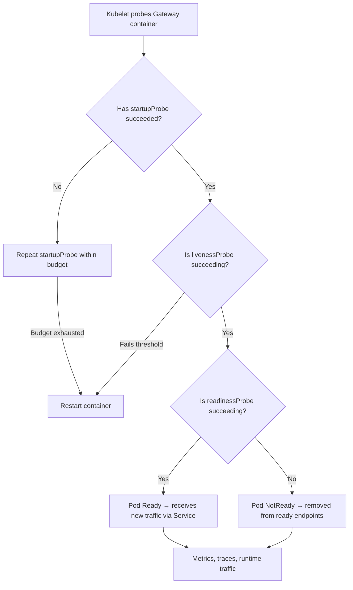
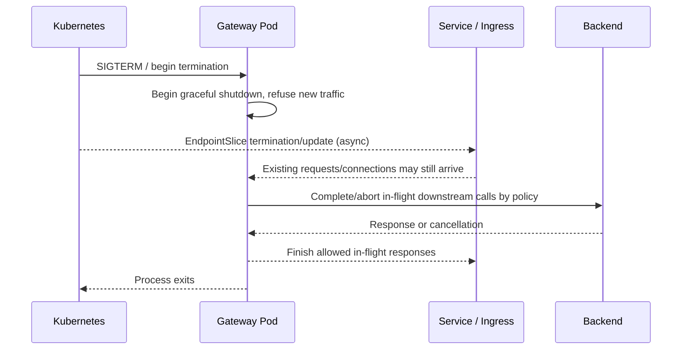
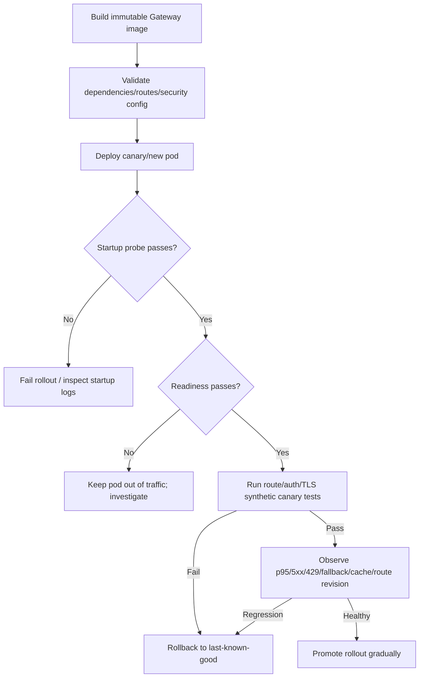

# Readiness, Liveness, and Dependencies to Check

When **Spring Cloud Gateway** sits at the entry point of a microservices system, a Gateway process can be **running** yet **not yet qualified to serve traffic**: route definitions have not finished loading, a required backend has zero instances, TLS certificates are misconfigured, the Redis instance used for rate limiting is unavailable, or a new config revision has not been verified. Conversely, the Gateway can be **operating normally** even when one backend is unhealthy; if the liveness probe depends on that backend, Kubernetes continuously restarts healthy Gateway pods and amplifies the outage.

This lesson belongs to the **Deployment** chapter in the **SPRING_CLOUD_GATEWAY** module, covering building an API Gateway with route predicate/filter chains, path/header transformations, service discovery, authentication, rate limiting, circuit breakers, retries, TLS, and observability. The goal is knowing **when a pod belongs in Service endpoints**, **when a restart is warranted**, **which dependencies to check**, and **how to validate and observe these decisions in real deployments**.

**Core thesis:** *Process alive* does not equal *application ready*; *readiness failure* does not mean *a restart will fix the error*; and *every dependency being important* does not mean *every dependency belongs in readiness or liveness*.

> **Version Scope:** Examples use **Spring Cloud Gateway Server WebFlux**, Spring Boot Actuator, and Kubernetes. With Gateway Server Web MVC, Proxy Exchange, or other Spring Boot/Spring Cloud lines, configurations, probe paths, and Security filter chains may differ. Cross-check the exact **Spring Boot + Spring Cloud release train** before copying YAML/Java. States and timings in examples are design models, not measurements taken from a specific cluster.

## 1. Three Distinct Operational Questions

| Signal | Question | What does Kubernetes do when the probe fails? | Should it depend on external services? |
| --- | --- | --- | --- |
| **Liveness** | Is this process still healthy enough to serve requests going forward? | Past the failure threshold, **kubelet restarts the container** per policy. | **Usually no.** External dependency failures do not necessarily mean the Gateway process is broken. |
| **Readiness** | Should this instance **receive new requests** right now? | The Pod is marked NotReady; typically excluded from **ready** EndpointSlice endpoints used by the Service for new traffic. | **Only essential dependencies** without which the instance cannot fulfill its required contract. |
| **Startup** | Has the process finished its initialization phase? | Until the startup probe succeeds, liveness/readiness probes remain inactive; exceeding budget restarts the container. | Focuses on bootstrap lifecycle; never use for ongoing backend monitoring. |

An HTTP health endpoint returning **200** only states that *the health indicator/group at that endpoint* returned a passing result. It is **not proof** that all backend APIs, authorization, route matching, and TLS work.

### Distinguishing Common States

```text
Pod process is running ───────────────┐
                                     ▼
                          Liveness = CORRECT?
                         /                  \
                       yes                  no
                       /                     \
          Readiness = ACCEPTING?          Liveness fail
               /           \                 → restart
             yes            no
             /               \
       Service can       Exclude from
       send new traffic  new Service traffic
```

This is a **conceptual model**. Kubernetes also involves readiness gates, EndpointSlice `terminating`/`serving` conditions, network/ingress/service-mesh logic, and existing open connections; **NotReady does not immediately close all existing TCP connections**.

## 2. Example: Gateway Started Yet Not Ready

Suppose the Gateway defines:

```text
GET /api/catalog/**  -> lb://catalog-service
GET /api/orders/**   -> lb://orders-service
POST /api/payments/** -> lb://payment-service
```

During the first 15 seconds of a rollout:

- JVM and Reactor Netty have already bound port `8080`.
- Route definitions may still be loading or refreshing.
- The discovery client has not yet fetched the fresh service instance list.
- Downstream TLS trust stores are mounted but unverified.
- The Redis rate limiter may not yet be connected.

Questions:

1. **Liveness?** If the Gateway is running and managing its lifecycle, it should typically stay **UP**.
2. **Readiness?** If minimum configuration/mandatory serving prerequisites are unmet, it should stay **REFUSING_TRAFFIC** or readiness health **DOWN/OUT_OF_SERVICE** per policy.
3. **Startup?** If bootstrap has not completed, the startup probe may fail within its allocated startup budget.

Later, if `payment-service` returns 503 while Gateway still serves `catalog` and `orders`, there is no universal rule forcing the entire pod NotReady. Base that decision on your **API contract** and the blast radius of pulling the pod from all traffic.

## 3. What Does Kubernetes Decide Using Probes?



### Kubernetes Does Not Understand "Business Readiness" on Its Own

Kubelet only sees **probe results**: HTTP status codes, TCP connects, or process exit codes. It does not natively know:

- How many valid Gateway routes are loaded.
- Whether `lb://catalog-service` has servable instances.
- Whether the Redis limiter is failing open or closed.
- Whether Spring Security/JWT audience contracts match.
- Whether mTLS certificates can actually connect to backends.
- Why a real user route returns 401/403/429/502.

Place those checks in the right layer: **health groups**, **startup/rollout smoke tests**, **synthetic requests**, **metrics/alerts**, or **backend-level monitoring**—not crammed blindly into a liveness endpoint.

### Common Misconfigurations

| Misconfiguration | Consequence |
| --- | --- |
| Liveness checks Redis/Consul/Eureka | Redis/registry outage → all Gateway containers restart simultaneously. |
| Readiness checks every backend including optional ones | One microservice fails → entire Gateway pulled from Service endpoints. |
| No startupProbe; liveness fails during bootstrap | Slow JVM startup → restart loop before finishing boot. |
| Probe routed through public ingress instead of direct pod | Results depend on DNS/LB/Ingress, misrepresenting the pod; routing loops. |
| Probe hits a separate management port | Actuator stays up while main HTTP listener stops accepting requests (false positive). |
| Probe timeout too tight | Brief GC pause or CPU throttle fails probe, causing restart churn. |
| Probe failure detection too slow | Broken Gateway stays in rotation too long or restarts too late. |
| Public health endpoint exposes details | Leaks internal IPs/hosts, Redis/registry IDs, stack traces. |

## 4. Spring Boot Actuator: Health and Availability States

Spring Boot provides the **Actuator health endpoint** and **ApplicationAvailability** with two state types:

- **`LivenessState`**: `CORRECT` or `BROKEN`.
- **`ReadinessState`**: `ACCEPTING_TRAFFIC` or `REFUSING_TRAFFIC`.

Spring Boot exposes these availability states via **`livenessState`/`readinessState` health indicators** and health groups:

```text
GET /actuator/health/liveness
GET /actuator/health/readiness
```

Under standard health group mapping:

- When liveness state is `CORRECT`, the liveness group reports `UP`.
- When liveness state is `BROKEN`, the liveness group reflects unhealthy status.
- When readiness state is `ACCEPTING_TRAFFIC`, the readiness group reports `UP`.
- When readiness state is `REFUSING_TRAFFIC`, the readiness group typically reports `OUT_OF_SERVICE`.

**Distinguish** application availability state from the Kubernetes Pod condition: Spring Boot `ReadinessState` is an **in-application** state, whereas Kubernetes computes Pod `Ready` from probe results and readiness gates. One does not automatically trigger the other unless wired to the right endpoint and configuration.

### Default Readiness Does Not Ping All Dependencies

Spring Boot configures **liveness/readiness probe health groups** automatically in supported environments like Kubernetes, and they can be enabled explicitly via properties. **The default readiness group does not include all health indicators** such as Redis, DB, Eureka, or custom external services. This is intentional to prevent external dependencies from gating the entire application.

If a dependency is genuinely a *hard requirement* for the entire pod, **explicitly include that dependency's health indicator in the readiness group**. Adding a `HealthIndicator` bean does not automatically put it into the readiness group in all configurations.

## 5. Configuring Spring Boot Actuator Probes

### Dependencies

In Gateway Server WebFlux with a compatible Spring Boot/Cloud BOM:

```xml
<dependencies>
    <dependency>
        <groupId>org.springframework.cloud</groupId>
        <artifactId>spring-cloud-starter-gateway-server-webflux</artifactId>
    </dependency>
    <dependency>
        <groupId>org.springframework.boot</groupId>
        <artifactId>spring-boot-starter-actuator</artifactId>
    </dependency>
</dependencies>
```

This is a **dependency excerpt**, not a standalone POM. Older lines may use `spring-cloud-starter-gateway`. WebMVC and Proxy Exchange use different starters, and MVC/WebFlux server stacks should not be mixed unintentionally.

### Sample `application.yml`

```yaml
server:
  port: 8080

management:
  endpoint:
    health:
      probes:
        enabled: true
        add-additional-paths: true
      show-details: never
  endpoints:
    web:
      exposure:
        include: health,info
```

In Spring Boot versions supporting `management.endpoint.health.probes.add-additional-paths`, the two default additional URLs are typically:

```http
GET /livez
GET /readyz
```

served on the **main server port**, alongside the Actuator health group paths. **Verify your exact Spring Boot version and config binding.** When `add-additional-paths` is unavailable in your release line, configure group additional paths supported by that version or design an alternative validated probe port/path.

### Why Put Probes on the Main Port?

If you configure:

```yaml
management:
  server:
    port: 9090
```

then `GET :9090/actuator/health/readiness` only proves the **management server** answers. Main listener `:8080` could be unable to accept HTTP traffic due to connection pool, event-loop, or resource issues while the management listener keeps responding. Serving `/readyz` on the main port routes probes through the **main web server infrastructure**, though it still cannot replace synthetic business requests.

**Do not assume the main port and management port share the same WebFilter/Security/routing chain.** Verify Spring Security configs per context and restrict network access to health endpoints.

## 6. Health Group HTTP Statuses and Kubernetes Impact

Spring Boot Actuator classifies health statuses such as `UP`, `DOWN`, `OUT_OF_SERVICE`, and `UNKNOWN`, then applies an **HTTP status mapping**. By default, `DOWN`/`OUT_OF_SERVICE` typically maps to HTTP **503**, while `UP` maps to HTTP **200**.

```http
GET /readyz

HTTP/1.1 200 OK
Content-Type: application/vnd.spring-boot.actuator.v3+json

{"status":"UP"}
```

When readiness is not met:

```http
GET /readyz

HTTP/1.1 503 Service Unavailable
Content-Type: application/vnd.spring-boot.actuator.v3+json

{"status":"OUT_OF_SERVICE"}
```

These responses are **illustrative**; media types vary by content negotiation and Actuator version. Health endpoints must return **non-2xx/3xx** on failure so Kubernetes `httpGet` evaluates them accurately; if a custom `HttpCodeStatusMapper` or security login redirect turns DOWN into HTTP 200 or 302, the probe reports a false success. **Kubernetes HTTP probes treat statuses 200 through 399 as success**, so a 301/302 login redirect is not a valid auth mechanism for kubelet.

### Do Not Let Gateway Routes Intercept Health Endpoints

`/livez` and `/readyz` must be served by the local application/Actuator health group, never forwarded to backends or accidentally caught by a catch-all route predicate (`Path=/**`). Place internal endpoints on the main server, test them **directly on the pod port**, and verify Security/WebFilter order alongside Gateway route matching on your actual release.

## 7. Kubernetes Deployment: Startup, Liveness, and Readiness Template

The example below configures **3 Gateway replicas** and Spring Boot Actuator additional paths on **main HTTP port 8080**. Public TLS termination runs at a trusted ingress/load balancer in the lab; if TLS terminates at the pod, adjust and test probe `scheme`/port separately.

```yaml
apiVersion: apps/v1
kind: Deployment
metadata:
  name: api-gateway
  labels:
    app: api-gateway
spec:
  replicas: 3
  minReadySeconds: 10
  progressDeadlineSeconds: 600
  strategy:
    type: RollingUpdate
    rollingUpdate:
      maxSurge: 1
      maxUnavailable: 0
  selector:
    matchLabels:
      app: api-gateway
  template:
    metadata:
      labels:
        app: api-gateway
    spec:
      terminationGracePeriodSeconds: 45
      containers:
        - name: gateway
          image: registry.example.invalid/platform/api-gateway:REPLACE_WITH_IMMUTABLE_TAG
          imagePullPolicy: IfNotPresent
          ports:
            - name: http
              containerPort: 8080
          resources:
            requests:
              cpu: 250m
              memory: 512Mi
            limits:
              memory: 1Gi
          startupProbe:
            httpGet:
              path: /livez
              port: http
              scheme: HTTP
            periodSeconds: 2
            timeoutSeconds: 2
            failureThreshold: 60
          livenessProbe:
            httpGet:
              path: /livez
              port: http
              scheme: HTTP
            periodSeconds: 10
            timeoutSeconds: 2
            failureThreshold: 3
          readinessProbe:
            httpGet:
              path: /readyz
              port: http
              scheme: HTTP
            periodSeconds: 5
            timeoutSeconds: 2
            failureThreshold: 2
            successThreshold: 1
```

This is a **template requiring customization**, not a copy-paste production manifest:

- `registry.example.invalid` is a placeholder; replace with an approved image registry and immutable tag/digest. Never pull unvetted images.
- `requests` and `limits` are illustrative values; measure CPU, heap/direct memory, Netty buffers, throughput, and JVM headroom.
- Port `8080` is internal HTTP; production requires proper TLS/trust boundaries at the public edge or all the way to the pod.
- Never hardcode JWT secrets, keystore passwords, Redis credentials, or mTLS private keys in manifests.
- Missing Service, ConfigMap/Secrets, ServiceAccount/RBAC, NetworkPolicy, anti-affinity/topology spread, PDB, and HPA; add per cluster and SLOs.
- `periodSeconds`/`failureThreshold` values must be derived from measured bootstrap and fault-detection timings.

### Why Place `startupProbe` First?

Spring Boot may need time to:

- Initialize JVM/JIT and Reactor Netty.
- Load configurations/route definitions, validate beans, and build the Spring Security chain.
- Read trust stores and initialize HTTP clients/connection pools.
- Register with service discovery or wait for config injection before bootstrap.
- Run application warm-up if required by policy.

Kubelet **does not run liveness/readiness probes** until the startup probe succeeds. With `failureThreshold=60` and `periodSeconds=2`, the startup budget is roughly **120 seconds** (actual elapsed time depends on probe timeouts and scheduling). If startup continuously fails past the budget, the container restarts. **Startup probe does not prove backends stay healthy forever** and does not replace readiness.

### Why Should Liveness Be More Tolerant Than Readiness?

A readiness failure pulls a pod out of new traffic cleanly without killing it. A liveness failure triggers a container restart—a disruptive action that drops in-flight requests and adds cold-start pressure. Therefore, liveness needs **reasonable tolerance for transient hiccups**, while readiness should detect faster when an instance should stop taking new traffic.

## 8. Kubernetes Service, EndpointSlice, and Avoiding Total Capacity Loss

### Service Routing Traffic to Ready Gateway Pods

```yaml
apiVersion: v1
kind: Service
metadata:
  name: api-gateway
spec:
  selector:
    app: api-gateway
  ports:
    - name: http
      port: 80
      targetPort: http
      protocol: TCP
  type: ClusterIP
```

In this topology, the Service routes to pod endpoints marked **ready**; the EndpointSlice controller updates pod state and kube-proxy/meshes/ingresses consume it via their own mechanisms. **NotReady** pods are normally excluded from **new connections** through the Service.

However:

- EndpointSlice updates are **not strictly synchronous** with application state transitions.
- Long-lived connections, HTTP/2 multiplexing, WebSockets/SSE, and pooled connections can outlive a NotReady transition.
- Clients may connect directly to a Pod IP or bypass the Service.
- Ingresses and service meshes have their own drain windows and policies.

Thus, **readiness does not replace graceful shutdown and connection draining**.

### RollingUpdate and Availability Budget

With `replicas: 3`, `maxUnavailable: 0` and `maxSurge: 1` allow Kubernetes to spin up a new pod before reducing available replicas per Deployment controller semantics. `minReadySeconds: 10` requires a Ready pod to stay stable before counting as available.

**Those three fields alone do not guarantee zero downtime:** if all pods share a Redis dependency and readiness flips DOWN simultaneously, the Service runs out of ready endpoints. If an app crashes mid-drain, long-lived requests still fail.

### Reference PodDisruptionBudget

```yaml
apiVersion: policy/v1
kind: PodDisruptionBudget
metadata:
  name: api-gateway-pdb
spec:
  minAvailable: 2
  selector:
    matchLabels:
      app: api-gateway
```

A PDB limits **voluntary disruptions** where supported by Kubernetes. It **cannot prevent node crashes, process crashes, or liveness-triggered restarts**, nor can it restore capacity when all pods go NotReady together.

### Sizing Replicas for the Workload

If one Gateway pod sustains ~`N` RPS within SLOs, three pods do not automatically sustain `3N`: consider network/LB overhead, hotspots, Redis, backend contention, TLS/CPU throttling, and traffic skew. Capacity-test with one pod missing, not solely when all three are healthy.

## 9. Which Dependencies Should Liveness Check?

**Default rule: liveness should reflect only states recoverable by restarting this Gateway instance.** An external dependency outage is normally **not** a reason to restart the Gateway.

| Component | Include in liveness? | Explanation |
| --- | --- | --- |
| Internal JVM/application lifecycle | **Yes**, via `livenessState`. | When the process cannot sustain operation, a restart helps. |
| Main Reactor Netty listener unresponsive | Probing the main port catches some failures. | Yet a 200 does not prove every route is healthy. |
| `RedisRateLimiter`/Redis server | **No**, by default. | A Redis outage must not restart all Gateway pods. |
| Eureka/Consul registry | **No**. | Registry outages are shared infra faults; restarts wipe useful caches. |
| A catalog/order/payment backend | **No**. | A broken backend does not prove the Gateway process is broken. |
| External DNS | **No**. | Cluster-wide DNS outages aren't solved by mass-restarting Gateways. |
| OAuth2/JWKS/Identity Provider | **No**. | A slow auth provider does not prove the Gateway process needs restarting. |
| External Config Server | **No**. | Once valid config is loaded, later server outages don't corrupt the JVM. |
| Cold/missing `LocalResponseCache` | **No**. | Cold caches are normal after rollouts. |
| Prometheus/log/tracing collector | **No**. | Observability outages must never restart the traffic data plane. |

### A Dangerous Anti-Pattern

```java
// Anti-pattern pseudocode: never put this in liveness.
Health liveness() {
    return pingRedis()
        && pingConsul()
        && pingEveryBackend()
        ? Health.up().build()
        : Health.down().build();
}
```

If a shared service drops for 10 seconds, hundreds of Gateway pods fail liveness simultaneously and restart, compounding recovery load with cold starts, empty caches, and connection pool storms.

### Liveness Is Not a Magic Watchdog

An HTTP liveness probe only confirms the app answers one endpoint at that instant. It misses deadlocks if health runs on a different thread/stack from the wedged request path, misses bad route predicates, and ignores upstream certificate errors. Complex failures demand **synthetic requests, metrics, tracing, JFR/profiling, Netty pool metrics, and alerts**.

## 10. Which Dependencies Should Readiness Check?

**Readiness** can include a dependency when its absence prevents **this instance from serving its mandatory contract**. Because a Gateway usually fronts **many routes** with differing dependencies, making the entire pod NotReady requires careful judgment.

### Decision Matrix

| Dependency/condition | Liveness | Readiness | Checks outside probes |
| --- | --- | --- | --- |
| Spring Boot `readinessState` | No | **Yes.** | Rollouts, availability events. |
| Mandatory route definitions not loaded/verified | No | Possibly **Yes**, if the instance lacks a minimum valid route set. | Route snapshots/revisions, targeted smoke tests. |
| Dynamic route store temporarily down while last-known-good remains valid | No | Usually **do not fail immediately** if routing still holds. | Config freshness, auditing, drift. |
| Shared Redis across all routes with fail-closed policy | No | **Evaluate carefully** against the full contract. | Redis errors, limiter decisions, backend protection. |
| Redis needed by only a subset of routes | No | Usually **No** for the whole Gateway. | Route-level 429/503 alerts. |
| Eureka/Consul unreachable | No | Usually **No** solely for a registry outage. | Cache age, instance health, routing success. |
| Zero instances found for an optional backend | No | Usually **No**. | Route-level 503s/synthetics. |
| Zero instances found for the Gateway's sole backend | No | **Possibly Yes**, depending on policy and pod-removal impact. | LB/discovery metrics, probe failure reason. |
| Missing inbound TLS key material or unbound listener | No external ping needed | Can keep app unready or fail startup. | Synthetic TLS handshakes, cert monitoring. |
| Downstream mTLS cert expired for one route | No | Weigh route criticality; avoid mass NotReady by default. | TLS synthetics and cert expiry alerts. |
| JWKS endpoint briefly unreachable while cached keys remain valid | No | Usually **No** for a single ping error. | Auth 401/5xx and cache refresh outcomes. |
| Broken JWT config/audience across entire API | No | Can halt rollout if **verified**; plain health rarely catches it. | Auth contract integration/synthetic tests. |
| Metrics/tracing collector unavailable | No | Usually **No**. | Telemetry alerts; separate compliance rules if strict. |
| Unwarmed `LocalResponseCache` | No | Usually **No**. | Hit/miss/backend load during warm-up. |
| Backend database paused | No | Not by default when Gateway serves other routes. | Backend-specific health/circuit breakers. |

### Questions Before Adding a Dependency to Readiness

1. Does a failure in this dependency break **all routes** or only a subset?
2. Does Gateway hold a **last-known-good route config** or cache allowing safe continued service?
3. Is the dependency **shared regionally/globally**—would pulling all Gateway pods NotReady make the incident worse?
4. Could another Gateway instance succeed if this one is pulled out of rotation?
5. Is there a mandatory **fail-closed** rule when absent, or an approved graceful degradation path?
6. Would probing force a network call every 5 seconds per pod, adding load and circular dependencies?
7. Does this condition belong in a **rollout gate, synthetic test, or alert** rather than readiness?

**There is no rule that "more readiness checks equal safer operations."** The aim is routing traffic **accurately** based on true serving capability—not turning one dependency hiccup into a cluster-wide outage.

## 11. Readiness of Route Definitions and Mandatory Configurations

Spring Cloud Gateway routes requests via `RoutePredicateHandlerMapping`, drawing runtime routes from `RouteLocator` and `RouteDefinitionLocator`/`RouteDefinitionRepository` sources. In production, route definitions may come from:

- Packaged `application.yml`/configs.
- Config Server or pre-startup config injection.
- Service discovery dynamic routes.
- Databases/Redis/custom `RouteDefinitionRepository` implementations.
- Controlled admin/dynamic route publishing APIs.

### A "Started" Gateway May Have Zero Loaded Routes

If the app boots with an empty route store or without an **approved route snapshot**, Reactor Netty health and `readinessState` can both report UP. Adding that pod to Service endpoints then causes valid client calls to return **404** despite healthy backends.

The fix is not pinging every downstream inside liveness. Instead, define a **minimum viable route snapshot**:

```text
Required at startup for this Gateway deployment:
  route IDs:
    catalog-public
    orders-public
    auth-public

  approved route revision:
    >= required release revision

  required security policy:
    validated and enabled

  target URI:
    allowed schemes and service IDs
```

These are **policy examples**, not built-in automatic Gateway checks. Until startup meets these criteria, fail readiness until the snapshot loads and validates. If the route store becomes temporarily unreachable **after** a valid last-known-good snapshot is active, the Gateway can keep serving safely—no need to drop readiness immediately if policy allows bounded stale config.

### Counting Routes Is Not Enough

```text
routes.size() == 3
```

proves nothing about correctness; three routes could overlap `Path=/**`, have wrong `order`, target unapproved hosts, or omit authentication filters. A startup gate should check:

1. **Syntactic/binding validation:** route definitions bind cleanly to real runtime routes, factories, and arguments.
2. **Policy validation:** scheme/host/service-ID allowlists, predicate scopes, auth/rate-limit filters.
3. **Revision validation:** approved route snapshot matching the required version.
4. **Targeted smoke tests:** executed outside health probes to verify sample requests hit expected backends/statuses.
5. **Rollback:** retain last-known-good so a bad new revision never flips all pods NotReady simultaneously.

### Do Not Fail Pod Readiness for Non-Critical Secondary Routes

Suppose a beta route `GET /api/experimental/reports/**` is disabled. As long as critical production routes remain healthy and beta carries no SLA, pod-wide readiness should not fail. Use **route-level monitoring and release gates** for beta features to contain blast radius.

## 12. A `ReactiveHealthIndicator` for Internal Conditions

In Spring Cloud Gateway **Server WebFlux**, if Gateway must confirm its **internal route snapshot has been verified**, you can implement a `ReactiveHealthIndicator`. Example using local state (making zero network calls to registries or backends per probe):

```java
package com.example.gateway.health;

import java.util.concurrent.atomic.AtomicBoolean;

import org.springframework.boot.actuate.health.Health;
import org.springframework.boot.actuate.health.ReactiveHealthIndicator;
import org.springframework.stereotype.Component;
import reactor.core.publisher.Mono;

@Component("routeBootstrap")
public class RouteBootstrapHealthIndicator
        implements ReactiveHealthIndicator {

    private final AtomicBoolean verified = new AtomicBoolean(false);

    @Override
    public Mono<Health> health() {
        return Mono.fromSupplier(() -> verified.get()
            ? Health.up().build()
            : Health.outOfService().build());
    }

    public void markVerified() {
        verified.set(true);
    }

    public void markInvalid() {
        verified.set(false);
    }
}
```

This is solely a **state holder** and does not perform route validation itself. Another component must invoke `markVerified()` **only after** verifying the route snapshot and security policy, and invoke `markInvalid()` if mandatory config becomes unsafe or invalid per policy. **Never call `markVerified()` in the constructor or merely on `ApplicationReadyEvent` without actually validating routing.**

### Attaching the Indicator to the Readiness Group

```yaml
management:
  endpoint:
    health:
      probes:
        enabled: true
        add-additional-paths: true
      group:
        readiness:
          include: readinessState,routeBootstrap
      show-details: never
```

With matching group config, `/readyz` returns UP only when:

- Spring Boot `readinessState` allows traffic, **and**
- the `routeBootstrap` indicator is UP.

Simply creating the indicator class does not wire everything automatically; implement the route-snapshot lifecycle manager and verify bean scanning/naming. If a readiness group lists a **non-existent** indicator name, Spring Boot can fail startup due to an invalid health contributor (depending on version/validation), so confirm bean name and scanning match.

### Pros and Cons

| Pros | Cons |
| --- | --- |
| Fast, non-blocking probe; zero network calls per poll. | Relies entirely on **correct state-update logic**. |
| Prevents Redis/registry timeouts from turning health checks into heavy dependencies. | Flag can go stale if dynamic route refreshes fail to update state. |
| Holds startup gate closed until the snapshot is approved. | Does not prove backends are alive or per-request auth contracts pass. |
| Composes cleanly with `readinessState`. | Cannot catch bugs that surface only under live traffic. |

### Never Leak Sensitive Details in Health Bodies

Never emit route URIs with tokens, credentials, private hostnames, or full stack traces in health payloads. Probes normally only need a status code. Route revisions, route counts, refresh timestamps, and invalidation reasons belong in **protected, redacted metrics/logs**, never on public health endpoints.

## 13. Readiness and `ApplicationAvailability` Events

Beyond custom indicators, Spring Boot lets components update readiness via `AvailabilityChangeEvent`. Illustrative example of an **internal lifecycle command**, not a user-facing HTTP endpoint:

```java
import org.springframework.boot.availability.AvailabilityChangeEvent;
import org.springframework.boot.availability.ReadinessState;
import org.springframework.context.ApplicationContext;

public final class GatewayReadinessSwitch {

    private final ApplicationContext context;

    public GatewayReadinessSwitch(ApplicationContext context) {
        this.context = context;
    }

    public void pauseNewTraffic() {
        AvailabilityChangeEvent.publish(
            context, ReadinessState.REFUSING_TRAFFIC);
    }

    public void allowNewTrafficAfterValidation() {
        AvailabilityChangeEvent.publish(
            context, ReadinessState.ACCEPTING_TRAFFIC);
    }
}
```

This is an **illustrative class**—not auto-registered as a bean and exposing no Internet endpoint. In a real app, inject it into an authenticated, audited lifecycle/route controller. Never publish `ACCEPTING_TRAFFIC` while mandatory prerequisites (such as route snapshots) remain unverified.

### Avoiding Race Conditions Across Multiple Readiness Writers

Suppose two components exist:

1. Route snapshot controller enables traffic.
2. Security policy validator just detected invalid config.

A late `ACCEPTING_TRAFFIC` event from the first component can **overwrite** `REFUSING_TRAFFIC` from the second without coordination. Use **a single readiness coordinator** computing overall state from all conditions before publishing availability events—or compose multiple indicators in the health group using aggregate AND semantics.

**Never let arbitrary threads or callbacks toggle readiness ad hoc**; enforce a state machine, clear ownership, audit logs, and runbooks.

### Startup Timing

In Spring Boot, startup progresses through lifecycle phases before readiness normally flips active after application boot finishes. When introducing a custom readiness coordinator, verify ordering across `ApplicationReadyEvent`, availability events, and custom validation so pods never accept traffic before route snapshot validation completes.

## 14. `RedisRateLimiter`: Keep Gateway UP or Pull from Service?

Suppose the API Gateway runs `RequestRateLimiter` backed by `RedisRateLimiter`. Redis faults impact quota enforcement; your response must match your security/availability model:

| Scenario | Liveness | Readiness | Other actions |
| --- | --- | --- | --- |
| Brief Redis slowdown; quotas still evaluated per policy | UP. | Usually stays UP. | Alert on Redis latency; monitor p95/p99. |
| Redis unavailable; limiter **fail-closed** on one public route | UP. | Do not pull whole Gateway by default. | Controlled route errors/denials; route-specific alerts, check upstream impact. |
| Redis unavailable; limiter intentionally fail-open | UP. | Can stay UP if secondary protections suffice. | Monitor bursts/backend load; alert on degraded policy. |
| Redis strictly required across **all** routes with zero safe fallback | UP. | **May** go NotReady per blast-radius-reviewed policy. | Release/synthetic gates, fail-safes, cluster-level dependencies. |

### Do Not Check Redis on Every Liveness Request

Across 100 Gateway pods, a 10-second liveness poll produces ~**10 Redis health checks/sec** from liveness alone—before counting readiness, actual limiter commands, and other services. During Redis overload, probe pings worsen saturation while liveness failures trigger cascading pod restarts.

To monitor Redis properly, use:

- Version-appropriate reactive Redis health/metrics with bounded timeouts.
- Error rates and latencies of actual limiter decisions.
- Route-level 429/5xx outcomes (without assuming every 429 is a Redis bug).
- Controlled synthetic quota tests outside main probes.
- A dedicated operational health group if useful, decoupled from liveness/readiness.

### Never Guess Fail-Open/Fail-Closed Behavior in Theory

Redis outage behavior depends on Gateway/RedisRateLimiter version, `KeyResolver`, exception handling, and custom filters. **Test empirically** on your chosen artifact: cut Redis connectivity in a lab, send valid requests, and record HTTP statuses, backend calls, CPU, retries/connection pools, and recovery time.

## 15. Eureka/Consul, `DiscoveryClient`, and LoadBalancer

`lb://catalog-service` resolves downstream `ServiceInstance` entries via Spring Cloud LoadBalancer backed by Eureka, Consul, Kubernetes Service Discovery, or another provider. This raises **two distinct questions**:

1. Is the registry online and answering HTTP calls?
2. Does Gateway still have enough **healthy service instances** to route requests?

A registry outage can happen while Gateway retains valid cached instances; conversely, a healthy registry can report **0 ready instances** for `catalog-service`.

### Behavior Matrix

| Situation | Gateway liveness | Gateway readiness | What to monitor |
| --- | --- | --- | --- |
| Eureka/Consul briefly unreachable; cached instances valid | UP. | Usually UP. | Registry reconnects, instance freshness, route success. |
| Zero `ServiceInstance` entries for an optional route | UP. | Usually UP. | Route 503s, discovery resolution errors. |
| Zero instances for the sole core service | UP. | Review policy; pulling all pods NotReady may not help. | Critical route synthetics, upstream health. |
| Discovery returning stale instances/connection refused | UP. | Do not decide solely from registry pings. | Backend connect errors, LB retries, cache TTL. |
| Wrong service IDs or crossed trust boundaries | UP. | Block rollout; consider NotReady if mandatory config is invalid. | Config audits, URI allowlists, security incidents. |

### Do Not Query the Registry Over HTTP on Every Kubelet Probe

Frequent readiness polling is not the place to query Eureka/Consul registries, pick instances, and ping dozens of backends. Doing so:

- Expands the health path's dependency graph.
- Slows probes and invites timeouts.
- Generates synthetic traffic unrelated to live load.
- Risks thundering herds when a registry flaps.

Instead, observe **discovery client state/cached revisions** with bounded freshness, run per-route synthetics outside probes, and gate readiness only after analyzing blast radius.

## 16. TLS, JWKS, Config Server, and Startup Dependencies

### Inbound TLS Certificate/Key Store

When Gateway terminates TLS directly:

- Keystore/private key must exist, be readable, and have valid format/passwords.
- The server listener must bind the HTTPS port.
- Certificate SAN/hostname and expiry must match clients.
- mTLS policies/trust roots must validate client identities if enabled.

An **invalid keystore at startup** typically causes startup failure; Kubernetes `startupProbe` fails because the port never binds. Conversely, an HTTP 200 liveness response **does not prove** production client TLS handshakes succeed—especially when TLS terminates at ingress.

**Run synthetic TLS handshake and certificate-expiry monitoring outside probes**, from trusted sources without logging private keys.

### Downstream TLS/mTLS

If Gateway calls `https://payment-service` with a bad client trust store, Gateway stays alive and other routes keep working. Validate downstream TLS hostnames/SNI/CAs/client certs per **route criticality** rather than pinging every backend in liveness.

### OAuth2/JWT and JWKS

Gateway validates JWTs using public keys fetched/cached from JWKS. When an identity provider is briefly unreachable:

- Cached keys can continue validating matching tokens.
- Missing keys or failed refreshes can yield 401/5xx depending on implementation.
- `TokenRelay` may rely on authorized client/token refreshes distinct from JWT validation.

**Never define liveness as "IdP ping succeeds."** Run JWT contract/synthetic auth checks outside probes and monitor auth failures, JWKS refresh errors, and token expiry/trust validity. If the entire authentication contract fails safely, rollout gates or readiness policies can reflect that—after design and blast-radius review.

### Config Server and External Secrets

External configuration and Secrets can be **startup prerequisites**. If mandatory config is missing or fails signature/revision checks, fail startup or hold readiness `REFUSING_TRAFFIC` until validated. However, **losing Config Server connectivity after startup** does not automatically require halting traffic if an approved last-known-good config is active.

Govern route/security configs via revisions, audits, and rollbacks; never use "config server ping" as a liveness indicator. If secret/cert rotation fails, alert and block rollouts rather than silently downgrading TLS or disabling signature checks.

## 17. Security for `/livez`, `/readyz`, and Actuator

Kubelet probes must reach health endpoints, yet **that does not justify exposing `/actuator/**` publicly**. Health endpoints are polled frequently by automation; tying them to complex auth can couple probes to IdP/Redis availability. Conversely, leaving admin endpoints open is dangerous.

### Partitioning Principles

| Endpoint | Intended caller | Policy |
| --- | --- | --- |
| `/livez` | Kubelet or node/cluster health subsystem. | Minimal status; may allow unauthenticated access **within trusted internal networks**, never public. |
| `/readyz` | Kubelet or trusted traffic management. | Same; status only, no host lists or tokens leaked. |
| `/actuator/health` | Internal observability/operators. | Guard details/components per policy. |
| `/actuator/metrics`, `/actuator/prometheus` | Internal metrics scrapers. | Network isolation plus proper authentication. |
| `/actuator/gateway` and route-mutation endpoints | Highly privileged operators/automation. | Never public; enforce auditing and restrict write access. |

### Example `SecurityWebFilterChain` for WebFlux

```java
package com.example.gateway.security;

import org.springframework.context.annotation.Bean;
import org.springframework.context.annotation.Configuration;
import org.springframework.http.HttpMethod;
import org.springframework.security.config.annotation.web.reactive.EnableWebFluxSecurity;
import org.springframework.security.config.web.server.ServerHttpSecurity;
import org.springframework.security.web.server.SecurityWebFilterChain;

@Configuration
@EnableWebFluxSecurity
public class GatewaySecurityConfig {

    @Bean
    SecurityWebFilterChain apiSecurity(ServerHttpSecurity http) {
        return http
            .authorizeExchange(exchanges -> exchanges
                .pathMatchers(HttpMethod.GET, "/livez", "/readyz")
                    .permitAll()
                .anyExchange()
                    .authenticated())
            .oauth2ResourceServer(oauth2 -> oauth2.jwt())
            .build();
    }
}
```

**This is a skeleton configuration**, not a complete Security setup for every system. Production apps need Resource Server/JWT issuer/validator config, matchers for OPTIONS/CORS, OAuth2 login/session/CSRF if used, and proper paths for the Actuator management context. Different Spring Security versions alter DSLs/API signatures. Never use `anyExchange().permitAll()` just to get probes returning 200.

### Risk When Health Paths Live on the Main Listener

If ingress has a catch-all forwarding all paths to Gateway, Internet users can reach `/livez`/`/readyz` even if Spring Security permits them. **Block them at public ingress/WAF/routing or network trust boundaries.** You can place health groups on an isolated internal management port if topology requires, provided you mitigate management-listener false positives with separate main-port checks.

### Never Put Fake Bearer Tokens in Kubelet Probes

Never hardcode an admin token inside `httpHeaders` of a Kubernetes probe manifest committed to Git. If authenticated health access is mandatory, design real kubelet auth, secret rotation, and bounded dependencies. In most deployments, **internal-network-only, minimal-status probes** are far simpler and more reliable than probes depending on an OAuth2 IdP.

## 18. Kubelet HTTP Probes vs the Main Port — Observation Boundaries

Kubernetes `httpGet` probes are typically sent by kubelet directly to **Pod IP + container port**, bypassing client-facing public ingress. Probe HTTP statuses:

```text
200–399  = HTTP probe success
Other    = HTTP probe failure
```

Probe paths differ from user paths:

```text
Kubelet -> Pod IP:8080 /readyz

Public client -> CDN/Ingress/LB
              -> Gateway Service -> Pod:8080
              -> route predicates/filters -> backend
```

**A 200 on `/readyz` does not test the full public path.** It does not verify DNS, ingress TLS/certs, Service endpoint propagation, CORS, OAuth2 token relay, downstream mTLS, or backend responses.

### TCP Probes and gRPC Probes

- `tcpSocket` only checks whether a TCP socket accepts connections; it knows nothing of Spring readiness groups or route states.
- `httpGet` to Actuator generally fits Gateway HTTP servers because it reflects Spring readiness/liveness states.
- Kubernetes supports **gRPC probes** for gRPC servers implementing the gRPC health checking protocol; however, Spring Cloud Gateway HTTP/Actuator liveness **does not automatically become a gRPC health service** just because it proxies a gRPC route.
- `exec` probes spawn processes inside the container with extra overhead and failure modes; avoid them when HTTP probes suffice.

**Never rely solely on a TCP probe to judge Gateway readiness.** An open socket does not prove routes, security, or config are ready.

### HTTPS Probes

If the main container port serves TLS only, Kubernetes `httpGet.scheme: HTTPS` can probe HTTPS. Even so, it **does not replace public client certificate/hostname verification**; kubelet's TLS validation semantics differ from browsers and gRPC clients. Run standalone synthetic TLS handshake checks and never treat an HTTPS health probe as an mTLS policy test.

## 19. Graceful Shutdown, SIGTERM, and Readiness During Rolling Deploys

Kubernetes rollouts and scale-downs terminate pods sequentially. If Gateway drops its listener immediately on SIGTERM, in-flight requests fail; if it accepts new requests too long, kubelet kills the pod mid-flight.

### Spring Boot Graceful Shutdown

```yaml
server:
  shutdown: graceful

spring:
  lifecycle:
    timeout-per-shutdown-phase: 30s
```

In supported Spring Boot releases, graceful shutdown tells the web server to stop accepting new requests per runtime semantics and gives in-flight requests time to complete. **Exact behavior still depends on Reactor Netty, HTTP/2/WebSocket/SSE, ingress/mesh, and app code**; an infinite stream cannot finish in 30 seconds.

### Distinguishing Three Milestones



**Milestone 1:** the app learns shutdown has started. **Milestone 2:** the data plane receives pod terminating/not-ready updates. **Milestone 3:** in-flight requests and connections drain/close. These three milestones are **not strictly synchronous**.

### `terminationGracePeriodSeconds` Must Leave Enough Margin

In the Kubernetes template, `terminationGracePeriodSeconds: 45` exceeds Spring Boot's `timeout-per-shutdown-phase: 30s`, leaving margin for termination steps, propagation, and process overhead. These are **illustrative values**—measure on real workloads.

When serving:

- Multi-hour WebSocket connections,
- Long HTTP/2/gRPC streams,
- SSE streams with thousands of clients, or
- Large uploads/downloads,

design explicit **drain protocols, client reconnection, backend cancellation, and timeout policies**. You cannot keep every stream open indefinitely inside the termination window.

### Is `preStop sleep` Needed?

Some deployments use `preStop` (e.g., a brief sleep) to let ingress/endpoints update before the process stops listening. However, **sleep consumes termination grace budget without guaranteeing endpoint propagation finished**. Do not copy arbitrary sleep durations blindly; measure integration across kubelet, EndpointSlice consumers, ingress/mesh, and Spring Boot graceful shutdown first.

### Readiness Is Not a Remote Shutdown Command

Never expose a public API letting callers flip `ReadinessState.REFUSING_TRAFFIC` or `LivenessState.BROKEN`. Unauthenticated endpoints like that become instant DoS vectors. Operator draining should go through deployment/operator/RBAC controls or a tightly scoped, authenticated, audited control plane.

## 20. Zero-Downtime Gateway Releases: Readiness Is One Piece

Recommended rollout pipeline:



**Readiness 200 is necessary to add a pod to traffic**, yet insufficient for a safe release. Beyond readiness, verify:

- **Route matching/path rewrite:** does `/api/catalog/products/42` reach `catalog-service`?
- **Authentication/authorization:** 401/403 for invalid/under-scoped tokens and 200 for valid tokens.
- **Rate limiting:** Redis limiter keys accurately without false-429s on valid users.
- **CircuitBreaker/Retry:** retries do not amplify backend attempts beyond budget.
- **TLS:** ingress certs/hostnames, downstream trust/SNI/mTLS.
- **Service discovery:** `lb://service-id` resolves valid instances.
- **Observability:** `routeId`, status, p95, backend attempts, and trace context appear.

### Rollback Triggers

Do not roll back only when liveness fails. A rollout can report liveness/readiness UP while:

- New routes return 404 for valid requests.
- 401/403 rates jump due to broken JWT audience/scope config.
- 429 rates spike from a KeyResolver collapsing users onto one shared key.
- Gateway returns 502/503 from broken downstream TLS trust.
- Retries trigger storms driving up backend CPU.
- `LocalResponseCache` serves stale or cross-tenant responses.

These regressions require **release gates, canary metrics, and synthetic checks** outside probes.

## 21. Lab Practice A: Verifying Probes on a Lab Cluster

### Prerequisites

Use a test namespace with a Gateway image built from **approved** source/config exposing Actuator `/livez`/`/readyz` on port 8080. The `kubectl` examples below are **commands learners can run in an authorized lab cluster**, not commands executed while writing this lesson.

### 21.1. Inspect Deployment and Pods

```bash
kubectl -n gateway-lab get deployment api-gateway
kubectl -n gateway-lab get pods -l app=api-gateway -o wide
kubectl -n gateway-lab describe deployment api-gateway
```

Look for:

- `replicas: 3`, pods progressing to Ready/Available.
- Container ports and probe paths `/livez`, `/readyz`.
- Events showing restarts, HTTP 503 probes, timeouts, or connection refused.
- CPU/memory requests/limits.

Never conclude health solely from Pod phase `Running`. A pod can be **Running while its container is not Ready**; inspect the `READY` column and Pod conditions.

### 21.2. Inspect One Pod Directly

In one terminal, substitute a real pod name (never use the literal placeholder):

```bash
kubectl -n gateway-lab port-forward \
  pod/REPLACE_WITH_POD_NAME 18080:8080
```

From a second terminal:

```bash
curl -i http://localhost:18080/livez
curl -i http://localhost:18080/readyz
```

Expected on a healthy pod post-startup:

```text
/livez  -> HTTP 200, {"status":"UP"} (per media type/version)
/readyz -> HTTP 200, {"status":"UP"} (per group config)
```

If custom `routeBootstrap` has not yet called `markVerified()`, `/readyz` can return **503 OUT_OF_SERVICE** while `/livez` still returns **200 UP**. That is the **intended behavior** for an alive pod lacking a validated route snapshot.

### 21.3. Compare Pod State Against EndpointSlice

```bash
kubectl -n gateway-lab get pods -l app=api-gateway
kubectl -n gateway-lab get endpointslices \
  -l kubernetes.io/service-name=api-gateway -o yaml
```

EndpointSlice records `conditions.ready` alongside termination/serving fields depending on Kubernetes version. Watch Pod Ready conditions, EndpointSlice updates, and actual Service requests. **Never treat a single snapshot as proof of zero propagation delay**; record timestamps during state transitions.

### 21.4. Test Through the Service

From an authorized in-cluster pod/client:

```text
GET http://api-gateway.gateway-lab.svc.cluster.local/api/catalog/products/42
```

This is an **illustrative URL** matching the lab's Service/namespace and API route. Probing `/readyz` does not verify that route: send live requests and verify status/body, backend access logs, `routeId`, and traces.

## 22. Lab Practice B: Slow Startup Without Premature Liveness Restarts

### Test Design

In an isolated test build, introduce a **45-second** bootstrap delay (e.g., waiting on mock config data or a test lifecycle hook **without blocking the Reactor event loop**). The startup probe has a ~120s budget:

```yaml
startupProbe:
  httpGet:
    path: /livez
    port: http
  periodSeconds: 2
  timeoutSeconds: 2
  failureThreshold: 60
```

Scenario:

1. Pod is scheduled; process starts before Actuator listener begins serving.
2. Startup probe fails several times, yet **liveness does not prematurely restart the app for slow startup**.
3. Once the app serves `/livez` cleanly, the startup probe passes.
4. Readiness probe takes over; only after readiness is UP does the pod receive new traffic.
5. If bootstrap stalls past the budget, `startupProbe` crosses its threshold and kubelet restarts the container.

### Acceptance Criteria

| Signal | Expectation |
| --- | --- |
| Container restart count during 45s bootstrap | Stays zero while startupProbe waits within budget. |
| Startup probe | Initially fails/connection refused, then succeeds. |
| Readiness during bootstrap | Pod stays out of ready endpoints. |
| Inbound route traffic | Does not reach pod before readiness passes (barring Service-bypassing paths). |
| Post-startup | `/livez` and `/readyz` match configured policies. |

**Never run `Thread.sleep(45000)` on the Reactor Netty event loop or deliberately hang production.** Use a recoverable lab-only mock startup hook.

### Distinguishing `startupProbe` from Readiness

If the app already serves `/livez` while route snapshot verification has not finished, **`startupProbe` passes while readiness fails**. That is normal: startup asks "did the process clear bootstrap?", whereas readiness asks "is it safe to take live traffic right now?"

## 23. Lab Practice C: Custom `routeBootstrap` Intentionally Failing Readiness

Use `RouteBootstrapHealthIndicator` from Section 12 with readiness group `include: readinessState,routeBootstrap`.

### Test Transitions

| Step | `routeBootstrap` | `readinessState` | `/livez` | `/readyz` |
| --- | --- | --- | --- | --- |
| Booting, snapshot unverified | OUT_OF_SERVICE | May flip ACCEPTING post-boot | 200 if process healthy | 503 per custom indicator. |
| Route snapshot validated | UP | ACCEPTING_TRAFFIC | 200 | 200. |
| New candidate route invalid while last-known-good remains active | Policy keeps UP if live route set stays safe | ACCEPTING | 200 | 200 if safe to keep serving. |
| Live route set violates mandatory contract | OUT_OF_SERVICE | ACCEPTING/REFUSING per coordinator | 200 | 503. |
| Valid snapshot restored | UP | ACCEPTING | 200 | 200. |

Never expose flag toggles on a public endpoint. In the lab, wire a test hook to an authenticated lifecycle component or test-only config. Goals to prove:

1. Readiness failure **does not** trigger liveness failure.
2. Kubelet pulls the pod from ready endpoints instead of restarting the container.
3. Once the snapshot recovers, readiness passes and traffic resumes.
4. Zero valid requests get 404 due to an unloaded route snapshot.

### When Not to Fail Readiness on a Bad Dynamic Update?

If an invalid candidate revision **has not been published** and the active route snapshot stays valid, **do not** mark the whole pod NotReady. Keep serving the last-known-good snapshot while alerting and rejecting/rolling back the candidate; readiness reflects **current serving fitness**, not whether an admin config push failed.

## 24. Lab Practice D: Redis/Registry Outages Without Restart Storms

### Setup

- 3 Gateway replicas running with `/livez` independent of Redis/registry.
- One route using `RedisRateLimiter` and one route using `lb://catalog-service`.
- Redis and registry run in an **isolated test environment** where faults can be injected safely without impacting other workloads.

### Redis Outage Scenario

1. Record baseline `/livez`, `/readyz`, Gateway restart counts, 429/5xx, and Redis latency.
2. Cut Redis connectivity **in the lab only**.
3. Call target routes; record HTTP responses and backend load.
4. Confirm liveness stays UP and restart counts **do not rise due to Redis**.
5. Confirm readiness reflects your designed policy rather than blindly killing the entire Gateway.
6. Restore Redis; observe error recovery and quota state.

### Discovery Outage Scenario

1. Keep `catalog-service` backends running.
2. Isolate the mock/Eureka/Consul registry in the lab only.
3. Observe whether `lb://` routes continue using cached instances or start returning 503.
4. Confirm Gateway liveness does not fail just because the registry cannot be pinged.
5. Measure route-level impact, cache freshness, and registry recovery.

### Design Expectation Table

| Observation | Expected | If different |
| --- | --- | --- |
| Liveness after Redis outage | 200. | External dependency likely slipped into liveness. |
| Container restart count | Unchanged by isolated Redis/registry faults. | Check probe composition/logs/conditions. |
| Route limiter | Fails open/closed per **tested** policy. | Inspect `KeyResolver`, `RedisRateLimiter`, exception handling. |
| `lb://` route | May return OK or 503 depending on cached instances & version. | Do not assume "registry outage = instant 503." |
| Observability | Dependency error metrics/alerts fire. | If only readiness 200 is monitored, route-level visibility is missing. |

**Never shut down production Redis/Consul/Eureka to practice.** Use mocks, sandbox namespaces, and bounded, authorized fault injection.

## 25. Lab Practice E: Graceful Drain During Rollouts

### Goal

Demonstrate that an active Gateway Pod does not drop valid in-flight traffic unnecessarily while Kubernetes rolling updates replace pods.

### Setup

- 3 replicas, `maxSurge=1`, `maxUnavailable=0`.
- `server.shutdown=graceful` with Spring shutdown phase timeout aligned inside termination grace.
- Mock backend completing requests after a brief delay (e.g., 3–5 seconds) without blocking WebFlux event loops.
- Load generator sending continuous idempotent GETs carrying **PII-free** request IDs.

### Execution

Once ready in the lab namespace, update the **controlled** image/tag to trigger a rolling update:

```bash
kubectl -n gateway-lab rollout status deployment/api-gateway
kubectl -n gateway-lab get pods -l app=api-gateway -w
```

These commands are primarily for **observation**. Deployment revisions should be triggered via CI/GitOps or approved manifests rather than ad hoc image edits.

### What to Record?

- New pods' startup/readiness transitions.
- `minReadySeconds` and Available replicas during the Deployment rollout.
- EndpointSlice `ready`/`terminating` conditions over time.
- Existing connections and in-flight requests on old pods.
- Gateway 502/503/504 errors, client disconnects, dropped requests, and p95/p99.
- Backend cancellations/timeouts, retry attempts, and duplicate side effects if any.
- Pod exit timing relative to `terminationGracePeriodSeconds`.

### Long-Lived Streams Case

Test WebSocket/SSE/gRPC bidirectional streams separately if Gateway proxies them. Client reconnect/resume protocols and HTTP/2 GOAWAY/mesh drain support may be needed per stack, because a multi-hour stream **cannot stay open forever** within a 45-second termination grace period.

**Do not declare a rollout zero-downtime solely because `kubectl rollout status` succeeded.** Collect request-level and connection-level metrics alongside backend effect verification.

## 26. Multi-Route Gateways: Containing Blast Radius

A Gateway may front:

```text
api-gateway
├── /api/catalog/**  → catalog-service
├── /api/orders/**   → orders-service
├── /api/payments/** → payment-service
└── /api/search/**   → search-service
```

If `search-service` goes down, marking the **entire Gateway NotReady** blocks healthy traffic to catalog, orders, and payments. On a shared Gateway entry point, readiness normally reflects **platform serving capacity and mandatory core config**, while single-backend failures are handled via:

- Appropriate HTTP statuses (e.g., 503/502) and per-route tracing.
- Bounded circuit breakers, timeouts, and retries.
- Approved fallbacks where contractually valid.
- Service discovery health/instance selection.
- **Route-specific** alerts and synthetic checks.
- Release/canary gates before changing route configs.

### When Should Gateway Deployments Be Split?

If payment routes carry completely different **mTLS, Redis quotas, authorized clients, or mandatory dependencies** than catalog, consider **separate gateway workloads** instead of forcing one global readiness signal to represent both domains simultaneously.

| Architecture | Benefits | Trade-offs |
| --- | --- | --- |
| Single Gateway for all routes | Fewer deployments, unified policies, simple entry point. | Readiness struggles with partial outages; larger blast radius. |
| Gateways split by API group/criticality | Tailored readiness/security/quotas per group; smaller blast radius. | More deployments, ingress routing complexity, observability/cost. |
| Single Gateway + route-level resilience/monitoring | Unified entry point with per-route failure detection. | Not every dependency can be isolated inside one process. |

**No single choice is universally best.** Decide from SLOs, security boundaries, quota dependencies, independent release cadence, and capacity tests. If a missing dependency breaks 100% of traffic, global readiness fits; if it serves only 5% of routes, global NotReady is harmful.

### Do Not Use Readiness to "Route" per Tenant

Readiness is a **pod-level** signal with no built-in way to express:

```text
Pod Ready for /api/catalog
Pod NotReady for /api/payments
```

A Service readiness probe cannot inspect the HTTP path, target service, or method of an upcoming request. For per-route availability, use routing architecture, backend health policies, or split ingress/gateway workloads rather than coupling single-route health to whole-pod readiness.

## 27. Observability: Health Endpoints Do Not Replace Metrics and Traces

Kubernetes governs traffic routing and restarts from probes, yet operators need to know **why** readiness failed and who is impacted. Monitor at least three layers:

1. **Orchestration:** Pod Ready, restart counts, rollout progress, EndpointSlice `ready`/`terminating`.
2. **Gateway runtime:** HTTP route traffic, 401/403/429/502/503/504, p95/p99, JVM/Netty resources, retries/circuit breakers/fallbacks/caches.
3. **Dependencies:** Redis latency/errors, Eureka/Consul discovery freshness, backend availability, TLS/JWKS/config validity.

### Useful Metrics

| Signal | Common source | Purpose |
| --- | --- | --- |
| `kube_pod_status_ready` | kube-state-metrics if deployed and configured. | Ratio of Ready Gateway pods. |
| `kube_pod_container_status_restarts_total` | kube-state-metrics. | Catching restart loops. |
| `kube_deployment_status_replicas_available` | kube-state-metrics. | Verifying sufficient available replicas during rollouts. |
| `spring.cloud.gateway.requests` | Gateway Metrics Filter + Micrometer/Actuator if enabled. | Status/latency per `routeId`; does not replace readiness state. |
| `http.server.requests` | Spring Boot/Micrometer. | Main server latency/status, potentially including health probes. |
| Reactor Netty client pool | Reactor Netty/Micrometer per config. | Diagnosing connection pool contention. |
| Redis errors/latency | Reactive Redis client metrics/instrumentation. | Actual quota dependency health. |
| Gateway route revision/drift | **Custom metric** from control plane. | Tracks which snapshot each pod serves. |
| Critical synthetic checks | Approved scripts/monitors. | End-to-end verification of paths, auth, TLS, and backends. |

Series names vary by exporter/version. **Do not assume** all metrics above exist solely by adding Actuator; kube-state-metrics and Prometheus require separate deployment/scraping, and route revision metrics are custom.

### Example PromQL: Ready Gateway Pods

Assuming Prometheus scrapes `kube_pod_status_ready` with matching namespace/labels:

```promql
sum(
  kube_pod_status_ready{
    namespace="gateway-lab",
    condition="true",
    pod=~"api-gateway-.*"
  }
)
```

This query **relies on lab pod naming**, not ideal for production selectors since pod names vary across rollouts. In production, join with `kube_pod_labels` or use owner/deployment metrics for precise filtering instead of broad regexes.

### Example PromQL: Available Deployment Replicas

```promql
kube_deployment_status_replicas_available{
  namespace="gateway-lab",
  deployment="api-gateway"
}
```

Compare against `kube_deployment_spec_replicas` or minimum availability targets; remember `maxSurge` during rolling updates can temporarily push total pod count above desired replicas.

### Restart-Rate Alarm

```promql
sum(
  increase(kube_pod_container_status_restarts_total{
    namespace="gateway-lab",
    container="gateway",
    pod=~"api-gateway-.*"
  }[15m])
)
```

On spikes, cross-check Pod events, `lastState.terminated.reason`, `OOMKilled`, health probe failures, and rollouts. **Rising restart counts do not automatically imply liveness failed**: containers can crash, OOM, or get rescheduled on node replacement.

### Avoid High-Cardinality Metrics

Never attach raw URL paths, user IDs, JWTs, request IDs, full backend hostnames, or stack traces as metric tags. Stick to bounded route IDs, health groups, dependency classes, and error categories; use controlled logs and traces for deep investigation.

## 28. Which Alerts Should Page On-Call Engineers?

| Alert | Conceptual condition | Initial triage |
| --- | --- | --- |
| **Gateway available replicas below threshold** | `available < minimum` for a sustained window. | Check rollouts, probes, and cluster capacity. |
| **Widespread Gateway readiness failure** | Multiple pods NotReady concurrently. | Inspect shared dependencies/health groups; avoid mass restarts. |
| **Gateway restart loop** | Abnormal spike in restart counts. | Distinguish OOM, crashes, and startup/liveness failures. |
| **Gateway route 503 spike** | 503s per `routeId`/API class breach SLO. | Check service discovery, backends, TLS, Redis/CB. |
| **Readiness UP while critical route synthetic fails** | Health says UP yet contract fails. | Halt canary/roll back config; inspect Security/routes. |
| **Redis limiter errors** | Redis errors/latency and 429/5xx shift. | Verify fail policy, protect backends, triage Redis. |
| **Route revision drift** | A Gateway pod runs an unapproved revision. | Assess security impact; isolate/roll back per runbook. |
| **Certificate nearing expiry** | Approaching expiry threshold, especially mTLS/ingress. | Rotate certs/trust; verify hostname/SNI/handshakes. |
| **High connection pool pending** | Rising Netty acquire queue/timeouts, high p99. | Check backend latency, pool sizing, capacity. |
| **Rollout stalled** | `progressDeadlineSeconds` breached or pods stuck NotReady. | Inspect logs/events; retain last-known-good, roll back if needed. |

Thresholds and alert windows must match real SLOs/baselines. **Do not page on transient 503 readiness responses during the first few seconds of startup** when startup probes/rollouts are working normally. Conversely, if pods show Ready while 30% of requests fail with 502, route-level alerts must fire even if kubelet restarts nothing.

### Never Toggle Liveness from External Alerts

Never build automation like "Redis failed → publish `LivenessState.BROKEN` so kubelet restarts pods." That is almost always the wrong response to a shared dependency fault. Liveness exists to catch unrecoverable internal process failures backed by **process-level evidence**, not external dependency alerts.

## 29. Production Probe Failure Triage Runbook

### Scenario 1 — Pod Running Yet NotReady

**Symptom:** container stays running, `/livez` returns 200, `/readyz` returns 503, and Deployment lacks available replicas.

Investigation order:

1. Check **Pod conditions/events** and `kubectl describe pod`; confirm whether probe gets HTTP 503 or timeouts.
2. Query `/readyz` directly on the pod's main port, bypassing public Ingress.
3. Inspect readiness group components via a secured internal observation endpoint; pinpoint whether `readinessState`, `routeBootstrap`, or a dependency indicator is non-UP.
4. Check the active route snapshot/revision and validation timestamp, not just route count.
5. If the failing component is Redis/registry, question whether it truly should be mandatory for the **entire Gateway**.
6. Inspect route-specific synthetics/metrics: can the pod serve traffic safely?
7. If a new rollout config is broken, **roll back** instead of repeatedly restarting pods.

Never assume "readiness 503 → delete pod." Replacement pods will fail readiness for the exact same reason, destroying caches and capacity through churn.

### Scenario 2 — Liveness Failing, Repeated Container Restarts

**Symptom:** restart count climbs and kubelet events report `Liveness probe failed`.

Check:

- Is the probe hitting `/livez` on the **right container port and path**?
- Is Security issuing 302 redirects, 401/403, or ingress rewriting the path?
- Is the main Netty listener responding? Event-loop stalls, CPU throttling, or OOM?
- Did a custom liveness health group accidentally include Redis/registry/backend indicators?
- Did a JVM crash or `OOMKilled` precede the kubelet liveness event?
- Did `startupProbe` grant enough warm-up budget?

If the process is genuinely deadlocked/unrecoverable, liveness restarts help. If every pod restarts whenever Redis drops, **fix the health group design** instead of inflating `failureThreshold` to mask an architectural flaw.

### Scenario 3 — Pods Ready Yet API Requests Return 503

**Symptom:** `/readyz` returns 200, yet `GET /api/catalog/products` returns 503.

Check:

1. Are the route ID and target service ID right?
2. Does `DiscoveryClient`/`ServiceInstance` return instances, and are service registrations/health valid?
3. Are TLS trust, SNI, hostnames, and ports accurate?
4. Is `RedisRateLimiter`/`KeyResolver` rejecting or erroring?
5. Is `CircuitBreaker` `OPEN` or is the backend returning 503?
6. Are retries multiplying backend attempts, timeouts, or pool saturation?
7. Do synthetic failures hit all pods or only one pod?

**Do not rush to force all Gateway pods NotReady** simply because one backend route is broken. If other routes remain healthy, handle it via route-level resilience or split deployment topologies.

### Scenario 4 — Pods Ready Yet Ingress Sends Zero Traffic

**Symptom:** direct Pod IP health passes while public requests time out or return 502.

Check:

- Do Service selectors and `targetPort` match Pod labels/ports?
- Does EndpointSlice list ready endpoints?
- Have the Ingress controller and service mesh ingested the updated endpoints?
- NetworkPolicies, ServiceAccounts, or mTLS between ingress and Gateway?
- HTTP/1.1/HTTP/2/TLS negotiation and connection draining?
- DNS, LoadBalancer listener health checks, security groups/firewalls?

Kubelet health **does not** replace ingress and data-plane monitoring.

### Scenario 5 — Gateway Restarts When Redis Goes Down

**Symptom:** all pods increment restart counts concurrently with a Redis outage.

Likely causes: a Redis `HealthIndicator` was added to the liveness group, the liveness endpoint runs a blocking network check, or the app crashes on an unhandled exception. Actions:

- Restore a safe release/health group if a new config introduced the loop.
- Remove shared Redis dependencies from liveness.
- Decouple Redis alerts/fail policies from container restart triggers.
- Re-test with a Redis outage in a multi-replica sandbox.
- Keep backend load bounded if the limiter fails open.

### Scenario 6 — Rollout Stuck Because All New Pods Stay NotReady

**Symptom:** `progressDeadlineSeconds` trips; old pods keep serving while new pods fail promotion.

Check route revisions, Security config, dependency versions, property namespaces, cert/Secret mounts, startup bootstrap timeouts, and readiness group include IDs. If custom `routeBootstrap` is unregistered or never calls `markVerified()`, new pods never pass. **Revert to last-known-good config/rollback**; never delete the readiness probe just to "force the rollout green."

## 30. Deployment Acceptance and Fault-Injection Matrix

The cases below form a **test plan**, not executed results. Run them only in authorized lab/staging environments with blast-radius controls and rollback capability.

| ID | Scenario | What must be proven |
| --- | --- | --- |
| P01 | Normal startup | `/livez`/`/readyz` flip UP at expected times; new pods become Ready only post-bootstrap. |
| P02 | Slow startup within budget | `startupProbe` waits without premature liveness restarts. |
| P03 | Startup exceeding budget | Kubelet restarts clearly; alerts and logs suffice for triage. |
| P04 | Unverified route snapshot | Liveness UP, readiness fails, zero new traffic routed. |
| P05 | Approved route snapshot | Readiness passes and pod joins ready endpoints within acceptable lag. |
| P06 | Faulty dynamic route candidate with valid active snapshot | Healthy Gateways stay Ready despite unpublished bad candidate. |
| P07 | Mandatory active route snapshot invalid | Readiness fails or release is blocked per policy, with clean rollback. |
| P08 | Brief Redis outage | Liveness neither fails nor restarts; limiter fail policy verified. |
| P09 | Redis latency spike | Redis decision p99 / Gateway p99 measured; probes do not amplify load. |
| P10 | Eureka/Consul registry outage | Liveness UP; route-level behavior matches cached instances and policy. |
| P11 | Optional backend has 0 instances | Pod stays Ready by default; route-specific 503s and alerts fire. |
| P12 | Hard critical dependency fails | Readiness reacts strictly per approved SLO/blast-radius policy. |
| P13 | JWT/JWKS endpoint briefly unreachable | Cached key behavior/401/5xx measured; zero restart storms. |
| P14 | Invalid/expired inbound TLS cert | Startup/synthetic handshake alerts fire; never masked by plain HTTP health. |
| P15 | Broken downstream mTLS trust | Route returns 502/503 with synthetic alerts; unrelated routes unaffected. |
| P16 | Config Server lost post-startup | Clear last-known-good policy; no needless liveness failures. |
| P17 | Health endpoint returns 302 redirect | Kubelet HTTP probe does not falsely succeed; Security mapping fixed. |
| P18 | `/actuator/**` publicly exposed | Admin endpoints blocked; minimal health confined inside trust boundary. |
| P19 | Main port wedged while management port lives | Main-port probe catches failure without false Ready. |
| P20 | App threads/event loop congested | Main-port probe timeout signals distress; capacity alerts and mitigation fire. |
| P21 | One Gateway pod NotReady | Service stops sending new connections to that pod's ready endpoint. |
| P22 | All Gateway pods NotReady | No-ready-endpoints alert fires without infinite cluster-wide restarts. |
| P23 | RollingUpdate with 3 replicas | Minimum availability preserved per strategy; readiness gates promotion. |
| P24 | Graceful SIGTERM with in-flight GETs | Drains/cancels within budget without dropping valid requests unnecessarily. |
| P25 | WebSocket/SSE/HTTP2 streams during rollout | Reconnect/drain policies exist; streams never assumed immortal. |
| P26 | Container OOM | Crashes/`OOMKilled` cleanly distinguished from liveness probe failures. |
| P27 | Readiness 503 from custom indicator | Diagnostics/metrics reveal cause while health body leaks zero secrets. |
| P28 | HPA scale-out / cold cache | Readiness waits for warm-up; backend load spikes measured. |
| P29 | Probe CPU/network pressure | Neither hyper-sensitive (false negatives) nor sluggish (prolonged outages). |
| P30 | Mismatched Service selector/port | Pod Ready yet Service drops traffic; synthetic/EndpointSlice tests catch it. |
| P31 | Canary route 401/429 spike | Rollout rolls back even though liveness/readiness both report 200. |
| P32 | Revision drift across Gateway pods | Caught via route revision/custom metrics; isolated/rolled back. |
| P33 | Zero ready endpoints in one availability zone | Failover/capacity budget validated per zone. |
| P34 | Prometheus loses scrape on one pod | Probes keep working; separate observability alert fires without mass restarts. |

### Evaluating One Case with Multi-Layer Evidence

For example, `P11` when `catalog-service` has zero instances while `orders-service` remains healthy:

```text
Gateway /livez:               HTTP 200
Gateway /readyz:              HTTP 200  (shared Gateway policy)
GET /api/catalog/products:    HTTP 503  (no healthy service instance)
GET /api/orders/123:          HTTP 200  (mock backend healthy)
Gateway container restarts:   unchanged
Route-level catalog 503:      increases
Prometheus alert catalog:     fires under defined SLO
```

This is a **simulated expected outcome** when policy treats catalog as a partial outage and routes are modeled accordingly. If the Gateway serves only catalog or mandates catalog for the whole entry point, readiness policy would differ. The key is **explaining the design choice and its trade-offs**, not merely comparing status codes.

## 31. Pre-Release Production Gateway Checklist

### A. Spring Boot / Actuator

- [ ] `spring-boot-starter-actuator` included with compatible Boot/Cloud/Gateway versions verified.
- [ ] `management.endpoint.health.probes.enabled` and additional paths match the target release.
- [ ] `/livez` and `/readyz` return expected HTTP statuses on the **main listener** or a verified equivalent topology.
- [ ] Health details kept minimal; zero credentials, routes, backend hostnames, or stack traces exposed.
- [ ] Readiness group includes `readinessState` and strictly approved **hard prerequisites**.
- [ ] Liveness group makes zero network calls to Redis, Eureka/Consul, backends, JWKS/IdP, metrics exporters, or Config Server.
- [ ] Any custom `ReactiveHealthIndicator` is non-blocking, timed out, and state-bounded.
- [ ] Zero public endpoints can mutate `ReadinessState`/`LivenessState`.

### B. Kubernetes Lifecycle

- [ ] `startupProbe` provides sufficient bootstrap budget to avoid restart loops during normal JVM warm-up.
- [ ] Liveness failure thresholds tolerate transient CPU/GC pauses.
- [ ] Readiness reflects capacity for new traffic and hits the right path/port.
- [ ] Service selectors, ports, and EndpointSlices match Pod labels.
- [ ] RollingUpdate `maxSurge`/`maxUnavailable`/`minReadySeconds` match capacity and SLOs.
- [ ] `terminationGracePeriodSeconds` exceeds measured shutdown/drain budgets.
- [ ] `server.shutdown: graceful` or alternative lifecycle strategy tested on the real runtime.
- [ ] WebSocket/SSE/gRPC/HTTP2 long-lived connections have reconnection and draining policies.
- [ ] PDB, HPA, topology spread, and zone failover designed for risk rather than replica count alone.
- [ ] Resource requests/limits fit JVM heap, Netty direct memory, sockets, and Redis/observability overhead.

### C. Dependencies and Routing

- [ ] Route definitions, route IDs, ordering, predicates, and baseline security policies validated per revision.
- [ ] Dynamic route publishing never marks all pods NotReady when a bad candidate fails while the active snapshot remains valid.
- [ ] `RedisRateLimiter`/`KeyResolver` outages have tested fail policies and backend safeguards.
- [ ] Registry outages distinguished from zero-instance states and backend failures, with separate metrics/alerts.
- [ ] TLS trust/hostname/SNI, mTLS, and cert rotation verified via synthetic tests without disabling verification.
- [ ] JWKS/IdP outages handled per cached-key/auth contract; omitted from liveness.
- [ ] Config Server/Secret startup requirements explicit; last-known-good, revisions, and rollbacks governed.
- [ ] Multi-route Gateways are not pulled completely out of traffic over one optional backend failure.
- [ ] CircuitBreaker, Retry, timeouts, and rate limiting act per route and SLO without causing retry storms.

### D. Security and Observability

- [ ] Probe paths restricted to cluster/trusted networks or equivalent policy; admin Actuator endpoints locked down.
- [ ] `SecurityWebFilterChain` neither redirects kubelet to login nor couples health auth to an IdP.
- [ ] Metrics exist for Pod Ready/restarts, Gateway 5xx/429/p95/p99, Redis errors, discovery, TLS expiry, and route revisions.
- [ ] Post-readiness synthetic tests cover critical paths, auth, path rewrites, TLS, and discovery.
- [ ] Raw URLs, tokens, and tenant IDs excluded from public health details and high-cardinality metric tags.
- [ ] Runbooks distinguish liveness failures, readiness failures, startup failures, partial route outages, and ingress misrouting.
- [ ] Canary/rollback thresholds catch 401/403/429/502 and data correctness regressions.
- [ ] All fault injection restricted to authorized sandboxes or staging—never disabling shared production dependencies.

## 32. Self-Check Questions

1. What two distinct questions do **liveness** and **readiness** answer? Why shouldn't readiness failures ordinarily restart containers?
2. How does a **startup probe** affect when liveness and readiness probes begin executing?
3. If a Gateway JVM takes 45 seconds to boot and liveness fails before port binding completes, should Kubernetes restart the app?
4. Do Spring Boot's `LivenessState.CORRECT` and `ReadinessState.ACCEPTING_TRAFFIC` automatically equal the Kubernetes Pod `Ready` condition?
5. Which health groups back `/actuator/health/liveness` and `/actuator/health/readiness`?
6. Why should the default readiness group avoid automatically including Redis, DB, Consul, or Eureka?
7. How does `management.endpoint.health.probes.add-additional-paths` help when Actuator runs on a separate management port?
8. Why does a management listener returning 200 not prove the Gateway's main port is serving traffic normally?
9. Which HTTP status range does a Kubernetes HTTP probe treat as success? How can a Security login redirect create a false positive?
10. Why is a `tcpSocket` health probe insufficient to prove route definitions and authorization are ready?
11. During a Redis outage affecting `RedisRateLimiter`, why should liveness stay healthy?
12. With a Redis outage and a fail-closed policy on just one route, what should you evaluate before marking the whole Gateway NotReady?
13. How does an unreachable Eureka/Consul registry differ from a backend having zero `ServiceInstance` entries?
14. Does `lb://catalog-service` require a live registry HTTP ping to succeed on every single request?
15. Should zero ready instances of `payment-service` automatically force a Gateway serving catalog and orders NotReady? What factors change the answer?
16. Why distinguish an approved active route snapshot from a faulty new candidate revision?
17. How do `RouteDefinitionLocator`/`RouteLocator` relate to verifying readiness of dynamic routes?
18. What are the pros and cons of a custom `ReactiveHealthIndicator` reading an `AtomicBoolean` versus pinging backends on every probe?
19. When should `AvailabilityChangeEvent` publish `ReadinessState.REFUSING_TRAFFIC`, and why prevent independent components from mutating state uncoordinated?
20. Why shouldn't `ApplicationReadyEvent` alone be treated as proof that route and security configs passed validation?
21. Must a briefly unreachable JWKS/IdP with valid cached signing keys automatically mark the Gateway NotReady?
22. Does an HTTP `/readyz` probe reliably detect an expiring ingress TLS certificate?
23. Why does `server.shutdown: graceful` still require `terminationGracePeriodSeconds`, EndpointSlice updates, and draining policies?
24. Do `maxUnavailable: 0` and `maxSurge: 1` guarantee zero dropped requests during deployments?
25. Can a `PodDisruptionBudget` prevent node crashes or liveness-triggered restarts?
26. Why should `/livez` and `/readyz` stay minimal-status and cluster-only even when they don't require bearer tokens?
27. When a Kubernetes Service has 3 pods with only 2 Ready, can ingress still send requests over existing connections to the NotReady pod?
28. Besides readiness probes, what mechanisms inside Gateway can generate a 503 response?
29. Why should post-readiness route-level synthetic tests exercise 401/403/429, TLS, path rewrites, and service discovery?
30. What does `spring.cloud.gateway.requests` measure, and what can it never prove about Kubernetes health?
31. Which metrics distinguish crashes/`OOMKilled` from liveness-probe restarts?
32. If all Gateway pods go NotReady during a Redis outage, should you fix the health group first or scale up replicas first? Why?
33. If a route returns HTTP 200 via fallback with stale data, does that count as full-service readiness?
34. When a rollout stalls because custom `routeBootstrap` never turns UP, which lifecycle component must you inspect?
35. Why can a kubelet probe to Pod IP and a client synthetic request through public ingress legitimately return opposite results at the same time?

## 33. References and Version Limitations

These are **official or project reference sources** for configuration verification. Verify exact property names, APIs, and behaviors on your running Spring Boot/Gateway/Kubernetes versions; links do not substitute for integration tests:

- [Spring Boot — Actuator Endpoints, Kubernetes Probes](https://docs.spring.io/spring-boot/reference/actuator/endpoints.html#actuator.endpoints.kubernetes-probes) — `ApplicationAvailability`, health groups, `/actuator/health/liveness`/`readiness`, additional paths.
- [Spring Boot — SpringApplication / Application Availability](https://docs.spring.io/spring-boot/reference/features/spring-application.html#features.spring-application.application-availability) — `LivenessState`, `ReadinessState`, and `AvailabilityChangeEvent`.
- [Spring Boot — Graceful Shutdown](https://docs.spring.io/spring-boot/reference/web/graceful-shutdown.html) — `server.shutdown` and lifecycle shutdown timeouts.
- [Spring Boot — Actuator Health Indicators](https://docs.spring.io/spring-boot/reference/actuator/endpoints.html) — `ReactiveHealthIndicator`, health status mapping, and security.
- [Spring Cloud Gateway Server WebFlux — How It Works](https://docs.spring.io/spring-cloud-gateway/reference/spring-cloud-gateway-server-webflux/how-it-works.html) — route matching and `FilteringWebHandler`.
- [Spring Cloud Gateway Server WebFlux — Global Filters](https://docs.spring.io/spring-cloud-gateway/reference/spring-cloud-gateway-server-webflux/global-filters.html) — Netty routing and Gateway metrics/filter chains.
- [Spring Cloud Gateway Server WebFlux — RequestRateLimiter](https://docs.spring.io/spring-cloud-gateway/reference/spring-cloud-gateway-server-webflux/gatewayfilter-factories/requestratelimiter-factory.html) — Redis token bucket, `KeyResolver`, and denied statuses.
- [Spring Cloud Gateway — Configuration Properties](https://docs.spring.io/spring-cloud-gateway/reference/configprops.html) — version-specific namespaces, HTTP client, timeouts, discovery, metrics.
- [Spring Cloud LoadBalancer — Reference](https://docs.spring.io/spring-cloud-commons/reference/spring-cloud-commons/loadbalancer.html) — `lb://`, service instance selection, caching/discovery integration.
- [Spring Security — Reactive Authorization](https://docs.spring.io/spring-security/reference/reactive/authorization/authorize-http-requests.html) — WebFlux `SecurityWebFilterChain` and endpoint security.
- [Kubernetes — Liveness, Readiness and Startup Probes](https://kubernetes.io/docs/concepts/configuration/liveness-readiness-startup-probes/) — probe semantics and types.
- [Kubernetes — Configure Liveness, Readiness and Startup Probes](https://kubernetes.io/docs/tasks/configure-pod-container/configure-liveness-readiness-startup-probes/) — HTTP/TCP/gRPC probes and thresholds.
- [Kubernetes — Pod Lifecycle](https://kubernetes.io/docs/concepts/workloads/pods/pod-lifecycle/) — Pod conditions, termination, and availability.
- [Kubernetes — EndpointSlices](https://kubernetes.io/docs/concepts/services-networking/endpoint-slices/) — endpoint `ready`, `serving`, and `terminating` conditions.
- [Kubernetes — Deployments](https://kubernetes.io/docs/concepts/workloads/controllers/deployment/) — RollingUpdate, `maxUnavailable`, `maxSurge`, `minReadySeconds`, and rollout status.
- [Kubernetes — PodDisruptionBudgets](https://kubernetes.io/docs/tasks/run-application/configure-pdb/) — limiting voluntary disruptions.
- [Prometheus — Query Functions](https://prometheus.io/docs/prometheus/latest/querying/functions/) — `rate`, `increase`, and counters.

### Quick Summary of Three Scenarios

| Scenario | Liveness | Readiness | Operational decision |
| --- | --- | --- | --- |
| JVM/Gateway process unresponsive; unrecoverable internal fault | May FAIL. | May FAIL. | Kubelet restarts per threshold; investigate crash/CPU/GC/port. |
| Mandatory route snapshot unverified while app runs | PASS. | FAIL. | Keep pod out of new traffic, fix/roll back config; **no restart loop**. |
| External Redis/Consul or one backend fails | Usually PASS. | Per **Gateway-wide** contract and blast radius; do not FAIL by default. | Route-level resilience, dependency alerts, fallback/quota policy, and synthetic checks. |

**Key Takeaway:** **Liveness** tells kubelet when to *restart a wedged process*; **readiness** controls whether a *Gateway instance should receive new traffic*; **startup probes** shield bootstrap. In **Spring Cloud Gateway**, health probes must stick to their exact roles rather than turning every Redis, Eureka/Consul, backend, JWKS, or downstream TLS hiccup into a cluster-wide restart trigger. Combine **Spring Boot Actuator availability states**, readiness groups scoped to mandatory prerequisites, Kubernetes probes on the right port, verified route snapshots, graceful shutdown, and readiness-aware rollouts. Finally, validate with **live requests, metrics, traces, and authorized fault injection**: a pod returning `/readyz` 200 can still suffer route-level 503s, and a route 503 alone does not mean the pod needs restarting.


