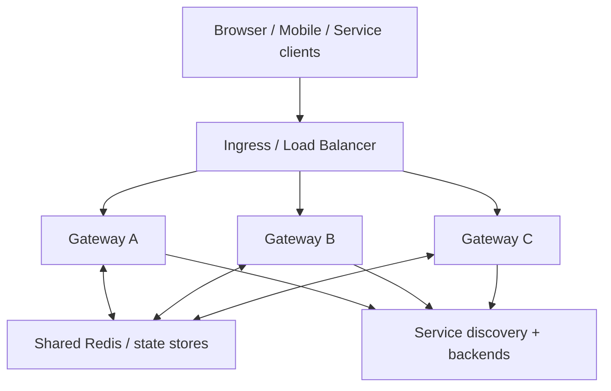
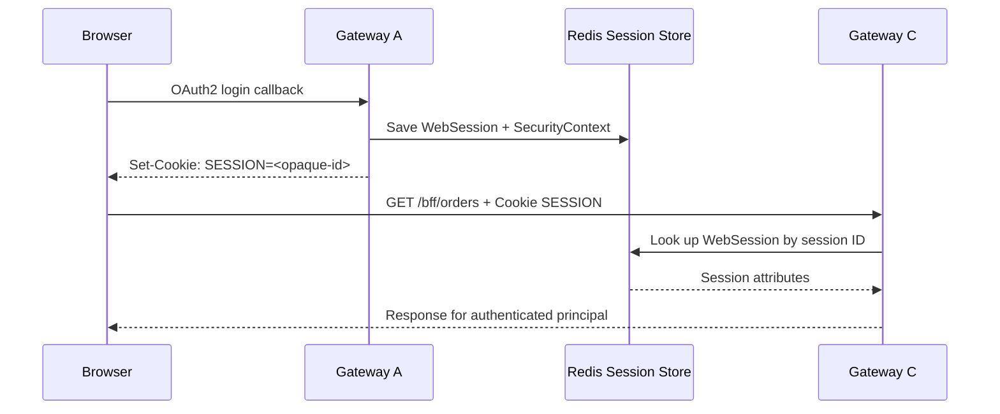
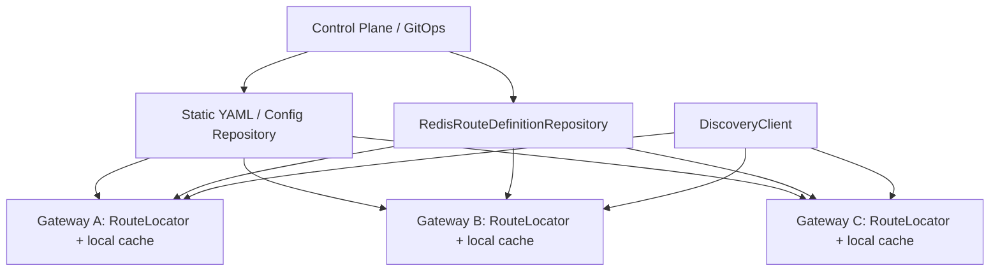

# Running Multiple Replicas and Sharing Sessions, Rate Limits, or Routes

## Lesson Objectives

In the **Deployment** chapter of the **SPRING_CLOUD_GATEWAY** module, this lesson shows how to take **Spring Cloud Gateway** from a standalone process to a **multi-replica** deployment capable of receiving traffic behind a load balancer, replacing pods during maintenance, and serving microservices reliably. The goal is not simply bumping `replicas: 3`; it is ensuring requests landing on any replica preserve consistent **login state**, **rate-limit policies**, and **route definitions** per contract.

Spring Cloud Gateway handles route predicates, filter chains, path/header transformations, service discovery, authentication and TokenRelay, rate limiting, retries, circuit breakers, TLS, and request observability. When scaling Gateway across multiple processes, data living in a single JVM's RAM **does not automatically become shared state**. You must answer: *What must be shared, what belongs local to each instance, and what happens if a pod dies mid-request?*

After this lesson, you will be able to:

- Distinguish the **stateless routing plane**, **session/authentication state**, **rate-limit state**, **usage quotas**, **dynamic route definitions**, and **runtime route caches**.
- Deploy multiple Gateway Server WebFlux replicas behind a Kubernetes `Service`/Ingress and understand readiness, liveness, rolling updates, and termination/draining.
- Use **Spring Session + Redis** to share `WebSession` for OAuth2 Login, while recognizing that the **OAuth2 authorized client / TokenRelay store** can be a separate state store.
- Use **`RedisRateLimiter`** so multiple Gateway replicas share one token bucket instead of counting separately per JVM, and design `KeyResolver` around verified identities.
- Distinguish short-term rate limiting from **monthly usage quotas** and **in-flight concurrency limits**, which `RedisRateLimiter` does not enforce on its own.
- Distribute **route definitions** via identical deployed config, `DiscoveryClient`, or **`RedisRouteDefinitionRepository`** where needed, understanding why updating a route store does not mean every instance refreshed its route cache.
- Design plans for **rollouts, rollbacks, Redis failovers, session expiry, rate-policy changes, route publication, and drift observability**.
- Write a multi-instance test matrix alternating requests across Gateways A/B and proving state is genuinely shared.

> **Technical scope:** Primary examples target **Spring Cloud Gateway Server WebFlux / Reactor Netty**. Servlet-based Gateway Server Web MVC uses different APIs/configurations; `ProxyExchange` is another mechanism altogether. Sample configs use the modern Gateway namespace `spring.cloud.gateway.server.webflux.*`; older lines may use `spring.cloud.gateway.*`. Before applying, verify against your running Spring Boot/Spring Cloud Gateway/Redis/Kubernetes versions. Capacity, timeout, and replica numbers are illustrative, **not default production SLOs**.

## 1. Why Can a Gateway That Works on One Pod Break on Three?

Initially:

```text
Browser
  └── Gateway A
       ├── route definitions A
       ├── session map A
       ├── local rate counter A
       └── HTTP connection pools A
```

When deploying three replicas:



A browser may send:

```text
Request 1: POST /login       → Gateway A
Request 2: GET  /bff/orders  → Gateway B
Request 3: GET  /bff/orders  → Gateway C
```

If login state lives only in A's RAM, the second request appears unauthenticated. If each pod independently caps 10 req/s, three pods can admit far more than the global quota. If an admin updates a route on A while B and C miss the update, the same URL intermittently returns 200 and 404.

**Replicating compute does not replicate state.** The solution is classifying every piece of state properly rather than "dumping everything into Redis" without understanding semantics.

### 1.1. Multi-Replica State Classification Table

| State | Typical location | Needs cross-replica consistency? | Recommended design |
| --- | --- | --- | --- |
| Route predicates/filters in YAML | App configuration | **Yes**, per rollout version | Identical image/config revision |
| Dynamic route definitions | RAM/DB/Redis/control plane | **Yes**, per publication contract | Shared repository + refresh all instances |
| Compiled/matched route cache | Each instance's JVM | Must converge; doesn't need Redis reads per request | Local cache + invalidation/refresh |
| `WebSession` for OAuth2 Login | RAM or session repository | **Yes** unless relying on sticky sessions | Spring Session with shared store |
| OAuth2 authorized client / access/refresh tokens | In-memory service or repository | **Yes** for multi-pod BFF/TokenRelay | Persistent secure authorized-client store |
| JWT bearer validation | Sessionless if stateless | Identical issuer/JWKS/key policy | Each pod verifies JWTs independently |
| Token-bucket rate limiter | RAM or Redis | **Yes** when enforcing aggregate limit | `RedisRateLimiter` + stable `KeyResolver` |
| Monthly API quota / credits | DB/ledger | **Yes**, typically durable and idempotent | Atomic reservation + durable ledger |
| In-flight concurrency counter | Each pod's JVM | Depends on per-pod vs global cap | Local bulkhead or distributed lease/semaphore |
| Load-balanced service instances cache | JVM/registry | Must refresh fast enough | Shared discovery source + health signals |
| Connection pools / TCP/TLS sockets | Each instance's JVM | **No**, sockets cannot migrate | Local pools and graceful draining |
| CircuitBreaker metrics/state | Each instance's JVM | Not synced automatically; policy varies | Per-instance state + fleet metrics, or custom mechanism |
| Trace IDs / logs / metrics | In-request or collectors | Needs correlation, not a Redis shared map | OpenTelemetry/Micrometer + centralized telemetry |

**One Redis cluster can serve multiple roles**, yet **sessions, limiters, and routes remain three distinct storage protocols** with separate namespaces, TTLs, consistency needs, and failure policies. Never assume "adding the Redis dependency" makes them synchronize automatically.

## 2. Layers of a Gateway Cluster

A deployment architecture can be split into:

```text
Data plane:
  Ingress → Gateway replicas → HTTP/WebSocket backends

Control plane:
  GitOps/Config Store/Route Admin → Route repository / rollout / refresh

Shared runtime state:
  Redis WebSession
  OAuth2AuthorizedClient repository
  Redis token-bucket counters
  Usage quota DB / ledger

Observability plane:
  Metrics + traces + structured logs + alerts
```

### 2.1. The Data Plane Should Be Nearly Stateless

Any Gateway replica can serve any new request without knowing another replica's TCP connection history **if**:

- Authentication relies on valid bearer JWTs or a shared session repository.
- All route/filter configurations match the published revision.
- Rate limiters share state when quotas are fleet-wide.
- Backend resources do not depend on a single Gateway's local RAM.

Still, **each in-flight HTTP request** carries transient state: `ServerWebExchange`, Reactor Context, body buffers, open sockets, connection pools, and timeout/cancellation state. None of those **migrate to another pod** if a pod dies.

### 2.2. The Control Plane Should Not Live on the Public API Port

APIs that create/delete routes or alter rate policies are **administrative operations**. Never expose writable `/actuator/gateway` to the Internet under the same security assumptions as a public API.

Route changes through GitOps/CI/CD or a private admin service with:

- Strong authentication/authorization.
- Actor/change/revision auditing.
- Validation of route URIs, predicates, and filters.
- Staged rollouts, canaries, and rollbacks.
- Verification comparing effective state across all pods.

### 2.3. Shared State Needs Its Own Topology

If `WebSession`, `RedisRateLimiter`, and route definitions all share a single Redis node, it becomes a **single point of failure** or risks saturation by high-traffic workloads.

Production requires considering:

- Redis HA (replication/sentinel/managed failover/clustering as appropriate).
- TLS/ACLs/network policies and secret rotation.
- Isolated key namespaces to prevent accidental wipes.
- Latency, memory, eviction policies, and key TTLs.
- **Different** persistence and recovery requirements across sessions, limiters, routes, and quotas.
- **Route-specific** fail-open/fail-closed policies during Redis outages.

## 3. Deploying Multiple Gateway Pods on Kubernetes

Illustrative three-replica deployment using a **built and tested** image. Assume the image runs Spring Boot Server WebFlux on port 8080 with Spring Boot Actuator on the same application port.

```yaml
apiVersion: apps/v1
kind: Deployment
metadata:
  name: spring-cloud-gateway
spec:
  replicas: 3
  revisionHistoryLimit: 5
  strategy:
    type: RollingUpdate
    rollingUpdate:
      maxUnavailable: 0
      maxSurge: 1
  selector:
    matchLabels:
      app: spring-cloud-gateway
  template:
    metadata:
      labels:
        app: spring-cloud-gateway
    spec:
      terminationGracePeriodSeconds: 60
      containers:
        - name: gateway
          image: registry.example.test/platform/gateway:2026-11-24-01
          imagePullPolicy: IfNotPresent
          ports:
            - name: http
              containerPort: 8080
          readinessProbe:
            httpGet:
              path: /actuator/health/readiness
              port: http
            periodSeconds: 5
            timeoutSeconds: 2
            failureThreshold: 3
          livenessProbe:
            httpGet:
              path: /actuator/health/liveness
              port: http
            periodSeconds: 10
            timeoutSeconds: 2
            failureThreshold: 3
          startupProbe:
            httpGet:
              path: /actuator/health/liveness
              port: http
            periodSeconds: 5
            failureThreshold: 24
          resources:
            requests:
              cpu: "250m"
              memory: "512Mi"
            limits:
              memory: "1Gi"
---
apiVersion: v1
kind: Service
metadata:
  name: spring-cloud-gateway
spec:
  type: ClusterIP
  selector:
    app: spring-cloud-gateway
  ports:
    - name: http
      port: 80
      targetPort: http
```

**This is a deployment skeleton**, not guaranteed to run standalone: you need a real image, namespace, ingress/controller, secret management, Spring Boot readiness/liveness support, security policies, and capacity sizing. `example.test` is a placeholder host, not a pullable image. Choose CPU/memory/replicas via load testing and resource budgets; Spring Gateway is network-intensive, so inspect sockets, direct memory, event-loop pressure, and upstream capacity as well.

### 3.1. Matching Actuator Health Configuration

```yaml
management:
  endpoint:
    health:
      probes:
        enabled: true
  endpoints:
    web:
      exposure:
        include: health,info,prometheus

server:
  shutdown: graceful

spring:
  lifecycle:
    timeout-per-shutdown-phase: 45s
```

Some Boot versions/platforms enable Kubernetes probes automatically; this shows explicit config for clarity. If management runs on a **different port**, update probe ports/paths accordingly. Expose metrics only via private monitoring ingress/network policies; never open admin Actuator endpoints to the public Internet.

**Readiness** asks "should this pod receive new traffic?", not "is every downstream API 100% healthy right now?" **Liveness** asks "must this process be restarted?" If liveness depends on transient Redis/backend reachability, a dependency hiccup can restart all Gateway replicas simultaneously and worsen the outage.

### 3.2. Startup Probes Prevent Premature Restarts

While the JVM boots/JITs, Spring initializes its context, or configs/discovery load, the startup probe buys time before liveness begins enforcing restarts. Avoid overly tight liveness thresholds that trigger cold-start restart loops.

### 3.3. Rolling Updates and Availability

With:

```yaml
replicas: 3
maxUnavailable: 0
maxSurge: 1
```

Kubernetes tries to maintain available pod counts during updates subject to readiness and node capacity. However, **zero downtime is never guaranteed unconditionally** if:

- Nodes lack capacity to schedule the surge pod.
- Readiness reports OK too early.
- Routing/endpoint propagation lags.
- Old pods still receive keep-alive/WebSocket traffic while draining.
- Shared Redis/session/route config breaks across pods.
- Schema/state changes are not backward-compatible.

Deployment rollouts are orchestration mechanics—they do not automatically resolve every protocol-level concern.

### 3.4. Upstream and Downstream Load Balancers Are Two Separate Layers

**Inbound layer:**

```text
Client → Ingress/LB → Gateway A/B/C
```

**Outbound layer:**

```text
Gateway A/B/C → Spring Cloud LoadBalancer → Order Service instances
```

`replicas: 3` on Gateway does not mean Order Service has three instances, and `lb://order-service` balances across **backend instances**, not across Gateway pods. Both layers need independent health checks, capacity planning, and timeout budgets.

## 4. Sticky Sessions: Benefits and Limitations

An Ingress can use **session affinity** to try routing requests from the same browser to the same Gateway pod. That can serve as a temporary bridge for RAM-stored sessions, yet **never replaces shared state** when high availability is required.

```text
Browser session X → Gateway A
Browser session Y → Gateway B
```

### 4.1. What Do Sticky Sessions Help With?

- Reduces cross-pod misses for certain local caches/sessions.
- Temporarily supports legacy apps requiring server-local state.
- Reduces migration friction during controlled traffic cutovers.

### 4.2. What Do Sticky Sessions Not Solve?

- Pod A dies → session X is lost if stored only in RAM.
- Rolling update replaces Pod A → browsers shift to another pod.
- Horizontal Pod Autoscaler adds new pods → affinity rebalances.
- OAuth2 authorized clients/access tokens may still reside in local memory.
- Each Gateway pod counts rate limits locally → global quotas get exceeded.
- A route edited on A does not automatically appear on B/C.
- An open WebSocket connection **cannot migrate its raw socket** to another pod.

**Recommendation:** for Gateways needing cross-replica login state, prefer a **shared session store**; if sticky affinity is used at all, treat it as a secondary optimization rather than your sole correctness mechanism.

## 5. Sharing `WebSession` with Spring Session and Redis

For WebFlux Gateways running **OAuth2 Login/BFF**, principal and security context state typically live in `WebSession`. Spring Session integrates with WebFlux to supply a Redis-backed `ReactiveSessionRepository` instead of per-pod in-memory sessions.

### 5.1. Multi-Pod Login Flow



**The `SESSION` cookie holds only an opaque identifier**, never raw access/refresh tokens. Session IDs must be unpredictable and protected with `Secure`, `HttpOnly`, `SameSite`, and matching Domain/Path attributes. A shared Redis store lets Gateway C read sessions created on A provided A and C share the **exact same namespace, serialization format, timeouts, and Redis cluster**.

### 5.2. Spring Boot Dependency for WebFlux Redis Sessions

In modern Spring Boot, the typical dependency is:

```xml
<dependency>
    <groupId>org.springframework.boot</groupId>
    <artifactId>spring-boot-starter-session-data-redis</artifactId>
</dependency>
```

Spring Boot can auto-configure Redis-backed reactive sessions for WebFlux when matching dependencies are present. Spring Session also supports explicit `@EnableRedisWebSession`. **Do not layer Boot auto-config with redundant manual config unnecessarily**; inspect the `WebSessionManager` and `ReactiveSessionRepository` beans for your exact Boot/Session versions.

> **Distinguish MVC:** Spring Session for Servlet uses `HttpSession`, different filters, and different repositories. Never copy `@EnableRedisHttpSession` into a WebFlux example. For WebFlux, `@EnableRedisWebSession` and `ReactiveRedisSessionRepository` are the matching components.

### 5.3. Illustrative Configuration

```yaml
spring:
  data:
    redis:
      host: ${REDIS_HOST}
      port: ${REDIS_PORT:6379}
      password: ${REDIS_PASSWORD}
      ssl:
        enabled: true

  session:
    timeout: 30m
    data:
      redis:
        namespace: gateway:websession:prod
```

Depending on Boot version, `spring.session.*` and `spring.data.redis.*` property details may differ; check the official property reference. `ssl.enabled: true` requires a TLS-capable Redis endpoint and valid trust configuration. Inject `REDIS_PASSWORD` from a **Kubernetes Secret/secret manager**—never commit real values to Git.

**Namespace choice is a data-isolation decision.** Never share a session namespace between staging and production or across apps that do not share a security context. Changing namespaces during a rollout logs users out en masse because new pods cannot locate existing sessions.

### 5.4. Testing Login on A, Reading Session on B

A trustworthy test:

```text
1. Gateway A and B run the same version against a test Redis.
2. Browser/HTTP test client completes OAuth2 login through Gateway A.
3. Capture the real SESSION cookie from the response.
4. Call /bff/orders on Gateway B with that exact cookie.
5. Verify B restores the expected authenticated principal.
6. Verify no unexpected login redirect or 401 occurs.
7. Restart A; requests through B still succeed while session remains valid.
```

Never use `mockOAuth2Login()` to claim multi-pod cookies/sessions are verified: mocks inject authentication into the test context and **prove nothing about Redis session persistence or browser cookie lifecycles**.

### 5.5. CSRF, Logout, Expiry, and Session Fixation

With browser cookies sent automatically, test:

- `POST/PUT/PATCH/DELETE` enforce CSRF tokens per session policy.
- Logout invalidates the session and associated state per policy.
- Session ID rotates at authentication to prevent session fixation.
- Expiry/TTL is enforced consistently across A/B/C.
- Session cookies set `Secure` over public HTTPS and `HttpOnly` when JS shouldn't read the ID.
- `SameSite` fits OAuth2 redirect topology and cross-site browser behavior.
- Session attributes avoid storing excessive PII, and logs never print session IDs.

Redis replication/failover does not make these behaviors **work automatically**; they require explicit Spring Security and Spring Session configuration and testing.

## 6. `TokenRelay` and OAuth2 Authorized Clients Are **Separate State from WebSession**

A classic bug: Spring Session Redis is wired up, logging in on A and hitting B restores `Authentication`, yet `TokenRelay` on B **cannot find the OAuth2 access token**.

### 6.1. Why?

OAuth2 login/sessions and OAuth2 authorized clients usually sit in two layers:

```text
WebSession / SecurityContext:
  I am user-42, authenticated.

ReactiveOAuth2AuthorizedClientService:
  For user-42 and registration "portal",
  what access token do I hold? What are its expiry and refresh token?
```

Per Spring Cloud Gateway's `TokenRelay` documentation, the default `ReactiveOAuth2AuthorizedClientService` implementation can use an **in-memory store**. Thus:

```text
Gateway A: user-42 session = Redis       OAuth2 client = RAM A
Gateway B: user-42 session = Redis       OAuth2 client = RAM B (missing)
```

Result: B knows the user logged in, yet lacks the authorized client needed to relay the access token.

### 6.2. Solution

- Provide a **persistent, shared** authorized-client repository/service implementation matching your Spring Security reactive API version.
- Protect access/refresh tokens with encryption at rest, TLS, RBAC/ACLs, bounded retention, and secret rotation.
- Key cleanly by **principal + clientRegistrationId + tenant boundary** in multi-tenant apps.
- Check refresh-token concurrency when multiple pods try refreshing the same expired access token simultaneously.
- Never treat dumping raw tokens into plain Redis text keys as secure architecture.
- Handle logout/revocation and token expiry/refresh failures per contract.

### 6.3. Distinguishing Three Credentials

| Credential | Used by browser/Gateway for | Should it be forwarded verbatim to backends? |
| --- | --- | --- |
| Browser `SESSION` cookie | Looking up `WebSession` at Gateway | No, unless architecture genuinely shares that session boundary |
| OIDC ID token | Confirming login to the OAuth2 client | Never use in place of an API access token |
| OAuth2 access token | Calling resource APIs per audience/scope | May be relayed via `TokenRelay` once contract is verified |

`TokenRelay` injects the access token into the **outbound `Authorization` header**. Backend Resource Servers must still verify issuer, audience, scopes, and resource permissions—receiving a header never automatically authorizes arbitrary actions.

### 6.4. What About Bearer-Only JWT APIs?

A Gateway receiving only:

```http
Authorization: Bearer <access-JWT>
```

without stateful sessions **does not need Spring Session** for authentication. Each replica validates JWTs using identical issuer/JWKS/trust policies. Even so, states like **revocation, nonce/replay defense, or per-user quotas** may still need shared storage depending on your security design.

**Never** introduce sessions solely because you run multiple pods when your API is genuinely stateless.

## 7. Rate Limiting: Local Limiters vs Shared `RedisRateLimiter`

If each pod keeps its limiter in RAM:

```text
Intended limit for user-42: 10 requests/second across the whole Gateway

Gateway A: 10 requests/second
Gateway B: 10 requests/second
Gateway C: 10 requests/second
```

With balanced traffic, total throughput can **approach 30 requests/second** before local counters throttle, violating a fleet-wide cap of 10. Sticky sessions **do not guarantee** a user stays pinned to one pod in all scenarios.

### 7.1. What Does `RedisRateLimiter` Solve?

`RequestRateLimiter` with `RedisRateLimiter` in Spring Cloud Gateway Server WebFlux stores **token-bucket** state in Redis. Multiple Gateway instances pointing at the same Redis and key evaluate against one shared bucket instead of three isolated ones.

Parameters:

| Parameter | Meaning |
| --- | --- |
| `replenishRate` | Token refill rate over time |
| `burstCapacity` | Maximum bucket capacity |
| `requestedTokens` | Tokens consumed per request |
| `KeyResolver` | Bucket identity (user, tenant, plan, verified IP, etc.) |

Example:

```text
replenishRate = 10 tokens/sec
burstCapacity = 20 tokens
requestedTokens = 1
```

A user can send a **short burst** up to 20 tokens accumulated in the bucket, while **steady rate** stays around 10 tokens/sec per config. This is not "strictly 10 requests in every arbitrary 1-second window": token buckets allow bursts and have specific boundary semantics.

### 7.2. Dependencies

For the Server WebFlux Redis rate limiter:

```xml
<dependency>
    <groupId>org.springframework.boot</groupId>
    <artifactId>spring-boot-starter-data-redis-reactive</artifactId>
</dependency>
```

Configure the reactive Redis connection with TLS, ACLs, and timeouts. Never use blocking `RedisTemplate` directly on the Netty event loop to roll a synchronous limiter.

### 7.3. Sample Rate-Limited Route

```yaml
spring:
  cloud:
    gateway:
      server:
        webflux:
          routes:
            - id: orders-rate-limited
              uri: lb://order-service
              predicates:
                - Path=/api/orders/**
              filters:
                - name: RequestRateLimiter
                  args:
                    key-resolver: "#{@authenticatedPrincipalKeyResolver}"
                    redis-rate-limiter.replenishRate: 10
                    redis-rate-limiter.burstCapacity: 20
                    redis-rate-limiter.requestedTokens: 1
                - StripPrefix=1
```

`lb://order-service` requires matching discovery/LoadBalancer configuration. `RequestRateLimiter` must sit on every relevant route's filter chain; an unguarded sibling route offers callers a bypass.

### 7.4. `KeyResolver` Must Be Stable Across Pods

Example keying by authenticated principal name:

```java
import org.springframework.cloud.gateway.filter.ratelimit.KeyResolver;
import org.springframework.context.annotation.Bean;
import org.springframework.context.annotation.Configuration;

@Configuration
class RateLimitIdentityConfig {

    @Bean
    KeyResolver authenticatedPrincipalKeyResolver() {
        return exchange -> exchange.getPrincipal()
            .map(principal -> "user:" + principal.getName());
    }
}
```

**Constraints of this example:**

- Safe only when `getPrincipal()` comes from real Spring Security authentication, never a client-supplied `X-User` header.
- Principal names must live in a collision-free namespace; in multi-issuer/multi-tenant systems, canonicalize keys like `issuer:tenant:user:plan` from **verified claims**.
- If no principal exists, this resolver returns an empty `Mono`; by default `RequestRateLimiter` typically **denies empty keys** per policy—verify exact behavior. Never substitute a shared `anonymous` literal that accidentally lumps the entire Internet into one bucket unless intended.
- All pods must share **identical key derivation, policies, and Redis namespaces**.

**Never** use raw `X-Forwarded-For` as user identity: clients can spoof IPs unless ingress sanitizes them. When rate limiting by IP, use only addresses verified by a trusted-proxy-aware resolver.

### 7.5. Expectations with Three Replicas

Suppose one user fires 60 requests rapidly across A/B/C:

```text
All pods → same KeyResolver output → same Redis token bucket
```

Decisions evaluate against **one logical token bucket**, not three independent buckets. Exact allowed counts over tiny measurement windows still depend on accumulated tokens, timing, burst allowance, and concurrent request ordering. Test against **token-bucket semantics and aggregate limits**, rather than hardcoding an exact count of 10 per calendar second.

## 8. `RedisRateLimiter` Is Neither a Usage Quota Nor a Concurrency Limit

**Do not equate these three controls:**

| Policy | Example | Typical mechanism |
| --- | --- | --- |
| **Rate limiting** | Max steady 10 req/s/user | Redis token bucket |
| **Concurrent in-flight limit** | Max 50 concurrent active requests/user **fleet-wide** | Distributed semaphores/leases or backend admission |
| **Usage quota** | Max 1 million API calls/month/tenant | Durable atomic counters + usage ledger/billing |

### 8.1. Why Doesn't a Local Semaphore Create a Global Limit?

If each pod creates:

```java
new Semaphore(50);
```

and you run three pods, distributed traffic can reach **150 concurrent in-flight requests**. That is a **per-instance concurrency limit**—useful for protecting each JVM, yet not enforcing a global cap of 50.

A distributed concurrency controller requires:

- Atomic acquisition and release.
- Leases/TTLs in case a pod crashes mid-request.
- Fencing/ownership tokens so late releases never free someone else's slot.
- Timeout/cancellation hooks wired to release logic.
- Avoiding severe hot-key contention.

Never cobble together `INCR` on entry and `DECR` on exit and call it a safe distributed semaphore; a pod crash leaks the counter permanently.

### 8.2. Billing-Period Quotas Need Durability

Example:

```text
Tenant ACME: 1,000,000 valid requests / month
```

A Redis token bucket does not natively manage:

- Calendar-month resets aligned to time zones.
- Billable vs non-billable requests.
- Duplicate retries and idempotency.
- Pre-execution reservation with finalize/refund on error.
- Reconciliation, auditing, and post-incident corrections.

For critical usage quotas, use a **durable ledger or reliable usage accounting engine** with atomic reservations/updates per tenant+period. Redis can accelerate fast paths only when durability, idempotency, and failover match business requirements.

### 8.3. Layering Complementary Controls

```text
Ingress/WAF coarse limit
  ↓
Gateway RedisRateLimiter per user/tenant
  ↓
Gateway/pod concurrency limit protecting threads/connections
  ↓
Backend distributed quota/billing enforcement
  ↓
Backend resource ownership/authorization
```

**Never** treat a Gateway 429 as proof a user exhausted their monthly quota: the rate limiter reflects only the short-term bucket per key and policy.

## 9. Redis Is Shared State, Not an Automatic HA Guarantee

From a multi-replica Gateway's perspective, Redis may hold several distinct workloads:

```text
Redis
  ├── namespace gateway:websession:prod
  ├── rate-limiter keys (implementation-defined)
  ├── route-definition keys (if using Redis repository)
  └── designed application-specific keys
```

**Do not guess** internal key prefixes/formats used by Spring Cloud Gateway's limiter or repository. Those keys belong to the framework and can change between versions; never wipe Redis keys with wildcards without understanding the impact on every subsystem.

### 9.1. Separating Consistency and Durability Needs

| State | Durability needed | Impact of data loss |
| --- | --- | --- |
| Sessions | Medium to high per product | Users logged out; OAuth2 flows break |
| Authorized client / refresh tokens | High + confidential | Relay/refresh fails; users must re-authenticate |
| Rate-limit token buckets | Typically availability/short-term oriented | Buckets reset → temporary over-admission or over-blocking |
| Dynamic route definitions | High | Lost routes/policies, outages, or misrouting |
| Usage ledger | **Very high** if billing-related | Wrong invoices, quotas, or credits |

Do not configure a Redis `maxmemory-policy` that freely evicts sessions/routes without evaluating side effects; an expired short-term rate counter is completely different from an evicted route definition.

### 9.2. Route-Specific Failure Policies

When Redis disconnects:

- **Public informational APIs:** may allow degraded fail-open behavior on a rate-limiter layer if risk is low and secondary defenses exist.
- **Payment/admin/expensive APIs:** may require fail-closed behavior or stricter caps to prevent quota abuse.
- **Session-required BFFs:** if sessions cannot be read safely, never treat unverified requests as authenticated.
- **Routes:** during brief store outages, local caches may continue serving last-known-good definitions within a freshness/expiry policy alongside drift alerts.
- **Billing quotas:** never silently grant unlimited usage without approved reconciliation/compensating controls.

Specific filters have version-dependent failure behavior. **Never claim `RedisRateLimiter` defaults to fail-open or fail-closed across all versions**; fault-injection tests must prove your production policy.

### 9.3. Securing and Configuring Redis

Prioritize:

- TLS to Redis with CA/certificate verification.
- Redis ACLs scoping commands/keys by function where supported.
- Secrets from a secret manager with rotation and auditing.
- Private networking/Kubernetes NetworkPolicies; never expose Redis publicly.
- HA/replication/managed failover and backups for durable state.
- Bounded connection pools/timeouts, latency/error metrics, memory/eviction tracking, and keyspace TTLs.
- Capacity isolation or separate clusters if rate-limiter traffic degrades session latency.

With Redis Cluster, watch out for **atomic multi-key operations and hash slots**. Custom scripts must honor hash-slot/hashtag rules rather than assuming arbitrary multi-key atomicity across shards. Use the official `RedisRateLimiter` implementation and test against your exact Redis topology/version.

## 10. Sharing Route Definitions: Three Choices to Distinguish

In Spring Cloud Gateway, **route definitions** are not the same as the **runtime route cache** or the **service discovery instance list**.



### 10.1. Option A — Shared YAML/Image/Config Revision

When routes change infrequently, the simplest operational model:

```yaml
spring:
  cloud:
    gateway:
      server:
        webflux:
          routes:
            - id: orders-v1
              uri: lb://order-service
              predicates:
                - Path=/api/orders/**
              filters:
                - StripPrefix=1
```

Every pod deploys from **the exact same Git commit/config revision**. Route updates go out via GitOps/CI/CD rolling updates.

**Pros:** clean code review, rollbacks, auditing, and versioning; minimal runtime control-plane complexity.

**Limitation:** during rolling updates, **old and new pods coexist briefly** serving different route revisions. Backward-incompatible route changes require compatibility/canary planning rather than assuming RollingUpdate is cluster-atomic.

### 10.2. Option B — `DiscoveryClient` Route Locator

If routes must be derived from a service registry, Gateway offers the `DiscoveryClient` route definition locator. `lb://service-name` routes requests to instances chosen by Spring Cloud LoadBalancer.

Conceptual example:

```text
Registry:  order-service → [10.0.0.11, 10.0.0.12]
Gateway:  /order-service/** → lb://order-service
```

**Important:** discovery updates **instance lists** without requiring changes to **route definitions**. For instance, `Path=/api/orders/**` stays unchanged while backend pod IPs rotate.

Never enable public discovery locators for all registry services unless you intend to expose administrative/internal APIs. Enforce an explicit route allowlist and security policies so `admin-service` or `secrets-service` never appear publicly by accident.

### 10.3. Option C — `RedisRouteDefinitionRepository`

Spring Cloud Gateway documents two implementations:

- `InMemoryRouteDefinitionRepository`: state lives in RAM inside **one Gateway instance**.
- `RedisRouteDefinitionRepository`: stores route definitions in shared Redis so **multiple instances read the same repository**.

In modern Gateway Server WebFlux lines, configprops includes:

```text
spring.cloud.gateway.server.webflux.redis-route-definition-repository.enabled
```

Older docs describing route sharing use the legacy name:

```text
spring.cloud.gateway.redis-route-definition-repository.enabled
```

**Verify your exact release train and property binding.** Never assume legacy prefixes work in Gateway 5.x, and never rely solely on a configprops default without checking actual dependencies and conditions.

### 10.4. Lab Example Using the Redis Route Repository

```yaml
spring:
  cloud:
    gateway:
      server:
        webflux:
          redis-route-definition-repository:
            enabled: true
```

Reactive Redis dependencies/connections must be present, and verify the repository bean is actually created. If an app mixes static YAML routes and dynamic Redis routes, define **route ID collision rules, source precedence, and deletion semantics**—never assume a Redis route "safely overrides" a YAML route.

## 11. A Shared Repository Does **Not** Auto-Refresh Every Replica's Route Cache

This is the single easiest mistake when scaling out.

```text
T0: Gateway A/B/C serve route cache version 1
T1: Route definition version 2 is written to Redis
T2: Gateway A refreshes its local route cache
T3: Gateway B/C have not refreshed yet
```

At that moment:

```text
Client → Gateway A → version 2
Client → Gateway B → version 1
Client → Gateway C → version 1
```

Sharing `RedisRouteDefinitionRepository` lets instances read **the same definition source**; it does not guarantee local route caches across every JVM invalidate instantaneously after a write.

### 11.1. `RefreshRoutesEvent` and `/actuator/gateway/refresh`

Gateway maintains a route cache and refresh trigger. Actuator docs describe:

```http
POST /actuator/gateway/refresh
```

to refresh the route cache. **Calling it on Gateway A affects only A** unless you build broadcast/distribution on top. Sending control calls through a load-balanced Service three times does not guarantee hitting A, B, and C each once.

`RefreshRoutesEvent` inside an application context is a **JVM-local** event, not a distributed message bus by default.

### 11.2. Designing Reliable Refresh Distribution

Approaches:

1. **GitOps rolling rollouts** when route policies change infrequently.
2. **Control-plane fan-out** calling refresh on every instance over a private admin network with acknowledgments and retries.
3. **Event bus/pub-sub** broadcasting version changes so each pod refreshes its local cache.
4. **Periodic reconciliation** catching pods that missed events or just restarted.

Pub/sub messages are **signals**, not the source of truth. If a pod misses a message, it must still **reconcile from the repository** by revision/freshness.

### 11.3. Track Route Revisions and Verify Convergence

A contract might look like:

```text
Desired route revision:  v42

Gateway A applied:       v42
Gateway B applied:       v42
Gateway C applied:       v41  ← drift
```

Here, route revision is an **application/control-plane metadata convention**, not a guaranteed built-in property of Gateway Actuator. To track revisions, embed them in config/route metadata or a dedicated status endpoint.

Flow:

```text
1. Validate route definitions.
2. Persist desired revision.
3. Notify pods or roll out.
4. Each pod refreshes + validates routes.
5. Poll/observe effective route IDs, URIs, predicates, filters, revision.
6. Mark publication successful once every pod reaches desired state.
7. If convergence stalls → hold canary/roll back or halt rollout per policy.
```

**Never treat HTTP 200 from `/actuator/gateway/refresh` as proof all routes converged.** Actuator docs note that errors during asynchronous refresh can leave old routes active. Perform readback/route inspection.

### 11.4. Multi-Step Route Updates Are Not Cluster-Atomic by Default

Suppose you switch:

```text
OLD: /api/orders/** → order-service-v1
NEW: /api/orders/** → order-service-v2
```

If routes flip while v2 is not ready or one Gateway pod still holds old routes, users see inconsistent responses. Mitigate with:

- Backward-compatible backend deployments first.
- Versioned paths `/v1`/`/v2`.
- Header/percentage-based canaries with consistent policies.
- Feature flags/routing metadata with explicit lifecycles.
- Tested commit/rollback procedures.

Never assume "Redis writes are atomic so every request switches instantly"—**local route caches and in-flight requests** still have independent lifecycles.

## 12. Securing Gateway Actuator Across Multiple Instances

Modern Gateway Actuator docs mark the `/gateway` endpoint **disabled/restricted by default**. For read-only route inspection:

```yaml
management:
  endpoint:
    gateway:
      access: read-only
  endpoints:
    web:
      exposure:
        include: health,info,gateway
```

**This is a read-only observability setting**, preventing admins from mutating/refreshing routes there. When mutations are needed, `management.endpoint.gateway.access=unrestricted` or its version equivalent must run strictly **inside a protected admin plane** per Boot/Gateway version.

### 12.1. Why Are Write Endpoints So Sensitive?

A maliciously or mistakenly created route can:

- Point to `http://internal-admin:8080`.
- Bypass authentication predicates.
- Leak credentials to untrusted hosts.
- Shadow a protected path with a higher-priority route.
- Trigger SSRF or reach cloud metadata endpoints.

Never expose writable Actuator endpoints via public ingress. Enforce authentication/authorization, network isolation, auditing, rate controls, and route destination validation. Consider a **dedicated admin controller** with approval workflows instead of letting operators invoke raw Actuator writes directly.

### 12.2. Do Not Confuse Introspection with Mutation

```text
GET /actuator/gateway/routes           → inspect route state
POST /actuator/gateway/refresh         → administrative state action
POST/DELETE /actuator/gateway/routes/* → mutate route definitions
```

Exact paths and methods vary by version; never hardcode security rules purely by raw URL paths if custom actuator base-paths exist. Verify the management context's security filter chain and live HTTP mappings.

## 13. Coordinating Static, Dynamic, and Discovery Routes

Many systems combine all three sources:

```text
Static YAML:
  /api/orders/** → lb://order-service

Dynamic routes:
  /partner/{partnerId}/** → selected service

Discovery:
  logical order-service → healthy backend instances
```

### 13.1. Route Definitions and Backend Instances Are Two Distinct Layers

A route definition stays unchanged:

```text
uri: lb://order-service
```

while backend instances churn continuously:

```text
10.2.0.11 → terminating
10.2.0.12 → ready
10.2.0.13 → ready
```

**You do not recreate routes whenever backend pod IPs change** once LoadBalancer/discovery updates. Conversely, having `order-service` in the registry does not expose it publicly—a matching route/predicate must still exist.

### 13.2. Watch Out for Route Order and Path Overlap

Example:

```text
/api/orders/** → order-service
/api/**        → generic-backend
```

When two routes match a request, `order` and predicate rules pick the winner. If one pod holds different route ordering from another during a rolling update, identical requests hit two different upstreams.

Tests must verify:

- Selected route ID.
- Upstream path after `StripPrefix`/`RewritePath`.
- Authentication and authorization filter chain.
- CORS/CSRF/rate-limit policies.
- Response status and headers.

### 13.3. Roll Out Route and Policy Changes Together

Updating a route to add:

```yaml
filters:
  - name: RequestRateLimiter
    args:
      ...
```

while one lagging pod lacks the update allows requests hitting the old pod to **bypass the rate limiter**. Treat **route revisions and policy revisions** as one atomic rollout unit whenever security is involved.

Never just check that all pods "have the route"—verify **filter definitions, order, and policy versions**.

## 14. CircuitBreaker, Retries, and Connection Pools in Multi-Replica Environments

Not every piece of runtime state belongs in Redis.

### 14.1. CircuitBreaker State Is Ordinarily Per-Process

Suppose:

```text
Gateway A: circuit OPEN
Gateway B: circuit CLOSED
Gateway C: circuit HALF_OPEN
```

Because circuit breakers track metrics inside each JVM, replicas can diverge. One Gateway fails fast while another still probes the backend.

This is **not always a bug**: local circuit breakers protect individual client instances, while service-level load shedding manages overall health. If your product explicitly requires **global circuit state**, engineer an explicit mechanism—never assume Resilience4j CircuitBreaker shares state automatically just because Redis is present.

### 14.2. Retry Amplification Multiplies by Pod Count

Suppose:

```text
3 Gateway pods
× 100 incoming req/s per pod
× up to 3 outbound attempts
= up to 900 attempts/s potential
```

This is an **illustrative bound** assuming all requests exhaust retries; real numbers depend on failures and policies. When a backend slows down, retries across many pods can trigger a **thundering herd**, deepening the outage.

Contain it with:

- Retrying only transient errors.
- Idempotent operations or idempotency keys.
- Bounded max attempts + backoff/jitter.
- End-to-end timeout budgets.
- Concurrency/pool bounds and circuit breakers.
- A single retry owner across multi-hop proxies.

### 14.3. Connection Pools Are Local

Each Gateway pod owns its own HTTP client connection pool:

```text
Gateway A maxConnections = 200
Gateway B maxConnections = 200
Gateway C maxConnections = 200
```

Potential peak of **600 outbound connections** to the same target under matching config—before counting other backends. Adding replicas increases **total connection fan-out** and can exhaust backend file descriptors, DB pools, or Envoy limits.

Capacity formula:

```text
Total upstream connection pressure
≈ Gateway replica count × per-pod max connections
```

Use this as a planning approximation; pools may partition by remote authority/proxy, HTTP/2 multiplexing, and routes, so monitor active/idle/pending pool metrics per backend.

### 14.4. Timeouts Must Nest in Order

When scaling out, client → ingress → Gateway → backend → DB each have timeouts. Align:

- Client deadline.
- Ingress request/idle timeouts.
- Gateway outer request budget.
- Netty connect/response/pool acquire timeouts.
- Resilience4j `TimeLimiter` if used.
- Backend/DB timeouts.

Never blindly inflate all timeouts just because replica count grew. Measure per-route p95/p99, queue saturation, retry ratios, and tail latencies.

## 15. WebSockets, SSE, and Long-Lived Connections During Rollouts

Short HTTP requests retry/reconnect cleanly. **WebSockets and SSE** are long-lived connections pinned to a specific Gateway pod for their lifetime.

### 15.1. WebSockets Across Multiple Gateway Replicas

```text
Browser WebSocket ──▶ Ingress ──▶ Gateway B ──▶ Chat Service
```

An upgraded WebSocket cannot silently "migrate" to Gateway A when B terminates. Clients must **reconnect**, getting load-balanced onto A or C. Therefore:

- Re-run handshake authentication cleanly.
- Restore subscription/presence state from shared sources, not Gateway B's RAM.
- Use durable message IDs/offsets if protocol supports resumption.
- Reconnect with exponential backoff and jitter to avoid reconnect storms.
- Graceful draining finishes short requests, yet cannot keep WebSockets alive forever during rolling updates.

### 15.2. SSE Also Requires Reconnection

SSE clients can send `Last-Event-ID` per contract when backends support replay. If a pod terminates mid-stream, clients reconnect; backends/pub-sub must restore state if zero event loss is required.

### 15.3. Sticky Affinity Cannot Rescue Sockets When a Pod Dies

Ingress affinity governs only **which pod receives new connections/requests**; once B vanishes, existing connections close. Never rely on sticky sessions as HA for real-time sockets.

### 15.4. Graceful Shutdown and Draining

Safe sequence:

```text
1. Pod marked Terminating.
2. Endpoints/Ingress stop routing new traffic (after propagation lag).
3. Spring Boot/Netty begins graceful shutdown per config.
4. In-flight short requests finish within grace period.
5. Long-lived streams/WebSockets close per policy; clients reconnect.
6. Pod exits; Kubernetes force-kills if grace period expires.
```

Kubernetes `terminationGracePeriodSeconds` **includes `preStop` hook duration**. An overly long `preStop` sleep burns budget needed for in-flight requests. Size grace periods, ingress propagation, and Spring shutdown budgets together—never slap on `sleep 60` assuming it guarantees zero downtime.

## 16. Readiness/Health During Redis Outages

A critical question: "If Redis goes down, should all Gateway pods be pulled from the Service?"

**The answer depends on your routes and authentication contract.**

If Redis only backs sessions for a few routes while bearer-only routes keep working fine, tying global Gateway readiness to Redis pulls **every Gateway pod** out of traffic even though part of the API still works. Conversely, if every request requires a Redis-backed security session, accepting traffic while Redis is down just generates useless 500/401 load.

### 16.1. Distinguishing Dependency Health from Process Health

| Probe/signal | Question |
| --- | --- |
| Liveness | Are the JVM and event loop healthy enough to run? |
| Readiness | Should this instance receive new requests? |
| Redis health indicator | Is the shared state dependency reachable? |
| Backend service health | Are downstream instances accepting calls? |
| Business-level availability | Which APIs remain usable right now? |

**Never** place all downstream dependencies into liveness where transient network blips trigger fleet-wide restarts. Use health groups, metrics, degraded modes, and admission strategies tailored to real requirements.

### 16.2. Redis Failovers Are Not Free

During failover you can observe:

- Reconnect delays.
- Failed in-flight Redis commands.
- Replication lag and write loss depending on persistence mode.
- Failed session lookups or reset/lagging token buckets.
- Unrefreshed route repos on freshly restarted pods.
- Divergent CircuitBreaker states across Gateway pods.

Fault-injection tests must observe A/B/C together during Redis failover rather than testing reconnect from one pod alone.

## 17. Multi-Replica Rollout and Rollback Strategy

### 17.1. Pre-Rollout Checklist

1. Freeze the approved **route/policy revision**.
2. Verify compatibility across Spring Boot, Spring Cloud Gateway, and Redis dependencies.
3. Verify network policies and TLS trust for Redis, backends, and ingress.
4. Verify `WebSession` serializers and versioned session attributes are **backward-compatible** across old/new pods.
5. Verify OAuth2 authorized-client serialization and token refresh behavior.
6. Compute aggregate rate/pool/concurrency totals after HPA scale-ups.
7. Run two-pod tests covering sessions, limiters, and route convergence.
8. Ensure per-pod/per-route dashboards, alerts, and rollback plans are ready.

### 17.2. Watch Session Serialization During Rolling Updates

A version-N pod might write session attributes using a new class shape that version-(N−1) pods **cannot deserialize**. During a rolling update when both versions coexist:

```text
Gateway N writes session
Gateway N−1 reads session → deserialization error
```

Never dump arbitrary Java object graphs into shared Redis sessions assuming stability across package/class/`serialVersionUID` edits. Prefer minimal, versioned schemas compatible across adjacent releases and test migrations/rollbacks.

### 17.3. Canarying Route Changes

When changing paths, filters, or security, shift a controlled slice of traffic to the new version and compare:

- Selected route IDs and actual upstream paths.
- CORS/CSRF/JWT/TokenRelay outcomes.
- 401/403/429/502/503/504 rates.
- Rate-limiter behavior per user/tenant.
- Session reads and authorized-client lookups.
- p95/p99, retry attempts, and pool pending counts.

Never look only at overall 200 rates: a broken new route can return 200 from the **wrong backend** or bypass a security filter.

### 17.4. Rollback Means More Than Rolling Back the Image

If the control plane wrote a new route revision into Redis, rolling back the container image **does not roll back Redis routes**. Similarly, changing session namespaces, serializers, or rate-limiter key formats can make older images incompatible.

Your rollback plan must cover:

```text
Application image revision
Route repository desired revision
Redis session/schema version
OAuth2 client store version
Rate policy/key revision
Feature flags
```

Keep backups/snapshots or versioned migrations for critical shared state—not just `git revert`.

## 18. Observability Across Multiple Gateway Replicas

Per-pod metrics can look fine while part of the fleet misbehaves; watch both **per-instance** signals and **global aggregates**.

### 18.1. Minimum Metrics

| Signal | Purpose |
| --- | --- |
| Inbound RPS by route + pod | Traffic distribution and imbalance |
| HTTP statuses 2xx/4xx/5xx | Separating security, rate, and backend errors |
| Gateway request latency p50/p95/p99 | User experience |
| Redis command latency/errors | Shared limiter/session/route store health |
| `RequestRateLimiter` 429 count | Policy-driven throttling |
| Session lookup failures/expiry | Multi-pod auth continuity |
| OAuth2 authorized-client lookup/refresh errors | `TokenRelay` health |
| Route revision per pod | Detecting configuration drift |
| Route refresh duration/failures | Control-plane convergence |
| LB instance selection / outbound attempts | Backend routing |
| Active/idle/pending HTTP connections | Saturation as replicas scale |
| CircuitBreaker state/rejections per pod | Fail-fast behavior |
| Client disconnects, committed responses | Graceful drain and stream errors |
| Redis memory/evictions/failovers | Safety of shared state store |

Exact metric names depend on Gateway/Micrometer/Netty/Redis versions. Use `spring.cloud.gateway.requests` if your Gateway version exposes it, verifying actual names/tags in `/actuator/metrics` instead of assuming every table entry exists out of the box.

### 18.2. Never Use User/Session IDs as Metric Labels

Good metric labels:

```text
routeId=orders-read
pod=gateway-abc123
status=429
limiterOutcome=denied
```

Bad metric labels:

```text
Authorization=<JWT>
sessionId=<SESSION-ID>
userId=<arbitrary-user>
requestPath=/api/orders/real-customer-id
```

Raw user/session IDs create **cardinality explosions** and privacy leaks. Use traces/span IDs with proper security and retention for per-request investigation—never enable Netty wiretap in production to inspect tokens or cookies.

### 18.3. Detecting Drift Across A/B/C

Periodic check collected via the **private admin plane**:

```text
Pod A: routeRevision=v42, sessionStore=redis, limiter=redis
Pod B: routeRevision=v42, sessionStore=redis, limiter=redis
Pod C: routeRevision=v41, sessionStore=redis, limiter=local  ← risk
```

These fields illustrate an **application-defined telemetry convention**, not a built-in Spring Cloud Gateway default payload.

When drift appears, inspect:

- Deployment revisions, images, and config sources.
- Redis route repository binding/bean availability.
- Route refresh outcomes.
- `KeyResolver`/limiter policies.
- Spring Session and authorized-client repository beans.

## 19. End-to-End Multi-Instance Testing

A single-pod test **cannot prove** HA or state sharing. Run at least two Gateway processes/containers on separate ports or two distinct Kubernetes pods.

### 19.1. Test Harness

```text
Test client
  ├── direct Gateway A :8081
  ├── direct Gateway B :8082
  └── through Ingress :443

Shared test Redis (isolated namespace)
Test OAuth2/OIDC provider
Test backend echo server
Test route config/control plane
```

Never test against production Redis, production JWT private keys, real user sessions, or live API keys. Use unique test namespaces to prevent collisions across parallel test runs.

### 19.2. Scenario A — Session Continuity

```text
Given:
  A and B share Spring Session Redis.

When:
  Log in through A, capture SESSION cookie.
  GET /bff/orders through B with the same cookie.

Then:
  B restores the exact principal.
  No extra login redirect occurs.
  Backend receives the valid request.
```

Harder checks:

- Restart A before calling B.
- Expire the session, then test both A and B.
- Log out through B and verify the session is invalid on A.
- Test tampered cookies or cross-tenant cookies.

### 19.3. Scenario B — Authorized Client and TokenRelay

```text
Given:
  User logs in on A and obtains an OAuth2 access token for registration "portal".
  B shares WebSession and the authorized-client store.

When:
  GET /bff/orders through B.

Then:
  Echo backend receives the OAuth2 access token in Authorization.
  Neither ID token nor browser SESSION cookie leaks downstream.
```

If sessions pass while TokenRelay fails, inspect **`ReactiveOAuth2AuthorizedClientService`** rather than looking solely at Redis `WebSession` keys.

### 19.4. Scenario C — Shared Rate Limit

```text
Given:
  user-42, shared RedisRateLimiter, identical KeyResolver.
  replenishRate=5, burstCapacity=5, requestedTokens=1.
  Fresh bucket / clean Redis test state.

When:
  Send 10 rapid requests alternating between A and B.

Then:
  Decisions share a single bucket.
  Success count does not multiply per pod.
  Requests beyond budget receive 429 per policy.
```

Because token buckets refill continuously, **do not assert a rigid count of 5** if requests span long enough to refill. Use concurrent bursts, controlled clocks, or bounded tolerances alongside Redis key verification in integration harnesses where permitted.

### 19.5. Scenario D — Route Publication

```text
Given:
  A/B/C currently serve route revision v1.

When:
  Control plane publishes v2 to shared repository.
  Trigger refresh/reconciliation across A/B/C.

Then:
  Every pod reads back route ID/URI/filter version = v2.
  No pod remains stale past the convergence deadline.
  Backend receives v2-matched paths/headers.
```

Negative test: intentionally skip sending the refresh to B, confirm **B stays stale**, then run periodic reconciliation to heal it. That proves a Redis repository alone does not equal route-cache convergence.

### 19.6. Scenario E — Redis Failure

```text
Given:
  A/B use Redis for sessions, rate limiting, and route repository.

When:
  Sever Redis connectivity or simulate failover.

Then:
  Session-required routes fail per auth policy—never auto-authenticated.
  Rate-limited routes enforce approved fail policy.
  Cached routes honor freshness contracts.
  Logs/metrics distinguish Redis errors from backend errors.
  When Redis returns → reconnect/reconcile without leaking state.
```

Do not assert merely "Gateway stayed alive." Verify **zero auth bypasses and zero unlimited quotas** while shared state is unavailable.

### 19.7. Scenario F — Rollout and Traffic Drain

```text
1. Start 50 concurrent requests through Ingress.
2. Terminate Gateway B mid-flight.
3. Confirm endpoint stops receiving new traffic post-propagation.
4. Short in-flight requests finish within grace per contract.
5. WebSocket/SSE clients reconnect and recover state.
6. Ingress stops sending new traffic to the terminated pod.
```

Measure client errors, truncated responses, retry attempts, circuit breaker states, and duplicate backend side effects. Never kill production pods outside approved change windows.

### 19.8. Scenario G — Scaling Replicas and Capacity

Scale 2 → 4 → 8 pods in a benchmark environment:

- Does total throughput grow, or does the backend saturate first?
- Does Redis limiter latency become a bottleneck?
- Do total outbound connections exceed backend capacity?
- Do CPU, GC, and Netty event-loop delays stay stable?
- Does HPA scaling out worsen p99 due to cold connections/retries?
- Do fleet-wide 429 rates preserve policy or multiply per pod?

Never assume throughput scales linearly with replicas; shared Redis, backends, DBs, and networks are shared bottlenecks.

## 20. Practical Troubleshooting

### 20.1. User Logs In on A, Hits B and Gets 401/Redirect

**Likely causes:** in-memory `WebSession`, mismatched Redis session namespaces, wrong cookie Domain/Path, incompatible serialization, expired TTL, or unreachable session store.

**Fix:** inspect Spring Session WebFlux repository beans and HTTP cookie/session lifecycles across A/B; never "fix" by setting `/bff/**` to `permitAll`.

### 20.2. Both A and B Recognize the Session, Yet B Lacks the Access Token

**Cause:** `ReactiveOAuth2AuthorizedClientService` is still local in-memory; token persistence/refresh is not shared.

**Fix:** implement a shared secure authorized-client repository and verify TokenRelay at a backend stub without forwarding raw browser cookies or ID tokens.

### 20.3. Rate Limiter Across Three Pods Allows Triple the Policy Quota

**Causes:** per-pod local limiters, inconsistent keys, pods pointing at different Redis instances/namespaces, or stale routes lacking the limiter.

**Fix:** inspect effective route filters, verified-principal `KeyResolver`, Redis connectivity, and bucket keys in authorized tests; load-test alternating A/B/C.

### 20.4. User Receives Inconsistent 429s Between A and B

**Causes:** policy config drift, differing `KeyResolver`s, token-bucket refill/burst timing, or differing Redis failure handling.

**Fix:** compare config revisions/route policies, normalized identity keys, and Redis responses instead of silencing 429s to 200.

### 20.5. New Route Works on A Yet B Returns 404

**Causes:** mutation wrote to a local `InMemoryRouteDefinitionRepository`, or the shared repo updated while B never refreshed its local route cache.

**Fix:** distinguish source of truth from effective route cache; check revisions, fan-out refresh/reconciliation, and validate backend paths.

### 20.6. `/actuator/gateway/refresh` Returns 200 Yet Some Pods Stay Stale

**Causes:** load-balanced POST hit only one pod, async refresh errored, or other pods missed the signal.

**Fix:** target each pod via private admin endpoints with acknowledgments and post-refresh readback. Never equate one pod's 200 with cluster convergence.

### 20.7. Redis Outage Marks All Gateway Pods NotReady

**Causes:** readiness health group depends on Redis while all pods share the outage, or the app truly cannot serve core routes without Redis.

**Fix:** align readiness/degraded modes with the traffic contract; keep Redis out of liveness to prevent restart storms.

### 20.8. Rolling Update Logs Browsers Out

**Causes:** changed session namespace/cookie name, serializer/class incompatibility, short TTLs, or incompatible authorized-client store.

**Fix:** verify old/new coexistence, migration plans, backward compatibility, token store versioning, and data rollbacks.

### 20.9. Rolling Update Disconnects WebSockets

**Causes:** pod holding connections terminated; long-lived sockets cannot migrate.

**Fix:** handshake/heartbeat/close/reconnect handling, durable stream offsets/subscriptions where needed, ingress draining/grace, and reconnection jitter.

### 20.10. Many Gateway Replicas Running Yet Backends Still Return 503

**Causes:** insufficient backend capacity, LB seeing no healthy instances, surging pool connections, retry amplification, or DB bottlenecks.

**Fix:** measure end-to-end p99, pool pending queues, backend saturation, Retry/CircuitBreaker, and backend HPA capacity. Adding Gateway pods does not add Order Service capacity.

### 20.11. Same URL Alternates Between Backend v1 and v2

**Causes:** coexisting old/new route revisions, stale per-pod route caches, or inconsistent canary configs.

**Fix:** trace selected route IDs and upstream instance versions, route publication revisions, and compatibility rollouts.

### 20.12. Old Cookie Still Works on Another Pod After Logout

**Causes:** non-shared session invalidation, caching/replication lag, or logout clearing only the browser cookie while server-side session survives.

**Fix:** invalidate the shared session, verify token revocation/authorized-client lifecycles per contract, and run negative A/B tests.

## 21. Production Checklist

| Area | Question |
| --- | --- |
| **Replicas** | Do all pods run identical image, config, and security policy revisions? |
| **Ingress/LB** | Are health checks, endpoint propagation, TLS, and timeouts aligned? |
| **Readiness** | Does it gate new traffic accurately without coupling unnecessarily to all backends? |
| **Liveness** | Avoids restart storms during transient Redis/backend outages? |
| **Graceful drain** | Tested `terminationGracePeriodSeconds`, Spring shutdown, `preStop`, and stream reconnects? |
| **Sessions** | WebFlux `WebSession` stored in a shared repository with right cookie flags/TTL/CSRF? |
| **TokenRelay** | Shared `ReactiveOAuth2AuthorizedClientService` and token refresh/logout policies? |
| **JWT** | All pods share issuer, JWKS, audience, scope, and TLS trust? |
| **Rate limiting** | `RedisRateLimiter` uses consistent Redis, keys, and policies with zero local bypasses? |
| **Concurrency** | Clear distinction between per-pod semaphores and global leases? |
| **Quotas** | Monthly credits/billing backed by atomic durable ledgers and idempotency? |
| **Redis HA** | Reviewed TLS, ACLs, namespaces, TTLs, memory, evictions, replication, and failover? |
| **Routes** | Clear static vs Redis vs Discovery ownership with audited route revisions? |
| **Cache convergence** | Every pod refreshes and reads back its route cache after publication? |
| **Actuator** | Gateway route mutations kept private; read-only introspection properly secured? |
| **Canary/Rollback** | Old/new session serialization, route policies, and Redis keys backward-compatible? |
| **Retries** | Attempt amplification across scaled replicas bounded? |
| **Pools** | Aggregate outbound connections fit within backend resource budgets? |
| **Streaming** | WebSocket/SSE reconnect and state resumption match contract? |
| **Observability** | Fleet metrics, per-pod drift detection, Redis errors, and request traces in place? |
| **Privacy** | Zero cookies, access/refresh tokens, JWTs, or raw headers/bodies logged? |
| **Tests** | Verified login-A/call-B, shared 429s, route revisions, Redis failover, and rollout drain? |

## 22. Practice Exercises with Answers

### Exercise 1 — Multiplied Quotas

Three Gateway pods each use a local token bucket with `replenishRate=10`. One user sends requests evenly across all three pods.

**Question:** Does this enforce a fleet-wide limit of 10 requests/second?

**Answer:** **No.** Each pod keeps its own bucket, allowing up to ~30 requests/second depending on timing and bursts. For a fleet-wide limit, use a shared Redis bucket with identical `KeyResolver` and policy.

### Exercise 2 — Redis Session Alone Is Insufficient for TokenRelay

User logs in on A; cookie/session are stored in Redis. Calling `/bff/orders` on B succeeds as authenticated, yet the backend receives no `Authorization` header.

**Question:** What must you check?

**Answer:** `ReactiveOAuth2AuthorizedClientService` or the authorized-client repository on B. Sharing `WebSession` does not automatically share access/refresh tokens; configure a shared authorized-client store and verify TokenRelay at the backend.

### Exercise 3 — Route Saved in Redis Yet Invisible on B

The control plane writes `/api/new/**` to the shared Redis repo. Gateway A refreshes, while B keeps serving the old route cache.

**Answer:** That state is expected without fan-out. The repository and local route cache are separate; refresh/reconcile every pod and read back applied revisions.

### Exercise 4 — Do Sticky Sessions Replace Redis?

**Answer:** No. Sticky affinity steers new requests to the same pod, yet pod crashes, rollouts, or HPA scaling still send requests elsewhere, losing local session and authorized-client data.

### Exercise 5 — Redis Disconnected

**Question:** Should you automatically allow all requests whenever the Redis rate limiter is down?

**Answer:** There is no universal answer. Low-risk public APIs may degrade differently from payment or admin APIs. Define fail-open/fail-closed policies per route, test actual version behavior, and monitor errors.

### Exercise 6 — Per-Pod Concurrency

Three pods each enforce a local semaphore of `50` in-flight requests.

**Question:** Is the fleet capped at 50?

**Answer:** No. Total concurrency can reach **150** in-flight when all pods fill their slots. Global concurrency requires distributed leases/bulkheads or service-side admission control.

### Exercise 7 — Image Rollback

A Deployment rolls back from image v2 to v1, while Redis routes remain on revision v2.

**Answer:** The rollback is incomplete. Roll back or reconcile the route repository, config/schemas/serializers, and token/rate policy keys per your compatibility plan.

### Exercise 8 — Backend Overloaded

Scaling Gateway from 3 to 6 pods increases total upstream connections, and Order Service starts returning 503.

**Answer:** The bottleneck is backend/DB/pool capacity; adding Gateway replicas does not add downstream capacity. Review connection counts, retries, bulkheads, and backend autoscaling.

### Exercise 9 — WebSockets After Pod Termination

**Question:** Why did users have to reconnect even though ingress enabled sticky affinity?

**Answer:** Existing connections cannot migrate to a new pod. Clients must reconnect and restore subscriptions/message state per protocol alongside graceful draining and backoff/jitter.

### Exercise 10 — Editing Routes from the Internet

**Question:** Should you set `management.endpoint.gateway.access=unrestricted` and expose `/actuator/gateway` on the public API?

**Answer:** **No.** Route mutation is a privileged control-plane capability carrying SSRF and routing-bypass risks; keep it on a private admin plane with RBAC, auditing, and validation.

### Exercise 11 — Bearer-Only JWT API

**Question:** Is Redis `WebSession` mandatory to run 5 Gateway replicas?

**Answer:** No, provided authentication is purely stateless without sessions. Other state such as rate limits, token revocation, or usage quotas may still require shared stores per contract.

### Exercise 12 — Counting 429s Across Two Pods

**Question:** If A returns 200 and B returns 429 at the same instant, is `RedisRateLimiter` definitely broken?

**Answer:** Not necessarily. Token buckets involve concurrency, bursts, refill timing, and request arrival order. Verify keys, policies, and config revisions and test aggregate bucket behavior rather than one pair of requests.

## 23. Step-by-Step Practice Plan

### Step 1 — Run Two Gateway Instances

Start A and B on separate ports in a test environment sharing the same image/config revision, mock echo backend, and test Redis.

### Step 2 — Prove Local State Causes Skew

Temporarily use a local rate counter or local session fixture; alternate requests across A and B and observe inconsistencies. **Lab only with synthetic data.**

### Step 3 — Add Spring Session Redis

Add the WebFlux session starter, configure Redis TLS and a test namespace, and verify `WebSessionManager`. Log in on A and call B with the cookie.

### Step 4 — Complete OAuth2 Authorized-Client Persistence

If using BFF/TokenRelay, add a shared authorized-client repository and verify the backend receives the right access token when calling B.

### Step 5 — Add `RedisRateLimiter`

Derive `KeyResolver` from verified identities, configure a route token bucket, and alternate burst requests across A and B. Test anonymous callers, missing keys, and Redis unavailability.

### Step 6 — Choose a Route-Sharing Strategy

For static routes, align GitOps config revisions. For dynamic routes, configure a shared repository/route admin with refresh/reconciliation and per-pod readback.

### Step 7 — Run Fault Injection

Kill pod A mid-traffic, simulate Redis network partitions/failovers, drop a route refresh event, test bearer 401s, session expiry, and WebSocket reconnects.

### Step 8 — Gate in CI/CD

Add key multi-pod checks before scaling replicas: session A→B, TokenRelay B→backend, shared fleet rate buckets, route convergence, and graceful draining.

### Step 9 — Canary and Observe

Roll out incrementally, comparing per-pod metrics, route versions, Redis errors, 401/403/429/503 rates, and p95/p99, with rollback plans covering **both images and shared state/config**.

## 24. Official References

- [Spring Cloud Gateway Server WebFlux — Sharing Routes between multiple Gateway instances](https://docs.spring.io/spring-cloud-gateway/reference/spring-cloud-gateway-server-webflux/sharing-routes.html): `InMemoryRouteDefinitionRepository`, `RedisRouteDefinitionRepository`, reactive Redis dependency.
- [Spring Cloud Gateway Server WebFlux — RequestRateLimiter GatewayFilter Factory](https://docs.spring.io/spring-cloud-gateway/reference/spring-cloud-gateway-server-webflux/gatewayfilter-factories/requestratelimiter-factory.html): token bucket, `RedisRateLimiter`, `KeyResolver`.
- [Spring Cloud Gateway Server WebFlux — TokenRelay GatewayFilter Factory](https://docs.spring.io/spring-cloud-gateway/reference/spring-cloud-gateway-server-webflux/gatewayfilter-factories/tokenrelay-factory.html): OAuth2 access token forwarding and authorized-client store.
- [Spring Cloud Gateway Server WebFlux — Actuator API](https://docs.spring.io/spring-cloud-gateway/reference/spring-cloud-gateway-server-webflux/actuator-api.html): routes, refresh, and securing management endpoints.
- [Spring Cloud Gateway — Configuration Properties](https://docs.spring.io/spring-cloud-gateway/reference/configprops.html): Gateway WebFlux namespaces and Redis repository properties by version.
- [Spring Cloud Gateway Server WebFlux — DiscoveryClient Route Definition Locator](https://docs.spring.io/spring-cloud-gateway/reference/spring-cloud-gateway-server-webflux/the-discoveryclient-route-definition-locator.html): service discovery + `lb://`.
- [Spring Session — WebSession Integration](https://docs.spring.io/spring-session/reference/web-session.html): WebFlux `WebSession`, `ReactiveSessionRepository`, `@EnableRedisWebSession`.
- [Spring Session — Redis Configuration](https://docs.spring.io/spring-session/reference/configuration/redis.html): Redis session repositories, TTL, and customization.
- [Spring Boot — Spring Session](https://docs.spring.io/spring-boot/reference/web/spring-session.html): Redis session starter, auto-configuration, and timeouts.
- [Spring Boot — Actuator Endpoints](https://docs.spring.io/spring-boot/reference/actuator/endpoints.html): health/management exposure and access control.
- [Kubernetes — Liveness, Readiness and Startup Probes](https://kubernetes.io/docs/concepts/configuration/liveness-readiness-startup-probes/): probe semantics and limitations.
- [Kubernetes — Termination of Pods](https://kubernetes.io/docs/concepts/workloads/pods/pod-termination/): graceful termination, `preStop`, and grace periods.

## Summary

**Running multiple Spring Cloud Gateway replicas** improves availability and isolates individual pod restarts, yet **does not automatically synchronize state**. Clearly separate **`WebSession`**, **OAuth2 authorized-client tokens**, **rate-limit token buckets**, **usage quotas**, **dynamic route definitions**, and **local route caches**. Use Spring Session Redis for WebFlux sessions when stateful login is needed; use a shared authorized-client repository when TokenRelay spans pods; use `RedisRateLimiter` with a stable `KeyResolver` for fleet-wide rate limits, while building dedicated durable mechanisms for monthly quotas and fleet-wide concurrency. For dynamic routes, choose an appropriate shared repository/control plane and **refresh/reconcile every replica**—never assume a Redis write or a single `/actuator/gateway/refresh` converges the whole cluster.

Ultimately, deployment success is not measured by `replicas: 3` alone. It demands **sound health probes, compatible rolling updates, graceful draining/reconnection for long-lived streams, Redis HA and failure policies, route revision auditing, live A/B/C testing, and both per-pod and fleet-wide metrics**. When every layer is verified together, the Gateway truly operates as a **consistent, secure, and fault-tolerant** microservices entry point for routing, authentication, traffic control, and observability.
