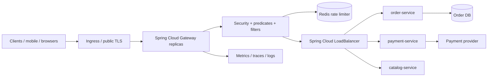
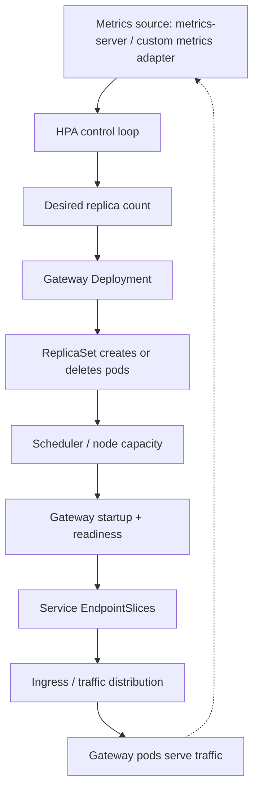
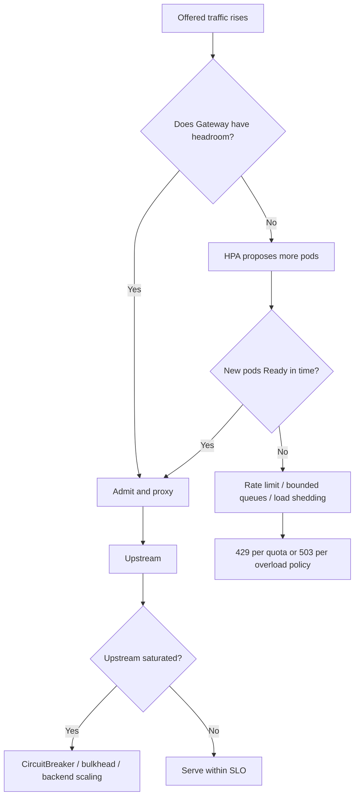
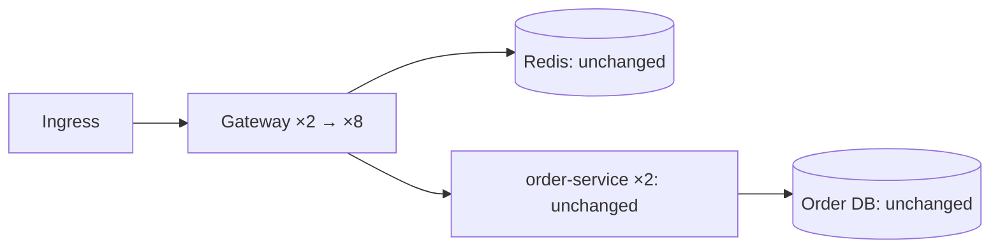
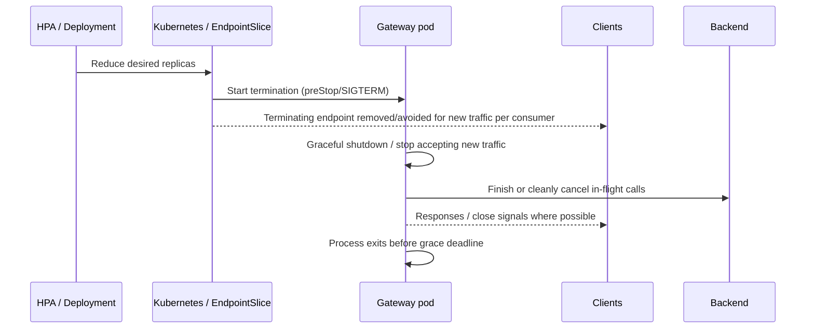
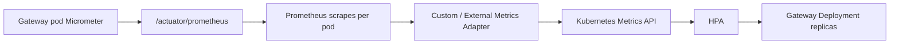

# Autoscaling by Load and Saturation Signals

When deploying **Spring Cloud Gateway** into a multi-microservice environment, the deployment question is not merely "how many Gateway pods should run?", but **when to add or remove replicas, based on which signals, and how to scale without causing disruption**. A Gateway can handle 500 requests/second comfortably on two pods yet degrade under 2,000 requests/second because CPU, the Reactor Netty event loop, outbound connection pools, the Redis rate limiter, or the backend itself hits its ceiling. Adding pods can help in the first case, yet can overload an already saturated backend in the others.

This lesson belongs to the **Deployment** chapter, focusing on **load-based autoscaling and saturation signals** for **Spring Cloud Gateway**. It sits within the full API Gateway lifecycle: route predicates and filter chains, path/header transformations, `lb://` service discovery, Spring Security/JWT, Redis rate limiting, Retry, CircuitBreaker, TLS, and request observability for safely operating a microservices entry point.

The focus is **Spring Cloud Gateway Server WebFlux with Reactor Netty on Kubernetes**. Examples use HPA, metrics-server, Micrometer/Prometheus, and optionally KEDA where installed. **Server Web MVC** runs on the Servlet stack with different metrics and graceful shutdown mechanics; never transplant Reactor Netty metrics or reactive-specific filters onto MVC. Exact Gateway property syntax, metric names, and startup/readiness behavior also depend on your pinned Spring Boot/Spring Cloud/Kubernetes/KEDA versions.

> **Practice Boundary:** Examples are strictly for staging/labs or environments where the operator is authorized. Never push resource limits, HPA changes, or stress tests straight to production without SLOs, budgets, and rollout/rollback plans. All RPS, CPU, pod count, and wait-time numbers here are **illustrative** for understanding the formulas, not universal recommendations.

## 1. The Problem: Traffic Grows, Yet Not Every Bottleneck Lives in the Gateway

Suppose the Gateway fronts three services:



A flash sale can trigger three completely different scenarios:

1. **Gateway CPU-bound:** JWT verification, JSON/body transformations, or custom filters consume heavy CPU; adding Gateway pods distributes CPU load.
2. **Gateway I/O-bound:** outbound pool pending counts climb due to connection limits or Netty event-loop blocking; adding Gateway pods *might* help if the bottleneck is a **per-pod** cap, yet can worsen backend congestion.
3. **Backend/Redis-bound:** the Order database, Redis, or payment provider is saturated; multiplying Gateway pods generally **adds zero real capacity** to the shared dependency.

Therefore, autoscaling must always ask:

**"Which resource is saturating, and will adding another Gateway pod raise useful throughput while keeping latency and data correct?"**

## 2. Terms to Distinguish

| Term | Meaning | Example |
| --- | --- | --- |
| **Replica** | An independent Gateway process/pod | `gateway-7c8f6f-abc12` |
| **Horizontal scaling** | Adding or removing replicas | 2 → 4 Gateway pods |
| **Vertical scaling** | Changing a pod's CPU/memory allocation | CPU request 300m → 500m |
| **HPA** | Kubernetes HorizontalPodAutoscaler adjusting replica counts from metrics | CPU utilization target 65% |
| **Cluster Autoscaler/Karpenter** | Adding/removing node capacity as needed | Provisioning a node for Pending pods |
| **Saturation** | A resource approaching or exceeding usable capacity | Pool active near max, growing queue |
| **Autoscaling signal** | Metric driving scale decisions | CPU utilization or a custom metric |
| **SLI/SLO** | Service-level indicator/objective | p95 ≤ 300 ms, 99.9% availability |
| **Load shedding** | Fast rejection of unservable load | 429 per quota, 503 per overload policy |
| **Graceful shutdown/drain** | Stopping new work while finishing/canceling in-flight work cleanly | Readiness off, draining connections |
| **Scale-out lag** | Time from needing capacity until new pods are Ready and serving traffic | Metric lag + scheduling + startup |
| **Scale-in** | Reducing replicas | 8 → 4 pods; must protect in-flight sessions |

**Autoscaling does not replace rate limiting or circuit breakers.** HPA needs time to aggregate metrics, compute desired replicas, schedule pods, and start the JVM. A 10-second burst can finish before a new pod ever becomes ready.

## 3. Mental Model: Demand, Saturation, and Outcome Signals

A trustworthy autoscaling dashboard tracks three groups:

| Group | Question | Example signals |
| --- | --- | --- |
| **Demand** | How much load is trying to enter? | Incoming RPS, request arrivals, active sessions |
| **Saturation** | Which resource is hitting its ceiling? | CPU throttling, pending acquires, event-loop lag, memory pressure |
| **Outcome** | What do users experience? | p95/p99, 5xx, timeouts, 429s, completed RPS |

With demand alone: you see 1,000 RPS without knowing whether 2 pods have plenty of headroom or are drowning.

With CPU alone: you see 30% CPU without seeing requests queued on outbound connections and timing out.

With p95 alone: you see slowness without knowing whether adding Gateway pods helps or makes backends slower.

**Operational recommendation:** pick a scaling signal proven to correlate with a **bottleneck that adding replicas actually relieves**, while using the other metrics as **guardrails, alerts, and diagnostics**.

## 4. How Does HPA Work?

Kubernetes **HorizontalPodAutoscaler** is a controller adjusting the `scale` subresource of a target such as a Deployment based on Kubernetes-readable metrics.



Conceptual loop:

1. Metrics infrastructure collects pod metrics.
2. HPA compares current metric values against targets.
3. Controller computes desired replica count.
4. HPA applies min/max bounds, stabilization windows, and scaling policies.
5. Deployment creates or terminates pods.
6. New pods go through scheduling, image pulling, JVM startup, and health checks.
7. Service/Ingress starts routing traffic to Ready endpoints.
8. Autoscaler keeps adjusting as fresh metrics arrive.

**HPA only computes replica counts—it does not add physical CPU to nodes.** If the cluster lacks node capacity, extra pods stay Pending. Monitor Kubernetes Scheduler and node autoscalers separately.

### Conceptual HPA Formula

At a basic level:

\[
R_{\text{desired}} \approx
\left\lceil
R_{\text{current}}\times
\frac{M_{\text{current}}}{M_{\text{target}}}
\right\rceil
\]

Suppose:

- There are 2 Gateway pods.
- Average CPU utilization is 130% relative to CPU request.
- Target CPU utilization is 65%.

\[
\left\lceil 2\times\frac{130}{65}\right\rceil=4
\]

The controller *may* propose 4 replicas. However, **this is a simplified model**, not an exact prediction in all cases. Real HPA applies tolerances, handles missing metrics, unready pods, stabilization windows, policies, min/max replicas, and controller state.

## 5. Starting with CPU Utilization as a Controllable Baseline

CPU is the standard starting signal because Kubernetes provides it out of the box via **metrics-server**.

In an HPA resource metric:

- `averageUtilization: 65` means average CPU usage equals **65% of CPU requests** across eligible pods.
- **Not** 65% of physical node CPUs.
- **Not** 65% of CPU limits.
- **Does not** automatically measure HTTP latency or outbound pool pressure.

Suppose a container declares:

```yaml
resources:
  requests:
    cpu: 300m
    memory: 512Mi
  limits:
    cpu: "1"
    memory: 1Gi
```

With a 65% CPU utilization HPA target, the reference point is roughly:

\[
300m\times0.65=195m
\]

That is ~195 millicores average CPU usage per pod under the metric calculation. It does not forbid a pod from exceeding 195m; it is the **target setpoint** around which HPA adjusts replica counts.

**CPU requests are required** to compute resource utilization. Without declared requests or working metrics-server data, HPA cannot compute utilization percentages properly.

### Why Not Target CPU Limits?

CPU limits trigger **throttling** when a container tries to exceed its quota within cgroup periods. Under CPU throttling, p95/p99 spikes even though the JVM throws zero exceptions. CPU requests govern scheduling guarantees and the HPA denominator; CPU limits set a separate upper bound.

When latency budgets are tight, track **CPU usage + throttling + client p95**, not utilization percentage alone.

## 6. Sample Deployment: CPU/Memory Requests, Probes, and Shutdown

Below is an **illustrative** Gateway WebFlux manifest. Replace images, labels, secrets, service accounts, and network settings per your approved environment.

```yaml
apiVersion: apps/v1
kind: Deployment
metadata:
  name: api-gateway
  labels:
    app: api-gateway
spec:
  replicas: 2
  strategy:
    type: RollingUpdate
    rollingUpdate:
      maxSurge: 1
      maxUnavailable: 0
  selector:
    matchLabels:
      app: api-gateway
  template:
    metadata:
      labels:
        app: api-gateway
    spec:
      terminationGracePeriodSeconds: 60
      containers:
        - name: gateway
          image: registry.example.invalid/platform/api-gateway:1.2.3
          ports:
            - name: http
              containerPort: 8080
          resources:
            requests:
              cpu: 300m
              memory: 512Mi
            limits:
              cpu: "1"
              memory: 1Gi
          startupProbe:
            httpGet:
              path: /livez
              port: http
            periodSeconds: 5
            failureThreshold: 30
          readinessProbe:
            httpGet:
              path: /readyz
              port: http
            periodSeconds: 5
            failureThreshold: 3
          livenessProbe:
            httpGet:
              path: /livez
              port: http
            periodSeconds: 10
            failureThreshold: 3
```

Key characteristics:

- **Two initial replicas** provide at least two Gateway endpoints when steady.
- **RollingUpdate** with `maxUnavailable: 0` avoids proactively dropping ready pods during updates, provided the cluster has resources to schedule the new pod.
- `startupProbe` gives the JVM bootstrap headroom before liveness/readiness take effect per Kubernetes rules.
- `readinessProbe` controls whether the pod enters ready endpoints to receive new traffic.
- `livenessProbe` detects wedged processes needing restarts, not backend routing faults.
- `terminationGracePeriodSeconds` allocates shutdown time, yet **does not guarantee** every HTTP/WebSocket session completes cleanly.
- Resource requests allow scheduler placement and anchor CPU HPA calculations.

**Never point `/livez` and `/readyz` at non-existent endpoints.** Configure Actuator health probes and test direct GETs on the application port; otherwise the Deployment stays NotReady or crash-loops forever.

### When HPA Is Enabled, Who Owns `spec.replicas`?

HPA continuously updates the Deployment's replica count. If GitOps/Helm repeatedly reapplies `spec.replicas: 2`, the two controllers fight each other. Define clear field ownership (bootstrap/minReplicas and manifest sync policies) so deployment pipelines do not overwrite HPA scaling decisions on every reconcile.

## 7. Spring Boot Readiness/Liveness and Graceful Shutdown

Application config example:

```yaml
server:
  port: 8080
  shutdown: graceful

spring:
  lifecycle:
    timeout-per-shutdown-phase: 30s

management:
  endpoint:
    health:
      probes:
        enabled: true
        add-additional-paths: true
  endpoints:
    web:
      exposure:
        include: "health,info,metrics,prometheus"
```

In Spring Boot lines supporting `add-additional-paths`, probe paths `/livez` and `/readyz` can be exposed on the **main server port**. Verify actual route mappings and Actuator behavior on your running version.

**Why use the main port?** If management runs on a separate port, management probes can report UP while the main application listener stops accepting requests. Probing the main port reduces false-ready risk—though probes still test only their configured scope, not every route/backend.

### Liveness and Readiness Serve Different Roles

**Liveness:**

- Answers "can this process keep operating?"
- Should not depend on all backends, Redis, or Identity Providers, because shared outages would force **all Gateway pods to restart simultaneously**.
- Restart only when the process itself cannot recover.

**Readiness:**

- Answers "should new traffic be routed to this pod?"
- Reflects startup/shutdown lifecycle and strictly mandatory policy prerequisites.
- Avoid marking all Gateway pods NotReady just because one backend fails when Gateway can still serve other routes, fallbacks, or proper 429s.

**Health=UP does not mean all route predicates, Redis limiters, outbound TLS, and backends work.** Route-level metrics and traces remain essential.

### Do Not Turn Readiness into Per-Route Load Balancing

Kubernetes Service readiness is **pod-level**, whereas a Gateway fronts many routes. If `payment-service` fails while `catalog-service` is healthy, marking the whole Gateway NotReady takes down **catalog** too. Keep readiness tied to pod-wide traffic fitness, and handle failing dependencies with circuit breakers, route-specific fallbacks, and rate limits.

## 8. Basic CPU-Based HPA v2

```yaml
apiVersion: autoscaling/v2
kind: HorizontalPodAutoscaler
metadata:
  name: api-gateway
spec:
  scaleTargetRef:
    apiVersion: apps/v1
    kind: Deployment
    name: api-gateway
  minReplicas: 2
  maxReplicas: 10
  metrics:
    - type: Resource
      resource:
        name: cpu
        target:
          type: Utilization
          averageUtilization: 65
  behavior:
    scaleUp:
      stabilizationWindowSeconds: 0
      selectPolicy: Max
      policies:
        - type: Percent
          value: 100
          periodSeconds: 60
        - type: Pods
          value: 2
          periodSeconds: 60
    scaleDown:
      stabilizationWindowSeconds: 300
      selectPolicy: Min
      policies:
        - type: Pods
          value: 1
          periodSeconds: 60
```

Explanation:

- `minReplicas: 2`: never drops below two pods while HPA manages a healthy Deployment.
- `maxReplicas: 10`: upper bound on HPA proposals; **not a guaranteed capacity ceiling**.
- `averageUtilization: 65`: CPU resource metric target.
- Scale-up `Percent 100` or `Pods 2` with `selectPolicy: Max`: picks the larger permitted step within policy bounds.
- Scale-down with `stabilizationWindowSeconds: 300` and max 1 pod/60s: scales down gradually to avoid thrashing and sudden capacity drops.

**`behavior` fields are optional HPA v2 controls on supported Kubernetes versions; exact semantics rest with the controller.** Values above are examples—tune based on startup time, bursts, backend capacity, node headroom, and SLOs.

### Why Scale Up Fast Yet Scale Down Slowly?

- Slow scale-up starves capacity during traffic ramps.
- Rapid scale-down destroys warm pools, cache locality, and active connections, prompting HPA to bounce back up on latency/CPU spikes.
- Overlapping rolling deploys and scale-downs amplify simultaneous terminations.
- WebSockets, SSE, and long requests make pod termination far riskier than short GETs.

**Scale-down stabilization is necessary, not sufficient.** Proper readiness, draining, and graceful shutdown are still mandatory.

## 9. Prerequisites for HPA to Actually Work

Before expecting autoscaling to trigger:

1. The cluster runs `metrics-server` or a resource metrics pipeline covering CPU/memory.
2. Target Deployment exists and HPA has permissions to read/update its `scale` subresource.
3. Containers declare valid CPU requests.
4. Replica pods run and emit fresh metrics.
5. Min/max bounds and scaling policies do not block the desired change.
6. Kubernetes Scheduler has free node resources for new pods.
7. Container images pull cleanly, secrets/configs exist, and JVMs boot properly.
8. Readiness probes reflect true serving state.
9. Gateway Service/Ingress routes traffic to new endpoints.
10. Observe both `desiredReplicas` and `readyReplicas`—never confuse the two.

Inspection commands in an **authorized test namespace**:

```bash
kubectl -n gateway-test get deployment api-gateway
kubectl -n gateway-test get hpa api-gateway
kubectl -n gateway-test describe hpa api-gateway
kubectl -n gateway-test top pods -l app=api-gateway
kubectl -n gateway-test get pods -l app=api-gateway -o wide
kubectl -n gateway-test rollout status deployment/api-gateway
```

If `kubectl top` shows nothing, check metrics-server/API availability. If `desiredReplicas` rises while pods sit Pending, inspect Scheduler/node capacity—not Gateway filter config.

## 10. HPA Status: Desired, Current, Ready, and Conditions

Four numbers prevent false conclusions:

| Signal | Meaning | Common mistake |
| --- | --- | --- |
| **Current replicas** | Replicas currently recorded/managed by Deployment | Assuming all are serving traffic |
| **Desired replicas** | Target replica count requested by controller | Assuming new capacity is already live |
| **Ready replicas** | Pods passing readiness and marked Ready | Assuming every endpoint serves all routes cleanly |
| **Available replicas** | Pods meeting Deployment availability conditions | Assuming backends/dependencies have capacity |
| **HPA conditions** | Why HPA can or cannot scale | Ignoring missing metrics or max limits |

HPA can show `desired=8` while only `ready=3` because nodes lack CPU. Raising `maxReplicas` further does nothing without fixing the scheduling bottleneck.

Useful HPA condition names include `AbleToScale`, `ScalingActive`, and `ScalingLimited`; verify exact Kubernetes version details in `kubectl describe hpa`.

## 11. CPU Scaling Does Not Fit Every Kind of Gateway Saturation

A WebFlux Gateway can show low CPU while:

- Outbound connection pools hit **active ≈ max** and `pending acquire` climbs.
- Backends respond slowly or TCP/TLS connections time out.
- The Netty event loop is blocked inside a custom filter.
- Redis rate-limiter command latencies spike.
- DNS/`DiscoveryClient` finds zero healthy instances.
- Long-lived WebSocket connections accumulate and direct memory climbs.
- Response caching/streaming routes buffer payloads for slow clients.

**Adding replicas helps only if the true bottleneck shards across pods** and shared dependencies still have headroom.

### Scenarios to Distinguish

| Observation | Likely helped by scaling Gateway? | Investigate first |
| --- | --- | --- |
| High Gateway CPU with backend/Redis headroom | **Likely yes** | CPU throttling, per-pod RPS, filter CPU |
| Per-pod connection pool capped while backend has headroom | **Likely yes** | Pool scope, acquire duration, backend capacity |
| Upstream p95 / DB pool already saturated | **Usually no** | Backend scaling, DB tuning, load shedding |
| Cluster-wide high Redis command latency | **Usually no** | Redis capacity/latency, rate decision volume |
| Event loop blocked by synchronous code | **Only masks symptoms** | Fix blocking filter; use async I/O |
| One backend instance failing under `lb://` | **Not directly** | Readiness, discovery, instance draining |
| Gateway direct memory near limit due to leak | **Will not fix leak** | Buffer lifecycle, caching, replay |
| Dense WebSockets evenly balanced across pods | **Can help new connections** | Drain/stickiness, active sessions |
| HPA wants to scale yet pods stay Pending | **Not yet** | Node autoscaler, quotas, images, topology |

Never "scale to fix 404s" caused by a broken `RewritePath`. Correctness, auth, and route matching are orthogonal to capacity.

## 12. Gateway Metrics Needed Before Picking a Scaling Signal

| Group | Metrics | Reliability/caveats |
| --- | --- | --- |
| Inbound HTTP | RPS, 429/401/403/5xx, client p95 | Reflects demand/outcomes; doesn't pinpoint bottleneck alone |
| Route metrics | `spring.cloud.gateway.requests` by route ID, status, duration | Covers only requests reaching instrumentation |
| HTTP client | Outbound attempts/latency/connect errors | Reflects Retry and selected instance behavior |
| Pools | Active, idle, pending, max, pending acquire time | May partition by provider/remote address |
| Event loop | Pending tasks/lag, CPU, thread dumps | Blocking bugs often require JFR/logs too |
| JVM/process | CPU usage/throttling, heap, GC, direct allocator, RSS | Memory metrics come from multiple non-overlapping sources |
| Redis | Decision latency/errors, CPU, used memory, key count | Can become a shared bottleneck |
| Resilience4j | CircuitBreaker OPEN/rejections, Retry attempts | Requires binder/instrumentation |
| Deployment | Ready pods, desired pods, startup/readiness duration | Confirms autoscaling creates real capacity |
| Backends | Per-instance latency/errors/DB pools | Determines whether downstream can take more load |

**Not all meters appear automatically.** Spring Cloud Gateway Server WebFlux, Reactor Netty, and Micrometer have version-specific enablement and naming. Inspect `/actuator/metrics` and raw `/actuator/prometheus` on your live app.

### From Actuator to Prometheus

Management config (secured by network/auth policies) might expose:

```yaml
management:
  server:
    port: 9090
  endpoints:
    web:
      exposure:
        include: "health,info,metrics,prometheus"
  metrics:
    tags:
      application: api-gateway
```

Requires `spring-boot-starter-actuator` and `micrometer-registry-prometheus` on supported versions. Keep the management port on an isolated network—never expose `/actuator/prometheus` publicly just to feed HPA metrics.

**CPU resource HPA does not require Prometheus.** However, custom/Prometheus-based HPA or KEDA requires a metrics adapter/scaler bridging into the Kubernetes Metrics API. **A Prometheus server alone does not let native HPA read custom RPS.**

## 13. CPU, Memory, and Custom Metrics: Which to Choose?

| HPA metric type | Source | Pros | Risks |
| --- | --- | --- | --- |
| **Resource CPU** | metrics-server | Standard, low complexity | Misses I/O-bound and pool saturation |
| **Resource memory** | metrics-server | Detects per-pod memory use | Pooled direct memory/caches don't shrink when idle; weak capacity proxy |
| **Pods custom metric** | Custom Metrics API adapter | e.g., in-flight or admitted RPS/pod | Needs adapter with accurate pod/label mapping |
| **Object metric** | Metric bound to Kubernetes object | Useful for object-level signals | Needs matching adapter/schema |
| **External metric** | External Metrics API / KEDA | Redis queues, aggregate Prometheus, demand | External outage risk, cardinality, query lag |
| **Multiple HPA metrics** | Resource + custom/external | Captures multiple limits | One bad metric can over-scale or block scale-down |

Never dump CPU, memory, RPS, p95, and pool pending into one HPA without defining **which signal is safe to scale on**. With multiple metrics, HPA computes desired replicas per metric and typically takes the maximum; one noisy or sticky metric blocks scale-down. Check your Kubernetes version's HPA semantics.

### Why Is Memory HPA Tricky for WebFlux Gateways?

Netty pooled direct buffers and JVM heap retain memory for reuse after traffic bursts; memory does not drop immediately when load falls. Memory-only HPA can **refuse to scale down** even on idle pods. Conversely, near OOM, scale-up arrives too late. Use memory primarily as a **budget/alert** before testing whether it makes a viable scaling signal.

## 14. Picking Saturation Signals Along the Causal Chain

An outbound HTTP overload chain often looks like:

```text
Backend slows down
  -> Gateway outbound active connections stay occupied longer
  -> active approaches max
  -> pending acquires climb
  -> acquire wait/p95 rises
  -> timeouts/5xx rise
```

`pending_connections` alone **is not enough** to trigger Gateway scale-out. Determine whether slow backends or a too-small per-pod pool caused it. If the backend has 50% headroom while each Gateway pod has too few slots, scaling out adds pool slots. If the DB is full, adding Gateway pods sends more outbound attempts and can collapse the system.

### Distinguishing Triggers from Guardrails

- **Trigger:** a validated metric tied to per-Gateway-pod capacity, such as CPU or in-flight admitted requests/pod.
- **Guardrail:** backend 5xx/DB saturation, Redis latency, and circuit breaker states preventing false "scaling worked" claims when downstreams degrade.
- **Alarm:** rising p95/p99 or user-visible errors requiring human/runbook response.
- **Debug signal:** pending acquires per remote pool, event-loop lag, and DNS/TLS errors pinpointing the fault.

Start with CPU HPA while keeping pool pending as an **investigation alert**; promote pending/in-flight to a custom HPA metric only after controlled tests validate the causal link.

## 15. Never Scale on Raw p95 Without Analyzing Behavior

p95 latency is crucial for SLOs, yet makes a poor direct HPA trigger:

- p95 swings wildly at low traffic.
- p95 jumps when shared backends or Redis slow down—adding Gateway pods fixes nothing.
- p95 can look artificially low when floods of requests fail fast with 429.
- Per-pod percentiles **cannot be averaged** into cluster p95.
- Histogram buckets and scrape intervals introduce lag.
- Scaling shifts traffic distribution, making percentiles oscillate.

To inspect p95 accurately, aggregate Prometheus histograms via `le`, e.g., when `spring_cloud_gateway_requests_seconds_bucket` is present:

```promql
histogram_quantile(
  0.95,
  sum by (le, routeId) (
    rate(spring_cloud_gateway_requests_seconds_bucket[5m])
  )
)
```

Never wire a p95 chart straight into autoscaling without pairing **workload, error rate, upstream headroom, and time windows**.

## 16. RPS per Pod: Simple Yet Conditional

If benchmarks prove each Gateway pod sustains up to ~400 **admitted** RPS within SLO for your current traffic mix, pick a lower safe operating target for headroom, e.g., 280 RPS/pod.

Preliminary capacity estimate:

\[
R_{\text{needed}} \approx
\left\lceil \frac{\lambda_{\text{offered}}}
{\lambda_{\text{safe per pod}}}\right\rceil
\]

At 1,100 admitted RPS and 280 RPS/pod target:

\[
R_{\text{needed}} \approx \lceil 1100/280\rceil =4
\]

**This is an initial estimate**, not a standard HPA algorithm or throughput guarantee. Load-test with ample backend capacity, realistic traffic mix, JWT verification, TLS, cache hit ratios, body sizes, and retries.

### Use "Offered" or "Admitted" RPS?

- **Offered RPS** counts all incoming requests, including those blocked by Security/RateLimiter.
- **Admitted RPS** counts requests passing admission into the proxy pipeline.
- **Completed RPS** counts responses finished within the window.

If scaling solely on admitted RPS, a 20,000-RPS attack quickly denied by RateLimiter keeps scaling metrics flat—which may match policy as long as denied traffic does not overwhelm Gateway.

If scaling on offered RPS, HPA might spin up dozens of pods just because one client keeps hammering `429` against an unchanged quota. Weigh **denial processing cost**, security threats, and policy (Ingress/WAF should shed floods early).

No single RPS metric fits every route.

## 17. Low CPU While the Event Loop Is Blocked

A reactive Gateway with a custom `GatewayFilter` calling a blocking API:

```java
// ANTI-PATTERN: Can block the WebFlux processing thread.
public Mono<Void> filter(ServerWebExchange exchange,
                         GatewayFilterChain chain) {
    legacyClient.fetchBlocking();
    return chain.filter(exchange);
}
```

When callbacks block, many requests stall despite low CPU. Adding pods temporarily reduces load per pod, yet **never fixes the non-blocking bug** and fails unpredictably as load grows.

Preferred fixes:

- Replace blocking clients with asynchronous/reactive clients where available.
- If blocking is unavoidable, isolate onto a bounded scheduler with concurrency and timeout budgets.
- Inspect event-loop pending tasks, JFR thread stacks, client p95, CPU, and call durations.
- Test under load and across cancellations.
- Wrap blocking dependencies with circuit breakers and bulkheads.

**HPA is not a tool for fixing event-loop bugs.**

## 18. Are Connection Pools Per-Pod or Per-Backend?

Reactor Netty `HttpClient` uses `ConnectionProvider` to reuse outbound connections. Common metrics across versions:

```text
reactor.netty.connection.provider.active.connections
reactor.netty.connection.provider.idle.connections
reactor.netty.connection.provider.pending.connections
reactor.netty.connection.provider.max.connections
reactor.netty.connection.provider.pending.connections.time
```

Metrics may split by provider name or remote address without automatically carrying `routeId`. One `lb://order-service` route can hit multiple instances and multiple pools. So when comparing:

```text
Gateway-A:
  backend-1 pool active=100/max=100, pending=80
  backend-2 pool active=10/max=100, pending=0
```

Never sum 110 active / 200 max and conclude "only 55% utilization, everything is fine." **One remote pool is completely saturated.**

### When Scaling Gateway Increases Aggregate Pool Capacity

If each pod allows 100 connections to a backend and Gateway scales from 2 → 8 pods, total connections *can* jump from ~200 to 800. That helps if the backend handles it, yet can trigger **file descriptor exhaustion, DB pool saturation, or backend TLS handshake pressure**.

Check backend connection/concurrency budgets before raising `maxReplicas`.

## 19. Scale-Out Lag and Why Headroom Is Mandatory

Total scaling lag includes:

```text
Metrics sampling/scrape
+ HPA reconciliation
+ ReplicaSet/Deployment reconciliation
+ Kubernetes scheduling
+ Node provisioning (if nodes are full)
+ Image pull
+ JVM class loading + caches
+ Spring Boot startup
+ Readiness probe
+ Service/Ingress endpoint propagation
```

A 20-second burst hits **long before a new pod becomes Ready**. Even with `scaleUp` stabilization at 0, JVM boot, cold connection pools, JWT JWK caching, and scheduling take real time.

**Therefore:** autoscaling handles **sustained load** and moderate ramps, but never replaces:

- Baseline capacity headroom.
- Pre-warming/`minReplicas` ahead of known events.
- Rate limits at Ingress and Gateway.
- Bulkheads and concurrency bounds.
- Bounded queues and request deadlines.
- CDN/caching where privacy allows.
- Retry budgets and circuit breakers.

### Scale-Lag Calculation Example

Suppose Gateway runs two pods, each safely handling 300 admitted RPS. Traffic jumps from 400 to 1,800 RPS in 15 seconds. Serving full load takes ~six pods, yet if new pods take 45 seconds to reach Ready, **you cannot rely on HPA to absorb the first 15 seconds**.

Set higher `minReplicas` or scheduled pre-scaling ahead of predictable sales or launch events.

## 20. Admission Control and Autoscaling Must Work Together



This diagram is a **conceptual decision flow**; HPA does not invoke GatewayFilters or inspect backend headroom directly. Configure and test each mechanism independently.

### Why Are Unbounded Queues Dangerous?

Every queued request holds headers, buffers, auth contexts, retry state, and sockets. If the client's deadline is 2 seconds yet a request queues 15 seconds before reaching the backend, the response is useless to the client even if eventually computed.

Instead of unbounded queues:

1. Define accepted throughput and max in-flight concurrency.
2. Cap pending acquires and concurrency.
3. Enforce realistic total deadlines and per-attempt timeouts.
4. Shed/reject load per policy when budgets are exceeded.
5. Track rejected requests alongside user-visible 5xx/429s.
6. Scale out deliberately where **adding pods genuinely helps**.

## 21. Redis Rate Limiters When Scaling Gateway Replicas

If Gateway uses `RequestRateLimiter` + `RedisRateLimiter` and per-user/per-tenant quotas must **span all Gateway replicas**, align:

- Same Redis cluster and namespace.
- Same effective route ID if `RedisRateLimiter` keys buckets by route ID.
- Same `KeyResolver` extracting **authenticated** identities.
- Same `replenishRate`, `burstCapacity`, and `requestedTokens`.
- Same failure policy and Redis client connectivity.
- Converged route refreshes/config deployments across replicas.

```text
Before scaling:
  Gateway A + B -> shared Redis bucket (Alice)

After scaling:
  Gateway A + B + C + D -> STILL the same bucket (Alice)
```

Using local in-memory buckets per Gateway causes HPA scaling 2 → 8 to **multiply a user's effective quota** by pod count. With shared Redis configured cleanly, adding Gateway replicas never inflates a subject/route's quota.

### Do Not Mistake `RedisRateLimiter` for Global Backend Concurrency Control

Token buckets rate-limit average/burst throughput **per key**, not total simultaneous requests. 10,000 users at 10 RPS each still generate 100,000 req/s—easily overwhelming backends.

Pair with global admission controls, bulkheads, backend capacity planning, and WAF/Ingress throttling. If 429s climb from intentional quota enforcement, autoscaling Gateway purely on **raw 429s** wastes pods without increasing useful served requests.

## 22. Retries and CircuitBreakers Shape Effective Load

One client request can emit multiple upstream attempts:

```text
Client GET /api/orders/42
  -> attempt 1 to backend-A: 503
  -> attempt 2 to backend-B: 503
  -> attempt 3 to backend-C: 200
Client sees 200 while backends absorbed 3 attempts
```

With 600 client req/s averaging 2 attempts/request:

\[
\text{upstream attempts/s}\approx 600\times 2=1,200
\]

Backends absorb double the load even though HPA sees only 600 logical Gateway req/s.

**Scaling Gateway can accidentally worsen a Retry storm** when newly added pods launch concurrent outbound attempts against an already saturated service.

Measure:

- Client-visible 5xx/timeouts.
- Retry attempts per logical request.
- Upstream attempts per backend instance.
- CircuitBreaker states, rejections, and fallback activations.
- Total request deadlines and backoff durations.
- Accepted vs rejected traffic at rate limiters.
- Fraction of requests still completing within SLO.

**Never enable Retries on non-idempotent POSTs simply because you added Gateway pods.** Require idempotency keys and backend enforcement if writes must retry.

### Does an OPEN CircuitBreaker Mean You Should Scale the Gateway?

When a downstream service is down, an OPEN breaker short-circuits calls before the outbound pool and returns fast fallbacks/503s. Gateway CPU drops while user-visible availability falls. Scaling Gateway **does not fix the backend**. Alert and heal the dependency; HPA continues governing pod counts by its own triggers without being treated as backend outage remediation.

## 23. Calculating Replica Counts from Capacity Tests, Not "Ideal" RPS

Suppose a test shows:

```text
Traffic mix:
  70% GET, 20% POST, 10% streaming
  JWT verification + RedisRateLimiter + TLS
  Ample backend headroom

Single Gateway pod:
  200 RPS: p95=120ms
  300 RPS: p95=180ms
  400 RPS: p95=330ms
  500 RPS: p95=850ms + rising pool pending
```

With an SLO of p95 ≤ 300 ms, sustainable per-pod throughput **in that environment** sits near 300 RPS. Reserve extra headroom for noise, spikes, and rollouts.

Rough sizing:

```text
Expected sustained admitted traffic = 900 RPS
Safe operating target per pod       = 225 RPS
Estimated replicas                  = ceil(900 / 225) = 4
```

This is only an estimate. Test 4 live pods together because:

- Redis, Ingress, or backends can become shared bottlenecks.
- Connection pooling and CPU scheduling shift across multiple pods.
- Traffic distribution is never perfectly uniform.
- HPA scale lag and readiness affect transient capacity.
- JVM warm-up and GC behavior vary.
- Long-lived WebSocket/SSE sessions do not scale proportionally with HTTP RPS.

## 24. Scaling Out Gateway Does Not Automatically Scale Microservices

Suppose Gateway scales from 2 to 8 replicas while `order-service` stays at 2 pods with one shared DB pool:



Gateway capacity grows while the backend bottleneck stays put. Without rate limiting, scaling Gateway sends higher concurrency into `order-service`, worsening backend p95 and 503s.

**Scaling strategies must examine the entire dependency chain:**

- Gateway Replicas/HPA.
- Ingress capacity and TLS termination.
- Redis RateLimiter throughput and latency.
- `DiscoveryClient` and LoadBalancer instance availability.
- Backend HPA and circuit breakers.
- Database connection pools and IOPS.
- Network bandwidth, NAT, and file descriptors.
- Monitoring pipeline capacity.

Not every service needs to autoscale simultaneously; identify the **first bottleneck** and enforce safe limits at every hop.

## 25. Separating Scaling Policies for Routes with Different Costs

One Gateway might serve:

- `catalog-read`: public GET with response caching.
- `orders-read`: authenticated GET with LB.
- `payments-create`: POST with heavy auth/authorization, strict latency, no blind retries.
- `reports-download`: multi-MiB responses, heavy bandwidth and direct memory.
- `websocket-chat`: long-lived connections and queues.

Under one shared CPU HPA, all routes share one capacity pool. Heavy report downloads consuming CPU/bandwidth can starve payment requests.

Architectural choices:

1. Single Gateway deployment with strict **rate limits, bulkheads, and priority classes**.
2. Split Gateway deployments by **workload/criticality** where ownership, security, and ops permit.
3. Separate scaling signals for public traffic vs streaming.
4. Backend quotas preventing one route from exhausting shared resources.
5. Never bypass authentication or tenant authorization when splitting traffic.

**Splitting deployments is not the default answer:** it adds config and route-management overhead. Gather evidence of interference or SLO conflict before splitting.

## 26. Autoscaled Deployments Must Be Stateless Where Required

As HPA adds and removes pods, new requests can hit any pod. Gateway must avoid storing required shared state inside per-replica RAM.

Examples:

- JWT validation via consistently configured public keys/caches.
- Rate-limiter quotas in shared Redis when fleet-wide.
- Route definitions distributed and refreshed consistently across replicas.
- Uniform Spring Security policies and trusted-proxy configs.
- Any sessions placed in stores/namespaces aligned with affinity and durability needs.
- Local response caches used strictly for eligible data without assuming simultaneous cluster-wide invalidation.
- WebSocket connections are **pod-local live state** and never migrate automatically during scale-down.
- Correlation/tracing propagated uniformly across all Gateway replicas.

**Sticky sessions do not automatically preserve quota or authorization consistency.** They can reduce connection churn for certain workloads, yet create hotspots and complicate scale-down.

## 27. Readiness During Scale-Out: Can a Ready Pod Truly Serve?

Before a new pod takes live traffic, verify:

1. JVM/Spring Boot finished startup.
2. Main-port HTTP listener accepts requests.
3. Critical route predicates and filter definitions are loaded.
4. JWT keys/issuer metadata work per policy (without blocking Ready unnecessarily on every JWK).
5. Redis connectivity/resilience policy is active.
6. `DiscoveryClient`/LoadBalancer has valid instance lists or handles zero-instance cleanly.
7. Outbound TLS truststores/certs are valid.
8. Startup spikes didn't exhaust CPU/memory headroom.
9. Metrics/tracing tags and deployment revisions match.
10. Local cache warm-up never serves stale/incorrect data.

Do not cram all downstream health checks into readiness if one backend outage would force **all Gateway pods NotReady**. Instead, use **synthetic route checks/canaries** and circuit breakers to monitor per-route functionality.

### Startup Readiness Is Not "Wait 20 Seconds and Hope"

A fixed `initialDelaySeconds` breaks on cold nodes or slow image pulls. Well-tuned `startupProbe` and `readinessProbe` settings paired with startup telemetry and load tests are far more reliable.

## 28. Scale-In: Avoiding Dropped In-Flight HTTP and WebSockets

Scaling down is not just deleting a pod. When Kubernetes sends termination signals:



**This diagram shows intended flow, not a universal schedule across every kube-proxy/Ingress controller.** Endpoint propagation lags; client keep-alives and long-lived connections still traverse old paths. Test on your **exact Ingress/service-mesh version** rather than setting `terminationGracePeriodSeconds` and assuming all requests drain cleanly.

### Components to Align

- HPA scale-down stabilization.
- Deployment rollout strategy and PodDisruptionBudget (PDB).
- Readiness transitions and EndpointSlice propagation.
- `server.shutdown: graceful`.
- `terminationGracePeriodSeconds` sized for bounded draining.
- Ingress connection draining, keep-alive, and timeout settings.
- Long-lived WebSocket/SSE close and reconnect policies.
- Client retries, idempotency, and cancellation cleanup.
- Upstream discovery caches/pools if Gateway routes change concurrently.

**Never promise infinite WebSocket survival during termination.** For long-lived connections, send explicit close/migration signals or have clients reconnect with jitter and re-authentication.

## 29. `preStop` and Shutdown: Explaining Actual Limits

Some deployments configure a lifecycle hook:

```yaml
lifecycle:
  preStop:
    exec:
      command:
        - /bin/sh
        - -c
        - "sleep 10"
```

The goal of sleeping in certain setups is letting endpoint removal propagate to proxies before the process exits. However:

- **Sleep does not transition readiness to NotReady on its own.**
- Does not guarantee Ingress stopped sending traffic.
- Consumes part of `terminationGracePeriodSeconds`.
- Does not cleanly drain WebSocket/SSE semantics.
- `/bin/sh` may not even exist in distroless images.
- Kubernetes force-kills the pod when termination grace expires.
- Exact `preStop` vs `SIGTERM` timing must be verified empirically.

**Never treat `sleep 10` as mandatory or sufficient.** Design shutdown across app and proxies, test pod termination under real load, and treat a 60-second grace budget purely as an example.

## 30. PodDisruptionBudget and Topology Spread

Even with `minReplicas=2`, placing both pods on one node risks total Gateway loss if that node dies.

Mitigations:

- `topologySpreadConstraints`/pod anti-affinity spreading pods across nodes/zones where supported.
- **PodDisruptionBudget (PDB)** limiting certain voluntary disruptions.
- `maxUnavailable` during rolling updates.
- Resource requests/quotas ensuring the scheduler can place pods.
- Cluster/node autoscaling.
- Observability and multi-endpoint network routing.

Example PDB:

```yaml
apiVersion: policy/v1
kind: PodDisruptionBudget
metadata:
  name: api-gateway-pdb
spec:
  minAvailable: 2
  selector:
    matchLabels:
      app: api-gateway
```

**A PDB does not prevent every pod loss:** node crashes, `OOMKilled`, and hardware failures are involuntary disruptions not blocked by PDBs like voluntary evictions. Nor is a PDB an HPA scale-down control; HPA and Deployment controllers follow separate rules. Never set a PDB so tight that cluster maintenance stalls—especially at low `minReplicas`.

## 31. Configuring Topology Spread (When Cluster-Supported)

```yaml
spec:
  template:
    spec:
      topologySpreadConstraints:
        - maxSkew: 1
          topologyKey: kubernetes.io/hostname
          whenUnsatisfiable: ScheduleAnyway
          labelSelector:
            matchLabels:
              app: api-gateway
```

This is a **Deployment snippet**, not a complete manifest. `ScheduleAnyway` is a soft constraint; the scheduler may still co-locate pods when resources are tight. For zone-level HA, configure zone topology labels, node capacity, and matching policies.

Never scale replicas blindly on a single-node cluster or when all pods share one failure domain.

## 32. When Should You Use Custom Metrics?

CPU HPA works well when Gateway's primary bottleneck is CPU and load tests confirm it. When Gateway is mostly **network I/O bound**, CPU can stay low while admitted concurrency or pool queues hit per-pod ceilings.

Custom metrics to consider:

| Custom metric | When useful | Pitfalls |
| --- | --- | --- |
| **In-flight admitted requests/pod** | Uniform request cost; per-pod queues rise before CPU | Slow backends inflate in-flight even when more Gateways won't help |
| **Admitted RPS/pod** | Pod capacity benchmarked for the route mix | RPS ignores body sizes and slow streams |
| **Pending outbound acquires/pod** | Proven per-pod pool limit while backend has headroom | Adding pods can overload backends |
| **Event-loop lag / pending tasks** | Detects event-loop saturation | Blocking code must be fixed, not just scaled |
| **Active WebSocket sessions/pod** | Long-lived sockets are the primary resource | Existing sessions cannot rebalance onto new pods on scale-up |
| **External workload queue depth** | Gateway acts as a queue consumer/worker | Gateway isn't ordinarily a queue consumer; easy to pick the wrong metric |
| **Composite demand metric** | Mixed routes have wildly different costs | Requires clear definition, validation, and maintenance |

A metric fits autoscaling only when it:

1. Measures **load tied to per-replica capacity**.
2. Has explicit units, labels, and scope.
3. Updates fast enough for control decisions.
4. Does not vanish or distort when a pod crashes/restarts.
5. Has tests proving scaling relieves saturation rather than pushing load onto a shared bottleneck.
6. Contains zero high-cardinality user IDs or raw URLs.
7. Has safe fallback behavior when metrics are missing.

**Never scale Gateway on raw Redis error counts or backend DB latency unless proven to reflect Gateway pod capacity.**

## 33. Exposing an In-Flight Gauge: Sample Instrumentation

To prototype a per-process `gateway.inflight.requests` custom metric, a `GlobalFilter` can track active executions:

```java
@Configuration
public class GatewayInflightMetricsConfiguration {

    private final AtomicInteger inFlight = new AtomicInteger();

    public GatewayInflightMetricsConfiguration(
            MeterRegistry registry) {
        registry.gauge(
            "gateway.inflight.requests",
            Tags.of("component", "gateway"),
            inFlight
        );
    }

    @Bean
    GlobalFilter inflightGaugeFilter() {
        return (exchange, chain) -> Mono.defer(() -> {
            inFlight.incrementAndGet();
            return chain.filter(exchange)
                .doFinally(signal -> inFlight.decrementAndGet());
        });
    }
}
```

This is **sample instrumentation needing proper imports and tests**, not a drop-in production scaling metric. It counts strictly within the **Gateway `GlobalFilter` chain**: it can miss pre-routing Security rejections, route misses, or outer layers. With Retries or custom filters, verify exactly **one increment/decrement per logical routed request** across errors and cancellations.

**Notes:**

- `Mono.defer` increments on subscription rather than pre-execution assembly.
- `doFinally` handles completion, errors, and cancellations per reactive lifecycle, yet unit/integration tests must verify the counter never leaks or goes negative on cancel.
- A multi-hour HTTP SSE response counts as in-flight—confirm whether that matches your intent.
- Micrometer/Actuator exposes the metric, yet **Kubernetes HPA cannot read it** without Prometheus Adapter / Custom Metrics API.
- This is a per-process gauge; Prometheus scrapes must preserve pod/instance labels.

Requests rejected by Security before `GlobalFilter` **are not counted** here; to defend against anonymous bursts, instrument earlier layers or use ingress/WAF metrics.

## 34. HPA Using a `Pods` Custom Metric — An Alternative to CPU

If a Custom Metrics API adapter exposes `gateway_inflight_requests` per pod, HPA can use:

```yaml
apiVersion: autoscaling/v2
kind: HorizontalPodAutoscaler
metadata:
  name: api-gateway
spec:
  scaleTargetRef:
    apiVersion: apps/v1
    kind: Deployment
    name: api-gateway
  minReplicas: 2
  maxReplicas: 10
  metrics:
    - type: Pods
      pods:
        metric:
          name: gateway_inflight_requests
        target:
          type: AverageValue
          averageValue: "120"
  behavior:
    scaleDown:
      stabilizationWindowSeconds: 300
```

**This policy REPLACES the CPU HPA example**—never attach two separate HPAs to one Deployment.

Prerequisites:

- Real `gateway.inflight.requests` meter with accurate units/tags.
- Prometheus scraping every Gateway pod.
- Prometheus Adapter (or Custom Metrics API provider) mapping metrics to Kubernetes pods.
- HPA reading `gateway_inflight_requests` via `custom.metrics.k8s.io`.
- Tests covering Ready vs NotReady pods and missing metrics.
- Target `120` derived from load testing, not guessed from Java code.

**HPA custom metric names do not automatically match Prometheus metric names** if adapters rename or remap resources. Inspect the adapter's API output directly rather than checking `/actuator/prometheus` alone.

### In-Flight Is a Symptom, Not Always the Root Cause

If a backend suddenly slows 10×, Gateway in-flight counts climb too. HPA spins up more Gateway pods while the DB remains wedged, admitting even more requests. The real fix is healing/scaling the backend, circuit breakers, bulkheads, and load shedding. Never treat in-flight HPA as a cure-all for latency.

## 35. Prometheus Does Not Automatically Become HPA Custom Metrics

Component chain for Prometheus-driven scaling:



CPU resource HPA flows through `metrics.k8s.io` (`metrics-server`). Prometheus-based custom Pods/Object/External metrics require a provider for `custom.metrics.k8s.io` or `external.metrics.k8s.io`.

Another option is **KEDA**, which uses triggers/scalers to create and manage an HPA. **Never run both a standalone HPA and a KEDA `ScaledObject` targeting the same Deployment** unless explicitly supported by architecture/ownership; one Deployment should have **one HPA controller owner**.

### Metric Labels Must Be Accurate

Prometheus must preserve per-pod/instance identity on every series. Scraping through a load-balanced Service that alternates Gateway A and B breaks counters and makes gauges misrepresent individual pods.

**Always verify** pod labels, units, and scrape density within the query window before feeding metrics to an autoscaler.

## 36. KEDA: Option When External Metrics Are Needed

**KEDA** is a Kubernetes add-on capable of scaling workloads from Prometheus queries, queues, and other event sources. It is not built into Spring Cloud Gateway or base Kubernetes.

Example `ScaledObject` for **aggregate RPS across a group of routes**:

```yaml
apiVersion: keda.sh/v1alpha1
kind: ScaledObject
metadata:
  name: api-gateway-traffic
spec:
  scaleTargetRef:
    name: api-gateway
  minReplicaCount: 2
  maxReplicaCount: 10
  pollingInterval: 15
  cooldownPeriod: 300
  triggers:
    - type: prometheus
      metadata:
        serverAddress: http://prometheus.monitoring.svc.cluster.local:9090
        query: >-
          sum(rate(
            spring_cloud_gateway_requests_seconds_count{
              routeId=~"orders-read|catalog-read"
            }[2m]
          ))
        threshold: "250"
```

**Requirements:**

1. KEDA CRDs/operator installed and authorized to query Prometheus.
2. Query returns a **single scalar/single-element vector** in expected requests/sec units.
3. Series and label names match your exact Gateway version's exporter.
4. `threshold: "250"` is an example value requiring calibration via per-pod capacity tests and KEDA scaler semantics.
5. No independent HPA simultaneously managing `api-gateway`.
6. Metrics endpoints and Prometheus secured with auth/TLS per infrastructure policy—never opened publicly.
7. Route-scoped queries can **miss pre-route 401/404s** and may count 429s depending on filter instrumentation; verify exact scope.

**Important:** KEDA's `cooldownPeriod` semantics relate to scale-to-zero/activation and KEDA version—do not equate it blindly with HPA `behavior.scaleDown.stabilizationWindowSeconds` when `minReplicaCount > 0`. To control scale-down across positive replica counts, configure and measure the KEDA-managed HPA behavior per your KEDA version docs.

### Should a Gateway Scale to Zero?

For a **public entry-point** API Gateway handling arbitrary HTTP traffic, scaling to zero cannot wake the process on incoming requests without specialized HTTP interceptor/activation infrastructure. A Prometheus query over **Gateway requests** also emits no samples when zero pods exist.

Examples use `minReplicaCount: 2` to keep the Gateway continuously Ready. Consider scale-to-zero only with purpose-built event-activation architectures—never treat it as a free cost-cutting switch.

## 37. When Does RPS-Based KEDA Mislead?

Common cases:

| Scenario | What RPS metric sees | What to check |
| --- | --- | --- |
| Security blocks before routing | Gateway route RPS looks low | Incoming HTTP RPS, JWT CPU |
| Redis emits heavy 429s | Route RPS looks high while accepted throughput is low | Should pods really scale out? |
| 95% cache hit rate | High RPS with minimal backend calls | Is Gateway CPU/bandwidth the bottleneck? |
| Slow backend processing | Low RPS yet high in-flight | Backend/DB saturation |
| Many WebSocket sessions | Low HTTP handshake RPS | Active sessions, memory/queues |
| Large response downloads | Low RPS yet high network bytes | Bandwidth, active streams |
| Prometheus scrape gap | Query returns no data | Fail-safe scaling / metrics availability |
| Canary route IDs change | Regex query misses new routes | Version/route naming governance |

Never define `threshold` purely from "how many RPS the backend tolerates." This is a **Gateway scaling signal**, not a substitute for backend admission control and bulkheads.

## 38. Which RPS Metric, and Should 429s Be Excluded?

In common Gateway WebFlux lines, `spring.cloud.gateway.requests` exports as:

```text
spring_cloud_gateway_requests_seconds_count
```

Aggregate RPS across two routes:

```promql
sum(
  rate(
    spring_cloud_gateway_requests_seconds_count{
      routeId=~"orders-read|catalog-read"
    }[2m]
  )
)
```

To break down by status code (only if your exporter includes `httpStatusCode`):

```promql
sum by (routeId, httpStatusCode) (
  rate(
    spring_cloud_gateway_requests_seconds_count{
      routeId=~"orders-read|catalog-read"
    }[2m]
  )
)
```

Do not assume every `2xx` is an **admitted upstream request**: fallbacks and caches can return 2xx without an outbound call. If your scaling signal needs *truly admitted* upstream requests, instrument a clean low-cardinality metric right after the admission decision.

### Impact of 429s

If adding pods does not raise per-subject rate limits, scaling HPA purely on rising 429s burns CPU and money without increasing useful throughput. Still, a 429 flood consumes CPU, network, and Redis—so WAF/Ingress should shed abusive floods early.

Choose among **offered demand**, **admitted throughput**, and **resource saturation** by goal, not because one PromQL snippet is easy to write.

## 39. Essential PromQL Queries for Inspecting Autoscaling

The queries below are **templates** using common meter/label names; verify against raw `/actuator/prometheus` and your Kubernetes exporters.

### Gateway RPS per Pod

```promql
sum by (pod) (
  rate(spring_cloud_gateway_requests_seconds_count[2m])
)
```

If `pod` does not exist, use your actual target label (e.g., `instance`); never assume Prometheus injects `pod` automatically.

### HPA Desired Replicas (with `kube-state-metrics`)

```promql
kube_horizontalpodautoscaler_status_desired_replicas{
  horizontalpodautoscaler="api-gateway"
}
```

### Deployment Available Replicas (with `kube-state-metrics`)

```promql
kube_deployment_status_replicas_available{
  deployment="api-gateway"
}
```

**`kube_*` metrics do not come from Spring Cloud Gateway**—they come from `kube-state-metrics`. Without that add-on or with different labels, queries return empty.

### Outbound Pending Connections

```promql
reactor_netty_connection_provider_pending_connections
```

### Event-Loop Pending Tasks

```promql
reactor_netty_eventloop_pending_tasks
```

### Gateway p95 Latency (When Histograms Are Enabled)

```promql
histogram_quantile(
  0.95,
  sum by (le, routeId) (
    rate(spring_cloud_gateway_requests_seconds_bucket[5m])
  )
)
```

### JVM Heap Used and GC Pressure

```promql
sum by (instance) (
  jvm_memory_used_bytes{area="heap"}
)
```

```promql
sum by (instance) (
  rate(jvm_gc_pause_seconds_sum[5m])
)
```

**Never apply `rate()` to gauges like pending connections or memory used** to fake "RPS." Match units, pod labels, metric scopes, and histogram settings.

## 40. Judging "Successful Scaling" by Outcomes, Not Just Replica Counts

A healthy autoscaling event looks like:

```text
12:00  2 pods, 300 RPS, p95=150 ms
12:05  2 pods, 900 RPS, p95=650 ms, CPU rising
12:06  HPA desired=4, ready=2
12:07  HPA desired=4, ready=4
12:09  4 pods, 900 RPS, p95=230 ms, CPU normal
```

This scale-out is **beneficial** if backend/Redis remain healthy, retry counts and total HTTP errors do not spike, and traffic balances evenly.

Conversely:

```text
12:00  2 pods, 300 RPS, backend p95=100 ms
12:05  2 pods, 900 RPS, backend p95=3 s
12:07  6 pods, 900 RPS, backend p95=5 s, 503s rising
```

Here Gateway scale-out merely **pushed more connections/attempts** onto a saturated backend. Fix/tune the backend and admission controls instead of celebrating 6 pods.

### Success Criteria

- **Accepted** requests stay within published p95/p99 SLOs.
- Useful throughput rises or stays protected as pods scale.
- Client-visible 5xx/timeouts do not climb uncontrollably.
- Redis and backend load stay within budgets.
- Retry amplification and queue lengths stay bounded.
- New pods become Ready with accurate routes and authorization policies.
- Traffic/connection spread creates no hotspots.
- As load subsides, HPA avoids thrashing and scale-in causes zero outage.

## 41. HPA Scaling and Pod Resource Requests: Capacity Planning Example

Suppose a Gateway pod declares:

```text
CPU request    = 300m
Memory request = 512 MiB
CPU limit      = 1 vCPU
Memory limit   = 1 GiB
HPA max        = 10 pods
```

At max scale, Gateway alone needs roughly:

```text
10 pods × 300m CPU request = 3 vCPU reserved capacity
10 pods × 512 MiB request  = 5 GiB memory requests
10 pods × 1 GiB limit      = 10 GiB potential memory usage
```

This covers only the main container—**before** sidecars, DaemonSets, node overhead, rollout `maxSurge`, observability agents, or other workloads.

Never set `maxReplicas=100` if cluster quotas/nodes cannot host them. HPA raising `desired` while pods sit Pending **reduces zero latency**.

### Cluster Node Capacity and Scale-Out Lag

If new nodes must be provisioned, add time for:

- Cluster autoscaler detecting unschedulable pods.
- Cloud provider launching and readying the node.
- CNI, CSI, and DaemonSets initializing.
- Pod image pull, startup, and readiness.

Short traffic spikes end before new nodes join. Keep reserved node headroom or scheduled pre-scaling for predictable events.

## 42. Memory Pressure and OOM: Do Not Use HPA to Mask Leaks

A WebFlux Gateway allocates:

- JVM heap.
- Netty direct/native buffers.
- Metaspace, code cache, and thread stacks.
- TLS/network memory.
- Response/body caches.
- Request/response streams and retry body buffers.

Containers get `OOMKilled` when RSS hits the limit even if JVM heap looks low. If a custom filter leaks `DataBuffer` retains/releases, adding replicas just gives **every replica its own leak**.

When memory climbs, inspect:

1. RSS/working set vs container limit.
2. JVM heap used/committed/max and GC pauses.
3. Reactor Netty direct allocator used/active memory where exposed.
4. Active HTTP/WebSocket sessions.
5. Request/response body sizes and concurrent buffering.
6. Response cache size/TTL and eligibility.
7. Retry body replay and cancellation cleanup.
8. Memory plateau across repeated load–idle cycles.

**Memory-based HPA can help** when per-pod memory grows linearly with load and drops when idle; it fails when memory sits in sticky pools/caches or leaks.

## 43. HPA Scale-Down: Latency Spikes from Cold Pools and GC

When HPA scales down:

- Remaining pods absorb the shifted traffic.
- Surviving pods may have to open fresh TCP/TLS connections.
- JVM heap and Netty buffer/cache pressure shifts.
- Backends see connection churn.
- Terminated pods may hold in-flight HTTP requests or WebSockets.
- Old pods' Prometheus time series stop updating.
- Scaling down too aggressively makes HPA bounce straight back up.

Monitor **reset/canceled requests**, latency during scale-in, connection reuse/handshake rates, and Ready pod counts—not just final replica count.

### Scaling Down with WebSocket Sessions

Suppose 2,000 WebSocket connections sit unevenly across pods:

```text
gateway-a: 1,500 active sessions
gateway-b:   300 active sessions
gateway-c:   200 active sessions
```

Scaling from three to two pods can terminate `gateway-a` without connection-aware selection, forcing 1,500 clients to reconnect even though cluster capacity was ample. HPA **does not automatically pick the pod with the fewest WebSockets** to delete. Design connection-aware draining/reconnection rather than relying purely on CPU HPA.

Operational options include raising `minReplicas` or isolating streaming Gateways into dedicated deployments when SLOs require it.

## 44. Scale-Up and Cold-Start TLS/JWT/Redis Overhead

A newly Ready pod is not necessarily "warm" across every layer:

- Cold JWT/JWK caches.
- Cold DNS/`DiscoveryClient` caches.
- Cold Redis Lua script caches and connection pools.
- Cold outbound TLS sessions and connection pools.
- Ongoing JVM JIT compilation.
- Empty `LocalResponseCache`.
- Lazy class loading/init for rarely hit routes.

If HPA spawns 8 pods at once, they can unleash a **connection/handshake burst** onto Redis, IdPs, and backends—temporarily raising latency even though total capacity grows.

### Testing Warm-Up and Readiness Properly

- Warm up with authorized synthetic traffic in staging.
- Measure time from Pod Created → Ready → actually serving routes.
- Never run health checks with business side effects.
- Tag metrics by pod age/deployment revision.
- Compare cold-pod p95 against warm-pod p95.
- Use `startupProbe` instead of fixed sleeps.
- If pre-warming is necessary, keep secrets safe and avoid hitting live production APIs improperly.

## 45. Route Definitions and Security Policies Must Converge When Scaling

HPA creates pods from the Deployment template. With **dynamic routes** or remote config, pods can temporarily hold different route revisions during rollouts/refreshes.

Example:

```text
gateway-a:
  routeId=orders-read
  Path=/api/orders/**
  StripPrefix=1

gateway-b:
  routeId=orders-v2
  Path=/api/orders/**
  StripPrefix=2

client:
  GET /api/orders/42
```

One pod forwards `/orders/42`, while another forwards `/42`. Users see alternating 200/404s right after scale-up. Autoscaling didn't cause the path bug, yet **exposed config drift**.

Verify:

- Route IDs, predicates, filters, and order.
- Gateway Server WebFlux vs MVC variant.
- Spring Security matchers on incoming paths.
- `RedisRateLimiter` `KeyResolver` and quota scopes.
- `lb://` service IDs and discovery namespaces.
- Header forwarding, CORS, TLS, and trusted-proxy policies.
- Dynamic route refresh and rollback semantics.
- Deployment/image/config revisions per pod.

**Every new pod must run verified policies**, not merely pass a Healthy check—critical for tenant isolation, auth, and payment routes.

## 46. Canary Rollouts and HPA: Two Distinct Axes of Change

**Canary deploys** shift traffic fractions between two app versions. **HPA** adjusts replica counts within one workload. They interact, yet are not the same.

With a single HPA over a Deployment mixing two versions, pod count ratios do not guarantee equal request ratios when:

- One version has different latency.
- Long-lived sessions or WebSockets stick.
- Ingress reuses connections or uses session affinity.
- Startup/readiness durations differ.
- HPA scales a different ReplicaSet mid-rollout.

Use a dedicated traffic-routing/rollout controller for canaries while tracking metrics by **version, route ID, and pod**. If two independent Gateway Deployments run separate HPAs, keep shared Redis quotas and route configs consistent when required by policy.

### A Trap with `RedisRateLimiter` During Canaries

Version v1 route ID `orders-read` and v2 route ID `orders-read-canary` can split **one user into two Redis buckets** if `RedisRateLimiter` keys include route IDs. Sharing Redis alone does not guarantee unified quotas—verify key/route ID parity in canaries.

## 47. Autoscaling and DNS, Service Discovery, and Connection Pools

A fresh Gateway pod starts with:

- Empty Netty `HttpClient` connection pools.
- Empty DNS caches.
- Fresh instance suppliers and LoadBalancer caches.
- Freshly loaded routes and filter chains.
- Fresh outbound TLS connections.

If a backend instance leaves service discovery, older Gateway pods may retain stale connections while new pods see updated endpoints. A scale-out can shift error rates without proving HPA fixed the root cause.

When diagnosing:

- Compare selected `ServiceInstance` per Gateway pod.
- Check backend readiness and termination state.
- Check discovery refresh and caching.
- Compare connect/TLS errors, pending pools, and backend p95.
- Never use Gateway HPA to paper over backend instance lifecycle bugs.

## 48. Service, Ingress, and Gateway Pods

A Kubernetes `Service` lets clients/Ingress route to Ready Gateway pods. Sample manifest:

```yaml
apiVersion: v1
kind: Service
metadata:
  name: api-gateway
spec:
  type: ClusterIP
  selector:
    app: api-gateway
  ports:
    - name: http
      port: 80
      targetPort: http
```

This Service **does not provide TLS or public Ingress on its own**. Production needs Ingress/Gateway API/LoadBalancer and network security per architecture.

**Scale-in note:** open keep-alive/WebSocket connections can stay attached to an older pod even after EndpointSlice updates. Readiness and Services govern **new connections per consumer semantics** rather than migrating already-open sockets.

### Checking EndpointSlices

```bash
kubectl -n gateway-test get endpointslices \
  -l kubernetes.io/service-name=api-gateway
```

If HPA reports 8 pods yet the Service lists only 3 Ready endpoints, check startup/readiness, pod labels/selectors, EndpointSlice propagation, and Ingress routing before claiming capacity increased.

## 49. Per-Pod Observability: Never Rely Solely on Cluster Averages

A cluster-wide dashboard might show:

```text
4 pods, average CPU utilization=48%
Gateway p95=230ms
```

While per pod shows:

```text
gateway-a: CPU=96% req, pool pending=150, p95=1.2s
gateway-b: CPU=30% req, pool pending=0,   p95=130ms
gateway-c: CPU=30% req, pool pending=0,   p95=140ms
gateway-d: CPU=36% req, pool pending=0,   p95=135ms
```

When traffic skews, one pod saturates while the cluster average looks calm.

Causes can include:

- Long-lived keep-alive/WebSocket affinity.
- Ingress weighted routing or stickiness.
- Hot DNS or skewed client sources.
- Route config drift.
- Single-pod JVM GC or direct memory leaks.
- Node CPU throttling or noisy neighbors.
- Backend instance affinity hotspots.

**Average-CPU HPA misses single-pod hotspots if other pods stay idle.** Monitor per-pod/route/instance metrics and fix traffic skew.

## 50. Autoscaling Cannot Fix Bad Raw Paths/URIs or Broken TLS

A Gateway route might misconfigure:

```yaml
filters:
  - StripPrefix=2
```

when the backend expects `/orders/**` for client calls to `/api/orders/42`. Under load, 404s climb; adding replicas only serves **more HTTP 404s**.

Similarly:

- `lb://order-service` pointing at a non-existent service ID.
- Outbound TLS certificate SAN/SNI mismatches.
- Wrong authorization token audiences.
- CORS policies rejecting browser requests.
- Retrying POSTs causing duplicate writes.
- Wrong cache keys leaking cross-tenant data.

**Correctness and security** demand dedicated integration tests. HPA scales pod capacity—it never fixes routes, filters, or auth policies.

## 51. Capacity Budgeting Across Requests, Limits, and Termination Surge

With `maxSurge: 1`, a rollout can temporarily run **more pods than HPA desired**. Reserve resource headroom for rollouts and disruptions.

For example, if HPA max is 10 pods and a rolling update adds one surge pod, potential memory usage briefly exceeds `10 × limit`. Coordinate node quotas, `PodDisruptionBudget`, and cluster autoscaling together.

**Never allocate 100% of node memory to requests** if rolling updates need room for surge pods. Real usable capacity depends on kubelet reservations, DaemonSets, fragmentation, and topology.

### Node Autoscalers Have Cooldown and Lag Too

Even when HPA requests replicas, node autoscalers need time. In testing, measure each stage separately:

- HPA desired rises.
- ReplicaSet creates pods.
- Pods schedule vs sit Pending.
- New nodes become Ready.
- Image pull, startup, and readiness finish.
- Endpoints receive traffic.

Fix whichever stage is actually slow.

## 52. Two-Layer Autoscaling Alerts

**Layer 1 — User Impact**

- Accepted-request p95/p99 exceeds SLO.
- HTTP 5xx/timeouts rise.
- Successful throughput drops while offered traffic rises.
- Client 429s exceed policy expectations.
- WebSocket handshake/reconnect failures climb.

**Layer 2 — Scaling / Control Plane**

- HPA pinned at `desiredReplicas=maxReplicas` while saturation rises.
- Desired replicas > Ready replicas for several minutes.
- Pods stuck Pending/Unschedulable/ImagePullBackOff/CrashLoopBackOff.
- HPA missing metrics / `ScalingLimited`.
- Node autoscaler stalled or hitting cloud quotas.
- Rapid scale-up/down oscillation (thrashing).
- Backend/Redis saturation rising right after scale-out.
- Pod terminations resetting active in-flight connections.

Never fire a bare "CPU > 65%" alert without user impact and duration, since 65% is simply the HPA control target.

### Actionable Alert Matrix

| Alert | First thing to check |
| --- | --- |
| HPA at max + high p95 | Is Gateway CPU/pool the real bottleneck, or backend/Redis? |
| Desired > Ready | Scheduling, images, readiness, quotas |
| HPA metrics unavailable | `metrics-server`, adapter, Prometheus |
| Scale thrashing | Stabilization windows, metric noise, startup lag |
| 429 spike while backends stay healthy | Quotas, user skew, abuse—do not scale blindly |
| 503 after scale-out | Backend no-instance/saturation, Retry, TLS |
| `OOMKilled` pods | Heap/direct/RSS, body buffering/leaks, limits |
| WebSocket disconnects on downscale | Termination, reconnects, draining |
| Redis errors after new pods Ready | Connection storm, shared Redis capacity |
| Single pod overloaded | Load skew, sticky sessions, config drift |

## 53. Runbook: HPA Does Not Scale Up Replicas

1. Confirm target references `Deployment/api-gateway` in the right namespace.
2. `kubectl describe hpa`: are current/target metrics populated?
3. If CPU reads `<unknown>`, check `metrics-server` and container CPU requests.
4. If custom metrics are unavailable, check the adapter, KEDA, or Prometheus query.
5. Check HPA min/max, `behavior` policies, and scaling conditions.
6. Check offered RPS and real CPU: did the metric stay above target long enough?
7. Check unready pods and missing metric samples.
8. Verify no other controller (GitOps, duplicate HPA, KEDA) is overwriting `replicas`.
9. If `desired` increased while `ready` lagged, switch to the scheduling/readiness runbook.
10. Run a controlled staging load profile watching `desired` → pod Ready → traffic distribution.

**Never crank `maxReplicas` up blindly** when metrics are broken or nodes lack capacity.

## 54. Runbook: HPA Wants to Scale Yet Pods Stay Pending

1. Run `kubectl get pods -o wide`: are pods Pending/unschedulable?
2. Run `kubectl describe pod` to read Scheduler events.
3. Check if CPU/memory requests exceed free node allocatable resources.
4. Check namespace `ResourceQuota` and `LimitRange`.
5. Check node selectors, affinity/`topologySpreadConstraints`, and taints/tolerations.
6. Check `PodDisruptionBudget` and rollout constraints across deployments.
7. Check cluster autoscaler/node provisioning and cloud quotas.
8. If new nodes exist while images stall, check registry/network/auth.
9. Once Running, check `startupProbe`, readiness, and endpoint selectors.
10. After fixing, confirm **`ReadyReplicas` climbs** and client p95/5xx improve.

**Never mistake HPA `desired=10` for 10 live serving pods.**

## 55. Runbook: Pod Count Rose Yet Gateway Stays Slow

1. Separate accepted RPS, 429s, 5xxs, and client p95.
2. Compare per-pod CPU, throttling, event-loop pending tasks, and memory.
3. Check outbound pool active/pending/acquire times per remote.
4. Check backend p95, DB pools, and errors for shared bottlenecks.
5. Check Redis command latencies, errors, and connection counts.
6. Check Retry attempts and CircuitBreaker states.
7. Check traffic distribution: are new pods actually receiving load?
8. Check cold-start effects, JWT/JWKs, and connection pools on new pods.
9. Check `RouteDefinition`/filters/identity keys across pods.
10. If backends are saturated, tighten admission, scale backends, or fix DB—stop multiplying Gateway pods indefinitely.
11. If the Gateway event loop is blocked, fix the filter—do not just add CPU.
12. Re-test with the identical traffic mix and measure useful throughput.

## 56. Runbook: Scaling Down Causes Errors or Drops WebSockets

1. Check HPA `scaleDown` stabilization and policies—is it shrinking too fast?
2. Check Kubernetes pod termination events, `SIGTERM`, and graceful shutdown logs.
3. Check `server.shutdown`, `spring.lifecycle.timeout-per-shutdown-phase`, and grace periods.
4. Check readiness/EndpointSlices and Ingress draining timings.
5. Count in-flight HTTP requests hit by connection resets.
6. Inspect WebSocket close codes, reconnect storms, and session affinity.
7. For POSTs, verify idempotency and backend state—never retry blindly.
8. Inspect connection pools, TLS handshakes, and cold-start spikes on surviving pods.
9. Tune `scaleDown` windows, `minReplicas`, policies, and app draining from evidence.
10. Re-test controlled scale-in under mixed short HTTP, long HTTP, SSE, and WebSocket traffic.

**`preStop` sleep is not a complete solution**, and PDBs never prevent terminating WebSockets during HPA scale-in.

## 57. Runbook: HPA Scale Thrashing

**Symptom:** Replicas bounce up and down repeatedly without stabilizing.

Common causes:

- CPU hovers near the target threshold.
- Scaling up too aggressively before new pods warm up.
- `scaleDown` stabilization window too short.
- Load shifts unevenly as pods churn.
- Cold-start JIT/JWT/pool initialization spikes CPU.
- Custom metric queries use too short a window or noisy outliers.
- Missing/jumpy metrics from Prometheus scrape gaps.
- Retry storms introduce delayed feedback oscillations.
- Offered vs admitted RPS interacts inversely with scaling.

Mitigations:

1. Plot **CPU/RPS/replicas/p95** on one synchronized timeline.
2. Inspect HPA conditions and scale events.
3. Smooth noise; set windows and policies proportional to startup duration.
4. Confirm new pods actually receive traffic once Ready.
5. Raise `minReplicas`/headroom for the baseline.
6. Never "cure" thrashing by raising `maxReplicas` indefinitely.
7. Test load ramps, steady high load, and recovery separately.
8. For custom metrics, verify units, pod mappings, and query windows.

## 58. Testing Scale-Out with Representative Load

A staging test profile:

```text
Warm-up:       200 RPS × 3 min
Baseline:      300 RPS × 5 min
Ramp:          300 → 900 RPS × 4 min
Plateau:       900 RPS × 7 min
Spike:       1,800 RPS × 20 sec
Recovery:      250 RPS × 5 min
```

Stages are purely for lab reference. Public production Gateways can behave completely differently; ensure test backends have enough capacity without impacting shared systems.

**Record all three timelines:**

- **Offered RPS from the load generator.**
- **HPA desired and Ready replicas over time.**
- **Client latency/errors + backend/Redis/resource utilization.**

A test passes not because replicas scaled 2 → 6, but because accepted-traffic p95 returned within target, 5xxs stayed controlled, backends were not pushed into overload, and recovery stabilized cleanly.

## 59. Open-Loop k6 Test to Observe Scale Lag

Example using `ramping-arrival-rate` in an **authorized test environment**:

```javascript
import http from "k6/http";
import { check } from "k6";

export const options = {
  scenarios: {
    gateway_scale_out: {
      executor: "ramping-arrival-rate",
      startRate: 100,
      timeUnit: "1s",
      preAllocatedVUs: 200,
      maxVUs: 700,
      stages: [
        { target: 100, duration: "2m" },
        { target: 400, duration: "2m" },
        { target: 900, duration: "3m" },
        { target: 900, duration: "5m" },
        { target: 150, duration: "2m" },
        { target: 150, duration: "4m" },
      ],
    },
  },
  thresholds: {
    http_req_duration: ["p(95)<1000"],
  },
};

export default function () {
  const base = __ENV.GATEWAY_URL || "http://127.0.0.1:8080";
  const token = __ENV.TEST_TOKEN;

  const headers = token
    ? { Authorization: "Bearer " + token }
    : {};

  const response = http.get(
    base + "/api/orders/42",
    {
      headers,
      tags: { operation: "orders-read" },
      timeout: "3s",
    }
  );

  check(response, {
    "expected contract status": (r) =>
      r.status === 200 || r.status === 429,
  });
}
```

Example run:

```bash
GATEWAY_URL=http://127.0.0.1:8080 \
TEST_TOKEN="$TEST_TOKEN" \
k6 run gateway-scale.js
```

Caveats:

- Never use production JWTs or store secrets in logs/CI artifacts.
- The 1-second k6 threshold is illustrative, not an SLO.
- `200 or 429` does not equal "business success" if the API should serve all eligible requests; **separate** allowed vs rejected counts.
- An arrival-rate executor tries to hit the schedule yet falls short if VUs/CPU/network run out. Watch `dropped_iterations`, actual started rates, and load-generator saturation.
- If per-user Redis quota caps one user at 100 RPS, firing 900 RPS as **one user** benchmarks only the limiter, not Gateway scaling capacity. Use realistic test identities and quotas—never turn off Security casually.
- This script includes no client retries; production mobile SDKs may retry aggressively.

## 60. Measuring Results: Target Arrivals ≠ Served Throughput

A 60-second window:

```text
Load generator target:    900 RPS
Actual request starts:    880 RPS
Gateway 429 responses:    180 RPS
Backend accepted calls:   700 RPS
Client 5xx/timeouts:       20 RPS
Completed successes:      680 RPS
```

These illustrative numbers also interact with in-flight lag and retries depending on measurement boundaries. Never claim:

```text
Gateway capacity = Load generator target = 900 RPS
```

Instead separate:

- Offered load = actual scheduled requests sent.
- Admitted load = requests passing admission.
- Useful completed throughput = operations completed per contract.
- Rejected traffic = 429/503/shed per policy.
- Upstream attempts = may exceed admitted requests due to Retries.
- Separate latencies of accepted requests vs fast-rejected responses.

### Using Little's Law to Understand Growing Concurrency

In steady state:

\[
L = \lambda W
\]

At 700 admitted RPS and 0.5-second average upstream latency, average in-flight upstream operations equal roughly:

\[
L \approx 700 \times 0.5 = 350
\]

If the backend slows to 2 seconds while Gateway still admits 700 RPS, concurrency jumps toward 1,400, straining pools and memory. **Adding Gateway pods via HPA does not reduce total system operations waiting on a slow backend** unless admission, routing, or response times change.

## 61. Scale-Out Tests Must Include Scale-In Tests

To verify the full lifecycle:

1. Start 2 Gateway pods at baseline load.
2. Ramp load and watch HPA scale out within expected lag.
3. Confirm new pods are **Ready and serving live traffic**.
4. Drop traffic back to baseline.
5. Wait for scale-down policies to fire and watch pod terminations.
6. Check in-flight HTTP requests and WebSocket/SSE sessions.
7. Check client reconnections and retry/side-effect behavior.
8. Confirm HPA stops without thrashing or leaving Pending pods.
9. Confirm latency and 5xxs return to baseline.
10. Verify direct memory, Redis, and connection pool metrics settle cleanly after recovery.

**Testing scale-out alone never proves a deployment survives HPA scale-in safely.**

## 62. Testing Backend Saturation: Guarding Against Misguided Scaling

Setup:

- 2 Gateway pods with CPU headroom.
- `order-service` stub artificially slowed from 100 ms → 3 seconds.
- Redis rate limiting and Retries tightly controlled.
- Load generator holds steady arrival RPS.
- Watch Gateway CPU, outbound pools, backend p95, and HPA desired.

Expected diagnosis:

1. Client p95 jumps.
2. Outbound active/pending counts may rise.
3. Gateway CPU does not necessarily climb.
4. Backend p95/saturation climbs.
5. CPU HPA does not necessarily scale—which is **appropriate**, since the bottleneck is the backend.
6. If a custom in-flight HPA scales aggressively, it risks extra backend pressure—enforce guardrails, bulkheads, and circuit breakers.
7. Once the backend recovers, queues drain and latency returns to baseline.

**Never fix this by raising Gateway `maxReplicas` endlessly.**

## 63. Testing Gateway CPU Saturation

Setup:

- Healthy backend stub with steady latency.
- Test Redis with headroom; valid JWT fixtures.
- Run CPU-heavy filter work **safely in staging** without creating a denial-of-service in shared environments.
- Step up admitted RPS incrementally.

Expectations:

1. Gateway CPU usage/throttling climbs with RPS.
2. p95 rises as each pod hits its knee point.
3. HPA desired rises per CPU target.
4. Nodes have resources; new pods reach Ready.
5. Client accepted RPS spreads across new pods.
6. Per-pod CPU and p95 drop or stabilize within SLO.
7. Backend and Redis stay off the bottleneck.
8. When load drops, `scaleDown` proceeds smoothly.

If per-pod CPU fails to drop after replicas turn Ready, inspect Ingress traffic skew, sticky sessions, connection reuse, and Deployment selectors.

## 64. Testing Shared Redis Quotas After Autoscaling

Scenario:

```text
2 Gateway pods -> 6 Gateway pods
1 shared Redis
routeId = orders-limited
KeyResolver = validated tenant/user ID
quota = fixed by policy
```

To verify:

1. Pick a test principal with a clean Redis bucket.
2. Send bursts across at least two pods, then across six pods.
3. Total admitted requests must not multiply with pod count.
4. Confirm 429 rejections **never reach upstream**.
5. Confirm route IDs, `KeyResolver`, and parameters stay identical post-rollout.
6. Measure Redis command p95, CPU, and connection counts with all 6 pods active.
7. Simulate Redis outage: verify clear fail policy with zero silent bypass.
8. Never emit raw user IDs or tokens as Prometheus labels.

**Token buckets refill continuously:** control test duration and expected upper bounds instead of asserting a rigid single count over windows long enough for refills.

## 65. Testing Readiness and Drain via Controlled Rollouts

Never wait for random HPA scale-down to discover termination bugs. In staging:

1. Run at least two Gateway pods in front of a request-journaling backend stub.
2. Send steady short HTTP requests alongside bounded slow requests.
3. If serving WebSocket/SSE, open reconnect-capable test sessions.
4. Trigger a **rollout or controlled termination** per authorized workflow.
5. Log timestamps for pod termination, readiness/EndpointSlice updates, `SIGTERM`, and connection closes.
6. Check HTTP 5xx/resets and completed vs canceled requests.
7. For writes, verify idempotency keys and backend state.
8. Measure reconnect storms and auth/Redis load post-termination.
9. Confirm processes exit before the grace deadline without OOM.
10. Tune shutdown, Ingress timeouts, and `scaleDown` policies from observed evidence.

**Never delete pods or inject faults in production** without formal authorization and recovery plans.

## 66. Autoscaling and Saturation Test Matrix

| ID | Condition | Required observable outcome |
| --- | --- | --- |
| A01 | CPU exceeds HPA target in baseline staging | Desired rises when metric is valid |
| A02 | Low CPU, high pool pending from slow backend | Do not assume scaling Gateway will help |
| A03 | `metrics-server` unavailable | HPA conditions/errors remain diagnosable |
| A04 | Missing CPU requests | Resource utilization HPA does not compute as intended |
| A05 | Missing custom metric adapter | HPA sees no metric; never fake a pass |
| A06 | Prometheus query returns multiple series | KEDA/custom scaler handles or errors cleanly |
| A07 | `minReplicas=2` | Does not drop to one pod when idle |
| A08 | `maxReplicas` ceiling hit | `ScalingLimited` and user impact trigger alerts |
| A09 | HPA desired climbs while pods sit Pending | Node quotas/scheduler bottlenecks diagnosed |
| A10 | New pods Running yet NotReady | Startup/readiness/mapping faults diagnosed |
| A11 | Pods Ready yet Ingress sends no load | Endpoint/selector/Ingress checks run |
| A12 | Scale-out 2→6 with standard traffic mix | Real p95/throughput improve |
| A13 | Backend DB saturated | Gateway scaling does not mask dependency failures |
| A14 | High Redis RTT | Limiter latency/errors and fail policy measured |
| A15 | 429s rise because one user hits quota | Does not trigger runaway pod storms |
| A16 | 1,000 users each under quota | Aggregate backend capacity stays protected |
| A17 | Sticky WebSockets overload one Gateway pod | Per-pod hotspot clearly visible |
| A18 | Route version drift on new pods | Functional/security tests catch it |
| A19 | Redis route ID drift | Quotas do not split unexpectedly |
| A20 | Retrying upstream 503s | Attempt budgets and backend load stay bounded |
| A21 | CircuitBreaker OPEN | Expected fallback/status; scaling doesn't pretend to fix |
| A22 | Cold-start JWT/JWK cache | New-pod latency/CPU and errors measured |
| A23 | TLS/connect burst post scale-out | Trust/SNI/handshakes/FD budgets hold |
| A24 | Scale-down with in-flight HTTP | Graceful completion/cancellation per contract |
| A25 | Scale-down with WebSocket/SSE | Clean close/reconnect and session re-auth |
| A26 | Pod `OOMKilled` during body rewrite | Heap/direct/RSS root cause identified |
| A27 | Slow cluster node autoscaler | Scale lag measured per stage |
| A28 | Concurrent PDB and rolling update | Availability stays within budget |
| A29 | HPA scale thrashing | Stabilization and metric windows tuned |
| A30 | Post-spike recovery | Queues drain and SLOs return to baseline |
| A31 | Prometheus scraping via random LB | Tests catch corrupted time series |
| A32 | Load generator hits max VUs | Never misreport capacity |
| A33 | Blue/green/canary release | Versions, routes, and limits stay consistent |
| A34 | WebFlux vs MVC variant | Never mix metrics/filters across stacks |
| A35 | Public Actuator URL probe | Blocked per management security policy |
| A36 | High-cardinality metric tags | Zero raw paths, users, or tokens in tags |
| A37 | Manual `kubectl scale` with HPA active | Ownership/rollback free of conflicts |
| A38 | Long soak with scale cycles | Zero memory leaks or abnormal pool churn |
| A39 | Scale-in right after scale-out | Stabilization protects stability |
| A40 | Ingress returns 503 before Gateway | Status origin clearly distinguished |

Do not mash A01–A40 into one unanalyzable stress test. Split **functional policy**, **HPA control**, **saturation**, **dependency failure**, **rollout/drain**, and **security** into dedicated suites with clear preconditions.

## 67. Runbook: "Low Gateway CPU Yet Very High p95"

1. Confirm whether p95 comes from clients or Gateway route timers, and whether 429s are included.
2. Isolate routes: is one route slow or all routes?
3. Inspect backend p95, DB capacity, and selected instances.
4. Inspect Reactor Netty outbound pool active/pending/acquire times.
5. Inspect event-loop pending tasks, thread dumps/JFR for blocking code.
6. Inspect Redis command p95/errors.
7. Inspect Retry attempts, deadlines, CircuitBreaker state, and fallbacks.
8. Inspect TLS connects/handshakes and DNS/discovery.
9. Inspect response body sizes, slow consumers, and direct memory.
10. Scale Gateway only after proving additional pods relieve a per-pod bottleneck.
11. Tune admission control or backend capacity first if shared dependencies are saturated.
12. Compare accepted RPS, p95, and 5xx before and after changes.

**Low CPU does not mean the Gateway has capacity for every I/O workload.**

## 68. Runbook: "Autoscaling Makes the Backend Worse"

Symptom: Gateway scales 2→8, Gateway CPU drops, yet backend p95 and 503s climb.

1. Measure upstream attempts/s and Retry amplification.
2. Check per-backend-instance concurrency, DB connection pools, CPU/IOPS.
3. Inspect new connections opened across eight Gateway pods and HTTP/2 multiplexing.
4. Check global Redis quotas and aggregate admission limits.
5. Check circuit breaker scopes, fallbacks, and load-balancing distribution.
6. Check whether any route bypasses rate limits or admission.
7. Mitigate deliberately: cap in-flight/attempts, scale backends if valid—stop tweaking Gateway HPA alone.
8. Re-measure accepted throughput and user SLOs.
9. Add backend-saturation guardrail alerts before allowing aggressive Gateway scale-out.
10. Write a postmortem separating "Gateway demand" from "dependency capacity."

## 69. Runbook: "Redis Quota Multiplies After Scaling"

1. Clarify the intended policy: per-user, per-tenant, per-route, or global?
2. Verify Redis endpoints, DB indices, and namespaces across all Gateway pods.
3. Compare effective route IDs, `KeyResolver`, and limiter arguments.
4. Inspect authenticated token/tenant identity extraction and normalization.
5. Send alternating bursts to pods A and B with a fresh test subject.
6. Send concurrent requests across multiple pods, checking total admitted vs backend calls.
7. Check Redis errors, custom fail-open policies, and clock skew.
8. During canaries or route refreshes, check whether a new route ID created a separate bucket.
9. Synchronize policies across pods and re-test 2→N scale-out.
10. Never change Redis key formats in production ad hoc without a migration plan.

## 70. Runbook: "Pods `OOMKilled` After Scale-Out or Spike"

1. Inspect `kubectl describe pod` and termination reason.
2. Compare container memory limit against RSS/working set.
3. Inspect JVM heap used/committed/max and GC pauses.
4. Inspect Reactor Netty direct allocator memory.
5. Audit body rewrites, request sizes, Retry body caching, and response caches.
6. Inspect active WebSocket/SSE sessions and slow-client queues.
7. Inspect connection pool/FD counts and cold TLS connection overhead.
8. Run load–idle soak tests in staging; verify memory plateaus cleanly.
9. Fix `DataBuffer` lifecycles/limits—never just bump `-Xmx`.
10. Recompute pod requests/limits, HPA max, and node capacity.
11. Add memory-pressure alerts and load tests whenever changing filters or body handling.

## 71. Reproducible Autoscaling Report Template

A report claiming "HPA works" should document:

```text
Environment:
  Kubernetes version:
  Gateway Server WebFlux version:
  Spring Boot/JDK/Reactor Netty versions:
  Ingress/Service mesh:
  Node types / allocatable resources:
  Gateway resource requests/limits:
  Deployment/Service/PDB/probe config:
  HPA/KEDA/adapter versions & configs:
  Metrics-server/Prometheus scrape intervals:
  Redis/backend topology and capacity:
  TLS and token verification mode:

Workload:
  Load generator/version:
  Traffic mix by route/method:
  Body/response sizes:
  Authenticated identities distribution:
  Offered arrival schedule:
  Warm-up/plateau/spike/recovery windows:
  Client timeout/retry behavior:

Results:
  Desired/current/ready replicas timeline:
  Pod startup/readiness/scale lag:
  Actual arrivals / completed throughput:
  Accepted vs 429 vs 5xx/timeout:
  p50/p95/p99 accepted latency:
  CPU/throttling, pool pending, event loop:
  Heap/direct/RSS and GC:
  Redis p95/error/keys/commands:
  Backend attempts/latency/errors:
  Shutdown/reconnect/scale-in failures:
  Recovery time:
  PASS/FAIL, root causes, unresolved risks:
```

Never write "autoscaled from 2 to 10 pods successfully" while ignoring latency and error budgets. **Adding replicas is only a control action; higher useful throughput within SLOs is the outcome.**

## 72. Capstone Exercise: Gateway Fronting Orders, Catalog, and Payments

A SaaS platform runs:

- Spring Cloud Gateway Server WebFlux on Kubernetes.
- Three routes: `orders-read` (GET, LB), `catalog-public` (GET, eligible response cache), and `payments-create` (POST, mandatory idempotency).
- JWT Resource Server, per-user or per-tenant `RedisRateLimiter`.
- `order-service` with its own HPA; Redis/DB on shared infrastructure.
- CircuitBreaker protecting backends and bounded Retry for idempotent GETs.
- Public HTTPS via Ingress; backend HTTPS per TLS policy.
- A WebSocket route serving a user cohort.
- Gateway starts at 2 pods; HPA scales up to 10 pods.

### Task A — Benchmark

Run k6 `ramping-arrival-rate` with 70% orders GET, 20% catalog GET, 10% payments POST (using idempotency keys and a test backend). Measure per-pod CPU/p95 to find sustainable per-pod throughput—never benchmark only a single cached GET.

### Task B — CPU HPA

Create a Deployment with resource requests/limits, startup/readiness/liveness probes, and graceful shutdown. Add an `autoscaling/v2` HPA targeting 65% CPU (lab), min 2 max 10. Explain what the CPU target means relative to `resources.requests.cpu`.

### Task C — Saturation Signals

Slow down `order-service` in tests so pool pending rises while Gateway CPU stays low. Explain why CPU HPA staying flat is right; evaluate bulkheads/backend scaling rather than forcing p95 HPA.

### Task D — Shared Redis Quotas

Scale Gateway from 2 to 6 pods and send requests for the same subject across pods. Total quota must not multiply with replica count. If route IDs drift across pods, tests must catch it.

### Task E — Scale-In / WebSockets

Drop traffic and watch HPA scale down while holding test WebSocket sessions open. Measure close codes/reconnects, post-reconnect JWT auth, in-flight HTTP resets, and recovery of Redis/JWT traffic.

### Task F — Pass/Fail Evaluation

Define test contract thresholds:

- Accepted-request p95 below SLO at target offered load.
- HPA scales out within lag budget for the traffic ramp.
- New pods reach Ready and serve traffic.
- Zero retry storms hitting backends.
- Legitimate 429s never reach upstream.
- Backends and Redis are not pushed into overload post scale-out.
- Zero OOMs or direct memory leaks.
- Scale-in keeps connection errors within threshold.
- Post-recovery queues, p95, and replica count stabilize.
- Zero auth bypasses, cross-tenant cache leaks, or tokens in telemetry.

## 73. Self-Check Questions

1. How does horizontal scaling differ from vertical scaling?
2. How does HPA's control scope differ from Cluster Autoscaler?
3. Why do desired replicas not equal Ready replicas?
4. Does HPA CPU `averageUtilization` reference CPU requests or CPU limits?
5. Why can omitting container CPU requests break CPU HPA?
6. When average CPU usage doubles the target, what does the simplified HPA formula predict?
7. Why doesn't real HPA always follow the simplified formula strictly?
8. How do `startupProbe`, `readinessProbe`, and `livenessProbe` differ?
9. Why shouldn't liveness depend on every backend?
10. When the management server runs on a separate port, what must probes watch out for?
11. Why doesn't a Ready pod guarantee every route/backend is ready?
12. What distinct roles do `server.shutdown: graceful` and `terminationGracePeriodSeconds` play?
13. Does `preStop sleep` guarantee clean WebSocket draining by itself?
14. Why is HPA `scaleDown` stabilization important with keep-alives and WebSockets?
15. Can a PDB prevent `OOMKilled` or node crashes?
16. Why use topology spread / anti-affinity across multiple Gateway replicas?
17. Why can Gateway run slowly even when CPU is low?
18. What do pool `active/max` and `pending acquire` indicate?
19. Why shouldn't high pool pending automatically trigger adding Gateway pods?
20. Can HPA fix a blocked event loop at the root?
21. Does low JVM heap used rule out a direct-memory OOM?
22. When should you use a custom HPA in-flight requests metric?
23. Why do you need a custom metrics adapter or KEDA rather than installing Prometheus alone?
24. Why shouldn't two separate HPAs control the same Deployment?
25. When can RPS-based scaling waste money on 429 floods?
26. When a backend slows down, how can an in-flight gauge mislead HPA?
27. Why avoid using raw p95 as an HPA metric without dependency analysis?
28. What risks arise from `minReplicaCount=0` on a public API Gateway lacking an HTTP activator?
29. Is KEDA's `cooldownPeriod` always equivalent to HPA `scaleDown` stabilization?
30. Why should Prometheus scrape each Gateway pod individually?
31. Which steps contribute to HPA scale-out lag?
32. How can a 15-second traffic spike outrun HPA?
33. Why are `minReplicas` and headroom essential complements to autoscaling?
34. Does a shared Redis token bucket prevent quotas from multiplying on scale-out?
35. Is pointing all pods at the same Redis endpoint enough on its own to guarantee shared quotas?
36. Why doesn't a per-user rate limiter cap aggregate backend concurrency?
37. How can Retries generate far more upstream attempts than client requests?
38. Does an OPEN CircuitBreaker automatically eliminate Gateway CPU bottlenecks?
39. Why can adding Gateway pods overload a backend DB pool worse?
40. How do you distinguish saturation in Redis, Gateway CPU/pools, and upstreams?
41. When 6 Gateway pods are Ready yet the Service shows only 3 endpoints, what must you inspect?
42. How do sticky sessions and WebSockets affect scale-in?
43. Why can route config drift easily surface during autoscaling with dynamic routes?
44. How can changing a route ID in a canary affect Redis quotas?
45. When HPA sits at `maxReplicas` while pods stay Pending, which layer must you investigate?
46. Why might you need extra node headroom for `RollingUpdate` `maxSurge`?
47. How do you measure useful throughput instead of load-generator target arrival rate?
48. Can you compute cluster-wide p95 by averaging per-pod p95s?
49. Why can fast 429s make overall latency charts look deceptively healthy?
50. What proves HPA scale-out genuinely improved SLOs?
51. Beyond pod counts, which signals must a safe scale-down verify?
52. Why can metric noise and warm-up lag cause HPA thrashing?
53. Should raw `userId`/`tenantId`/paths ever be used as HPA metric tags?
54. When Redis goes down, does Gateway automatically fail open by default?
55. When a pod is `OOMKilled`, which memory regions must you compare?
56. What test proves policy consistency as HPA scales from 2 to 6 pods?
57. If CPU drops after scaling yet p95 and backend 503s rise, what should you do?
58. How do you select a scaling signal from causal bottlenecks rather than pretty charts?
59. Why must acceptance criteria cover post-spike recovery and graceful scale-in?
60. Which configs and metrics belong in a reproducible autoscaling report?

**Key Takeaway:** **Autoscaling Spring Cloud Gateway** is never a simple formula of "high CPU means add pods." Track **incoming demand, resource saturation, and user outcomes**, drive **HPA/KEDA** from signals tied to Gateway's own per-pod capacity, always separate **Gateway, Redis, LoadBalancer, and upstream** bottlenecks, and coordinate **readiness, resource requests, graceful scale-in, shared Redis quotas, retry budgets, circuit breakers, and load shedding**. A sound deployment proves itself through **useful throughput within SLOs, zero config/security drift, timely scale-out where helpful, and safe recovery when traffic subsides**.
