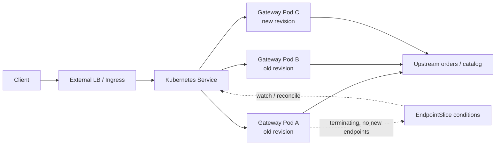
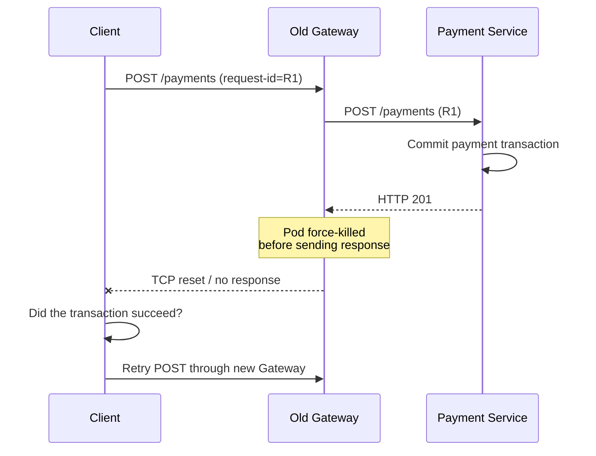
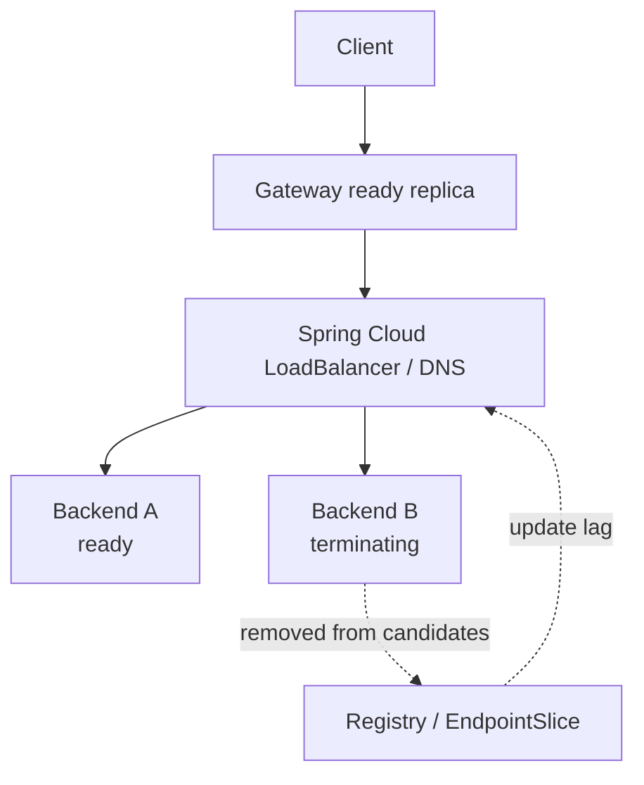
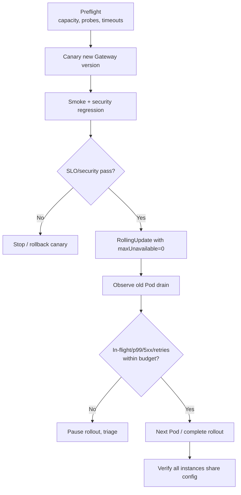

# Graceful Shutdown, Traffic Draining, and Handling In-Flight Connections

A new release of **Spring Cloud Gateway** is rolled out using a Kubernetes rolling update. An old Pod receives `SIGTERM` and exits seconds later; at that exact moment, a client is downloading a large response, a `POST /payments` call has reached the backend without responding yet, and hundreds of keep-alive connections still point to the old Pod. If the pod dies immediately, clients see `connection reset` or `502/503/504`; if clients retry carelessly, business operations can be written twice. If the pod keeps accepting new requests while trying to shut down, waiting for connections to drain can drag on forever.

**Graceful shutdown** and **traffic draining** solve two distinct halves of the problem: **stop routing new work to an instance leaving the cluster** and **let in-flight work finish within a bounded time budget**. In practice, you also must handle HTTP keep-alive, WebSockets/SSE, outbound connection pools, Spring lifecycle ordering, and Kubernetes forced termination deadlines.

This lesson belongs to the **Deployment** chapter of the **SPRING_CLOUD_GATEWAY** module, in the context of building an API Gateway with route predicates, filter chains, path/header transformations, service discovery, authentication/authorization, rate limiting, circuit breakers, retries, TLS, and observability. The goal is deploying, updating, or scaling down replicas without unnecessarily severing active work, while knowing precisely when **zero dropped requests cannot be promised**.

**After this lesson, you will be able to:**

1. Distinguish **readiness**, **draining**, **graceful application shutdown**, **connection close**, and **forced kill**.
2. Describe the real sequence of **Kubernetes Pod termination**, `preStop`, EndpointSlices, `SIGTERM`, Spring Boot, and `SIGKILL`.
3. Configure Spring Boot Gateway WebFlux/MVC with matching timeouts and run safe rolling updates.
4. Handle **HTTP/1.1 keep-alive, HTTP/2, uploads/downloads, SSE, and WebSockets**.
5. Prevent **retry storms** and duplicate side-effecting writes when a Pod is replaced.
6. Write load tests, fault-injection scenarios, backend stubs, metrics, and PASS/FAIL/INCONCLUSIVE drain rules.

> **Version Scope:** Examples primarily target **Spring Cloud Gateway Server WebFlux + Spring Boot + Kubernetes**, with a dedicated section comparing Gateway Server Web MVC (Servlet/Tomcat or Jetty). Current Spring Boot docs note graceful shutdown is enabled by default on supported embedded servers; **older Spring Boot 3.x releases may require `server.shutdown=graceful` explicitly**. For reproducibility, examples declare it explicitly. Kubernetes `lifecycle.preStop.sleep` stabilized in **Kubernetes v1.34**; on older clusters verify API support or use a compatible hook. All second counts and replica counts in examples are **practice values**, not universal defaults.

## 1. Four Things Commonly Lumped Together as "Graceful"

| Concept | Problem solved | What is **not** guaranteed |
| --- | --- | --- |
| **Readiness** | Is this Pod still eligible for new traffic? | Does not close existing TCP/WebSocket connections. |
| **Traffic draining** | Have Ingress/Service/LB stopped picking this pod for new requests/connections? | Does not finish in-flight requests; propagation is not instantaneous. |
| **Graceful application shutdown** | Does the server wait for active requests to complete before closing? | Does not wait forever; time budgets and transport semantics apply. |
| **Connection/session draining** | How are TCP keep-alives, HTTP/2 streams, WebSockets/SSE, and outbound resources handled? | Does not guarantee long-lived sessions finish before deadline. |
| **Forced shutdown** | Once the deadline expires, when does OS/container runtime kill the process? | Cannot preserve unfinished work past `SIGKILL`. |

Distinguish **request**, **TCP connection**, and **business operation**:

- **One HTTP/1.1 keep-alive connection** can serve many sequential HTTP requests.
- **One HTTP/2 connection** can carry many concurrent streams.
- **One WebSocket connection** can stay open for hours, and its messages are not standard HTTP requests.
- **One business operation** can already be committed at the backend while Gateway/client loses the response, risking duplicate writes on retry.

Therefore, "closing the TCP port" does not mean "all transactions completed," and "refusing new requests" does not mean "all connections vanished."

### 1.1. Three Outcomes a Request Can Experience During a Rollout

1. **Completes cleanly:** Client sent the request before drain; Gateway kept the pipeline open long enough for the backend to answer and the client to receive the full response.

2. **Rejected or steered to another instance:** A new request arrives after the Pod leaves load balancing; ingress/clients pick another Gateway or return an error per config. Never assume the server always emits an HTTP status—it could be a TCP reset/refused.

3. **Interrupted mid-flight:** Grace budget expired, container killed, client/network dropped, backend ran too slowly, or the stream had no end. Requires observability and retry/idempotency policies.

A well-engineered deployment minimizes **case 3** and makes **case 2** cleanly recoverable—rather than promising zero network errors unconditionally.

## 2. Multi-Layer Traffic Draining Architecture



During a rollout, **several independent traffic-control systems** must converge:

1. Deployment controller creates new Pods and deletes old Pods.
2. Kubernetes API Server records Pod termination start.
3. EndpointSlice controller updates endpoint conditions.
4. kube-proxy, ingress controllers, service meshes, and load balancers observe updates via watches/reconciliation.
5. Clients or upstream proxies may still hold pooled TCP connections to old pods.
6. Kubelet executes `preStop`, sends the stop signal, and eventually force-kills any remaining process.

**These components do not synchronize atomically inside one shared transaction.** There is always a window where membership, routing, and process lifecycle diverge. Drain design must tolerate that window.

### 2.1. Traffic Flows in Two Directions

Gateway has **two HTTP sides**:

```text
           Inbound                                  Outbound
Client ----> Ingress ----> Gateway ----> HTTP client/pool ----> Backend
                     [accept/drain]      [finish/cancel/close]
```

- **Inbound drain:** stop accepting new connections/requests onto the departing Gateway.
- **Outbound drain:** do not prematurely destroy connections the Gateway needs to await backend replies.
- **Backend drain:** when backends also roll out, coordinate service discovery/endpoint readiness so Gateway stops picking departing backends.

Adding a hook that closes the HTTP client immediately on `SIGTERM` breaks the **outbound** leg even while the embedded server is still waiting for existing inbound requests to finish.

## 3. Kubernetes Pod Termination Sequence

Per current Kubernetes documentation, graceful Pod deletion sets a **grace period deadline**. Kubelet, the EndpointSlice controller, and routing planes react in parallel; there is no guarantee routing updates finish before the stop signal arrives.

```mermaid
sequenceDiagram
    participant D as Deployment / API Server
    participant K as Kubelet
    participant E as EndpointSlice + Ingress
    participant P as Gateway process
    participant B as Backend
    D->>D: Pod deletionTimestamp, grace deadline
    par Endpoint update
        D->>E: Pod terminating; ready=false
        E->>E: Propagate to Service/LB
    and Node termination
        D->>K: Terminate Pod
        opt preStop configured
            K->>P: Run preStop hook / sleep
        end
        K->>P: Send SIGTERM (usually PID 1)
        P->>P: Spring context closing
        P->>P: Stop accepting new HTTP
        P->>B: Complete in-flight upstream requests
        B-->>P: Backend responses
        P->>P: Close remaining resources
    end
    alt Exit before grace deadline
        P-->>K: Process exits
    else Grace period expires
        K->>P: SIGKILL; remaining work interrupted
    end
```

### 3.1. Key Milestones

| Milestone | What happens | Impact on Gateway |
| --- | --- | --- |
| **T0 — Pod deletion requested** | Kubernetes sets `deletionTimestamp` and grace deadline. | Pod is leaving the cluster. |
| **T0+ — EndpointSlice updated** | Endpoint gets `terminating=true` and `ready=false`; entry may still remain in EndpointSlice. | LB/Service should stop sending **new regular traffic** once observed. |
| **T0+ — preStop** | Kubelet runs hook if configured; hook time **counts toward grace**. | Process stays alive; gives routing propagation time. |
| **Post-preStop — SIGTERM** | Runtime sends stop signal (ordinarily to PID 1). | Spring begins context closure and graceful server stop if signal propagates. |
| **Graceful phase** | Embedded web server lets active requests finish while rejecting new ones. | In-flight work continues within budget. |
| **Deadline** | Grace expires with process still alive → `SIGKILL`. | Remaining requests/sessions sever; no Java shutdown hooks run. |

**Note:** Kubernetes' default `terminationGracePeriodSeconds` is **30 seconds**. This timer starts when termination begins and **includes `preStop`**, not 30 seconds after the hook finishes. If `preStop` eats most of the budget, the process gets almost no time to shut down cleanly.

### 3.2. EndpointSlice `terminating` and `serving`

In modern Kubernetes releases:

- A terminating endpoint has `terminating=true`.
- For backward compatibility, `ready=false` for terminating endpoints.
- `serving` may indicate serving ability during drain for consumers supporting advanced drain logic.

**Never interpret `serving=true` as "this pod should keep getting brand-new production traffic."** Normally only ready/non-terminating endpoints take new requests; drain-aware proxies can use `serving` for existing connections.

Likewise, an external ingress outside Kubernetes Services may have its own **deregistration delay/connection draining**. Measure your exact LB controller and network path rather than inferring from Pod specs alone.

### 3.3. Readiness Probes Do Not Close Connections

A failing readiness probe **removes the pod from future endpoint selection**, yet:

- In-flight requests are not canceled automatically.
- Old HTTP keep-alive connections may remain open in ingress/proxies.
- Some proxies keep sending on pooled connections until endpoint tables refresh.
- Upgraded browser WebSockets are not forced closed solely because readiness changed.

Therefore, never add `readinessProbe` and ignore `SIGTERM` and Spring graceful shutdown.

## 4. Spring Boot Graceful Shutdown in Gateway

Current Spring Boot supports graceful shutdown across **Reactor Netty, Tomcat, and Jetty** for both reactive and Servlet applications. When the `ApplicationContext` closes, the embedded server stops accepting new requests per server semantics and **grants active requests a window to complete**. This integrates with Spring `SmartLifecycle` shutdown phases.

### 4.1. Minimal Configuration

```yaml
server:
  port: 8080
  shutdown: graceful

spring:
  application:
    name: edge-gateway
  lifecycle:
    timeout-per-shutdown-phase: 40s
```

Meaning:

- `server.shutdown: graceful`: explicitly declares graceful HTTP server shutdown, especially helpful across differing Boot versions.
- `spring.lifecycle.timeout-per-shutdown-phase: 40s`: wait budget **per shutdown phase** in Spring `LifecycleProcessor`, **not a guarantee that the entire process finishes within 40 seconds total**.
- For standard Gateway Server WebFlux, the embedded server is typically **Reactor Netty**.
- For Gateway Server Web MVC, the embedded Servlet server is typically **Tomcat/Jetty**; the same Spring Boot properties apply, though request rejection, connection reuse, and threading differ.

**Never set `server.shutdown: immediate`** and expect in-flight HTTP requests to complete. Even where newer Spring Boot defaults to graceful, declaring it explicitly aids code reviews, testing, and consistency with older lines.

### 4.2. "Refusing New Requests" Depends on the HTTP Server

Spring Boot docs explain that grace-period rejection mechanics differ by server and **persistent connections can affect behavior**. Across Tomcat/Jetty/Reactor Netty, graceful shutdown stops admitting new requests at the network layer. Still, never assume every request **on an already-open connection** immediately receives HTTP 503: clients may see socket close/reset, handshake failures, or failover to another instance.

| Runtime | What to watch during drain | Common trap |
| --- | --- | --- |
| **Gateway Server WebFlux / Reactor Netty** | Event loops, HTTP/1.1 keep-alive, HTTP/2 streams, in-flight reactive responses. | One long stream blocks draining or gets killed at deadline. |
| **Gateway Server Web MVC / Tomcat** | Servlet worker threads, connections, async dispatch, response writes. | Blocking backend calls pin worker threads until timeout. |
| **Gateway Server Web MVC / Jetty** | Jetty connectors, async I/O, thread pools, HTTP upgrades. | Applying Tomcat properties assuming they tune Jetty. |
| **Ingress proxy/LB** | Endpoint selection and pooled upstream connections. | LB keeps routing to pod after the app closed its listener. |

**Never use Netty event-loop metrics to inspect a Tomcat-backed Gateway MVC**, or apply `server.tomcat.*` properties to Reactor Netty. Match docs to your runtime and monitor both inbound and outbound sides.

### 4.3. `SmartLifecycle`, `@PreDestroy`, and Shutdown Ordering

The Spring context shuts down across ordered lifecycle phases. Do not create a bean like:

```java
// Anti-pattern: closing outbound HTTP clients immediately at context close
// while the embedded web server is still awaiting in-flight requests.
@PreDestroy
void closeClientsImmediately() {
    // httpClient.disposeNow();
}
```

Closing pools/clients early fails in-flight requests mid-flight that otherwise would have succeeded. For Spring/Gateway-managed HTTP clients, **let the framework manage lifecycle**, writing custom lifecycles only when you understand `SmartLifecycle` phasing and dependencies.

A custom background worker may need to stop pulling new jobs while finishing active ones; give it **its own deadline and error handling**. Never block indefinitely in `@PreDestroy`, and never invoke `System.exit(0)` straight from a `preStop` handler.

### 4.4. App Shutdown Differs from HTTP Response Timeouts

Several independent timers coexist:

- **Connect timeout:** time allowed to establish an outbound backend connection.
- **Response timeout:** time allowed waiting for backend replies per client/filter semantics.
- **Circuit breaker timeout:** deadline enforced by the resilience layer.
- **Graceful server timeout:** window given active requests during server shutdown.
- **Kubernetes termination deadline:** hard ceiling before container kill.

If response timeout is 120 seconds while remaining termination budget is 40 seconds, **you cannot guarantee** a 120-second request finishes. Align a **consistent end-to-end time budget**.

## 5. Readiness, Liveness, and Startup Probes in Spring Boot

**Spring Boot Actuator** tracks `ApplicationAvailability` across two axes:

- **Liveness:** is the process healthy or does it need restarting?
- **Readiness:** is this instance ready to accept new traffic?

On Kubernetes, Boot exposes `/actuator/health/liveness` and `/actuator/health/readiness` when Actuator and probes are enabled. Default readiness **does not check all external dependencies**; adding shared Redis, backends, or registries to readiness must be weighed carefully because if Redis goes down and every pod goes unready, the entire Gateway Service loses all endpoints.

### 5.1. Boot States at Startup and Shutdown

| Phase | Liveness | Readiness | Interpretation |
| --- | --- | --- | --- |
| Starting up | May be `BROKEN` | `REFUSING_TRAFFIC` | Not taking traffic yet. |
| App started, not ready | `CORRECT` | `REFUSING_TRAFFIC` | Waiting on startup tasks, warm-up, etc. |
| App ready | `CORRECT` | `ACCEPTING_TRAFFIC` | Eligible for Service/LB. |
| Spring graceful shutdown | Usually still `CORRECT` | `REFUSING_TRAFFIC` | HTTP server stopped admitting new requests and waits for in-flight work. |
| Context closed | Health endpoint gone | Gone | Process stopped. |

**Readiness is not a socket-closing switch.** During shutdown, HTTP probes can fail simply because the server is closing its listener. To confirm the process entered drain, combine logs/lifecycle metrics and Kubernetes Pod/EndpointSlice events rather than polling `/readyz` repeatedly after `SIGTERM`.

### 5.2. Serving Probes on the **Same Web Server Port**

```yaml
spring:
  application:
    name: edge-gateway
  lifecycle:
    timeout-per-shutdown-phase: 40s

server:
  port: 8080
  shutdown: graceful

management:
  endpoint:
    health:
      probes:
        enabled: true
        add-additional-paths: true
  endpoints:
    web:
      exposure:
        include: health,info
```

Boot exposes `/livez` and `/readyz` on the **main server port** when additional paths are configured. This helps especially when Actuator runs on a separate port: a management context can report OK while the main HTTP connector is broken; main-port probes catch real listener faults.

**Never turn `/readyz` into a secret-leaking endpoint.** Return minimal health status only, keeping diagnostics like `env`, `heapdump`, and Gateway route-write APIs off public networks.

### 5.3. When Is `startupProbe` Needed?

If Gateway takes longer to initialize TLS resources, `RouteDefinitionRepository`, or dependency metadata, `startupProbe` keeps kubelet from **killing the app prematurely via liveness** during legitimate boot. Only once `startupProbe` passes do readiness and liveness probes begin running.

**Never use liveness probes to test whether Redis, IdPs, or backends are healthy:** a shared dependency outage triggers simultaneous Gateway pod restarts, amplifying the incident. Readiness should also avoid coupling to every backend when Gateway has circuit breakers/fallbacks and independent healthy routes.

### 5.4. Intentionally Marking Unready Before Pod Deletion

In platforms using **coordinated two-phase draining** (drain traffic first, then terminate), Spring Boot supports availability events:

```java
import org.springframework.boot.availability.AvailabilityChangeEvent;
import org.springframework.boot.availability.ReadinessState;
import org.springframework.context.ApplicationContext;

// Illustrative snippet inside a Spring-managed component:
AvailabilityChangeEvent.publish(
    applicationContext, ReadinessState.REFUSING_TRAFFIC);
```

The orchestrator then waits for load balancers to confirm zero new traffic before issuing Pod deletion. **Mandatory requirement:** the trigger must live strictly on a secured management/control plane—never create a public `POST /drain` callable from the Internet, and never treat this event as a substitute for real process termination.

When using standard Kubernetes deletion alone, terminating/ready=false updates happen automatically without building a custom drain API. Pick **one clear strategy** and test it rather than letting multiple filters and hooks fight over readiness state.

## 6. Sample Kubernetes Deployment: Rolling Update and `preStop`

This example targets Kubernetes **v1.34+** for stable `preStop.sleep.seconds`. Demo goals:

- 3 Gateway replicas, keeping capacity while replacing one pod.
- Route traffic only to ready pods.
- Wait 10 seconds before signaling so endpoint updates can propagate to ingress/LBs.
- On `SIGTERM`, Spring Boot gets ~40 seconds **per lifecycle phase**.
- Kubernetes allows **120 seconds** total for cleanup, leaving room for extra phases and margin.

### 6.1. Deployment YAML

```yaml
apiVersion: apps/v1
kind: Deployment
metadata:
  name: edge-gateway
  labels:
    app: edge-gateway
spec:
  replicas: 3
  minReadySeconds: 5
  progressDeadlineSeconds: 600
  selector:
    matchLabels:
      app: edge-gateway
  strategy:
    type: RollingUpdate
    rollingUpdate:
      maxSurge: 1
      maxUnavailable: 0
  template:
    metadata:
      labels:
        app: edge-gateway
    spec:
      terminationGracePeriodSeconds: 120
      containers:
        - name: gateway
          image: registry.example.test/edge-gateway:1.0.0
          imagePullPolicy: IfNotPresent
          ports:
            - name: http
              containerPort: 8080
          lifecycle:
            preStop:
              sleep:
                seconds: 10
          startupProbe:
            httpGet:
              path: /livez
              port: http
            periodSeconds: 2
            timeoutSeconds: 1
            failureThreshold: 60
          livenessProbe:
            httpGet:
              path: /livez
              port: http
            periodSeconds: 10
            timeoutSeconds: 2
            failureThreshold: 3
          readinessProbe:
            httpGet:
              path: /readyz
              port: http
            periodSeconds: 2
            timeoutSeconds: 1
            failureThreshold: 2
          resources:
            requests:
              cpu: 500m
              memory: 512Mi
            limits:
              cpu: "1"
              memory: 1Gi
---
apiVersion: v1
kind: Service
metadata:
  name: edge-gateway
spec:
  type: ClusterIP
  selector:
    app: edge-gateway
  ports:
    - name: http
      port: 80
      targetPort: http
```

**This is an illustrative template, not an applied manifest.** `registry.example.test/edge-gateway:1.0.0` is a placeholder; production requires a real image, security contexts, TLS ingress, security/network policies, quotas, and full Spring Cloud Gateway config. CPU/memory limits show structure only—size from real load testing.

### 6.2. Explaining Key Fields

| Field | Reason | Caveat |
| --- | --- | --- |
| `replicas: 3` | Keeps peer instances serving while one pod leaves. | 3 replicas cannot absorb traffic if all are already saturated. |
| `maxUnavailable: 0` | Avoids dropping available pods below desired during RollingUpdate. | Cannot prevent workload errors or capacity loss from node crashes. |
| `maxSurge: 1` | Brings up one replacement pod before stopping an old pod. | Requires cluster headroom for the surge pod. |
| `minReadySeconds: 5` | Requires new pods to stay ready briefly before counting available. | Does not automatically prove all routes/IdPs/backends work. |
| `startupProbe` | Shields slow cold starts from premature liveness kills. | Keep startup window bounded. |
| `readinessProbe` | Removes unready pods from new traffic. | Does not drain existing connections. |
| `livenessProbe` | Restarts truly wedged pods. | Never tie to shared Redis health. |
| `preStop.sleep: 10` | Gives endpoint/LB propagation extra time before `SIGTERM`. | Consumes 10s of termination grace; doesn't flip app readiness itself. |
| `terminationGracePeriodSeconds: 120` | Hard deadline for shutdown before kill. | Must exceed combined duration of hooks and shutdown phases. |

### 6.3. Why `preStop` Sleep Helps — and Its Limits

When Kubernetes marks a Pod terminating, the EndpointSlice controller starts pulling it from new traffic. Yet ingresses and load balancers may lag. `preStop.sleep` keeps the app alive briefly so updates can arrive **before Spring closes the HTTP listener**.

However:

- During sleep, Spring **has not received `SIGTERM` yet**, so internal readiness may still read `ACCEPTING_TRAFFIC` even though Kubernetes marked the endpoint terminating.
- Unconverged load balancers **can still send new requests** to the Pod during this window.
- Some external cloud ingresses have deregistration timers longer than 10 seconds.
- The hook does not know whether every proxy actually stopped picking the Pod. **10 seconds must be measured**, not assumed.

If stricter control is required, use **two-phase coordination**: flip readiness to refusing via a trusted control plane, wait for confirmed convergence, then terminate—understanding the added state/time complexity and failure handling between phases.

### 6.4. `preStop` on Older Clusters

Before using `preStop.sleep`, verify your cluster supports it (stable in v1.34). A compatible option on older clusters:

```yaml
lifecycle:
  preStop:
    exec:
      command:
        - /bin/sh
        - -c
        - sleep 10
```

**Use only when the container image includes `/bin/sh` and `sleep`.** Distroless/minimal images typically **lack a shell**, causing this hook to fail. Prefer the native sleep action on supported clusters or a shell-free control-plane drain—never add a shell to production images just for `sleep` if it violates hardening policy.

### 6.5. Never Wait Until Termination Grace Expires to Remove Endpoints

A common mistake looks like:

```text
Pod terminating
  -> immediate SIGTERM
  -> embedded server closes listener
  -> 30 seconds later ingress finally learns the pod is gone
  -> burst of connection refused errors
```

A **propagation/drain window before server close** reduces that race. Yet if ingress takes 40 seconds to update while `preStop` sleeps only 10 seconds, errors still occur. Measure **your exact LB, idle connection reuse, and ingress propagation lag** before picking durations.

## 7. Calculating Time Budgets Across Layers

Never treat `10s`/`40s`/`120s` as production-ready defaults from an example. Compute your budget:

```text
T_kubernetes_grace
  >= T_preStop_propagation
   + T_application_shutdown
   + T_additional_cleanup_phases
   + T_margin
```

Where:

- `T_preStop_propagation`: time for `preStop` and endpoint propagation.
- `T_application_shutdown`: time the embedded server gives in-flight work to finish.
- `T_additional_cleanup_phases`: other Spring lifecycle phases, exporters, consumer jobs, pool closes, and signal overhead.
- `T_margin`: buffer for scheduling jitter, network variance, and measurement noise.

**Crucial detail:** `spring.lifecycle.timeout-per-shutdown-phase` applies **per phase**. With multiple phases or custom `SmartLifecycle` beans hitting their timeouts, total process shutdown can **exceed a single phase's timeout**. Measure actual stop durations rather than treating 40 seconds as an absolute ceiling.

### 7.1. Sample Budget Table

| Component | Practice value | Notes |
| --- | ---: | --- |
| `preStop` | 10s | For EndpointSlice/ingress propagation. |
| HTTP graceful shutdown target | 40s | `spring.lifecycle.timeout-per-shutdown-phase`, excluding other phases. |
| Other cleanup phases | 30s | Estimated; must measure live. |
| Buffer | 40s | Margin for jitter/anomalies. |
| **Kubernetes grace** | **120s** | Illustrative total budget. |

If p99 requests take 15 seconds and max timeout is 45 seconds, a 40-second HTTP graceful budget covers **most** requests without **guaranteeing** a valid 45-second request finishes if drain begins right after it arrives. Tighten deadlines/contracts or ensure controlled retries/recovery.

### 7.2. Timeouts That Cannot Simply Be Added Together

| Timeout | Owner | Meaning |
| --- | --- | --- |
| `preStop.sleep.seconds` | Kubelet | Delay before sending stop signal. |
| `terminationGracePeriodSeconds` | Kubelet/container runtime | Hard cutoff before forced kill. |
| `spring.lifecycle.timeout-per-shutdown-phase` | Spring `ApplicationContext` | Allowance per lifecycle phase. |
| Gateway response timeout | Gateway outbound client/filter | Wait cap for a single backend reply. |
| Ingress idle/read timeout | External LB / ingress | Idle/read cap on connections or requests. |
| HTTP keep-alive idle timeout | HTTP connection | Cap on **idle connections**, not total request duration. |
| WebSocket/SSE session lifetime | Application/protocol/LB | Can vastly exceed HTTP graceful budgets. |

**Never set ingress idle timeout to 5s expecting Gateway to hold a 30-minute SSE stream**, or set Kubernetes grace to 20s when Spring needs 60s. Validate time budgets **per request type**.

### 7.3. Reserving Capacity During Rollouts

Suppose 3 replicas split 900 RPS (~300 RPS each), and each pod sustains 400 RPS within SLO.

- If one pod drains before a replacement becomes available, **2 pods** absorb 900 RPS → 450 RPS/pod, breaching capacity.
- With `maxSurge: 1` and the new pod taking traffic **before** the old pod drains, 3 pods remain ready (~300 RPS/pod, subject to real LB spread).

**Zero-downtime rollouts demand sufficient capacity and accurate readiness**, not just long grace periods. If the cluster lacks surge capacity, rollouts stall instead of dropping traffic—monitor that failure mode too.

## 8. `SIGTERM` Must Reach the Real Java Process

Inside containers, signal delivery matters just as much as Spring configuration. If the container runtime sends `SIGTERM` to a shell wrapper that fails to forward signals to the JVM, Spring Boot **never gets to run graceful shutdown**.

### 8.1. Dockerfile Using Exec-Form `ENTRYPOINT`

```dockerfile
# JDK/runtime/image are examples; pick a maintained base image.
FROM eclipse-temurin:21-jre

WORKDIR /app
COPY target/edge-gateway.jar /app/edge-gateway.jar

# Apply non-root, read-only filesystem, and image signing best practices
# per your deployment environment.
ENTRYPOINT ["java", "-jar", "/app/edge-gateway.jar"]
```

With exec form, `java` runs directly as the main process and receives stop signals cleanly. If using a wrapper script, end with **`exec java ...`**:

```sh
#!/bin/sh
set -eu
exec java -jar /app/edge-gateway.jar
```

Never let a shell spawn Java as a child without `exec` or signal forwarding, such as:

```dockerfile
# Anti-pattern: shell-form ENTRYPOINT does not guarantee Java receives SIGTERM.
ENTRYPOINT java -jar /app/edge-gateway.jar
```

Entrypoints and launchers vary in signal handling; verify by **sending a real test signal** rather than guessing from the Dockerfile. With distroless images, no shell exists for `/bin/sh -c sleep` in `preStop`, making native Kubernetes sleep the clean choice on supported clusters.

### 8.2. Checking PID 1 in a Lab Container

In a test container with process inspection tools, run:

```sh
# Example command in a Linux container that includes ps.
ps -o pid,ppid,command -p 1
```

Expect either Java or a proper signal-forwarding init process (`tini` or similar init wrapper reaping zombies and forwarding signals works fine—PID 1 not being `java` isn't automatically an error).

Verify by observing real behavior:

1. Start a slow request carrying a unique traceable ID.
2. Send `SIGTERM` to the main process/container via an authorized method.
3. Watch Spring graceful shutdown logs and the in-flight response.
4. Confirm the JVM exits cleanly before the forced-kill deadline.

### 8.3. Testing `docker stop` in a Lab

```bash
# Never run against production containers.
docker stop --time 120 edge-gateway-test
```

Depending on engine/OS, the runtime sends a stop signal and waits the specified duration before killing. This tests **container lifecycle** only—it cannot substitute for Kubernetes EndpointSlice/ingress drain testing since local Docker lacks those layers.

### 8.4. Cases Graceful Shutdown Cannot Rescue

- Kernel OOM kills or node power loss.
- Immediate `SIGKILL` or `terminationGracePeriodSeconds: 0`.
- Kernel/network partitions severing sockets.
- JVM deadlocks or blocking code unresponsive to signals/cleanup.
- Native/JNI crashes or fatal filesystem failures.

That is why **client recovery, idempotency, durable state, and multiple replicas** remain mandatory. Graceful shutdown reduces errors only during **planned, signaled terminations**.

## 9. Observing Actual In-Flight HTTP Requests

When a Pod begins draining, know:

- How many HTTP requests are actively running?
- How many completed vs canceled/errored?
- How many inbound TCP connections stay open?
- How many outbound HTTP connections are active/pending/idle?
- How many long-lived WebSocket/SSE sessions remain open?
- How many retries are still firing after shutdown starts?

**Never mistake connection counts for in-flight request counts.** HTTP/1.1 keep-alives sit idle, HTTP/2 multiplexes concurrent streams, and WebSocket handshakes finish while sessions live for hours.

### 9.1. A `WebFilter` Purely for Measuring In-Flight HTTP

Example for **Spring WebFlux** (not for Servlet Web MVC):

```java
package com.example.gateway.observability;

import java.util.concurrent.atomic.AtomicInteger;

import io.micrometer.core.instrument.Gauge;
import io.micrometer.core.instrument.MeterRegistry;
import org.springframework.stereotype.Component;
import org.springframework.web.server.ServerWebExchange;
import org.springframework.web.server.WebFilter;
import org.springframework.web.server.WebFilterChain;
import reactor.core.publisher.Mono;

@Component
public final class InFlightHttpWebFilter implements WebFilter {

    private final AtomicInteger inFlight = new AtomicInteger();

    public InFlightHttpWebFilter(MeterRegistry registry) {
        Gauge.builder("gateway.inflight.http.requests",
                inFlight, AtomicInteger::get)
            .description("Subscribed inbound HTTP exchanges in progress")
            .register(registry);
    }

    @Override
    public Mono<Void> filter(
            ServerWebExchange exchange,
            WebFilterChain chain) {

        return Mono.defer(() -> {
            inFlight.incrementAndGet();

            return chain.filter(exchange)
                .doFinally(signal ->
                    inFlight.decrementAndGet());
        });
    }
}
```

Explanation:

1. `Mono.defer(...)` increments **upon subscription**, avoiding premature counts during reactive assembly.
2. `doFinally(...)` decrements on **complete, error, or cancel**, preventing leaks when clients abort requests.
3. The Gauge registers once in Micrometer with no high-cardinality `userId` or `correlationId` tags.
4. Operating at the **WebFlux HTTP chain**, it may also count requests not matching a Gateway route depending on filter ordering.
5. It counts **active reactive HTTP subscriptions**, not open idle sockets or detached background work spawned outside the reactive pipeline.

**Never spin-wait indefinitely on this counter inside `@PreDestroy`.** Any wait loop needs explicit deadlines, cancellation logic, and deadlock safety with Spring's lifecycle. In practice, let Spring Boot's server graceful shutdown coordinate the HTTP pipeline while using the gauge for **observability and diagnostics**.

### 9.2. Why Can In-Flight Be 0 While Connections Remain Open?

Idle HTTP keep-alive sockets carry zero active requests. Upgraded WebSocket sessions keep exchanging frames while HTTP-filter counters may not reflect the **full** session lifetime depending on runtime/handler. HTTP/2 connections can stay open with zero active streams.

For long-lived sessions, add **connection/session registries or protocol-level metrics** at the right layer rather than relying solely on an HTTP request gauge.

### 9.3. Observing Spring Cloud Gateway / Netty Outbound Pools

In Gateway Server WebFlux, outbound pool metrics can be enabled under the modern namespace:

```yaml
spring:
  cloud:
    gateway:
      server:
        webflux:
          httpclient:
            connect-timeout: 3000
            response-timeout: 20s
            pool:
              type: FIXED
              max-connections: 200
              acquire-timeout: 2000
              metrics: true
```

Numbers are **staging measurement examples**, not universal defaults. Units for `connect-timeout`/`acquire-timeout` here are **milliseconds**; `response-timeout` accepts Duration strings. Check your Gateway version's configprops, as older 4.x lines use `spring.cloud.gateway.httpclient.*`.

Common Reactor Netty metrics:

| Logical metric name | Meaning |
| --- | --- |
| `reactor.netty.connection.provider.active.connections` | Acquired connections currently in use. |
| `reactor.netty.connection.provider.idle.connections` | Idle pooled connections. |
| `reactor.netty.connection.provider.pending.connections` | Acquisitions waiting for a connection. |
| `reactor.netty.connection.provider.total.connections` | Active + idle per pool. |
| `reactor.netty.connection.provider.pending.connections.time` | Wait time for acquisition. |
| Gateway route request metrics | Per-route latency/status if enabled. |

Align **the exact same time window** across in-flight HTTP, outbound pools, backend latencies, and Kubernetes events when debugging. Do not conclude "Gateway failed to drain" merely because idle outbound pool connections linger while the context closes.

### 9.4. Do Not Dispose the Outbound Pool Too Early

Calling Reactor Netty `ConnectionProvider.dispose()` or `HttpResources.disposeLoopsAndConnections()` can tear down shared resources. Calling it while requests remain in-flight fails outbound HTTP client calls.

If you manage a **custom `ConnectionProvider`**, define when new acquisitions stop, when pending/active resources close, and cleanup deadlines. Reactor Netty also provides pool dispose grace APIs depending on version—**do not confuse them with Spring Boot's server graceful timeout**.

With Gateway's auto-configured HTTP client, manual disposal code is rarely needed; testing real shutdown behavior matters most.

### 9.5. Shutdown Logging Should Not Delay Shutdown

A helpful structured log:

```json
{
  "event": "gateway.shutdown.requested",
  "service.name": "edge-gateway",
  "instance": "edge-gateway-pod-a",
  "remainingGraceMs": 120000,
  "inFlightHttp": 38,
  "outboundActive": 22,
  "release": "1.0.0"
}
```

This is a **desired log schema**, not default Spring output. `remainingGraceMs` requires a real deadline source (often unknown directly inside the container); if unavailable, **omit the field** rather than fabricating values. Never log Authorization headers, Cookies, or raw payloads, and never put correlation IDs into high-cardinality metric labels.

## 10. Special HTTP Behaviors During Drain

### 10.1. HTTP/1.1 Keep-Alive

Clients and ingresses open one TCP connection to send multiple sequential requests. During Pod drain:

- A request that arrived before graceful stop can finish.
- A new request sent **over an existing connection** behaves per server/HTTP client and shutdown timing.
- Once the connection closes, clients may see `EOF`, `connection reset`, or `connection refused`—**not necessarily HTTP 503**.
- Reverse proxies may pick another instance and safely retry idempotent requests before answering the client.

**Never send `Connection: close` on every response from startup:** that kills pooling and inflates TCP/TLS overhead. Only emit close headers during draining if your runtime/LB specifically requires it, and test thoroughly.

### 10.2. HTTP/2 Multiplexing

In HTTP/2, **one TCP connection carries many concurrent streams**. Abruptly closing the socket breaks multiple requests at once. Graceful HTTP/2 draining relies on **GOAWAY** and draining active streams, with details varying across Reactor Netty, Jetty, Tomcat, and ingresses by version.

Never claim "Boot always emits GOAWAY on every shutdown" without testing your actual stack. Tests should check:

1. One HTTP/2 connection carrying multiple active streams.
2. Trigger drain.
3. Check whether streams complete or cancel per time budget.
4. Confirm clients stop opening new streams on the draining connection and open connections to another pod.
5. Inspect HTTP/2 connection/stream metrics if supported by the runtime.

**TCP connection count ≠ active HTTP/2 stream count**; size capacity and drains in the right units.

### 10.3. Large Uploads and Downloads

A multi-GiB download or slow-client upload can outlast graceful shutdown:

- Distinguish response idle timeouts from total deadlines.
- Stream payloads instead of buffering entire bodies in RAM.
- If a client cancels an upload, does the backend call cancel cleanly?
- If TCP drops after the backend processed a POST, retries risk duplicate side effects.
- If using `Retry`/body caching, bound memory usage and replay semantics.

**Never stretch `terminationGracePeriodSeconds` to hours just for unbounded uploads.** Design chunked/resumable uploads, pre-signed object-storage URLs, or checkpointed job APIs when workloads demand it.

### 10.4. WebSockets

Spring Cloud Gateway Server WebFlux proxies WebSockets via `ws://`/`wss://` routes and the WebSocket routing filter. Post-upgrade, sessions can run for hours. Kubernetes readiness and HTTP request completion **cannot migrate open WebSockets to a new pod**.

A practical drain policy:

1. **Reject new WebSocket handshakes** on the draining instance.
2. Let existing sessions run up to a **bounded deadline**.
3. Send an application-level "server restarting" message if the protocol supports it.
4. Close sessions cleanly with an **appropriate WebSocket close frame/code**, prompting clients to reconnect with backoff and jitter.
5. Have clients restore subscriptions/state using verified tokens or cursors—never trust spoofed client messages.
6. Force-close at the hard deadline and count severed sessions.

**Do not assume Gateway provides a single built-in counter or API to "drain all WebSockets" identically across WebFlux and MVC.** Depending on framework and ingress, implement server session registries/policies or client reconnection. For pass-through WebSockets, close/reconnect logic may live at the ingress or backend.

### 10.5. Server-Sent Events (SSE)

An SSE response is a long-lived HTTP stream. Unending streams cannot finish inside a finite graceful timeout. Design:

- Event IDs/`Last-Event-ID` or cursors for client resumption.
- Heartbeats to detect dead sockets.
- Maximum session lifetimes when running behind frequently rolled Gateways.
- Reconnect backoff/jitter to prevent tens of thousands of clients reconnecting at once when a pod dies.
- Never keep application-level session state solely in the memory of a replaceable pod.

When the backend drives the SSE stream, Gateway does not know which event ID the client last processed. Tests must prove client reconnects **neither skip nor mis-process duplicate events contrary to contract**.

### 10.6. gRPC and Long-Lived Streams

If proxying gRPC over HTTP/2, **verify that your exact Gateway flavor, protocol stack, and ingress truly support gRPC per design**. Never assume an ordinary HTTP path proxy preserves all gRPC semantics, trailers, or bidirectional streaming.

During drain, gRPC clients must honor reconnects, deadlines, status codes, and retry rules; for streaming RPCs, verify checkpoint resumption or idempotent replay. **Apply this guidance only after confirming your stack supports gRPC end-to-end.**

## 11. Retries, Idempotency, and Interrupted Requests: Beyond Shutdown Alone

Consider:



**Gateway graceful shutdown cannot turn a lost HTTP response into proof that a transaction never committed.** A client can hit a transport error after the backend finished the work. This is the classic **at-least-once retry** and side-effect correctness problem.

### 11.1. Idempotency Keys for Side-Effecting POSTs

For payment or order creation:

```http
POST /api/payments HTTP/1.1
Authorization: Bearer <TEST_TOKEN>
Idempotency-Key: pay-7d1a906e-1
Content-Type: application/json

{"orderId":"order-42","amount":100000}
```

In a sound design:

1. The backend authenticates principal/tenant and validates payloads.
2. The backend persists the idempotency key **scoped properly** (principal/tenant/operation) alongside the outcome or in-progress state.
3. When the client retries with the same key, the backend **does not charge twice**.
4. If the same key arrives with a different payload, the backend rejects/conflicts safely per contract.
5. Retry responses return deterministic statuses/bodies independent of the old Gateway pod.

Idempotency ordinarily requires **durable backend state**, never just an in-memory cache inside a Gateway Pod that can disappear mid-rollout.

### 11.2. Calculating Retry Amplification During Rollouts

At 200 req/s through Gateway, if clients, ingress, and Gateway all retry independently, a burst of connection resets can hit backends with far more than 200 req/s.

Enforce:

- **One explicit end-to-end attempt budget**, avoiding 3× retries stacked at every layer.
- Retries restricted to permitted status/transport errors and **safe/idempotent operations**.
- Exponential backoff + jitter, total deadlines, and concurrency caps.
- Suppressing new outbound retry attempts during shutdown **once most of the grace budget is gone**.
- Circuit breakers shielding degraded backends.
- Observability on `requestId/correlationId`, `attempt`, and backend call counts.

**Never turn on Gateway's Retry Filter blindly for all POSTs to "hide" Pod-kill errors.** That swaps a handful of network errors for duplicate business writes.

### 11.3. Rate Limiters and Security Must Stay Active While Draining

Flipping readiness never disables auth or rate limiting:

- Any new request hitting the old pod during propagation **must still pass auth and quotas** if processed.
- An already-admitted request **must never escalate privileges** because the pod is stopping.
- Circuit breaker fallbacks must never bypass scope, tenant, or object ownership checks.
- Never wipe or reset shared `RedisRateLimiter` keys when pods rotate versions.
- Distinguish security/quota `401/403/429` responses from shutdown network resets; **never blindly retry security rejections**.

If implementing a custom drain filter returning 503 for new arrivals, order it carefully relative to Spring Security and metrics without exposing admin endpoints. **Never fake "200 OK" for dropped requests** just to make rollout charts look clean.

## 12. Gateway Must Also Survive Rolling Backends

Gateways are not the only pods restarting. If `lb://order-service` picks a backend instance that just started terminating, Gateway can hit:

- TCP connect timeouts/refused because the backend listener closed;
- Connection resets on pooled sockets pointing at the old backend;
- Response timeouts while the backend drains or overloads;
- 503/404 from unready instances or route/backend version skew;
- mTLS/TLS handshake errors if certs rotate mid-rollout.

### 12.1. Two-Way Readiness and Service Discovery



Gateway must monitor **real service instance lists and health/readiness policies**. Never assume a Kubernetes Service VIP magically fixes pooled connections: DNS, LoadBalancer caches, and connection pools all introduce update lag.

### 12.2. Connection Pools Holding Stale Backend Connections

An outbound keep-alive connection can linger in the pool after the backend closes it. Stale sockets get detected on reuse or cleaned up via idle/lifetime/eviction policies depending on client.

Current Gateway WebFlux docs expose:

```yaml
spring:
  cloud:
    gateway:
      server:
        webflux:
          httpclient:
            pool:
              type: FIXED
              max-connections: 200
              max-idle-time: 30s
              max-life-time: 5m
              eviction-interval: 30s
              metrics: true
```

These values are **context-dependent tuning examples**, not universal presets. Some releases enforce specific Duration formats—check configprops. Evicting idle connections cuts stale-socket errors, yet **cannot prevent resets** if a backend dies mid-flight.

### 12.3. HTTP Pool Sizing and Deadlines

Suppose 200 RPS hits a backend averaging 300 ms latency:

\[
\text{average in-flight} \approx 200 \times 0.3 = 60
\]

By Little's Law, ~60 requests sit in-flight in steady state—**not necessarily equal to TCP connection count** (HTTP/2 multiplexing, keep-alive, remote hosts, and pool settings all matter). A `max-connections=20` pool builds huge pending queues when backends slow down; raising it to 500 without backend capacity triggers overload.

During shutdown, if allowing in-flight requests to finish, **keep outbound pool capacity alive long enough** and align timeouts—never shrink `max-connections` abruptly or force-close pools just because readiness turned false.

### 12.4. HTTP Client Errors and Status Codes

| Client symptom | Likely meaning | What to distinguish |
| --- | --- | --- |
| `connection refused` | Gateway listener closed while LB still routed there | Drain/propagation race. |
| `connection reset` | TCP severed mid-flight | Gateway or backend forced close. |
| HTTP 502 | Proxy/upstream transport failure per mapping | Don't assume backend emitted 502. |
| HTTP 503 | Zero instances, open circuit breaker, or overload per config | Routing, discovery, or policy? |
| HTTP 504 | Upstream wait exceeded deadline per ingress/Gateway mapping | Which hop timed out? |
| HTTP 200 after retry | Client/proxy recovered automatically | How many upstream attempts and side effects ran? |

**Never assume a fixed HTTP 503 for every graceful shutdown:** once a listener closes, there may be **no HTTP response at all**.

## 13. Load Balancers, Ingresses, and Service Meshes Have Their Own Drain Timeouts

A Kubernetes Gateway can sit behind:

```text
Internet
  -> Cloud L7 Load Balancer (connection draining / deregistration)
  -> Ingress controller
  -> Service / kube-proxy / CNI
  -> Envoy/Istio sidecar (if used)
  -> Spring Cloud Gateway
```

Each layer brings its own settings:

- Backend health checks and unhealthy threshold before deregistration.
- Keep-alive TTLs and TCP idle timeouts.
- Max connections or max requests per upstream socket.
- Deregistration/draining delays for departing instances.
- HTTP/2 GOAWAY and stream drain policies.
- Request retries/hedging and retry budgets.
- Proxy worker shutdown timeouts and Envoy drain periods/sidecar ordering.

### 13.1. Why Might a 10-Second `preStop` Not Be Enough?

If an external LB takes 30 seconds to deregister an instance while `preStop` waits only 10 seconds:

```text
T0       pod terminating
T0+10s   Spring gets SIGTERM and closes listener
T0+30s   External LB finally stops selecting Pod
         ^^^^^^^^^^^^^^^^^^^^^^^^^^^^^^^^^^^^^^^
         20 seconds where traffic may still hit a closed listener
```

The answer is not **always slapping on 30 seconds of sleep**. Instead:

1. Measure actual propagation/deregistration times for your LB/controller.
2. Check for target deregistration APIs/hooks ahead of Pod termination.
3. Size `preStop` windows, two-phase drains, and total grace budgets appropriately.
4. Limit keep-alive reuse toward draining pods per proxy policy.
5. Test new requests, in-flight requests, and long-lived sessions.
6. Keep sufficient replicas/capacity during rollouts.

### 13.2. Never Drain Backend Routing and Close Gateway's Listener Simultaneously

Target ordering:

```text
Stop selecting Pod for NEW work
    -> Allow LB/ingress tables to converge
    -> Deliver termination signal
    -> Stop accepting new server requests
    -> Complete in-flight work within budget
    -> Flush/close resources
    -> Process exits
```

Remember that under default Kubernetes termination, **endpoint updates and `preStop` run in parallel**. This sequence is the goal, not an atomic cross-controller guarantee from Kubernetes. Strict ordering requires explicit extra orchestration and its operational overhead.

### 13.3. Service Mesh Sidecars Also Participate in Termination

When a Pod includes an Envoy/service-mesh sidecar:

- Gateway's outbound traffic may need the proxy sidecar **alive** until in-flight HTTP calls finish.
- Inbound connections pass through the sidecar with its own drain timers.
- If the sidecar exits early, Gateway sits waiting on a backend whose network path was severed.
- Native Kubernetes sidecar containers follow specific lifecycle ordering on supported versions; regular multi-container pods can receive signals without strict ordering.

**Never design per-container `preStop` sleeps without checking your exact Kubernetes version and mesh injector.** Follow Kubernetes native sidecar rules where supported, or consult mesh docs for legacy injected sidecars.

### 13.4. `PodDisruptionBudget` Complements, Never Replaces, `RollingUpdate`

With 3 Gateway replicas, you can declare a PDB:

```yaml
apiVersion: policy/v1
kind: PodDisruptionBudget
metadata:
  name: edge-gateway-pdb
spec:
  minAvailable: 2
  selector:
    matchLabels:
      app: edge-gateway
```

A PDB governs **voluntary evictions via the Eviction API**, such as planned node maintenance drains. It **does not guarantee zero downtime across Deployment rollouts**, cannot stop OOMs or node crashes, and never replaces `maxUnavailable`/`maxSurge` or readiness. Pair with node placement/topology spread so all 3 replicas never sit on one failing node.

### 13.5. Autoscaling and Scale-Down

HPA scales replicas up and down from CPU, RPS, or custom metrics. Scale-downs trigger Pod termination and draining just like rollouts.

- Never set `minReplicas` so low that one draining pod pushes survivors past SLO.
- Prevent HPA metric oscillation right after scale-up/down.
- Session-heavy Gateways should track **active WebSockets/streams**, not just average CPU.
- Never pair aggressive scale-down with WebSockets lacking reconnect/resume policies.
- Test cluster-autoscaler node drains alongside HPA scale-downs under load since they can coincide.

**Graceful shutdown is not just for code releases**; it must work whenever autoscalers, operators, or admins shrink replica counts.

## 14. Dynamic Route Changes Happening Mid-Drain

Spring Cloud Gateway can load route definitions from config, service discovery, or Redis and refresh routes **without restarting the app**. That creates another axis of change outside Kubernetes rollouts.

Scenarios:

1. Pod A is draining while route definitions update from revision 10 to 11.
2. Pod B is ready yet has not refreshed to the new routes.
3. Client requests hit both revisions while one pod leaves.
4. Backend deployments simultaneously shift API versions or URIs.

**Never treat `RefreshRoutesEvent` or route cache refreshes as a substitute for graceful shutdown or connection draining.** Refresh swaps the routing table; it **does not migrate** in-flight HTTP requests already bound to an open backend connection.

### 14.1. Coordinating Revisions and Traffic Draining

Safe strategy when config updates and deploys overlap:

- Freeze non-urgent route edits during sensitive rollouts, or ship config and image revisions together.
- Record desired/published/observed route revisions per instance.
- Before draining an old pod, confirm surviving Gateway pods run the approved route set and security policies.
- As the old pod drains, confirm live traffic lands on healthy pods on the target version.
- If new routes misbehave, roll back **config revisions** and/or **images** per dedicated runbook without messy unaudited double-rollbacks.

### 14.2. Never Equate a "Route Refreshed" Log with Cluster Convergence

In a multi-instance Gateway, verify route updates via effective route definitions and HTTP probes. One node logging refresh success does not prove stale caches cleared, security filters aligned, or backend routes converged across all peers.

**Draining is safe only when surviving nodes can route properly and enforce equivalent security.**

## 15. Testing Graceful Shutdown in Staging

A config change is trustworthy only after testing against **an active in-flight request**, **a continuous stream of new arrivals**, and **a live termination**. Simply starting and stopping an idle app proves the process can exit—not that it preserves in-flight work.

### 15.1. Building a Controllable Slow Backend

In **a separate test Spring Boot app** on port 9091, create a backend stub:

```java
package com.example.slowbackend;

import java.time.Duration;
import org.springframework.http.ResponseEntity;
import org.springframework.web.bind.annotation.GetMapping;
import org.springframework.web.bind.annotation.RequestParam;
import org.springframework.web.bind.annotation.RestController;
import reactor.core.publisher.Mono;

@RestController
public class SlowBackendController {

    @GetMapping("/slow/ping")
    public Mono<ResponseEntity<String>> slow(
            @RequestParam(defaultValue = "8") int delaySeconds) {
        // Cap delay to avoid holding test resources open too long by mistake.
        int delay = Math.max(0, Math.min(delaySeconds, 20));

        return Mono.delay(Duration.ofSeconds(delay))
            .map(tick -> ResponseEntity.ok(
                "slow-backend-completed-after-" + delay + "s"));
    }
}
```

The backend needs Spring WebFlux and a reactive web runtime. `Mono.delay(...)` delays without blocking the event loop; **never use `Thread.sleep(8000)` in a Reactor Netty handler** to simulate slowness, as it distorts server behavior. For Gateway MVC, use an equivalent external HTTP stub rather than dropping a reactive controller unchanged into a Servlet app.

### 15.2. Gateway Route to the Slow Backend

```yaml
spring:
  application:
    name: edge-gateway-test
  lifecycle:
    timeout-per-shutdown-phase: 40s
  cloud:
    gateway:
      server:
        webflux:
          routes:
            - id: slow-api
              uri: http://localhost:9091
              predicates:
                - Path=/api/slow/**
              filters:
                - StripPrefix=1

server:
  port: 8080
  shutdown: graceful
```

Use **one** top-level `spring` key containing both `lifecycle` and `cloud.gateway`. Never repeat top-level `spring` keys in the same YAML mapping, as parsers overwrite sections or reject the file.

In a Kubernetes lab, `localhost:9091` inside the Gateway container **does not point to another backend Pod**. Replace the URI with a **test Kubernetes Service DNS** such as `http://slow-backend.gateway-staging.svc.cluster.local:9091`, or an intentional backend sidecar in the same Pod. This is a classic trap where network failures get misdiagnosed as "graceful shutdown failed."

### 15.3. One Slow Request Before Termination

With the test Gateway running:

```bash
# Run strictly against an authorized test app.
# --max-time is the CLIENT deadline; keep it longer than target backend delay.
curl -i --max-time 45 \
  "http://localhost:8080/api/slow/ping?delaySeconds=8"
```

Expected backend response:

```http
HTTP/1.1 200 OK
Content-Type: text/plain

slow-backend-completed-after-8s
```

Next, **start this request**, then trigger termination after the backend logs receipt and **before 8 seconds elapse**. Automate coordination or check backend started logs rather than guessing terminal timing by hand.

### 15.4. Three Perspectives to Capture

1. **Client:** whether HTTP response completed or hit socket reset, latency, and error type.
2. **Gateway:** `SIGTERM` logs, shutdown requested, in-flight gauge, context close duration, exit reason.
3. **Kubernetes/Ingress:** Pod `deletionTimestamp`, EndpointSlice `ready`/`terminating`, LB deregistration, exact time new traffic stopped reaching the old pod.

Receiving HTTP 200 through a Service does not prove the terminating Pod handled that request. Use **correlation IDs and test-only instance markers** to identify the exact serving Pod—never expose internal node/topology markers to public production clients.

### 15.5. Interpreting Test Outcomes

| Observed outcome | Interpretation |
| --- | --- |
| Request entered old Pod pre-shutdown; client got full body | Good evidence for in-flight completion in that case. |
| New request after drain routed to another Pod by LB | Good evidence endpoint routing/draining worked in that case. |
| Client hit old Pod after listener closed; got refused/reset | Indicates ingress/endpoint propagation race or direct-to-Pod call. |
| 8s request killed despite 120s grace | Check signals, app timeouts, outbound client, ingress timeouts, custom lifecycles. |
| Pod won't exit despite zero HTTP requests | Look for worker threads, sessions, background jobs, unclosed resources. |
| In-flight gauge hits 0 while WebSockets stay open | Gauge tracks HTTP subscriptions, not long-lived sessions. |

**Never treat one passing GET 200 as absolute zero-downtime proof.** Repeat across warm/cold connections and multiple replicas.

## 16. Continuous Load Testing with k6 During Rolling Updates

A steady arrival-rate test exposes windows where ingress keeps picking a departing Pod after its listener closes.

### 16.1. Illustrative k6 Script

```javascript
import http from 'k6/http';
import { check } from 'k6';
import { Rate } from 'k6/metrics';

const BASE_URL = __ENV.BASE_URL || 'http://127.0.0.1:8080';
const unexpected = new Rate('gateway_drain_unexpected');

export const options = {
  scenarios: {
    slow_get: {
      executor: 'constant-arrival-rate',
      exec: 'slowGet',
      rate: 5,
      timeUnit: '1s',
      duration: '4m',
      preAllocatedVUs: 60,
      maxVUs: 90,
      gracefulStop: '30s',
    },
  },
  thresholds: {
    gateway_drain_unexpected: ['rate<0.01'],
    'http_req_duration{scenario:slow_get}': ['p(95)<12000'],
    dropped_iterations: ['count<1'],
  },
};

export function slowGet() {
  const response = http.get(
    BASE_URL + '/api/slow/ping?delaySeconds=8',
    {
      timeout: '45s',
      tags: { operation: 'slow-read-during-rollout' },
    },
  );

  const passed = check(response, {
    'complete successful response': (r) =>
      r.status === 200 &&
      String(r.body || '').includes(
        'slow-backend-completed-after-8s'),
  });

  unexpected.add(!passed);
}
```

Explanation:

- `constant-arrival-rate` launches ~**5 iterations/s** regardless of response duration; an 8s delay keeps ~40+ requests in-flight concurrently.
- `preAllocatedVUs` must be high enough to prevent `dropped_iterations`; if k6 cannot sustain the arrival rate, capacity results are **INCONCLUSIVE**.
- `http_req_duration` measures client-side time; the 12s p95 threshold illustrates an 8s slow backend.
- `gateway_drain_unexpected` tracks contract-violating responses (missing body or non-200) for the **authorized test GET**.
- `gracefulStop: 30s` lets **k6's own generator iterations** finish after test duration ends—**unrelated to Kubernetes `terminationGracePeriodSeconds`**.
- Adjust VUs, workloads, thresholds, and durations for different backends or high network latencies.

**Thresholds define what to measure**, not results executed while authoring this lesson. Real APIs may legitimately return 404/401 per contract; never assume every API always returns 200.

### 16.2. Staging Execution Procedure

In an **authorized test environment**, a session looks like:

```bash
# Terminal A: k6 runs continuously through the test environment ingress.
k6 run \
  --env BASE_URL=https://gateway.staging.example.test \
  drain-load.js

# Terminal B: once load stabilizes, trigger a controlled rollout.
kubectl -n gateway-staging rollout restart deployment/edge-gateway

# Terminal B: monitor rollout until completion or timeout.
kubectl -n gateway-staging rollout status \
  deployment/edge-gateway --timeout=10m

# Terminal C: watch Pods transition Terminating / Ready.
kubectl -n gateway-staging get pods \
  -l app=edge-gateway -w
```

These commands are **lab instructions**, not executed during authoring. `gateway.staging.example.test` is a placeholder; use an authorized test ingress. **Never run `kubectl rollout restart` on production deployments** without authorization and impact assessment.

Once k6 finishes, collect:

```text
Deployment revision/image: ...
Gateway replicas before / during / after: ...
Target started RPS: 5/s
Achieved HTTP RPS: ...
Dropped iterations: ...
Unexpected response rate: ...
p50 / p95 / p99: ...
Connection refused/reset count: ...
Incomplete responses count: ...
Old-Pod in-flight requests completed: ...
Old-Pod sessions still open at deadline: ...
Average/p99 drain duration: ...
EndpointSlice propagation duration (if measured): ...
```

**Never fill "..." placeholders with zeros.** If you lacked instrumentation for old-pod in-flight completions, record `NOT_MEASURED` instead of claiming zero errors.

### 16.3. k6 and "Zero Downtime"

`gateway_drain_unexpected < 1%` fits an illustrative SLO, yet if your goal is **zero errors during rollout**, express the strict threshold and run sufficient sample size. **Zero observed errors never proves true error probability is zero**, especially with small request counts or tests missing the exact race window.

Define:

- **Acceptance criteria** per product/SLO (e.g., error rate below threshold X).
- **Hard security criteria**, such as zero token leaks or admin exposure (any violation fails).
- **Statistical confidence** across total requests, replica count, and rollout coverage.
- **Recovery criteria:** post-rollout p99 and error rates return to baseline with zero leaks or stuck queues.

### 16.4. Negative Control: Immediate Kill for Comparison

In an **isolated sandbox**, test an abrupt termination for comparison:

- Graceful shutdown via `SIGTERM`/rolling update.
- Abrupt termination / expired grace with an active request.

The goal is observing the contrast: graceful lets active requests finish, whereas abrupt drops sockets instantly. **Never test `SIGKILL` on production.** For automated tests, spin up disposable Pod stubs isolated from real stateful systems.

## 17. Testing WebSockets, SSE, and HTTP/2 During Pod Replacement

An 8-second HTTP GET is just one in-flight pattern. **Long-lived connections** need their own test matrix.

### 17.1. WebSocket Test

1. Open a WebSocket through Gateway A in a test cluster; record instance ID and dummy session ID.
2. Exchange heartbeats/messages every few seconds.
3. Initiate Pod A termination.
4. Confirm **zero new handshakes** reach A after drain converges.
5. Observe whether A emits a close frame/restart signal per design or resets at deadline.
6. Client reconnects with exponential backoff/jitter and lands on B/C.
7. Restore subscriptions/state and verify permissions hold with zero duplicate side effects.

**Never expect a multi-hour WebSocket to "finish" like an HTTP GET.** Policies need session drain caps, clean server closes/reconnects, and protocol resumption.

### 17.2. SSE Test

An SSE client records:

```text
id: 420
event: update
data: {"sku":"BOOK-1"}

id: 421
event: update
data: {"sku":"BOOK-2"}
```

When a connection drops during rollout, the client reconnects sending `Last-Event-ID: 421` if supported by contract. Backends must support cursor resumption with **at-least-once** semantics: event 421 may replay, so consumers must stay idempotent where required. Never rely on holding Gateway connections open 10 seconds longer as a substitute for resumable streaming.

### 17.3. HTTP/2 Multiplexing Test

Use an HTTP/2 test client capable of opening concurrent streams on one socket:

- Launch 20 streams with staggered delays.
- Trigger termination on one Gateway pod.
- Count completed, reset, retried, and deadline-exceeded streams.
- Observe HTTP/2 GOAWAY/close behavior where instrumentation allows.
- Confirm the client stops opening new streams on the draining connection.

**Never look at `netstat` showing one TCP socket and conclude "only one request is in flight."**

### 17.4. TLS/mTLS Rotation During Draining

If rolling Gateway pods concurrently with certificate rotation:

- Backends/ingresses must trust the new cert beforehand or in safe sequence.
- New Gateways hold valid keystores, truststores, and SNI identities.
- Existing requests on older TLS connections finish per policy.
- Never disable certificate validation to bypass handshake errors.
- Separate TLS handshake errors from graceful shutdown failures.

Changing CAs, route destinations, and container images simultaneously makes root-cause analysis painful—stage high-risk changes sequentially whenever possible.

## 18. If Gateway Uses Server Web MVC Instead of WebFlux

Kubernetes, readiness, `preStop`, and termination-budget principles **remain the same**, yet Spring Cloud Gateway Server Web MVC runs on a **Servlet stack** (Tomcat/Jetty) rather than reactive Reactor Netty:

| Concern | Gateway Server WebFlux | Gateway Server Web MVC |
| --- | --- | --- |
| HTTP runtime | Reactor Netty, WebFlux | Servlet/Tomcat or Jetty, WebMvc.fn |
| Spring Boot graceful property | `server.shutdown: graceful` | **Same property** |
| Per-phase lifecycle timeout | `spring.lifecycle.timeout-per-shutdown-phase` | **Same property** |
| Actuator readiness/liveness | WebFlux health endpoints | Servlet health endpoints |
| In-flight measurement | `WebFilter`, Reactor signals | Servlet Filter / async request lifecycle |
| Threading/concurrency | Reactive event loop, non-blocking pipeline | Servlet workers, async dispatch, virtual threads if enabled |
| Outbound connections | Gateway HTTP client typically Reactor Netty | Gateway MVC HTTP proxy client per version |
| WebSockets | Reactive WebSocket proxy | Servlet WebSocket proxy; different resource model |
| Worker saturation | Blocking the event loop | Exhausting Servlet threads/connector queues |

### 18.1. Servlet Filters Differ from WebFlux `WebFilter`s

In Web MVC, a `OncePerRequestFilter` can increment an `AtomicInteger`, yet must account for **async request processing** and dispatch types; decrementing right after `chain.doFilter(...)` returns prematurely if an async request **is still running** after the filter thread exits.

For example, a Spring MVC controller can return `DeferredResult` or use Servlet async I/O. Track true in-flight work with Servlet async listeners, observations, or container metrics—do not blindly copy:

```java
// This snippet DOES NOT accurately track Servlet async request lifetimes.
inFlight.incrementAndGet();
try {
    chain.doFilter(request, response);
} finally {
    inFlight.decrementAndGet();
}
```

In Spring WebFlux, `doFinally` on the reactive subscription carries different lifecycle semantics. **Match counting to your runtime** and verify with slow/async requests in tests.

### 18.2. Servlet Worker Threads Need a Budget

A Gateway MVC route waiting on a slow HTTP backend can pin a Servlet thread depending on proxy handler and client implementation. Under slow backends, concurrent requests can exhaust the worker pool before `SIGTERM` arrives, preventing queued requests from finishing in time.

Measure:

- Active/busy Servlet worker threads.
- Accept/queue backlogs, active connections, keep-alive reuse.
- Backend HTTP client pool active/pending counts and response/connect timeouts.
- Spring Security Servlet `FilterChain` and session states.
- CPU, GC, blocked threads, and JVM shutdown duration.

Never raise `server.tomcat.threads.max` blindly; more threads cannot fix an overloaded backend and increase memory/CPU scheduling overhead.

### 18.3. MVC WebSockets

Gateway Server Web MVC documentation describes WebSocket proxying over Servlet APIs. Post-handshake, frame relaying has different buffering and backpressure limits from WebFlux. **Request filters like `StripPrefix` and `TokenRelay`** apply at handshake; many body-oriented filters, `Retry`, and `CircuitBreaker` **do not apply to post-handshake frames**.

Test **session lifecycle/reconnection independently** when draining WebSockets rather than relying on HTTP handler timeouts. When holding thousands of concurrent WebSockets on Gateway MVC, size against your Servlet container and Gateway version—never copy Netty event-loop settings directly.

### 18.4. WAR / External Servlet Containers

If Gateway MVC runs inside an external Servlet container, stopping and deployment lifecycles may be governed by the **app server** rather than an embedded Boot server. Check graceful undeploy, connector draining, classloader/session lifecycles, and signal handling. Embedded Boot `server.shutdown` examples **do not guarantee** external WAR containers handle rolling restarts identically.

In containerized deployments, an executable JAR + embedded Tomcat/Jetty gives much clearer lifecycle control—still verify with live tests.

## 19. Observability: What Defines a "Successful Drain"?

A post-rollout dashboard should answer:

1. When drain started, **how many requests were active**?
2. **How many requests finished** before the Pod exited?
3. **How many requests/streams were canceled/reset/timed out**, and at which hop?
4. **Did Ingress keep sending new work to the terminating pod**, and for how long?
5. Did the outbound HTTP pool close early, or did pending queues spike?
6. Did WebSocket/SSE sessions reconnect and resume cleanly on new pods?
7. What was actual time-to-exit, and did it hit the Kubernetes grace deadline?
8. Post-rollout, did 5xx, p99, and retry rates return to baseline?

### 19.1. Recommended Standardized Log Events

| Self-instrumented event | When | Recommended fields |
| --- | --- | --- |
| `gateway.drain.requested` | Control plane requests traffic drain | instance, revision, reason, deadline if known. |
| `gateway.readiness.refusing` | App intentionally flips readiness or prepares stop | instance, status, timestamp. |
| `gateway.shutdown.context.closing` | Spring context receives close event | instance, uptime, active gauges. |
| `gateway.shutdown.inflight.waiting` | Waiting for in-flight completion | inFlight, outboundActive, remainingBudget if measurable. |
| `gateway.shutdown.completed` | Process cleanup finishes (while still able to log) | shutdownDurationMs, remainingSessions. |
| `gateway.shutdown.forced` | Usually inferred from Kubernetes events, since SIGKILL prevents JVM logging | pod reason/events, exit code 137 if applicable. |
| `gateway.request.failed` | Request canceled/reset/timed out | correlationId, routeId, errorType, attempt. |
| `gateway.websocket.closed` | Session closed during drain | session duration, close reason, reconnect marker. |

**These event names are a proposed schema**, not built-in Spring Boot logs. A JVM hit by `SIGKILL` **cannot log** `shutdown.forced`, so correlate timestamps from kubelet, Kubernetes events, and container runtimes.

### 19.2. Spring Event Listener Logging Context Close

```java
package com.example.gateway.observability;

import org.slf4j.Logger;
import org.slf4j.LoggerFactory;
import org.springframework.context.event.ContextClosedEvent;
import org.springframework.context.event.EventListener;
import org.springframework.stereotype.Component;

@Component
public final class ShutdownLogListener {

    private static final Logger log =
        LoggerFactory.getLogger(ShutdownLogListener.class);

    @EventListener
    public void onContextClosed(ContextClosedEvent event) {
        log.atInfo()
            .addKeyValue("event",
                "gateway.shutdown.context.closing")
            .log("Gateway application context is closing");
    }
}
```

This marks the **Spring context milestone**, not proof all Kubernetes proxies stopped forwarding. Never run long blocking I/O, synchronous network log exports, or `Thread.sleep` inside the listener. Pull pod names/revisions from vetted environment metadata rather than raw client headers.

### 19.3. Minimum Metrics

| Metric group | Examples to watch | What to avoid |
| --- | --- | --- |
| Gateway requests | Rate by route/status, p95/p99 | Never put full URIs or user IDs in labels. |
| In-flight HTTP | Active gauge, duration histograms | Never equate connection counts with request counts. |
| Outbound pool | active/idle/pending connections, pending acquire time | Never expand pools blindly when backends are weak. |
| TCP/network | reset/refused/timeout rates at client/ingress | Never infer from HTTP 5xx that an HTTP reply arrived. |
| Pod lifecycle | ready/terminating, restarts/OOM kills, exit reasons | Never watch Pod status alone while ignoring ingress stats. |
| LB/ingress | active connections per target, deregistration lag, retry rates | Never assume EndpointSlice updates hit all proxies instantaneously. |
| WebSocket/SSE | open sessions, reconnects, resume failures, forced closes | Never treat long-lived sessions as "hung HTTP." |
| Resilience | retry attempts, circuit breaker states, rate limiter 429s | Never lump intentional 429s with unexpected 5xxs. |

In Gateway WebFlux, combine Gateway request metrics with Reactor Netty pool metrics; keep route tags low-cardinality (`routeId`, status, method, environment). Keep correlation IDs in **logs and traces**, never in Prometheus labels.

### 19.4. Correlation IDs Across Rollouts

A request traversing Gateway A and backend B during rollout should carry the same correlation ID per contract. When a client retries via Gateway C, keep the **business idempotency key** while assigning a distinct **request attempt ID**; tracing may start new spans/trace contexts per retry boundary.

**Never force every retry onto the same `spanId`:** a span represents one concrete attempt. To verify whether a backend transaction committed, inspect business transaction/idempotency state rather than HTTP 200/503 logs alone.

### 19.5. Account for Clock Skew in Log Analysis

Kubernetes events, ingress logs, Gateway logs, and backend logs can have skewed timestamps from clock drift, buffering, and ingestion lag. When building timelines:

- Normalize to UTC, comparing emission and ingestion timestamps where present.
- Log pod instance ID, rollout revision, and correlation ID.
- Rely on distributed trace spans for parent-child causality where instrumented.
- When unsure which request reset, correlate client/network logs with backend request markers rather than guessing within a few milliseconds.

## 20. Safe Deployment and Rollback Runbook

### 20.1. Pre-Flight Checks

1. Verify release image carries an approved version/BOM/config hash.
2. Verify current release has working readiness/liveness/startup probes.
3. Verify Spring Boot graceful shutdown is enabled with right timeouts.
4. Verify container entrypoint propagates stop signals cleanly.
5. Verify grace period covers `preStop` plus phase margins.
6. Verify ingress/LB drain behavior and HTTP keep-alive reuse in staging.
7. Confirm surge capacity, resource quotas, and node headroom.
8. Review HPA min/max, PDBs, topology spread, and scheduled node disruptions.
9. Verify backends are compatible with both old and new Gateway revisions during rollout.
10. Verify authz, JWT/mTLS, secrets, Redis limiters, routes, and dynamic configs have zero drift.
11. Have dashboards, k6/security regression suites, and a rollout owner ready to halt.
12. Confirm a known-good image/config revision and tested rollback procedure exist.

### 20.2. Run Canary Then Rolling Update

Target flow:



**Never trigger automatic rollbacks just because a Pod enters `Terminating`:** that is normal. Base rollback triggers on data: unexpected 5xxs, reset spikes, security violations, error budgets, or stalled convergence.

### 20.3. Reference Staging Commands

```bash
# Inspect deployment and Pods in a test namespace.
kubectl -n gateway-staging get deployment edge-gateway
kubectl -n gateway-staging get pods -l app=edge-gateway -o wide

# After triggering an approved rollout (e.g., via GitOps/CI image/config update),
# watch rollout status:
kubectl -n gateway-staging rollout status \
  deployment/edge-gateway --timeout=10m

# When inspecting why a Pod fails to exit:
kubectl -n gateway-staging describe pod <test-pod-name>

# If rolling back image revision per CI/GitOps workflow:
kubectl -n gateway-staging rollout undo \
  deployment/edge-gateway
```

These commands are **examples for learners in authorized environments**, not run during authoring. Under GitOps, manual `rollout undo` may be overwritten by the sync controller—update the **source of truth** per your organizational runbook.

### 20.4. When to Halt a Rollout

Define concrete triggers, such as:

- `connection reset/refused` exceeds baseline and stays elevated past the propagation window.
- p95/p99 or error rates breach SLO across multiple measurement windows.
- In-flight requests already inside old pods get severed before target grace.
- Old pods hit repeated `SIGKILL` under normal traffic.
- Numerous WebSocket/SSE sessions fail to reconnect or lose state.
- Rate limiter, authz, CORS, or security behavior diverges between revisions.
- New pods fail readiness or rollouts stall for lack of surge capacity.
- Route configs or TLS trust diverge across Gateway replicas.

**Security regressions**—like an admin route leaking publicly or broken tenant authz—halt rollouts immediately without waiting for more latency samples.

### 20.5. Rollbacks Do Not Fix Everything

If a new pod has a bug, rolling back the image restores code. Still:

- Clients may have already disconnected and need retry/resume.
- Backend transactions may have partially committed.
- Redis rate-limit/connection state persists across rollbacks.
- Dynamic routes published to a shared repository do not revert with an image rollback.
- Rotated certs/secrets may be incompatible with the older image.

During rollbacks, check **backward compatibility** and security policies, and verify old/new pods drain cleanly during the rollback itself.

## 21. Graceful Shutdown and Draining Test Matrix

A production-grade test suite goes beyond one `SIGTERM` check. Explicitly test: **Kubernetes readiness/endpoint convergence, HTTP in-flight behavior, long-lived connection policies, backend state, and security**.

### 21.1. Pod Lifecycle and Traffic Steering

| ID | Scenario | Verifiable expectation |
| --- | --- | --- |
| D01 | New Pod not yet ready | Service/LB does not pick it for new traffic. |
| D02 | Pod stably ready | Past `minReadySeconds`, Deployment marks pod available per policy. |
| D03 | Pod enters Terminating | EndpointSlice marks terminating; `ready=false` after controller reconciles. |
| D04 | `preStop` sleep 10s | `SIGTERM` arrives **after the hook**, not at hook start. |
| D05 | Grace = 120s | Total termination obeys deadline; hook time counts against 120s. |
| D06 | Exec-form entrypoint | JVM receives stop signal; Spring logs context closing. |
| D07 | Shell wrapper lacking `exec` | Detects signal never reached Java or Java was abruptly killed. |
| D08 | Distroless image with `exec` `preStop` `/bin/sh` | Catches hook failure; use native sleep on supported clusters. |
| D09 | Readiness turns false | Ingress stops selecting old pod after measured propagation window. |
| D10 | `preStop` shorter than LB delay | Test catches refused/reset errors inside race window. |
| D11 | `maxUnavailable: 0` + `maxSurge: 1` | New pod reaches Ready before old pod scales down per policy. |
| D12 | Cluster lacks surge capacity | Rollout stalls and alerts instead of faking success. |
| D13 | Pod gets `SIGKILL` at grace expiry | Forced termination logged; active work may drop. |
| D14 | Node crash / OOM kill | System tolerates non-graceful loss per separate SLO. |
| D15 | HPA scale-down under load | Pod still drains without starving capacity. |
| D16 | Node eviction with PDB | Voluntary evictions bounded; PDB not mistaken for rollout guarantee. |

### 21.2. HTTP In-Flight and Connection Draining

| ID | Scenario | Expectation |
| --- | --- | --- |
| H01 | 8s GET entered Pod before `SIGTERM` | Full body returned when grace/timeouts suffice. |
| H02 | New GET hits Pod after listener closed | LB picks another Pod or fails clearly; measure resets/refusals. |
| H03 | Idle HTTP/1.1 keep-alive | Closed/evicted cleanly without holding pod forever. |
| H04 | Client sends new request on old keep-alive | Behaves per server/LB; never hardcode expecting 503. |
| H05 | 20 HTTP/2 streams on one connection | Count completions/resets per stream, not per TCP socket. |
| H06 | Large download with slow client | Finishes if within budget; otherwise follows error/recovery policy. |
| H07 | Large upload canceled by client | Backends/caches/buffers clean up with zero resource leaks. |
| H08 | Outbound call awaiting backend | HTTP client not prematurely disposed. |
| H09 | Pending connection pool acquisitions | Neither grows unbounded nor stalls past deadline. |
| H10 | Backend timeout exceeds shutdown budget | Clear fail/recovery policy; never hangs forever. |
| H11 | Client deadline shorter than backend delay | Distinguish client-side aborts from graceful shutdown faults. |
| H12 | Requests spread across Gateway replicas | Correlation IDs/traces identify exact handling Pod. |

### 21.3. Streams, Resilience, and Security

| ID | Scenario | Expectation |
| --- | --- | --- |
| S01 | Open WebSocket session on old Pod | Clear close/reconnect/drain-deadline policy applied. |
| S02 | New WebSocket handshake post-convergence | Zero new sessions opened on draining Pod. |
| S03 | SSE with `Last-Event-ID` | Client reconnects and resumes per contract. |
| S04 | gRPC streaming (if supported) | GOAWAY/stream cancellation/retry semantics verified per stack. |
| S05 | Backend commits POST yet response lost | Idempotency key prevents duplicate writes on retry. |
| S06 | GET retried after connection reset | Bounded retries; backend attempts stay within budget. |
| S07 | Circuit breaker OPEN during rollout | Zero retry storms or auth-bypassing fallbacks. |
| S08 | JWT expires during rollout | Request still rejected per policy; zero bypasses. |
| S09 | Multi-replica rate limiter | Surge pods never multiply per-user quotas. |
| S10 | Gateway hits stale backend instance | 502/503/resets surfaced; backend readiness + pool policy clear. |
| S11 | Backend and Gateway roll out together | Version compatibility and independent drain budgets verified. |
| S12 | mTLS certificate rotation | Never trust-all; old and new connections honor policy. |
| S13 | Actuator/management access during drain | Route-write/shutdown endpoints stay private; authz unweakened. |
| S14 | Sidecar proxy exits before Gateway | Detects severed outbound calls; fix lifecycle ordering. |
| S15 | Dynamic routes refreshed mid-rollout | Never equate refresh with drain; verify effective route revisions. |
| S16 | Retries active at both ingress and Gateway | Combined attempts stay bounded per policy. |

### 21.4. Metrics and Post-Rollout Recovery

| ID | Scenario | Expectation |
| --- | --- | --- |
| M01 | Steady k6 load through ingress | Achieved rate hits target with negligible dropped iterations. |
| M02 | Multiple Gateway revision transitions | p95/p99/5xx stay within approved SLOs. |
| M03 | Slow EndpointSlice observed | Propagation window measured and reflected in budgets. |
| M04 | In-flight gauge drops to zero | Zero active HTTP requests per metric scope; long sessions tracked separately. |
| M05 | Outbound pool active/pending during drain | Pool stays alive long enough; zero leaks post-exit. |
| M06 | 100+ WebSockets reconnecting together | Jitter and capacity keep reconnect storms bounded. |
| M07 | Forced kill in sandbox | Clear baseline comparison of abrupt vs graceful termination. |
| M08 | Rollback after Canary failure | Known-good version + security/route policies restored; RTO recorded. |
| M09 | Sampled logs/traces | Never assume 100% span/log capture; rely on aggregate metrics too. |
| M10 | 30 minutes post-rollout | Memory, connections, p99, and backend retries return to baseline. |

**Note:** This table is a **test specification**, not measured data or executed runs. Every test needs an owner, fixtures, environment, expected/actual outputs, timestamps, logs/traces, and cleanup steps.

## 22. Common Troubleshooting Scenarios

### 22.1. "SIGTERM Arrives Yet Requests Still Cut Off Immediately"

Check in order:

1. Is `server.shutdown` overridden to `immediate` by a profile or env var?
2. Does your Spring Boot version support graceful shutdown and bind the property properly?
3. Was the request actually hitting the **Pod receiving `SIGTERM`**, or another pod?
4. Is a custom `@PreDestroy` / `SmartLifecycle` closing HTTP clients/backend pools prematurely?
5. Is an ingress timeout or client deadline shorter than server grace?
6. Was the JVM killed immediately by `SIGKILL`/OOM due to a too-short grace?
7. Did the remaining 2 pods run out of CPU to finish in-flight work under shifted load?

Never raise timeouts blindly before identifying **which layer severed the HTTP request**. Correlation IDs and backend markers reveal whether requests even reached the backend.

### 22.2. "`preStop` Sleeps 30s Yet `connection refused` Still Happens"

Possible causes:

- Ingress or external LB takes longer than 30 seconds to deregister.
- Pooled upstream connections still point to the old Pod.
- Pod terminated for a different reason without running the expected hook.
- Sleep hook failed because the container image lacks a shell.
- App crashed/OOMed before `preStop` completed.
- Traffic bypassed Service/ingress straight to Pod IP, ignoring endpoint updates.

Test through the **real** ingress while watching EndpointSlices and LB target health instead of merely lengthening `preStop` sleep. Ask: how long after Gateway closes its listener does new traffic still arrive?

### 22.3. "Pod Waits 120s Then Exits via Kubernetes Kill"

Likely causes:

- A Spring lifecycle phase hit its timeout.
- Multiple phases exist, each consuming its own timeout.
- WebSockets/SSE or long requests never ended.
- Background workers/jobs held resources or ignored interrupts.
- Thread deadlocks, blocking I/O, or custom close hooks.
- Sidecars, meshes, or sibling containers prolonged Pod termination.

Measure per phase, request, and session; take thread dumps before the deadline, and inspect context logs and Kubernetes container events. **Never bump grace to 3,600 seconds** to hide a resource leak or deadlock.

### 22.4. "Readiness Returns 200 Yet All Gateway Requests Time Out"

When health runs on a **separate management port**, web infrastructure may answer fine while the main Gateway listener, event loop, or route pipeline is wedged. Enable `management.endpoint.health.probes.add-additional-paths: true` to serve `/readyz`/`/livez` on the main port, and test live proxy requests too.

Also remember default readiness does not verify every backend. Gateway can be ready while one downstream times out—use per-route SLOs and circuit breakers.

### 22.5. "Readiness Flipped False Yet WebSockets Stayed Open"

Not necessarily a bug: readiness controls **new endpoint selection**, not closing active sessions. Enforce session close/reconnect policies, max connection lifetimes, and active-session metrics.

### 22.6. "HTTP/2 Streams Reset Despite Only One TCP Socket"

One socket multiplexes many streams; dropping it fails multiple operations simultaneously. Check client/server HTTP/2 graceful GOAWAY/close semantics, ingress connection draining, and stream-level retries/deadlines.

### 22.7. "Gateway Shut Down Cleanly Yet Backend Received Duplicate POSTs"

Likely caused by client or ingress retries after a lost response; Gateway cannot prove a backend never committed. Check idempotency keys, transaction logs, backend attempt counts, and retry rules at every hop.

### 22.8. "5xx Spikes During Rolling Update Even Though Replica Count Never Dropped"

Possible causes:

- New pods passed readiness before loading routes, keystores, or IdP keys.
- Shallow readiness failed to verify proxying on critical routes.
- API incompatibility between old and new versions.
- Cold caches, connection warm-up, or JIT spiking p99.
- Divergent route discovery or wrong network policies on new pods.
- Surge pods hitting CPU throttling despite reporting Ready.

Verify canary route probes, old-vs-new metrics, startup tasks, and backend compatibility. **Never treat `maxUnavailable=0` as an error-free guarantee.**

### 22.9. "Adding `preStop` Sleep Makes Rolling Deploys Take Forever"

Sleep hooks add delay **per terminated pod**, lengthening rollouts. With many replicas, rolling one by one with a 60s `preStop` stretches deployments dramatically.

Tune by measuring real LB propagation, picking the shortest effective `preStop`, sizing `maxSurge`/parallelism, and keeping headroom—never slash grace periods so hard that active requests drop.

### 22.10. "Redis-Dependent Readiness Forced Every Gateway Pod Unready"

When shared Redis fails, a mandatory Redis readiness check pulls **all** Gateway endpoints out of service simultaneously—even for routes needing no Redis or having fallbacks. Treat this as a conscious business decision. Keep core HTTP readiness independent and use **route-level metrics and circuit breakers** to isolate faults instead of taking down or restarting the whole cluster.

### 22.11. "Outbound Pool Pending Climbs During Drain"

Possible causes:

- Active requests still waiting on backend connections.
- Backends rolling simultaneously, rising latency, stale sockets.
- Retries adding attempts while pools are busy.
- Custom shutdown code closing/locking pools prematurely.
- Too few surviving ready replicas absorbing shifted load.

Compare active/pending acquires, backend response times, retry attempts, in-flight requests, and Pod lifecycle events. Never bump `max-connections` blindly without knowing backend capacity.

### 22.12. "Logs Show `shutdown.completed` Yet Pod Still Got `SIGKILL`"

Check which **custom instrumentation** emitted that event—did it log before actual process exit or merely after one component closed? Java's context-closed event does not prove all threads, sockets, or sidecars stopped. Check kubelet exit codes, Pod events, runtime logs, and final timestamps.

### 22.13. "Rollback Still Fails After Reverting the Image"

Shared route repositories, configs, Redis schemas, secrets, backend schemas, or CA certs may have changed, or prior pods haven't converged. Rollbacks must align **effective configs/versions** and **security contracts**, not merely image tags.

### 22.14. "Request Returned 200 Yet Client Received a Truncated Body"

Never assert HTTP status alone. For streaming/downloads, verify:

- Contractual byte counts, checksums, and `Content-Range`.
- Server/client disconnect and cancellation events.
- Headers like `Content-Length`, `Transfer-Encoding`, and `ETag` after rewrites.
- Full backend byte delivery and Gateway flush completion.
- No mixed retry or partial-response artifacts.

A response that already committed status 200 can sever **after headers flush**, leaving clients with truncated bodies. Tests must validate bodies, trailers, and stream completion.

### 22.15. "Gateway Drained Cleanly Yet 401/403/429 Behavior Changed"

Check security filter/rate-limiter ordering, config drift across replicas, JWT issuer/JWKS caches, clock skew, `KeyResolver`s, and custom drain filters. **Never disable auth or rate limiting during shutdown** to mask 4xxs. With shared Redis rate limiting, surge pods must never multiply principal quotas.

## 23. Scenario Exercises with Guided Answers

### Exercise A — Insufficient Grace Budget

A Gateway configures:

```text
terminationGracePeriodSeconds = 60s
preStop.sleep = 20s
Spring shutdown phase budget = 40s
Custom logging/resource cleanup = 15s
```

**Question:** Can you guarantee no kills when older requests take 35 seconds to finish?

**Answer:** No. 20s `preStop` + 40s phase + 15s cleanup can already hit 75s, exceeding 60s before overhead and multiple lifecycle phases. Phases can also overlap or execute differently, so **measure real process shutdown durations**. Increase Kubernetes grace with margin or trim stages based on measurements—never chop valid requests short just to force fast exits.

### Exercise B — Sizing Remaining Capacity

A cluster has 3 Gateway pods, each proven to handle **400 RPS** at SLO. Total load is **900 RPS** with no surge pod ready; one pod begins draining.

**Answer:** 2 remaining pods carry 900 RPS (450 RPS/pod average), exceeding 400. **You need surge capacity, load shedding, or more replicas**—longer graceful timeouts alone cannot preserve availability. Keeping 3 ready pods during replacement keeps ~300 RPS/pod with headroom, though real traffic spread must still be measured.

### Exercise C — Readiness False Yet WebSockets Stay Open

A pod leaves Ready endpoints while still holding 1,200 live WebSocket sessions.

**Answer:** Readiness governs new traffic selection, not closing active sessions. Define application-level close/reconnect policies, max session lifetimes, heartbeats, cursor resumption, and hard deadlines. When 1,200 clients reconnect together, add jitter/backoff and capacity on surviving pods.

### Exercise D — Backend Received POST, Client Saw Reset

A client places an order through an old Gateway; the backend commits, then Gateway gets force-killed before returning HTTP 201.

**Answer:** Never assume the request failed. Clients can safely retry using an **idempotency key** backed by durable deduplication/result storage at the backend. Gateway timeouts and graceful shutdown do not deliver exactly-once guarantees.

### Exercise E — `preStop` Hook Reports "file not found"

A Deployment uses a distroless image with `exec: ["/bin/sh", "-c", "sleep 10"]`.

**Answer:** The image has no shell. On supported Kubernetes clusters, use `lifecycle.preStop.sleep.seconds`; otherwise use another verified drain strategy rather than assuming every image includes a shell.

### Exercise F — Boot 4 Enables Graceful by Default

A team wants to delete `server.shutdown: graceful` because current Boot enables graceful by default.

**Answer:** Behavior may match on that Boot version, yet keeping the property explicit helps code reviews, documentation, and clarity across versions. What remains mandatory is **testing real signal delivery**, `spring.lifecycle.timeout-per-shutdown-phase`, and Kubernetes time budgets—a property alone does nothing if PID 1 swallows `SIGTERM`.

### Exercise G — Ingress Keeps Routing 25 Seconds After EndpointSlice Update

`preStop` sleeps only 10 seconds, and Spring closes its listener at 10s. Clients hit bursts of `connection refused` until second 25.

**Answer:** A 15-second propagation/deregistration race window. Measure exact ingress/LB target draining, tune `preStop` or two-phase readiness/drain coordination, and rebalance total grace—never just pile retries onto POSTs.

### Exercise H — One HTTP/2 Socket Carrying 30 Requests

Metric `active.connections=1`; the team assumes only one in-flight request remains.

**Answer:** Wrong. HTTP/2 multiplexes many streams per socket; inspect stream/request metrics and test GOAWAY/close semantics. Conversely, an idle keep-alive socket can hold zero active requests.

### Exercise I — Gateway Draining During a Redis Outage

Rate limiting uses Redis; a Redis disconnect marks all Gateway pods unready because readiness requires shared Redis.

**Answer:** This can wipe out every cluster endpoint simultaneously. Evaluate whether Redis is truly an instance-local prerequisite for every route, or whether circuit breakers and per-route fail-open/fail-closed policies plus alerts are better. Never put shared dependencies into liveness.

### Exercise J — Logs Show `ContextClosedEvent`, Then Container Gets Killed

A team assumes shutdown finished cleanly because `gateway.shutdown.context.closing` appeared in logs.

**Answer:** That log only marks **the start** of context closure—not that phases, outbound pools, processes, or sidecars finished exiting. Inspect Kubernetes exit reasons, process lifetime, remaining requests, and lifecycle metrics.

### Exercise K — Gateway and Backend Change Versions Together

New Gateways route to a new backend path/API version while rolling updates still leave some old backend pods running.

**Answer:** Design **backward/forward compatible API contracts**, roll out in safe order, keep clear route revisions, and probe both old and new combinations. Graceful shutdown cannot fix API incompatibilities between versions.

### Exercise L — Main Port vs Management Port Probes

Actuator readiness on 9090 returns 200 while client traffic to Gateway port 8080 times out due to a broken listener.

**Answer:** Enable additional health probe paths on the main port (`/readyz`, `/livez`), verify security/exposure, and run end-to-end route smoke tests. Readiness on a separate management port misses main-port routing faults.

### Exercise M — Zero 5xx on Dashboard While Users Are Interrupted

Ingress resets TCP before responses arrive from Gateway; `spring.cloud.gateway.requests` dashboards record zero HTTP 5xxs for those failures.

**Answer:** Single-layer HTTP metrics miss connection resets/timeouts **lacking an HTTP response**. Correlate client errors, ingress/LB logs, and transport metrics alongside full-body verification.

### Exercise N — Bumping Grace from 120s to 900s

A team extends termination grace to 15 minutes just to avoid cutting 10 lingering WebSocket sessions.

**Answer:** Unsustainable. Enforce max session lifetimes, clean close/reconnect protocols, backoff, resumption, and active-session metrics; keep graceful periods within **practical bounds** rather than pinning old pods for fifteen minutes on every rollout.

### Exercise O — Same Correlation ID, Two Gateway Attempts

A client hits a reset and retries through a new Pod. Backend logs show two attempts sharing one correlation ID yet different span IDs.

**Answer:** Expected retry behavior; verify idempotency, attempt counters, and backend transaction state. Do not expect identical `spanId`s across attempts, and never mistake two attempts for two completed business operations.

## 24. Pre-Production Verification Checklist

1. **Correct Gateway flavor:** Server WebFlux/Reactor Netty or Server Web MVC/Servlet; never apply the wrong runtime tuning.
2. **Matching Boot/Cloud BOM:** Graceful shutdown, Actuator probes, and Gateway properties verified for exact versions.
3. **Spring graceful explicitly enabled:** `server.shutdown: graceful`.
4. **Evidence-based per-phase timeout:** `spring.lifecycle.timeout-per-shutdown-phase` tested against p99 requests and lifecycle beans.
5. **PID 1/signal path tested:** JVM receives `SIGTERM` through the container runtime/wrapper.
6. **Sufficient Kubernetes grace:** covers `preStop` + HTTP drain + cleanup phases + margin.
7. **Cluster/image-compatible `preStop`:** native sleep where supported; never assume distroless has a shell.
8. **Main-port readiness:** accurate health groups/probes leaking zero sensitive diagnostics.
9. **Liveness free of shared backends:** never causes simultaneous restarts on Redis/IdP outages.
10. **EndpointSlice/ingress convergence measured:** never rely on a guessed sleep duration.
11. **RollingUpdate surge/capacity sized:** `maxUnavailable`, `maxSurge`, replicas, and node headroom aligned.
12. **PDB/topology/evictions accounted for:** never mistake a PDB for universal zero-downtime across all disruptions.
13. **Backend draining addressed:** service discovery/LoadBalancer and outbound keep-alive aligned.
14. **Outbound pool not disposed early:** in-flight requests retain HTTP client resources.
15. **All HTTP patterns tested:** keep-alive, HTTP/2 streams, large bodies, and cancellations.
16. **WebSocket/SSE lifecycle designed:** close/reconnect/resume/jitter, session metrics, and bounded deadlines.
17. **TLS/mTLS trust boundaries intact:** never disable certificate validation during rollouts.
18. **JWT/authz/rate limiters never bypassed:** even during Pod drain or fallbacks.
19. **Bounded retries:** never retry side-effecting POSTs without idempotency.
20. **No critical business state solely inside Gateway Pods:** durable state, cursors, and idempotency live in proper backend stores.
21. **Metrics separate requests from connections:** in-flight, outbound pools, sessions, and LB resets tracked distinctly.
22. **Correlated logs/traces:** include route ID, instance, release revision, and request/attempt IDs.
23. **Load tested during rollouts:** k6 sustains target RPS with negligible dropped iterations.
24. **Forced kill tested in sandbox:** recovery paths verified when graceful exit fails.
25. **Canary/rollback runbooks ready:** owners, alert thresholds, and config source of truth documented.
26. **Post-rollout monitoring active:** p95/p99, 5xx, resets, retries, session reconnects, and memory/leaks.
27. **Never declare victory from one HTTP 200:** verify full response bodies, exact backend targets, and side effects.
28. **Security regression gates enforced:** Actuator, forwarded headers, token validation, route permissions, and TLS.

## 25. Key Takeaways

1. **Draining and graceful shutdown are two distinct jobs:** one stops new traffic arrivals, while the other lets active work finish cleanly.
2. **Kubernetes `preStop`, EndpointSlice updates, and `SIGTERM` do not form one synchronous transaction**—measure your propagation window.
3. **`terminationGracePeriodSeconds` includes `preStop`**, and expiry triggers a forced kill if the container is still alive.
4. **Spring Boot `server.shutdown: graceful`** lets embedded servers finish in-flight requests within limits; `timeout-per-shutdown-phase` applies **per lifecycle phase**, not as a total JVM deadline.
5. **Readiness does not close TCP/WebSocket connections**; liveness must stay decoupled from shared Redis/backends.
6. **HTTP requests, TCP connections, HTTP/2 streams, and WebSocket/SSE sessions are distinct units** when measuring drains.
7. **Never close the outbound HTTP pool too early**, because Gateway may still be waiting on backend responses for valid requests.
8. **Zero transport errors cannot be guaranteed unconditionally** against node crashes, OOMs, forced kills, or network partitions—build recovery and idempotency.
9. **Side-effecting POSTs require idempotency and explicit retry rules** when replies can drop between backend commit and client receipt.
10. **Safe rollouts require capacity headroom, accurate probes, aligned time budgets, intact security, and layered observability**—never just inflating shutdown timers.

**Practical conclusion:** In **Spring Cloud Gateway**, a departing Pod must **stop being picked for new requests**, **retain enough time and HTTP client resources to finish admitted requests**, then **close remaining connections/sessions under a bounded deadline** and **exit before Kubernetes force-kills it**. WebSockets, SSE, and side-effecting POSTs demand explicit reconnection/resumption and idempotency designs. Only once outcomes are measured across **client → ingress → Gateway → backend**, repeated across rolling updates, and backed by rollback runbooks can you safely claim production readiness.

### Official References

- [Spring Boot — Graceful Shutdown](https://docs.spring.io/spring-boot/reference/web/graceful-shutdown.html): embedded Tomcat/Jetty/Reactor Netty, `server.shutdown`, and `spring.lifecycle.timeout-per-shutdown-phase`.
- [Spring Boot — Actuator, Kubernetes Probes, and Application Availability](https://docs.spring.io/spring-boot/reference/actuator/endpoints.html): readiness/liveness, `/readyz`, `/livez`, shutdown availability states, and separate management port caveats.
- [Spring Boot 3.3 — Graceful Shutdown](https://docs.spring.io/spring-boot/3.3/reference/web/graceful-shutdown.html): enabling graceful shutdown on older Boot lines.
- [Kubernetes — Termination of Pods](https://kubernetes.io/docs/concepts/workloads/pods/pod-termination/): Pod deletion sequence, `preStop`, signals, termination grace, EndpointSlice `terminating`/`serving`, and forced kills.
- [Kubernetes — Explore Termination Behavior for Pods and Their Endpoints](https://kubernetes.io/docs/tutorials/services/pods-and-endpoint-termination-flow/): illustrating EndpointSlice/endpoint states during Pod shutdown.
- [Kubernetes v1.34 Release — Container Lifecycle Sleep Action](https://kubernetes.io/blog/2025/08/27/kubernetes-v1-34-release/): `preStop.sleep` stable in v1.34.
- [Kubernetes — Container Lifecycle Hooks](https://kubernetes.io/docs/concepts/containers/container-lifecycle-hooks/): `preStop`, `exec`, and `sleep` actions.
- [Kubernetes — Update a Deployment Without Downtime](https://kubernetes.io/docs/tasks/run-application/update-deployment-rolling/): `RollingUpdate`, `maxUnavailable`, `maxSurge`, and progress tracking.
- [Kubernetes — PodDisruptionBudget](https://kubernetes.io/docs/tasks/run-application/configure-pdb/): role of PDBs for voluntary disruptions.
- [Spring Cloud Gateway Server WebFlux — Global Filters](https://docs.spring.io/spring-cloud-gateway/reference/spring-cloud-gateway-server-webflux/global-filters.html): HTTP routing, WebSocket routing, Gateway metrics, and filter chains.
- [Spring Cloud Gateway — Configuration Properties](https://docs.spring.io/spring-cloud-gateway/reference/configprops.html): outbound HTTP client pools/timeouts/metrics and version-specific WebFlux namespaces.
- [Reactor Netty — HTTP Client](https://projectreactor.io/docs/netty/release/reference/http-client.html): connection pooling, dispose semantics, and HTTP client resources.
- [Reactor Netty — TCP Client Metrics](https://projectreactor.io/docs/netty/release/reference/tcp-client.html): active/idle/pending connection pool metrics.
- [Reactor Netty — HTTP Server](https://projectreactor.io/docs/netty/release/reference/http-server.html): connection limits, HTTP protocol support, and server lifecycle.
- [Spring Cloud Gateway Server Web MVC — WebSockets](https://docs.spring.io/spring-cloud-gateway/reference/spring-cloud-gateway-server-webmvc/websockets.html): Servlet WebSocket proxy behavior, handshake filters, and buffering.
- [Grafana k6 — Constant Arrival Rate](https://grafana.com/docs/k6/latest/using-k6/scenarios/executors/constant-arrival-rate/): response-duration-independent load testing and dropped iterations.
- [Grafana k6 — Thresholds](https://grafana.com/docs/k6/latest/using-k6/thresholds/): latency and error-rate pass/fail gates during CI rollout tests.
