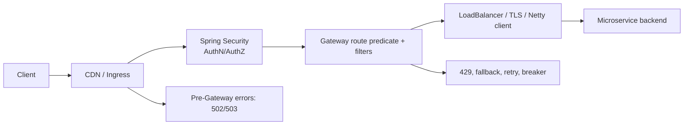
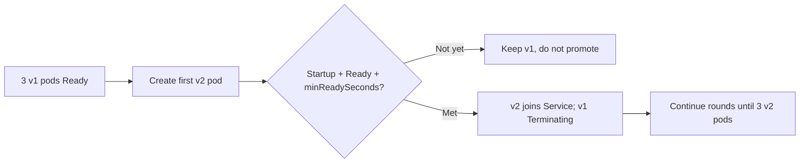
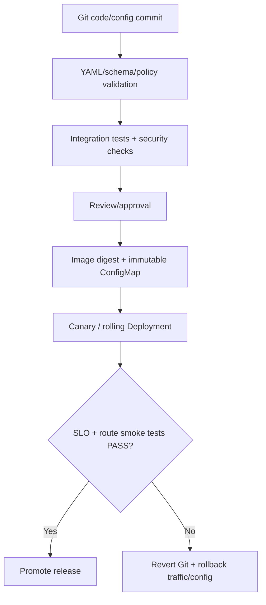

# Rolling Upgrades and Configuration Recovery

In a microservices architecture, **Spring Cloud Gateway** serves as the entry point for many services. A seemingly small change—modifying a `Path` predicate, `RewritePath`, an `lb://` URI, a `KeyResolver`, an OAuth2 issuer, a circuit breaker, a retry policy, or TLS—can simultaneously impact hundreds of endpoints. If all Gateway instances are replaced at once without a configuration revision to fall back to, errors are difficult to isolate and recover from.

**Rolling upgrade** is the process of gradually replacing Gateway instances while keeping a subset of older instances serving traffic. **Configuration recovery** is the process of restoring route definitions, filter parameters, secret references, and related configuration sources to a **verified state**. These two operations are related but **not identical**: a Deployment rollback command does not automatically revert Redis or Config Server, and a route cache refresh command does not fix an invalid source configuration.

This lesson belongs to the **Deployment** chapter of the **SPRING_CLOUD_GATEWAY** module, combining knowledge of route predicates, filter chains, path/header transformations, service discovery, authentication, rate limiting, circuit breakers, retries, TLS, and request observability to operate an API Gateway safely.

**Lesson objectives:**

- Explain `RollingUpdate`, `maxSurge`, `maxUnavailable`, canary, blue-green, rollback, and config revision.
- Use readiness/liveness/startup probes, Spring Boot graceful shutdown, and Kubernetes termination grace periods for their intended purposes.
- Prepare upgrades without unexpectedly disrupting HTTP, WebSocket, SSE, SockJS, and in-flight requests.
- Manage route config via images, immutable ConfigMaps, Spring Cloud Config, or dynamic route repositories.
- Distinguish `POST /actuator/gateway/refresh` from restoring source configuration and reconciling across multiple Gateway pods.
- Build a rollback runbook covering **image + config + secret references + traffic policy**, rather than a single command.
- Measure upgrade effectiveness using route smoke tests, 404/401/429/5xx rates, p95/p99 latency, retries, circuit breakers, and TLS errors.
- Rehearse reproducible failure scenarios in staging before deploying to production.

> **Version scope:** Primary examples target **Spring Cloud Gateway Server WebFlux 5.x** on Kubernetes, using the `spring.cloud.gateway.server.webflux.routes` namespace. In Gateway WebFlux 4.3.x, the namespace is typically `spring.cloud.gateway.routes`. **Gateway Server Web MVC** has different Servlet stack/filter semantics. With Spring Boot 4, graceful shutdown is enabled by default; with Spring Boot 3.x, explicitly configure `server.shutdown=graceful` when needed. Verify the exact dependency BOM/release train and configuration properties before promoting examples to production.

## 1. Application rollback is not the same as configuration rollback

A Gateway pod contains more than Java bytecode. It depends on multiple state layers:

| Component | Example | Storage location | How to recover? |
| --- | --- | --- | --- |
| Application image | `edge-gateway:1.8.2` | Registry, Deployment Pod template | Re-select a stable image **digest** |
| Static routes | `Path=/api/orders/**` | `application.yaml` or ConfigMap | Re-select a previous **route revision** |
| Filter settings | `StripPrefix`, `Retry`, `RequestRateLimiter` | Config and custom code | Restore compatible code/config |
| Config Server | `spring.config.import=configserver:...` | Git/backend Config Server | Pin the previous label/commit |
| Dynamic routes | `RedisRouteDefinitionRepository` | Redis/external repository | Perform controlled route snapshot restore |
| Secrets/certificates | OAuth client secret, TLS trust | Secret manager/K8s Secret | Select a valid version/alias |
| Backend instances | `orders-service` via LoadBalancer | Service discovery | Ensure endpoints are Ready and match the contract |
| RedisRateLimiter state | Token buckets and keys | Redis | Typically **do not** roll back all of Redis |
| Circuit breaker state | OPEN/CLOSED | Per-pod JVM | Understand that state resets on restart |
| Ingress/canary policy | 5% traffic to the new release | Ingress/service mesh | Shift traffic back to the stable revision |

**Example:** `kubectl rollout undo deployment/edge-gateway` can revert the image back to v1.8.1. However, if the `orders-read` route was edited in place in Redis or in a ConfigMap with the same name, Gateway v1.8.1 can still load the **broken new configuration**.

Conversely, if each release uses an **immutable ConfigMap named by revision** and the previous Deployment points to that still-existing old ConfigMap, rolling back the Pod template restores the **reference** to the old configuration. That is why a release should be a **consistent bundle of versions**, not just an image tag.

## 2. Release manifest: know the exact state currently running

Track a single deployment unit:

```text
release: edge-gateway-2026-11-24-v17
image: registry.example.org/platform/edge-gateway@sha256:<verified-digest>
app-version: 1.8.2
spring-boot/spring-cloud: compatible release train
static-routes: routes-v17 (Git commit/content hash)
dynamic-routes: snapshot-v6 (if used)
oauth2-config: identity-v3 (reference, no secret values)
tls-trust-bundle: trust-v5
ingress-canary-policy: edge-v9
last-known-good: edge-gateway-v16
```

When an error occurs, the runbook must answer:

1. Which **image digest** are Pod A, B, and C running?
2. Which **effective routes** revision has each pod loaded?
3. Did those routes come from a **file, ConfigMap, Config Server, or Redis**?
4. Are the Secret/TLS/OAuth2 references still compatible with the old image?
5. Do requests hitting the new version show different 401/404/429/503 rates compared to the old version?
6. Are the old image, config snapshots, and deployment permissions available for an immediate rollback?

**Never write JWT values, private keys, refresh tokens, or client secrets into manifests or audit logs**. Record only references, revisions, and access-controlled identifiers.

## 3. Why are Gateway upgrades more sensitive than a typical REST service?

The Gateway normally processes requests **in front of** backends:



A bug in the Gateway can:

- Match the wrong route because of `Host`/`Path`/`Method` or `order`.
- Rewrite the path incorrectly via `StripPrefix`/`RewritePath`, causing `404` responses from the backend.
- Accidentally drop the `Authorization` header or inject untrusted identity headers.
- Return `401/403` due to mismatched issuer/JWK/scopes or CORS settings across versions.
- Return `429` because `RedisRateLimiter` or key resolution changed.
- Return `502/504` due to misconfigured TLS, connection pools, timeouts, or upstream URIs.
- Return `503` when `lb://` finds no instances or a circuit breaker opens.
- Disconnect **WebSocket/SSE** connections when old pods terminate.

Therefore, **"Pod Ready" does not equal "all business routes are correct"**. Rollouts require both runtime probes and smoke tests across real HTTP paths.

## 4. RollingUpdate, maxSurge, and maxUnavailable

Kubernetes `Deployment` supports `RollingUpdate` to gradually replace old pods with new pods.

- `replicas`: desired number of pods.
- `maxSurge`: temporary extra pods allowed above `replicas` during a rollout.
- `maxUnavailable`: maximum number of pods allowed to be unavailable during a rollout.
- `minReadySeconds`: duration a pod must stay Ready before being counted as Available.
- `progressDeadlineSeconds`: progress time limit before the Deployment is marked as failed to progress.

Example with **3 replicas**, a max surge of one, and no proactive reduction in Available pods:

```yaml
spec:
  replicas: 3
  minReadySeconds: 10
  progressDeadlineSeconds: 300
  strategy:
    type: RollingUpdate
    rollingUpdate:
      maxSurge: 1
      maxUnavailable: 0
```



**This is not an absolute "zero downtime" guarantee.** A rollout can still cause errors if a new pod reports Ready too early, surge pods lack CPU/RAM, the ingress has not removed old endpoints yet, long-lived sockets are closed, or routes/config are wrong. In addition, `maxUnavailable=0` governs controller-managed Deployment progress; it cannot prevent node failures, backend outages, or unexpected network errors.

## 5. Check capacity before creating a surge pod

Suppose a cluster runs 3 Gateway pods, each consuming 600 MiB of memory under peak load. With `maxSurge=1`, there must be headroom to run a **fourth pod** along with its associated resources.

Before a rollout:

- Check allocatable CPU/RAM on nodes and resource quotas.
- Check ingress/LB target capacity, service endpoints, and network policies.
- Check whether HPA is scaling or trying to adjust replicas at the same time.
- Check outbound HTTP client pools and Redis connections when pod count increases temporarily.
- Check backend capacity: adding Gateway pods does **not** add DB/backend capacity.
- Check topology spread/anti-affinity so all pods do not land on a single node or zone.

**Do not fix a rollout stalled by insufficient capacity by arbitrarily changing `maxUnavailable=3`**. Doing so can evict all old pods before the new version is ready.

## 6. Spring Boot graceful shutdown and the Pod deadline

Spring Boot supports graceful shutdown with Reactor Netty and corresponding embedded servers. Explicit configuration:

```yaml
server:
  port: 8080
  shutdown: graceful

spring:
  lifecycle:
    timeout-per-shutdown-phase: 30s
```

- `server.shutdown=graceful`: instructs the server during shutdown to give in-flight requests time to finish. Spring Boot 4 enables this by default; declaring it makes the policy explicit.
- `spring.lifecycle.timeout-per-shutdown-phase=30s`: maximum duration for a Spring lifecycle shutdown phase, **not** a timeout for a single upstream HTTP request.
- Kubernetes `terminationGracePeriodSeconds`: the **total** budget covering `preStop`, stop-signal delivery, shutdown, and overhead.
- Once the grace period expires, kubelet may send SIGKILL, dropping any remaining connections.

Example:

```yaml
spec:
  terminationGracePeriodSeconds: 60
```

You can leave a brief window for the ingress to drain the endpoint, then allow Spring roughly 30 seconds to finish HTTP requests. Do not expect a **WebSocket alive for hours** to complete within 60 seconds; protocol-aware reconnection is required.

## 7. Pod Terminating, EndpointSlice, and preStop

The basic Kubernetes Pod termination sequence is:

1. The Pod is marked Terminating.
2. The control plane updates the EndpointSlice; terminating endpoints have `ready=false` for new regular traffic.
3. Kubelet runs `preStop` if configured and grace budget remains.
4. The container typically receives SIGTERM; Spring Boot starts graceful shutdown.
5. Once the grace period expires, remaining running workloads may be force-killed.

If an external ingress/LB propagates endpoint updates slowly, adding a short `preStop` hook sometimes helps reduce new connections hitting the old pod:

```yaml
spec:
  terminationGracePeriodSeconds: 60
  containers:
    - name: gateway
      lifecycle:
        preStop:
          exec:
            command: ["/bin/sh", "-c", "sleep 8"]
```

**Warning:** This example only works if the container image includes `/bin/sh` and `sleep`. Distroless images may lack a shell. `preStop` time **consumes part of** the termination grace period; `sleep 60` with a 30s grace period can prevent Spring from shutting down gracefully. Measure EndpointSlice/ingress propagation instead of blindly adding a sleep to every cluster.

**Readiness=false does not mean existing sockets are closed.** HTTP keep-alive, WebSocket, and SSE connections can remain open until shutdown; client retry/reconnect behavior must be tested.

## 8. Readiness, liveness, and startup probes are three distinct contracts

| Probe | Question | Kubernetes behavior on failure |
| --- | --- | --- |
| Startup | Has the application finished starting? | Delays liveness/readiness; may restart after exceeding threshold |
| Readiness | Should the pod receive new traffic? | Removes it from Ready Service endpoints |
| Liveness | Can the process still recover? | Restarts container after threshold |
| Synthetic API probe | Do business routes and backends work end-to-end? | Usually a CI/monitoring signal, not a direct K8s probe replacement |

**Do not make liveness depend on the health of every backend**, because an outage in a shared Redis/backend could cause **all Gateway pods to restart**, turning a partial failure into a cascading outage.

When the management port runs separately, checking health only on that port might appear "green" even if the main traffic listener is blocked. Spring Boot supports exposing probe paths on the **main application port**:

```yaml
management:
  server:
    port: 9090
  endpoint:
    health:
      probes:
        enabled: true
        add-additional-paths: true
```

When using this configuration on a supported version, **`/livez` and `/readyz`** are exposed on the main server port, such as `8080`. Lifecycle-based readiness does **not automatically verify** every route definition; smoke tests through the ingress are still necessary.

## 9. Sample manifests: safer rolling WebFlux Deployment

The example below assumes a versioned ConfigMap named `edge-routes-v17`, container image, and Service already exist:

```yaml
apiVersion: apps/v1
kind: Deployment
metadata:
  name: edge-gateway
  namespace: edge
  labels:
    app: edge-gateway
spec:
  replicas: 3
  revisionHistoryLimit: 10
  minReadySeconds: 10
  progressDeadlineSeconds: 300
  strategy:
    type: RollingUpdate
    rollingUpdate:
      maxSurge: 1
      maxUnavailable: 0
  selector:
    matchLabels:
      app: edge-gateway
  template:
    metadata:
      labels:
        app: edge-gateway
        app.kubernetes.io/version: "1.8.2"
      annotations:
        config-revision: "routes-v17"
    spec:
      terminationGracePeriodSeconds: 60
      containers:
        - name: gateway
          image: registry.example.org/platform/edge-gateway:1.8.2
          imagePullPolicy: IfNotPresent
          ports:
            - name: http
              containerPort: 8080
            - name: management
              containerPort: 9090
          env:
            - name: SPRING_PROFILES_ACTIVE
              value: prod
            - name: SPRING_CONFIG_ADDITIONAL_LOCATION
              value: "optional:file:/etc/edge-config/"
          volumeMounts:
            - name: routes
              mountPath: /etc/edge-config
              readOnly: true
          startupProbe:
            httpGet:
              path: /livez
              port: http
            periodSeconds: 2
            failureThreshold: 30
          readinessProbe:
            httpGet:
              path: /readyz
              port: http
            periodSeconds: 5
            timeoutSeconds: 2
            failureThreshold: 2
          livenessProbe:
            httpGet:
              path: /livez
              port: http
            periodSeconds: 10
            timeoutSeconds: 2
            failureThreshold: 3
          resources:
            requests:
              cpu: 250m
              memory: 512Mi
            limits:
              memory: 1Gi
      volumes:
        - name: routes
          configMap:
            name: edge-routes-v17
```

**Deployment prerequisites:**

- Image tag `1.8.2` is only safe if the registry disallows tag overwrites; in production, prefer **pinning the image digest**.
- Requires the ConfigMap in the same namespace, Service/Ingress, RBAC, NetworkPolicy, image pull credentials, and sufficient node capacity.
- `SPRING_CONFIG_ADDITIONAL_LOCATION` adds an external config directory at Spring Boot startup; verify property precedence against config packaged inside the image.
- `minReadySeconds` makes the rollout wait for the pod to remain stably Ready, but does not prove route semantics.
- `management.server.port` and additional probe paths must match the application config.
- `revisionHistoryLimit` retains old ReplicaSets so the Deployment can roll back; it does **not** back up Config Server or Redis.
- Validate resource requests/limits via realistic load testing rather than copying lab numbers to production.

## 10. Sample application.yaml: route, timeout, and read-only Actuator

```yaml
spring:
  application:
    name: edge-gateway
  lifecycle:
    timeout-per-shutdown-phase: 30s
  cloud:
    gateway:
      server:
        webflux:
          routes:
            - id: orders-read
              uri: lb://orders-service
              predicates:
                - Path=/api/orders/**
                - Method=GET
              filters:
                - StripPrefix=1
              metadata:
                connect-timeout: 1000  # milliseconds
                response-timeout: 3000 # milliseconds

server:
  port: 8080
  shutdown: graceful

management:
  server:
    port: 9090
  endpoint:
    health:
      probes:
        enabled: true
        add-additional-paths: true
    gateway:
      access: read-only
  endpoints:
    web:
      exposure:
        include: health,info,metrics,prometheus,gateway
```

**Routing notes:**

- The `lb://orders-service` URI requires Spring Cloud LoadBalancer and a `ServiceInstance` source; otherwise, `503` responses may occur.
- `StripPrefix=1` removes the `api` segment so the backend receives `/orders/**`.
- Route metadata `response-timeout=3000` means **3,000 ms**, unlike the global `Duration` syntax `3s`.
- The GET route only matches GET requests; do not blindly attach retries to mutating POST operations.
- An upgrade that alters `Path`/`StripPrefix`/`lb` can cause 404/503 responses even while readiness stays green.

**Actuator notes:**

- `management.endpoint.gateway.access=read-only` allows inspecting routes when exposed, **without** allowing writes or refreshes.
- `/actuator/gateway` can expose internal topology and URIs; protect the management port with authentication/authorization, TLS, and network isolation.
- `management.endpoints.web.exposure.include` **does not grant RBAC automatically**. Avoid exposing port 9090 to the public Internet.

## 11. Versioned immutable ConfigMaps for verifiable rollbacks

Avoid editing a fixed-name ConfigMap in place if you need to restore an older version. Instead, use:

```text
edge-routes-v16  # last-known-good
edge-routes-v17  # candidate
edge-routes-v18  # future revision
```

Example:

```yaml
apiVersion: v1
kind: ConfigMap
metadata:
  name: edge-routes-v17
  namespace: edge
  labels:
    app: edge-gateway
    config-revision: routes-v17
immutable: true
data:
  application.yaml: |
    spring:
      cloud:
        gateway:
          server:
            webflux:
              routes:
                - id: orders-read
                  uri: lb://orders-service
                  predicates:
                    - Path=/api/orders/**
                    - Method=GET
                  filters:
                    - StripPrefix=1
```

The Deployment mounts this ConfigMap at `/etc/edge-config/application.yaml`. A new revision uses a newly named ConfigMap; in the Pod template, update both `config-revision` and `volumes.configMap.name`. Each new Pod reads a deterministic snapshot at startup.

### Two commonly confused details

1. ConfigMap consumed as **environment variables**: values inside a running pod **are not updated automatically** when the ConfigMap changes; a new pod/rollout is required.
2. ConfigMap mounted as a **volume**: the file may update *eventually*, yet Spring Boot/Gateway does not automatically reload configuration read at startup. `subPath` mounts also have different update behavior.

**Recommended decision:** Use **immutable ConfigMaps + rolling restarts** for static routes to reduce config drift. If true hot reload is needed, design and test a dedicated update/refresh mechanism instead of assuming a file change automatically updates the route cache.

## 12. GitOps as the source of truth; avoid long-lived manual hotfixes

A release governance pipeline:



**Route validation should cover at least:**

- Unique route IDs and clear ownership.
- `Host`/`Path`/`Method` predicates without unintended overlaps.
- Accurate route `order` when multiple routes can match the same request.
- Valid `lb://` service IDs and allowlisted URI schemes/hosts.
- `StripPrefix`/`RewritePath` aligned with backend contracts.
- Header-transformation filters that do not strip auth or spoof identity.
- Security/WebFilter and CORS policies that do not expose sensitive APIs.
- RateLimiter `KeyResolver` built from verified identity attributes.
- Bounded Retry/CB/timeouts that never cause duplicate side effects on POST.
- TLS/issuer/client-registration configuration sourced from secret references.
- Config namespace matching **Gateway Server WebFlux 5.x** or the target release train.
- A clear path to revert config/source changes.

**Do not run `kubectl edit configmap` in production and ignore the source of truth.** GitOps reconciliation can overwrite the hotfix later, reintroducing the incident.

## 13. Config Server and Git label versioning

If using Spring Cloud Config Client, you can pin a config label:

```yaml
spring:
  application:
    name: edge-gateway
  config:
    import: "configserver:https://config.internal.example"
  cloud:
    config:
      label: "gateway-release-v17"
```

Spring Cloud Config can use a **Git branch, tag, or commit** as the label depending on the backend. For critical releases, a controlled or immutable label/commit ensures newly started JVMs read predictable configuration.

- `configserver:...` without `optional:` is typically chosen when startup should **fail fast** if the source is unreachable (per Config Client behavior).
- `optional:configserver:...` allows startup in some unreachable-source cases, but can leave the Gateway running **without critical routes** if no verified fallback source exists.
- `spring.cloud.config.label` should belong to the deployment unit; rollbacks must restore the label compatible with the image.
- If Config Server tracks a floating branch instead of a pinned revision, restarting a pod can load different config even with an unchanged image.
- Properties affecting bean construction or security behavior may require a **restart** rather than just a refresh.
- Native/AOT deployments have their own refresh limitations—check the documentation.

**Do not confuse Config Server/Spring Cloud `/actuator/refresh` with Gateway route cache `/actuator/gateway/refresh`**: they operate at different layers.

## 14. Gateway Actuator: inspect routes, refresh cache, mutate repository

Spring Cloud Gateway Server WebFlux exposes the Gateway Actuator API (when enabled and authorized):

| Endpoint/operation | Used for | Does not automatically |
| --- | --- | --- |
| `GET /actuator/gateway/routes` | Inspect active routes | Modify the source |
| `GET /actuator/gateway/routes/{id}` | Inspect a single route | Verify the backend contract |
| `POST /actuator/gateway/refresh` | Refresh/clear the route cache | Fix broken routes in Redis/Git |
| Actuator POST/DELETE route definitions (when allowed) | Mutate a route source via API | Replace GitOps/backups |
| Spring Cloud Context `/actuator/refresh` | Rebind/refresh `Environment` via Spring Cloud | Guarantee all route caches are synchronized |

Gateway 5.x documentation recommends **`management.endpoint.gateway.access=read-only`**. Performing POST refresh/mutations requires configuring `unrestricted` access **alongside** RBAC/TLS/network isolation/auditing. Never expose write endpoints publicly.

### HTTP 200 on refresh does not mean cluster-wide success

Gateway documentation notes that `POST /actuator/gateway/refresh` can trigger an **asynchronous refresh**. Receiving 200 means the API accepted the request—it **does not prove** routes on every pod have updated.

If `/actuator/gateway/refresh` is called through a Kubernetes Service, the request reaches **only one load-balanced pod** rather than automatically broadcasting to all replicas. You need cluster-wide reconciliation/refresh or a verified **rolling restart**.

## 15. When three Gateway pods hold different route caches

Consider this scenario:

```text
Before the change:
  Pod A -> orders-read, routes-v16
  Pod B -> orders-read, routes-v16
  Pod C -> orders-read, routes-v16

After the source changes to v17, only Pod B refreshes:
  Pod A -> routes-v16
  Pod B -> routes-v17
  Pod C -> routes-v16
```

Users may intermittently receive `200` or `404` depending on which pod handles the request. This is **mixed route state** during propagation, not necessarily a network fault.

**Ways to reduce risk:**

1. Attach the config revision to deployment metadata and telemetry.
2. Use immutable config + rolling pod replacement when appropriate.
3. For dynamic routes, emit reliable events/reconciliation signals to every instance.
4. Measure *convergence time* across pods.
5. Verify effective route IDs, URIs, predicates, filter lists, order, and metadata on **each pod**.
6. Never mark a release successful just because one pod returns the new route.
7. Design route changes to be **backward compatible** during the window when two revisions coexist.

If near-atomic consistency across the entire route set is required, consider **blue-green**: bring up the full green group and shift traffic only after all green Gateway pods are verified.

## 16. Dynamic route repositories in Redis

Gateway WebFlux provides `RouteDefinitionRepository` implementations with different characteristics:

- `InMemoryRouteDefinitionRepository` holds state only inside the current JVM; it **does not share** route definitions across Gateway replicas.
- `RedisRouteDefinitionRepository` shares route definitions via Redis when compatible configuration and dependencies are present.

Gateway documentation illustrates a property like:

```yaml
spring:
  cloud:
    gateway:
      redis-route-definition-repository:
        enabled: true
```

Exact configuration must be verified against your release train and reactive Redis dependencies. **`RedisRouteDefinitionRepository` is not the same as `RedisRateLimiter`**: Redis may concurrently hold route definitions, token buckets, and other data.

### Safely recovering Redis routes

1. Freeze other route mutation sources; identify who or what automation made the change.
2. Back up current route definitions as evidence.
3. Retrieve the approved last-known-good **route snapshot**, including IDs, predicates, filters, URIs, and metadata.
4. Validate the snapshot: no duplicate IDs, no untrusted hosts/URIs, and no accidentally removed auth filters.
5. Restore **only the keys/route IDs belonging to the repository** via supported APIs.
6. Do not flush all of Redis or wipe quota/session keys as a "reset".
7. Reconcile/refresh all Gateway instances.
8. Compare active routes per pod and run authenticated smoke tests.
9. Remove any manual overrides once the source of truth is aligned.

**Do not assume a Redis update plus Gateway cache refreshes form an atomic distributed transaction.** Design for brief periods where two revisions coexist.

## 17. Static, dynamic, and externalized config: choosing the right mechanism

| Source | Pros | Risks to manage | Recommended rollback method |
| --- | --- | --- | --- |
| `application.yaml` inside image | Image/config coupled, deterministic startup | Changing a route requires rebuilding the image | Roll back image digest |
| Immutable ConfigMap | Clear config revision, no image rebuild | Requires rollout, source precedence | Revert Pod template to the previous ConfigMap |
| Spring Cloud Config | Centralized config/Git labels | Config Server outage, floating labels | Pin/revert label/commit + reconcile |
| Redis dynamic repository | Dynamic routes without full restarts | Redis dependency, cache drift | Restore route snapshot + refresh pods |
| Actuator route mutation | Fast emergency mitigation | Dangerous control plane, prone to drift | Audit, restore source, and remove override |
| Runtime feature flag/route policy | Limits blast radius | State/ownership confusion and stale caches | Version flag policy and roll out |

**Principle:** The "hotter" a configuration is, the stronger its **authorization, auditing, rollback, and synchronization** must be. When operating an entry point to many microservices, overly easy route edits without a source of truth are usually riskier than a controlled, slower rollout.

## 18. Protect route config like a control plane

Anyone with write access to route definitions can make the Gateway:

- Forward requests to unauthorized URIs (open proxy/SSRF).
- Hijack another route's traffic via overlapping `Path`/`Host` predicates.
- Disable rate limiters, retry budgets, circuit breakers, or security headers.
- Forward `Authorization`/`Cookie` headers to a backend with the wrong audience.
- Alter `RewritePath` to target internal administrative backend endpoints.
- Cause `POST` requests to retry and multiply side effects.
- Trigger `502` errors by pointing URIs to TLS servers lacking valid trust/SNI.

Therefore:

- Apply least-privilege RBAC for GitOps, Redis route writers, Config Server, and Actuator.
- Separate permissions for **reading routes** vs. **mutating routes**.
- Enforce destination URI allowlists, valid service IDs, filter ordering, and static analysis/config policies.
- Restrict network egress to approved backends only.
- Protect the management port with TLS/RBAC/network isolation—never make it public.
- Review, audit, and time-box emergency overrides.
- Never log Bearer tokens, private keys, or route secrets in tests or dashboards.

**Route configuration is security-sensitive code**, not just "ops YAML".

## 19. Upgrade preparation: verify both the binary and the route contract

Before every rollout, execute a **preflight checklist** in order:

1. **Freeze the release unit**: image digest, Spring Boot/Cloud BOM, config revision, dynamic route snapshot, secret references.
2. **Check compatibility**: Java, Spring Security, Reactor Netty, Redis, LoadBalancer, `GatewayFilter` factories, and backend APIs.
3. **Inspect route diffs**: did `Path`, `Host`, `Method`, `order`, `StripPrefix`, `RewritePath`, `uri`, or `KeyResolver` change?
4. **Run unit/config tests**: validate route IDs, URI schemes, filter names, authorization policies, and response contracts.
5. **Run integration tests** using a real Gateway WebFlux HTTP port and WireMock/Testcontainers, covering 404/401/429/503 and TLS.
6. **Run backend compatibility tests**: can both the old and new Gateway communicate properly with the currently deployed backend?
7. **Verify cluster capacity**: enough node resources for surge pods; sufficient headroom on backends and Redis.
8. **Verify probes**: startup/readiness/liveness probes are accurate and cannot trigger a restart storm on shared dependency loss.
9. **Verify draining**: SIGTERM, `preStop` (if used), timeouts, and WebSocket/SSE reconnection.
10. **Prepare rollback**: old image digest, ConfigMap/Config Server label, Redis routes snapshot, and ingress controls.
11. **Prepare metrics**: 5xx, 404, 401/403, 429, p95, retries, open breakers, and pending pool connections segmented by revision.
12. **Approve stop conditions**: who decides to halt, after how long, and when to roll back immediately.

A checklist without an **accountable owner** or a **way back** is incomplete. For critical APIs, attach the runbook/owner to route metadata or a service catalog instead of relying on on-call memory.

## 20. How RollingUpdate, canary, and blue-green differ

| Strategy | How traffic reaches the new version | Pros | Risks |
| --- | --- | --- | --- |
| **RollingUpdate** | Gradually replaces pods in the same Deployment | Built into Kubernetes, simple | Old/new serve together, imprecise traffic split |
| **Canary Deployment** | Ingress/mesh routes a small fraction to the new Deployment | Controls blast radius and compares per-version SLIs | Needs L7 routing and sufficient sample size |
| **Blue-green** | Stands up full "green" fleet, then switches traffic | Entire green fleet can be tested before cutover | Temporarily requires 2x capacity; persistent connections still need draining |
| **Recreate** | Terminates all old pods before starting new ones | No mixed-version traffic | Causes downtime, usually unsuitable for HA Gateways |
| **Feature flag/route flag** | Enables new feature/route by policy | Isolates logic changes | Needs control plane, auditing, and convergence |

**Do not confuse Spring Cloud Gateway's `Weight` route predicate with canarying the Gateway binary itself.** `Weight` inside the Gateway normally splits traffic **across backend routes**. To canary a Gateway version, traffic must be split **in front of the Gateway**, such as at an ingress, service mesh, or edge load balancer.

### Sample canary gates

A rollout might progress through 1%, 5%, 25%, and then 100% traffic, while measuring **actual traffic** reaching the canary:

- 1–5%: check routing, TLS, authentication, and quota behavior.
- 10–25%: monitor 5xx, 401/403/404, p95/p99, HTTP pools, and retries.
- Full rollout: verify config convergence, pod health, and long-lived sessions.
- Post-release: observe across at least one meaningful traffic window.

**If a canary receives 10 requests over 30 minutes and all 10 succeed, that is not strong statistical proof**. Add synthetic tests and targeted load tests for low-traffic routes.

## 21. kubectl commands along the deployment sequence

The following commands are **reference examples for environments you manage**—never run them against production without approval:

```bash
# Pre-release: inspect current state and history.
kubectl -n edge get deployment edge-gateway
kubectl -n edge get pods -l app=edge-gateway -o wide
kubectl -n edge rollout history deployment/edge-gateway

# After pipeline/GitOps updates the Deployment:
kubectl -n edge rollout status deployment/edge-gateway \
  --timeout=300s

# Investigate a stuck rollout:
kubectl -n edge describe deployment edge-gateway
kubectl -n edge get events --sort-by=.lastTimestamp

# Pause upon detecting a regression.
kubectl -n edge rollout pause deployment/edge-gateway

# Only resume after deciding to continue promotion/reconciliation:
kubectl -n edge rollout resume deployment/edge-gateway

# Roll back Deployment Pod template (execute per runbook).
kubectl -n edge rollout undo deployment/edge-gateway
kubectl -n edge rollout status deployment/edge-gateway \
  --timeout=300s
```

**GitOps warning:** If a GitOps controller manages the Deployment, a manual `kubectl rollout undo` may be **overwritten during reconciliation** by a manifest still pointing to v17. Always **revert the source of truth** per process and let the controller sync; `undo` is only a Kubernetes-level action that must be coordinated.

**Pause warning:** Do not leave a Deployment paused and expect normal rollback or promotion workflows to behave as usual. Check status and resume/reconcile according to the runbook once a path forward is chosen.

`rollout status` tracks the Kubernetes Deployment controller state; it does **not** confirm correct filter chains or business APIs. Always inspect active routes and run synthetic tests.

## 22. WebSocket, SSE, SockJS, and long-lived connections

An API Gateway may proxy:

| Traffic type | When pod terminates | Recovery conditions |
| --- | --- | --- |
| Short HTTP GET | May finish within the grace period | Timeouts and backoff retries |
| POST/PUT | Backend may have committed before client lost the response | Idempotency keys and transaction status checks |
| WebSocket | Long-lived connection closes when old pod exits | Client reconnect, re-authenticate, resubscribe |
| SSE | Open stream drops | Reconnect, `Last-Event-ID`, and server-supported replay |
| SockJS XHR polling | Multiple HTTP requests belong to one logical session | Session affinity/shared state or session recreation |
| Long download/upload | Body or response may be partially sent | Dedicated resume/range/checkpoint protocol |

### Why doesn't WebSocket "automatically move" to a new pod?

After the handshake, a WebSocket is bound to **a live connection** through the old Gateway pod. `Ready=false` only steers new traffic; it cannot migrate an active TCP connection to another pod. Once the old JVM stops, the session must be re-established.

A production-ready design requires:

1. Client reconnection using **exponential backoff + jitter**.
2. Valid authentication/token refresh upon reconnect.
3. STOMP/SockJS client resubscription per protocol.
4. Message replay/ack via a durable broker if message loss is unacceptable.
5. Rate-limiting reconnect attempts/handshakes to avoid thundering herds.
6. Tracking active sessions, WS close codes, and reconnect rate metrics during rollouts.

**Do not blindly enable the Retry GatewayFilter for WebSocket frames or already-committed HTTP streaming responses.** Once response bytes have begun streaming, they cannot simply be replaced with a fallback JSON payload like a standard HTTP GET.

## 23. HTTP keep-alive and terminationGracePeriodSeconds

HTTP keep-alive can keep reusing a connection to an old pod even after Kubernetes starts removing the Pod from endpoints. An ingress or L7 proxy may also cache endpoints during propagation lag.

Test in staging:

- Open multiple keep-alive requests through the old Gateway.
- Issue a long-running request shorter than the grace period.
- Trigger a rolling upgrade.
- Count responses ending in `502`, premature close, or client timeout.
- Inspect Pod Terminating state, EndpointSlice readiness, and ingress target updates.
- Confirm in-flight requests finish cleanly when sufficient grace is given.
- Verify new client connections stop going to terminating pods after propagation.

**Do not treat `terminationGracePeriodSeconds=60` as a per-request timeout**. It is the Pod shutdown budget; Spring lifecycle, ingress timeouts, and Netty client timeouts are separate clocks.

If you combine `preStop sleep 8s` and a 30s Spring shutdown phase, total budget needs at least **8s + 30s + overhead**. A 20s Pod grace period conflicts with that config. Conversely, an excessively long grace period slows rollouts and ties up old resources, so size it to measured workloads.

## 24. OAuth2/JWT, TLS, and Redis while two versions coexist

During a rolling update, **v16 and v17 can serve requests concurrently**. Any breaking policy change causes inconsistent outcomes depending on which pod answers.

| Component | Risk when changed | Mitigation |
| --- | --- | --- |
| OAuth2 issuer/JWKS | New pods accept different tokens than old pods | Key overlap, trust migration, and auth smoke tests |
| Scope/role mapping | Intermittent `403` across pod versions | Backward-compatible security contract |
| TokenRelay | Authorized-client state exists only on old pods | Tested shared persistence/session or affinity |
| TLS truststore | Outbound WSS/HTTPS fails only on new pods | Trust overlap, verify cert chain/SNI |
| RateLimiter `KeyResolver` | Same user gets different quotas across revisions | Key migration policy and 429 testing |
| RedisRouteDefinitionRepository | Pods cache different route definitions | Reconcile per pod + config revision |
| CircuitBreaker | New pods start CLOSED while old pods may be OPEN | Track state per instance |
| Retry policy | New pods issue more attempts | Retry budget/capacity gate |
| Service discovery | New `lb://service` not Ready yet | Validate registry/contract before rollout |

**Never "fix" TLS 502 errors by disabling certificate validation**. **Never "fix" 401 errors by turning off authentication or opening wildcard origins**. Canaries exist to surface real errors and roll back to compatible trust/config.

### OAuth2 key rotation

When an IdP rotates keys and the Gateway caches JWKs by TTL, two pods may briefly hold different cached key sets. Maintain an **overlapping keys** window, avoid retiring old keys prematurely, and verify valid client tokens throughout migration. Never log JWTs or bearer credentials during investigation.

## 25. Retry/CircuitBreaker and backend capacity during rollouts

In Spring Cloud Gateway:

- **Retry** can generate multiple outbound attempts per client request.
- **CircuitBreaker** can open on backend errors, though state normally resides in each JVM.
- **RedisRateLimiter** can retain shared state in Redis across Gateway pod restarts.
- **LoadBalancer** distributes across backend instances without increasing total backend capacity.
- **HTTP client pools** can increase aggregate connection count when surge Gateway pods come up.

Example: a backend sustains 400 attempts/s, current load is 320 logical GET/s, and 25% of requests retry once:

\[
320 \times (1+0.25)=400\ \text{attempts/s}.
\]

If p95 rises during a rollout and the retry fraction climbs to 50%, backend load becomes:

\[
320 \times 1.5=480\ \text{attempts/s}.
\]

**This is amplification overload**, which cannot be cured simply by adding more Gateway replicas. When signs appear, tighten retry budgets, protect backends with rate/concurrency limits, and investigate upstream bottlenecks.

**Do not expect an OPEN breaker on Pod A to automatically synchronize to Pod B**. Resilience4j circuit breakers typically keep local sliding-window state; monitor state per pod.

## 26. Compatibility: letting old and new versions serve together

| Change | Mixed-version issue | Strategy |
| --- | --- | --- |
| `Path=/api/v1/**` -> `/api/v2/**` | One group of pods returns 404 | Keep both paths during overlap |
| `StripPrefix=1` -> `StripPrefix=2` | Backend receives a different path | Run route contract tests before promotion |
| `lb://orders-service` -> `lb://orders-v2` | 503 if new service is not Ready | Deploy backend first |
| Route ID changed | Metric/quota key/session consistency shifts | Keep IDs stable, migrate with care |
| Added `RemoveRequestHeader=Authorization` | Backend loses auth token | Security regression test |
| Changed `KeyResolver` | Inconsistent quotas | Dual-key or migration policy |
| Changed TLS trust | Handshake fails only on new pods | Overlapping trust bundle |
| Changed JWK issuer | Valid tokens rejected on one group | Coordinated IdP/Gateway rollout |
| Backend response schema changed | Old Gateway/clients deserialize differently | Expand–migrate–contract |
| Enabled `Retry` on POST | Duplicated side effects | Disallow or make backend idempotent |

**RollingUpdate does not turn a breaking change into a backward-compatible one.** If two versions cannot coexist briefly, consider a **blue-green traffic switch**, while still handling in-flight connections and shared state.

## 27. SLI/SLO gates: a successful deployment is one that does not break users

Monitor at least:

| Signal | Purpose during rollout |
| --- | --- |
| Route ID and active route count | Detect missing or mismatched route definitions |
| HTTP 404 | Catch `Path`/`Host`/`order`/path-rewriting bugs |
| 401/403 | Catch OAuth2/JWT/Security/CORS policy regressions |
| 429 | Catch `RedisRateLimiter`/`KeyResolver`/quota issues |
| 502/503/504 | Catch TLS/discovery/backend/timeout failures |
| p95/p99 | Catch latency regressions when status stays 200 |
| Netty active/pending pool | Catch resource saturation on new pods |
| Retry attempts per logical request | Catch amplification |
| Breaker state/fallback | Catch masked backend unhealthiness |
| WebSocket reconnect/close codes | Catch disruption during draining |
| Config revision per pod | Catch config split-brain |
| Prometheus `up` | Catch missing telemetry/metrics |
| Readiness/Available pods | Catch rollout stalls |
| Synthetic success | Verify end-to-end business contracts |

**Caution:** Gateway route timer `spring.cloud.gateway.requests` only measures requests routed through Gateway route metrics. A no-route 404 or an ingress error before the Gateway may **not** appear in that timer. Use edge HTTP metrics and synthetic checks alongside it.

### Illustrative PromQL

When Micrometer Prometheus exports the `spring_cloud_gateway_requests_seconds_count` metric:

```promql
# RPS by route.
sum by (routeId) (
  rate(spring_cloud_gateway_requests_seconds_count{
    job="gateway-prod"
  }[5m])
)
```

```promql
# 5xx ratio by route, for routes with an existing numerator time series.
sum by (routeId) (
  rate(spring_cloud_gateway_requests_seconds_count{
    job="gateway-prod",
    httpStatusCode=~"5.."
  }[5m])
)
/
clamp_min(
  sum by (routeId) (
    rate(spring_cloud_gateway_requests_seconds_count{
      job="gateway-prod"
    }[5m])
  ),
  0.000001
)
```

When zero 5xx responses occur, the numerator series may be absent; apply appropriate zero-filling on dashboards. When **all metrics disappear**, never interpret that as `0%` errors: configure `up`/no-data alerts. Always verify label and metric names against your actual exporter rather than trusting snippets blindly.

### Stop thresholds

Do not copy a blanket "5xx above 1%" threshold for every API. With a 99.9% availability SLO, a 1% error rate burns the error budget rapidly. Use **burn rate**, baselines, and windows with sufficient sample volume. For low-traffic APIs, supplement with synthetic tests.

## 28. Runbook A — New route has wrong Path or RewritePath

**Scenario:** New v17 pods are Ready, yet `GET /api/orders/42` returns 404. Old v16 pods return 200.

**Actions:**

1. Halt promotion and shift canary traffic back to v16 if applicable.
2. Identify which pod handled the request via revision labels/logs (never log tokens).
3. Compare `GET /actuator/gateway/routes/orders-read` between old and new pods.
4. Inspect `Path`, `Host`, `Method`, `order`, `StripPrefix`, or `RewritePath`.
5. Fix/revert the **source config** back to `routes-v16`, rather than just refreshing the v17 cache.
6. Roll out pods referencing the compatible v16 ConfigMap or Config Server label.
7. Verify all pods load the same route and the backend receives the expected path.
8. Monitor 404/5xx/p95 and close the incident once SLOs recover.

**Do not increase Retry** for 404 errors caused by route mismatches. Retrying will not synthesize a valid route or path.

## 29. Runbook B — Broken dynamic routes in Redis

**Scenario:** Image rollback succeeded, yet a route still forwards traffic to the wrong URI.

**Root cause:** Route definitions come from `RedisRouteDefinitionRepository`, and Redis still stores the broken value. `kubectl rollout undo` does not alter Redis data.

**Actions:**

1. Lock/restrict writes to the route repository and investigate any automation making edits.
2. Snapshot the current route state for auditability.
3. Locate the **last-known-good** snapshot for **those specific route keys**.
4. Selectively restore through the authorized repository/control plane; validate IDs, URIs, and filter policies.
5. Never wipe all of Redis (it may also store token buckets and session/cache keys).
6. Reconcile/refresh **all** Gateway pods, not just a single load-balanced Service endpoint.
7. Compare route snapshots and run smoke tests against every pod.
8. Remove emergency overrides and resynchronize GitOps/source of truth.

**Do not assume a single `POST /actuator/gateway/refresh` call completes cluster-wide synchronization**. Verify when the updated route actually appears and passes traffic after refreshing.

## 30. Runbook C — Misconfigured Config Server, Secret, or TLS

### Config Server unreachable

- Check whether `spring.config.import` uses `optional:` and review startup fail-fast policy.
- Check DNS, TLS, and trust toward the Config Server.
- Verify which label/commit new pods are reading.
- If the config source is unavailable, **keep last-known-good pods serving**; never replace them all with pods missing critical routes.
- Once the source recovers, roll out pinned to an immutable label and verify active routes.

### TLS certificate/truststore changed

- Compare cert chains, hostnames, SNI, and mTLS identities between old and new releases.
- Restore the secret/cert **version reference** without pasting private keys into logs.
- During rotations, maintain an adequate trust-overlap window.
- Never disable SSL verification to "fix 502s" in production.

### Incorrect OAuth2/JWT issuer or key cache

- Check issuer, audience, scopes, JWK key IDs, and cache TTL.
- Coordinate IdP key rotation with overlap; roll back security config if valid requests start returning 401.
- Never turn 401s into 200s by disabling authentication.
- Check backend resource-server authorization as well, not only the Gateway.

## 31. Runbook D — Stuck Deployment or exhausted surge capacity

Diagnostic commands:

```bash
kubectl -n edge rollout status deployment/edge-gateway \
  --timeout=300s

kubectl -n edge describe deployment edge-gateway
kubectl -n edge get pods -l app=edge-gateway -o wide
kubectl -n edge get events --sort-by=.lastTimestamp
kubectl -n edge describe pod <new-pod-name>
```

| Symptom | Likely cause | What to inspect |
| --- | --- | --- |
| Pending pods | Insufficient CPU/RAM, quotas, scheduling constraints | Node allocatable resources, events |
| ImagePullBackOff | Invalid tag/digest, registry auth failure | Image reference/pull secret |
| CrashLoopBackOff | Config binding failure, missing filter bean, JVM error | Redacted logs, BOM versions |
| Startup probe failing | Cold start too slow or app fails to bind port | Probe thresholds, app logs |
| Readiness stays false | App not ready or overly strict custom health check | Health groups, dependencies |
| Ready yet 404 | Incorrect route definitions | Actuator routes + synthetic checks |
| Gateway 502 after deploy | Invalid upstream TLS or URI | Trust/SNI, service discovery |
| Old pod refuses to exit | Active long-lived connections or overly long `preStop` | Drain/grace lifecycle |

Kubernetes may set `Progressing=False` after `progressDeadlineSeconds`, yet it **does not automatically perform a safe rollback**. Your team's workflow must execute rollback or roll-forward.

## 32. Designing pre- and post-release tests

A minimal test suite:

```text
Given:
  gateway image v1.8.2
  routes-v17 snapshot
  backend stubs for orders/catalog
  test JWT/tenant identities
  Redis or mocked quota per test fixture

When:
  GET /api/orders/42
  unmatched request (no route)
  invalid token / missing scope
  burst exceeding RedisRateLimiter
  backend returns 503 or latency spike
  WebSocket/SSE connection held across pod termination
  rollback of image + config revision

Then:
  backend receives exact path /orders/42
  no-route returns status per contract
  401/403 is never bypassed
  429 is never proxied to the backend
  retry/CB stay within budget, fallback follows contract
  long-lived clients reconnect/replay properly
  routes on all pods converge back to last-known-good revision
```

Illustrative **Java test snippet with WebTestClient + WireMock**:

```java
// Illustrative @Test snippet; requires a fixture starting Gateway on a real HTTP port
// and WireMock dynamic port configured via @DynamicPropertySource.
@Test
void ordersRouteStillRewritesPathCorrectly() {
    backend.stubFor(get(urlEqualTo("/orders/42"))
        .willReturn(aResponse()
            .withStatus(200)
            .withHeader("Content-Type", "application/json")
            .withBody("{\"id\":42}")));

    webTestClient.get()
        .uri("/api/orders/42")
        .exchange()
        .expectStatus().isOk()
        .expectBody()
        .jsonPath("$.id").isEqualTo(42);

    backend.verify(1,
        getRequestedFor(urlEqualTo("/orders/42")));
}
```

An HTTP 200 assertion helps, but it is **not enough**; verify outbound paths, headers, attempt counts, and each pod's config snapshot. Never run fault injection against real production backends.

### Route drift test

Query effective routes from a protected admin endpoint and normalize:

- Route ID and `order` precedence.
- `Host`/`Path`/`Method` predicates.
- URI scheme/target service identity.
- `GatewayFilter` names, args, and filter ordering.
- Timeout metadata.
- Revision/schema version.

Compare against the expected release snapshot. **Never compare raw JSON with arbitrary key ordering, and never print secrets**. If drift is detected, halt promotion and inspect source precedence or manual overrides.

## 33. PodDisruptionBudget, HPA, and scaling interactions

`PodDisruptionBudget` protects Ready pod counts against **voluntary evictions**:

```yaml
apiVersion: policy/v1
kind: PodDisruptionBudget
metadata:
  name: edge-gateway-pdb
  namespace: edge
spec:
  minAvailable: 2
  selector:
    matchLabels:
      app: edge-gateway
```

**Do not use a PDB as a substitute for `Deployment.maxUnavailable`.** PDB governs the Eviction API, while the Deployment controller's RollingUpdate uses its own availability budget. Node failures cannot be prevented by a PDB.

With HPA:

- Desired replicas can shift mid-rollout.
- Surge capacity and per-pod limits must be recalculated.
- Adding Gateway instances also increases Redis connections and outbound HTTP pool usage.
- Backends do not scale automatically just because the Gateway HPA scales.
- Local circuit breakers start with fresh state on new pods.
- Actual traffic splits and per-revision p95/5xx must be measured.

**Do not scale up Gateway pods to solve a saturated backend DB connection pool**. Doing so can raise concurrency and worsen the outage.

## 34. Acceptance test matrix

| Test | Condition | Expected outcome |
| --- | --- | --- |
| T01 | New pod has slow startup | Startup probe prevents premature restarts |
| T02 | New pod crashes | Old pods keep serving within RollingUpdate budget |
| T03 | Cluster lacks surge resources | Rollout stalls safely without deleting healthy pods |
| T04 | `replicas=3,maxSurge=1,maxUnavailable=0` | Availability budget matches expectations |
| T05 | In-flight GET when pod goes Terminating | Completes within grace period under normal conditions |
| T06 | POST commits before client loses response | Idempotency prevents duplicate side effects |
| T07 | Open WebSocket connection | Reconnects/resubscribes with reliable broker delivery |
| T08 | Actively streaming SSE | Client reconnects/replays per contract |
| T09 | Broken `StripPrefix` in v17 route | Smoke test catches 404 and halts promotion |
| T10 | ConfigMap environment updated in place | Running pod does not pick up new env automatically |
| T11 | Mounted ConfigMap file updated | Spring does not automatically reload parsed routes |
| T12 | Wrong Config Server label | Re-pin label/commit and roll out with correct source |
| T13 | Gateway refresh via Service | Does not automatically refresh every pod |
| T14 | Broken dynamic routes in Redis | Rolling back image alone is insufficient |
| T15 | Redis rate limiter key policy changed | 429 behavior and per-key quotas remain valid |
| T16 | OAuth2/JWK rotation | No spike in 401/403 for valid users |
| T17 | New TLS trust missing CA | 502 handshake failure caught without disabling verification |
| T18 | Discovery has zero instances | Clear 503 root cause |
| T19 | Breaker states differ on old vs. new pods | Per-instance metrics distinguish state from config drift |
| T20 | Pool pending/retries rise during rollout | SLO/capacity gate catches amplification |
| T21 | GitOps reconciles after manual hotfix | Source of truth restored/reconciled |
| T22 | Pod template rolled back | Image and ConfigMap reference revert to target revision |
| T23 | Old ConfigMap/image already pruned | Rehearsal flags missing rollback artifacts |
| T24 | Read-only Gateway Actuator | Non-admins cannot POST refresh or mutate routes |
| T25 | Very low-traffic canary | Synthetic tests cover paths instead of assuming "0 errors = PASS" |

## 35. Rehearsing rollbacks in staging

A concrete drill procedure:

1. Deploy **v16 image + routes-v16** as the last-known-good baseline.
2. Deploy **v17 image + routes-v17** to canary with an intentional wrong `StripPrefix` on a **test route**.
3. Verify synthetic requests receive 404 on canary while v16 succeeds.
4. Halt canary traffic and promotion.
5. Revert the GitOps manifest to **image/config pair v16**, ensuring ConfigMap v16 still exists.
6. Roll out pods on v16 and wait until Available.
7. Query active routes on **every pod** and confirm convergence on revision v16.
8. Verify backend request logs show the expected path and HTTP status/p95 recover.
9. Test a **dynamic Redis route update**; confirm rolling back the image does not clear the broken route.
10. Selectively restore the Redis route snapshot and refresh/reconcile every pod.
11. Keep a test WebSocket/SSE client connected across pod termination and measure reconnection.
12. Record time-to-detect, time-to-mitigate, time-to-rollback, config convergence time, and failed request count.
13. Confirm GitOps does not overwrite the rollback with v17 on the next reconciliation cycle.
14. Remove any emergency overrides; leave only test routes isolated in staging.

A rollout/rollback drill only "passes" when **functional checks and SLOs** recover—not simply when `kubectl rollout status` returns success.

## 36. Symptom-based troubleshooting

| Symptom | Common causes | Actions |
| --- | --- | --- |
| Deployment stuck | Readiness, startup, surge capacity, image pull | `describe`, events, resource quotas |
| Pods Ready yet 404 | Wrong route Path/order/rewrite | Effective routes + backend path |
| New pods 401/403, old 200 | Different OAuth2 issuer/scope/JWK | Security config diff |
| Sudden 429 spike | KeyResolver/quota/Redis latency | R/B/K, key namespace, Redis metrics |
| 502 on new pods | Upstream TLS trust/SNI/DNS/URI | TLS integration, cert refs |
| 503 after changing `lb://` | Registry missing instances | Service discovery/health |
| Refresh returns 200 yet errors persist | Broken source or unrefreshed pods | Restore source + inspect all pods |
| `rollout undo` leaves routes broken | External Redis/Config Server/ConfigMap still broken | Revert external config outside Deployment |
| Pod A route list differs from B | Dynamic cache drift | Reconcile + revision alert |
| ConfigMap updated yet app unchanged | Frozen env vars or no app reload | Immutable revision + restart |
| WebSocket dropped | Old pod closed long-lived socket | Client reconnect + replay |
| SSE missed events | No `Last-Event-ID`/durable replay | Design event contract |
| Pod Terminating too long | `preStop`/sessions/grace budget | Measure drain, tune timeouts |
| Liveness restart storm during Redis outage | Probe tied to shared dependency | Decouple liveness from dependency |
| Canary green yet production breaks | Low canary traffic/untested critical path | Targeted synthetic/load tests |
| GitOps overwrites hotfix | Source manifest not reverted | Commit/revert and sync |
| Duplicate route ID | Manual mutation/multiple route sources | Route validation/source ownership |
| Errors persist after rollback | Backend schema/secrets no longer compatible | Coordinated recovery |

**Debug in order:** identify affected requests -> compare pod release revisions -> inspect main port/probes -> read effective routes -> locate config source -> verify auth/TLS/Redis/discovery -> roll back source + image -> verify cluster-wide.

## 37. Practice exercises

### Exercise 1 — maxSurge and availability

A Deployment has 3 replicas, `maxSurge=1`, and `maxUnavailable=0`.

**Answer:** Up to 4 pods may run temporarily while the controller aims to keep 3 pods Available during a controlled rollout. This still does not guarantee zero WebSocket disconnects or zero route 404s.

### Exercise 2 — ConfigMap edited in place

The image rolls back to v16, but the `edge-routes` ConfigMap was edited in place from v16 to v17 with no immutable v16 ConfigMap.

**Answer:** `rollout undo` does not restore the ConfigMap contents. Restore the v16 route config from Git/snapshot before re-rolling.

### Exercise 3 — Gateway refresh through a Kubernetes Service

You send `POST /actuator/gateway/refresh` once through a Service fronting three pods and get 200.

**Answer:** That does not prove all three pods refreshed; reconcile/refresh each pod individually or perform a rolling restart, then verify effective routes per pod.

### Exercise 4 — Spring Boot readiness

A new pod passes `/readyz`, yet its Path predicate is wrong.

**Answer:** Application-lifecycle readiness does not validate full route semantics. Add business synthetic tests.

### Exercise 5 — Redis outage

Gateway liveness directly checks the Redis connection, so a Redis outage causes every pod to restart.

**Answer:** This probe design can trigger a cascading outage. Liveness should check process health, while dependency health belongs to separate readiness/alerting policies.

### Exercise 6 — WebSocket and graceful shutdown

A WebSocket client has been connected for 2 hours; the Pod termination grace period is 60 seconds.

**Answer:** Live sockets cannot be migrated to a new pod. The client must reconnect, resubscribe, and replay/ack if data loss is unacceptable.

### Exercise 7 — CircuitBreaker OPEN on one pod

During a rolling update, Pod A has an OPEN breaker while Pod B stays CLOSED.

**Answer:** Resilience4j breaker state can be JVM-local; use per-instance observability rather than mistaking differing states for config drift.

### Exercise 8 — Security regression

A new route adds `RemoveRequestHeader=Authorization`, causing backends to return 401 on v17 pods.

**Answer:** Treat this as a route/security regression; roll back the filter config instead of retrying 401s or disabling backend authentication.

### Exercise 9 — PDB and RollingUpdate

A team configures only a PDB with `minAvailable=2` and leaves `maxUnavailable` unset in the Deployment.

**Answer:** PDB and Deployment RollingUpdate budgets serve different purposes; a PDB does not replace `maxUnavailable`.

### Exercise 10 — When to use blue-green?

A route change cannot be made backward-compatible between Gateway v16 and v17 during a mixed-version window.

**Answer:** Blue-green with traffic cutover after validating the green fleet may fit better than RollingUpdate, though shared state, long-lived sessions, and rollback contracts still require management.

### Exercise 11 — Config Server branch

The team redeploys the same v16 image using `spring.cloud.config.label=main`, and `main` has since changed config.

**Answer:** Same image version does not guarantee identical configuration. Pin immutable commits/tags and record the revision with the release.

### Exercise 12 — Is the rollback complete?

`kubectl rollout status` reports success, yet one Pod has a different route list from the other two and 404s remain elevated.

**Answer:** Not yet. Achieve config convergence, pass route smoke tests, and see SLIs recover cluster-wide before declaring success.

## 38. Production checklist for upgrades and recovery

- [ ] Release unit includes audited image digest, config revision, and secret references.
- [ ] Last-known-good image and config snapshots remain accessible.
- [ ] Compatible Spring Boot/Spring Cloud/Java BOM is used.
- [ ] WebFlux 5.x, WebFlux 4.x, and Gateway Server MVC are properly distinguished.
- [ ] Route IDs are unique, and predicates/order/URIs/filters are validated.
- [ ] `StripPrefix`/`RewritePath` are tested against backend contracts.
- [ ] AuthN/AuthZ/CORS/JWT/TokenRelay smoke tests cover security changes.
- [ ] TLS cert/trust/SNI overlap is maintained without disabling verification.
- [ ] A quota migration plan exists for `RedisRateLimiter`/`KeyResolver`.
- [ ] Routes with untrusted URIs are blocked from reaching production.
- [ ] Immutable ConfigMaps or pinned Config Server commits are used for static routes.
- [ ] ConfigMap volume updates are not confused with automatic application route reloads.
- [ ] Separate backups exist for dynamic routes in Redis.
- [ ] Redis is never wiped wholesale to restore route configuration.
- [ ] Gateway Actuator defaults to read-only; write access is strictly protected.
- [ ] `/gateway/refresh` is not treated as a source fix or cluster-wide broadcast.
- [ ] Effective route list and revision are verified on every Gateway pod.
- [ ] RollingUpdate sets `maxSurge`, `maxUnavailable`, and ensures sufficient surge capacity.
- [ ] Startup/readiness/liveness probes play distinct roles and test the main traffic port.
- [ ] Liveness does not depend on shared backends in a way that causes restart storms.
- [ ] `terminationGracePeriodSeconds` covers `preStop` + Spring graceful shutdown.
- [ ] Ingress endpoint propagation, keep-alive, and connection resets are tested.
- [ ] WebSocket/SSE/SockJS have reconnect/replay/affinity strategies where required.
- [ ] POST/PUT operations have idempotency or status reconciliation if responses drop.
- [ ] Canary/blue-green is used when changes cannot run mixed versions.
- [ ] Gateway `Weight` route predicates are not confused with Gateway binary canaries.
- [ ] SLO/error-budget gates, 404/401/429/5xx/p95 metrics, and synthetic checks are in place.
- [ ] Retry attempts, breaker states, connection pools, and Redis latency are monitored.
- [ ] Version/config labels are attached to metrics/logs/traces with bounded cardinality.
- [ ] Stop conditions, rollback approvers, and per-source runbooks are defined.
- [ ] Responders understand `kubectl rollout undo` alone is often insufficient with external config.
- [ ] GitOps revert and Redis route snapshot restore have been rehearsed.
- [ ] HPA/PDB/topology plans do not conflict with the rolling strategy.
- [ ] Secret values, JWTs, and private keys are never stored or pasted in manifests/logs.
- [ ] Post-rollback checks verify route revisions, SLOs, backend paths, and ingress traffic.
- [ ] Emergency overrides are removed so GitOps reconciliation does not reintroduce failures.
- [ ] Rollbacks—including config drift and WS drain—are tested in staging before production.
- [ ] A rollout is marked successful only when **all** user-facing contracts pass.

## Conclusion

**Rolling upgrades** let Spring Cloud Gateway replace instances gradually without proactively taking down the entire entry point, yet `RollingUpdate` only orchestrates pod replacement. It does not validate route predicates, filter chains, `RewritePath`, JWT/OAuth2, `RedisRateLimiter`, service discovery, or TLS. Long-lived connections like **WebSocket/SSE** do not migrate across pods automatically; intentional reconnect/replay behavior is required.

**Configuration recovery** must start from the **source of truth**. With immutable ConfigMaps or pinned Config Server labels, rolling back the image/config pair is predictable. For dynamic routes in Redis, you must restore the repository data and ensure every Gateway instance refreshes its cache. **`POST /actuator/gateway/refresh` only refreshes a route cache**, and **`kubectl rollout undo` only reverts the Deployment revision**—neither operation automatically restores all external state.

A reliable release requires a **versioned image + config + compatibility plan**, proper readiness/graceful draining, SLO-gated canaries, per-pod effective route checks, and rehearsed rollbacks. That is how you run a microservices API Gateway with controlled changes, minimal blast radius, and fast incident recovery.

## References

- [Spring Cloud Gateway Server WebFlux — Actuator API and Refreshing Route Cache](https://docs.spring.io/spring-cloud-gateway/reference/spring-cloud-gateway-server-webflux/actuator-api.html)
- [Spring Cloud Gateway Server WebFlux — Sharing Routes Between Gateway Instances](https://docs.spring.io/spring-cloud-gateway/reference/spring-cloud-gateway-server-webflux/sharing-routes.html)
- [Spring Cloud Gateway — Configuration Properties](https://docs.spring.io/spring-cloud-gateway/reference/configprops.html)
- [Spring Cloud Gateway Server WebFlux — Global Filters and Gateway Metrics](https://docs.spring.io/spring-cloud-gateway/reference/spring-cloud-gateway-server-webflux/global-filters.html)
- [Spring Cloud Gateway Server WebFlux — HTTP Timeouts](https://docs.spring.io/spring-cloud-gateway/reference/spring-cloud-gateway-server-webflux/http-timeouts-configuration.html)
- [Spring Boot — Graceful Shutdown](https://docs.spring.io/spring-boot/reference/web/graceful-shutdown.html)
- [Spring Boot — Actuator Endpoints and Kubernetes Health Probes](https://docs.spring.io/spring-boot/reference/actuator/endpoints.html)
- [Spring Cloud Config Client — Config Data Import and Version Labels](https://docs.spring.io/spring-cloud-config/reference/client.html)
- [Kubernetes — Update a Deployment Without Downtime](https://kubernetes.io/docs/tasks/run-application/update-deployment-rolling/)
- [Kubernetes — Deployments, Rolling Back](https://kubernetes.io/docs/concepts/workloads/controllers/deployment/)
- [Kubernetes — Termination of Pods](https://kubernetes.io/docs/concepts/workloads/pods/pod-termination/)
- [Kubernetes — ConfigMaps and Update Propagation](https://kubernetes.io/docs/concepts/configuration/configmap/)
- [Kubernetes — PodDisruptionBudgets](https://kubernetes.io/docs/tasks/run-application/configure-pdb/)
- [Google SRE Workbook — Canarying Releases](https://sre.google/workbook/canarying-releases/)
- [Google SRE Book — Reliable Product Launches](https://sre.google/sre-book/reliable-product-launches/)
