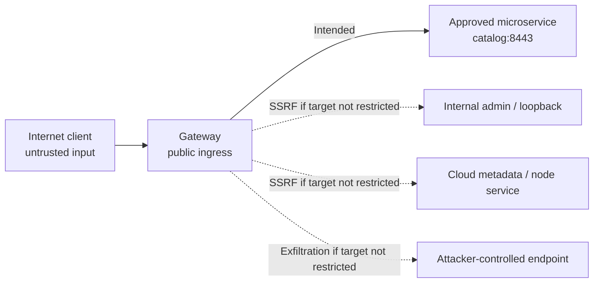
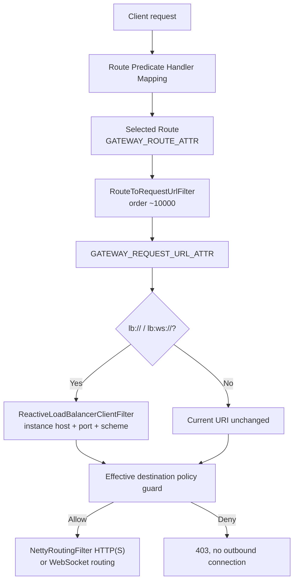
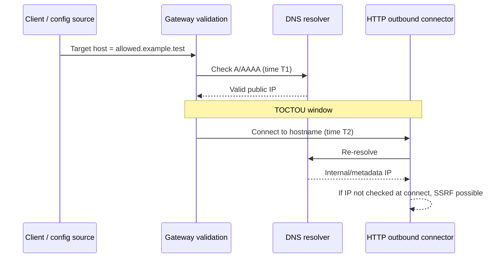
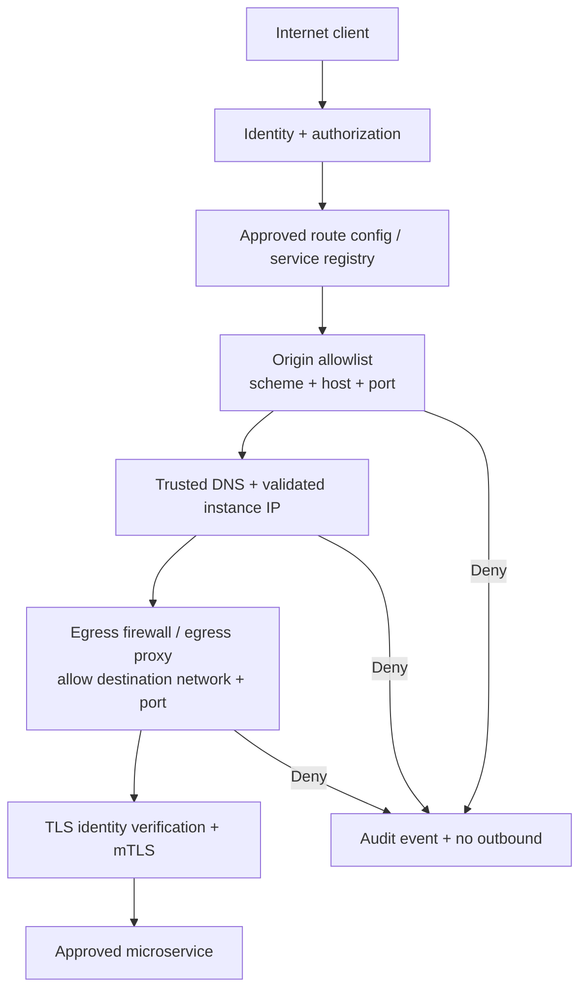
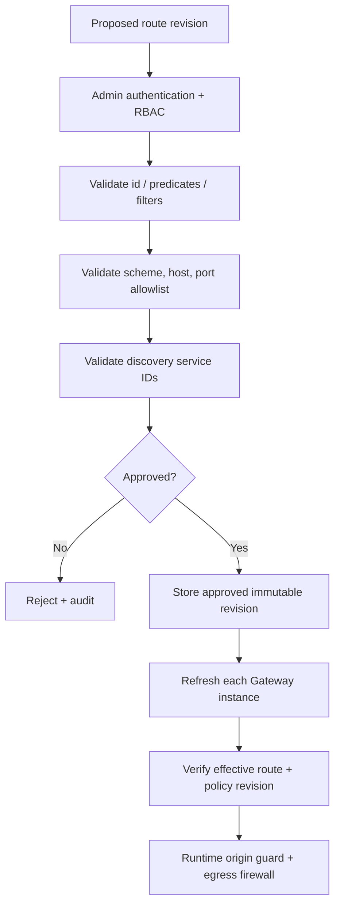

# SSRF Prevention and Restricting Target URI Scheme, Host, and Port in Spring Cloud Gateway

**Spring Cloud Gateway** is the entry point for microservices, where an external request can be matched by route predicates, pass through a filter chain, rewrite paths/headers, perform service discovery, authenticate, apply rate limiting, retry, trigger circuit breakers, and forward to an upstream. These capabilities also create a critical security boundary: **who is allowed to decide which server the Gateway will connect to?**

If client-controlled data can turn into the **target URI** or alter the connected host/port without constraints, the Gateway risks becoming a **Server-Side Request Forgery (SSRF)** vector: an attacker tricks the server into proactively sending requests to an unauthorized address from a network with higher privileges than the client. The target could be a cloud metadata service, an internal admin application, localhost, another Pod/service, or an external server outside the organization receiving confidential data.

This lesson belongs to the **Security Hardening** chapter of the `SPRING_CLOUD_GATEWAY` module. The focus is on **strictly restricting the scheme, host, and port of the target URI**, enforced at **route configuration/approval time** and **immediately before outbound routing**, while also protecting DNS, redirects, service discovery, and network egress. Examples are based on **Spring Cloud Gateway Server WebFlux 5.0.x**, with comparisons to Server Web MVC and related Gateway components.

> **Version scope:** Spring Cloud Gateway 5.0.5 / Spring Boot 4.x / Spring Framework 7 per Spring Cloud 2025.1.x compatibility releases. WebFlux route properties use `spring.cloud.gateway.server.webflux.routes`, not the `spring.cloud.gateway.routes` prefix from older guides. All examples connecting to `127.0.0.1` are **for loopback lab use only**, not production egress policy.

## 1. Learning Objectives

After this lesson, you will be able to:

1. Describe SSRF in an API Gateway and the difference between **client URL**, **route URI**, and **the IP address selected when actually connecting**.
2. Identify all sources that can alter outbound URIs: YAML/Java routes, dynamic route repositories, discovery locator, `lb://`, route filters, custom `GlobalFilter`s, redirects/fallbacks, and auxiliary proxy/HTTP clients.
3. Build a **positive allowlist** policy by `routeId → (scheme, host, port)` instead of relying on blacklists, suffix checks, or a naive URL regex.
4. Analyze dangerous URI patterns: disallowed schemes, userinfo, deceptive hostnames, non-approved ports, internal/metadata IPs, IPv6, and host encoding.
5. Understand why validating a URI string **is insufficient against DNS rebinding/TOCTOU**, and why DNS resolution, destination IP at connect time, and network egress controls are necessary.
6. Create a `GlobalFilter` that inspects `GATEWAY_REQUEST_URL_ATTR` **after route URI creation and load balancing, and before Netty outbound routing**.
7. Build a WebFlux Gateway lab with an exact allowlist, allowed/denied routes, a Java stub backend, and `curl`/JUnit tests.
8. Design dedicated controls for `lb://`/service discovery, WebSocket `ws:/wss:`, gRPC descriptor resources, redirect handling, and Server Web MVC.
9. Restrict route administration/refresh capabilities, log audit events, perform negative testing, and implement defense-in-depth.
10. Identify what an application-layer `GlobalFilter` **cannot replace**, especially an egress firewall and connect-time enforcement.

## 2. Where Does SSRF Happen in a Gateway?

### 2.1. Threat Model

Consider a poorly designed API that lets the client decide the upstream:

```text
GET /proxy?destination=http://127.0.0.1:9000/admin
X-Target-Url: http://some-internal-host/private
```

These are **examples of untrusted input**, not an API you should deploy. If the server takes `destination` or `X-Target-Url` and constructs an outbound route/`HttpClient`, the client can force the Gateway to **read from a network that the client cannot reach directly**.



Consequences can include reading metadata/credentials, invoking internal APIs with side effects, probing network topology, blind SSRF via timing/status codes, or forwarding sensitive headers (`Authorization`, cookies, service tokens) to an unauthorized host.

**SSRF does not mean "any call to a private IP is bad."** A microservices Gateway is meant to call **approved internal** services. The right question is: *is the destination authorized for this route, environment, connection method, and trust level?* A policy allowing `orders.internal.example:8443` does not mean allowing the **entire** `10.0.0.0/8` range.

### 2.2. Three URL Entities That Must Not Be Conflated

| Entity | Example | Trusted source? | What to control |
|---|---|---|---|
| **Inbound request URL** | `https://api.example.test/catalog/42` | Client controls method/path/query/headers | Authentication, predicates, normalization, input validation |
| **Configured route URI** | `https://catalog.svc.example.test:8443` | Trusted only if route source is governed and approved | Scheme/host/port allowlist, route ID, change control |
| **Effective outbound URI** | `https://10.22.3.17:8443/catalog/42` or resolved DNS host | May change due to `lb://`, service registry, custom filters | Verify final destination at Gateway and network connect |
| **Resolved socket address** | `10.22.3.17:8443` | Depends on DNS/LB, may change over time | IP/network policy **at connect time** |

Key point: `Path=/catalog/**` only selects a route. **It does not prove the route's `uri` is safe.** Likewise, JWT authentication for a client does not grant that client the right to pick arbitrary server-side hosts/ports.

### 2.3. When Can a Static Route Still Pose a Risk?

A YAML route with a fixed target URI that only admins can change generally has a **narrower** SSRF surface than a proxy endpoint taking a client-supplied URL. However, it can still become a risk if:

- The repository containing routes can be modified by a low-privilege account or a compromised CI system.
- An admin API allows unauthenticated or unauthorized route POSTs.
- Service discovery/registry is spoofed, or a service instance advertises an invalid host/port.
- A custom filter overwrites `GATEWAY_REQUEST_URL_ATTR` based on a query parameter or header.
- DNS for an approved hostname is pointed to a forbidden IP address.
- An HTTP client automatically follows a redirect to a new unvalidated destination.
- Another filter (image fetch, webhook, OAuth callback, gRPC proto resource) opens an outbound connection outside the normal Netty routing path.

Therefore, **static routes and authenticated clients alone are not enough** to eliminate SSRF across the entire system.

## 3. Identify All Sources That Create or Modify URIs

### 3.1. Route Definitions in Configuration and Control Plane

A valid route can come from:

- `application.yml` / `application.properties`;
- Java DSL (`RouteLocatorBuilder` in WebFlux, WebMvc.fn route APIs in MVC);
- database/Redis/custom `RouteDefinitionLocator` or `RouteDefinitionRepository`;
- gateway actuator route management when write access is enabled;
- discovery locator auto-generating routes from service IDs;
- route refresh/synchronization mechanisms across multiple Gateway replicas.

**Never let a frontend or tenant write the `uri` field as an arbitrary URL string.** When service selection is needed, accept a **service key** from an enum/allowlist and map it to a pre-defined route in the control plane.

### 3.2. WebFlux Pipeline That Builds Outbound URIs

The Spring Cloud Gateway Server WebFlux documentation describes:



Details to remember:

1. `RouteToRequestUrlFilter` takes the route URI and request and builds the new URI in the `ServerWebExchangeUtils.GATEWAY_REQUEST_URL_ATTR` attribute.
2. For `lb://service-id`, `ReactiveLoadBalancerClientFilter` uses an instance from LoadBalancer, which can replace the **host, port, and scheme** of the URI in this attribute.
3. `NettyRoutingFilter` proxies if the final scheme is `http` or `https`; `WebsocketRoutingFilter` handles `ws`/`wss`.
4. Filter execution order determines **which URL the outbound policy sees**. A guard running **before** the LB step may see `lb://catalog` instead of `http://10.22.3.17:8080`, missing the final host/port.
5. A `GlobalFilter` only runs within **Gateway WebFlux route processing** when a route matches; it does not block outbound connections from arbitrary SDK beans and does not replace a network firewall.

The Gateway Actuator `/actuator/gateway/globalfilters` documentation gives examples of `RouteToRequestUrlFilter` order `10000` and `ReactiveLoadBalancerClientFilter` order `10100`; the routing filters have very high order values. Exact values must be **verified on the running release**, not copied from old blog posts.

### 3.3. Special Schemes Do Not Have the Same Meaning

| Scheme / URI form | Meaning | How to control |
|---|---|---|
| `https://host:443` | Outbound HTTP over TLS | Allow when **host + port + TLS identity** are valid |
| `http://host:8080` | Plaintext outbound HTTP | Use only for approved internal hops or labs |
| `lb://catalog` | Service name via Spring Cloud LoadBalancer | Allowlist service ID and **resolved instance** |
| `lb:ws://chat` | Service discovery for WebSocket | Verify service ID and effective `ws/wss` target |
| `wss://chat:9443` | WebSocket over TLS | Dedicated WebSocket policy, Origin/auth, and egress |
| `ws://chat:9001` | Plaintext WebSocket | Do not expose publicly; only when internal policy permits |
| `forward:///local-fallback` | Internal dispatch via WebFlux handler | Not network egress, but still needs handler/authorization restrictions |
| `no://op` | Special placeholder used by certain route filters like redirects | Do not use as a generally whitelisted outbound URI |
| `file:`, `jar:`, `ftp:`, `gopher:`, `dict:` | Not valid HTTP proxy targets for this lab; can be dangerous in other SDKs | **Deny**, never add to egress allowlist |
| `http://169.254.169.254:80` | Example link-local metadata address | Disallow from Internet-controlled routes; block at egress |

**Do not whitelist every URI with the `https` scheme.** HTTPS only indicates traffic is encrypted to some endpoint; it does not prove that endpoint is authorized to receive the request or confidential data.

## 4. Safe Policy: Positive Allowlist per Route

Instead of a rule saying "forbid localhost and metadata" and allowing everything else, define the policy:

\[
\mathrm{Allow}(r,u) =
\big(\mathrm{routeId}(r),\mathrm{scheme}(u),\mathrm{host}(u),\mathrm{port}(u)\big)
\in \mathcal A
\]

where `𝒜` is the set of approved origins. **By default, if no entry exists, deny.**

### 4.1. Approved Scheme–Host–Port Matrix

| Route | Scheme | Host | Port | Notes |
|---|---|---|---:|---|
| `catalog-api` | `https` | `catalog.svc.example.test` | 8443 | Internal upstream with matching TLS identity |
| `orders-api` | `https` | `orders.svc.example.test` | 8443 | Orders service; separate permissions |
| `public-assets` | `https` | `assets.example.test` | 443 | Exact FQDN and port only |
| `catalog-lab` | `http` | `127.0.0.1` | 9001 | **Loopback LAB ONLY** |
| `chat-wss` | `wss` | `chat.svc.example.test` | 9443 | Requires dedicated WebSocket guard |

No `*://*:*`, `https://*.internal.example.test:*`, or entire `10.0.0.0/8` subnets. If business logic uses `lb://catalog`, the approved service IDs and permitted instances/networks must be bound to that route.

**Production rule:** ports **80/443** may be valid for certain endpoints, but must still be permitted per **specific host and port pair**. Do not allow `https://catalog.svc.example.test:2375` just because the hostname is on the list.

### 4.2. Why Is a Blacklist Insufficient?

A denylist of `127.0.0.1`, `localhost`, `169.254.169.254` easily misses:

- Other equivalent IPv4 representations or DNS aliases pointing to loopback.
- IPv6 `::1`, IPv4-mapped IPv6, IPv6 link-local, unique-local.
- NAT64 or dual-stack where the network allows reaching a forbidden IPv4 address via IPv6.
- Private IPs in ranges other than `10.0.0.0/8`.
- DNS rebinding from an apparently public hostname to a private/metadata address.
- Redirects from a valid URL to a new unapproved destination.
- Other admin ports and services running on an already-approved host.

OWASP recommends **allowlisting**, network egress policies, and connect-time validation. Specific IP denylists are only **supplementary protection**, not a substitute for positive allowlisting.

### 4.3. HTTP Redirects Must Not Let an Approved Origin "Move"

If backend `https://assets.example.test` returns:

```http
HTTP/1.1 302 Found
Location: http://unapproved-host.internal:8080/private
```

The Gateway may either:

- return the 302 directly to the **client** **without** following the redirect itself; or
- use a custom HTTP client/proxy filter that **automatically follows** it and makes a second outbound request.

Only the second case is an outbound step that **must validate the new URL** to prevent SSRF. The policy should **not auto-follow redirects** unless business requirements mandate it and the code enforces allowlist/IP controls on **every redirect hop**, caps max redirects, and avoids sending credentials across origins. Never rely on having validated the **initial** URL to permit a new redirect target.

### 4.4. Do Not Accept Targets from Query Parameters or Headers

**Anti-pattern:**

```java
// DO NOT USE: attacker can decide the target URI.
String target = exchange.getRequest()
    .getQueryParams().getFirst("url");
URI destination = URI.create(target);
exchange.getAttributes().put(
    ServerWebExchangeUtils.GATEWAY_REQUEST_URL_ATTR, destination);
```

**Better design:** The client only sends an allowed business identifier, e.g., `GET /catalog/items/42`. The `catalog-api` route already defines `uri: https://catalog.svc.example.test:8443` and an origin-controlling policy. If multiple providers are genuinely needed, the client sends `provider=CATALOG_A`, the server looks up an immutable `Map<Provider, ApprovedOrigin>` that cannot be externally modified, and then applies authorization.

Do not let HTTP `Host` or `X-Forwarded-Host` headers determine the upstream URI by default. Those headers represent **inbound host/proxy context**, not directives granting permission to make network calls.

## 5. Canonicalize URIs Before Comparing Against the Allowlist

### 5.1. Do Not Write a Single Regex to Parse URLs

Use `java.net.URI` (or a well-tested standard parser library) to extract **scheme, authority, userinfo, host, port, path, query, fragment**. Then inspect each field instead of writing:

```java
// Anti-pattern: substring check easily accepts spoofed hosts or ambiguous URIs.
if (url.contains("catalog.svc.example.test")) {
    // ALLOW -- WRONG
}
```

Cases that must be handled by an explicit policy:

| Illustrative input | Security question |
|---|---|
| `https://catalog.svc.example.test:8443` | Does it match the route's allowlist? |
| `HTTP://CATALOG.SVC.EXAMPLE.TEST:8443` | Scheme/host are case-insensitive; normalize consistently |
| `https://catalog.svc.example.test` | Omitted port: HTTPS defaults to 443, **which differs from 8443** |
| `https://catalog.svc.example.test:9443` | Right host but **wrong port** |
| `http://catalog.svc.example.test:8443` | Right host/port but **wrong scheme**; could strip TLS |
| `https://catalog.svc.example.test.evil.test:8443` | String contains the approved hostname, but it is a different origin |
| `https://catalog.svc.example.test@evil.test:8443` | `userinfo` tricks human readers; the actual host is `evil.test` |
| `https://evil.test@catalog.svc.example.test:8443` | Userinfo is still unnecessary for a gateway proxy and can leak secrets |
| `https://catalog.svc.example.test.:8443` | FQDN with trailing dot must be canonicalized or denied consistently |
| `https://cátalog.example.test:8443` | IDN/Unicode; must convert IDNA to punycode via a trusted component before exact match |
| `https://[::1]:8443` | IPv6 loopback, must not be missed when checking localhost |
| `https://127.0.0.1:8443` | Loopback address; only valid in an isolated lab |
| `https://catalog.svc.example.test:8443/path?x=y` | Origin may be valid; path/query must be controlled in a separate layer |
| `file:///etc/passwd` | No HTTP host/port and must never be accepted as a proxy target |
| `lb://catalog` | Pseudo-scheme requiring service ID validation followed by post-LB instance checks |

**Important:** `URI.getHost()` can return `null` for non-standard authorities even when `URI.create(...)` does not throw an exception. Never treat `null` as "use default host" or trust an unvalidated `getRawAuthority()`.

### 5.2. Recommended Canonicalization Rules

1. Parse with a standard parser; reject null/opaque URIs or missing host/authority.
2. Only accept **schemes permitted by policy**; for instance, an HTTP guard only supports `http`/`https`.
3. Reject `userinfo`, `fragment`, and ambiguous components unnecessary for the target.
4. Canonicalize scheme and DNS hostname to lowercase (`Locale.ROOT`), not the machine's default locale.
5. Decide explicitly how to handle IDN/IPv6/trailing dots: either use a thoroughly tested standard parser/normalizer, or **deny** until intentional support is built.
6. Normalize the **effective port**: `http` without port → 80; `https` without port → 443; explicit port 8443 remains 8443.
7. Compare the **full origin** by equality, not startsWith/endsWith/contains.
8. Separate **origin policy** from **path/query policy** and **resolved IP egress policy**.
9. Do not perform synchronous DNS lookups inside a `GlobalFilter`, as it can **block the Netty event loop**.
10. Do not turn unknown scheme/host/port into an allowed default; **fail closed**.

### 5.3. Host Suffix Checks Are a Trap Without Clear Boundaries

`host.endsWith("example.test")` matches `notexample.test`. `host.endsWith(".example.test")` is slightly better on boundaries, yet still opens **all subdomains**, including hijacked subdomains or tenant-registered namespaces.

For critical routes, use **exact FQDNs**. If wildcards are genuinely required by the business, you need ownership of the entire namespace, public suffix protection, tenant isolation, certificate policy, and an approved sub-list. Never equate "has a valid TLS cert for a subdomain" with "that subdomain is authorized to receive all backend traffic."

### 5.4. Target URI Is Not the HTTP `Host` Header

When proxying to `https://catalog.svc.example.test:8443`:

- HTTP routing/client configuration determines the **socket endpoint**.
- Request `Host`/`:authority` may be derived from the target or affected by `PreserveHostHeader`.
- TLS SNI and certificate hostname verification must use the **trusted target** identity.
- `X-Forwarded-Host` represents inbound proxy context, not an instruction to arbitrarily switch targets.

**Never replace the hostname with a resolved IP and disable TLS validation.** If connection pinning to an allowed IP is needed, the HTTP client must preserve the exact origin hostname for SNI, Host, and certificate verification; implement this using a dedicated, well-tested connector/network policy.

## 6. DNS Rebinding, Special IP Ranges, and Network Egress

### 6.1. Why Can a Hostname Allowlist Still Be Bypassed?

Suppose a hostname is approved in the control plane. During the initial check, DNS returns a valid IP. By the time the HTTP client actually connects, the resolver may return a **different IP** due to DNS rebinding, cache TTLs, split-horizon DNS, CDN/registry updates, or an untrusted DNS source.



**Solution:** If policy needs to restrict IPs, inspect A/AAAA records **and ensure the actual connection goes to a validated IP**, rather than letting the HTTP client re-resolve unchecked. Alternatively, enforce destination networks at an egress proxy/firewall at connection time, combined with trusted DNS policy.

A `GlobalFilter` that only compares `URI.getHost()` **is not enough to prevent DNS rebinding**. It is an important **origin allowlist layer**, but there must be a connect-time layer.

### 6.2. Address Groups Requiring Special Vigilance

| Group | Example | Risk |
|---|---|---|
| Loopback IPv4 | `127.0.0.0/8` | Gateway calling admin services bound only locally |
| Unspecified | `0.0.0.0/8` and certain special addresses | Representations that must not be used as outbound targets |
| RFC1918 private | `10.0.0.0/8`, `172.16.0.0/12`, `192.168.0.0/16` | Unlisted internal services |
| Link-local IPv4 | `169.254.0.0/16` | Cloud metadata, node/pod identity |
| Shared address | `100.64.0.0/10` | Carrier-grade NAT / provider networks in some topologies |
| Multicast/reserved | `224.0.0.0/4`, broadcast, reserved | Not normal proxy targets |
| IPv6 loopback | `::1/128` | Local management services |
| IPv6 unique-local | `fc00::/7` | IPv6 internal networks |
| IPv6 link-local | `fe80::/10` | Interface-local services |
| IPv4-mapped IPv6 | `::ffff:0:0/96` | Same IPv4 address expressed in IPv6 form |
| NAT64 | `64:ff9b::/96` and active network prefixes | Can reach forbidden IPv4 targets via IPv6 |
| IPv6 multicast | `ff00::/8` | Destinations not meant for outbound APIs |
| Metadata addresses | `169.254.169.254`, IPv6/provider-specific endpoints | Cloud metadata/credentials or identity services |

This list serves as a **testing and defense-in-depth guide**, not a blanket firewall rule to **block all private IPs**. A legitimate Gateway may need to connect to approved private IPs of Kubernetes Services. Production policy needs specific **network namespace + port + service identity**, not simply "public vs private."

When detecting IPv4-mapped/NAT64 addresses, canonicalize using a tested IP library/connector and enforce across both IPv4 and IPv6; string checks like `startsWith("127.")` are insufficient.

### 6.3. Defense-in-Depth Architecture



Each layer has a distinct purpose:

- **Authorization**: who is allowed to call which route?
- **Route policy**: which upstream is the route allowed to select?
- **DNS/IP policy**: does the hostname actually resolve to a permitted network/destination?
- **Network egress**: is the Gateway process/pod physically restricted to connecting only to authorized networks/ports?
- **TLS/mTLS**: correct hostname/service workload identity, preventing credential leakage and MITM.
- **Logging/monitoring**: detecting route config/instance drift, anomalous denials, and unexpected egress.

**Do not put all your trust in Java `GlobalFilter` code.** A library creating its own `WebClient`, gRPC channel, OAuth JWK fetch, or native socket can bypass the Gateway filter chain. Network egress is the final backstop protecting those outbound connections.

### 6.4. Kubernetes and Cloud Deployments

For Kubernetes:

1. Allow the Gateway namespace/service account to egress only to the **exact namespaces/Pods/ports** the API requires.
2. Use a CNI that actually enforces `NetworkPolicy` for **egress**, and test default-deny + allow rules on the target cluster.
3. Restrict DNS egress to trusted resolvers, keeping in mind destination IPs can change; DNS egress rules do **not** replace IP/connect rules.
4. Block metadata/node endpoints and unnecessary cloud identity APIs from the Gateway pod using platform policies.
5. If using a service mesh/egress gateway, restrict service identity, SNI/host, certs, and actual destinations; do not trust HTTP Host alone.
6. When calling external SaaS, consider an egress proxy allowlist, hostname verification, and an IP change process.
7. Test a pod calling a **mock internal-denied service** in a test cluster to prove egress is blocked; never probe production metadata.

Standard `NetworkPolicy` resources typically describe IP CIDRs, namespace/pod selectors, and ports, **not built-in FQDN policies**. If hostname allowlisting is needed at egress, use a CNI/egress proxy that supports it and verify how it handles DNS TTLs/rebinding.

### 6.5. What Timeouts and TLS Cannot Do

`response-timeout: 3s` reduces how long resources are held on slow upstreams, but **does not prevent** SSRF to an internal endpoint that returns 200 in 2 ms.

`https://host` with a valid certificate verifies host/network identity under the trust model, but **does not decide whether this route is allowed to call that host**. TLS, timeouts, rate limiters, and circuit breakers are only supporting layers; **scheme–host–port allowlisting + IP/connect egress** are the core of this topic.

## 7. WebFlux Lab: Origin Allowlist by Route ID

Goal: Gateway listens on `127.0.0.1:8080`, echo backend on `127.0.0.1:9001`. Route `catalog-lab` is allowed to reach `http://127.0.0.1:9001`. Route `blocked-loopback` uses the **same origin** but has no permission for its route ID. Route `blocked-port` uses unapproved port 9002. The guard rejects with 403 **before outbound**, even though the target URI is syntactically valid.

**Note:** Allowlisting `127.0.0.1` is **for the loopback lab only**. Production must have a dedicated policy pointing to approved services and never borrow a lab policy that opens localhost.

### 7.1. Maven Dependencies and Startup Application

Create a Spring Boot 4.x project using a compatible Spring Cloud BOM 2025.1.x:

```xml
<dependencies>
    <dependency>
        <groupId>org.springframework.cloud</groupId>
        <artifactId>spring-cloud-starter-gateway-server-webflux</artifactId>
    </dependency>
    <dependency>
        <groupId>org.springframework.boot</groupId>
        <artifactId>spring-boot-starter-actuator</artifactId>
    </dependency>
</dependencies>
```

These are only the core dependencies, not a complete `pom.xml`; include the appropriate Boot parent/plugin and BOM. Do not add the Gateway Server Web MVC starter to the same project.

`SsrfGatewayApplication.java`:

```java
import org.springframework.boot.SpringApplication;
import org.springframework.boot.autoconfigure.SpringBootApplication;
import org.springframework.boot.context.properties.EnableConfigurationProperties;

@SpringBootApplication
@EnableConfigurationProperties(EgressRules.class)
public class SsrfGatewayApplication {
    public static void main(String[] args) {
        SpringApplication.run(SsrfGatewayApplication.class, args);
    }
}
```

### 7.2. Lab Profile and Route Policy

`src/main/resources/application-ssrf-lab.yml`:

```yaml
server:
  address: 127.0.0.1
  port: 8080

spring:
  application:
    name: gateway-ssrf-lab
  cloud:
    gateway:
      server:
        webflux:
          routes:
            - id: catalog-lab
              uri: http://127.0.0.1:9001
              predicates:
                - Path=/catalog/items/**
                - Method=GET
              filters:
                - StripPrefix=1
                - RemoveRequestHeader=Cookie
                - RemoveRequestHeader=Authorization
                - RemoveRequestHeader=X-Target-Url

            - id: blocked-loopback
              uri: http://127.0.0.1:9001
              predicates:
                - Path=/blocked-loopback/**
                - Method=GET
              filters:
                - StripPrefix=1

            - id: blocked-port
              uri: http://127.0.0.1:9002
              predicates:
                - Path=/blocked-port/**
                - Method=GET
              filters:
                - StripPrefix=1

# This is an application custom property, not a built-in
# Gateway SSRF firewall property.
app:
  gateway:
    egress:
      allowed-origins:
        catalog-lab:
          - "http://127.0.0.1:9001"

management:
  endpoints:
    web:
      exposure:
        include: health,info
```

The policy has a **single entry**: route `catalog-lab` may call HTTP port 9001. The two blocked routes exist to verify deny-by-route-ID/port, **not as production endpoints**.

### 7.3. ConfigurationProperties Holding the Allowlist

Create `EgressRules.java` in the same package scanned by Boot:

```java
import java.util.HashMap;
import java.util.List;
import java.util.Map;

import org.springframework.boot.context.properties.ConfigurationProperties;

@ConfigurationProperties(prefix = "app.gateway.egress")
public class EgressRules {

    // Key = routeId; values = origin-only URLs.
    private Map<String, List<String>> allowedOrigins =
            new HashMap<>();

    public Map<String, List<String>> getAllowedOrigins() {
        return allowedOrigins;
    }

    public void setAllowedOrigins(
            Map<String, List<String>> allowedOrigins) {
        this.allowedOrigins = allowedOrigins == null
                ? new HashMap<>()
                : allowedOrigins;
    }
}
```

An empty default map means **no routes are allowed**. This configuration belongs to a control plane with access control, code review, and versioning, and must never be accepted directly from queries/headers or public forms. In production, add fail-fast validation if required policies are missing, and never fall back to allow-all to avoid startup failures.

### 7.4. `GlobalFilter` Checking Effective URI

Create `OutboundOriginGuard.java`:

```java
import java.net.URI;
import java.util.HashMap;
import java.util.HashSet;
import java.util.List;
import java.util.Locale;
import java.util.Map;
import java.util.Set;

import org.slf4j.Logger;
import org.slf4j.LoggerFactory;
import org.springframework.cloud.gateway.filter.GatewayFilterChain;
import org.springframework.cloud.gateway.filter.GlobalFilter;
import org.springframework.cloud.gateway.route.Route;
import org.springframework.cloud.gateway.support.ServerWebExchangeUtils;
import org.springframework.core.Ordered;
import org.springframework.http.HttpStatus;
import org.springframework.stereotype.Component;
import org.springframework.web.server.ServerWebExchange;

import reactor.core.publisher.Mono;

@Component
public class OutboundOriginGuard implements GlobalFilter, Ordered {

    private static final Logger log =
            LoggerFactory.getLogger(OutboundOriginGuard.class);

    // HTTP-only policy for this lab. WS/forward/lb and IPv6 need
    // separate, explicitly reviewed extensions.
    private static final Set<String> SCHEMES =
            Set.of("http", "https");

    private final Map<String, Set<Origin>> allowByRoute;

    public OutboundOriginGuard(EgressRules rules) {
        Map<String, Set<Origin>> compiled = new HashMap<>();

        for (Map.Entry<String, List<String>> entry
                : rules.getAllowedOrigins().entrySet()) {
            String routeId = entry.getKey();
            if (routeId == null || routeId.isBlank()
                    || entry.getValue() == null) {
                throw new IllegalArgumentException(
                    "Invalid route ID or origin list");
            }

            Set<Origin> approved = new HashSet<>();
            for (String text : entry.getValue()) {
                URI uri;
                try {
                    uri = URI.create(text);
                } catch (IllegalArgumentException ex) {
                    throw new IllegalArgumentException(
                        "Malformed outbound origin policy", ex);
                }

                Origin origin = Origin.from(uri);
                String path = uri.getRawPath();
                // Policy values are origins, not full request URLs.
                if (origin == null
                        || (path != null && !path.isEmpty())
                        || uri.getRawQuery() != null) {
                    throw new IllegalArgumentException(
                        "Origin policy must be scheme://host[:port]");
                }
                approved.add(origin);
            }
            compiled.put(routeId, Set.copyOf(approved));
        }
        this.allowByRoute = Map.copyOf(compiled);
    }

    @Override
    public int getOrder() {
        // Gateway WebFlux 5.0 documented example:
        // RouteToRequestUrlFilter: 10000
        // ReactiveLoadBalancerClientFilter: 10100
        // NettyRoutingFilter: very late in chain.
        // Verify effective order in Actuator on YOUR release.
        return 10500;
    }

    @Override
    public Mono<Void> filter(
            ServerWebExchange exchange,
            GatewayFilterChain chain) {

        Route route = exchange.getAttribute(
                ServerWebExchangeUtils.GATEWAY_ROUTE_ATTR);
        URI target = exchange.getAttribute(
                ServerWebExchangeUtils.GATEWAY_REQUEST_URL_ATTR);

        Origin actual = Origin.from(target);
        String routeId = route == null ? null : route.getId();

        Set<Origin> approved =
                routeId == null ? null : allowByRoute.get(routeId);

        if (actual == null || approved == null
                || !approved.contains(actual)) {
            // Do not log raw URI, query tickets or credentials.
            log.warn("SSRF guard denied routeId={}",
                    routeId == null ? "<none>" : routeId);
            exchange.getResponse().setStatusCode(HttpStatus.FORBIDDEN);
            return exchange.getResponse().setComplete();
        }

        return chain.filter(exchange);
    }

    private record Origin(String scheme, String host, int port) {

        static Origin from(URI uri) {
            if (uri == null || uri.isOpaque()
                    || uri.getRawAuthority() == null
                    || uri.getRawUserInfo() != null
                    || uri.getRawFragment() != null) {
                return null;
            }
            String inputScheme = uri.getScheme();
            String inputHost = uri.getHost();
            if (inputScheme == null || inputHost == null) {
                return null;
            }

            String scheme = inputScheme.toLowerCase(Locale.ROOT);
            String host = inputHost.toLowerCase(Locale.ROOT);

            if (!SCHEMES.contains(scheme) || !asciiHost(host)) {
                return null;
            }

            int port = uri.getPort();
            if (port == -1) {
                port = scheme.equals("https") ? 443 : 80;
            }
            if (port < 1 || port > 65535) {
                return null;
            }
            return new Origin(scheme, host, port);
        }

        // Conservative teaching parser: ASCII DNS/IPv4 only.
        // A full IPv6/IDNA policy requires separately tested logic.
        private static boolean asciiHost(String host) {
            if (host.isEmpty() || host.length() > 253
                    || host.endsWith(".")) {
                return false;
            }
            for (String label : host.split("\\.", -1)) {
                if (label.isEmpty() || label.length() > 63
                        || !label.matches(
                           "[a-z0-9](?:[a-z0-9-]*[a-z0-9])?")) {
                    return false;
                }
            }
            return true;
        }
    }
}
```

`Origin` is a Java record: `equals` compares the exact **scheme, normalized host, and effective port**. Binding allowlist entries to **route ID** prevents route B from borrowing route A's outbound permissions.

### 7.5. Why Is a Guard at Order 10500 Still Not a Complete Solution?

In Gateway WebFlux 5.0 Actuator documentation, `RouteToRequestUrlFilter` has order `10000`, `ReactiveLoadBalancerClientFilter` is illustrated at order `10100`, and `NettyRoutingFilter` runs very late. Guard `10500` therefore inspects the URI after those steps, **provided** runtime order matches expectations.

However:

- A custom filter with order between `10501` and outbound routing **can still alter `GATEWAY_REQUEST_URL_ATTR` after the guard has run**. You must forbid or place all URI-mutating filters before the guard; test runtime order/attributes.
- An HTTP client that auto-follows redirects will perform a new outbound hop **without necessarily passing through `GlobalFilter` again**.
- `forward:///...`, `ws/wss`, `lb:ws://...`, and SDKs outside Netty routing require separate policies.
- A host allowlist does not prevent DNS rebinding; IP/network must be enforced at **connect time**.
- A `GlobalFilter` does not protect outgoing WebClient/gRPC/S3 SDK calls that do not go through the Gateway route pipeline.

This is **a policy enforcement layer at the Gateway route**, not a general JVM outbound firewall.

### 7.6. Intentional Fail-Closed Behaviors

This sample rejects IPv6 literals, Unicode hostnames, `forward:`, `ws/wss`, unresolved `lb://`, and unknown route IDs. Those cases are **not harmless**; support for them must only be added after building canonicalization, trust policies, and thorough tests.

Do not patch the code with `host.contains(...)`, do not let `approved==null` pass, do not perform synchronous DNS lookups on the Netty event loop, do not disable TLS verification, and do not convert a 403 guard denial into a 200 fallback. If a new route lacks a policy, fix the configuration error in the control plane instead of turning off controls "to avoid disruption."

## 8. Lab Backend and Testing That Gateway Never Calls Forbidden URIs

### 8.1. Standalone Echo Backend Using the JDK

Create `SsrfEchoBackend.java` in a separate lab directory from the Gateway:

```java
import com.sun.net.httpserver.HttpExchange;
import com.sun.net.httpserver.HttpServer;
import java.net.InetSocketAddress;
import java.nio.charset.StandardCharsets;
import java.util.concurrent.atomic.AtomicInteger;

public class SsrfEchoBackend {
    private static final AtomicInteger COUNT = new AtomicInteger();

    public static void main(String[] args) throws Exception {
        HttpServer server = HttpServer.create(
            new InetSocketAddress("127.0.0.1", 9001), 0);

        server.createContext("/__lab/count", exchange ->
            reply(exchange, 200, "calls=" + COUNT.get(), false));

        server.createContext("/__lab/reset", exchange -> {
            if (!"POST".equals(exchange.getRequestMethod())) {
                reply(exchange, 405, "method-not-allowed", false);
                return;
            }
            COUNT.set(0);
            reply(exchange, 200, "reset=ok", false);
        });

        server.createContext("/", exchange -> {
            int n = COUNT.incrementAndGet();
            String path = exchange.getRequestURI().getRawPath();
            String query = exchange.getRequestURI().getRawQuery();

            String result = "call=" + n + "\n"
                + "path=" + path + "\n"
                + "query=" + (query == null ? "" : query) + "\n"
                + "cookiePresent="
                + exchange.getRequestHeaders().containsKey("Cookie") + "\n"
                + "authPresent="
                + exchange.getRequestHeaders().containsKey("Authorization")
                + "\n"
                + "targetHeaderPresent="
                + exchange.getRequestHeaders().containsKey("X-Target-Url");

            int status = path.startsWith("/items/") ? 200 : 404;
            reply(exchange, status, result, true);
        });
        server.start();
        System.out.println("SSRF lab backend on 127.0.0.1:9001");
    }

    private static void reply(HttpExchange exchange, int status,
                              String body, boolean upstream)
            throws java.io.IOException {
        byte[] bytes = body.getBytes(StandardCharsets.UTF_8);
        exchange.getResponseHeaders().set(
            "Content-Type", "text/plain; charset=utf-8");
        exchange.getResponseHeaders().set("Cache-Control", "no-store");
        if (upstream) {
            exchange.getResponseHeaders().set("X-Upstream-Lab", "hit");
        }
        exchange.sendResponseHeaders(status, bytes.length);
        try (var out = exchange.getResponseBody()) {
            out.write(bytes);
        }
    }
}
```

The backend binds only to `127.0.0.1`. Both `/__lab/*` endpoints are unauthenticated and **for testing only**; never deploy them in production.

Run the backend and Gateway in two separate terminals:

```bash
# Terminal 1, JDK 17+
java --add-modules jdk.httpserver SsrfEchoBackend.java

# Terminal 2, inside Gateway project, Linux/macOS
SPRING_PROFILES_ACTIVE=ssrf-lab ./mvnw spring-boot:run
```

For Windows PowerShell:

```powershell
$env:SPRING_PROFILES_ACTIVE = 'ssrf-lab'
.\mvnw.cmd spring-boot:run
```

### 8.2. Positive Test: Matching Origin and Route

```bash
curl -i -X POST http://127.0.0.1:9001/__lab/reset

curl -i \
  -H "Cookie: SESSION=synthetic-only" \
  -H "Authorization: Bearer synthetic-only" \
  -H "X-Target-Url: http://127.0.0.1:9002" \
  "http://127.0.0.1:8080/catalog/items/42?lang=vi"
```

Illustrative result:

```http
HTTP/1.1 200 OK
X-Upstream-Lab: hit
Content-Type: text/plain; charset=utf-8

call=1
path=/items/42
query=lang=vi
cookiePresent=false
authPresent=false
targetHeaderPresent=false
```

This provides evidence that:

- `Path=/catalog/items/**` matched route `catalog-lab`.
- `StripPrefix=1` forwarded `/items/42` to the backend.
- `RemoveRequestHeader` stripped the three test headers so they were not forwarded downstream.
- The client-sent `X-Target-Url` header **did not alter the upstream URI** in the lab route.
- `OutboundOriginGuard` allowed the exact tuple `(catalog-lab, http, 127.0.0.1, 9001)`.

**Never use real tokens/cookies.** In production, if `TokenRelay` is needed for a service with an appropriate audience, the header policy will differ and must be designed specifically.

### 8.3. Negative Test: Unapproved Route and Port

```bash
curl -s http://127.0.0.1:9001/__lab/count

curl -i http://127.0.0.1:8080/blocked-loopback/items/42
curl -i http://127.0.0.1:8080/blocked-port/items/42

curl -s http://127.0.0.1:9001/__lab/count
```

Both requests through the Gateway must return `403 Forbidden` from the guard, and the 9001 backend counter **must not increment**:

- `blocked-loopback` uses the right host/port 9001, but **the route ID has no policy**.
- `blocked-port` targets 9002; this origin is not allowed, so no real server on port 9002 is needed.

In concurrent environments, a global counter is easily noisy. CI should use a per-test backend stub or a request journal keyed by test ID. A `403` alone **does not prove** no outbound connection occurred: you need counters, tracing, or egress logs.

### 8.4. No-Route Is Not an SSRF Guard Denial

```bash
curl -i http://127.0.0.1:8080/catalog/admin
curl -i -X POST http://127.0.0.1:8080/catalog/items/42
```

These two requests do not match the lab route by Path/Method; if no other handler exists, they typically return 404. **The guard is not invoked if the Gateway does not select a route**, so do not expect 403 here.

To test `file:`/`ftp:`/`gopher:` URIs, use **unit tests on the validator** rather than creating a dangerous proxy route. Never send real requests to cloud metadata or admin hosts in production to "test if it gets blocked."

### 8.5. Verifying Filter Order with Actuator

In a **read-only admin profile on loopback**, you can configure:

```yaml
management:
  endpoint:
    gateway:
      access: read-only
  endpoints:
    web:
      exposure:
        include: health,info,gateway
```

```bash
curl -i http://127.0.0.1:8080/actuator/gateway/globalfilters
curl -i http://127.0.0.1:8080/actuator/gateway/routes
```

Confirm `OutboundOriginGuard` sits at order 10500, after URL construction/LB and before Netty routing. This only verifies **runtime filter order**; it does not prove all DNS connections or other SDKs pass through the guard.

**Never expose Actuator route management to the Internet.** Read permission for routes/filters and write/refresh permission are separate privileges; route administration must reside on a management network with RBAC/audit.

## 9. Dynamic Route Admission Before Activation

A runtime `GlobalFilter` is an important safeguard, but policy must **begin in the control plane**:



### 9.1. Checks Needed at the Route Administration Gate

1. Only authenticated/admin workloads may manage routes; require approval for sensitive changes.
2. Validate unique `routeId`, namespace, owner, priority/order, and route overlap.
3. URI is syntactically valid **and** present in the per-route-ID allowlist.
4. For `lb://service-id`: service ID is approved, and instance host/port have their own policy.
5. Filters capable of modifying `GATEWAY_REQUEST_URL_ATTR` must be restricted and evaluated against the guard's order.
6. Never accept arbitrary `Forwarded`/`Host`/`X-Target-Url` to pick destinations.
7. Never expose debug/Actuator/administration URLs simply by adding a `/**` route.
8. New routes or scheme/host/port changes require validation and audit before commit.
9. Update **all** Gateway replicas, verify effective revisions, and roll back if out of sync.
10. On validation error: **do not save and do not activate**, and never fall back to allow-all.

### 9.2. Admission Control Pseudocode

```java
// PSEUDOCODE: implement the interfaces and methods yourself.
Mono<Void> approveAndPublish(
        RouteDefinition proposed, Admin actor) {

    authorize(actor, "GATEWAY_ROUTE_WRITE");
    ensureSafeIdOrderPredicates(proposed);
    validateRouteUri(
        proposed.getId(), proposed.getUri());
    validateNoPostGuardUriMutation(proposed.getFilters());

    ApprovedRevision revision = approveAndSign(proposed);
    return storeRevision(revision)
        .then(refreshAllGatewayInstances(revision))
        .then(verifyEffectiveRevisionOnEveryInstance(revision));
}
```

The snippet above **is not a runnable Java class**; types like `Admin`, `ApprovedRevision`, and those helper methods are undefined. Its goal is to illustrate the sequence of control steps, not to imply a built-in Gateway API handles full approval workflows automatically.

### 9.3. Discovery Locator Can Generate Unintended Routes

Gateway WebFlux has `spring.cloud.gateway.server.webflux.discovery.locator.enabled` (documented in 5.0 as `false` by default). When enabled, it can generate routes from the registry, with a default `url-expression` of `'lb://'+serviceId`.

Therefore:

- Only enable it when genuinely needed.
- Restrict service IDs via `include-expression`/metadata according to policy; do not let the registry decide which services become public.
- Protect write permissions for instances/ports/hosts in the service registry.
- Validate the **service ID** before route activation and the **instance URI** after LoadBalancer resolution.
- Combine network egress, mTLS/service identity, and authorization so another service cannot impersonate an approved target.
- Test that registering an unfamiliar service in a test environment **does not automatically turn it into a public route** with outbound permissions.

## 10. `lb://` and Service Discovery: Must Inspect the **Actual Instance**

### 10.1. Service ID Is Not the Destination IP

A route may be configured as follows:

```yaml
spring:
  cloud:
    gateway:
      server:
        webflux:
          routes:
            - id: catalog-prod
              uri: lb://catalog-service
              predicates:
                - Path=/api/catalog/**
              filters:
                - StripPrefix=2
```

When Spring Cloud LoadBalancer and a `ServiceInstance` are present, `ReactiveLoadBalancerClientFilter` replaces `lb://catalog-service` with a URI containing the instance's **host/port/scheme**. If the registry is misconfigured or tampered with, a valid service ID can still point to a policy-violating host/port.

| Stage | Check |
|---|---|
| Route admission | `catalog-prod` may only use service ID `catalog-service` |
| Post-LoadBalancer | Effective host/port/scheme belongs to authorized instance list |
| At DNS/socket connect | Resolved IP resides in permitted network/service identity |
| Backend layer | mTLS/workload identity and domain authorization are valid |

According to the Gateway WebFlux documentation, `ServiceInstance.isSecure()` can affect the outbound URL scheme. **Do not assume** inbound HTTPS means outbound is also HTTPS. Verify the actual scheme after LoadBalancer and the TLS certificate/CA/SNI on the outbound connection.

### 10.2. NetworkPolicy Should Open Only the Exact Service/Port

An **illustrative** `NetworkPolicy` for Gateway pods in the `edge` namespace egressing to catalog pods on port 8443:

```yaml
apiVersion: networking.k8s.io/v1
kind: NetworkPolicy
metadata:
  name: gateway-catalog-egress
  namespace: edge
spec:
  podSelector:
    matchLabels:
      app: gateway
  policyTypes: [Egress]
  egress:
    - to:
        - namespaceSelector:
            matchLabels:
              kubernetes.io/metadata.name: catalog
          podSelector:
            matchLabels:
              app: catalog-api
      ports:
        - protocol: TCP
          port: 8443
```

**This is not yet a complete production policy**: the Gateway may also need DNS egress and deliberate connections to an Identity Provider, service discovery, and metrics. Add minimal rules tailored to your cluster's exact topology and labels. You must test that the CNI enforces egress policies and check interactions with Kubernetes Service NAT/EndpointSlice, rather than just reading the YAML.

**Never open all Pod IPs and all ports** to fix discovery errors. Standard `NetworkPolicy` also does not provide dynamic FQDN allowlisting by default; use a CNI/egress proxy with reliable mechanisms if hostname-based blocking is required.

### 10.3. Do Not Publish the Entire Registry as Public Routes

If `spring.cloud.gateway.server.webflux.discovery.locator.enabled` is turned on, you must:

- Approve service IDs using protected `include-expression`/metadata.
- Protect who can register/edit service instances.
- Define which Path/Method/Host routes may be exposed to the Internet.
- Verify each instance belongs to an authorized network, port, and certificate.
- Test that registering an unfamiliar service in the registry **does not** generate an allowed public route.

## 11. Redirects, Fallbacks, and Special Outbound Paths

### 11.1. Gateway Returning 302 Differs from an HTTP Client Auto-Following 302

The `RedirectTo` GatewayFilter can return a `Location` header to the **client**. That **does not mean the Gateway connects** to the URL in `Location`. SSRF occurs when a server-side HTTP client/SDK **auto-follows redirects** and initiates a request to the new destination without revalidating.

| Scenario | Safe contract |
|---|---|
| Backend returns 302 to an unapproved URL | Do not auto-follow on the server; if forwarding 302, enforce separate open-redirect controls |
| Server-side client must follow redirects | Validate scheme/host/port/IP on every hop, cap max redirects |
| Redirect from HTTPS to HTTP | Deny when policy requires TLS; strip Authorization/cookies |
| Redirect to loopback/link-local | Do not connect; audit denial |
| Redirect loop | Bounded redirects + deadline; prevent resource exhaustion |
| OAuth callback using return URL | Allowlist return URLs; protect codes/tokens from external redirection |

OWASP recommends disabling automatic redirect following for SSRF-sensitive flows. Actual configuration depends on the Reactor Netty `HttpClient`, WebClient, or SDK in use; do not invent a `follow-redirect` Gateway property unless your running branch documents one.

### 11.2. `forward:///...`: Internal Does Not Mean Unrestricted

Gateway WebFlux `ForwardRoutingFilter` handles `forward:` via Spring's `DispatcherHandler`, **not an outbound HTTP socket**. Nevertheless, untrusted clients or route sources must still not be allowed to arbitrarily choose `forward:///actuator/...` or administrative handlers.

The HTTP-only guard in the lab **intentionally rejects** `forward:`. If business logic needs `forward:/fallback`, design an allowlist of **routeId → internal handler path**, enforce authorization, and forbid forwarding to admin/diagnostics endpoints. Do not simply open the `forward` scheme globally in the HTTP origin policy to silence a 403.

### 11.3. WebSocket `ws://`, `wss://`, and `lb:ws://`

WebSockets still have outbound destinations and SSRF risks:

- `ws://`: plaintext outbound WebSocket.
- `wss://`: TLS-encrypted outbound WebSocket.
- `lb:ws://service-id`: selects an instance via LoadBalancer before WebSocket routing.

You must allowlist the service ID, **effective scheme/host/port**, IP/connect-time egress, and proper TLS identity. You also need a browser Origin allowlist, handshake authentication, and per-message authorization.

The lab's `OutboundOriginGuard` only accepts HTTP/HTTPS. A WebSocket route `wss://chat.svc.example.test:9443` will be rejected by it. If supporting WebSockets, extend with a **dedicated policy** and test `WebsocketRoutingFilter` ordering rather than merely adding `ws`/`wss` to the scheme set and ignoring everything else.

### 11.4. HTTP `Host`, Forwarded Headers, and `PreserveHostHeader`

`PreserveHostHeader` can preserve the inbound Host when proxying. `Forwarded`/`X-Forwarded-*` express ingress context. If a backend relies on `Host`/`X-Forwarded-Host` to determine service, tenant, or callback URLs and trusts client-supplied values, host-header poisoning/confused-deputy vulnerabilities arise.

- Ingress must strip/rewrite forwarded headers from trusted sources.
- Never use inbound `Host`/`X-Target-Url` as a target URI without allowlisting.
- TLS SNI/certificate validation must verify the approved upstream hostname.
- Never forward raw `Authorization`/`Cookie` headers to an unauthorized origin.
- Backends must still verify identity/tenant/resource authorization independently.

### 11.5. Retries, CircuitBreakers, and Fallbacks Also Need Policies

A retry may select a different service instance, a fallback may switch routes/`forward:`, and an HTTP client may follow a redirect after a 3xx. **Every outbound attempt** must obey the destination policy. A fallback returning 200 must never mask that the **SSRF guard denied with 403**.

Limit retry budgets, timeouts, circuit breakers, and side effects. SSRF validation **does not replace** idempotency keys for POST/payment calls, nor does it stop legitimate backends from being overwhelmed.

## 12. Real-World Advisory: CVE-2026-47879 Involving gRPC Descriptors

On **20/08/2026**, Spring disclosed **CVE-2026-47879 — Spring Cloud Gateway SSRF and native file access with gRPC**. The issue involves `JsonToGrpcGatewayFilterFactory`: the Spring `Resource` path used to load the **proto descriptor** could point to unauthorized resources.

| Key detail | Per Spring advisory |
|---|---|
| Component | `JsonToGrpcGatewayFilterFactory` |
| Issue | Proto descriptor could be fetched from arbitrary Spring Resource locations |
| Affected 5.0 branches | **5.0.0–5.0.2** |
| OSS fix for 5.0 | **5.0.3** |
| Fixes on other supported branches | 4.3.6, 4.2.10, 3.1.14 per support terms in advisory |
| Resource restriction property on 5.0/4.3 | `spring.cloud.gateway.server.webflux.json-to-grpc.valid-proto-descriptor-prefixes` |
| Mitigation | **Upgrade to patched version**, restrict descriptor resources to controlled prefixes, limit file/network permissions |

Official source: [Spring Security Advisory — CVE-2026-47879](https://spring.io/security/cve-2026-47879/).

**Critical technical point:** This **is not just** an `uri: http(s)://...` route. A Spring `Resource` reading files/URLs inside a filter can **bypass `GATEWAY_REQUEST_URL_ATTR` and `NettyRoutingFilter`**. Therefore, a `GlobalFilter` checking outbound route URIs **cannot by itself fix** the proto descriptor vulnerability.

If you do not use `JsonToGrpc`, do not enable the filter just to experiment. If you do use it, verify a patched version, whitelist descriptor resource prefixes, never let clients/tenants supply the Resource location, and secure egress + filesystem access. Never open `file:` or `http:` globally for all resources just for one gRPC requirement.

### 12.1. Other Surfaces That Must Be Inventoried

Beyond Gateway routes, beans/libraries can initiate outbound requests on their own: webhook delivery, image fetching, OAuth2/JWK discovery, health check URLs, S3/cloud SDKs, gRPC channels, custom WebClients, HTTP redirect followers, or proxy exchange helpers.

For each one, ask:

1. Who chooses the URL/host and from what trusted source?
2. Is there a scheme–host–port/Resource-location allowlist?
3. Can it connect to unauthorized link-local/localhost/private IPs?
4. Are HTTP redirects restricted and revalidated on every hop?
5. Are DNS rebinding/TOCTOU and connect-time enforcement addressed?
6. Could service credentials/cookies/tokens be sent to the wrong origin?
7. Are there resource size/timeout/concurrency limits?
8. Are there corresponding egress firewall/proxy rules and audit events?

## 13. Server Web MVC Needs a **Different** Enforcement Layer

Gateway Server Web MVC uses Servlet + Spring MVC/WebMvc.fn `RouterFunction`/`HandlerFunction`, unlike the reactive `GlobalFilter`/`ServerWebExchange` in Gateway Server WebFlux.

| Aspect | Server WebFlux | Server Web MVC |
|---|---|---|
| Runtime | Reactor Netty/WebFlux | Servlet container/Spring MVC |
| Route namespace | `spring.cloud.gateway.server.webflux.routes` | `spring.cloud.gateway.server.webmvc.routes` |
| Route filter | `GatewayFilter` / `GlobalFilter` | `HandlerFilterFunction` and before/after filter functions |
| Security | `SecurityWebFilterChain` | Servlet `SecurityFilterChain` |
| Effective URI | `GATEWAY_REQUEST_URL_ATTR` on `ServerWebExchange` | Proxy target/attributes per MVC handler/client |
| SSRF check | Admission + **post-LB WebFlux guard** + egress | Admission + **MVC before-proxy check/outbound client** + egress |
| DNS/IP/egress | Mandatory defense-in-depth | **Also mandatory** |

MVC YAML example:

```yaml
spring:
  cloud:
    gateway:
      server:
        webmvc:
          routes:
            - id: catalog-mvc
              uri: https://catalog.svc.example.test:8443
              predicates:
                - Path=/api/catalog/**
              filters:
                - StripPrefix=2
```

The `catalog-mvc` route needs the same `(catalog-mvc, https, catalog.svc.example.test, 8443)` policy in principle, **but the Java `OutboundOriginGuard implements GlobalFilter` in section 7 does not protect MVC**. You must enforce at the post-resolution route/URI step **before the MVC HTTP proxy client**, using extensions/filters supported by your MVC version, as well as at network egress.

Also distinguish **Proxy Exchange** from Gateway Server: handlers/controllers may use `ProxyExchange` or a separate HTTP client. Those connections need validation **at the outbound-calling API itself**; do not assume a Server WebFlux `GlobalFilter` applies.

## 14. SSRF Test Matrix by Scheme–Host–Port and Route

The test suite should verify **allow and deny**, **outbound count = 0 on deny**, and **actual socket addresses** in network/egress integration tests.

| ID | Input / configuration | Expectation |
|---|---|---|
| S01 | `catalog-lab → http://127.0.0.1:9001` | Allow **lab only**, backend receives request |
| S02 | Another route using same origin 9001 without policy | Deny, backend count does not increment |
| S03 | `catalog-lab` modified to port 9002 | Deny, no connection to 9002 |
| S04 | Correct host, scheme `https` instead of `http` | Deny if tuple is unapproved |
| S05 | Correct host, port 443 instead of 8443 | Deny if new port is unapproved |
| S06 | Host with `.evil.test` suffix appended | Deny exact match |
| S07 | Userinfo `allowed-host@evil.test` | Deny userinfo/non-matching host |
| S08 | Userinfo before an actually approved host | Deny all userinfo |
| S09 | Mixed-case scheme/host | Canonicalize for exact match; grant no extra rights |
| S10 | FQDN with trailing dot | Demo denies; prod normalizes or denies consistently |
| S11 | Unsupported Unicode/IDN hostname | Demo denies; prod uses tested IDNA policy |
| S12 | IPv6 loopback `[::1]` | Demo denies; prod enforces full CIDR/IPv6 checks |
| S13 | IPv4-mapped IPv6 | Deny when unapproved; check mapping at egress |
| S14 | NAT64 to restricted IPv4 | Block via resolved IP/egress policy |
| S15 | `169.254.169.254` | No connection to metadata; verify with mock/network deny |
| S16 | URL missing host/authority | Parser denies, no fallback |
| S17 | `file:`/`jar:`/`ftp:` schemes | Deny in HTTP origin policy |
| S18 | URI with `fragment` or `userinfo` | Deny |
| S19 | `https://host` without port | Effective port 443; allow only if tuple 443 approved |
| S20 | `http://host` without port | Effective port 80; do not implicitly allow 8080 |
| S21 | Port `0`/invalid or malformed URI | Deny or reject at admission |
| S22 | Route misses Path/Method predicate | No outbound, typically 404 route miss |
| S23 | Spoofed `X-Target-Url` header | Does not change destination; sanitized per policy |
| S24 | Spoofed inbound `Host`/`X-Forwarded-Host` | Does not dictate upstream; proxy headers must be trusted |
| S25 | Client query `?url=other-host` | Not used for route selection; backend must also validate if fetching URLs |
| S26 | Unapproved dynamic route | Not activated; audit control-plane deny |
| S27 | Active route missing policy | Runtime deny, no fail-open |
| S28 | One pod failed to refresh policy | Detect policy revision drift/deny |
| S29 | `lb://approved-service` valid instance | Allow if both service ID and instance/network policy pass |
| S30 | `lb://approved-service` instance switches to unknown port | Post-LB deny |
| S31 | Registry creates unknown service ID | Does not produce an allowed public route |
| S32 | DNS hostname changes A/AAAA to restricted IP | Connect-time deny despite hostname string being allowed |
| S33 | HTTP 302 to forbidden origin | Do not follow server-side, or revalidate and deny |
| S34 | Redirect HTTPS to HTTP | Deny when TLS required |
| S35 | Retry picks another instance | Every attempt still checked against approved destinations |
| S36 | Approved `wss:` WebSocket | Dedicated WebSocket policy; handshake/Origin/auth pass |
| S37 | Unapproved WebSocket scheme/port | Deny before outbound handshake |
| S38 | Unapproved `forward:///admin` | Deny internal handler/authorization |
| S39 | `JsonToGrpc` proto descriptor outside prefix | Reject on patched version / dedicated policy |
| S40 | Gateway Web MVC with unknown route | MVC outbound guard/egress denies, not relying on WebFlux filter |
| S41 | Route guard returns 403 | Upstream counter does not increase; logs contain no URL tokens |
| S42 | Custom SDK WebClient calls host outside route | Egress firewall denies even though Gateway GlobalFilter does not see it |
| S43 | Internal mock cloud metadata | Mock egress blocked; **never use production metadata** |
| S44 | CORS preflight/Host predicate | CORS/route matching does not replace outbound SSRF policy |
| S45 | Egress policy deleted or parse error | Fail-closed/abort config activation, never allow-all |

### 14.1. Testing Scheme/Host/Port **Without Actually Connecting to Sensitive Targets**

For parser/URI policy cases, use unit tests constructing `URI` objects and asserting allow/deny. For egress cases, stand up a **mock denied service** on a team-controlled test network/port rather than calling real cloud metadata or admin control planes.

To prove "no connection was made," do not assert 403 alone: use upstream counters/request journals, egress proxy logs, or packet/network metrics in an isolated environment.

### 14.2. Route-Miss vs Policy-Deny

| Case | Typical HTTP result | Evidence |
|---|---|---|
| No Gateway route matched | 404 if no other handler | `GATEWAY_ROUTE_ATTR` not set; backend not called |
| Route matched, SSRF guard denied | **403** from demo guard | Route ID present, backend not called |
| Route matched, outbound allowed, backend returned 403 | 403 **from backend** | Upstream marker/counter confirms proxying occurred |
| LB found no instance | Typically 503 by default (configurable to 404) | LB metric/log, not confused with policy deny |
| Egress network blocked socket | Connect/timeout/5xx per runtime | Firewall/egress logs |
| Backend returned 302, not followed | Gateway may pass 302 to client | No second outbound hop |
| Bad TLS cert | Outbound handshake failed | TLS verification logs, no trust-all |

**Do not use status 403 as the sole conclusion.** When Spring Security is active, a request can be blocked **before** `GlobalFilter` is ever called; 403 can also originate from a WAF or the backend.

## 15. Automated Testing and CI Regression

### 15.1. Separate Tests by Layer

- **URI parser/normalizer unit tests:** scheme, host, port, userinfo, IDN, IPv6, malformed URIs, path/query behavior.
- **Route admission tests:** dynamic route writes rejected; only approved revisions can refresh.
- **Gateway WebFlux integration:** `GATEWAY_REQUEST_URL_ATTR` timing; guard 10500 blocks before Netty outbound; backend count stays unchanged.
- **LoadBalancer integration:** approved service ID whose instance swaps to an unapproved host/port still gets denied.
- **DNS/egress integration:** connect-time enforcement prevents hostname rebinding/metadata IPs using a mock network.
- **Redirect tests:** 301/302/307/308 per hop, credential stripping, and redirect loop limits.
- **WebSocket tests:** `ws/wss`, post-LB endpoint, Origin/auth, 101 handshake, no connection to forbidden hosts.
- **MVC tests:** dedicated MVC route/proxy client tests, not WebFlux `GlobalFilter` mocks.
- **Security tests:** route admin RBAC, non-approved route/config cannot activate, logs contain no raw secrets.
- **Upgrade regressions:** re-test after upgrading Gateway/Boot/Cloud/Reactor Netty, Spring Security, discovery drivers, and CNI.

### 15.2. Pseudocode Assertions for HTTP Contract

```java
// PSEUDOCODE: supply your own HTTP client/test harness and counter stubs.
assertHttpStatus(
    get("http://127.0.0.1:8080/catalog/items/42"), 200);
assertBackendCalls("echo-9001", 1);

int before = backendCalls("echo-9001");
assertHttpStatus(
    get("http://127.0.0.1:8080/blocked-loopback/items/42"),
    403);
assertEquals(before, backendCalls("echo-9001"));

assertHttpStatus(
    get("http://127.0.0.1:8080/blocked-port/items/42"),
    403);
assertNoSocketConnect("127.0.0.1", 9002);
```

This is **pseudocode**, not complete JUnit code. `assertNoSocketConnect` requires socket mocking/egress proxy monitoring; a backend counter only proves **backend 9001** was not called, not the entire network layer.

### 15.3. Recommended CI Gates

| Stage | Tests | Release-blocking condition |
|---|---|---|
| Every PR | Static route validation, parser unit tests, policy diff | Unapproved route / dangerous URI |
| Integration | Gateway WebFlux/MVC per product, backend stubs | Any unauthorized outbound connection |
| Security regression | Host spoofing, route admin, duplicate order, redirects | SSRF escape / credential leakage |
| Nightly | LB instance drift, DNS rebind mock, egress policy | Unapproved IP/port can connect |
| Before release | K8s network egress, mTLS, multi-replica refresh | Policy drift or open egress |
| Dependency upgrade | Security advisories/compatibility matrix | Unapplied fix version or regression |

Heavy network tests do not need to run on every commit, but **route admission and origin parser unit tests must be a fast gate**. Changes to routes/egress policies require an authorized reviewer, change ticket, and rollback plan.

### 15.4. CI Reports Must Carry Evidence Without Secrets

A safe report:

```json
{
  "testId": "SSRF-S30",
  "variant": "SERVER_WEBFLUX",
  "routeId": "catalog-prod",
  "policyRevision": "egress-r24",
  "effectiveScheme": "http",
  "effectivePort": 9200,
  "outcome": "DENIED",
  "upstreamConnections": 0,
  "source": "post-lb-policy"
}
```

This schema is an **internal proposal**, not Spring's default log format. Never record raw URI queries, JWTs, cookies, signed URLs, instance private keys, or full request bodies. If a host is needed for investigation, log a canonicalized value with bounded retention/cardinality, and prevent log injection from unvalidated input.

## 16. Observability: Tracking Egress Decisions and Policy Drift

### 16.1. Events Worth Instrumenting

| Suggested metric/event | Purpose | Notes |
|---|---|---|
| `gateway_ssrf_denied_total` | Total requests blocked by origin guard | Tag by bounded route ID/deny reason |
| `gateway_ssrf_policy_missing_total` | Active route lacking an allowlist | Alerts on unapproved configuration |
| `gateway_egress_connect_denied_total` | Egress proxy/firewall rejected socket | May originate from network layer, not JVM |
| `gateway_route_revision_mismatch` | Replicas running different revisions | Check control-plane refresh |
| `gateway_discovery_instance_rejected_total` | Service instance had wrong host/port/scheme | Bounded cardinality by serviceId |
| `gateway_outbound_scheme_change_total` | LB/redirect downgraded HTTPS to HTTP | Policy-violating connection blocked |
| `gateway_admin_route_change_total` | Admin create/update/delete route | Audit actor, approval, and revision |
| `gateway_outbound_tls_errors` | Cert/hostname/mTLS failure | Never fix by disabling verification |
| `gateway_unapproved_redirect_total` | Client/server-side unapproved redirect target | Applies only where HTTP clients follow redirects |
| `gateway_policy_revision` | Active allowlist version | Should be bounded-cardinality metadata |
| `gateway_ssrf_cve_patch_level` | Detect versions with unpatched advisories | Gather from SBOM/dependency scanner instead of inventing metrics |

This is a **proposed schema**, not built-in metric names in Spring Cloud Gateway. You must instrument them yourself across the control plane, Gateway guard, and egress proxy in alignment with your organization's observability standards.

Never attach full URL paths, user IDs, tokens, per-request raw IPs, or arbitrary client-supplied hostnames as metric tags, as this creates high cardinality and risks data leakage.

### 16.2. Logging Denials with Minimal Data

A sample event after filtering/sanitizing:

```json
{
  "event": "gateway.egress.denied",
  "routeId": "catalog-prod",
  "policyRevision": "egress-r24",
  "reason": "UNAPPROVED_PORT",
  "scheme": "https",
  "port": 9200,
  "decision": "DENY",
  "upstreamAttempted": false,
  "correlationId": "opaque-trace-demo"
}
```

**This is not the default output** of the Java example; it is an audit structure you should build. For events originating from a connect-time egress firewall, `upstreamAttempted` may differ because the JVM initiated a socket open before the network denied it; record the exact enforcement layer instead of claiming all denials occur pre-connect.

Never log raw `Cookie`, `Authorization`, query tickets, OAuth codes, cloud credentials, sensitive DNS responses, or bodies containing PII. Watch out for route IDs/hostnames from dynamic route sources that could contain log-injection characters; permit route IDs only matching a validated charset/length.

### 16.3. Detecting Out-of-Band Route URI Changes

A periodic reconciliation job should:

1. Read the approved route revision from the trusted control plane.
2. Fetch effective routes/filters via the **read-only** management API on each Gateway replica (with RBAC).
3. Compare `routeId`, `uri`, `order`, predicates, filters, and policy revision.
4. Alert on drift if a new route appears, scheme/host/port differs, or a filter mutates the URI without approval.
5. If egress outside policy is detected, investigate registry/LB, DNS, and network logs before merely editing YAML.
6. Maintain a **fail-closed** rollback/kill switch, never automatically switching the whole Gateway to allow-all.

Do not use an `/actuator/gateway/routes` entry showing a static URI as proof that actual IP connections are safe; connect-time auditing is needed to defend against DNS rebinding.

## 17. Common Errors and Troubleshooting

| Symptom | Likely cause | Check / resolution |
|---|---|---|
| Valid route always returns 403 | Route ID missing from allowlist, mismatched scheme/port | Check `app.gateway.egress.allowed-origins` and effective route |
| `catalog-lab` 403 after copying YAML | `ssrf-lab` profile not active or policy config unbound | Check active profile and `EgressRules` bean |
| Backend 9001 receives no requests | Guard denied, Security blocked, route miss, or network error | Compare HTTP status, Gateway logs, and backend counter |
| Missing route returns 404 instead | Gateway did not match Path/Method | Distinguish route miss from SSRF 403 |
| Origin string matches, DNS goes to unauthorized IP | DNS rebinding/split-horizon/poisoning | Connect-time policy + trusted DNS/egress |
| Valid private IP gets denied | Demo parser rejects IPv6 or allowlist lacks instance | Design dedicated approved private instance/network policy |
| `https://host` denied while `https://host:443` allowed | Inconsistent effective port/default normalization across layers | Normalize default ports 443/80 consistently |
| Right host, wrong port slips through | Policy checked hostname only | Use scheme–host–port tuple; test port 0/443/8443 |
| Spoofed host suffix slips through | Broken `contains`/`endsWith` check | Exact FQDN match after canonicalization |
| URL with `@` bypasses check | Parser mishandled userinfo | Reject `getRawUserInfo()!=null` |
| DNS lookup slows down Gateway | Blocking `InetAddress.getAllByName` in event loop | Never run blocking DNS in GlobalFilter; enforce at connector/egress |
| `lb://service` denied by HTTP guard | LB unresolved or wrong filter order | Check LoadBalancer/order/dependencies; never whitelist `lb` broadly |
| Approved service ID connects to wrong host | Validated service ID only, skipped effective instance | Post-LB guard + egress policy |
| Inbound HTTPS turns into outbound HTTP | `ServiceInstance.isSecure` or route/prefix behavior | Check actual scheme and TLS policy |
| Retry hits an unauthorized second host | New attempt bypassed validation | Enforce policy per attempt and at egress |
| Backend 302 makes server hit metadata | HTTP client followed redirect without revalidation | Disable follow or validate every hop/IP |
| `JsonToGrpc` reads unexpected URL/file | CVE-2026-47879 or misconfigured resource policy | Upgrade to patched release and set allowed descriptor prefixes |
| Actuator route write exposed publicly | Management API exposed/lacks RBAC | Disable write exposure, isolate management network |
| Route URI updated, one pod still uses old one | Refresh/revision drift | Reconcile every instance, versioned rollout/rollback |
| `Host` header affects backend identity | `PreserveHostHeader`/forwarded headers trusted from client | Sanitize at ingress, verify Host/TLS/security |
| DNS breaks after applying NetworkPolicy | Allowed only service port, forgot DNS egress | Add minimal cluster-specific DNS policy; do not allow all |
| `403` turns into `200` via fallback | Circuit breaker/error mapper masked denial | Do not fall back on security denials; preserve error contract |
| IPv6-mapped metadata IP bypasses check | Checked only IPv4 strings/ranges | Normalize mapped/NAT64 addresses; enforce dual-stack egress |
| MVC still calls forbidden upstream | Installed only WebFlux GlobalFilter | Build MVC-specific guard/outbound client policy |
| Custom SDK WebClient calls unapproved URL | Bypasses Gateway filter pipeline | HTTP-client guard + egress firewall |
| Route URI has a path, backend does not receive it | Gateway route URI path semantics differ from assumption | Gateway WebFlux normally uses request path; use route filters and test upstream |
| `file:///...` "blocked" yet gRPC still reads file | Two separate Resource/HTTP paths | Restrict JsonToGrpc Spring Resources and filesystem permissions |
| Matching FQDN host, wrong TLS cert | Text allowlist only, missing TLS validation | Fix CA/SAN/SNI; never trust-all |
| SSRF denied metrics stay at 0 | Not instrumented or requests never hit guard | Verify custom meter registration and route matching |
| Enabling default deny breaks all routes | Missing approved policies | Fix control-plane config and approvals; **never** disable the guard |

### 17.1. Seven-Step Investigation Procedure

1. **Identify request/route**: method, path, selected route ID, and version.
2. **Read effective URI**: scheme, host, effective port after URL construction/LB; **do not print query secrets**.
3. **Locate the denying layer**: Spring Security, SSRF guard, network egress, TLS, or backend.
4. **Inspect the allowlist**: route ID, approved config, and canonicalization.
5. **Inspect the network**: DNS A/AAAA, resolved IP at connect, egress logs, and TLS identity.
6. **Check alternate paths**: retry, redirect, fallback, forward, WebSocket, custom SDKs.
7. **Verify the fix**: test negative cases open no sockets and positive cases hit the right backend; update regression tests/approvals.

Never fix issues by disabling TLS verification, changing to `anyRequest().permitAll()`, opening `0.0.0.0/0` on all ports, adding host wildcards, or logging URL credentials.

## 18. Self-Check Questions

**Q1.** How does SSRF in a Gateway differ from normal route matching?

**Answer:** SSRF happens when the server is induced to make an outbound request to an unauthorized destination. Route matching only selects request-handling logic; it does not guarantee the target URI complies with policy.

**Q2.** Why must scheme, host, and port all be checked?

**Answer:** `https://catalog:8443`, `http://catalog:8443`, and `https://catalog:9200` carry different trust/connectivity semantics; sharing a host does not mean every scheme or port is permitted.

**Q3.** Is `host.contains("catalog")` safe?

**Answer:** No. It can match another attacker-controlled hostname. Use a standard parser and an exact allowlist of normalized origins.

**Q4.** Is `URI.create(url)` succeeding without throwing an exception enough to allow it?

**Answer:** No. The URI can be opaque, lack a host, contain userinfo, have a different scheme/port, or yield a null host; fields and policy must be validated.

**Q5.** Why is `https://host` not equivalent to `https://host:8443`?

**Answer:** HTTPS without an explicit port defaults to 443. Port 8443 is a different socket endpoint and requires separate approval.

**Q6.** If route `catalog-lab` is allowed to call `127.0.0.1:9001`, is another route using the same host automatically allowed?

**Answer:** No. The lab allowlist is bound to route ID; another route without a policy is denied.

**Q7.** Which filter creates `GATEWAY_REQUEST_URL_ATTR`?

**Answer:** `RouteToRequestUrlFilter` builds the outbound URI from the selected route and request; LoadBalancer may change host/port/scheme afterward.

**Q8.** Why might a guard placed before `ReactiveLoadBalancerClientFilter` miss risks?

**Answer:** It sees `lb://service-id` rather than the final instance host/port. Checks must run after LB and at network connect.

**Q9.** Does checking a hostname allowlist completely stop DNS rebinding?

**Answer:** No. DNS can change the IP between validation and connection. You must validate/bind the resolved IP or enforce at egress at connect time.

**Q10.** Why shouldn't synchronous `InetAddress.getAllByName` be called in a `GlobalFilter`?

**Answer:** It can block the Reactor Netty event loop, creating bottlenecks, and still fails to fix TOCTOU if the HTTP client re-resolves at connect time.

**Q11.** Should all RFC1918/private IPs be blocked?

**Answer:** Not necessarily. A microservices Gateway may need to call **approved** private instances. Good policy specifies exact services/destinations/networks/ports, with default deny for anything else.

**Q12.** Does a standard `NetworkPolicy` automatically understand FQDN allowlists?

**Answer:** Not by default. It usually relies on selectors/IP blocks/ports; use a CNI/egress proxy supporting FQDNs if required.

**Q13.** Does a Gateway returning `RedirectTo=302,...` inherently cause SSRF?

**Answer:** Not necessarily. It may simply send `Location` to the client. SSRF arises if a server-side HTTP client auto-follows to an unauthorized URL; open redirect is a separate concern.

**Q14.** With `lb://catalog`, is an approved service ID sufficient?

**Answer:** No. The registry might provide an unapproved host/port/scheme; resolved instances and egress must be checked.

**Q15.** Does a Gateway receiving public HTTPS guarantee outbound traffic to the backend is HTTPS?

**Answer:** No. LoadBalancer/service instances/route URIs can produce HTTP outbound; check the actual scheme and TLS policy of the Gateway → backend hop independently.

**Q16.** Why do IPv4-mapped IPv6 and NAT64 matter?

**Answer:** They can represent/reach forbidden IPv4 addresses over IPv6, bypassing string checks written solely for IPv4. Normalize IPs and enforce dual-stack rules.

**Q17.** Does `forward:///fallback` share the same policy as `https://catalog`?

**Answer:** No. `forward` is an internal dispatch requiring handler/path whitelisting and Security, not an HTTP network origin tuple.

**Q18.** Does WebSocket `wss:` prevent SSRF by default?

**Answer:** No. WSS only encrypts/authenticates the transport; you still must restrict route/service/host/port/IP and enforce dedicated Origin/auth.

**Q19.** Why doesn't a `GlobalFilter` solve CVE-2026-47879?

**Answer:** `JsonToGrpcGatewayFilterFactory` can read Spring Resource proto descriptors outside Netty's route outbound URL; it requires the patch and dedicated resource prefix policy.

**Q20.** Which 5.0 versions are affected by and fixed for CVE-2026-47879?

**Answer:** Per the Spring advisory, Gateway **5.0.0–5.0.2** are affected; **5.0.3** is the OSS fix release.

**Q21.** Does a 403 response from a route prove no outbound connection happened?

**Answer:** No. You need backend journals/egress logs to identify which layer denied and whether any socket was opened beforehand.

**Q22.** Can `OutboundOriginGuard implements GlobalFilter` be used as-is in Web MVC?

**Answer:** No. Web MVC runs on a different Servlet/functional handler stack and requires MVC-compatible policy enforcement plus network egress controls.

**Q23.** If admin route management is publicly exposed, is a `GlobalFilter` alone enough?

**Answer:** No. Clients could create/edit routes, causing disruption and opening other SSRF paths. Isolate/RBAC the route control plane and approve routes before activation.

**Q24.** Why should raw target URLs not be written to audit logs?

**Answer:** Queries can contain access tokens/signed URLs or sensitive data and cause log injection/high cardinality. Log minimal fields like route/policy revision/deny reason.

**Q25.** What are the three minimum layers of protection to remember?

**Answer:** Approve routes/URIs via allowlist before activation, verify the **effective outbound destination** before routing, and enforce IP/network/TLS identity **at connect time**.

## 19. Production Checklist and Hands-On Exercises

### 19.1. Gateway SSRF Prevention Checklist

- [ ] Correctly identify whether the Gateway is **Server WebFlux** or **Server Web MVC**, without mixing filters/APIs between variants.
- [ ] Maintain an inventory of **every route source**: YAML/Java, dynamic repositories, discovery locator, Actuator route management, and Proxy Exchange/custom SDKs.
- [ ] Never allow clients/tenants to directly control `uri` or `GATEWAY_REQUEST_URL_ATTR` via query parameters or headers.
- [ ] Maintain a **positive allowlist** per route ID and scheme/host/port, avoiding `contains`/uncontrolled host suffix wildcards.
- [ ] Ensure the URI parser handles null/opaque, authority, userinfo, fragment, default ports, IDN, and IPv6 under an explicit policy.
- [ ] Never permit `file:`/`ftp:`/`gopher:`/`jar:` schemes in HTTP routing policy.
- [ ] If `forward:`/local handlers are used, maintain a **separate allowlist by path and route ID**.
- [ ] Validate dynamic routes **before approving/persisting/activating**.
- [ ] Enforce RBAC, review, versioning, audit, and rollback for all route policy/URI changes.
- [ ] Discovery locator exposes only approved services; write access to registry/instances is restricted.
- [ ] For `lb://`, inspect the effective host/port/scheme **after LoadBalancer resolution**.
- [ ] Guard runs after all URI-mutating filters and **before** outbound routing; verify filter order/attributes on the actual release.
- [ ] Do not rely on `GlobalFilter` to protect WebClient/gRPC/Resource/ProxyExchange SDKs outside the route chain.
- [ ] Enforce **DNS/connection-time IP validation** or an egress proxy/firewall to defeat DNS rebinding/TOCTOU.
- [ ] Configure minimal default-deny/allow egress to only required networks/ports/service identities.
- [ ] Block cloud metadata and unauthorized loopback/host-admin endpoints via network enforcement, not string blacklists alone.
- [ ] Policy covers IPv4/IPv6, mapped IPv6, NAT64, split DNS, and metadata addresses.
- [ ] HTTP clients do not arbitrarily auto-follow redirects; if following redirects, revalidate **every hop** and cap hop count.
- [ ] Outbound HTTPS/mTLS verifies CA/SAN/SNI and workload identity; never trust-all.
- [ ] Never forward `Authorization`/`Cookie`/service tokens to the wrong origin or unnecessary backends.
- [ ] Never treat client-supplied `PreserveHostHeader`/`X-Forwarded-*` as untrusted authority/target selectors.
- [ ] `TokenRelay`, rate limiting, circuit breakers, retries, and fallbacks do not bypass policy or allow credential leaks.
- [ ] WebSocket `ws/wss`/`lb:ws://` has a dedicated destination egress policy, plus Origin/auth handshake and per-message authorization.
- [ ] If using `JsonToGrpc`, Gateway is patched for **CVE-2026-47879** and restricts proto resource prefixes.
- [ ] Actuator route APIs/control plane reside only on a trusted management network, with write privileges separated from read privileges.
- [ ] Sensitive routes have negative tests: wrong scheme/host/port, unknown route ID, DNS rebinding, redirects, LB instance drift.
- [ ] When the guard denies, logs/metrics confirm the upstream was not called and no raw URLs/tokens are leaked.
- [ ] CI blocks P0 SSRF regressions; releases record exact Gateway/Boot/Cloud versions and approved policy revisions.
- [ ] Reconcile across all replicas to detect route/policy drift and fail closed on config errors.

### 19.2. Exercise 1 — Exact Scheme, Host, Port Testing

Use `Origin.from(...)` (you may extract it to a package-private class for testing) and JUnit 5. Write cases for `http://127.0.0.1:9001`, `http://127.0.0.1:9002`, `https://127.0.0.1:9001`, `https://catalog.svc.example.test`, and a URI with userinfo.

Requirements: assert the distinction between default ports 443/80 and explicit ports; no-match must deny. **Do not make real outbound network calls** in unit tests.

### 19.3. Exercise 2 — Proving "Deny Never Calls the Backend"

Run the loopback lab, reset `/__lab/count`, and send requests to `catalog-lab`/`blocked-loopback`/`blocked-port`. Produce a table:

```text
routeId          request                        status  upstreamCountDelta
catalog-lab      GET /catalog/items/42          200     1
blocked-loopback GET /blocked-loopback/items/42 403     0
blocked-port     GET /blocked-port/items/42     403     0
```

Consider the test passing only when **both the status and backend delta are correct**. Explain why a 403 alone is insufficient.

### 19.4. Exercise 3 — Dynamic Route Approval

Suppose a control plane receives route proposals via JSON. Design an admin-only endpoint whose validator parses `uri` and persists only when `routeId + origin` is approved. Test:

- Approved route with valid filters.
- Route with `file:`/`forward:` outside policy.
- Route using an unknown service ID.
- Route changing to the right hostname but wrong port.
- Route with a filter overwriting `GATEWAY_REQUEST_URL_ATTR` after the guard.

Expect invalid proposals to be rejected **before activation** and the audit log to record the revision/deny reason.

### 19.5. Exercise 4 — LoadBalancer Instance Drift

Create a fake `ServiceInstanceListSupplier`/stub discovery with two instances in a test network: one approved instance, and one instance with an unapproved port. Use `lb://catalog-service` in a test route and measure:

- Initial policy per service ID.
- Effective URI after the LB filter.
- Which instance the guard allows/denies.
- That when the supplier updates, requests do not flow to the unauthorized instance.
- That toggling `isSecure` does not cause an out-of-policy TLS downgrade.

Do not test against a production service registry.

### 19.6. Exercise 5 — Safe DNS Rebinding in a Lab

Do not use an uncontrolled public hostname. Set up a **dedicated test DNS server or mock resolver** in an isolated network to simulate an approved hostname returning changing A/AAAA records. Design tests proving:

1. Text-only hostname checks can still be rebound.
2. An egress proxy or connect-time policy still rejects the new IP if it falls outside the allowlist.
3. TLS SNI/Host cannot be spoofed to bypass certificate verification.
4. Both IPv4 and IPv6 are handled, without missing mapped/NAT64 cases if the environment supports them.

**Never request real metadata**, only a mock denied service.

### 19.7. Exercise 6 — Redirect Policy

Use a controlled stub backend returning 302 to another origin in a **test-only network**. Test an HTTP client configured not to follow redirects and an auto-following variant with revalidation.

Requirements: no connection to denied origins, no credential relay to the new origin, max redirects, and a deadline. Distinguish browser open redirects from server-side SSRF.

### 19.8. Exercise 7 — WebSocket and gRPC Resources

Write tests for a separately allowlisted `wss://` WebSocket route with a specific hostname/port; test another origin, `ws://` scheme, and an out-of-policy `lb:ws://` instance. For gRPC descriptors, verify a Gateway patched against CVE-2026-47879 and permit `Resource` only under approved prefixes.

Do not use `file:///etc/...` or real sensitive network URLs for testing; use mock resources inside the test directory.

### 19.9. Exercise 8 — Egress NetworkPolicy

In a test Kubernetes namespace, apply a `NetworkPolicy` restricting Gateway pods to a mock catalog Pod on port 8443. Configure cluster-specific DNS egress separately. Test a positive connection to the right port and a negative connection to another mock Pod/port.

Requirements: document the CNI, namespace selectors, egress verdict, DNS behavior, and behavior after a rolling restart. **Never widen all CIDRs/ports just to make the suite green.**

### 19.10. Exercise 9 — Security Logs and Observability

Add the `gateway_ssrf_denied_total` counter inside the guard, tagged by controlled route ID/deny reason, plus an audit event with policy revision. Test that no raw `Authorization`/`Cookie`/query strings appear in logs. Use synthetic route IDs and never log raw user input directly.

### 19.11. Exercise 10 — Comparing WebFlux and MVC

Create two separate Gateway projects for WebFlux and MVC sharing the same approved origin policy. For WebFlux, test the post-LB `GlobalFilter`; for MVC, implement policy at the MVC routing/outbound client layer.

A report table should include `routeId`, scheme/host/port, expected allow/deny, actual outbound attempts, and network evidence. Do not mark MVC as secure simply because WebFlux tests pass.

## 20. References

1. [Spring Cloud Gateway 5.0 — Overview](https://docs.spring.io/spring-cloud-gateway/reference/5.0/index.html). Gateway Server WebFlux/MVC variants, Spring Boot 4, and Reactor.
2. [Spring Cloud Gateway Server WebFlux — How It Works](https://docs.spring.io/spring-cloud-gateway/reference/5.0/spring-cloud-gateway-server-webflux/how-it-works.html). Route predicates, filters, URI definitions; route URI paths have distinct behavior.
3. [Spring Cloud Gateway Server WebFlux — Global Filters](https://docs.spring.io/spring-cloud-gateway/reference/spring-cloud-gateway-server-webflux/global-filters.html). `RouteToRequestUrlFilter`, `GATEWAY_REQUEST_URL_ATTR`, LoadBalancer, Netty/Websocket/Forward routing.
4. [Spring Cloud Gateway 5.0 — Actuator API](https://docs.spring.io/spring-cloud-gateway/reference/5.0/spring-cloud-gateway-server-webflux/actuator-api.html). Inspecting runtime filters, order, and effective routes via management endpoints.
5. [Spring Cloud Gateway 5.0 — Configuration Properties](https://docs.spring.io/spring-cloud-gateway/reference/5.0/configprops.html). `spring.cloud.gateway.server.webflux` namespace, discovery locator, and filter/HTTP client configuration.
6. [Spring Cloud Gateway Server Web MVC — How It Works](https://docs.spring.io/spring-cloud-gateway/reference/5.0/spring-cloud-gateway-server-webmvc/how-it-works.html). Servlet/WebMvc.fn routing and filters.
7. [Spring Cloud Gateway WebFlux — RemoveRequestHeader](https://docs.spring.io/spring-cloud-gateway/reference/spring-cloud-gateway-server-webflux/gatewayfilter-factories/removerequestheader-factory.html). Header sanitization before upstream.
8. [Spring Security Advisory — CVE-2026-47879](https://spring.io/security/cve-2026-47879/). SSRF and native file access with `JsonToGrpcGatewayFilterFactory`; affected/fixed versions and proto descriptor prefix restriction.
9. [OWASP — SSRF Prevention Cheat Sheet](https://cheatsheetseries.owasp.org/cheatsheets/Server_Side_Request_Forgery_Prevention_Cheat_Sheet.html). Allowlisting, DNS rebinding, redirects, cloud metadata, and network egress.
10. [OWASP Top 10:2021 — A10 SSRF](https://top10.owasp.org/2021/A10_2021-Server-Side_Request_Forgery_%28SSRF%29/). SSRF impact and defense-in-depth.
11. [RFC 3986 — Uniform Resource Identifier: Generic Syntax](https://www.rfc-editor.org/rfc/rfc3986). Scheme/authority/userinfo/host/port/path/query/fragment.
12. [Java 17 — java.net.URI](https://docs.oracle.com/en/java/javase/17/docs/api/java.base/java/net/URI.html). `URI.create`/`getHost`/`getPort` and URI interpretation.
13. [Java 17 — HttpServer](https://docs.oracle.com/en/java/javase/17/docs/api/jdk.httpserver/com/sun/net/httpserver/HttpServer.html). JDK HTTP backend for the lab.
14. [Kubernetes — Network Policies](https://kubernetes.io/docs/concepts/services-networking/network-policies/). Egress isolation, selectors, ports, and implementation limitations.
15. [Kubernetes — DNS for Services and Pods](https://kubernetes.io/docs/concepts/services-networking/dns-pod-service/). Service discovery and DNS in clusters.
16. [Spring Framework — WebClient](https://docs.spring.io/spring-framework/reference/web/webflux-webclient.html). Custom reactive HTTP clients also need separate outbound policies.
17. [Reactor Netty — HTTP Client](https://projectreactor.io/docs/netty/release/reference/http-client.html). HTTP connection/redirect/TLS behavior and outbound network controls.
18. [IANA — IPv4 Special-Purpose Address Registry](https://www.iana.org/assignments/iana-ipv4-special-registry/iana-ipv4-special-registry.xhtml). Special-purpose addresses including link-local/loopback/private/reserved.
19. [IANA — IPv6 Special-Purpose Address Registry](https://www.iana.org/assignments/iana-ipv6-special-registry/iana-ipv6-special-registry.xhtml). IPv6 special-purpose ranges and mapped/translating prefixes requiring evaluation.
20. [Spring Cloud — Release Trains and Compatibility](https://spring.io/projects/spring-cloud/). Selecting a compatible BOM and tracking patched versions.

**Remember:** Preventing SSRF in Spring Cloud Gateway requires **three continuous layers**: **(1) approving and binding route URIs with a positive allowlist** of scheme–host–port before activation, **(2) checking the effective target URI after route construction/LoadBalancer and before outbound routing**, and **(3) restricting IP/network/service identity at connection time via an egress firewall/proxy and TLS/mTLS**. Never let headers/queries dictate upstreams, never trust a hostname allowlist alone against DNS rebinding, never auto-follow redirects to new origins, and never assume a WebFlux `GlobalFilter` protects MVC, WebSocket/gRPC Resources, or other outbound SDKs. Tests must prove that **denied routes genuinely make no outbound requests**, while approved upstreams continue operating per contract.
