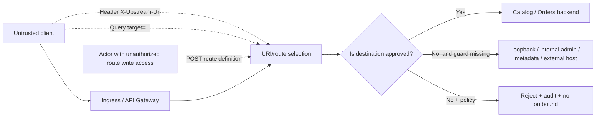
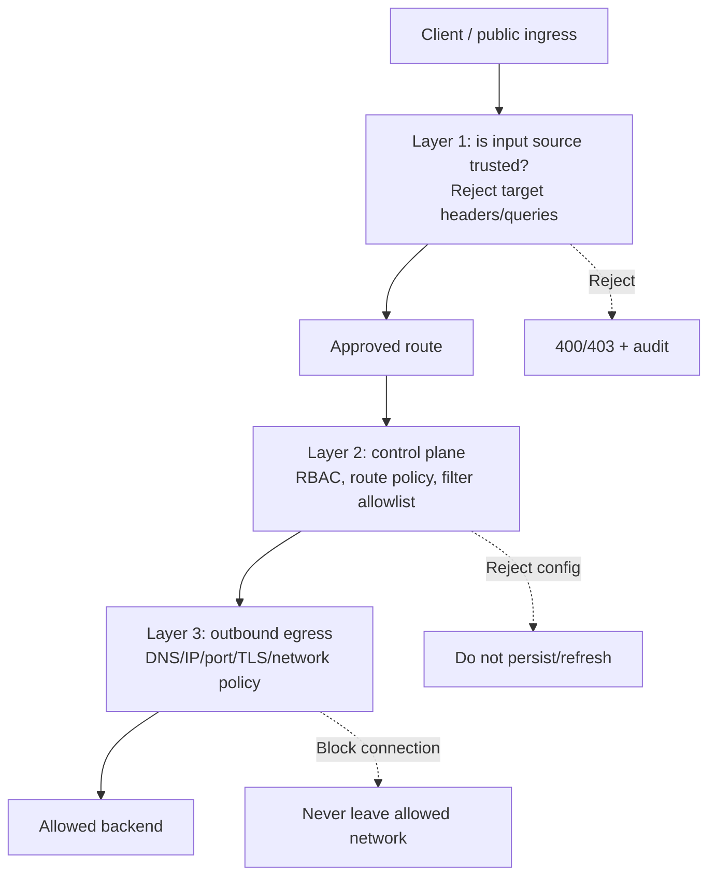
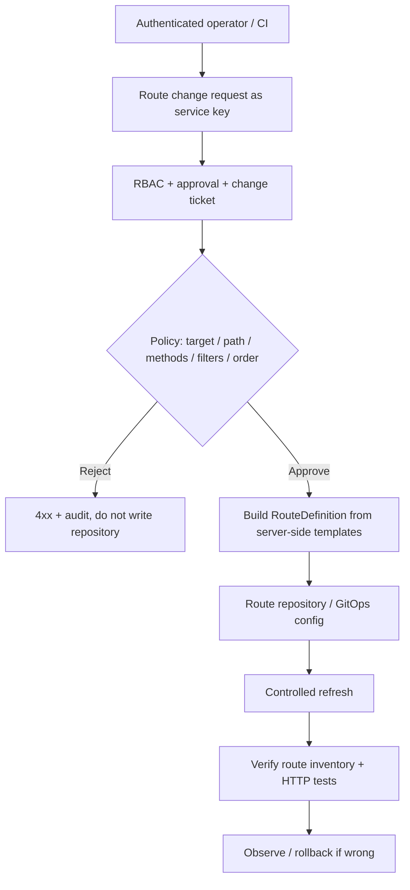

# Preventing Open Proxy from Headers, Query Parameters, or Dynamic Route Configuration

## 1. Why Is an API Gateway at Risk of Becoming an Open Proxy?

**SPRING_CLOUD_GATEWAY** acts as a unified entry point for microservices: route predicates select routes; the filter chain transforms paths, headers, and requests; `lb://` resolves service instances; authentication, rate limiting, circuit breakers, retries, TLS, and observability keep the system operating safely. The authority to **choose where to send an HTTP request** is therefore an especially sensitive privilege.

A gateway becomes an **open proxy** when an untrusted caller can cause it to send requests to **unauthorized addresses**. For example, a client provides a header/query containing a target URL and a filter/controller trusts that URL; or an exposed dynamic route management API allows adding a route with an arbitrary `uri`. The Gateway can then become a **server-side request forgery (SSRF)** tool to access internal services, loopback addresses, cloud metadata endpoints, or attacker-controlled external servers.



In the **Security Hardening** chapter, this lesson answers the exact question: **how to prevent clients from controlling proxy destinations via headers, queries, or dynamic route configurations**, without breaking legitimate Gateway features.

### Learning Objectives

After this lesson, you will be able to:

1. Explain **open proxy**, **SSRF**, and **open redirect**, and why the three concepts are related yet distinct.
2. Identify untrusted data sources: `Host`, `Forwarded`, `X-Forwarded-Host`, `X-Target-URL`, `target`/`url` queries, route metadata, and unapproved administrative requests.
3. Recognize the risks of `RequestHeaderToRequestUri` and custom filters that write `GATEWAY_REQUEST_URL_ATTR`.
4. Distinguish a **route predicate** (selecting a route) from a **destination URI** and filters that mutate the target.
5. Apply **service key allowlisting** and fixed URI scheme/hostname/port instead of taking an arbitrary URL directly from the client.
6. Lock down **Actuator Gateway write operations** using `management.endpoint.gateway.access: read-only` or by not exposing the endpoint.
7. Design a dedicated workflow for dynamic routes: authentication/RBAC, target approval, filter/predicate/order validation, auditing, rollback, and multi-instance synchronization.
8. Add DNS/redirect/egress/TLS controls rather than relying on a single regex host check to stop all SSRF.
9. Practice with Java/YAML/`curl` using a fixed route, a filter rejecting destination hints, and an echo backend to prove requests are not redirected to another target.
10. Write unit/integration tests for headers, queries, and dynamic route management, understanding the conclusion scope of each test layer.

> **Version scope:** Examples use **Spring Cloud Gateway Server WebFlux 4.3.x**, **Spring Cloud 2025.0.x**, **Spring Boot 3.5.x**, Java 17+, and the `spring.cloud.gateway.server.webflux` configuration prefix. Gateway Server Web MVC and Proxy Exchange have different handler/filter models; defensive concepts are similar, but **do not copy WebFlux Java APIs into MVC**. Versions `3.5.0`/`2025.0.0` in the lab only illustrate a compatible pair, not a recommendation to run the first patch release in production.

## 2. Distinguishing Open Proxy, SSRF, and Open Redirect

| Concept | What happens | Example design mistake | Core control |
| --- | --- | --- | --- |
| **Open proxy** | A system sends requests on behalf of clients to arbitrary destinations. | Gateway takes `uri` from client `?target=`. | Never let clients pick network destinations; use server-side mapping. |
| **SSRF** | An attacker tricks the server into sending requests to resources the client cannot reach directly. | Client-sent header switches target to an internal admin service. | Allowlist + DNS/connect-time policy + egress firewall + auth. |
| **Open redirect** | Server returns `Location` causing the **client** to navigate to an unintended address. | `RedirectTo` uses an unvalidated URL. | Validate redirect destination/origin; distinct from outbound proxying. |
| **Header spoofing** | An attacker forges metadata normally set only by a trusted proxy. | Client sends `X-Forwarded-Host`, `X-User-Id`. | Ingress strip/overwrite and trusted proxy chains. |
| **Route poisoning** | Routing configuration is altered so a new route hijacks requests or points to the wrong upstream. | Dynamic route has high-priority order and overly broad predicate. | RBAC, review, immutable policy, route inventory, and rollback. |

**An HTTP 302 with a malicious `Location` does not itself prove Gateway performed SSRF**, because the subsequent request is usually issued by the browser/client. Conversely, a `200` with content from an internal service can be the result of outbound SSRF. When testing, count **actual requests at the backend/blocked destination**, not just HTTP status codes on the client side.

### 2.1. Why Is a Gateway a Sensitive Point?

A Gateway typically possesses:

- Network routes to internal services or service discovery unreachable by Internet clients.
- Service-to-service credentials, client certificates, or token relay capabilities.
- Broader egress DNS/proxy permissions than user environments.
- Retry, redirect, websocket, load balancing, and route rewrite mechanisms.
- Route configuration management privileges separated from the data plane.

If the authority to pick URIs is mistakenly handed to the client, **the network zone the Gateway can access** becomes the surface an attacker can probe or attempt to call. Thus, the design must protect both the **data plane** and the **control plane**.

## 3. URI Processing Flow in Gateway Server WebFlux

In Gateway Server WebFlux, `RoutePredicateHandlerMapping` selects the `Route`; `FilteringWebHandler` executes GlobalFilters and route-specific GatewayFilters; routing filters inspect attributes on `ServerWebExchange`.

```text
Inbound request
    |
    v
Route predicate: Path=/api/catalog/**, Method=GET
    |
    v
Selected Route + GATEWAY_ROUTE_ATTR
    |
    v
Pre filters: path/header transforms
    |
    v
RouteToRequestUrlFilter
    | sets GATEWAY_REQUEST_URL_ATTR (target URI)
    v
Filters that may alter URI / select service instance
    | RequestHeaderToRequestUri  <- dangerous if header is untrusted
    | lb:// resolver            <- needs service ID/instance policy
    v
NettyRoutingFilter (http/https) or WebSocket/forward routing
    |
    v
Approved downstream (if policy is enforced)
```

Gateway 4.3 documentation confirms that `RouteToRequestUrlFilter` constructs `GATEWAY_REQUEST_URL_ATTR` from the matched route; `ReactiveLoadBalancerClientFilter` can change the target after selecting an instance; Netty routing performs outbound HTTP(S) based on the final URI. **A safe initial route configuration does not guarantee a safe final URL** if a downstream filter can alter the host or scheme.

### 3.1. Data Commonly Mistaken as Trusted

| Inbound/control data | May it select the target host? | Reason |
| --- | --- | --- |
| `GET /api/catalog/items/42` | **No**, except fixed path→service mapping. | Path is client-chosen; it may only select an operator-approved route. |
| `?target=https://...` or `?url=` | **No**. | Clients must not declare network destinations. |
| `X-Upstream-Url` or `X-CF-Forwarded-Url` | **No** on public ingress. | Headers are easily forged without a trust boundary. |
| `Host`/`X-Forwarded-Host` | **No** for selecting outbound hosts. | Hostname spoofing, reverse proxy injection, and virtual host confusion. |
| URI in a newly POSTed `RouteDefinition` | **Not yet**, until RBAC and policy checks pass. | A route definition can still point to a sensitive network. |
| Service ID from registry | **Only when approved**. | `lb://` does not make a service ID/instance inherently safe. |
| Literal URI in reviewed code/config | **Yes, within policy bounds**. | Separates config change authority from API call privileges. |

### 3.2. Three-Layer Defense Diagram



**Do not rely on a single Java filter** as an absolute guarantee. A dynamic route can change filter order, a custom HTTP client can bypass Gateway filters, or DNS can change after the application checks it. Network egress guards and route governance processes provide independent defense layers.

## 4. Direct Risk: `RequestHeaderToRequestUri`

Gateway Server WebFlux 4.3 includes the **`RequestHeaderToRequestUri`** filter, which takes a header name and uses the **URI value in that header** to replace the downstream URI if valid. Official documentation emphasizes that this filter **should only be used in trusted environments**, and the header used for redirection must be stripped from client requests **before entering the Gateway**.

A dangerous configuration if placed on a public Internet route:

```yaml
# PATTERN TO AVOID: client-controlled header can alter the URI.
spring:
  cloud:
    gateway:
      server:
        webflux:
          routes:
            - id: unsafe_header_routing
              uri: https://catalog.example.test
              predicates:
                - Path=/api/catalog/**
              filters:
                - RequestHeaderToRequestUri=X-Upstream-Url
```

If a client sends `X-Upstream-Url` set to another valid URL, the filter can change the destination. In a Gateway environment with broad network access, this is **an SSRF/open proxy vector**, not merely a custom header for logging.

**Safe alternative for public routes:** do not configure `RequestHeaderToRequestUri`; use a **fixed destination** or an approved `lb://` service ID with sufficiently narrow predicates. If an internal system genuinely requires header-based routing, you must:

1. Allow only a **trusted routing layer** source to set the header after ingress authentication/mTLS.
2. Have ingress **completely strip** headers of the same name from all external clients before the trusted layer adds them.
3. Constrain the destination to a scheme/hostname/IP/port allowlist; never accept arbitrary URLs.
4. Control DNS/redirects and egress at the network layer.
5. Tag the source, audit route ID/target alias, and test against spoofing.
6. Ensure dynamic routes cannot re-add the filter with a new header name outside policy.

### 4.1. Disable the Filter Factory If Unused

Gateway 4.3 provides a corresponding property:

```yaml
spring:
  cloud:
    gateway:
      server:
        webflux:
          filter:
            request-header-to-request-uri:
              enabled: false
```

This is **defense in depth** to eliminate an unneeded capability. If an existing route depends on this factory, disabling it may make the route invalid or fail startup; check dependencies before changing it. **This property does not replace checking custom filters or route URIs**: code that writes `GATEWAY_REQUEST_URL_ATTR` directly can still create SSRF.

### 4.2. Custom Filters Can Create the Same Flaw

The snippet below is an **anti-pattern** and must never be used to process Internet requests:

```java
// UNSAFE: illustrates a design flaw only.
String supplied = exchange.getRequest().getHeaders()
        .getFirst("X-Upstream-Url");
URI next = URI.create(supplied);

exchange.getAttributes().put(
        ServerWebExchangeUtils.GATEWAY_REQUEST_URL_ATTR, next);
return chain.filter(exchange);
```

The same flaw can arise when `supplied` comes from:

- `exchange.getRequest().getQueryParams().getFirst("target")`;
- a path variable such as `{backend}` or `{tenant}`;
- a client-sent JSON field `destination`;
- a JWT claim **used for the wrong purpose** or without signature/audience validation;
- unverified service discovery metadata.

Do not use a URI parser as a substitute for authorization. `URI.create(...)` only parses a string; it **does not tell you whether the host is authorized to be accessed**.

## 5. `Host` Header, `Forwarded`, and Confusion Between URI and Authority

### 5.1. The Host Header Is Not a Trusted Target URI

The Gateway may receive a request:

```http
GET /api/catalog/items/42 HTTP/1.1
Host: edge.example.test
X-Forwarded-Host: another.example.test
```

`Host` normally describes the authority the client is calling, not the backend allowed to be proxied. If the application constructs a target from `Host`/`X-Forwarded-Host`, the client can influence the destination. In addition, `SetRequestHostHeader` and `PreserveHostHeader` change the **outbound HTTP Host header**, not necessarily the target URI/socket destination. Uncontrolled Host modification can cause **virtual-host confusion** rather than providing a safe routing control.

### 5.2. Trusted Proxy Chain and `X-Forwarded-*`

In Gateway 4.3 Server WebFlux, the docs use `spring.cloud.gateway.server.webflux.trusted-proxies` (a Java regular expression) to identify trusted proxies when processing `Forwarded`/`X-Forwarded-*`. `X-Forwarded-For`/`Host`/`Proto` may **append** values if enabled.

Policy should be:

- Edge ingress **removes/overwrites client-sent values** for headers trusted by the application, unless the chain is controlled.
- Declare only **exact upstream proxy identities** as trusted. Never set regex `.*` in public environments.
- Do not use untrusted `X-Forwarded-For` as the source IP for quotas, authentication, or opening egress.
- Never use `X-Forwarded-Host` to compute outbound URIs. Domains outside the trusted virtual host policy must be rejected.
- Combine Spring Security and outbound network policy; header filtering does not authenticate principals by itself.

### 5.3. Request Headers and Response Redirects Differ

`RedirectTo` or `Location` can create an **open redirect** if the redirect target is chosen by the client without an allowlist. This is a distinct bug class. When Gateway **proxies HTTP(S)**, Netty routing uses a server-side target URI; when Gateway **redirects**, it returns a URI for the browser/client to decide whether to follow. An SSRF test must observe **server-side outbound connections**, not conflate them with HTTP 30x responses.

## 6. Query Parameters: Do Not Turn Search Data into Network Destinations

A reasonable API:

```http
GET /api/catalog/items/42?lang=vi
```

The Gateway simply sends the request to the configured `catalog` backend. The `lang` param is business data, **not** permission to pick a host.

Bad pattern:

```java
// UNSAFE: client chooses the URL actually invoked.
String target = exchange.getRequest().getQueryParams()
        .getFirst("target");
exchange.getAttributes().put(
        GATEWAY_REQUEST_URL_ATTR, URI.create(target));
return chain.filter(exchange);
```

**Alternative:** the route selects a fixed backend; if multiple valid upstreams exist, accept only a **service key** like `catalog` or `inventory`, then map that service key **on the server** to a reviewed target. Never turn `?service=catalog` into `lb://` + an arbitrary user string. For public APIs, it is best to separate them into statically defined URLs:

```text
/api/catalog/**      -> catalog-service
/api/inventory/**    -> inventory-service
```

Query values can still affect backend business logic, so validate and encode them; however, **never allow a query to specify protocol/host/port**. Simply deleting a `target` query key in a filter will not save custom code that reads another key to pick a URI; you need an **architecture independent of client URLs**, not just a blacklist of param names.

### 6.1. Path Variables Must Not Open Network Authority Either

A path `/api/{tenant}/items/**` can identify a tenant after **authentication and authorization**, but should not construct hostnames like `https://{tenant}.arbitrary-host` and proxy without a registry/allowlist. Host-based routing using the `Host` predicate must also restrict accepted domains and avoid assuming `Host` proves ownership.

### 6.2. A URL Parser Does Not Replace an Allowlist

A check like `target.startsWith("https://catalog.example.test")` is **insufficient** because of userinfo, host prefixes, encoding, trailing dots, ports, and alternative IP notations. When accepting an input URL from a trusted source is unavoidable, use a standard URI parser and inspect **scheme, normalized hostname, port, userinfo, path/query/fragment**, combined with DNS/connect-time enforcement at the connection layer. Simpler and safer: **never let callers supply complete URLs**.

## 7. Dynamic Routes: A Privileged Surface That Alters Proxy Targets

Dynamic routing is useful for steering traffic, rolling out new backends, and updating routes without rebuilding the Gateway. However, a `RouteDefinition` can carry:

- **`id`**: the route name, which could try to hijack/overwrite an existing route.
- **`uri`**: the network destination or scheme `lb://`, `forward://`, `ws://`, etc.
- **`predicates`**: `Path`, `Host`, `Method`, `Header` conditions; an overly broad predicate can match sensitive endpoints.
- **`filters`**: e.g., `StripPrefix`, `RewritePath`, `RequestHeaderToRequestUri`, `SetRequestHostHeader`, `TokenRelay`, `Retry`, `CircuitBreaker`.
- **`order`**: priority order when multiple routes match.
- **`metadata`**: extra data affecting application policies or observability.

If an actor authorized only to call the HTTP client API can POST arbitrary `RouteDefinition`s, they can **escalate from the data plane to the control plane**.

### 7.1. Actuator Gateway 4.3: Read-Only and Unrestricted

Official Gateway Server WebFlux 4.3 documentation notes `/actuator/gateway` **has no access granted by default**; using it requires configuring both access level and web exposure. With Spring Boot 3.5:

```yaml
# Recommended config when route observability is needed on a management network:
management:
  server:
    port: 8081
    address: 127.0.0.1
  endpoint:
    gateway:
      access: read-only
    health:
      access: read-only
  endpoints:
    web:
      exposure:
        include: health,gateway
```

`access: read-only` allows viewing routes when the endpoint is exposed and network-reachable, while **granting no create, delete, or refresh permissions**. If route inventory via Actuator is unneeded, a tighter option is **not exposing the Gateway endpoint** or setting `access: none`.

Another setting:

```yaml
management:
  endpoint:
    gateway:
      access: unrestricted
```

can open **write operations** such as creating/deleting/refreshing routes. The 4.3 documentation also mentions `management.endpoint.gateway.enabled=true` as the legacy enable mechanism; **do not use it as a way to enable read-only access**. In production, allow write endpoints only when there is a clear administrative need, over a dedicated management network, with authentication/RBAC, approvals, auditing, and supplementary controls.

> **Important:** `management.server.address: 127.0.0.1` with a separate management port is suitable **only for single-machine labs**. In Kubernetes or multi-node setups, management traffic needs network policies, dedicated services, mTLS/identity, and corresponding controls. Binding loopback does not replace authentication if a local process or compromised container already has access.

### 7.2. APIs That Must Be Protected

| Actuator Gateway API | Method | Risk if write access is exposed |
| --- | --- | --- |
| `/actuator/gateway/routes` | GET | Leaks route inventory and upstream topology if public. |
| `/actuator/gateway/routes/{id}` | GET | Leaks route/filter/predicate details. |
| `/actuator/gateway/routes/{id}` | POST | Creates a route defining targets/predicates/filters. |
| `/actuator/gateway/routes/{id}` | DELETE | Deletes routes, causing outages/traffic shifting. |
| `/actuator/gateway/routes` | POST | Creates multiple routes depending on API version. |
| `/actuator/gateway/refresh` | POST | Refreshes route cache, activating config changes at runtime. |

In Gateway 4.3, route creation via Actuator uses a **route definition payload**, e.g., `"predicates": ["Path=/managed/catalog/**"]`, `"filters": ["StripPrefix=2"]`, `"uri": "https://..."`. Filter names and their arguments are **administrative inputs requiring validation**, not safe values just because JSON parses cleanly.

**Distinguish states:** routes stored in the repository and routes currently active in runtime can diverge due to caching/refresh. After approving a new route, verify the result via route listing, HTTP behavior, and per-replica status. An HTTP `200` from refresh does not prove all instances are synchronized.

### 7.3. Why Checking Only the URI Is Insufficient for Dynamic Routes

Suppose a payload has a valid `uri` belonging to an approved service. It can still introduce risk if:

1. Predicate `Path=/**` captures traffic for `/admin/**` or `/auth/**`.
2. `order` gives the new route higher priority than an authenticated route.
3. Filter `RequestHeaderToRequestUri` lets **each client request** change the destination after route match.
4. `RewritePath` opens access to a backend management endpoint even though the hostname is allowlisted.
5. `SetRequestHeader=Authorization,...` or `TokenRelay` leaks credentials to a service with the wrong audience.
6. `PreserveHostHeader`/`SetRequestHostHeader` causes virtual host or backend routing confusion.
7. An `lb://` route uses an unapproved service ID.
8. Metadata alters the behavior of a custom security/tenant filter.
9. An existing route ID is overwritten or collides, making mapping/rollback unpredictable.

**Route approval policy must check all 5:** `URI + predicates + filters + order + ownership`. Metadata and security-chain impact must also be reviewed. A hostname allowlist alone does not stop all of these cases.

### 7.4. Designing a Dedicated, Narrow Control Plane

Recommended workflow:



- **Do not accept raw `RouteDefinition` from public APIs**; admin endpoints should accept a DTO like `{ "serviceKey": "catalog" }`, and the **server** generates the URI/predicates/filters from reviewed templates.
- Only minimal roles such as `GATEWAY_ROUTE_ADMIN` may request changes; require independent approval for new routes in production.
- Never expose the repository or Actuator write API through public ingress.
- Every write path must go through policy: custom admin services, GitOps, database/Redis repositories, Actuator, Config Server, or internal controllers/SDKs.
- Dynamic config should enforce schema/versioning, an approved domain/service list, route ID namespaces, path order limits, and filter sets.
- Audit log: actor, approved service alias, route ID, before/after diff, timestamp, environment, reviewer, verification result. **Never log secret filter arguments/tokens.**
- Maintain a tested rollback version; do not rely on a blind `DELETE` to restore previous configuration.

### 7.5. Do Not Treat a Network-Isolated Actuator as Invulnerable

Even if `/actuator/gateway` listens only on a private management network, risks remain: SSRF via another app in the VPC, credential compromise, misconfigured proxy forwarding, a workload with egress permission to the management service, or overly broad roles. Therefore **mTLS + RBAC + network policy + read-only by default** provide essential layered defense.

If Actuator write access is needed during a maintenance window, enable it within a **genuinely isolated admin environment**, limit time/scope, record every operation, and **disable it again afterward**. Keeping `unrestricted` enabled long-term merely for `curl` convenience in operations is not recommended.

## 8. Outbound Controls: URI Allowlist, DNS, Redirects, and Actual Connections

### 8.1. Why Are Prefix Checks or URL Regexes Too Weak?

Several URI forms can fool a naive check:

- Lookalike hostnames or differing suffixes on allowed hosts.
- URIs with `user@host` userinfo confusing string-based authority splitting.
- Adding non-443 ports, or `http` scheme instead of `https`.
- IPv4/IPv6 literals, non-standard IP encodings, loopback/link-local addresses.
- Domains changing DNS results over time (*DNS rebinding*).
- HTTP 30x redirects from an allowed host to another host.
- Percent encoding/double encoding affecting paths, queries, or differing URL parser layers.

**Example of an exact-destination blocking policy**, rather than `startsWith`:

| Property | Example production policy |
| --- | --- |
| Scheme | `https` only (or `wss` if a WebSocket route is separately approved). |
| Host | Exact canonical ASCII host in allowlist, e.g., `catalog.svc.example.internal`. |
| Port | `443`/`8443` per service contract, never arbitrary. |
| Userinfo/fragment | Absent. |
| Query in route base URI | Absent; business queries handled by separate schema. |
| Service discovery ID | Exact ID in operator-approved registry. |
| Resolved IP | Within permitted CIDRs **at connection time**. |
| Redirect | Auto-follow disabled by default, or revalidate **every hop** if truly required. |
| Credentials | Tokens/certs scoped to the exact audience and backend; never forwarded to another URI. |

**The policy above is a conceptual model**, not automatically enforced by Gateway merely from a table. It must be implemented across configuration intake, HTTP clients/egress proxies, and network infrastructure.

### 8.2. DNS Rebinding and the Time-of-Check/Time-of-Use Gap

Code like:

```java
InetAddress[] checked = InetAddress.getAllByName(host);
validateAllAddresses(checked);
httpClient.get().uri("https://" + host + "/..."); // DNS may be queried again
```

**is insufficient**: the HTTP client can perform another DNS lookup after validation and receive a different address. This is a **TOCTOU** (*time of check vs time of use*) flaw. OWASP recommends validating the host/IP and ensuring the actual connection uses the **verified address**, while preserving the original hostname for TLS SNI/hostname verification.

Practical solutions include:

1. Never let clients specify hostnames; use only **registered service endpoints**.
2. An egress gateway/proxy or DNS/network policy forcing connections strictly to **approved CIDRs**.
3. If the application must dispatch by URL, use an HTTP client with resolver/connect-time controls, not just `InetAddress.getAllByName` ahead of an ordinary `WebClient`.
4. Disable unrestricted redirect following; if enabled, validate every destination hop.
5. Control both IPv4 **and IPv6**, loopback, link-local, and private/reserved networks per **environment policy**. Note that legitimate internal services may also use private IPs, so allow **specific CIDRs** rather than applying a blanket "all private IPs forbidden" rule unconditionally.
6. Test DNS rebinding/route poisoning in an isolated environment, never in production.

### 8.3. Network Policy Is the Final Layer Stopping SSRF

Even if a custom filter mis-sets `GATEWAY_REQUEST_URL_ATTR`, a network egress policy can still **block the connection**. On Kubernetes, verify your cluster's actual CNI/NetworkPolicy capabilities; standard NetworkPolicy usually selects pods/IPs/ports, while FQDN policies may require a specialized CNI or egress proxy.

One design pattern:

```text
Gateway Pod (namespace edge)
    |
    +-- allow TCP 8443 --> catalog backend service subnet
    +-- allow TCP 8443 --> inventory backend service subnet
    +-- allow DNS      --> cluster resolver
    |
    +-- DENY other outbound traffic
         loopback-adjacent, metadata, arbitrary Internet, admin ranges
```

**Do not assume "blocking 127.0.0.1 via NetworkPolicy" is sufficient**: loopback within the same namespace/container, `hostNetwork`, CNI implementations, `kube-proxy`, and egress NAT have differing semantics. Evaluate against your actual deployment; use firewall/namespace/container isolation and avoid running privileged host networking unnecessarily.

### 8.4. `lb://` Is Not Automatically an Allowlist

With `uri: lb://catalog-service`, `ReactiveLoadBalancerClientFilter` picks a `ServiceInstance` and builds an HTTP(S) URI. However, if a client/admin can arbitrarily swap the service ID, or if the registry is poisoned with a bad instance, the Gateway can still reach an unintended host.

Controls:

- Approved service IDs, never concatenated directly from untrusted query/header/path data.
- Restricted write access to the service registry/discovery metadata.
- Port/scheme/backend certificate identity in mTLS environments.
- Egress CIDRs, service accounts, and network policies.
- Same policy applied as for direct `http(s)://` targets, including retries/fallbacks.

### 8.5. TLS, Token Relay, and SSRF Can Compound

If Gateway forwards bearer tokens, cookies, API keys, mTLS client identities, or `Authorization` headers to a swapped target, an SSRF bug becomes **credential exfiltration**. When selecting an upstream:

- Credentials must be restricted by **audience/scope**.
- Never forward user tokens to services outside the intended token recipient list.
- Separate client identity from service-to-service identity; use token exchange where appropriate.
- TLS must verify CA/hostname/SAN; never use an insecure trust manager.
- Never allow dynamic custom routes to disable security filters or retry in ways that expose bodies.

## 9. Hardening via "Secure-by-Default Configuration"

On a public Gateway, prefer **fixed routes** and a small, reviewed set of filters. The ability for clients to change upstreams should be eliminated by design rather than merely filtering dangerous URL patterns.

A concise template for Gateway Server WebFlux 4.3:

```yaml
spring:
  cloud:
    gateway:
      server:
        webflux:
          filter:
            request-header-to-request-uri:
              enabled: false
          routes:
            - id: catalog_public_v1
              uri: https://catalog.svc.example.internal:8443
              predicates:
                - Path=/api/catalog/**
                - Method=GET
              filters:
                - StripPrefix=2
                - RemoveRequestHeader=X-Upstream-Url
                - RemoveRequestHeader=X-CF-Forwarded-Url
                - RemoveRequestHeader=X-Internal-User
```

This production example **assumes** `catalog.svc.example.internal` is an organization-approved DNS/service with a valid TLS certificate and corresponding egress controls. It is **not a ready-to-run URL to copy**, and stripping a few headers alone does not replace blocking all other SSRF vectors.

### 9.1. Why Add `RemoveRequestHeader`?

Headers that the API contract **forbids clients from controlling** should be stripped before downstream, such as `X-Internal-User` or `X-Upstream-Url`. However, if a client can choose an outbound target via a filter running before the remove-header step, removing the header **afterward is too late**. To ensure untrusted values are never used for routing:

- **Do not enable** `RequestHeaderToRequestUri` on public routes.
- Block/strip at trusted ingress before any logic consumes the header.
- Inspect **filter order** and whether dynamic routes can insert new filters.
- Maintain an egress policy blocking unauthorized targets independently of Java filters.

### 9.2. Configurations Not to Use as "Quick Fixes"

| Anti-pattern | Why it is wrong |
| --- | --- |
| Enabling `RequestHeaderToRequestUri` on `/**`. | Lets client headers directly affect the destination. |
| Taking route `uri` from a query parameter. | Turns the API into a user-controlled HTTP client. |
| Allowing public `/actuator/gateway/routes` POST. | Hands data-plane administration rights to clients. |
| `management.endpoint.gateway.access: unrestricted` without RBAC. | Allows arbitrary route creation/deletion/refresh. |
| Allowlist via `startsWith("https://trusted")`. | Confused by hosts, userinfo, ports, and canonicalization. |
| Checking DNS once, then letting HTTP client re-lookup. | DNS rebinding/TOCTOU. |
| Enabling auto-redirects to any host. | Can leave the allowlist on subsequent hops. |
| Blocking only IP `127.0.0.1`. | Leaves IPv6, link-local, private/metadata, DNS, and routing variants open. |
| Placing Auth only on the backend while Gateway allows arbitrary dynamic routes. | Can bypass backend guards or leak internal tokens. |
| Relying solely on a custom GlobalFilter to stop SSRF. | Route configs/admin APIs/other HTTP clients can still change targets. |

## 10. Hands-On: WebFlux Gateway Allowing Only One Defined Destination

### 10.1. Lab Goal and Scope

Run two processes on the **same machine**:

```text
Client : curl
    |
    | GET /api/catalog/items/42?lang=vi
    v
Gateway WebFlux :8080
    |-- GlobalFilter: reject routing hints from header/query
    |-- Route: catalog_fixed -> http://127.0.0.1:9001
    |-- StripPrefix=2
    |-- NO RequestHeaderToRequestUri
    v
EchoBackend :9001
    GET /items/42?lang=vi

Gateway management :8081 (127.0.0.1)
    /actuator/gateway/* -> read-only, no create/delete/refresh
```

The lab provides two pieces of evidence:

1. Valid requests reach **exact backend :9001** with the transformed path.
2. Requests containing header/query routing hints receive **400** before `GatewayFilterChain`, and the backend request counter does not increment.

**Limitation:** a filter detecting a few disallowed input names is **defense in depth for the lab API contract**, not proof that all SSRF is prevented. Core protection is **fixed route URI + never using untrusted input to select targets + non-writable Actuator + egress policy**. In production, add authentication, authorization, ingress header sanitization, TLS/mTLS, and firewalls.

### 10.2. Maven `pom.xml`

Create a standalone Maven project, JDK 17+:

```xml
<?xml version="1.0" encoding="UTF-8"?>
<project xmlns="http://maven.apache.org/POM/4.0.0"
         xmlns:xsi="http://www.w3.org/2001/XMLSchema-instance"
         xsi:schemaLocation="http://maven.apache.org/POM/4.0.0
                             https://maven.apache.org/xsd/maven-4.0.0.xsd">
    <modelVersion>4.0.0</modelVersion>

    <parent>
        <groupId>org.springframework.boot</groupId>
        <artifactId>spring-boot-starter-parent</artifactId>
        <version>3.5.0</version>
        <relativePath/>
    </parent>

    <groupId>com.example</groupId>
    <artifactId>gateway-open-proxy-hardening-lab</artifactId>
    <version>0.0.1-SNAPSHOT</version>

    <properties>
        <java.version>17</java.version>
    </properties>

    <dependencyManagement>
        <dependencies>
            <dependency>
                <groupId>org.springframework.cloud</groupId>
                <artifactId>spring-cloud-dependencies</artifactId>
                <version>2025.0.0</version>
                <type>pom</type>
                <scope>import</scope>
            </dependency>
        </dependencies>
    </dependencyManagement>

    <dependencies>
        <dependency>
            <groupId>org.springframework.cloud</groupId>
            <artifactId>spring-cloud-starter-gateway-server-webflux</artifactId>
        </dependency>
        <dependency>
            <groupId>org.springframework.boot</groupId>
            <artifactId>spring-boot-starter-actuator</artifactId>
        </dependency>

        <!-- Spring Test, JUnit 5, AssertJ -->
        <dependency>
            <groupId>org.springframework.boot</groupId>
            <artifactId>spring-boot-starter-test</artifactId>
            <scope>test</scope>
        </dependency>
        <dependency>
            <groupId>io.projectreactor</groupId>
            <artifactId>reactor-test</artifactId>
            <scope>test</scope>
        </dependency>
    </dependencies>

    <build>
        <plugins>
            <plugin>
                <groupId>org.springframework.boot</groupId>
                <artifactId>spring-boot-maven-plugin</artifactId>
            </plugin>
        </plugins>
    </build>
</project>
```

The Maven BOM keeps Boot/Cloud versions compatible; **do not add** the Gateway Server MVC starter or Proxy Exchange to this lab. The Actuator starter is needed to read routes during the administration test step; in production, expose only required endpoints and protect them with management security.

### 10.3. Spring Boot Entry Point

Create `src/main/java/com/example/gateway/SecureGatewayApplication.java`:

```java
package com.example.gateway;

import org.springframework.boot.SpringApplication;
import org.springframework.boot.autoconfigure.SpringBootApplication;

@SpringBootApplication
public class SecureGatewayApplication {
    public static void main(String[] args) {
        SpringApplication.run(SecureGatewayApplication.class, args);
    }
}
```

Place the custom GlobalFilter in the same package so `@Component` is scanned.

### 10.4. `application.yml` with Fixed Destination

Create `src/main/resources/application.yml`:

```yaml
server:
  address: 127.0.0.1
  port: 8080

spring:
  application:
    name: gateway-open-proxy-hardening-lab
  cloud:
    gateway:
      server:
        webflux:
          filter:
            request-header-to-request-uri:
              enabled: false
          routes:
            - id: catalog_fixed
              uri: http://127.0.0.1:9001
              predicates:
                - Path=/api/catalog/**
                - Method=GET
              filters:
                - StripPrefix=2
                - RemoveRequestHeader=X-Upstream-Url
                - RemoveRequestHeader=X-CF-Forwarded-Url
                - RemoveRequestHeader=X-Target-Uri

management:
  server:
    address: 127.0.0.1
    port: 8081
  endpoint:
    gateway:
      access: read-only
    health:
      access: read-only
  endpoints:
    web:
      exposure:
        include: health,gateway
```

Intentional choices:

- Only one route, matching `GET /api/catalog/**` with target `127.0.0.1:9001`.
- `RequestHeaderToRequestUri` is **disabled** because the lab does not use it.
- `StripPrefix=2` turns `/api/catalog/items/42` into `/items/42`.
- `RemoveRequestHeader` strips destination hints in case a valid request isn't blocked by another GlobalFilter; **do not treat this as the sole SSRF guard**.
- Management port `8081` is loopback-only and `access: read-only`; no route POST or refresh is permitted.
- `http://` is only for the backend on the **loopback demo**. In production, replace with `https://`/mTLS service identity and network egress policy.

**Do not enable `management.endpoint.gateway.access: unrestricted` to test a route injection attack.** This lesson verifies deny behavior, not creating an actual malicious route.

### 10.5. GlobalFilter Rejecting Client Routing Hints

Create `src/main/java/com/example/gateway/BlockClientRoutingHintsGlobalFilter.java`:

```java
package com.example.gateway;

import java.util.List;
import java.util.Locale;
import java.util.Set;

import org.springframework.cloud.gateway.filter.GatewayFilterChain;
import org.springframework.cloud.gateway.filter.GlobalFilter;
import org.springframework.core.Ordered;
import org.springframework.http.HttpStatus;
import org.springframework.http.HttpHeaders;
import org.springframework.stereotype.Component;
import org.springframework.web.server.ServerWebExchange;

import reactor.core.publisher.Mono;

@Component
public class BlockClientRoutingHintsGlobalFilter
        implements GlobalFilter, Ordered {

    private static final List<String> TARGET_HEADERS = List.of(
            "X-Upstream-Url",
            "X-CF-Forwarded-Url",
            "X-Target-Uri");

    private static final Set<String> TARGET_QUERY_KEYS = Set.of(
            "target",
            "targeturl",
            "proxyurl",
            "upstreamurl");

    @Override
    public Mono<Void> filter(
            ServerWebExchange exchange,
            GatewayFilterChain chain) {

        HttpHeaders headers = exchange.getRequest().getHeaders();

        boolean unsafeHeader = TARGET_HEADERS.stream()
                .anyMatch(headers::containsKey);

        boolean unsafeQuery = exchange.getRequest()
                .getQueryParams()
                .keySet()
                .stream()
                .map(key -> key.toLowerCase(Locale.ROOT))
                .anyMatch(TARGET_QUERY_KEYS::contains);

        if (unsafeHeader || unsafeQuery) {
            exchange.getResponse()
                    .setStatusCode(HttpStatus.BAD_REQUEST);

            // Fail closed: do not call chain.filter(...).
            return exchange.getResponse().setComplete();
        }

        return chain.filter(exchange);
    }

    @Override
    public int getOrder() {
        return Ordered.HIGHEST_PRECEDENCE;
    }
}
```

**Behavior:**

- `HttpHeaders.containsKey` checks headers using HTTP header name case-insensitivity semantics.
- Query names are lowercased with `Locale.ROOT` and checked against the allowlist of names **forbidden by the lab API contract**.
- If a destination hint appears, the filter returns 400 **before the chain**.
- Without a destination hint, the chain proceeds and Gateway uses the URI from the configured route.
- `Ordered.HIGHEST_PRECEDENCE` makes the filter run early in the **Gateway combined filter chain**. It does not guarantee running ahead of WebFlux/Spring Security `WebFilter`s in another pipeline, does not replace ingress sanitization, and does not make arbitrary dynamic routes trustworthy.

**Do not copy this list of header/query names and claim it blocks all URL injection.** Another custom filter might read `destination`, `host`, or a JSON body; true safety comes from **never reading client URLs to pick outbound targets**. The GlobalFilter only expresses **the input contract for the lab's own routes**, while egress/network and the control plane must be secured separately.

**Never use client headers/queries as identity:** `X-Correlation-Id`, `X-Tenant`, or `X-Forwarded-For` can be spoofed. If the system uses identity headers, set them **after authenticating the principal** and strip inbound headers of the same name.

### 10.6. JDK EchoBackend to Observe the Actual Destination

Create `EchoBackend.java` in a **separate directory outside the Spring Boot project**:

```java
import com.sun.net.httpserver.HttpServer;
import java.net.InetSocketAddress;
import java.nio.charset.StandardCharsets;
import java.util.concurrent.atomic.AtomicLong;

public class EchoBackend {

    public static void main(String[] args) throws Exception {
        AtomicLong calls = new AtomicLong();

        HttpServer server = HttpServer.create(
                new InetSocketAddress("127.0.0.1", 9001), 0);

        server.createContext("/", exchange -> {
            long call = calls.incrementAndGet();

            String path = exchange.getRequestURI().getRawPath();
            String query = exchange.getRequestURI().getRawQuery();
            String host = exchange.getRequestHeaders()
                    .getFirst("Host");

            String body = "backend-call=" + call + "\n"
                    + "method=" + exchange.getRequestMethod() + "\n"
                    + "path=" + path + "\n"
                    + "query=" + query + "\n"
                    + "host=" + host + "\n"
                    + "unsafe-header-present="
                    + exchange.getRequestHeaders().containsKey(
                            "X-Upstream-Url")
                    + "\n";

            // Log route/path only; never print credentials.
            System.out.println("BACKEND #" + call
                    + " " + path);

            byte[] bytes = body.getBytes(StandardCharsets.UTF_8);
            exchange.getResponseHeaders().set(
                    "Content-Type", "text/plain; charset=UTF-8");

            exchange.sendResponseHeaders(200, bytes.length);

            try (var output = exchange.getResponseBody()) {
                output.write(bytes);
            }
        });

        server.start();
        System.out.println(
                "EchoBackend listening on 127.0.0.1:9001");
    }
}
```

This backend intentionally never alters HTTP destinations based on queries/headers. It counts **requests reaching :9001** to prove that when Gateway blocks input, the backend counter does not increment. It is **not** a production service: it runs only on localhost with no auth/TLS and does not log tokens/cookies.

### 10.7. Starting the Lab

**Terminal A**, in the directory containing `EchoBackend.java`:

```bash
java EchoBackend.java
```

**Terminal B**, in the project containing `pom.xml`:

```bash
mvn spring-boot:run
```

If using the Maven Wrapper: `./mvnw spring-boot:run` (Linux/macOS) or `mvnw.cmd spring-boot:run` (Windows). Ensure ports `8080`, `8081`, and `9001` are free.

**Scope note:** these commands are for **learners to run in their own lab project**, not a build/Content QA step for the lesson repository. Worker STEP 4 only writes Markdown and updates assigned YAML statuses.

## 11. Testing with `curl`: Which Requests Reach the Backend?

### 11.1. Happy Path: Fixed Route, Normal Business Query

```bash
curl -i \
  "http://127.0.0.1:8080/api/catalog/items/42?lang=vi"
```

Expected status 200, main body similar to:

```http
HTTP/1.1 200 OK
Content-Type: text/plain; charset=UTF-8

backend-call=1
method=GET
path=/items/42
query=lang=vi
host=127.0.0.1:9001
unsafe-header-present=false
```

The `backend-call` count will increase if called previously. `Host` typically reflects the target authority; do not assert byte-for-byte equality on all headers because Reactor Netty/the container may add valid headers. Most importantly, the backend receives the **expected path** and is invoked **exactly once**.

### 11.2. URI-Altering Header Rejected

In Terminal C:

```bash
curl -i \
  -H "X-Upstream-Url: http://127.0.0.1:9999/not-approved" \
  "http://127.0.0.1:8080/api/catalog/items/42"
```

Expect **400 Bad Request** from the GlobalFilter. Watch the backend terminal: **no new `BACKEND #...` line**. No service needs to be running at :9999; the test simply verifies the client **has no authority to specify** a destination outside the fixed route.

Try another header linked by Gateway docs to the routing layer:

```bash
curl -i \
  -H "X-CF-Forwarded-Url: https://unapproved.example.test" \
  "http://127.0.0.1:8080/api/catalog/items/42"
```

This must also be blocked under the lab API contract. **Do not use a real environment with secrets or admin endpoints to test SSRF**; we only need to prove the filter skips the chain and the target config stays unchanged.

### 11.3. Arbitrary Target Query Rejected

```bash
curl -i \
  "http://127.0.0.1:8080/api/catalog/items/42?target=http%3A%2F%2F127.0.0.1%3A9999"
```

Expect 400 and no increment on the backend counter. Testing with uppercase must also be rejected because the code normalizes query names:

```bash
curl -i \
  "http://127.0.0.1:8080/api/catalog/items/42?TargetUrl=https%3A%2F%2Foutside.example.test"
```

**Do not infer that every query name containing `url` is dangerous**; the lab policy blocks keys unsupported by the API contract. In real APIs, define a detailed per-route contract and have zero code reading any query parameter to alter network targets.

### 11.4. Can an Unforbidden Header Change the Destination?

For example:

```bash
curl -i \
  -H "X-Random-Info: hello" \
  "http://127.0.0.1:8080/api/catalog/items/42?lang=vi"
```

The valid request still reaches **:9001** because the route URI is fixed and no filter treats `X-Random-Info` as a destination. This is an important lesson: safety is achieved by **never using untrusted input to choose targets**, not by banning every header outside an endless list.

### 11.5. Read-Only Actuator: Cannot Create/Refresh Routes

Read the list:

```bash
curl -i \
  "http://127.0.0.1:8081/actuator/gateway/routes"
```

Expect route `catalog_fixed` to appear if the Actuator Gateway endpoint is enabled/exposed and locally accessible. If the API is missing due to config/version differences, check startup/endpoint exposure before concluding.

Try a **forbidden write operation** without passing a route payload:

```bash
curl -i -X POST \
  "http://127.0.0.1:8081/actuator/gateway/refresh"
```

With `access: read-only`, the write mapping must be **disallowed**. The exact HTTP code may be 404/405/403 depending on endpoint registration/security setup; the key assertion is **refresh fails**, route inventory does not change, and no extra privileges are granted. If you get 2xx, review the management configuration immediately.

**Distinction:** `read-only` controls only the **Actuator Gateway endpoint**; it does not automatically stop a custom admin controller or Redis/config writer with permissions to edit the route repository. Protect **all write paths**.

### 11.6. Route Miss and Method Mismatch

```bash
curl -i \
  "http://127.0.0.1:8080/not-routed"

curl -i -X POST \
  "http://127.0.0.1:8080/api/catalog/items/42"
```

No route matches in the lab, so you usually receive 404/405 depending on other mappings; the backend receives **no new requests**. Gateway's GlobalFilter runs only after a matching Gateway route is selected — for route misses, do not expect it to return 400 for every URL. A security `WebFilter` placed outside Gateway can handle requests early if the system needs a global policy.

## 12. Generating Dynamic Routes from Approved Templates, Not Free-Form URLs

If the business genuinely needs dynamic route management, a safer option than accepting an arbitrary `RouteDefinition` JSON is **accepting a cataloged service key**, then having the server generate the entire route from a template.

### 12.1. Narrow Input Policy

Suppose operators are allowed to request enabling routes for two services:

```json
{"serviceKey": "catalog"}
```

or:

```json
{"serviceKey": "inventory"}
```

This is not a URL. Admins **cannot pass** `uri`, `host`, `filterName`, `order`, or `predicates` in this DTO. The control plane decides those fields based on a reviewed service registry and environment.

### 12.2. Java Factory Returning `RouteDefinition` Only from Server-Side Mapping

Create `src/main/java/com/example/gateway/ApprovedRouteFactory.java`:

```java
package com.example.gateway;

import java.net.URI;
import java.util.List;
import java.util.Map;

import org.springframework.cloud.gateway.filter.FilterDefinition;
import org.springframework.cloud.gateway.handler.predicate.PredicateDefinition;
import org.springframework.cloud.gateway.route.RouteDefinition;

public final class ApprovedRouteFactory {

    // Illustrative production policy: two reviewed targets.
    // Do not use these hosts directly for the localhost lab.
    private static final Map<String, URI> TARGETS = Map.of(
            "catalog",
            URI.create(
                    "https://catalog.svc.example.internal:8443"),
            "inventory",
            URI.create(
                    "https://inventory.svc.example.internal:8443"));

    private ApprovedRouteFactory() {
    }

    public static RouteDefinition build(String serviceKey) {
        if (serviceKey == null) {
            throw new IllegalArgumentException(
                    "Unsupported serviceKey");
        }

        // Do not call URI.create(serviceKey): this is a service key,
        // not a caller-supplied URL.
        URI uri = TARGETS.get(serviceKey);

        if (uri == null) {
            throw new IllegalArgumentException(
                    "Unsupported serviceKey");
        }

        // Service key comes from a fixed map, preventing characters
        // that could skew the public path or route ID.
        RouteDefinition route = new RouteDefinition();
        route.setId("managed_" + serviceKey);
        route.setUri(uri);
        route.setOrder(100);

        route.setPredicates(List.of(
                new PredicateDefinition(
                        "Path=/managed/" + serviceKey + "/**"),
                new PredicateDefinition("Method=GET")));

        route.setFilters(List.of(
                new FilterDefinition("StripPrefix=2"),
                new FilterDefinition(
                        "RemoveRequestHeader=X-Upstream-Url"),
                new FilterDefinition(
                        "RemoveRequestHeader=X-CF-Forwarded-Url")));

        return route;
    }
}
```

**Why is this pattern safer?**

- `serviceKey` can only pick one of two **existing keys**; it cannot specify an arbitrary IP/hostname.
- `id`, `Path`, `Method`, and `order` are **server-generated**, preventing callers from hijacking `/auth/**`.
- `uri` is a reviewed `URI` with HTTPS/port matching the service contract.
- The filter list forbids adding `RequestHeaderToRequestUri` or `SetRequestHostHeader`.
- The route accepts only **GET**, avoiding automatically exposing sensitive POST/DELETE operations.
- The HTTPS target still needs **DNS/connect-time validation, mTLS/CA/hostname verification, and network egress policy**. A fixed map alone does not guarantee the service registry/DNS cannot be compromised.

**This is only an object factory**, not a public admin API, nor does it persist to a repository or refresh caches. Never expose `build(serviceKey)` to arbitrary clients without authentication/RBAC. The route-writing workflow must sit behind change approval with audit and rollback. In particular, if `/actuator/gateway/routes` is simultaneously `unrestricted` or another writer accepts raw JSON, **this factory does not stop bypass paths**.

### 12.3. Why Not Accept Raw `RouteDefinition`?

A DTO like:

```json
{
  "id": "anything",
  "uri": "https://anything",
  "predicates": ["Path=/**"],
  "filters": ["RequestHeaderToRequestUri=X-Upstream-Url"],
  "order": -1000
}
```

grants excessive control. Even if `uri` passes a hostname allowlist, `Path=/**` and filter/header overrides can cause route shadowing or policy bypasses. **Successful JSON parsing does not mean a configuration is secure.**

If a system must accept raw route definitions from authenticated operators, it must validate **all** of the following:

| Field | Example validation rule |
| --- | --- |
| `id` | Unique, owner-scoped namespace, cannot overwrite other IDs. |
| `uri` | Allowlisted scheme/host/IP/port; no userinfo, fragments, or arbitrary redirects. |
| `predicates` | Allocated public path namespace, method/host/header per API contract. |
| `filters` | Filter name allowlist and validation of **every argument**; forbid dynamic URI overrides unless explicitly governed. |
| `order` | Within allocated range, must not shadow auth/admin routes. |
| `metadata` | Allowed keys only, must not disable security/tenant controls. |
| `source/owner` | RBAC scoped by service and environment, audit diff/approval. |
| `effective route` | After compile/refresh, verify the active route uses exact URI/filters/order. |

**Do not validate only in the UI when creating routes.** If route definitions are also written via database migrations, Redis, GitOps, CLI, or Actuator, those write paths must also be controlled. Policy can be enforced at a centralized approval gateway and pre-repository admission, while still locking down network egress to limit the blast radius of any missed path.

### 12.4. Route Lifecycle Must Be Verified, Not Just Written to Repository

Every route change should pass through states:

```text
PROPOSED -> VALIDATED -> APPROVED -> PERSISTED
          -> REFRESHED -> VERIFIED -> ACTIVE
                                     |
                                  ROLLBACK
```

**PERSISTED ≠ ACTIVE**: the route repository and cached route locator can differ. With multiple Gateway pods, verify each instance receives the right route version. **REFRESHED ≠ SAFE**: refreshing only updates routes; it does not enforce destination/authorization policies by itself.

A release checklist for dynamic routes:

- Review before/after diff: `id`, `uri`, `Path`, `Method`, filter list, `order`, metadata.
- Run unit policy tests and integration contract tests.
- Confirm the target service is approved and TLS identity matches.
- Publish via canary/limited scope, measuring latency, status, and destination alias.
- Verify route inventory and actual outbound target.
- On failure, roll back the **entire route definition**, rather than blindly deleting an ID.
- Audit change ticket/actor/timestamp and protect access logs from leaking credentials.

## 13. Unit Tests: Input-Blocking Filter and Route-Restricting Factory

### 13.1. Testing That `BlockClientRoutingHintsGlobalFilter` Never Calls Chain When Rejecting

Create `src/test/java/com/example/gateway/BlockClientRoutingHintsGlobalFilterTest.java`:

```java
package com.example.gateway;

import java.util.concurrent.atomic.AtomicInteger;

import org.junit.jupiter.api.Test;
import org.springframework.http.HttpStatus;
import org.springframework.mock.http.server.reactive.MockServerHttpRequest;
import org.springframework.mock.web.server.MockServerWebExchange;

import reactor.test.StepVerifier;

import static org.assertj.core.api.Assertions.assertThat;

class BlockClientRoutingHintsGlobalFilterTest {

    private final BlockClientRoutingHintsGlobalFilter guard =
            new BlockClientRoutingHintsGlobalFilter();

    @Test
    void clientSuppliedTargetHeaderIsRejected() {
        MockServerWebExchange exchange = MockServerWebExchange.from(
                MockServerHttpRequest
                        .get("/api/catalog/items/42")
                        .header("X-Upstream-Url",
                                "http://127.0.0.1:9999")
                        .build());

        AtomicInteger nextCalls = new AtomicInteger();

        StepVerifier.create(guard.filter(exchange, forwarded -> {
            nextCalls.incrementAndGet();
            return forwarded.getResponse().setComplete();
        })).verifyComplete();

        assertThat(exchange.getResponse().getStatusCode())
                .isEqualTo(HttpStatus.BAD_REQUEST);
        assertThat(nextCalls.get()).isZero();
    }

    @Test
    void lowerCaseHeaderIsAlsoRejected() {
        MockServerWebExchange exchange = MockServerWebExchange.from(
                MockServerHttpRequest
                        .get("/api/catalog/items/42")
                        .header("x-upstream-url",
                                "https://unapproved.example.test")
                        .build());

        AtomicInteger nextCalls = new AtomicInteger();

        StepVerifier.create(guard.filter(exchange, forwarded -> {
            nextCalls.incrementAndGet();
            return forwarded.getResponse().setComplete();
        })).verifyComplete();

        assertThat(exchange.getResponse().getStatusCode())
                .isEqualTo(HttpStatus.BAD_REQUEST);
        assertThat(nextCalls.get()).isZero();
    }

    @Test
    void targetQueryIsRejected() {
        MockServerWebExchange exchange = MockServerWebExchange.from(
                MockServerHttpRequest
                        .get("/api/catalog/items/42"
                                + "?target=https%3A%2F%2Foutside.example.test")
                        .build());

        AtomicInteger nextCalls = new AtomicInteger();

        StepVerifier.create(guard.filter(exchange, forwarded -> {
            nextCalls.incrementAndGet();
            return forwarded.getResponse().setComplete();
        })).verifyComplete();

        assertThat(exchange.getResponse().getStatusCode())
                .isEqualTo(HttpStatus.BAD_REQUEST);
        assertThat(nextCalls.get()).isZero();
    }

    @Test
    void ordinaryQueryContinuesToNextFilter() {
        MockServerWebExchange exchange = MockServerWebExchange.from(
                MockServerHttpRequest
                        .get("/api/catalog/items/42?lang=vi")
                        .build());

        AtomicInteger nextCalls = new AtomicInteger();

        StepVerifier.create(guard.filter(exchange, forwarded -> {
            nextCalls.incrementAndGet();
            return forwarded.getResponse().setComplete();
        })).verifyComplete();

        assertThat(nextCalls.get()).isEqualTo(1);
        assertThat(exchange.getResponse().getStatusCode())
                .isNull();
    }
}
```

**What contract is actually tested:** on invalid input, the guard returns 400 and the fake chain is **not** invoked; on valid input, the chain is invoked once. `MockServerWebExchange` does not run Netty and cannot prove whether **backend :9001** received an HTTP request. Network evidence must come from `curl` + EchoBackend or a real integration test.

### 13.2. Testing That the Route Factory Rejects Unapproved Service Keys

Create `src/test/java/com/example/gateway/ApprovedRouteFactoryTest.java`:

```java
package com.example.gateway;

import java.net.URI;

import org.junit.jupiter.api.Test;
import org.springframework.cloud.gateway.route.RouteDefinition;

import static org.assertj.core.api.Assertions.assertThat;
import static org.assertj.core.api.Assertions.assertThatThrownBy;

class ApprovedRouteFactoryTest {

    @Test
    void buildsOnlyApprovedServiceRoute() {
        RouteDefinition catalog = ApprovedRouteFactory
                .build("catalog");

        assertThat(catalog.getId())
                .isEqualTo("managed_catalog");

        assertThat(catalog.getUri())
                .isEqualTo(URI.create(
                        "https://catalog.svc.example.internal:8443"));

        assertThat(catalog.getOrder()).isEqualTo(100);

        assertThat(catalog.getPredicates())
                .hasSize(2);
        assertThat(catalog.getFilters())
                .hasSize(3);

        assertThat(catalog.getFilters().stream()
                .anyMatch(f -> "RequestHeaderToRequestUri"
                        .equals(f.getName())))
                .isFalse();
    }

    @Test
    void rejectsUnknownServiceKey() {
        assertThatThrownBy(() ->
                ApprovedRouteFactory.build(
                        "http://127.0.0.1:9999"))
                .isInstanceOf(IllegalArgumentException.class)
                .hasMessageContaining("Unsupported serviceKey");
    }

    @Test
    void rejectsNullServiceKey() {
        assertThatThrownBy(() ->
                ApprovedRouteFactory.build(null))
                .isInstanceOf(IllegalArgumentException.class);
    }
}
```

These unit tests prove the factory does not accept arbitrary host/service keys. They do **not** test RBAC, auditing, route repository writes, DNS rebinding, or network policies. You must add those test layers if deploying real dynamic routing.

### 13.3. Running Tests in the Learning Project

```bash
mvn -Dtest=BlockClientRoutingHintsGlobalFilterTest,ApprovedRouteFactoryTest test
```

Or with the Maven Wrapper:

```bash
./mvnw -Dtest=BlockClientRoutingHintsGlobalFilterTest,ApprovedRouteFactoryTest test
```

**These are commands for learners to run in their own project.** During STEP 4 work, the worker only writes Markdown documentation and does not execute Maven/Gradle builds or repository domain Content QA.

### 13.4. Why Unit Tests Alone Are Not Enough

Unit tests verify local logic branches, not:

- Gateway route selection, `FilteringWebHandler` order, and filter factory names in YAML.
- NettyRoutingFilter outbound HTTP(S), DNS/TLS/redirects/connection pooling.
- Whether the live Actuator management endpoint permits POSTs.
- Multiple Gateway replicas sharing a route repository or holding divergent route caches.
- Cluster ingress trusted headers/mTLS/NetworkPolicies.
- Spring Security JWT signatures, audiences, roles, and CSRF policies.
- Overlapping routes or path rewrites opening routes to admin endpoints.

You need HTTP integration tests with **backend stubs/recorders** including negative cases, followed by staging/E2E tests with real network controls.

## 14. Integration Testing: Proving "No Outbound" with Real HTTP

### 14.1. Minimum Test Suite

| Test | Input | Expected Gateway | Expected Backend :9001 |
| --- | --- | --- | --- |
| H01 | GET `/api/catalog/items/42?lang=vi` | 200. | One GET `/items/42?lang=vi`. |
| H02 | Header `X-Upstream-Url` | 400. | **0 new calls**. |
| H03 | Header `X-CF-Forwarded-Url` | 400. | **0 new calls**. |
| H04 | Different-case header `x-upstream-url` | 400. | **0 new calls**. |
| H05 | Query `?target=` | 400. | **0 new calls**. |
| H06 | Query `?TargetUrl=` | 400. | **0 new calls**. |
| H07 | Query `?lang=vi` | 200. | Goes only to configured backend. |
| H08 | POST to GET-only route | 404/405 or 4xx per handler mapping. | **0 new calls**. |
| H09 | Unknown path | 404 in lab. | **0 new calls**. |
| H10 | Local Actuator GET route list | Read-only response if endpoint exposed. | No impact on backend data. |
| H11 | Local Actuator POST refresh | Write denied, typically 4xx. | Routes unchanged. |
| H12 | Route factory key `catalog` | Generates approved URI/Path/filters. | Not yet an outbound call. |
| H13 | Unknown route factory key | Exception, no route generated. | No outbound/persist. |
| H14 | Backend target down | 5xx/exception per Gateway policy. | Never redirected to client-picked target. |
| H15 | Route config tries pointing to non-allowlisted host | Rejected by review/admission. | No route/refresh. |
| H16 | Allowed URI whose DNS changes | Egress/connect-time controls prevent leaving approved network. | No unauthorized connection. |
| H17 | Backend redirects to external host | HTTP client does not follow outside policy. | No connection to redirect host. |
| H18 | Authenticated routes | JWT/scope/tenant verified. | Receives no unauthorized requests. |
| H19 | Multiple Gateway replicas | Same route version. | Same target/predicates/filters. |
| H20 | Rollback of a bad route | Previous route restored, full audit. | No remaining path to wrong target. |

**H01–H11** can be tested with the local lab (adding appropriate backend call counters/assertions); **H12–H13** are unit tests; **H15–H20** require dedicated control plane/network/staging environments. Never mark DNS, egress, or JWT cases as "passed" simply because guard unit tests are green.

### 14.2. Do Not Assert Status 400 Alone

Assertions required for a request that must be rejected:

```text
HTTP response status = 400
AND
Gateway selected target did not change to client-supplied URL
AND
backend request count delta = 0
AND
no outbound network connection to addresses outside allowlist
```

In the lab, EchoBackend measures only **calls to :9001**, not all egress to other addresses. To conclusively verify outbound policy, add **network-level egress logs/firewall audits** or an egress test proxy capturing connection attempts. Thus, an unincremented counter **does not prove no HTTP connection was made to any other address**. This is a critical limitation when drawing conclusions about SSRF.

### 14.3. Dynamic Route Validation: Test Non-URI Fields Too

A strong suite should test:

- Duplicate route ID with a different owner.
- `Path=/**` or predicates encroaching on `/auth/**`, `/admin/**`.
- Overly high/negative priority order violating policy.
- Unlisted filter (even a valid Gateway filter name).
- Allowed filter name with unsafe args.
- `lb://` route with an unapproved service ID.
- `http://` URI when HTTPS is required, out-of-contract ports, userinfo/fragments.
- Route pushed by a custom repository writer bypassing the validator.
- Concurrent refresh/rollback with multiple Gateway replicas reading configs at different times.
- Auth role able to read routes but forbidden from writing/refreshing.
- Expired/revoked admin credentials unable to write routes.

**Never use a single "internal-looking" URI as the allowlist criterion.** You need route ownership, service identity, and an approved destination set.

## 15. Observing and Detecting Anomalous Routes/URIs

A Gateway can be misconfigured **without immediately returning 5xx**: if an external target still returns HTTP 200, a status-only dashboard will not notice that the route left the allowlist. Observe **outbound destinations** and **control-plane changes** alongside HTTP statuses.

### 15.1. Signals to Monitor

| Signal | Source | How to read properly |
| --- | --- | --- |
| HTTP requests by route ID, status, method | Gateway Micrometer metrics. | Spike in unfamiliar routes/Paths or abnormal statuses. |
| Route inventory and config version | GitOps/repository + read-only Actuator. | Diff between approved routes and active routes. |
| Count of route changes / refreshes | Admin API audit + config deploy logs. | Alert on any change outside change windows. |
| Rejected destination hints | Custom guard counter by route & reason. | Sudden spikes may indicate probing; never log raw URLs. |
| Egress denies | Firewall/CNI/egress gateway. | Confirm outbound attempts to out-of-policy IPs/CIDRs. |
| Outbound destination alias, scheme, port | HTTP client instrumentation/egress proxy. | Use approved service catalog; do not create labels from raw URLs. |
| Anomalous DNS lookups | DNS audit/resolver logs. | Destinations outside allowlist, private/public transitions, rebinding. |
| TLS handshake/hostname failures | Controlled Reactor Netty/TLS logs. | Distinguish cert mismatches from backend HTTP 5xx. |
| Management write API access | Ingress/management auth logs. | Unauthorized POST/DELETE/refresh, credential misuse. |
| Backend authorization errors | Backend access logs/traces. | Check for route bypasses and unauthorized requests. |

**Avoid high-cardinality metrics:** never use full `uri`, raw queries, user IDs, access tokens, cookies, or attacker-controlled hostnames as tags. Use `routeId`, `destinationClass` (`approved`/`blocked`), and bounded-cardinality reason codes instead.

### 15.2. Route Count Is Not Enough to Detect Route Poisoning

The route count may stay unchanged when an existing route has its URI or filter replaced. A new route might use a lookalike ID, or a different order to shadow an older route. Store **hashes/diffs** of fields:

```text
route-id | uri scheme/host/port | predicates | filters/args
         | order | metadata | owner | deployed-version
```

Compare results on **every Gateway instance**, not just the route repository database. When needed, also verify route cache/refresh status; never assume committing config in one place means the entire data plane is consistent.

### 15.3. Logs Must Be Safe

When `X-Upstream-Url` or `?target=` is detected, log the **blocked event**, never printing the raw value:

```text
routeId=catalog_fixed
reason=UNTRUSTED_DESTINATION_HINT
source=public_ingress
decision=REJECT
httpStatus=400
```

Avoid logging raw target URLs because they can hold access tokens, username/password in userinfo, query secrets, internal DNS names, or personal data. For administrative audits, redacted hashes/diffs suffice for investigation without leaking secrets.

## 16. Runbook When Suspecting Gateway Was Turned into an Open Proxy

### 16.1. Triggers for Investigation

- Appearance of an uninventoried route ID or a new `uri` outside approved targets.
- Actuator Gateway write endpoint unexpectedly accessible.
- `RequestHeaderToRequestUri` present on a new public route.
- Egress firewall logs connections from Gateway to hosts/IPs outside allowed networks.
- Surge of requests containing `target`, `X-Upstream-Url`, `X-CF-Forwarded-Url`.
- Gateway service account making requests to admin/metadata endpoints without an approved workflow.
- Audit records route refreshes outside change windows, or changes to order/predicates or unfamiliar filters.

### 16.2. Safe-Order Response Steps

1. **Contain:** lock down write access on Actuator/custom route admins, apply network egress denies for unauthorized destinations, halt abnormal route rollouts. Do not wait for confirmed data exfiltration before shrinking the blast radius.
2. **Preserve evidence:** save approved config versions, active route snapshots from each replica, audit events, and redacted timestamped egress/DNS/proxy logs with request IDs. Restrict access to investigation artifacts.
3. **Identify the target-altering path:** was it a client-controlled header/query, custom filter, admin API, Redis/DB route repository, or compromised service registry? Inspect both `GATEWAY_REQUEST_URL_ATTR` logic and load balancer decisions.
4. **Check permissions:** which role/principal made the route change; is the management endpoint `read-only` or `unrestricted`; were proxy/header trust rules overridden?
5. **Recover:** roll back to reviewed route definitions; refresh/activate under controlled procedures and verify every Gateway replica. Never blindly delete a route without knowing traffic dependencies.
6. **Re-test:** send synthetic requests to approved targets, negative tests for headers/queries, check egress deny counters; confirm zero unintended outbound connections.
7. **Handle secrets:** if Gateway may have forwarded tokens/cookies/service credentials to the wrong URI, assess scope and **rotate/revoke credentials** per security playbook.
8. **Post-recovery monitoring:** heighten monitoring on route inventory/destinations, confirm no further unauthorized writes/refreshes, and address root cause to prevent recurrence.

**Never run a "direct SSRF test" against cloud metadata or production admin systems** to prove an incident. Use isolated environments, stub destinations, and authorized egress logs; avoid causing extra damage or data leaks during investigation.

### 16.3. Quick Triage Reference

| Observation | Unwarranted conclusion | Follow-up check |
| --- | --- | --- |
| Client sees 400 when sending `X-Upstream-Url`. | "SSRF is impossible by any means." | Are there other custom URL inputs, dynamic routes, or clients outside the Gateway chain? |
| Actuator POST gets 405. | "Nobody can modify routes." | Check GitOps, DB/Redis repositories, custom admin APIs, config server permissions. |
| No new requests at EchoBackend. | "No unauthorized outbound traffic occurred." | Check egress/firewall logs for all destinations. |
| `uri` in YAML is safe. | "Runtime destination is also safe." | Check route filters, `GATEWAY_REQUEST_URL_ATTR`, LB results, and final outbound URI. |
| DNS name is in allowlist. | "Connected IP is guaranteed in allowlist." | Check DNS rebinding/TOCTOU/connect-time policies. |
| Backend returns 200. | "Caller is authorized." | Verify JWT/tenant auth and resource authorization. |
| Route count unchanged. | "No route poisoning." | Diff URI/filter/Path/order/metadata/owner. |
| TLS handshake succeeds. | "Credential relay is safe." | Verify audience/scope, SNI/hostname, target identity, and authorized recipient. |

## 17. Pre-Production Hardening Checklist

### 17.1. Data Plane — Client Requests

- [ ] Public routes **never** derive outbound URIs from untrusted headers, queries, path variables, or request bodies.
- [ ] `RequestHeaderToRequestUri` is not used on public ingress; if unneeded, disable the filter factory per version.
- [ ] `X-Upstream-Url`/`X-CF-Forwarded-Url` and routing hints are stripped/rejected before any logic that could consume them.
- [ ] Route `Host`, `Path`, and `Method` predicates are narrow and tested for route overlaps.
- [ ] `Host`, `Forwarded`, and `X-Forwarded-*` are trusted only per reviewed ingress/proxy policy.
- [ ] Never use `X-Forwarded-Host`/user query input as a target host or for tenant authorization.
- [ ] Internal identity headers are removed/overwritten after authentication, not appended alongside spoofed values.
- [ ] JWT/session/API keys are verified before privileged actions; backends enforce resource authorization.
- [ ] Rate limiters and circuit breakers create no security bypasses; retries do not leak data/credentials.
- [ ] Body/query/path values are validated/encoded; raw secrets/target URLs are never logged.

### 17.2. Control Plane — Dynamic Route Definitions

- [ ] Actuator Gateway endpoint is unexposed or `management.endpoint.gateway.access: read-only` as intended.
- [ ] No `unrestricted` or legacy `enabled=true` exposes write APIs outside a secured control plane.
- [ ] Dedicated management network/port, mTLS/identity, least-privilege RBAC, and audit events.
- [ ] Every write path (Actuator, custom admin, GitOps, Redis/DB, Config Server) enforces corresponding validation/admission.
- [ ] Allowlisted service keys only; never accept arbitrary raw `RouteDefinition` from public APIs.
- [ ] `uri`, `predicates`, `filters` and **filter args**, `order`, and metadata are all reviewed.
- [ ] Route ID namespaces, ownership, and policies against route shadowing/ID collisions are in place.
- [ ] Dynamic `lb://` routes target only approved service IDs; service registry write permissions are restricted.
- [ ] Approved config versions, audit diffs, canaries, per-replica refresh verification, and rollback exist.

### 17.3. Egress, DNS, and TLS

- [ ] Destination allowlist checks exact scheme/host/port, not URL `startsWith`.
- [ ] Reject userinfo, fragments, or unapproved URI schemes.
- [ ] DNS rebinding/TOCTOU mitigated via connect-time validation/egress controls, not pre-HTTP lookup alone.
- [ ] IPv4/IPv6, loopback, link-local, metadata, and private CIDRs evaluated per environment.
- [ ] Redirects disabled or each hop revalidated against policy.
- [ ] Firewalls/NetworkPolicies/egress proxies permit only approved destinations and ports.
- [ ] `lb://` resolution cannot bypass egress/firewall policies.
- [ ] TLS CA/hostname/SAN/SNI and mTLS client identity are verified; trust-all is never enabled.
- [ ] Token relay/credentials match exact service audience and are never forwarded to client-alterable targets.

### 17.4. Testing and Observability

- [ ] Unit tests prove bad header/query → 400 and **chain count = 0**.
- [ ] Backend captures prove valid requests hit the right target/path and blocked requests trigger zero backend calls.
- [ ] Egress logs or network-level tests prove no connections to disallowed destinations.
- [ ] Integration tests verify route/YAML binding, filter order, and management write denials.
- [ ] Tests cover route shadowing/priority/filter args and dynamic route admission.
- [ ] Isolated staging tests cover DNS/redirects/TLS/IPv6 as authorized.
- [ ] Metrics/alerts cover route changes, destination aliases, egress denies, and unauthorized admin attempts.
- [ ] Logs/metrics contain no tokens, raw URLs/queries, cookies, or personal data.
- [ ] Rollback/incident response is rehearsed, not just documented on paper.
- [ ] Boot/Cloud/Gateway versions are supported and patched for relevant security advisories.

## 18. Self-Check Questions

**1. How does an open proxy differ from an open redirect?**

An open proxy causes the **server/Gateway** to send HTTP requests to client-controlled destinations. An open redirect directs the **client** via `Location` to another URL. Both require validating destinations, but network flows and impacts differ.

**2. Why is `RequestHeaderToRequestUri` dangerous on public routes?**

Because the filter can use a request header to **replace the downstream URI**. When clients can set that header, they can specify targets outside the reviewed route.

**3. Is `?target=https://...` valid for choosing the catalog backend?**

No. Clients should only select business data or a server-mapped service key; they must never supply arbitrary URLs for outbound HTTP.

**4. If a `RouteDefinition` has an allowlisted `uri`, is it automatically safe?**

No. `predicates`, `filters`/args, `order`, metadata, and route ownership can still shadow auth routes or alter the URI after route matching.

**5. Does setting `management.endpoint.gateway.access: read-only` block all write paths?**

No. It governs the Actuator Gateway endpoint, not custom admin controllers, Redis/DB/Config Server writers, or GitOps deployments.

**6. Why not use `target.startsWith("https://trusted")`?**

Because prefix string matching fails to validate the **actual host/port/scheme** and can be tricked by userinfo, domain suffixes, ports, or other URI forms.

**7. Why is a DNS lookup before an HTTP request insufficient against rebinding?**

The HTTP client may re-query DNS when connecting. You must ensure the actual connected endpoint is a **verified address**, alongside egress policies.

**8. If a test sees 400 and the EchoBackend counter doesn't rise, is SSRF proven impossible?**

Not conclusively. A request could still reach another destination; you need egress/network logs or controlled destination recorders to prove **no unauthorized outbound connection** occurred.

**9. When using `lb://catalog-service`, is the service ID trusted automatically?**

No. The service ID, instance registry, and resolved host/port still require authorization, service discovery controls, and outbound network policies.

**10. Why must route order also be inspected?**

A new route with a broad predicate and high-priority order can **shadow** an existing route, alter processing paths, or bypass a security policy.

**11. Should `unrestricted` be enabled on Actuator in production for admin convenience?**

Not by default. Enable it only if truly required within an isolated control plane with RBAC, approval, audit, network restrictions, and rollback. When only viewing routes is needed, use `read-only` or keep the endpoint unexposed.

**12. If an outbound target is altered, what risks exist beyond internal service access?**

Credential/token relay to the wrong audience, payload disclosure, metadata exfiltration, backend authorization bypass, DoS via load/retries, and forged audit/trace data.

## Conclusion

**Preventing open proxy behavior from headers, queries, or dynamic route configurations** is fundamentally a **destination control** problem in Spring Cloud Gateway. In Gateway Server WebFlux, a downstream URI may start from a selected route yet be altered by filters or dynamic route definitions. Therefore, **never let public clients specify outbound URIs**, never enable `RequestHeaderToRequestUri` on untrusted routes, and never grant arbitrary route creation/refresh privileges through Actuator.

A durable solution requires **three coexisting layers**: (1) the data plane accepts requests strictly per API contract and fixed/approved service mappings; (2) the control plane constrains `RouteDefinition`s via RBAC, templates, allowlists, reviews, and audits; (3) network egress/HTTP clients force real connections to obey scheme/host/IP/port/TLS/redirect policies. Unit tests for headers/queries, HTTP tests with backend captures, and E2E egress checks must be deployed together. These policies must also coordinate with **authentication, rate limiting, circuit breakers, retries, TLS, and observability** so the Gateway operates safely against misconfiguration or untrusted requests.

### Official References

- [Spring Cloud Gateway 4.3 — RequestHeaderToRequestUri GatewayFilter Factory](https://docs.spring.io/spring-cloud-gateway/reference/4.3/spring-cloud-gateway-server-webflux/gatewayfilter-factories/requestheadertorequesturi-factory.html)
- [Spring Cloud Gateway 4.3 — Actuator API (access levels, dynamic routes, refresh)](https://docs.spring.io/spring-cloud-gateway/reference/4.3/spring-cloud-gateway-server-webflux/actuator-api.html)
- [Spring Cloud Gateway 4.3 — Global Filters / RouteToRequestUrl / Netty Routing](https://docs.spring.io/spring-cloud-gateway/reference/4.3/spring-cloud-gateway-server-webflux/global-filters.html)
- [Spring Cloud Gateway 4.3 — HttpHeadersFilters / Trusted Proxies](https://docs.spring.io/spring-cloud-gateway/reference/4.3/spring-cloud-gateway-server-webflux/httpheadersfilters.html)
- [Spring Cloud Gateway 4.3 — Route Configuration](https://docs.spring.io/spring-cloud-gateway/reference/4.3/spring-cloud-gateway-server-webflux/configuration.html)
- [Spring Cloud Gateway 4.3 — How It Works](https://docs.spring.io/spring-cloud-gateway/reference/4.3/spring-cloud-gateway-server-webflux/how-it-works.html)
- [Spring Cloud Gateway 4.3 — Configuration Properties](https://docs.spring.io/spring-cloud-gateway/reference/4.3/configprops.html)
- [Spring Cloud Gateway 4.3 — SetRequestHostHeader GatewayFilter Factory](https://docs.spring.io/spring-cloud-gateway/reference/4.3/spring-cloud-gateway-server-webflux/gatewayfilter-factories/setrequesthostheader-factory.html)
- [Spring Boot 3.5 — Actuator: Endpoint Access and Exposure](https://docs.spring.io/spring-boot/3.5/reference/actuator/endpoints.html)
- [Spring Security — WebFlux Security](https://docs.spring.io/spring-security/reference/reactive/index.html)
- [OWASP — Server-Side Request Forgery Prevention Cheat Sheet](https://cheatsheetseries.owasp.org/cheatsheets/Server_Side_Request_Forgery_Prevention_Cheat_Sheet.html)
- [OWASP — API Security Top 10: Server Side Request Forgery](https://owasp.org/API-Security/editions/2023/en/0xa7-server-side-request-forgery/)
- [Kubernetes — NetworkPolicy](https://kubernetes.io/docs/concepts/services-networking/network-policies/)
- [Spring Cloud — Release Train Compatibility](https://spring.io/projects/spring-cloud/)
